PaleoACES
================

<!-- Generated by R/build_report.R from report/README.Rmd. Edit the .Rmd, not this file. -->

PaleoACES compares climate-predicted and observed forest composition in
Mount Rainier (MORA) and North Cascades (NOCA) National Parks, using
forest resurveys and four Holocene macrofossil records. One CCA
calibrated on the legacy survey plots provides the shared coordinate
system.

This page is the supplementary appendix of the analysis, in the order of
the analysis: the research questions, the study area, the forest tree
communities, climate change, fire dynamics, the climate–community space,
and then the four questions in turn (lags, pace and direction effects,
associations with fire, species contributions). It shows every main and
supplementary figure, the tables reported in the manuscript and the
modelling code, and keeps the text of the Supporting Information
(Appendix S1, Appendix S2), and adds Appendix S3 on the bias-corrected
paleoclimate. Data cleaning is summarized by its figure here. The
step-by-step detail sits in [`report/details/`](report/details), linked
from each section.

``` sh
Rscript R/run_all.R --offline   # run the whole analysis from the cached climate (add --age-models to refit Bacon)
Rscript R/build_report.R        # rebuild this page and report/ from the outputs
```

| Folder | Contents |
|----|----|
| `R/pipeline/` | The analysis, numbered in run order (01–15); writes `output/` only |
| `R/figures/` | Main and supplementary figures, drawn from `output/` |
| `R/worked_examples.R` | Step-by-step method illustrations |
| `R/sensitivity_bias_corrected.R` | Stages 07 to 15 with the bias-corrected paleoclimate, into `output_bias_corrected/` (run separately) |
| `R/tests/` | Scientific regression checks, run last by `R/run_all.R` |
| `R/helpers/` | Shared functions; `paths.R` declares every output file |
| `report/` | Figures, tables and detail pages of this report |
| `data/`, `Cores/`, `output/`, `output_bias_corrected/` | Raw data, Bacon runs and outputs (local, not in git) |

|  |  |
|----|----|
| Every script and output file | **Outputs and workflow →** [11_outputs_and_workflow](report/details/11_outputs_and_workflow.md) |
| Every analytical decision | **Decisions →** [10_decisions](report/details/10_decisions.md) |
| CCA constraints in this build | MSpT, SP |

Software: R with rbacon 3.5.2, tapas 0.1.5 and CharAnalysis 2.0.3, plus
`pdftoppm` (poppler) for the report.

# Research questions

The analysis compares forest community reassembly under Holocene and
Anthropocene climate change in Mount Rainier (MORA) and North Cascades
(NOCA), in one climate–community ordination for both eras (Figure 1). It
asks four questions (manuscript draft, November 2026), each answered in
its own section below:

1.  Are climate–community lags smaller under slower Holocene climate
    change than under rapid Anthropocene climate change?
    ([Climate–community lags](#climatecommunity-lags-q1))
2.  When communities fail to track climate, is this because observed
    community turnover is slower than climate-predicted turnover,
    because communities reorganize in a different direction from that
    predicted by climate, or both? ([Pace and direction
    effects](#pace-and-direction-effects-q2))
3.  Is fire associated with differences in the pace and direction of
    climate tracking? ([Associations with
    fire](#associations-with-fire-q3))
4.  Which species contribute the most to the discrepancies between
    observed and climate-predicted community change? ([Species
    contributions](#species-contributions-q4))

**Figure 1. Conceptual framework.** *To be added (conceptual figure, not
produced by the code).*

Caption revisions: the drawing is unchanged. In panel B, the lag is the
difference between the mismatches at t2 and t1, the first and last
sampled century of a lake-period (one lake within one climate period),
and the lag rate is that difference per century. In panel C, “at the
same time point t” becomes “at t2”. The axis labels may read “Spring
temperature” and “Summer precipitation”.

# Study area

The study covers Mount Rainier National Park (MORA) and the North
Cascades National Park Service Complex (NOCA), Washington, USA. In each
park, legacy vegetation plots were resurveyed decades later, and small
lakes hold Holocene records in their sediments. Figure 2 shows the plot
pairs that enter the CCA, whether each burned between the two surveys,
and the cored lakes by what each record contributes. At MORA, the
vegetation comes from Jay Bath, Log Wallow and Reflection Pond
(Dunwiddie 1986) and the fire from the Sunrise Ridge lakes of Walsh et
al. (2017). At NOCA, vegetation and fire come from the same core at
Panther Potholes (Prichard et al. 2009).

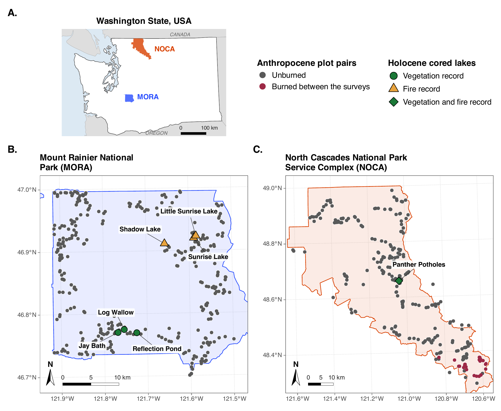

**Figure 2. Study area.** (A) Mount Rainier National Park (MORA) and (B)
the North Cascades National Park Service Complex (NOCA), which joins the
national park with the Ross Lake and Lake Chelan National Recreation
Areas. The points are the legacy–resurvey plot pairs that enter the CCA,
328 at MORA and 277 at NOCA. They are grey when unburned and red when
burned between the two surveys (0 at MORA and 24 at NOCA). The two MORA
plots that burned are left out of the analysis. The large symbols are
the cored lakes: vegetation records (green circles, macrofossils,
Dunwiddie 1986), fire records (orange triangles, charcoal, Walsh et
al. 2017) and Panther Potholes, whose core gives both (green diamond,
Prichard et al. 2009). The map above the park maps locates both parks in
Washington State, USA. The two park maps have the same size and
therefore different scales, shown by the same 10 km scale bar on each.
Park maps in UTM zone 10N, the Washington map in an equal-area
projection. Park boundaries from the National Park Service
administrative boundaries, Sunrise Ridge lake coordinates from Walsh et
al. (2017, Table 1). Script:
[`R/figures/main_fig2_study_area.R`](R/figures/main_fig2_study_area.R).

# Forest tree communities

## Legacy surveys and resurveys

Legacy surveys and resurveys of the same plots at Mount Rainier (MORA)
and North Cascades (NOCA) National Parks were matched, cleaned and
harmonized to one tree taxonomy
(`R/pipeline/01_clean_mora_vegetation.R`,
`R/pipeline/02_clean_noca_vegetation.R`).

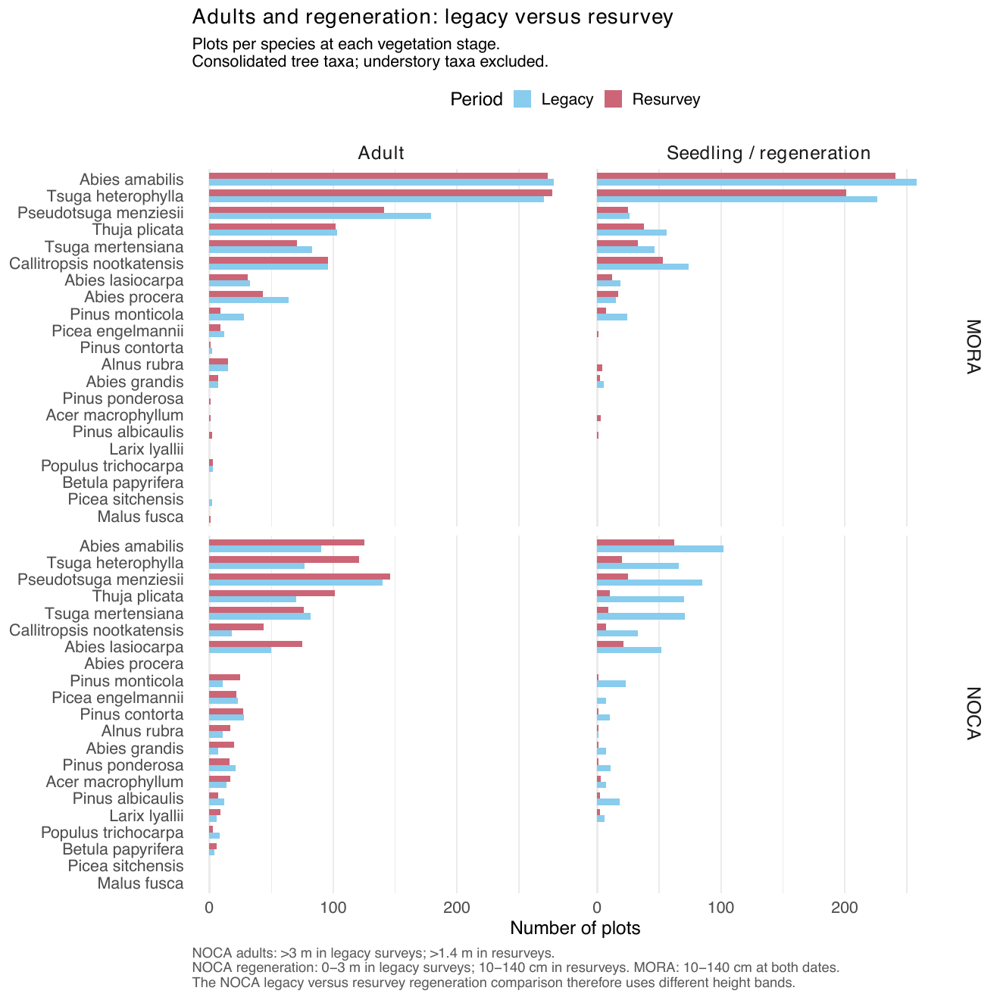

**Fig. S1. Tree species occurrence by developmental stage in legacy
surveys and resurveys.** Number of plots in which each species was
recorded as an adult tree or seedling/regeneration at Mount Rainier
(MORA) and North Cascades (NOCA) National Parks, following taxonomic
harmonization and exclusion of understory taxa, but before applying the
CCA frequency threshold. Species could occur in both vegetation stages
within the same plot. At MORA, seedlings were defined as individuals
10–140 cm tall at both survey dates. At NOCA, however, legacy surveys
classified individuals 0–3 m tall as regeneration and those taller than
3 m as adults, whereas resurveys recorded seedlings of 10–140 cm and
adults taller than 1.4 m. Consequently, differences between vegetation
stages at NOCA should be interpreted cautiously because size-class
definitions differed between surveys.


**Fig. S2. Selection of vegetation records for canonical correspondence
analysis (CCA).** Flowchart summarizing the matching, cleaning, and
selection of legacy–resurvey plots (upper panels) and Holocene
macrofossil samples (lower panels) from Mount Rainier (MORA, blue) and
North Cascades (NOCA, orange) National Parks. The final set of eligible
paired plots was used both to calibrate the CCA using legacy community
composition and to assess contemporary community change, whereas
Holocene samples were projected into the fitted ordination. Plots
without any retained tree species at either survey date were excluded
because they could not be assigned an observed CCA position. Sample
sizes and reasons for exclusion are indicated at each step.

**Legacy plot area at NOCA.** Every resurvey plot is 500 m², but the
NOCA legacy plots range from 25 to 400 m². A small legacy plot can miss
species that the resurvey then records, which would show up as turnover.
The table gives the NOCA plot pairs used in the analysis by legacy plot
area, with their richness and their Anthropocene responses (turnover
rate, lag and lag rate). It is descriptive only.

**NOCA plot pairs by legacy plot area.** Richness is the mean number of
the retained CCA taxa present in a plot. Turnover rate, lag and lag rate
are plain means with 95% t-intervals (no model): the turnover and lag
rates in CCA distance per century, the lag in CCA distance. The single
36 m² plot has no interval.

| Legacy area (m²) | Plots | Richness, legacy | Richness, resurvey | Turnover rate | Lag | Lag rate |
|:---|---:|:---|:---|:---|:---|:---|
| 25 | 37 | 2.89 | 3.05 | 1.889 (1.213 to 2.565) | -0.113 (-0.357 to 0.131) | -0.397 (-1.253 to 0.460) |
| 36 | 1 | 2.00 | 3.00 | 1.723 | -0.502 | -1.826 |
| 100 | 213 | 2.81 | 2.91 | 2.126 (1.893 to 2.360) | -0.027 (-0.109 to 0.055) | -0.092 (-0.381 to 0.196) |
| 200 | 2 | 4.00 | 1.50 | 2.531 (-29.634 to 34.697) | 0.956 (-9.078 to 10.990) | 3.355 (-31.851 to 38.561) |
| 400 | 20 | 2.10 | 2.15 | 2.550 (1.155 to 3.945) | 0.083 (-0.409 to 0.575) | 0.293 (-1.435 to 2.021) |
| not recorded | 4 | 1.50 | 2.00 | 2.220 (-2.828 to 7.267) | 0.089 (-0.120 to 0.299) | 0.325 (-0.436 to 1.086) |
| all NOCA plot pairs | 277 | 2.76 | 2.85 | 2.128 (1.903 to 2.353) | -0.023 (-0.102 to 0.055) | -0.081 (-0.358 to 0.197) |

<sub>Table file:
[noca_plot_area_responses.csv](report/tables/noca_plot_area_responses.csv)</sub>

The smallest legacy plots did not record fewer of the CCA taxa: 2.89
taxa per 25 m² plot against 2.81 per 100 m² plot. Their turnover rate
was not higher (1.89 against 2.13 CCA distance per century), and the
intervals of the three common areas overlap for every response. The NOCA
Anthropocene results do not rest on the small legacy plots.

**Cleaning details →**
[01_vegetation_cleaning](report/details/01_vegetation_cleaning.md)
(plot-by-plot decisions, NOCA tree corrections, survey dates, raw-data
provenance).

## Species selection

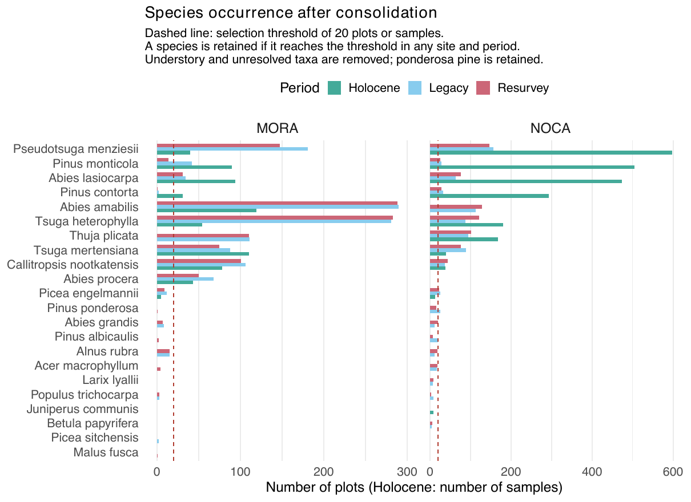

**Fig. S3. Species occurrence frequencies across sites and periods
before CCA species selection.** Number of plots (legacy surveys and
resurveys) or macrofossil samples (Holocene) in which each tree species
was recorded at MORA and NOCA, following taxonomic harmonization and
exclusion of understory and unidentified taxa. Presence was determined
from both adult tree and seedling records. The dashed red line indicates
the minimum occurrence threshold of 20 plots or samples. Species were
retained if they reached this threshold in at least one site and period
combination, resulting in 14 species included in the CCA.

**Species-selection details →**
[05_species_selection](report/details/05_species_selection.md)
(consolidation rules, excluded taxa, occupancy through time).

## Holocene macrofossil records

The Holocene communities come from plant macrofossils in dated
lake-sediment cores, three at MORA and one at NOCA (Figure 2). Each
sample is dated with the age–depth model of its core (Appendix S1).

### Appendix S1. Construction of the Holocene age–depth models

#### S1.1 Why an age–depth model was required

The macrofossils are measured at known depths in a sediment core, but
depth itself does not provide an age. Sediment does not necessarily
accumulate at a constant rate: for example, 1 cm of sediment can
represent relatively few years during rapid accumulation and many more
years during slow accumulation. Chronological control is available only
at selected depths, through radiocarbon dates, dated volcanic deposits,
²¹⁰Pb dating, or other independently dated horizons. We therefore
required an age–depth model to estimate the calendar age of every depth
between these dated points and, importantly, to quantify uncertainty in
those estimated ages.

We used the rbacon R package, which reconstructs sediment accumulation
histories within a Bayesian framework (Blaauw & Christen 2011). Rather
than drawing a single line through the dated horizons, Bacon estimates
many age–depth histories that are compatible with the chronological
evidence and assumptions about sediment accumulation. The distribution
of these histories represents the posterior chronological uncertainty
shown in Fig. S4.

#### S1.2 Chronological controls and radiocarbon calibration

For each core, we assembled chronological controls for which both
sediment depth and age information were available (Table S1.1). For
MORA, these consisted of the core surfaces, seven radiocarbon dates from
Jay Bath and Log Wallow, dated volcanic tephra horizons, and a basal
radiocarbon age for Reflection Pond. Reflection Pond contained no
radiocarbon dates of its own and was therefore constrained by the core
surface, tephra horizons, and this basal control. For Panther Potholes,
we reproduced the chronology archived in the Neotoma database using the
core surface, five ²¹⁰Pb ages, six Accelerator Mass Spectrometry (AMS)
radiocarbon dates, and three tephra horizons. We used the corrected
control depths archived in Neotoma rather than the depths reported in
Prichard et al. (2009), which contain documented depth errors.

Radiocarbon ages are expressed in ¹⁴C years and cannot be treated
directly as calendar ages because atmospheric ¹⁴C concentrations have
varied through time. We therefore supplied radiocarbon ages and their
laboratory errors as uncalibrated dates (cc = 1), which Bacon calibrated
against the IntCal20 Northern Hemisphere calibration curve (Reimer et
al. 2020). This converts each radiocarbon measurement into a probability
distribution of plausible calendar ages. Controls already expressed in
calendar years, including the core surfaces and tephra ages, were
supplied directly (cc = 0) and were not calibrated.

The seven MORA radiocarbon ages and their laboratory errors were taken
directly from Dunwiddie (1986). For all other chronological controls,
the source and interpretation of the assigned age uncertainty are
reported explicitly in Table S1.1. The Reflection Pond basal control is
the mean of the two basal radiocarbon ages of Jay Bath (QL-1704) and Log
Wallow (QL-1728), 6015 ± 110 ¹⁴C yr BP with the larger of the two
laboratory errors, following P. Dunwiddie’s advice that the three basins
share the same basal age (pers. comm.).

For Panther Potholes, the five ²¹⁰Pb ages were derived using a Constant
Rate of Supply (CRS) model. We retained the error values used in the
archived Gavin chronology for the primary model; however, these values
correspond numerically to the ²¹⁰Pb activity uncertainties reported by
Prichard et al. (2009), rather than to independently estimated age
uncertainties in years. We therefore evaluated this uncertainty
specification in a separate sensitivity analysis described below.

**Table S1.1. Chronological controls used in the four Bayesian age–depth
models.** For cc = 1, the entered age is an uncalibrated ¹⁴C age
calibrated with IntCal20. For cc = 0, the entered age is already in
calibrated years before present (cal yr BP; present = A.D. 1950).

| Site | Core | Chronological control | Depth (cm) | Age entered ± error | Bacon treatment | Age source | Uncertainty source |
|:---|:---|:---|:---|:---|:---|:---|:---|
| MORA | Jay Bath | Core surface | 0 | −31.5 ± 10 cal yr BP | cc = 0 | Coring date, 1981–1982 | Assumed ±10 yr to account for uncertainty in recovery of the sediment–water interface |
| MORA | Jay Bath | MSH-W tephra | 22 | 470 ± 10 cal yr BP | cc = 0 | Yamaguchi 1983; Walsh et al. 2017 | Assumed ±10 yr around the tree-ring-dated eruption age; no published statistical age error |
| MORA | Jay Bath | QL-1729 | 39.5 | 1320 ± 30 ¹⁴C yr BP | cc = 1, IntCal20 | Dunwiddie 1986 | Published laboratory error |
| MORA | Jay Bath | MR-C tephra | 62 | 2250 ± 100 cal yr BP | cc = 0 | Mullineaux 1974; Walsh et al. 2017 | Assumed ±100 yr; no published statistical age error |
| MORA | Jay Bath | QL-1730 | 70 | 2920 ± 60 ¹⁴C yr BP | cc = 1, IntCal20 | Dunwiddie 1986 | Published laboratory error |
| MORA | Jay Bath | MSH-Y tephra, upper boundary | 87 | 3650 ± 100 cal yr BP | cc = 0 | Mullineaux 1974; Walsh et al. 2017 | ±100 yr derived approximately from radiocarbon dates bracketing the eruption age (bracket half-width ≈103 yr; Mullineaux 1996) |
| MORA | Jay Bath | MSH-Y tephra, lower boundary | 105 | 3650 ± 100 cal yr BP | cc = 0 | Mullineaux 1974; Walsh et al. 2017 | Same uncertainty as upper boundary; both depths represent the same instantaneous tephra deposit |
| MORA | Jay Bath | Beta-6332 | 124.5 | 3740 ± 80 ¹⁴C yr BP | cc = 1, IntCal20 | Dunwiddie 1986 | Published laboratory error |
| MORA | Jay Bath | MR-F tephra | 142 | 5740 ± 100 cal yr BP | cc = 0 | Mullineaux 1974; Walsh et al. 2017 | Assumed ±100 yr; no published statistical age error |
| MORA | Jay Bath | QL-1704 | 152.25 | 6050 ± 110 ¹⁴C yr BP | cc = 1, IntCal20 | Dunwiddie 1986 | Published laboratory error |
| MORA | Log Wallow | Core surface | 0 | −31.5 ± 10 cal yr BP | cc = 0 | Coring date, 1981–1982 | Assumed ±10 yr to account for uncertainty in recovery of the sediment–water interface |
| MORA | Log Wallow | MSH-W tephra | 22 | 470 ± 10 cal yr BP | cc = 0 | Yamaguchi 1983; Walsh et al. 2017 | Assumed ±10 yr around the tree-ring-dated eruption age; no published statistical age error |
| MORA | Log Wallow | QL-1726 | 29 | 1650 ± 80 ¹⁴C yr BP | cc = 1, IntCal20 | Dunwiddie 1986 | Published laboratory error |
| MORA | Log Wallow | MSH-Y tephra, upper boundary | 40 | 3650 ± 100 cal yr BP | cc = 0 | Mullineaux 1974; Walsh et al. 2017 | ±100 yr derived approximately from radiocarbon dates bracketing the eruption age (bracket half-width ≈103 yr; Mullineaux 1996) |
| MORA | Log Wallow | MSH-Y tephra, lower boundary | 98 | 3650 ± 100 cal yr BP | cc = 0 | Mullineaux 1974; Walsh et al. 2017 | Same uncertainty as upper boundary; both depths represent the same instantaneous tephra deposit |
| MORA | Log Wallow | MR-F tephra | 116 | 5740 ± 100 cal yr BP | cc = 0 | Mullineaux 1974; Walsh et al. 2017 | Assumed ±100 yr; no published statistical age error |
| MORA | Log Wallow | QL-1727 | 117 | 4900 ± 80 ¹⁴C yr BP | cc = 1, IntCal20 | Dunwiddie 1986 | Published laboratory error |
| MORA | Log Wallow | QL-1728 | 140 | 5980 ± 60 ¹⁴C yr BP | cc = 1, IntCal20 | Dunwiddie 1986 | Published laboratory error |
| MORA | Reflection Pond | Core surface | 0 | −31.5 ± 10 cal yr BP | cc = 0 | Coring date, 1981–1982 | Assumed ±10 yr to account for uncertainty in recovery of the sediment–water interface |
| MORA | Reflection Pond | MSH-W tephra | 10 | 470 ± 10 cal yr BP | cc = 0 | Yamaguchi 1983; Walsh et al. 2017 | Assumed ±10 yr around the tree-ring-dated eruption age; no published statistical age error |
| MORA | Reflection Pond | MR-C tephra | 26 | 2250 ± 100 cal yr BP | cc = 0 | Mullineaux 1974; Walsh et al. 2017 | Assumed ±100 yr; no published statistical age error |
| MORA | Reflection Pond | MSH-Y tephra, upper boundary | 45 | 3650 ± 100 cal yr BP | cc = 0 | Mullineaux 1974; Walsh et al. 2017 | ±100 yr derived approximately from radiocarbon dates bracketing the eruption age (bracket half-width ≈103 yr; Mullineaux 1996) |
| MORA | Reflection Pond | MSH-Y tephra, lower boundary | 64 | 3650 ± 100 cal yr BP | cc = 0 | Mullineaux 1974; Walsh et al. 2017 | Same uncertainty as upper boundary; both depths represent the same instantaneous tephra deposit |
| MORA | Reflection Pond | MR-F tephra | 82 | 5740 ± 100 cal yr BP | cc = 0 | Mullineaux 1974; Walsh et al. 2017 | Assumed ±100 yr; no published statistical age error |
| MORA | Reflection Pond | Basal sediment, mean of QL-1704 and QL-1728 | 90 | 6015 ± 110 ¹⁴C yr BP | cc = 1, IntCal20 | Dunwiddie 1986; P. Dunwiddie, pers. comm. | Larger of the two laboratory errors (±110 yr), allowing for transfer of the Jay Bath and Log Wallow basal age to Reflection Pond |
| NOCA | Panther Potholes | Core surface | 0.5 | −49 ± 1 cal yr BP | cc = 0 | Gavin 2021 Neotoma chronology; coring year 1999 | ±1 yr retained from the archived Gavin chronology |
| NOCA | Panther Potholes | ²¹⁰Pb CRS age | 7 | −36.7; error entered = 3.47 | cc = 0 | Prichard et al. 2009; Gavin 2021 | Inherited Gavin value; 3.47 is numerically the published ²¹⁰Pb activity uncertainty in DPM g⁻¹, not a verified age error in years |
| NOCA | Panther Potholes | ²¹⁰Pb CRS age | 14 | −9; error entered = 1.15 | cc = 0 | Prichard et al. 2009; Gavin 2021 | Inherited Gavin value; 1.15 is numerically the published ²¹⁰Pb activity uncertainty in DPM g⁻¹, not a verified age error in years |
| NOCA | Panther Potholes | ²¹⁰Pb CRS age | 21 | 12; error entered = 0.72 | cc = 0 | Prichard et al. 2009; Gavin 2021 | Inherited Gavin value; 0.72 is numerically the published ²¹⁰Pb activity uncertainty in DPM g⁻¹, not a verified age error in years |
| NOCA | Panther Potholes | ²¹⁰Pb CRS age | 28 | 21; error entered = 0.74 | cc = 0 | Prichard et al. 2009; Gavin 2021 | Inherited Gavin value; 0.74 is numerically the published ²¹⁰Pb activity uncertainty in DPM g⁻¹, not a verified age error in years |
| NOCA | Panther Potholes | ²¹⁰Pb CRS age | 35 | 36; error entered = 0.77 | cc = 0 | Prichard et al. 2009; Gavin 2021 | Inherited Gavin value; 0.77 is numerically the published ²¹⁰Pb activity uncertainty in DPM g⁻¹, not a verified age error in years |
| NOCA | Panther Potholes | Beta-172005, conifer seed | 214 | 1950 ± 50 ¹⁴C yr BP | cc = 1, IntCal20 | Prichard et al. 2009 | Published laboratory error |
| NOCA | Panther Potholes | MSH-P tephra | 305.5 | 2620 ± 70 cal yr BP | cc = 0 | Gavin 2021 Neotoma chronology | Age and ±70-yr uncertainty retained from the archived chronology |
| NOCA | Panther Potholes | Beta-169623, seed | 363 | 3260 ± 40 ¹⁴C yr BP | cc = 1, IntCal20 | Prichard et al. 2009 | Published laboratory error |
| NOCA | Panther Potholes | Beta-169624, pollen cone | 389 | 3520 ± 40 ¹⁴C yr BP | cc = 1, IntCal20 | Prichard et al. 2009 | Published laboratory error |
| NOCA | Panther Potholes | MSH-Y tephra | 401 | 3660 ± 65 cal yr BP | cc = 0 | Gavin 2021 Neotoma chronology | Age and ±65-yr uncertainty retained from the archived chronology |
| NOCA | Panther Potholes | Beta-169207, pollen cone | 479 | 4500 ± 40 ¹⁴C yr BP | cc = 1, IntCal20 | Prichard et al. 2009 | Published laboratory error |
| NOCA | Panther Potholes | Mazama tephra | 629 | 7633 ± 25 cal yr BP | cc = 0 | Gavin 2021 Neotoma chronology; Egan et al. 2015 | Age and ±25-yr uncertainty retained from the archived chronology |
| NOCA | Panther Potholes | Beta-169208, seed | 678 | 7330 ± 40 ¹⁴C yr BP | cc = 1, IntCal20 | Prichard et al. 2009 | Published laboratory error |
| NOCA | Panther Potholes | Beta-169625, Pinus contorta needles | 864 | 9370 ± 40 ¹⁴C yr BP | cc = 1, IntCal20 | Prichard et al. 2009 | Published laboratory error |

<sub>Table file:
[table_S1_1_chronological_controls.csv](report/tables/table_S1_1_chronological_controls.csv)</sub>

#### S1.3 Bayesian age–depth models

We fitted each core independently with Bacon using the settings
summarized in Table S1.2. Bacon divided each sediment core into 5-cm
sections and estimated an accumulation time, in yr cm⁻¹, for each
section. Accumulation times were allowed to differ among sections but
were correlated between neighbouring sections through the model’s memory
parameter. The chronological controls in Table S1.1 were then used to
update these prior expectations and generate the posterior age–depth
chronology shown in Fig. S4.

The three MORA cores were modelled using the same accumulation and
memory priors. Panther Potholes instead retained the settings of the
archived Bacon chronology in the Neotoma database so that our model
reproduced the published chronology while providing the complete
posterior age–depth draws required for subsequent analyses. All runs are
seeded (seed 42).

**Table S1.2. rbacon parameters used to construct the age–depth
models.**

| rbacon argument | What it controls | MORA | Panther Potholes | Rationale |
|:---|:---|:---|:---|:---|
| cc, cc1 | Determines whether a date requires radiocarbon calibration and which calibration curve is used | cc=1, cc1=“IntCal20” for ¹⁴C dates; cc=0 for calendar-age controls | Same | Northern Hemisphere terrestrial ¹⁴C dates were calibrated with IntCal20; already calendar-dated controls were not recalibrated |
| thick | Thickness of the sediment sections for which accumulation rates are estimated | 5 cm | 5 cm | Standard Bacon section thickness; for Panther Potholes this value reproduced the archived Gavin chronology |
| acc.mean | Mean of the prior distribution for accumulation time, in yr cm⁻¹ | 50 | 10 | MORA cores accumulate substantially more slowly; 10 yr cm⁻¹ reproduces the Gavin chronology and is close to the approximately 12.8 yr cm⁻¹ reported for Panther Potholes |
| acc.shape | Shape of the gamma prior around acc.mean; larger values impose a more concentrated accumulation prior | 1.5 | 1.5 | Broad rbacon default retained for MORA and Gavin setting retained for Panther Potholes |
| mem.mean | Prior mean dependence between accumulation rates in adjacent sediment sections | 0.5 | 0.7 | rbacon default retained for MORA; Gavin setting retained for Panther Potholes |
| mem.strength | Strength of the prior around mem.mean; larger values impose the assumed memory more strongly | 10 | 10 | Broad rbacon default retained for MORA and Gavin setting retained for Panther Potholes |
| slump | Depth intervals treated as effectively instantaneous accumulation rather than gradual sedimentation | Jay Bath: 87–105 cm; Log Wallow: 40–98 cm; Reflection Pond: 45–64 cm | 303–308, 396–406, and 623–635 cm | Prevents thick tephra deposits from being interpreted as long periods of sediment accumulation |
| normal, t.a, t.b | Distribution used to accommodate chronological-control scatter and potential outlying dates | FALSE, 3, 4 | FALSE, 15, 16 | rbacon default robust t-distribution retained for MORA; Gavin settings retained for Panther Potholes |
| ssize | Number of MCMC iterations retained for the posterior | 4,000 | 10,000 | Default sampling was retained for MORA; Panther Potholes required the larger value for adequate MCMC mixing and reproduction of the archived chronology |
| prob | Posterior interval reported for the chronology | 0.95 | 0.95 | Ages are summarized with 95% posterior intervals |
| d.max | Maximum core depth included in the model | Jay Bath: 153 cm; no manual extension for Log Wallow or Reflection Pond | 870 cm | Jay Bath was extended to 153 cm to retain its deepest macrofossil sample; Panther Potholes retained the Gavin model extent |

<sub>Table file:
[table_S1_2_rbacon_parameters.csv](report/tables/table_S1_2_rbacon_parameters.csv)</sub>

The thick volcanic deposits required one additional treatment. The MSH-Y
tephra was represented as an instantaneous depositional interval in all
three MORA cores, including the 58-cm interval at Log Wallow containing
both primary and redeposited Y tephra. At Panther Potholes, the MSH-P,
MSH-Y, and Mazama tephra intervals were treated in the same way. Bacon
therefore removed these intervals while estimating gradual sediment
accumulation and reinserted them without adding elapsed time. These
intervals are shown as vertical grey bands in Fig. S4.


**Fig. S4. Bayesian age–depth models for the Jay Bath, Log Wallow, and
Reflection Pond cores at MORA and the Panther Potholes core at NOCA.**
For each core, the three upper panels show, from left to right, the
Markov chain Monte Carlo trace, the prior (green) and posterior (grey)
distributions of sediment accumulation time, and the prior and posterior
distributions of memory. In the main panels, depth increases along the
x-axis and age is expressed as calibrated years before present. Coloured
distributions at dated depths represent the chronological controls and
their uncertainty. The grey field represents the posterior distribution
of possible age–depth relationships; the central red line shows the
posterior age–depth estimate and the outer dotted lines the 95%
posterior interval. Vertical grey bands identify tephra intervals
treated as instantaneous deposition.

For Panther Potholes, we reproduced the archived Neotoma chronology as
the primary model. However, Prichard et al. (2009) report uncertainties
for measured ²¹⁰Pb activity, in DPM g⁻¹, and the same numerical values
were entered as age errors, in years, in the archived chronology. We
therefore fitted a sensitivity model in which the five ²¹⁰Pb controls
were each assigned an assumed ±10-year age error, all other controls and
settings unchanged (Fig. S5).


**Fig. S5. Sensitivity of the Panther Potholes age–depth chronology to
uncertainty assigned to the five ²¹⁰Pb controls in the upper 35 cm of
the core.** The left panel shows that the two posterior chronologies are
nearly identical below the ²¹⁰Pb-dated section, whereas the right panel
shows the expected increase in uncertainty within the upper 35–40 cm.
The uncertainty assigned to the ²¹⁰Pb controls affects the precision of
the most recent chronology but does not materially alter the deeper
Holocene chronology used in our analyses.

**Chronology details →**
[03_chronology](report/details/03_chronology.md) (every control and its
source).

# Climate change and comparisons within eras

## Climate data

Modern climate is CHELSA V2.1 monthly climate in a survey-specific
window for every plot (`R/pipeline/04_modern_climate.R`); Holocene
climate is CHELSA-TraCE21k at each lake and century
(`R/pipeline/07_paleo_climate.R`).

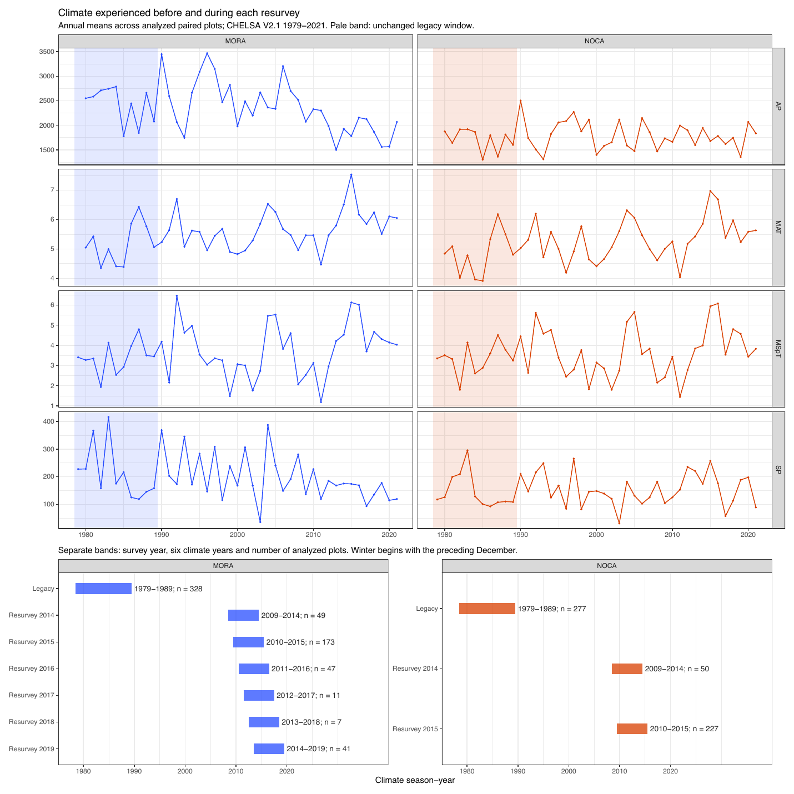

**Fig. S6. Climate conditions and survey-specific climate windows for
the Anthropocene.** Upper panels show annual climate variation from
CHELSA v2.1 (1979–2021), averaged across the paired vegetation plots at
Mount Rainier (MORA, blue) and North Cascades (NOCA, orange) National
Parks. Variables include mean annual temperature (MAT), annual
precipitation (AP), and the four seasonal seasonal variables mean spring
temperature (MSpT), mean winter temperature (MWT), summer precipitation
(SP), and winter precipitation (WP); MSpT and SP constrain the CCA.
Shaded areas indicate the common legacy climate window (1979–1989).
Lower panels show the six-year climate windows used for each resurvey
year (Y−5 through Y), together with the number of paired plots (n)
surveyed in that year. Winter calculations also included December of the
preceding calendar year. Climate conditions were therefore calculated
separately for each plot according to its resurvey year.


**Fig. S7. Correlations among climate variables during the Holocene and
Anthropocene.** Pearson correlation coefficients (r) were calculated
across lake locations and 100-year climate intervals for the Holocene
(CHELSA-TraCE21k, left) and across vegetation plots and survey periods
for the Anthropocene (CHELSA v2.1, right). Red indicates positive
correlations and blue indicates negative correlations, with numerical
values showing Pearson’s r. Climate variables include mean annual (MAT),
spring (MSpT), summer (MST), and winter (MWT) temperature, and annual
(AP), spring (SpP), summer (SP), and winter (WP) precipitation. Spring
corresponds to March–May, summer to June–August, and winter to
December–February.

**Climate details →** [02_climate](report/details/02_climate.md) (survey
windows, TraCE21k against V2.1, full correlation tables).

## Climate periods

**What and why.** The Holocene is cut into climate-change (C) periods,
when the park-average climate of the lakes moved steadily in one
direction, and stability (S) periods between them. The rules of the
climate-era step are unchanged. Only their input changed: the periods
are now drawn from the two CCA variables, MSpT and SP, so that the
periods describe change along the same climate axes that the CCA uses. A
climate-change period that contains a long internal trough of low change
is split into sub-periods (a, b, c). Each period, or sub-period, is one
unit for the lake-periods (see Climate–community lags).

**Result.**

**Climate periods** drawn from MSpT and SP (used in the analysis) and,
by the same rules, from all four seasonal variables (the periods before
the CCA constraints were reduced to MSpT and SP).

| Catalog | Period | Type | Older (cal BP) | Younger (cal BP) | Duration (years) | Drivers |
|:---|:---|:---|---:|---:|---:|:---|
| MSpT + SP (after Step 0) | C1 | Holocene-C | 9650 | 8650 | 1000 | spring cooling, summer drying |
| MSpT + SP (after Step 0) | S1 | Holocene-S | 8650 | 8250 | 400 |  |
| MSpT + SP (after Step 0) | C2 | Holocene-C | 8250 | 7250 | 1000 | spring warming, summer wetting |
| MSpT + SP (after Step 0) | S2 | Holocene-S | 7250 | 6850 | 400 |  |
| MSpT + SP (after Step 0) | C3 | Holocene-C | 6850 | 6250 | 600 | spring cooling |
| MSpT + SP (after Step 0) | S3 | Holocene-S | 6250 | 5450 | 800 |  |
| MSpT + SP (after Step 0) | C4 | Holocene-C | 5450 | 4950 | 500 | spring warming |
| MSpT + SP (after Step 0) | S4 | Holocene-S | 4950 | 2250 | 2700 |  |
| MSpT + SP (after Step 0) | C5 | Holocene-C | 2250 | 1750 | 500 | spring warming |
| MSpT + SP (after Step 0) | S5 | Holocene-S | 1750 | 1350 | 400 |  |
| All four seasonal variables (before Step 0) | C1a | Holocene-C | 9650 | 8650 | 1000 | spring cooling, winter warming, summer drying |
| All four seasonal variables (before Step 0) | C1b | Holocene-C | 8650 | 8250 | 400 | winter wetting |
| All four seasonal variables (before Step 0) | C1c | Holocene-C | 8250 | 7250 | 1000 | spring warming, winter warming, summer wetting |
| All four seasonal variables (before Step 0) | S1 | Holocene-S | 7250 | 6850 | 400 |  |
| All four seasonal variables (before Step 0) | C2 | Holocene-C | 6850 | 6250 | 600 | spring cooling |
| All four seasonal variables (before Step 0) | S2 | Holocene-S | 6250 | 5450 | 800 |  |
| All four seasonal variables (before Step 0) | C3 | Holocene-C | 5450 | 4950 | 500 | spring warming |
| All four seasonal variables (before Step 0) | S3 | Holocene-S | 4950 | 2250 | 2700 |  |
| All four seasonal variables (before Step 0) | C4 | Holocene-C | 2250 | 1750 | 500 | spring warming |
| All four seasonal variables (before Step 0) | S4 | Holocene-S | 1750 | 1350 | 400 |  |

<sub>Table file:
[step1_periods.csv](report/tables/step1_periods.csv)</sub>

With MSpT and SP the Holocene from 9650 to 1350 cal BP falls into 5
climate-change periods and 5 stability periods, and no climate-change
period is split. The first four-variable climate-change period (C1a to
C1c, 9650 to 7250 cal BP) becomes C1, S1 and C2: its middle part (8650
to 8250 cal BP) was driven by winter wetting alone, which is no longer a
constraint. From 7250 cal BP onward every boundary is unchanged, and the
periods are renumbered.


**Figure 3. Holocene climate and fire.** (A) Spring temperature (°C) and
(B) summer precipitation (mm), the two CCA constraints, averaged over
the lakes of each park with the two parks weighted equally
(CHELSA-TraCE21k). Bold lines are 1,000-year running means and thin
lines the centennial series. Shading marks the climate-change (C) and
stability (S) periods, with the change that drove each climate-change
period written below its name (cooling or warming of spring temperature,
drying or wetting of summer precipitation). Labels linked to the bold
lines give the change per century over a period for each variable that
drove it. A cross marks the largest step between two consecutive
centuries, labelled with its rate. To the right of each panel, the
Anthropocene change per century from the legacy to the resurvey climate
window, the median over plots in each park: spring temperature +1.30 °C
at MORA and +0.77 °C at NOCA, summer precipitation -143.6 mm at MORA and
+103.6 mm at NOCA. These come from a change over about 29 years, while
each Holocene rate spans a whole period of 400 to 2,700 years. (C) Fire
frequency of each park: accepted fire events per 1,000 years, counted in
a 1,000-year window centred every 100 years. At MORA it is the mean of
the three Sunrise Ridge cores of Walsh et al. (2017) wherever at least
two cover the date, at NOCA the Panther Potholes core (Prichard et
al. 2009). The two parks are on different y axes because their
frequencies are not comparable: Panther Potholes is resampled every 12
years and the Sunrise Ridge cores every 42 to 48 years, and a finer
record resolves more events. The MORA cores lie on Sunrise Ridge, away
from the vegetation lakes (Fig. S11). The models do not use this curve:
their fire activity counts the same accepted events between the two ends
of each lake-period, per century and per covered core (see
Climate–community lags). To the right, the Anthropocene plot pairs of
each park that burned between the two surveys (MORA’s two burned plots
are left out of the analysis).

Stages and helpers:
[`R/pipeline/11_climate_eras_fire_frequency.R`](R/pipeline/11_climate_eras_fire_frequency.R),
[`R/helpers/holocene_climate_fire_era_functions.R`](R/helpers/holocene_climate_fire_era_functions.R),
[`R/figures/main_fig3_climate_eras_fire.R`](R/figures/main_fig3_climate_eras_fire.R).


**Fig. S8. Holocene climate levels of the four seasonal variables.** As
Figure 3A for spring temperature, winter temperature, summer
precipitation and winter precipitation, without the rate labels. Only
spring temperature and summer precipitation constrain the CCA and define
the periods. (B) Fire frequency as in Figure 3C.

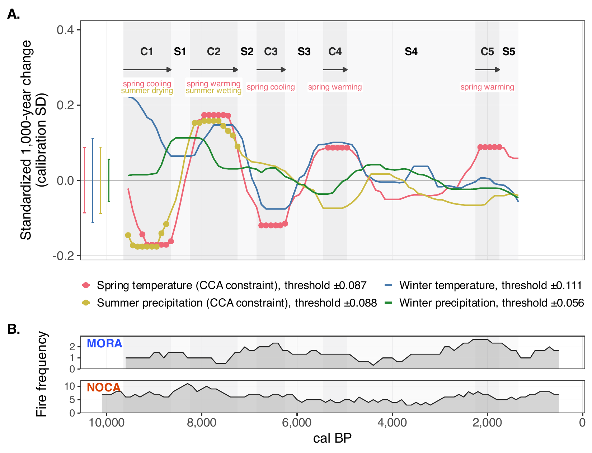

**Fig. S9. How the climate periods were drawn.** (A) Equal-site regional
median of the signed 1,000-year change of the four seasonal variables,
standardized by the legacy calibration standard deviation. Filled points
mark the cells of the two CCA constraints that qualify as directional
change (beyond 50% of the variable’s maximum, with at least 8 of 10
phases agreeing in direction). The periods are classified from these
points. Winter temperature and winter precipitation are shown for
context. Brackets at the left give each variable’s stability range. (B)
Fire frequency as in Figure 3C.

# Fire dynamics

## Appendix S2. Reconstruction of fire histories

### S2.1 Holocene charcoal records

For MORA, we reconstructed Holocene fire activity using the Sunrise
Lake, Shadow Lake, and Little Sunrise Lake macrocharcoal records from
Walsh et al. (2017). These records provide evidence of regional fire
activity on Sunrise Ridge and are independent of the Jay Bath, Log
Wallow, and Reflection Pond records used to reconstruct vegetation. For
NOCA, we reconstructed Holocene fire activity using the Panther Potholes
macrocharcoal record of Prichard et al. (2009), extracted from the
archived Neotoma record and dated with the Panther Potholes chronology
of Appendix S1. Thus, at NOCA fire and vegetation records share the same
core and chronology.

### S2.2 Identification of individual fire events

We reconstructed the fire-event detection analyses of Walsh et
al. (2017) and Prichard et al. (2009) within a common workflow
implemented with the R package tapas (`R/pipeline/08_fire_records.R`).
CHAR was interpolated to regular intervals, its slowly varying
background estimated by robust LOWESS, and candidate fire events
identified where the residual peak component exceeded a record-specific
threshold of the background noise. Candidates were screened with a
75-year minimum-count test (p ≤ 0.05), and consecutive exceedances were
treated as one event. Record-specific settings are given in Table S2.1.

**Table S2.1. Parameters used to reconstruct individual Holocene fire
events.** All records were also screened with the same 75-year
minimum-count test (p ≤ 0.05). MORA settings follow Walsh et al. (2017)
and Panther Potholes settings Prichard et al. (2009), except its 12-year
interpolation interval, the median resolution of our updated chronology.

| Site | Fire record | Interpolation interval (years) | Background window (years) | Peak threshold | Accepted fire events |
|:---|:---|---:|---:|:---|---:|
| MORA | Sunrise Lake | 48 | 800 | 95% | 17 |
| MORA | Shadow Lake | 47 | 1000 | 95% | 14 |
| MORA | Little Sunrise Lake | 42 | 500 | 95% | 13 |
| NOCA | Panther Potholes | 12 | 500 | 99% | 66 |

<sub>Table file:
[table_S2_1_fire_detection_parameters.csv](report/tables/table_S2_1_fire_detection_parameters.csv)</sub>

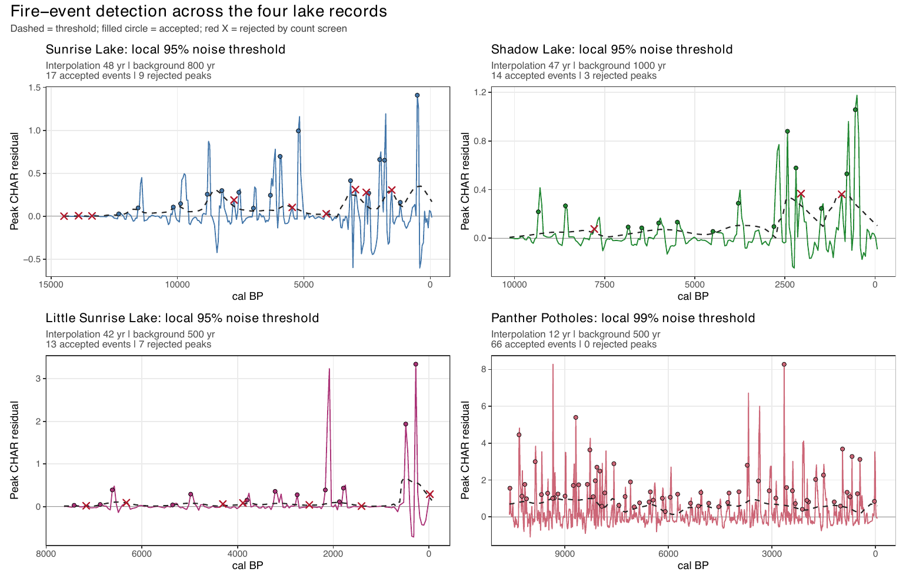

**Fig. S10. Identification of Holocene fire events in the four
records.** The residual peak component is the difference between
interpolated charcoal accumulation rates (CHAR) and the background
estimated with the record’s robust LOWESS window. Candidate events
exceed the local noise threshold (dashed line) and are then screened
with a 75-year minimum-count test (p ≤ 0.05): filled circles are
accepted events, red crosses rejected candidates. The manuscript example
is Little Sunrise Lake (lower left; 500-year background, 95th
percentile).

### S2.3 Fire frequency

We counted the accepted events of each record within centred 1,000-year
windows evaluated every 100 years and expressed them as events per 1,000
years. The MORA series is the mean of the three Sunrise Ridge records
wherever at least two cover the date, the NOCA series is the Panther
Potholes record (`R/pipeline/11_climate_eras_fire_frequency.R`). Figure
3C shows both, each park on its own axis, because the records’ different
resolutions make their frequencies incomparable between the parks. No
high-fire periods are classified: an earlier version marked periods
above the park’s median plus one robust standard deviation, but no model
used them, and the frequency itself is shown instead.

### S2.4 Reproducibility against the original studies

We compared the number of events identified by tapas with those reported
by Walsh et al. (2017) and Prichard et al. (2009), and additionally
reproduced the MORA analyses with CharAnalysis R 2.0.3 (Table S2.2).
Event counts differed from the published values, including with
CharAnalysis, suggesting that discrepancies arise partly from
differences between software implementations. We retained tapas for one
consistent detection procedure across all four records, preserving their
source-specific settings rather than tuning parameters to reproduce
published counts.

**Table S2.2. Holocene fire-event counts reported in the original
studies and reconstructed with CharAnalysis R 2.0.3 (MORA only) and
tapas (all four records).**

| Site | Lake | Published | CharAnalysis R 2.0.3 | tapas | Difference from published |
|:---|:---|---:|---:|---:|:---|
| MORA | Sunrise | 24 | 15 | 17 | -7 (-29%) |
| MORA | Shadow | 18 | 16 | 14 | -4 (-22%) |
| MORA | Little Sunrise | 16 | 14 | 13 | -3 (-19%) |
| MORA total |  | 58 | 45 | 44 | -14 (-24%) |
| NOCA | Panther Potholes | 59 | — | 66 | +7 (+12%) |
| Both sites |  | 117 | — | 110 | -7 (-6%) |

<sub>Table file:
[table_S2_2_fire_event_counts.csv](report/tables/table_S2_2_fire_event_counts.csv)</sub>

**Fire details →** [04_fire](report/details/04_fire.md) (per-record
detection, CharAnalysis reproduction, modern fire assignment of the
survey plots).

## Fire records and the vegetation lakes

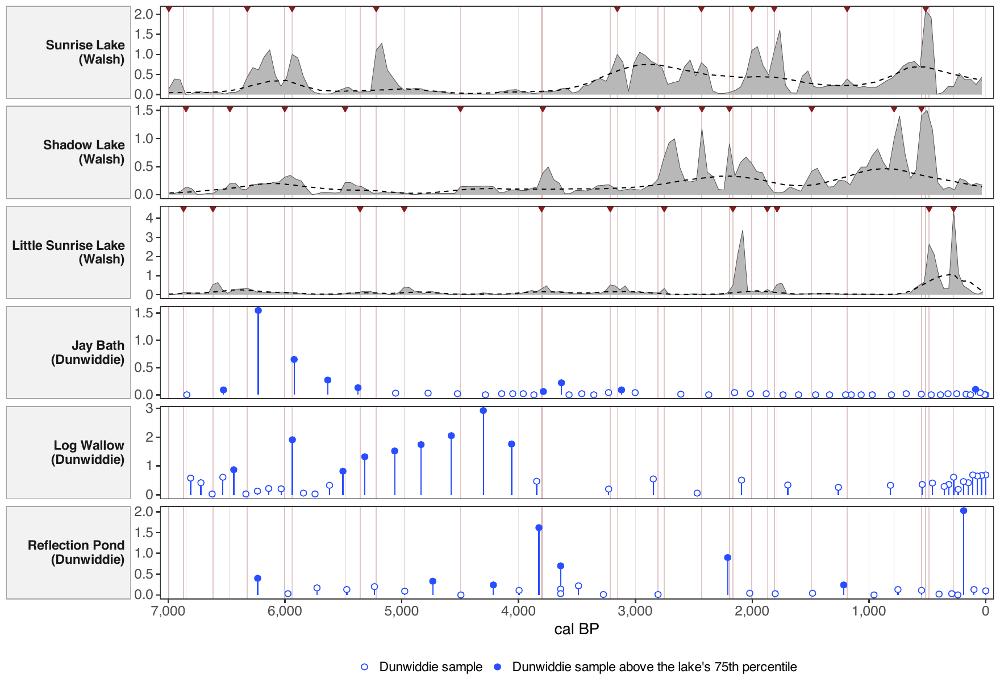

**Fig. S11. Charcoal of the Walsh et al. (2017) Sunrise Ridge cores
against the charcoal of the MORA vegetation lakes (Dunwiddie).** The
MORA fire values of the analysis come from the three Sunrise Ridge
cores, while the vegetation records come from Jay Bath, Log Wallow and
Reflection Pond. The upper three rows show each Sunrise Ridge core’s
charcoal accumulation rate (grey) with its background (dashed) and the
fire events accepted by tapas (dark red triangles). The lower three rows
show the charcoal fragments counted in each Dunwiddie macrofossil
sample. They are a concentration, since all samples of a core had the
same volume, and the samples above each lake’s 75th percentile are
filled. Every Walsh event is carried as a faint line through all rows.
Time runs from 7,000 cal BP to the present, the span of the Dunwiddie
records. The two kinds of record follow opposite long-term courses: the
Sunrise Ridge cores hold most of their charcoal and events in the last
3,500 years, while Jay Bath and Log Wallow hold most of theirs before
4,000 cal BP. Correlated over 14 bins of 500 years with the mean of the
three cores (Spearman, p from circular shifts that keep each record’s
autocorrelation, so that the smallest possible p is about 0.07), Jay
Bath gives -0.31 (p = 0.71) with the charcoal accumulation and +0.02 (p
= 1.00) with the fire frequency, Log Wallow -0.45 (p = 0.29) and -0.53
(p = 0.07), and Reflection Pond -0.18 (p = 0.62) and +0.14 (p = 0.77).
The Sunrise Ridge cores agree only weakly with one another (Sunrise Lake
and Shadow Lake +0.45, Sunrise Lake and Little Sunrise Lake +0.31,
Shadow Lake and Little Sunrise Lake +0.09). A Dunwiddie peak lies within
200 years of 38%, 29% and 21% of the 34 Walsh events at Jay Bath, Log
Wallow and Reflection Pond, against 41%, 39% and 44% expected by chance.
The Sunrise Ridge record therefore gives no evidence of the fire history
at the vegetation lakes, and the MORA fire values should be read as
regional at best. The Dunwiddie values are concentrations, not
accumulation rates, so a change in sedimentation rate could shape part
of their long-term course. Script:
[`R/figures/supp_charcoal_dunwiddie_walsh.R`](R/figures/supp_charcoal_dunwiddie_walsh.R).

## Fire between the two surveys

In the Anthropocene a plot pair counts as burned when a fire falls
between its two surveys. At MORA this comes from the National Park
Service LandTrendr landscape-change polygons of 1987 to 2017 (a fire
polygon within 100 m of the plot), at NOCA from the assignment of Wilson
et al. (2024). Of the plot pairs in the analysis, 0 at MORA and 24 at
NOCA burned (Figures 2 and 3C). The two MORA plots that burned are left
out of the analysis, so the Anthropocene fire comparison is a NOCA
comparison.

# Climate–community space

One CCA is fitted to the legacy composition of the 605 matched plots
(MORA and NOCA pooled), constrained by the climate variables above
(scaling 1, Hill = FALSE). Resurvey plots and Holocene samples are
projected into it: their climate gives a predicted (LC) position and
their composition an observed (WA) position.

**What and why.** The four seasonal variables come in two tightly linked
pairs: spring and winter temperature, and summer and winter
precipitation. Inside a pair the CCA cannot tell the two seasons apart,
and Holocene lakes reach seasonal combinations the modern plots never
show. The CCA is therefore constrained by one variable of each pair.
Spring temperature (MSpT) stands for snowmelt timing and the start of
the growing season. Summer precipitation (SP) stands for summer drying
stress. Because each pair is strongly correlated, the two also carry
temperature and precipitation change in general.

**How it is calculated.**

``` r
# R/pipeline/10_cca.R
# The CCA is fitted once, on the legacy survey only.
#   species_past_final: one row per calibration plot (605), one column per tree
#     species (14), the counts of each species in the plot.
#   env_past_final: the same 605 plots, two columns, MSpT (mean spring
#     temperature) and SP (summer precipitation) of the plot's legacy climate
#     window.
# The formula reads "species ~ MSpT + SP". vegan::cca finds the two axes,
# each a weighted sum of MSpT and SP, along which species composition changes
# most. With two climate variables there are exactly two axes. All later
# positions (plots at both surveys, lake samples) live in this 2-D space.
cca_formula = reformulate(CCA_VARIABLES, response = "species_past_final")
cca_model = cca(cca_formula, data = env_past_final)
```

``` r
# R/pipeline/10_cca.R
# Two positions for every community, both on the fitted axes:
#   type = "lc" (linear combination): where its CLIMATE alone puts it, the
#     predicted position. It uses only MSpT and SP.
#   type = "wa" (weighted average): where its SPECIES put it, the observed
#     position, the average of the species' scores weighted by their counts.
# The lag M of a community is the distance between the two.
predicted_present = predict(cca_model, newdata = env_present_final, type = "lc", scaling = cca_scaling, hill = cca_hill)
projected_present = predict(cca_model, newdata = species_present_final,
                            type = "wa", scaling = cca_scaling, hill = cca_hill)

predicted_paleo = predict(cca_model, newdata = env_paleo[, CCA_VARIABLES, drop = FALSE],
                          type = "lc", scaling = cca_scaling, hill = cca_hill)
projected_paleo = predict(cca_model, newdata = species_paleo[, keep_species, drop = FALSE],
                          type = "wa", scaling = cca_scaling, hill = cca_hill)
```

**Result.**

**Screening of the climate constraints** on the 605 legacy calibration
plots. Holocene lake-centuries: 333 at MORA (three lakes) and 111 at
NOCA.

| Set | Variables | Largest abs. correlation | VIF | R² | Adjusted R² | MORA lake-centuries outside (%) | NOCA lake-centuries outside (%) |
|:---|:---|---:|:---|---:|---:|---:|---:|
| All four | MSpT, MWT, SP, WP | 0.956 | MSpT 29.5, MWT 26.4, SP 5.2, WP 6.7 | 0.154 | 0.149 | 88.288 | 14.414 |
| MWT + SP | MWT, SP | 0.071 | MWT 1.0, SP 1.0 | 0.131 | 0.128 | 0.000 | 0.000 |
| MSpT + SP | MSpT, SP | 0.286 | MSpT 1.1, SP 1.1 | 0.128 | 0.126 | 0.000 | 0.000 |

<sub>Table file:
[step0_screening.csv](report/tables/step0_screening.csv)</sub>

With MSpT and SP the CCA explains 12.6% of the variation in composition
(adjusted R²), against 14.9% with all four variables. Adding winter
temperature and winter precipitation back improves the fit (pseudo-F
8.91, p = 0.0001 unrestricted and p = 0.0104 within parks). That gain
comes from the seasonal contrasts within each pair, the same contrasts
that make the four-variable fit collinear (VIF up to 29.5) and that
place 88% of the MORA lake-centuries outside the calibration climate.
With MSpT and SP no lake-century in either park is outside it. The
display rotation turns the plane by -23.5 degrees so that rotated axis 1
is spring temperature increasing to the right and rotated axis 2 summer
precipitation increasing upward. The pipeline asserts that mismatch,
lag, turnover, pace and direction are identical before and after this
rotation.

**Choice of CCA constraints.** Candidate variables are screened by their
correlations (Fig. S7) and by their variance inflation in the fitted
CCA, keeping one temperature and one precipitation variable. With the
four seasonal variables MSpT, MWT, SP and WP, the two temperatures had
variance inflation factors near 30 and opposite-signed coefficients that
are not identifiable. The CCA is therefore constrained by spring
temperature, the temperature that changes most through the Holocene, and
summer precipitation. Figures in the CCA plane are rotated rigidly by
the varimax angle so that the two arrows lie along the axes; distances
and angles, and therefore every tracking metric, are unchanged by the
rotation (decision of 2026-11-09 in **Decisions →**
[10_decisions](report/details/10_decisions.md)). The constraints of this
build:

| Variable | Label                |  VIF | CCA1 score | CCA2 score |
|:---------|:---------------------|-----:|-----------:|-----------:|
| MSpT     | Spring temperature   | 1.08 |       0.53 |      -0.09 |
| SP       | Summer precipitation | 1.08 |      -0.26 |      -0.34 |

<sub>Table file:
[cca_constraint_vif.csv](report/tables/cca_constraint_vif.csv)</sub>

**CCA axes.** Constrained inertia: 12.8% of the total.

| Axis | Eigenvalue | % total inertia | % constrained inertia |
|:-----|-----------:|----------------:|----------------------:|
| CCA1 |      0.293 |           8.469 |                65.917 |
| CCA2 |      0.152 |           4.379 |                34.083 |

<sub>Table file: [cca_axes.csv](report/tables/cca_axes.csv)</sub>

**Permutation tests** (9,999 permutations, unrestricted and restricted
within parks).

| Test    | Component |  df | Pseudo-F | p (unrestricted) | p (within parks) |
|:--------|:----------|----:|---------:|-----------------:|-----------------:|
| Overall | Model     |   2 |   44.375 |                0 |                0 |
| Axis    | CCA1      |   1 |   58.500 |                0 |                0 |
| Axis    | CCA2      |   1 |   30.385 |                0 |                0 |

<sub>Table file:
[cca_permutation_tests.csv](report/tables/cca_permutation_tests.csv)</sub>


**Figure 4. Climate and community positions in the CCA plane.** (A) The
species that carry more than an equal share of the constrained inertia
(100% divided by the 14 taxa), 7 taxa holding 80% of it (vectors from
the centre, shaded from light to dark by their share, with the
percentage of legacy plots in which each occurs), and the two climate
constraints (bold arrows) of the CCA fitted on 605 legacy plots. All
taxa are shown in Fig. S12. (B) Observed (dark colours) and
climate-predicted (light colours) movement of each park: in the Holocene
from the first to the last climate period with samples, in the
Anthropocene from the legacy survey to the resurvey (averaged over 328
MORA and 277 NOCA plot pairs). The MORA arrows run from C3 to S5 (6850
to 1350 cal BP), and the first MORA period rests on 8 samples in 8
lake-centuries. The NOCA arrows run from C1 to S5 (9650 to 1350 cal BP).
Grey dots are the legacy calibration plots. Labels mark the Holocene
start and end and the legacy survey and resurvey. (C, D) The full
Holocene sequence of period centroids at MORA and NOCA, observed and
predicted, each period named at its observed centroid (C, climate-change
period, S, stability period). Each centroid averages the sampled
centuries of each lake within the period, with the lakes weighted
equally. Axes orthogonally rotated (varimax, -23.5 degrees) for display,
so that axis 1 follows spring temperature and axis 2 summer
precipitation. All metrics are rotation-invariant. The unrotated biplot
is Fig. S12.

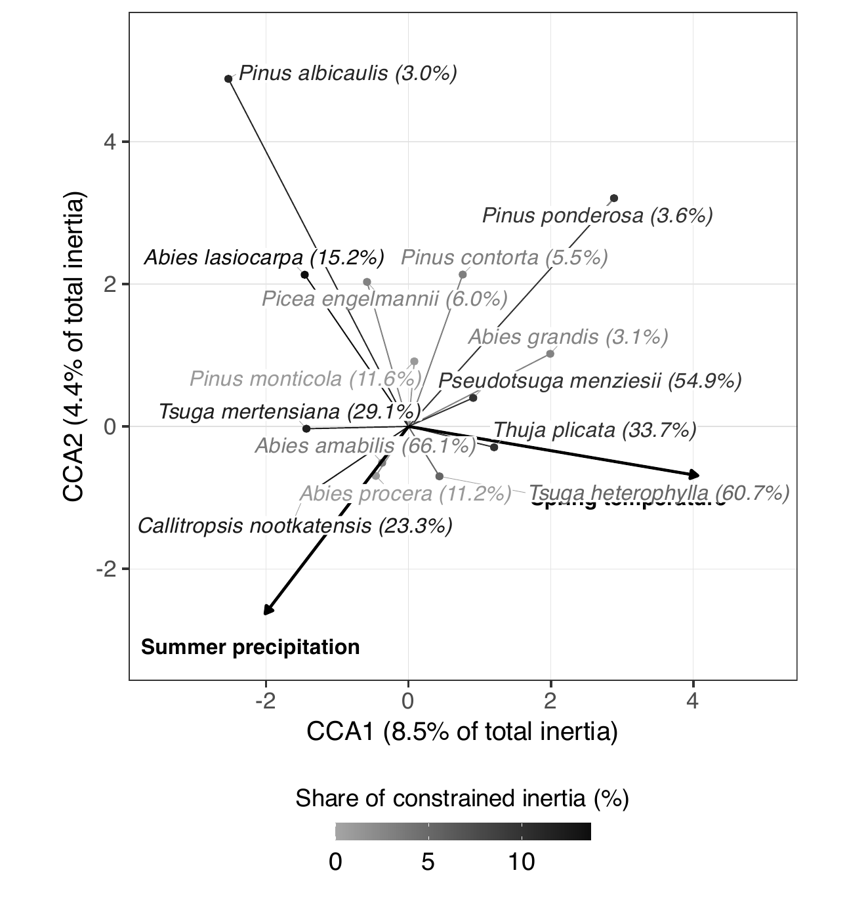

**Fig. S12. Unrotated CCA biplot.** As Figure 4A on the unrotated axes,
labelled with their share of the total inertia, with all taxa.

Stages and helpers: [`R/pipeline/10_cca.R`](R/pipeline/10_cca.R),
[`R/helpers/cca_report.R`](R/helpers/cca_report.R) (screening and
add-back test),
[`R/helpers/cca_display_rotation.R`](R/helpers/cca_display_rotation.R),
[`R/pipeline/12_tracking.R`](R/pipeline/12_tracking.R) (rotation check),
[`R/figures/main_fig4_cca_trajectories.R`](R/figures/main_fig4_cca_trajectories.R).

**CCA details →** [06_cca](report/details/06_cca.md) (full model output,
species and climate contributions, scaling 1 against scaling 2).

## Holocene samples in the CCA plane

**What and why.** Each macrofossil sample has an observed position in
the CCA plane (its WA score, from the taxa it contains). Each lake also
has a climate-predicted position for every century (its LC score, from
that lake’s own climate cell). Samples are dated by the median of their
Bacon ages and grouped by century. The observed position of a century is
the centroid of its samples’ WA positions. No vegetation is interpolated
between sampled centuries. These century positions feed the lake-periods
(Climate–community lags) and the period centroids of Figure 4. No model
is fitted on the century steps any more.

**Sampled centuries per lake** on the MSpT + SP CCA.

| Park | Lake | Sampled centuries | Samples | Centuries with one sample | Oldest (cal BP) | Youngest (cal BP) |
|:---|:---|---:|---:|---:|---:|---:|
| MORA | JayBath | 41 | 48 | 35 | 6800 | 0 |
| MORA | LogWallow | 34 | 40 | 29 | 6800 | 0 |
| MORA | ReflectionPond | 28 | 31 | 26 | 6200 | 0 |
| NOCA | PantherPotholes | 107 | 812 | 0 | 10600 | 0 |

<sub>Table file:
[step1_sampled_centuries.csv](report/tables/step1_sampled_centuries.csv)</sub>

The three MORA lakes begin about 6,800 cal BP and most of their
centuries rest on a single sample. Panther Potholes (NOCA) covers the
whole Holocene with several samples per century.

Stages and helpers:
[`R/pipeline/12_tracking.R`](R/pipeline/12_tracking.R),
[`R/helpers/century_tracking.R`](R/helpers/century_tracking.R),
[`R/helpers/tracking_metrics.R`](R/helpers/tracking_metrics.R).

# Climate–community lags (Q1)

## Lake-periods

**What and why.** Two scoops of sediment from the same forest in the
same century differ by about as much as the forest drifts in many
centuries, because one needle caught or missed moves a sample’s
position. A lag computed between consecutive centuries is therefore
mostly that noise. Comparing the two ends of a whole climate period lets
the drift outgrow it. A lake-period is one lake within one climate
period. Its start (t1) is the oldest and its end (t2) the youngest
sampled century of that lake in that period, and a lake needs samples in
at least two centuries of a period to have a lake-period there. The
centuries in between enter no model.

At each end the mismatch M is the distance between the observed and the
climate-predicted positions. The lag rate is the change in M per
century. The turnover rate is the length of the observed movement per
century. The pace and direction effects ask how much smaller the final
mismatch would have been if the community had moved the predicted
distance in its own direction (pace) or its own distance in the
predicted direction (direction). The climate change rate is the
standardized end-to-end change of MSpT and SP in the lake’s own climate
cell, per century. Fire activity is the number of accepted fire events
between t1 and t2, per century and per charcoal core, averaged over the
cores of the park that cover the whole lake-period.

**How it is calculated.** The code below computes every quantity from
the two ends of a unit, a Holocene lake-period or an Anthropocene plot
pair. The comments say what each step means.

``` r
# R/helpers/tracking_metrics.R
  # One row per unit (a Holocene lake-period or an Anthropocene plot pair),
  # with two ends, t1 (older) and t2 (younger). At each end the community has
  # an observed position (o1, o2: from its species) and a predicted position
  # (p1, p2: from its climate) on the two CCA axes. The suffix _2 marks t2.
  # Movement from t1 to t2: observed (ox, oy), predicted (px, py), and their
  # lengths a (observed distance) and b (predicted distance).
  ox = x$o1_2-x$o1; oy = x$o2_2-x$o2
  px = x$p1_2-x$p1; py = x$p2_2-x$p2
  a = sqrt(ox^2+oy^2); b = sqrt(px^2+py^2)
  # A movement shorter than epsilon has no direction, so the angle, the pace
  # and direction effects and the tracking ratio are left undefined there.
  x$finite_endpoints = rowSums(!is.finite(as.matrix(x[coords]))) == 0L
  x$small_observed_movement = is.finite(a) & a <= epsilon
  x$small_predicted_movement = is.finite(b) & b <= epsilon
  observed_direction = x$finite_endpoints & is.finite(a) & a > epsilon
  predicted_direction = x$finite_endpoints & is.finite(b) & b > epsilon
  x$angle_valid = observed_direction & predicted_direction
  x$pace_counterfactual_valid = observed_direction
  x$direction_counterfactual_valid = predicted_direction
  x$tracking_ratio_valid = predicted_direction
  x$delta_observed_CCA1 = ox; x$delta_observed_CCA2 = oy
  x$delta_predicted_CCA1 = px; x$delta_predicted_CCA2 = py
  x$observed_vegetation_displacement = a
  x$predicted_vegetation_displacement = b
  # Turnover rate: observed distance moved, per century. Tracking ratio:
  # observed over predicted distance (1 = moved as far as climate asked).
  # Angle: between the observed and the predicted movement (0 = same way).
  x$observed_turnover_rate = a/x$vegetation_dt_years*100
  x$predicted_vegetation_change_rate = b/x$climate_dt_years*100
  x$magnitude_tracking_ratio = ifelse(predicted_direction, a/b, NA_real_)
  x$rate_tracking_ratio = ifelse(predicted_direction,
    x$observed_turnover_rate/x$predicted_vegetation_change_rate, NA_real_)
  x$angle_degrees = acos(safe_cosine_2d(ox, oy, px, py, epsilon))*180/pi
  # Lag M at each end: the distance between observed and predicted position,
  # how far the community is from where its climate would put it. The lag is
  # M at t2 minus M at t1 (positive: the gap grew), the lag rate the same per
  # century.
  x$lag_t1 = sqrt((x$o1-x$p1)^2+(x$o2-x$p2)^2)
  x$lag_t2 = sqrt((x$o1_2-x$p1_2)^2+(x$o2_2-x$p2_2)^2)
  x$change_in_lag = x$lag_t2-x$lag_t1
  x$lag_rate_per_century = x$change_in_lag/x$climate_dt_years*100
```

``` r
# R/helpers/tracking_metrics.R
  # Two "what if" end points at t2, both starting from the observed t1 position:
  #   pace-corrected: the community's own direction, but the predicted
  #     distance b (as if it had moved at the climate's pace);
  #   direction-corrected: the predicted direction, but its own distance a
  #     (as if it had moved the climate's way).
  # Each effect is the observed lag at t2 minus the lag at that "what if" end
  # point, per century. Positive: the community's own pace (or direction)
  # widened the lag. Negative: it narrowed the lag.
  x$pace_corrected_CCA1 = x$pace_corrected_CCA2 = rep(NA_real_, nrow(x))
  x$direction_corrected_CCA1 = x$direction_corrected_CCA2 = rep(NA_real_, nrow(x))
  i = observed_direction
  x$pace_corrected_CCA1[i] = x$o1[i]+b[i]*ox[i]/a[i]
  x$pace_corrected_CCA2[i] = x$o2[i]+b[i]*oy[i]/a[i]
  i = predicted_direction
  x$direction_corrected_CCA1[i] = x$o1[i]+a[i]*px[i]/b[i]
  x$direction_corrected_CCA2[i] = x$o2[i]+a[i]*py[i]/b[i]
  x$lag_t2_pace_corrected = sqrt((x$pace_corrected_CCA1-x$p1_2)^2+
    (x$pace_corrected_CCA2-x$p2_2)^2)
  x$lag_t2_direction_corrected = sqrt((x$direction_corrected_CCA1-x$p1_2)^2+
    (x$direction_corrected_CCA2-x$p2_2)^2)
  x$pace_effect_on_lag = x$lag_t2-x$lag_t2_pace_corrected
  x$direction_effect_on_lag = x$lag_t2-x$lag_t2_direction_corrected
  x$pace_effect_on_lag_per_century = x$pace_effect_on_lag/x$climate_dt_years*100
  x$direction_effect_on_lag_per_century = x$direction_effect_on_lag/x$climate_dt_years*100
```

**Result.**

**Lake-periods.** Rates are per century: climate change in calibration
SD, fire in events per covered core, the others in CCA distance. Pace
and direction are undefined where the observed or the predicted position
did not move.

| Park | Lake | Period | t1 (cal BP) | t2 (cal BP) | Years | Samples t1 | Samples t2 | Climate change rate | MSpT change (°C) | SP change (mm) | Fire activity | M t1 | M t2 | Lag rate | Turnover rate | Pace effect | Direction effect |
|:---|:---|:---|---:|---:|---:|---:|---:|---:|---:|---:|---:|---:|---:|---:|---:|---:|---:|
| MORA | JayBath | C3 | 6800 | 6500 | 300 | 1 | 1 | 0.061 | -0.433 | 2 | 0.111 | 0.439 | 0.378 | -0.020 | 0.000 | — | — |
| MORA | JayBath | S3 | 6200 | 5600 | 600 | 1 | 1 | 0.079 | 0.583 | 25 | 0.111 | 0.514 | 0.455 | -0.010 | 0.064 | -0.017 | 0.016 |
| MORA | JayBath | C4 | 5400 | 5100 | 300 | 1 | 1 | 0.021 | -0.150 | -1 | 0.222 | 0.504 | 0.489 | -0.005 | 0.000 | — | — |
| MORA | JayBath | S4 | 4800 | 2400 | 2400 | 1 | 1 | 0.007 | -0.267 | 8 | 0.125 | 0.281 | 0.698 | 0.017 | 0.025 | 0.019 | -0.004 |
| MORA | JayBath | C5 | 2200 | 1900 | 300 | 1 | 1 | 0.095 | 0.417 | -14 | 0.333 | 0.483 | 0.701 | 0.073 | 0.140 | 0.035 | 0.124 |
| MORA | JayBath | S5 | 1700 | 1500 | 200 | 1 | 1 | 0.114 | 0.033 | 14 | 0.000 | 0.557 | 0.500 | -0.028 | 0.000 | — | — |
| MORA | LogWallow | C3 | 6800 | 6300 | 500 | 1 | 1 | 0.105 | -1.133 | -14 | 0.200 | 0.601 | 0.247 | -0.071 | 0.029 | 0.027 | -0.048 |
| MORA | LogWallow | S3 | 6200 | 5500 | 700 | 1 | 1 | 0.038 | 0.550 | 8 | 0.095 | 0.281 | 0.447 | 0.024 | 0.056 | 0.012 | 0.030 |
| MORA | LogWallow | C4 | 5300 | 5100 | 200 | 1 | 1 | 0.086 | -0.383 | 4 | 0.167 | 0.538 | 0.303 | -0.118 | 0.112 | -0.042 | -0.175 |
| MORA | LogWallow | S4 | 4800 | 2500 | 2300 | 1 | 1 | 0.008 | 0.200 | 10 | 0.101 | 0.427 | 0.756 | 0.014 | 0.014 | 0.010 | 0.015 |
| MORA | ReflectionPond | S3 | 6200 | 5500 | 700 | 1 | 1 | 0.036 | 0.550 | 7 | 0.095 | 0.750 | 0.874 | 0.018 | 0.000 | — | — |
| MORA | ReflectionPond | C4 | 5200 | 5000 | 200 | 1 | 1 | 0.069 | 0.333 | 0 | 0.000 | 0.768 | 0.603 | -0.082 | 0.154 | -0.088 | 0.030 |
| MORA | ReflectionPond | S4 | 4700 | 2800 | 1900 | 1 | 1 | 0.016 | -0.700 | -5 | 0.105 | 0.932 | 0.690 | -0.013 | 0.031 | -0.001 | -0.034 |
| MORA | ReflectionPond | C5 | 2200 | 1800 | 400 | 1 | 1 | 0.082 | 0.483 | -16 | 0.417 | 0.823 | 1.273 | 0.112 | 0.077 | 0.038 | 0.147 |
| NOCA | PantherPotholes | C1 | 9600 | 8700 | 900 | 8 | 7 | 0.044 | -0.933 | -6 | 0.667 | 1.022 | 1.250 | 0.025 | 0.043 | 0.015 | 0.015 |
| NOCA | PantherPotholes | S1 | 8600 | 8300 | 300 | 8 | 7 | 0.075 | 0.517 | 4 | 0.333 | 1.179 | 1.149 | -0.010 | 0.143 | -0.024 | 0.052 |
| NOCA | PantherPotholes | C2 | 8200 | 7300 | 900 | 8 | 5 | 0.057 | 0.967 | 20 | 0.889 | 0.847 | 0.706 | -0.016 | 0.040 | -0.009 | -0.009 |
| NOCA | PantherPotholes | S2 | 7200 | 6900 | 300 | 5 | 6 | 0.039 | 0.283 | 0 | 0.667 | 0.695 | 0.855 | 0.053 | 0.038 | 0.016 | 0.063 |
| NOCA | PantherPotholes | C3 | 6800 | 6300 | 500 | 6 | 5 | 0.095 | -1.100 | -8 | 0.600 | 1.263 | 0.702 | -0.112 | 0.084 | -0.023 | -0.138 |
| NOCA | PantherPotholes | S3 | 6200 | 5500 | 700 | 6 | 6 | 0.033 | 0.533 | 4 | 0.571 | 0.831 | 0.393 | -0.063 | 0.080 | -0.057 | -0.038 |
| NOCA | PantherPotholes | C4 | 5400 | 5000 | 400 | 5 | 6 | 0.013 | 0.117 | -1 | 0.750 | 0.443 | 0.625 | 0.046 | 0.090 | 0.043 | 0.030 |
| NOCA | PantherPotholes | S4 | 4900 | 2300 | 2600 | 5 | 11 | 0.014 | -0.783 | -9 | 0.500 | 0.494 | 0.108 | -0.015 | 0.015 | 0.000 | -0.022 |
| NOCA | PantherPotholes | C5 | 2200 | 1800 | 400 | 11 | 10 | 0.087 | 0.633 | -14 | 0.750 | 0.340 | 0.017 | -0.081 | 0.086 | -0.042 | -0.096 |
| NOCA | PantherPotholes | S5 | 1700 | 1400 | 300 | 8 | 8 | 0.043 | -0.017 | 8 | 0.333 | 0.289 | 0.806 | 0.172 | 0.290 | 0.191 | -0.083 |

<sub>Table file:
[step24_lake_periods.csv](report/tables/step24_lake_periods.csv)</sub>

Of the 27 lake and period combinations with at least one sampled
century, 24 have samples in two or more centuries and become
lake-periods (MORA 14, NOCA 10, 12 in climate-change and 12 in stability
periods). They span 200 to 2600 years. Every MORA end rests on a single
sample, and 4 MORA lake-periods have no defined direction because the
observed or predicted position did not move. All lake-periods have fire
coverage.

Stages and helpers:
[`R/pipeline/12_tracking.R`](R/pipeline/12_tracking.R),
[`R/helpers/lake_periods.R`](R/helpers/lake_periods.R),
[`R/helpers/tracking_metrics.R`](R/helpers/tracking_metrics.R),
[`R/helpers/century_tracking.R`](R/helpers/century_tracking.R) (fire per
interval), [`R/tests/test_lake_periods.R`](R/tests/test_lake_periods.R).

## Holocene against Anthropocene

**What and why.** Each response is compared between the Holocene
stability periods, the Holocene climate-change periods and the
Anthropocene, within each park. The two Holocene types are never pooled,
so back-and-forth change in the stability periods cannot cancel the
directional change of the climate-change periods, and the parks are
never pooled. The Holocene rows are the lake-periods and the
Anthropocene rows are the plot pairs, in one model per response with
group-specific residual spread, the endpoint weights and the AR(1)
within each lake. Fire stays out of these models, because it is measured
differently in the two eras. Rates over a few decades and over centuries
are not on equal footing, since longer windows give lower rates, and
every comparison states both time spans. The three contrasts between
period types in each park are tested together for both parks, so each
response has six contrasts, and their p-values are Holm-adjusted within
that family. Significance is read from the adjusted p-values. The
intervals are the unadjusted 95% intervals.

**How it is calculated.**

``` r
# R/pipeline/13_era_models.R
  # One model per response (climate change rate, climate change, turnover rate,
  # displacement, lag rate, lag, pace effect, direction effect and their totals).
  # Climate change, displacement, lag and the effect totals are totals between
  # the two ends, the others per century.
  # Each row is a Holocene lake-period or an
  # Anthropocene plot pair; `estimate` is its value of the response.
  # Mean part, period_type * site: one mean for each period type (Holocene-S,
  # Holocene-C, Anthropocene) in each park. The era means, the contrasts
  # (Anthropocene minus each Holocene type) and the folds come from these.
  # gls (generalized least squares, nlme) is a regression whose errors may be
  # correlated and unequal:
  #   correlation: consecutive lake-periods of one lake are correlated, AR(1)
  #     along the unit order within each series (a lake; each Anthropocene plot
  #     is a series of one unit);
  #   weights: each period type in each park has its own spread (varIdent), and
  #     ends that rest on few samples are noisier, in proportion to
  #     endpoint_var = 1/n_start + 1/n_end (varFixed).
  captured = reconstruction_capture(function() gls(estimate ~ period_type * site,
    correlation = corAR1(form = ~ unit_index | series),
    weights = varComb(varIdent(form = ~ 1 | period_type_site), varFixed(~ endpoint_var)),
    data = d, method = 'REML', control = glsControl(msMaxIter = 500)))
```

**Result.**

**Fitted means by period type and park.** Climate change rate in
calibration SD per century, the climate change in calibration SD, the
displacement, the lag and the effect totals in CCA distance, the other
responses in CCA distance per century. Holocene-C lake-periods span 200
to 900 years, Holocene-S lake-periods 200 to 2600 years, and the
Anthropocene plot pairs 27.5 to 32.5 years.

| Response | Park | Period type | n | Fitted mean | 95% CI |
|:---|:---|:---|---:|---:|:---|
| Climate change rate | MORA | Holocene-S | 7 | 0.042 | 0.012 to 0.072 |
| Climate change rate | MORA | Holocene-C | 7 | 0.074 | 0.054 to 0.094 |
| Climate change rate | MORA | Anthropocene | 328 | 2.596 | 2.505 to 2.687 |
| Climate change rate | NOCA | Holocene-S | 5 | 0.042 | 0.022 to 0.062 |
| Climate change rate | NOCA | Holocene-C | 5 | 0.062 | 0.034 to 0.090 |
| Climate change rate | NOCA | Anthropocene | 277 | 2.711 | 2.485 to 2.937 |
| Climate change (not divided by time) | MORA | Holocene-S | 7 | 0.251 | 0.161 to 0.341 |
| Climate change (not divided by time) | MORA | Holocene-C | 7 | 0.260 | 0.131 to 0.389 |
| Climate change (not divided by time) | MORA | Anthropocene | 328 | 0.764 | 0.734 to 0.795 |
| Climate change (not divided by time) | NOCA | Holocene-S | 5 | 0.206 | 0.117 to 0.295 |
| Climate change (not divided by time) | NOCA | Holocene-C | 5 | 0.381 | 0.225 to 0.536 |
| Climate change (not divided by time) | NOCA | Anthropocene | 277 | 0.770 | 0.705 to 0.834 |
| Turnover rate | MORA | Holocene-S | 7 | 0.029 | 0.007 to 0.052 |
| Turnover rate | MORA | Holocene-C | 7 | 0.088 | 0.029 to 0.147 |
| Turnover rate | MORA | Anthropocene | 328 | 0.929 | 0.840 to 1.019 |
| Turnover rate | NOCA | Holocene-S | 5 | 0.147 | -0.033 to 0.327 |
| Turnover rate | NOCA | Holocene-C | 5 | 0.062 | 0.021 to 0.103 |
| Turnover rate | NOCA | Anthropocene | 277 | 2.128 | 1.903 to 2.353 |
| Displacement (turnover, not divided by time) | MORA | Holocene-S | 7 | 0.334 | 0.131 to 0.537 |
| Displacement (turnover, not divided by time) | MORA | Holocene-C | 7 | 0.223 | 0.088 to 0.358 |
| Displacement (turnover, not divided by time) | MORA | Anthropocene | 328 | 0.353 | 0.319 to 0.387 |
| Displacement (turnover, not divided by time) | NOCA | Holocene-S | 5 | 0.506 | 0.245 to 0.767 |
| Displacement (turnover, not divided by time) | NOCA | Holocene-C | 5 | 0.366 | 0.338 to 0.393 |
| Displacement (turnover, not divided by time) | NOCA | Anthropocene | 277 | 0.678 | 0.606 to 0.750 |
| Lag rate | MORA | Holocene-S | 7 | 0.001 | -0.017 to 0.020 |
| Lag rate | MORA | Holocene-C | 7 | -0.011 | -0.090 to 0.068 |
| Lag rate | MORA | Anthropocene | 328 | 0.554 | 0.434 to 0.673 |
| Lag rate | NOCA | Holocene-S | 5 | 0.036 | -0.083 to 0.155 |
| Lag rate | NOCA | Holocene-C | 5 | -0.047 | -0.135 to 0.042 |
| Lag rate | NOCA | Anthropocene | 277 | -0.081 | -0.357 to 0.196 |
| Lag | MORA | Holocene-S | 7 | 0.093 | -0.094 to 0.281 |
| Lag | MORA | Holocene-C | 7 | -0.028 | -0.245 to 0.189 |
| Lag | MORA | Anthropocene | 328 | 0.163 | 0.127 to 0.198 |
| Lag | NOCA | Holocene-S | 5 | -0.030 | -0.424 to 0.364 |
| Lag | NOCA | Holocene-C | 5 | -0.160 | -0.475 to 0.156 |
| Lag | NOCA | Anthropocene | 277 | -0.023 | -0.102 to 0.055 |
| Pace effect | MORA | Holocene-S | 5 | 0.004 | -0.011 to 0.019 |
| Pace effect | MORA | Holocene-C | 5 | 0.002 | -0.057 to 0.061 |
| Pace effect | MORA | Anthropocene | 252 | 0.173 | 0.080 to 0.266 |
| Pace effect | NOCA | Holocene-S | 5 | 0.037 | -0.057 to 0.131 |
| Pace effect | NOCA | Holocene-C | 5 | -0.014 | -0.046 to 0.019 |
| Pace effect | NOCA | Anthropocene | 211 | -0.270 | -0.551 to 0.010 |
| Direction effect | MORA | Holocene-S | 5 | 0.001 | -0.019 to 0.022 |
| Direction effect | MORA | Holocene-C | 5 | 0.007 | -0.096 to 0.109 |
| Direction effect | MORA | Anthropocene | 252 | 0.351 | 0.184 to 0.517 |
| Direction effect | NOCA | Holocene-S | 5 | -0.012 | -0.090 to 0.066 |
| Direction effect | NOCA | Holocene-C | 5 | -0.038 | -0.127 to 0.052 |
| Direction effect | NOCA | Anthropocene | 211 | -0.264 | -0.575 to 0.048 |
| Pace effect (not divided by time) | MORA | Holocene-S | 5 | 0.119 | -0.093 to 0.330 |
| Pace effect (not divided by time) | MORA | Holocene-C | 5 | 0.028 | -0.111 to 0.167 |
| Pace effect (not divided by time) | MORA | Anthropocene | 252 | 0.049 | 0.021 to 0.076 |
| Pace effect (not divided by time) | NOCA | Holocene-S | 5 | 0.051 | -0.265 to 0.367 |
| Pace effect (not divided by time) | NOCA | Holocene-C | 5 | -0.039 | -0.178 to 0.100 |
| Pace effect (not divided by time) | NOCA | Anthropocene | 211 | -0.077 | -0.157 to 0.002 |
| Direction effect (not divided by time) | MORA | Holocene-S | 5 | -0.068 | -0.403 to 0.267 |
| Direction effect (not divided by time) | MORA | Holocene-C | 5 | 0.040 | -0.275 to 0.356 |
| Direction effect (not divided by time) | MORA | Anthropocene | 252 | 0.102 | 0.054 to 0.151 |
| Direction effect (not divided by time) | NOCA | Holocene-S | 5 | -0.169 | -0.637 to 0.298 |
| Direction effect (not divided by time) | NOCA | Holocene-C | 5 | -0.193 | -0.672 to 0.287 |
| Direction effect (not divided by time) | NOCA | Anthropocene | 211 | -0.074 | -0.162 to 0.014 |

<sub>Table file:
[step5a_era_means.csv](report/tables/step5a_era_means.csv)</sub>

**Contrasts between period types within each park**, with conditional
95% confidence intervals (unadjusted). p (Holm) is adjusted across the
six contrasts of each response, three per park. Holocene-C lake-periods
span 200 to 900 years, Holocene-S lake-periods 200 to 2600 years, and
the Anthropocene plot pairs 27.5 to 32.5 years.

| Response | Park | Contrast | Estimate | 95% CI | p | p (Holm) |
|:---|:---|:---|---:|:---|---:|---:|
| Climate change (not divided by time) | MORA | Anthropocene - Holocene-C | 0.505 | 0.372 to 0.637 | 0.000 | 0.000 |
| Climate change (not divided by time) | MORA | Anthropocene - Holocene-S | 0.513 | 0.418 to 0.608 | 0.000 | 0.000 |
| Climate change (not divided by time) | MORA | Holocene-C - Holocene-S | 0.008 | -0.189 to 0.205 | 0.935 | 0.935 |
| Climate change (not divided by time) | NOCA | Anthropocene - Holocene-C | 0.389 | 0.221 to 0.557 | 0.000 | 0.000 |
| Climate change (not divided by time) | NOCA | Anthropocene - Holocene-S | 0.564 | 0.454 to 0.674 | 0.000 | 0.000 |
| Climate change (not divided by time) | NOCA | Holocene-C - Holocene-S | 0.174 | -0.050 to 0.399 | 0.127 | 0.254 |
| Climate change rate | MORA | Anthropocene - Holocene-C | 2.522 | 2.429 to 2.616 | 0.000 | 0.000 |
| Climate change rate | MORA | Anthropocene - Holocene-S | 2.554 | 2.459 to 2.650 | 0.000 | 0.000 |
| Climate change rate | MORA | Holocene-C - Holocene-S | 0.032 | -0.006 to 0.069 | 0.096 | 0.191 |
| Climate change rate | NOCA | Anthropocene - Holocene-C | 2.649 | 2.421 to 2.877 | 0.000 | 0.000 |
| Climate change rate | NOCA | Anthropocene - Holocene-S | 2.669 | 2.442 to 2.896 | 0.000 | 0.000 |
| Climate change rate | NOCA | Holocene-C - Holocene-S | 0.020 | -0.015 to 0.056 | 0.262 | 0.262 |
| Direction effect | MORA | Anthropocene - Holocene-C | 0.344 | 0.149 to 0.539 | 0.001 | 0.003 |
| Direction effect | MORA | Anthropocene - Holocene-S | 0.349 | 0.182 to 0.517 | 0.000 | 0.000 |
| Direction effect | MORA | Holocene-C - Holocene-S | 0.005 | -0.109 to 0.119 | 0.926 | 1.000 |
| Direction effect | NOCA | Anthropocene - Holocene-C | -0.226 | -0.551 to 0.098 | 0.171 | 0.512 |
| Direction effect | NOCA | Anthropocene - Holocene-S | -0.252 | -0.573 to 0.069 | 0.124 | 0.495 |
| Direction effect | NOCA | Holocene-C - Holocene-S | -0.026 | -0.179 to 0.127 | 0.743 | 1.000 |
| Direction effect (not divided by time) | MORA | Anthropocene - Holocene-C | 0.062 | -0.257 to 0.381 | 0.703 | 1.000 |
| Direction effect (not divided by time) | MORA | Anthropocene - Holocene-S | 0.170 | -0.168 to 0.509 | 0.323 | 1.000 |
| Direction effect (not divided by time) | MORA | Holocene-C - Holocene-S | 0.108 | -0.479 to 0.695 | 0.717 | 1.000 |
| Direction effect (not divided by time) | NOCA | Anthropocene - Holocene-C | 0.118 | -0.369 to 0.606 | 0.633 | 1.000 |
| Direction effect (not divided by time) | NOCA | Anthropocene - Holocene-S | 0.095 | -0.380 to 0.571 | 0.694 | 1.000 |
| Direction effect (not divided by time) | NOCA | Holocene-C - Holocene-S | -0.023 | -0.915 to 0.869 | 0.959 | 1.000 |
| Displacement (turnover, not divided by time) | MORA | Anthropocene - Holocene-C | 0.130 | -0.009 to 0.269 | 0.066 | 0.331 |
| Displacement (turnover, not divided by time) | MORA | Anthropocene - Holocene-S | 0.019 | -0.187 to 0.225 | 0.857 | 0.964 |
| Displacement (turnover, not divided by time) | MORA | Holocene-C - Holocene-S | -0.111 | -0.409 to 0.187 | 0.464 | 0.964 |
| Displacement (turnover, not divided by time) | NOCA | Anthropocene - Holocene-C | 0.312 | 0.235 to 0.389 | 0.000 | 0.000 |
| Displacement (turnover, not divided by time) | NOCA | Anthropocene - Holocene-S | 0.171 | -0.099 to 0.442 | 0.214 | 0.856 |
| Displacement (turnover, not divided by time) | NOCA | Holocene-C - Holocene-S | -0.141 | -0.419 to 0.138 | 0.321 | 0.964 |
| Lag | MORA | Anthropocene - Holocene-C | 0.191 | -0.029 to 0.411 | 0.088 | 0.530 |
| Lag | MORA | Anthropocene - Holocene-S | 0.069 | -0.122 to 0.260 | 0.477 | 1.000 |
| Lag | MORA | Holocene-C - Holocene-S | -0.122 | -0.472 to 0.228 | 0.495 | 1.000 |
| Lag | NOCA | Anthropocene - Holocene-C | 0.136 | -0.189 to 0.462 | 0.411 | 1.000 |
| Lag | NOCA | Anthropocene - Holocene-S | 0.007 | -0.395 to 0.409 | 0.973 | 1.000 |
| Lag | NOCA | Holocene-C - Holocene-S | -0.129 | -0.754 to 0.496 | 0.684 | 1.000 |
| Lag rate | MORA | Anthropocene - Holocene-C | 0.564 | 0.421 to 0.708 | 0.000 | 0.000 |
| Lag rate | MORA | Anthropocene - Holocene-S | 0.552 | 0.431 to 0.673 | 0.000 | 0.000 |
| Lag rate | MORA | Holocene-C - Holocene-S | -0.012 | -0.106 to 0.082 | 0.797 | 1.000 |
| Lag rate | NOCA | Anthropocene - Holocene-C | -0.034 | -0.324 to 0.257 | 0.819 | 1.000 |
| Lag rate | NOCA | Anthropocene - Holocene-S | -0.117 | -0.418 to 0.184 | 0.447 | 1.000 |
| Lag rate | NOCA | Holocene-C - Holocene-S | -0.083 | -0.283 to 0.117 | 0.414 | 1.000 |
| Pace effect | MORA | Anthropocene - Holocene-C | 0.171 | 0.061 to 0.281 | 0.002 | 0.012 |
| Pace effect | MORA | Anthropocene - Holocene-S | 0.169 | 0.075 to 0.263 | 0.000 | 0.003 |
| Pace effect | MORA | Holocene-C - Holocene-S | -0.002 | -0.070 to 0.066 | 0.958 | 0.958 |
| Pace effect | NOCA | Anthropocene - Holocene-C | -0.257 | -0.539 to 0.026 | 0.075 | 0.224 |
| Pace effect | NOCA | Anthropocene - Holocene-S | -0.307 | -0.603 to -0.011 | 0.042 | 0.167 |
| Pace effect | NOCA | Holocene-C - Holocene-S | -0.050 | -0.169 to 0.068 | 0.402 | 0.803 |
| Pace effect (not divided by time) | MORA | Anthropocene - Holocene-C | 0.021 | -0.121 to 0.163 | 0.775 | 1.000 |
| Pace effect (not divided by time) | MORA | Anthropocene - Holocene-S | -0.070 | -0.284 to 0.144 | 0.520 | 1.000 |
| Pace effect (not divided by time) | MORA | Holocene-C - Holocene-S | -0.091 | -0.379 to 0.197 | 0.536 | 1.000 |
| Pace effect (not divided by time) | NOCA | Anthropocene - Holocene-C | -0.038 | -0.199 to 0.122 | 0.639 | 1.000 |
| Pace effect (not divided by time) | NOCA | Anthropocene - Holocene-S | -0.128 | -0.454 to 0.198 | 0.440 | 1.000 |
| Pace effect (not divided by time) | NOCA | Holocene-C - Holocene-S | -0.090 | -0.487 to 0.308 | 0.657 | 1.000 |
| Turnover rate | MORA | Anthropocene - Holocene-C | 0.841 | 0.734 to 0.949 | 0.000 | 0.000 |
| Turnover rate | MORA | Anthropocene - Holocene-S | 0.900 | 0.808 to 0.992 | 0.000 | 0.000 |
| Turnover rate | MORA | Holocene-C - Holocene-S | 0.059 | -0.020 to 0.137 | 0.143 | 0.285 |
| Turnover rate | NOCA | Anthropocene - Holocene-C | 2.066 | 1.838 to 2.294 | 0.000 | 0.000 |
| Turnover rate | NOCA | Anthropocene - Holocene-S | 1.981 | 1.693 to 2.269 | 0.000 | 0.000 |
| Turnover rate | NOCA | Holocene-C - Holocene-S | -0.085 | -0.301 to 0.131 | 0.441 | 0.441 |

<sub>Table file:
[step5a_era_contrasts.csv](report/tables/step5a_era_contrasts.csv)</sub>

**Folds**: the Anthropocene fitted mean divided by the Holocene fitted
mean of each type. Holocene-C lake-periods span 200 to 900 years,
Holocene-S lake-periods 200 to 2600 years, and the Anthropocene plot
pairs 27.5 to 32.5 years.

| Response            | Park | Anthropocene over |    Fold | Quoted as speed |
|:--------------------|:-----|:------------------|--------:|:----------------|
| Climate change rate | MORA | Holocene-C        |  35.068 | yes             |
| Climate change rate | MORA | Holocene-S        |  61.531 | no              |
| Climate change rate | NOCA | Holocene-C        |  43.557 | yes             |
| Climate change rate | NOCA | Holocene-S        |  64.919 | no              |
| Turnover rate       | MORA | Holocene-C        |  10.567 | yes             |
| Turnover rate       | MORA | Holocene-S        |  31.784 | no              |
| Turnover rate       | NOCA | Holocene-C        |  34.295 | yes             |
| Turnover rate       | NOCA | Holocene-S        |  14.471 | no              |
| Lag rate            | MORA | Holocene-C        | -50.519 | no              |
| Lag rate            | MORA | Holocene-S        | 410.329 | no              |
| Lag rate            | NOCA | Holocene-C        |   1.722 | no              |
| Lag rate            | NOCA | Holocene-S        |  -2.227 | no              |

<sub>Table file:
[step5a_era_folds.csv](report/tables/step5a_era_folds.csv)</sub>

Climate changed 35 times faster at MORA and 44 times faster at NOCA in
the Anthropocene than in the Holocene climate-change periods. The forest
turned over 11 times faster at MORA and 34 times faster at NOCA. At MORA
the lag grew in the Anthropocene and did not grow in either Holocene
type (Anthropocene minus Holocene-C +0.56 (0.42 to 0.71, Holm p \<
0.001), minus Holocene-S +0.55 (0.43 to 0.67, Holm p \< 0.001) CCA
distance per century). At NOCA the lag rate did not differ between the
period types (-0.03 (-0.32 to 0.26, Holm p = 1.000) against Holocene-C).
Within the Holocene, the C and S lake-periods did not differ in lag,
pace or direction in either park. Holocene-C lake-periods span 200 to
900 years, Holocene-S lake-periods 200 to 2600 years, and the
Anthropocene plot pairs 27.5 to 32.5 years.

Not divided by time, the climate still shifted further in the few
decades of the Anthropocene than over a whole Holocene lake-period
(Anthropocene minus Holocene-C +0.50 (0.37 to 0.64, Holm p \< 0.001)
calibration SD at MORA, +0.39 (0.22 to 0.56, Holm p \< 0.001) at NOCA).
The distance the community moved (the displacement) tells a different
story from its rate: in a few decades the plots moved about as far as,
or further than, the Holocene communities did over whole lake-periods.
Anthropocene minus Holocene, in CCA distance: MORA did not differ
significantly from the climate-change periods (+0.13 (-0.01 to 0.27,
Holm p = 0.331)); MORA did not differ significantly from the stability
periods (+0.02 (-0.19 to 0.22, Holm p = 0.964)); NOCA moved further than
in the climate-change periods (+0.31 (0.24 to 0.39, Holm p \< 0.001));
NOCA did not differ significantly from the stability periods (+0.17
(-0.10 to 0.44, Holm p = 0.856)).


**Figure 5. Climate change, community turnover and climate-community lag
in the Holocene and the Anthropocene.** For each park, the fitted mean
and 95% confidence interval of the Holocene stability periods
(triangles), the Holocene climate-change periods (circles) and the
Anthropocene plot pairs (diamonds). Each row shows a total between the
two ends of a lake-period or plot pair (left) and its rate per century
(right): (A) the standardized climate change, the distance between the
climates at the two ends, and (B) its rate; (C) the observed community
turnover, the distance the community moved in CCA space, and (D) its
rate; (E) the climate-community lag, the change in mismatch between the
two ends (M at t2 minus M at t1), and (F) its rate. The fitted mean is
printed beside each point. B and D are on log axes, where equal
distances are equal folds, and the arrow gives the fold between the
Anthropocene and the Holocene climate-change means. A, C, E and F are on
linear axes without folds. Their connectors link the Anthropocene to the
Holocene climate-change periods (lower) and to the Holocene stability
periods (upper) within each park, and a star marks a contrast that
differs from zero (two-sided t test, Holm-adjusted p \< 0.05 across the
six period-type contrasts of each response, three per park). The
intervals are unadjusted. The totals in A, C and E build up over a whole
lake-period in the Holocene and over the few decades between the two
surveys in the Anthropocene. Means come from the model response ~ period
type × site, with an AR(1) correlation within each lake and weights for
the number of samples at each end, fitted on 7 climate-change and 7
stability lake-periods and 328 plot pairs at MORA, and 5, 5 and 277 at
NOCA. Holocene climate-change lake-periods span 200 to 900 years and
stability lake-periods 200 to 2600 years between their first and last
sampled century. Anthropocene plot pairs span 27.5 to 32.5 years between
the midpoints of their climate windows (about 29 years). Longer windows
give lower rates, so the rates of the two eras are not on equal footing.
Units: the climate change rate in calibration standard deviations per
century, the climate change in calibration standard deviations, the
turnover and lag rates in CCA distance per century, the turnover and the
lag in CCA distance.

**Check: displacement and lag by lake-period duration.** Displacement
and lag are totals, so a longer lake-period could show more of both only
because it is longer. The table gives their plain means (no model) for
the duration classes the lake-periods fall into.

**Displacement and lag of the lake-periods by duration.** Plain means
over the Holocene lake-periods of each park and duration class. The
displacement is the distance the community moved in CCA space from the
first to the last sampled century. The absolute lag is the size of the
change in mismatch, \|M at t2 minus M at t1\|, and the lag is the same
change with its sign. All three are in CCA distance and not divided by
time.

| Park | Duration | Lake-periods | Stability / climate-change | Years | Mean displacement | Mean absolute lag | Mean lag |
|:---|:---|---:|:---|:---|---:|---:|---:|
| MORA | 1,000 years or more | 3 | 3 / 0 | 1900 to 2400 | 0.509 | 0.329 | 0.168 |
| MORA | 200 to 400 years | 7 | 1 / 6 | 200 to 400 | 0.180 | 0.171 | 0.019 |
| MORA | 500 to 900 years | 4 | 3 / 1 | 500 to 700 | 0.231 | 0.176 | -0.031 |
| NOCA | 1,000 years or more | 1 | 1 / 0 | 2600 to 2600 | 0.387 | 0.386 | -0.386 |
| NOCA | 200 to 400 years | 5 | 3 / 2 | 300 to 400 | 0.425 | 0.243 | 0.101 |
| NOCA | 500 to 900 years | 4 | 1 / 3 | 500 to 900 | 0.430 | 0.342 | -0.228 |

<sub>Table file:
[step5a_duration_classes.csv](report/tables/step5a_duration_classes.csv)</sub>

At MORA the 3 longest lake-periods (1,900 to 2,400 years) moved further
than the shorter ones (mean displacement 0.509 against 0.180 for 200 to
400 years and 0.231 for 500 to 900 years). At NOCA the displacement did
not grow with duration (0.425, 0.430 and 0.387, the last from a single
lake-period). The absolute lag ranged from 0.171 to 0.329 at MORA and
from 0.243 to 0.386 at NOCA across the classes. The displacement is the
net movement from the first to the last century, so movement back and
forth within a lake-period does not add to it, and it does not grow in
proportion to time. The rates of the long lake-periods are low partly
for that reason.

**Model checks.** Each era model is a generalized least squares fit with
an AR(1) correlation between successive units of a series, a residual
standard deviation for each period type and park (relative to the
Anthropocene at MORA) multiplied by the square root of the endpoint
variance, and the fixed effects period type × park. The table gives
these parameters for each response, and Fig. S13 shows the residuals.
The coefficients of every model are on the **model details page →**
[08_models](report/details/08_models.md).

**Era models: covariance parameters.** Model estimate ~ period_type \*
site, AR(1) on the unit order within each series, residual SD per period
type and park relative to the Anthropocene at MORA, times the square
root of endpoint_var. R² is descriptive.

| Response | Units | AR(1) | Residual SD by period type and park | Descriptive R² | Warnings |
|:---|---:|---:|:---|---:|:---|
| Climate change rate | 629 | -0.054 | Anthropocene NOCA=2.284, Holocene-C MORA=0.033, Holocene-S MORA=0.048, Holocene-C NOCA=0.100, Holocene-S NOCA=0.071 | 0.112 | none |
| Climate change (not divided by time) | 629 | -0.426 | Anthropocene NOCA=1.935, Holocene-C MORA=0.568, Holocene-S MORA=0.396, Holocene-C NOCA=1.472, Holocene-S NOCA=0.830 | 0.051 | none |
| Turnover rate | 629 | -0.657 | Anthropocene NOCA=2.308, Holocene-C MORA=0.080, Holocene-S MORA=0.030, Holocene-C NOCA=0.114, Holocene-S NOCA=0.488 | 0.176 | none |
| Displacement (turnover, not divided by time) | 629 | -0.372 | Anthropocene NOCA=1.944, Holocene-C MORA=0.546, Holocene-S MORA=0.822, Holocene-C NOCA=0.242, Holocene-S NOCA=2.253 | 0.110 | none |
| Lag rate | 629 | -0.616 | Anthropocene NOCA=2.124, Holocene-C MORA=0.082, Holocene-S MORA=0.019, Holocene-C NOCA=0.190, Holocene-S NOCA=0.250 | 0.031 | none |
| Lag | 629 | -0.337 | Anthropocene NOCA=2.052, Holocene-C MORA=0.857, Holocene-S MORA=0.741, Holocene-C NOCA=2.720, Holocene-S NOCA=3.332 | 0.034 | none |
| Pace effect | 483 | -0.430 | Anthropocene NOCA=2.765, Holocene-S MORA=0.022, Holocene-C MORA=0.087, Holocene-C NOCA=0.117, Holocene-S NOCA=0.328 | 0.021 | none |
| Direction effect | 483 | -0.426 | Anthropocene NOCA=1.712, Holocene-S MORA=0.016, Holocene-C MORA=0.084, Holocene-C NOCA=0.179, Holocene-S NOCA=0.152 | 0.027 | none |
| Pace effect (not divided by time) | 483 | -0.264 | Anthropocene NOCA=2.691, Holocene-S MORA=1.078, Holocene-C MORA=0.717, Holocene-C NOCA=1.828, Holocene-S NOCA=4.077 | 0.022 | none |
| Direction effect (not divided by time) | 483 | -0.538 | Anthropocene NOCA=1.669, Holocene-S MORA=0.896, Holocene-C MORA=0.869, Holocene-C NOCA=3.065, Holocene-S NOCA=2.926 | 0.029 | none |

<sub>Table file:
[era_model_summary.csv](report/tables/era_model_summary.csv)</sub>
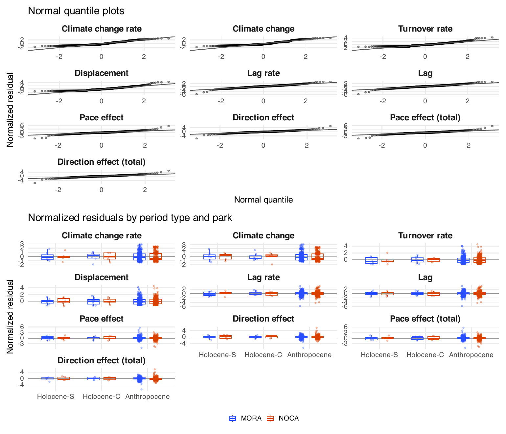

**Fig. S13. Residual checks of the ten era models.** Top: normal
quantile plots of the normalized residuals, one per response. Bottom:
normalized residuals by period type and park (points, with boxes for the
quartiles). The models have no continuous predictor, so the fitted
values take one value per period type and park, and residuals by group
show what a plot against fitted values would. The climate change rate,
the climate change, the turnover rate and the displacement are positive
by construction and their residuals are right-skewed. The lag, lag rate,
pace and direction residuals have heavy tails from a few Anthropocene
plots.

Stages and helpers:
[`R/pipeline/13_era_models.R`](R/pipeline/13_era_models.R),
[`R/helpers/tracking_model_reporting.R`](R/helpers/tracking_model_reporting.R)
(period types),
[`R/helpers/reconstruction_models.R`](R/helpers/reconstruction_models.R),
[`R/figures/main_fig5_era_contrasts.R`](R/figures/main_fig5_era_contrasts.R).

# Pace and direction effects (Q2)

**What and why.** The pace effect and the direction effect, defined with
the lake-periods above, ask whether a lag comes from how far the
community moved or from the direction it took. They are compared between
the period types with the same era models as the lag. A joint model also
fits the two effects of a unit together, so that they can be compared
with their correlation taken into account.

**How it is calculated.**

``` r
# R/pipeline/13_era_models.R
  # Pace and direction effects in one model, two rows per unit (correction =
  # pace or direction), so that the two effects of the same unit can be
  # compared with their correlation taken into account (corPairedAR1: the AR(1)
  # above plus a correlation between the two rows of a unit). Same weights.
  gls(estimate ~ period_type * site * correction, data = d,
    correlation = corPairedAR1(sort(unique(d$pair_group))),
    weights = varComb(varIdent(form = ~ 1 | period_type_site_correction), varFixed(~ endpoint_var)),
    method = 'REML', na.action = na.fail, control = glsControl(msMaxIter = 500))
```

**Result.**

The pace and direction effects lose their era differences when they are
not divided by time. At MORA, the per-century pace effect of the
Anthropocene exceeds that of both Holocene types (+0.17 (0.06 to 0.28,
Holm p = 0.012) against Holocene-C), and so does the per-century
direction effect (+0.34 (0.15 to 0.54, Holm p = 0.003)). As totals, no
contrast between the Anthropocene and a Holocene period type is
significant after the adjustment in either park (for example MORA
direction against Holocene-S +0.17 (-0.17 to 0.51, Holm p = 1.000), NOCA
pace against Holocene-C -0.04 (-0.20 to 0.12, Holm p = 1.000)). At NOCA
the per-century pace and direction effects do not differ between the
eras either (pace against Holocene-C -0.26 (-0.54 to 0.03, Holm p =
0.224)). The Anthropocene effects are large per century mainly because
they build up over a few decades.


**Figure 6. Pace effect and direction effect in the Holocene and the
Anthropocene.** For each park, the fitted mean and 95% confidence
interval of the Holocene stability periods (triangles), the Holocene
climate-change periods (circles) and the Anthropocene (diamonds), with
the fitted mean printed beside each point. Each row shows an effect over
the whole lake-period or plot pair (left, not divided by time) and per
century (right): (A) the pace effect and (B) its rate, (C) the direction
effect and (D) its rate. The two totals share one y scale and the two
rates another. Each effect is the lag at the end of the period minus the
lag the community would have had at the climate-predicted pace (A, B,
keeping its own direction) or in the climate-predicted direction (C, D,
keeping its own distance). A positive effect means that the community’s
own pace or direction widened the lag. A negative effect means that it
narrowed the lag. Connectors link the Anthropocene to the Holocene
climate-change periods (lower) and to the Holocene stability periods
(upper) within each park, and a star marks a contrast that differs from
zero (two-sided t test, Holm-adjusted p \< 0.05 across the six
period-type contrasts of each response). Fitted means and contrasts come
from the same models as Figure 5, whose panel F shows the lag rate.
Lake-periods and plots whose observed or predicted position did not move
have no pace or direction effect: the panels hold 5 climate-change and 5
stability lake-periods at MORA. Holocene climate-change lake-periods
span 200 to 900 years and stability lake-periods 200 to 2600 years
between their first and last sampled century. Anthropocene plot pairs
span 27.5 to 32.5 years between the midpoints of their climate windows
(about 29 years). The totals are in CCA distance, the rates in CCA
distance per century.

**Check: sensitivity to the paleoclimate bias correction.** The primary
run uses the raw CHELSA-TraCE21k paleoclimate. Its modern slice differs
from the CHELSA V2.1 climate the CCA is calibrated on, by a fixed offset
per lake and month for temperature and a fixed ratio for precipitation.
[`R/sensitivity_bias_corrected.R`](R/sensitivity_bias_corrected.R)
reruns stages 07 to 15 with that difference removed
(`PALEO_USE_BIAS_CORRECTED = TRUE`) into `output_bias_corrected/`, and
leaves the primary outputs untouched. The climate periods are defined on
the raw series in both runs, so the same lake-periods are compared. Only
the climate-predicted Holocene positions change. The observed positions
and the Anthropocene do not. Appendix S3 compares every response, era
contrast and explanatory-model slope of the two runs.

**Era contrasts with the raw and the bias-corrected paleoclimate**, from
the same era models, with Holm-adjusted p (six contrasts per response).
The Anthropocene values are the same in both runs.

| Response | Park | Contrast | Raw | Bias-corrected |
|:---|:---|:---|:---|:---|
| Direction effect | MORA | Anthropocene - Holocene-C | +0.344 (0.149 to 0.539), Holm p = 0.003 | +0.322 (0.131 to 0.513), Holm p = 0.005 |
| Direction effect | MORA | Anthropocene - Holocene-S | +0.349 (0.182 to 0.517), Holm p \< 0.001 | +0.361 (0.191 to 0.531), Holm p \< 0.001 |
| Direction effect | NOCA | Anthropocene - Holocene-C | -0.226 (-0.551 to 0.098), Holm p = 0.512 | -0.217 (-0.533 to 0.099), Holm p = 0.354 |
| Direction effect | NOCA | Anthropocene - Holocene-S | -0.252 (-0.573 to 0.069), Holm p = 0.495 | -0.282 (-0.596 to 0.032), Holm p = 0.234 |
| Lag | MORA | Anthropocene - Holocene-C | +0.191 (-0.029 to 0.411), Holm p = 0.530 | +0.188 (0.067 to 0.308), Holm p = 0.014 |
| Lag | MORA | Anthropocene - Holocene-S | +0.069 (-0.122 to 0.260), Holm p = 1.000 | +0.295 (0.027 to 0.562), Holm p = 0.154 |
| Lag | NOCA | Anthropocene - Holocene-C | +0.136 (-0.189 to 0.462), Holm p = 1.000 | +0.079 (-0.176 to 0.335), Holm p = 1.000 |
| Lag | NOCA | Anthropocene - Holocene-S | +0.007 (-0.395 to 0.409), Holm p = 1.000 | -0.179 (-0.586 to 0.228), Holm p = 1.000 |
| Lag rate | MORA | Anthropocene - Holocene-C | +0.564 (0.421 to 0.708), Holm p \< 0.001 | +0.552 (0.427 to 0.677), Holm p \< 0.001 |
| Lag rate | MORA | Anthropocene - Holocene-S | +0.552 (0.431 to 0.673), Holm p \< 0.001 | +0.542 (0.417 to 0.666), Holm p \< 0.001 |
| Lag rate | NOCA | Anthropocene - Holocene-C | -0.034 (-0.324 to 0.257), Holm p = 1.000 | -0.050 (-0.330 to 0.230), Holm p = 1.000 |
| Lag rate | NOCA | Anthropocene - Holocene-S | -0.117 (-0.418 to 0.184), Holm p = 1.000 | -0.141 (-0.443 to 0.160), Holm p = 1.000 |
| Pace effect | MORA | Anthropocene - Holocene-C | +0.171 (0.061 to 0.281), Holm p = 0.012 | +0.145 (0.052 to 0.239), Holm p = 0.010 |
| Pace effect | MORA | Anthropocene - Holocene-S | +0.169 (0.075 to 0.263), Holm p = 0.003 | +0.186 (0.093 to 0.279), Holm p \< 0.001 |
| Pace effect | NOCA | Anthropocene - Holocene-C | -0.257 (-0.539 to 0.026), Holm p = 0.224 | -0.269 (-0.550 to 0.012), Holm p = 0.120 |
| Pace effect | NOCA | Anthropocene - Holocene-S | -0.307 (-0.603 to -0.011), Holm p = 0.167 | -0.321 (-0.626 to -0.015), Holm p = 0.118 |

<sub>Table file:
[bias_correction_era_contrasts.csv](report/tables/bias_correction_era_contrasts.csv)</sub>

The result is poor at MORA. There the lag kept its sign in 3 of 14
lake-periods and the pace effect in 5 of 10, while the direction effect
kept it in 6 of 10. At NOCA the lag kept its sign in 8 of 10, the pace
effect in 10 of 10 and the direction effect in 8 of 10. The correction
shifts the spring temperature of each lake by a fixed offset and scales
its summer precipitation by a fixed ratio, so it moves the
climate-predicted positions of a lake together and changes the mismatch
at both ends of a lake-period. Most MORA Holocene lags and pace effects
are small, and a small change in the two mismatches is enough to flip
their sign. The Holocene values of each lake-period are therefore not
robust at MORA. The era comparisons are more robust, because the
Anthropocene values are far from the Holocene ones: the MORA lag rate,
Anthropocene minus Holocene-C, is +0.564 (Holm p \< 0.001) raw and
+0.552 (Holm p \< 0.001) corrected. The MORA lag contrasts change their
meaning: against Holocene-C the lag goes from +0.191 (Holm p = 0.530) to
+0.188 (Holm p = 0.014), and against Holocene-S from +0.069 (Holm p =
1.000) to +0.295 (Holm p = 0.154), the latter because the long MORA S4
lake-periods turn negative: 1 of the 3 have a negative lag with the raw
paleoclimate and 3 with the corrected one. Whether the MORA Anthropocene
lag, not divided by time, exceeds the Holocene one therefore depends on
the paleoclimate correction. The NOCA pace contrast against Holocene-C
is -0.257 (Holm p = 0.224) raw and -0.269 (Holm p = 0.120) corrected.

**Model checks.** The joint model has one AR(1) parameter on the unit
order and one correlation between the pace and the direction effect of
the same unit for each era and park. The table gives them, and Fig. S14
shows the residuals.

**Joint pace and direction model: correlation parameters.**

| Parameter                                     | Estimate |
|:----------------------------------------------|---------:|
| AR(1) on the unit order                       |   -0.527 |
| Pace–direction correlation, Anthropocene MORA |    0.171 |
| Pace–direction correlation, Anthropocene NOCA |    0.406 |
| Pace–direction correlation, Holocene MORA     |    0.402 |
| Pace–direction correlation, Holocene NOCA     |    0.281 |

<sub>Table file:
[joint_correction_correlation.csv](report/tables/joint_correction_correlation.csv)</sub>
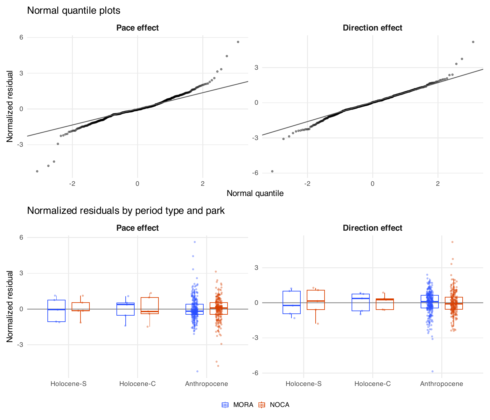

**Fig. S14. Residual checks of the joint pace and direction model.** As
Fig. S13, for the pace and direction effects fitted together.

Stages and helpers:
[`R/pipeline/13_era_models.R`](R/pipeline/13_era_models.R),
[`R/helpers/tracking_model_reporting.R`](R/helpers/tracking_model_reporting.R)
(paired AR(1) correlation),
[`R/figures/main_fig6_lag_pace_direction.R`](R/figures/main_fig6_lag_pace_direction.R),
[`R/sensitivity_bias_corrected.R`](R/sensitivity_bias_corrected.R).

# Associations with fire (Q3)

**What and why.** Within the Holocene lake-periods, does a period with
more climate change, or more fire, end with a larger lag, and with
better or worse pace and direction? Each response is modelled on the
park, the climate change rate and fire activity together. Consecutive
lake-periods of a lake can share an end century, so their errors are
related, and an AR(1) term on the order of the lake-periods within each
lake carries that from the start. Ends that rest on a single sample are
noisier, so each row is weighted by the sampling variance of its two
ends, and the parks keep different residual spread. In the Anthropocene
the same responses are compared between burned and unburned plots within
each park.

**How it is calculated.**

``` r
# R/pipeline/14_predictor_models.R
  # Holocene lake-periods only. Does the response go with more climate change
  # or more fire? Fitted twice: per century (lag rate, pace effect, direction
  # effect) with climate = climate_rate, the climate change rate, and as totals
  # not divided by time (lag, pace and direction effect totals) with
  # climate = climate_change, the climate change between the two ends.
  #   site: a separate level for each park;
  #   climate: the slope per unit of climate change (rate or total);
  #   fire_activity: the slope per accepted fire event per century per core.
  # Consecutive lake-periods of a lake are correlated (AR(1) within lake).
  # varIdent lets the parks keep a different spread, and varFixed gives ends
  # resting on single samples less weight (endpoint_var = 1/n_start + 1/n_end).
  model = reformulate(c('site', climate, 'fire_activity'), response = 'estimate')
  captured = reconstruction_capture(function() gls(model,
    correlation = corAR1(form = ~ unit_index | lake),
    weights = varComb(varIdent(form = ~ 1 | site), varFixed(~ endpoint_var)),
    data = d, method = 'REML', control = glsControl(msMaxIter = 500)))
```

``` r
# R/pipeline/14_predictor_models.R
  # Anthropocene plot pairs only: the same responses against site and burned
  # (whether the plot burned between the two surveys). Plots are independent,
  # each park keeps its own spread.
  captured = reconstruction_capture(function() gls(estimate ~ site + burned,
    weights = varIdent(form = ~ 1 | site), data = da, method = 'REML'))
```

**Result.**

**Explanatory models.** Holocene: response ~ site + climate_rate +
fire_activity for the per-century responses and response ~ site +
climate_change + fire_activity for the responses not divided by time, on
the lake-periods, AR(1) within lake, endpoint weights. Anthropocene:
response ~ site + burned on the plot pairs. Estimates in CCA distance
(per century for the per-century responses) per unit of the term.
Conditional 95% confidence intervals. R² is descriptive (1 − SSE/SST).

| Response | Era | Term | Estimate | 95% CI | p | n | R² | SD ratio NOCA/MORA | AR(1) |
|:---|:---|:---|---:|:---|---:|---:|---:|---:|---:|
| Lag rate | Holocene | (Intercept) | -0.046 | -0.096 to 0.005 | 0.075 | 24 | -0.299 | 5.948 | -0.535 |
| Lag rate | Holocene | siteNOCA | -0.133 | -0.238 to -0.027 | 0.016 | 24 | -0.299 | 5.948 | -0.535 |
| Lag rate | Holocene | climate_rate | -0.098 | -0.760 to 0.564 | 0.761 | 24 | -0.299 | 5.948 | -0.535 |
| Lag rate | Holocene | fire_activity | 0.291 | 0.085 to 0.496 | 0.008 | 24 | -0.299 | 5.948 | -0.535 |
| Lag rate | Anthropocene | (Intercept) | 0.554 | 0.434 to 0.673 | 0.000 | 605 | 0.031 | 2.128 | — |
| Lag rate | Anthropocene | siteNOCA | -0.650 | -0.963 to -0.336 | 0.000 | 605 | 0.031 | 2.128 | — |
| Lag rate | Anthropocene | burnedBurned | 0.180 | -0.805 to 1.164 | 0.720 | 605 | 0.031 | 2.128 | — |
| Pace effect | Holocene | (Intercept) | -0.018 | -0.057 to 0.022 | 0.353 | 20 | -0.327 | 8.531 | -0.236 |
| Pace effect | Holocene | siteNOCA | -0.082 | -0.173 to 0.008 | 0.071 | 20 | -0.327 | 8.531 | -0.236 |
| Pace effect | Holocene | climate_rate | -0.300 | -0.916 to 0.315 | 0.317 | 20 | -0.327 | 8.531 | -0.236 |
| Pace effect | Holocene | fire_activity | 0.206 | 0.043 to 0.369 | 0.016 | 20 | -0.327 | 8.531 | -0.236 |
| Pace effect | Anthropocene | (Intercept) | 0.173 | 0.080 to 0.266 | 0.000 | 463 | 0.042 | 2.737 | — |
| Pace effect | Anthropocene | siteNOCA | -0.347 | -0.651 to -0.043 | 0.025 | 463 | 0.042 | 2.737 | — |
| Pace effect | Anthropocene | burnedBurned | -1.194 | -2.214 to -0.174 | 0.022 | 463 | 0.042 | 2.737 | — |
| Direction effect | Holocene | (Intercept) | 0.024 | -0.071 to 0.120 | 0.593 | 20 | 0.130 | 2.005 | -0.055 |
| Direction effect | Holocene | siteNOCA | -0.083 | -0.212 to 0.047 | 0.196 | 20 | 0.130 | 2.005 | -0.055 |
| Direction effect | Holocene | climate_rate | -0.554 | -1.794 to 0.685 | 0.357 | 20 | 0.130 | 2.005 | -0.055 |
| Direction effect | Holocene | fire_activity | 0.101 | -0.142 to 0.344 | 0.393 | 20 | 0.130 | 2.005 | -0.055 |
| Direction effect | Anthropocene | (Intercept) | 0.351 | 0.184 to 0.517 | 0.000 | 463 | 0.033 | 1.708 | — |
| Direction effect | Anthropocene | siteNOCA | -0.680 | -1.044 to -0.315 | 0.000 | 463 | 0.033 | 1.708 | — |
| Direction effect | Anthropocene | burnedBurned | 0.810 | -0.332 to 1.952 | 0.164 | 463 | 0.033 | 1.708 | — |
| Lag (not divided by time) | Holocene | (Intercept) | 0.083 | -0.125 to 0.292 | 0.415 | 24 | 0.038 | 6.494 | -0.595 |
| Lag (not divided by time) | Holocene | siteNOCA | -0.676 | -1.093 to -0.258 | 0.003 | 24 | 0.038 | 6.494 | -0.595 |
| Lag (not divided by time) | Holocene | climate_change | -0.951 | -1.703 to -0.200 | 0.016 | 24 | 0.038 | 6.494 | -0.595 |
| Lag (not divided by time) | Holocene | fire_activity | 1.245 | 0.422 to 2.068 | 0.005 | 24 | 0.038 | 6.494 | -0.595 |
| Lag (not divided by time) | Anthropocene | (Intercept) | 0.163 | 0.127 to 0.198 | 0.000 | 605 | 0.032 | 2.055 | — |
| Lag (not divided by time) | Anthropocene | siteNOCA | -0.190 | -0.280 to -0.101 | 0.000 | 605 | 0.032 | 2.055 | — |
| Lag (not divided by time) | Anthropocene | burnedBurned | 0.052 | -0.228 to 0.331 | 0.717 | 605 | 0.032 | 2.055 | — |
| Pace effect (not divided by time) | Holocene | (Intercept) | 0.189 | -0.076 to 0.454 | 0.150 | 20 | 0.105 | 3.385 | -0.089 |
| Pace effect (not divided by time) | Holocene | siteNOCA | -0.070 | -0.477 to 0.337 | 0.720 | 20 | 0.105 | 3.385 | -0.089 |
| Pace effect (not divided by time) | Holocene | climate_change | -0.409 | -1.277 to 0.459 | 0.333 | 20 | 0.105 | 3.385 | -0.089 |
| Pace effect (not divided by time) | Holocene | fire_activity | 0.014 | -0.799 to 0.828 | 0.970 | 20 | 0.105 | 3.385 | -0.089 |
| Pace effect (not divided by time) | Anthropocene | (Intercept) | 0.049 | 0.021 to 0.076 | 0.000 | 463 | 0.042 | 2.664 | — |
| Pace effect (not divided by time) | Anthropocene | siteNOCA | -0.098 | -0.185 to -0.012 | 0.026 | 463 | 0.042 | 2.664 | — |
| Pace effect (not divided by time) | Anthropocene | burnedBurned | -0.340 | -0.630 to -0.050 | 0.021 | 463 | 0.042 | 2.664 | — |
| Direction effect (not divided by time) | Holocene | (Intercept) | 0.510 | -0.212 to 1.233 | 0.154 | 20 | 0.100 | 0.903 | 0.687 |
| Direction effect (not divided by time) | Holocene | siteNOCA | -0.569 | -1.361 to 0.223 | 0.147 | 20 | 0.100 | 0.903 | 0.687 |
| Direction effect (not divided by time) | Holocene | climate_change | -1.653 | -2.288 to -1.018 | 0.000 | 20 | 0.100 | 0.903 | 0.687 |
| Direction effect (not divided by time) | Holocene | fire_activity | 0.676 | 0.161 to 1.190 | 0.013 | 20 | 0.100 | 0.903 | 0.687 |
| Direction effect (not divided by time) | Anthropocene | (Intercept) | 0.102 | 0.054 to 0.151 | 0.000 | 463 | 0.034 | 1.666 | — |
| Direction effect (not divided by time) | Anthropocene | siteNOCA | -0.195 | -0.299 to -0.091 | 0.000 | 463 | 0.034 | 1.666 | — |
| Direction effect (not divided by time) | Anthropocene | burnedBurned | 0.230 | -0.094 to 0.553 | 0.164 | 463 | 0.034 | 1.666 | — |

<sub>Table file:
[step5_explanatory_models.csv](report/tables/step5_explanatory_models.csv)</sub>

In the Holocene, faster climate change did not go with the lag rate
(-0.10 (-0.76 to 0.56)) and did not go with the pace effect (-0.30
(-0.92 to 0.32)). More frequent fire went with a larger lag rate (+0.29
(0.09 to 0.50)) and did not go with the direction effect (+0.10 (-0.14
to 0.34)). The slopes are in CCA distance per century for one more
standardized unit of climate change per century, or for one more event
per century per core. The fire values of the two parks barely overlap.
The site term absorbs the difference between the parks, so the fire
slope comes from the narrow range within each park (MORA 0.00 to 0.42,
NOCA 0.33 to 0.89 events per century per core).

The same models on the responses not divided by time use the climate
change between the two ends in place of its rate, and the slopes are in
CCA distance per standardized unit of climate change or per event per
century per core. More climate change went with a smaller lag (-0.95
(-1.70 to -0.20)), did not go with the pace effect (-0.41 (-1.28 to
0.46)) and went with a smaller direction effect (-1.65 (-2.29 to
-1.02)). More fire went with a larger lag (+1.25 (0.42 to 2.07)), did
not go with the pace effect (+0.01 (-0.80 to 0.83)) and went with a
larger direction effect (+0.68 (0.16 to 1.19)). Of the 12 Holocene
climate and fire slopes, 6 have an interval that excludes zero. They
rest on 24 lake-periods and change markedly with a bias-corrected
paleoclimate (Appendix S3), so they are fragile. In the Anthropocene,
burned plots had a smaller total pace effect than unburned ones (-0.34
(-0.63 to -0.05)). Fire activity stays a frequency in both forms,
because a count of events would grow with the length of the lake-period.


**Figure 7. Climate and fire associations.** Model slopes with
conditional 95% confidence intervals for the lag (black), the pace
effect (pink) and the direction effect (blue), side by side for each
term, in the colours of Figure 1. Faded estimates have intervals that
include zero. Top row (A, B): the responses per century, the change in
mismatch or the reduction in final mismatch under the pace or direction
correction divided by the elapsed time. Bottom row (C, D): the same
responses not divided by time. The panels of a row share one x scale.
(A, C) Holocene lake-periods, model response ~ site + climate + fire
activity with an AR(1) correlation within each lake and weights for the
number of samples at each end, where climate is the climate change rate
in A and the climate change between the two ends in C: 14 MORA and 10
NOCA lake-periods for the lag, and 10 and 10 for pace and direction. The
climate slope is per standardized unit of climate change per century (A)
or per standardized unit of climate change (C), and the fire slope per
accepted event per century per covered core. (B, D) Anthropocene plot
pairs, model response ~ site + burned with park-specific variances: 605
plot pairs for the lag and 463 for pace and direction. Descriptive R² is
given below each panel. Holocene climate-change lake-periods span 200 to
900 years and stability lake-periods 200 to 2600 years between their
first and last sampled century. Anthropocene plot pairs span 27.5 to
32.5 years between the midpoints of their climate windows (about 29
years). Effects are in CCA distance per century (A, B) or CCA distance
(C, D) per unit of the term.

**Model checks.** The table gives, for each explanatory model, the rows
per park, the descriptive R², the AR(1) parameter of the Holocene models
and the ratio of the NOCA to the MORA residual standard deviation. The
rows left out and the coefficients are on the **model details page →**
[08_models](report/details/08_models.md).

**Explanatory models: rows and covariance parameters.**

| Response | Era | Model | MORA | NOCA | Descriptive R² | AR(1) | SD ratio NOCA/MORA | Warnings |
|:---|:---|:---|---:|---:|---:|---:|---:|:---|
| Lag rate | Holocene | site + climate_rate + fire_activity | 14 | 10 | -0.299 | -0.535 | 5.948 | none |
| Lag rate | Anthropocene | site + burned | 328 | 277 | 0.031 | — | 2.128 | none |
| Pace effect | Holocene | site + climate_rate + fire_activity | 10 | 10 | -0.327 | -0.236 | 8.531 | none |
| Pace effect | Anthropocene | site + burned | 252 | 211 | 0.042 | — | 2.737 | none |
| Direction effect | Holocene | site + climate_rate + fire_activity | 10 | 10 | 0.130 | -0.055 | 2.005 | none |
| Direction effect | Anthropocene | site + burned | 252 | 211 | 0.033 | — | 1.708 | none |
| Lag | Holocene | site + climate_change + fire_activity | 14 | 10 | 0.038 | -0.595 | 6.494 | none |
| Lag | Anthropocene | site + burned | 328 | 277 | 0.032 | — | 2.055 | none |
| Pace effect (not divided by time) | Holocene | site + climate_change + fire_activity | 10 | 10 | 0.105 | -0.089 | 3.385 | none |
| Pace effect (not divided by time) | Anthropocene | site + burned | 252 | 211 | 0.042 | — | 2.664 | none |
| Direction effect (not divided by time) | Holocene | site + climate_change + fire_activity | 10 | 10 | 0.100 | 0.687 | 0.903 | none |
| Direction effect (not divided by time) | Anthropocene | site + burned | 252 | 211 | 0.034 | — | 1.666 | none |

<sub>Table file:
[explanatory_model_performance.csv](report/tables/explanatory_model_performance.csv)</sub>

Stages and helpers:
[`R/pipeline/14_predictor_models.R`](R/pipeline/14_predictor_models.R),
[`R/helpers/reconstruction_models.R`](R/helpers/reconstruction_models.R),
[`R/figures/main_fig7_climate_fire_associations.R`](R/figures/main_fig7_climate_fire_associations.R).

# Species contributions (Q4)

**What and why.** The observed movement of a community between t1 and t2
is the sum of one vector per species: the change in the species’ share
times the species’ fixed position in the CCA plane. Projecting each
species’ vector on a reference direction says how much that species
moved the community along it. Two measures are used, both per century.
Along the direction the prediction moved (`contrib_climate`), a positive
value means the species carried the community with the climate. The
second measure, `contrib_lag`, splits the lag rate itself. The mismatch
g, from the predicted to the observed position, is taken at both ends
(g1 at t1, g2 at t2), and m is their sum divided by the sum of their
lengths. Each species’ vector projected on m is that species’ part of
the lag rate, and the predicted movement projected on m, with its sign
reversed, is the climate’s part. Because the change in mismatch, g2 −
g1, is the observed movement minus the predicted movement, and (g2 −
g1)·m is exactly the change in the length of the mismatch, the species
parts and the climate part add up exactly to the lag rate (asserted). A
negative species value means the species narrowed the lag, a positive
value that it widened it. Swapping the two surveys reverses every value,
so the measure has no direction of its own. It replaces `contrib_gap`,
the projection on the mismatch at the start alone. That measure leaned
positive: a community sampled away from its predicted position tends to
come back towards it by chance, and run backwards in time it also
appeared to close the gap. `contrib_lag` is per century of the same
interval as the lag rate.

**How it is calculated.**

``` r
# R/helpers/cca_transition_contributions.R
step6_species_contributions = function(context, first, last, positions, endpoints, dt, lag_dt) {
  # rows: one row per unit and species, with the species' vector (its change in
  # share times its CCA position) in contribution_CCA1 and contribution_CCA2.
  rows = contribution_species(context, first, last, positions, endpoints)
  contribution_close((last - first) %*% positions,
    as.matrix(endpoints[c('delta_observed_CCA1', 'delta_observed_CCA2')]), 'Species vectors sum to dWA')
  index = rep(seq_len(nrow(context)), each = ncol(first))
  defined = endpoints$direction_defined[index]
  # contrib_climate: the vector along the predicted movement, per century.
  rows$contrib_climate = ifelse(defined, rows$parallel_contribution * 100 / dt[index], NA_real_)
  # contrib_lag: the vector projected on m (dot product), per century of the lag rate.
  m = step6_lag_direction(endpoints)
  rows$lag_projection = rows$contribution_CCA1 * m$x[index] + rows$contribution_CCA2 * m$y[index]
  rows$contrib_lag = rows$lag_projection * 100 / lag_dt[index]
  rows
}

# The direction m of each unit: the mismatch at the start (g1) plus the
# mismatch at the end (g2), divided by the sum of their lengths.
step6_lag_direction = function(endpoints) {
  g1x = endpoints$o1 - endpoints$p1; g1y = endpoints$o2 - endpoints$p2
  g2x = endpoints$o1_2 - endpoints$p1_2; g2y = endpoints$o2_2 - endpoints$p2_2
  total = sqrt(g1x^2 + g1y^2) + sqrt(g2x^2 + g2y^2)
  if (any(!(total > CCA_CONTRIBUTION_EPSILON))) stop('A unit has no mismatch at either end: contrib_lag undefined')
  list(x = (g1x + g2x) / total, y = (g1y + g2y) / total)
}
```

``` r
# R/pipeline/15_contributions.R
# For one species in one park and period type, x holds its contribution in
# every lake-period (or plot pair). The result is the plain mean with a 95%
# t-interval: mean plus or minus t(0.975, n - 1) times the standard error
# sd / sqrt(n). With a single value the interval is undefined.
group_mean = function(x) {
  n = length(x); m = mean(x); se = if (n > 1) sd(x) / sqrt(n) else NA_real_
  q = if (n > 1) qt(.975, n - 1) else NA_real_
  tibble(n, estimate = m, std_error = se, conf_low = m - q * se, conf_high = m + q * se,
    interval_defined = n > 1 && is.finite(se) && se > 0)
}
```

**Result.**

**Species contributions**, mean and 95% t-interval in CCA distance per
century, per species, park and period type. Columns: measure
(contrib_climate along the predicted movement, contrib_lag the species’
part of the lag rate) and period type. “absent”: the species does not
occur in that park and period type. contrib_lag includes the units where
the community did not move (all species values zero), contrib_climate
does not (epsilon rule).

| Species | Park | contrib_climate_Holocene-S | contrib_climate_Holocene-C | contrib_climate_Anthropocene | contrib_lag_Holocene-S | contrib_lag_Holocene-C | contrib_lag_Anthropocene |
|:---|:---|:---|:---|:---|:---|:---|:---|
| Abies amabilis | MORA | -0.000 (-0.003 to 0.002) | +0.005 (-0.008 to 0.018) | -0.041 (-0.072 to -0.010) | +0.001 (-0.001 to 0.003) | -0.004 (-0.014 to 0.005) | +0.030 (0.008 to 0.051) |
| Abies amabilis | NOCA | absent | absent | +0.021 (-0.016 to 0.059) | absent | absent | +0.005 (-0.014 to 0.025) |
| Abies grandis | MORA | absent | absent | -0.018 (-0.057 to 0.021) | absent | absent | -0.027 (-0.051 to -0.004) |
| Abies grandis | NOCA | absent | absent | -0.056 (-0.142 to 0.031) | absent | absent | -0.063 (-0.135 to 0.010) |
| Abies lasiocarpa | MORA | -0.000 (-0.019 to 0.018) | +0.007 (-0.052 to 0.065) | -0.009 (-0.041 to 0.023) | -0.003 (-0.011 to 0.004) | -0.020 (-0.048 to 0.008) | +0.015 (-0.036 to 0.066) |
| Abies lasiocarpa | NOCA | +0.065 (-0.041 to 0.170) | -0.016 (-0.059 to 0.026) | -0.061 (-0.205 to 0.082) | -0.026 (-0.153 to 0.102) | -0.023 (-0.083 to 0.037) | +0.057 (-0.068 to 0.182) |
| Abies procera | MORA | -0.002 (-0.005 to 0.000) | +0.001 (-0.002 to 0.003) | +0.029 (-0.001 to 0.059) | +0.000 (-0.003 to 0.003) | +0.003 (-0.005 to 0.012) | -0.019 (-0.042 to 0.004) |
| Abies procera | NOCA | absent | absent | absent | absent | absent | absent |
| Callitropsis nootkatensis | MORA | +0.002 (-0.006 to 0.009) | -0.033 (-0.112 to 0.047) | -0.004 (-0.071 to 0.064) | +0.004 (-0.001 to 0.009) | +0.020 (-0.031 to 0.071) | +0.011 (-0.036 to 0.058) |
| Callitropsis nootkatensis | NOCA | -0.007 (-0.023 to 0.010) | -0.007 (-0.028 to 0.013) | +0.023 (-0.017 to 0.063) | -0.003 (-0.010 to 0.005) | -0.001 (-0.005 to 0.002) | +0.011 (-0.037 to 0.058) |
| Picea engelmannii | MORA | absent | absent | -0.004 (-0.017 to 0.009) | absent | absent | -0.001 (-0.020 to 0.018) |
| Picea engelmannii | NOCA | -0.003 (-0.012 to 0.005) | +0.001 (-0.002 to 0.004) | -0.013 (-0.088 to 0.063) | +0.004 (-0.007 to 0.015) | -0.001 (-0.004 to 0.002) | +0.006 (-0.055 to 0.068) |
| Pinus albicaulis | MORA | absent | absent | +0.003 (-0.001 to 0.008) | absent | absent | +0.015 (-0.006 to 0.037) |
| Pinus albicaulis | NOCA | absent | absent | +0.257 (0.079 to 0.434) | absent | absent | -0.283 (-0.475 to -0.091) |
| Pinus contorta | MORA | +0.007 (-0.002 to 0.016) | +0.000 (-0.005 to 0.006) | -0.002 (-0.013 to 0.008) | -0.001 (-0.009 to 0.007) | -0.004 (-0.009 to 0.002) | -0.004 (-0.013 to 0.006) |
| Pinus contorta | NOCA | -0.002 (-0.019 to 0.015) | +0.008 (-0.011 to 0.027) | +0.039 (-0.064 to 0.142) | +0.012 (-0.052 to 0.077) | +0.002 (-0.057 to 0.060) | -0.022 (-0.106 to 0.063) |
| Pinus monticola | MORA | +0.001 (-0.004 to 0.006) | -0.007 (-0.025 to 0.010) | -0.041 (-0.057 to -0.025) | -0.002 (-0.004 to 0.001) | +0.002 (-0.009 to 0.013) | +0.017 (0.003 to 0.031) |
| Pinus monticola | NOCA | +0.006 (-0.044 to 0.056) | +0.001 (-0.011 to 0.013) | +0.009 (-0.029 to 0.046) | +0.026 (-0.025 to 0.078) | +0.002 (-0.028 to 0.032) | +0.020 (-0.005 to 0.044) |
| Pinus ponderosa | MORA | absent | absent | +0.009 (-0.009 to 0.026) | absent | absent | +0.009 (-0.009 to 0.026) |
| Pinus ponderosa | NOCA | absent | absent | +0.216 (-0.036 to 0.468) | absent | absent | -0.192 (-0.403 to 0.019) |
| Pseudotsuga menziesii | MORA | -0.001 (-0.006 to 0.004) | -0.022 (-0.060 to 0.016) | -0.051 (-0.101 to -0.002) | +0.002 (-0.001 to 0.006) | +0.003 (-0.015 to 0.021) | +0.033 (0.002 to 0.063) |
| Pseudotsuga menziesii | NOCA | -0.009 (-0.027 to 0.010) | -0.007 (-0.033 to 0.018) | -0.010 (-0.080 to 0.061) | -0.003 (-0.010 to 0.003) | +0.000 (-0.013 to 0.013) | +0.018 (-0.044 to 0.079) |
| Thuja plicata | MORA | absent | absent | +0.005 (-0.024 to 0.034) | absent | absent | +0.035 (-0.000 to 0.070) |
| Thuja plicata | NOCA | -0.002 (-0.006 to 0.002) | -0.006 (-0.018 to 0.006) | +0.033 (-0.012 to 0.079) | +0.000 (-0.004 to 0.005) | +0.003 (-0.002 to 0.007) | -0.016 (-0.058 to 0.027) |
| Tsuga heterophylla | MORA | +0.002 (-0.010 to 0.015) | -0.005 (-0.020 to 0.009) | -0.045 (-0.065 to -0.025) | -0.003 (-0.009 to 0.003) | -0.004 (-0.013 to 0.005) | +0.032 (0.008 to 0.055) |
| Tsuga heterophylla | NOCA | +0.008 (-0.016 to 0.032) | +0.001 (-0.003 to 0.005) | +0.109 (0.062 to 0.155) | +0.010 (-0.019 to 0.039) | -0.004 (-0.015 to 0.007) | +0.018 (-0.011 to 0.046) |
| Tsuga mertensiana | MORA | -0.001 (-0.007 to 0.005) | +0.026 (-0.015 to 0.066) | +0.011 (-0.019 to 0.041) | -0.000 (-0.004 to 0.004) | -0.014 (-0.037 to 0.008) | -0.007 (-0.031 to 0.018) |
| Tsuga mertensiana | NOCA | +0.001 (-0.000 to 0.002) | absent | +0.011 (-0.026 to 0.049) | +0.000 (-0.000 to 0.001) | absent | -0.042 (-0.094 to 0.010) |

<sub>Table file:
[step6_species_means.csv](report/tables/step6_species_means.csv)</sub>

**The lag rate split into the species and the climate.** Plain means
over the lake-periods or plot pairs with 95% t-intervals, in CCA
distance per century. In every unit the sum over species plus the
climate part equals the lag rate. Positive values widen the lag.

| Park | Period type | Units | Lag rate | Species (sum) | Climate part |
|:---|:---|---:|:---|:---|:---|
| MORA | Holocene-S | 7 | +0.003 (-0.015 to +0.022) | -0.002 (-0.021 to +0.018) | +0.005 (-0.014 to +0.024) |
| MORA | Holocene-C | 7 | -0.016 (-0.093 to +0.062) | -0.017 (-0.080 to +0.045) | +0.002 (-0.032 to +0.035) |
| MORA | Anthropocene | 328 | +0.554 (+0.434 to +0.673) | +0.138 (+0.039 to +0.238) | +0.415 (+0.343 to +0.487) |
| NOCA | Holocene-S | 5 | +0.028 (-0.085 to +0.140) | +0.021 (-0.103 to +0.145) | +0.007 (-0.012 to +0.025) |
| NOCA | Holocene-C | 5 | -0.028 (-0.112 to +0.056) | -0.023 (-0.093 to +0.048) | -0.005 (-0.034 to +0.024) |
| NOCA | Anthropocene | 277 | -0.081 (-0.358 to +0.197) | -0.483 (-0.763 to -0.202) | +0.402 (+0.289 to +0.515) |

<sub>Table file:
[step6_lag_decomposition.csv](report/tables/step6_lag_decomposition.csv)</sub>

The species vectors add up to the observed movement for every
lake-period and plot pair (asserted).

In the Holocene every species mean is close to zero in both parks
(largest absolute value 0.065 CCA distance per century). None of the 70
Holocene intervals excludes zero. The Anthropocene means are larger.

In the Anthropocene the climate’s part of the lag rate is about the same
in both parks (+0.42 at MORA, +0.40 at NOCA, CCA distance per century):
the predicted positions moved away from the communities. The parks
differ in their species. At MORA the species added to the lag (sum
+0.14), so the lag rate was +0.55. At NOCA they narrowed it by more than
the climate widened it (sum -0.48), so the lag rate was -0.08. Species
whose interval lies below zero, which narrowed the lag: Abies grandis
(MORA, -0.027), Pinus albicaulis (NOCA, -0.283). Species whose interval
lies above zero, which widened it: Abies amabilis (MORA, +0.030), Pinus
monticola (MORA, +0.017), Pseudotsuga menziesii (MORA, +0.033), Tsuga
heterophylla (MORA, +0.032). Across species the two measures are
negatively correlated in the Anthropocene (r = -0.56 at MORA, -0.84 at
NOCA): species that moved the community with the climate-predicted
direction narrowed the lag, and those that moved it against that
direction widened it.

The period types of a species are compared with Welch tests, three
contrasts per species, measure and park, and the p-values are
Holm-adjusted within each measure and park across all species and
contrasts. Of 144 testable contrasts, 22 have p \< 0.05 before the
adjustment and 5 after it (Pinus monticola MORA, Anthropocene -
Holocene-S, contrib_climate; Tsuga heterophylla MORA, Anthropocene -
Holocene-C, contrib_climate; Tsuga heterophylla MORA, Anthropocene -
Holocene-S, contrib_climate; Tsuga heterophylla NOCA, Anthropocene -
Holocene-C, contrib_climate; Tsuga heterophylla NOCA, Anthropocene -
Holocene-S, contrib_climate). All of them set the Anthropocene against a
Holocene period type.


**Figure 8. Species contributions in the Holocene and the
Anthropocene.** Each species’ vector is its change in share between the
first and the last sampled century of a lake-period, or between the
legacy survey and the resurvey of a plot, times its fixed position in
the CCA plane. The upper row (following climate-predicted direction)
projects these vectors on the direction in which the climate-predicted
position moved, and the lower row (changing the climate-community lag)
on the average direction of the mismatch at the two ends, so that the
species’ values plus the climate’s part add up to the lag rate. Labels
at the top of each panel read with the row title: a species moved the
community following or against the climate-predicted direction (upper
row), and narrowed or widened the climate-community lag (lower row). The
lower row includes the lake-periods and plot pairs whose composition did
not change (all species values zero) and is per century of the same
interval as the lag rate. Species are ordered by the maximum elevation
of the plots where they occur (the 605 plot pairs, both surveys, both
parks), the highest at the top. Their names are shaded by that maximum
in four grey steps, lightest below 1,500 m and black above 1,900 m (key
below the figure). Names in bold are species absent from the Holocene
record of both parks. Symbols are means: triangles, Holocene stability
periods, circles, Holocene climate-change periods, diamonds,
Anthropocene plot pairs (burned and unburned together). Large symbols
with bars are means whose 95% t-interval excludes zero, small faded
symbols are means whose interval includes zero. A species with no
Holocene symbols in a park is absent from that park’s Holocene record.
Each park has its own x scale, symmetric around zero. Holocene
climate-change lake-periods span 200 to 900 years and stability
lake-periods 200 to 2600 years between their first and last sampled
century. Anthropocene plot pairs span 27.5 to 32.5 years between the
midpoints of their climate windows (about 29 years). Contributions are
in CCA distance per century.

**Check: species contributions not divided by time.** Per century, the
Holocene species values are small partly because the lake-periods are
long, and the Anthropocene values are large partly because the plot
pairs are short.

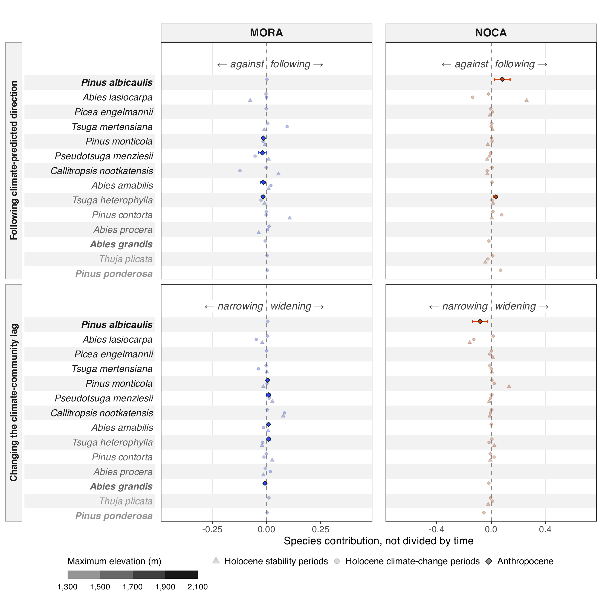

The Holocene lake-periods span 200 to 2,600 years and the Anthropocene
plot pairs 31 to 41.5 years. Fig. S15 shows the species means without
dividing by time, that is how far each species moved the community over
the whole lake-period or plot pair. The Holocene means then reach the
size of the Anthropocene ones (largest *Abies lasiocarpa* at NOCA,
Holocene-S, contrib_climate, +0.260 CCA distance), but they vary so much
between the few lake-periods that 0 of 70 Holocene intervals exclude
zero (0 per century). In the Anthropocene 12 means exclude zero, against
12 per century, the same species in the same parks. After the Holm
adjustment 0 of 144 contrasts between period types are significant,
against 5 per century. The large Anthropocene species rates therefore
come mainly from changes made within a few decades. Over a whole
lake-period, Holocene species moved the community about as far, but too
variably to say which species did.

**Fig. S15. Species contributions not divided by time.** As Figure 8,
with each species’ contribution taken over the whole lake-period or plot
pair instead of per century. Upper row: the distance the species moved
the community along the direction in which the climate-predicted
position moved. Lower row: the species’ part of the change in mismatch
between the two ends, so that the species’ values plus the climate’s
part add up to the lag. Plain means with 95% t-intervals, symbols, order
and shading as in Figure 8. Holocene climate-change lake-periods span
200 to 900 years and stability lake-periods 200 to 2600 years between
their first and last sampled century. Anthropocene plot pairs span 27.5
to 32.5 years between the midpoints of their climate windows (about 29
years). Contributions are in CCA distance.

**Species contributions not divided by time**, mean and 95% t-interval
in CCA distance, per species, park and period type, as the per-century
table above.

| Species | Park | contrib_climate_Holocene-S | contrib_climate_Holocene-C | contrib_climate_Anthropocene | contrib_lag_Holocene-S | contrib_lag_Holocene-C | contrib_lag_Anthropocene |
|:---|:---|:---|:---|:---|:---|:---|:---|
| Abies amabilis | MORA | +0.009 (-0.024 to 0.042) | +0.020 (-0.031 to 0.070) | -0.016 (-0.028 to -0.004) | +0.006 (-0.023 to 0.036) | -0.015 (-0.052 to 0.023) | +0.009 (0.002 to 0.015) |
| Abies amabilis | NOCA | absent | absent | +0.007 (-0.005 to 0.019) | absent | absent | +0.002 (-0.004 to 0.007) |
| Abies grandis | MORA | absent | absent | -0.007 (-0.022 to 0.008) | absent | absent | -0.008 (-0.014 to -0.001) |
| Abies grandis | NOCA | absent | absent | -0.017 (-0.044 to 0.010) | absent | absent | -0.018 (-0.038 to 0.003) |
| Abies lasiocarpa | MORA | -0.076 (-0.288 to 0.136) | -0.001 (-0.131 to 0.129) | -0.003 (-0.015 to 0.009) | -0.020 (-0.094 to 0.054) | -0.048 (-0.106 to 0.010) | +0.004 (-0.011 to 0.019) |
| Abies lasiocarpa | NOCA | +0.260 (-0.185 to 0.706) | -0.136 (-0.417 to 0.146) | -0.020 (-0.066 to 0.026) | -0.158 (-0.640 to 0.325) | -0.127 (-0.418 to 0.164) | +0.016 (-0.020 to 0.051) |
| Abies procera | MORA | -0.037 (-0.085 to 0.012) | +0.004 (-0.008 to 0.017) | +0.011 (-0.000 to 0.023) | -0.015 (-0.053 to 0.023) | +0.017 (-0.024 to 0.058) | -0.006 (-0.013 to 0.001) |
| Abies procera | NOCA | absent | absent | absent | absent | absent | absent |
| Callitropsis nootkatensis | MORA | +0.054 (-0.056 to 0.165) | -0.123 (-0.444 to 0.197) | -0.002 (-0.027 to 0.024) | +0.077 (-0.024 to 0.177) | +0.082 (-0.122 to 0.286) | +0.003 (-0.010 to 0.017) |
| Callitropsis nootkatensis | NOCA | -0.028 (-0.080 to 0.023) | -0.030 (-0.112 to 0.053) | +0.007 (-0.005 to 0.020) | -0.011 (-0.032 to 0.011) | -0.005 (-0.021 to 0.010) | +0.003 (-0.011 to 0.016) |
| Picea engelmannii | MORA | absent | absent | -0.002 (-0.006 to 0.003) | absent | absent | -0.000 (-0.006 to 0.005) |
| Picea engelmannii | NOCA | -0.009 (-0.035 to 0.016) | +0.010 (-0.017 to 0.037) | -0.004 (-0.028 to 0.020) | +0.012 (-0.021 to 0.044) | -0.010 (-0.038 to 0.018) | +0.002 (-0.015 to 0.019) |
| Pinus albicaulis | MORA | absent | absent | +0.001 (-0.001 to 0.003) | absent | absent | +0.005 (-0.002 to 0.011) |
| Pinus albicaulis | NOCA | absent | absent | +0.082 (0.025 to 0.139) | absent | absent | -0.081 (-0.135 to -0.026) |
| Pinus contorta | MORA | +0.106 (-0.035 to 0.247) | -0.003 (-0.022 to 0.016) | -0.001 (-0.005 to 0.003) | +0.026 (-0.066 to 0.117) | -0.013 (-0.035 to 0.010) | -0.001 (-0.004 to 0.002) |
| Pinus contorta | NOCA | +0.005 (-0.072 to 0.081) | +0.078 (-0.083 to 0.239) | +0.012 (-0.020 to 0.045) | -0.007 (-0.300 to 0.287) | +0.021 (-0.484 to 0.527) | -0.006 (-0.030 to 0.018) |
| Pinus monticola | MORA | -0.008 (-0.055 to 0.040) | -0.017 (-0.051 to 0.018) | -0.015 (-0.021 to -0.009) | -0.015 (-0.039 to 0.008) | +0.002 (-0.022 to 0.025) | +0.005 (0.001 to 0.009) |
| Pinus monticola | NOCA | -0.024 (-0.237 to 0.188) | +0.007 (-0.060 to 0.073) | +0.003 (-0.009 to 0.015) | +0.131 (-0.180 to 0.442) | +0.022 (-0.130 to 0.174) | +0.006 (-0.001 to 0.013) |
| Pinus ponderosa | MORA | absent | absent | +0.003 (-0.003 to 0.010) | absent | absent | +0.003 (-0.003 to 0.008) |
| Pinus ponderosa | NOCA | absent | absent | +0.069 (-0.012 to 0.150) | absent | absent | -0.055 (-0.115 to 0.005) |
| Pseudotsuga menziesii | MORA | +0.009 (-0.066 to 0.084) | -0.053 (-0.145 to 0.038) | -0.020 (-0.038 to -0.001) | +0.026 (-0.009 to 0.061) | +0.012 (-0.038 to 0.061) | +0.010 (0.001 to 0.018) |
| Pseudotsuga menziesii | NOCA | -0.029 (-0.094 to 0.036) | -0.014 (-0.164 to 0.135) | -0.003 (-0.026 to 0.019) | -0.014 (-0.045 to 0.017) | -0.006 (-0.115 to 0.102) | +0.005 (-0.012 to 0.023) |
| Thuja plicata | MORA | absent | absent | +0.002 (-0.009 to 0.013) | absent | absent | +0.010 (-0.000 to 0.021) |
| Thuja plicata | NOCA | -0.043 (-0.156 to 0.070) | -0.024 (-0.074 to 0.025) | +0.010 (-0.004 to 0.025) | -0.022 (-0.095 to 0.051) | +0.011 (-0.009 to 0.030) | -0.004 (-0.016 to 0.007) |
| Tsuga heterophylla | MORA | -0.010 (-0.126 to 0.107) | -0.026 (-0.099 to 0.047) | -0.017 (-0.024 to -0.009) | -0.021 (-0.060 to 0.017) | -0.018 (-0.063 to 0.026) | +0.009 (0.002 to 0.016) |
| Tsuga heterophylla | NOCA | +0.014 (-0.072 to 0.100) | +0.006 (-0.010 to 0.022) | +0.035 (0.020 to 0.050) | +0.023 (-0.073 to 0.119) | -0.015 (-0.059 to 0.028) | +0.005 (-0.003 to 0.013) |
| Tsuga mertensiana | MORA | -0.011 (-0.134 to 0.111) | +0.095 (-0.042 to 0.231) | +0.004 (-0.007 to 0.016) | +0.001 (-0.079 to 0.080) | -0.038 (-0.108 to 0.032) | -0.002 (-0.009 to 0.005) |
| Tsuga mertensiana | NOCA | +0.011 (-0.016 to 0.037) | absent | +0.004 (-0.008 to 0.015) | +0.005 (-0.010 to 0.021) | absent | -0.012 (-0.027 to 0.003) |

<sub>Table file:
[step6_species_means_total.csv](report/tables/step6_species_means_total.csv)</sub>

Stages and helpers:
[`R/pipeline/15_contributions.R`](R/pipeline/15_contributions.R),
[`R/helpers/cca_transition_contributions.R`](R/helpers/cca_transition_contributions.R),
[`R/figures/main_fig8_species.R`](R/figures/main_fig8_species.R).

# Appendix S3. Bias-corrected paleoclimate

**What and why.** The Holocene climate-predicted positions come from
CHELSA-TraCE21k, while the CCA is calibrated on CHELSA V2.1. Over the
period both products cover, they differ at each lake. Depending on the
lake and the month, the modern CHELSA-TraCE21k slice differs from the
1979 to 2021 CHELSA V2.1 mean by -2.6 to +1.5 °C in maximum temperature
and +0.3 to +3.0 °C in minimum temperature, and CHELSA V2.1 has 1.1 to
2.3 times its precipitation. A difference of this kind shifts every
climate-predicted position of a lake, and with it the mismatch at both
ends of a lake-period. All Holocene analyses were therefore repeated
with the difference removed, by a fixed offset per lake and month for
temperature and a fixed ratio for precipitation:
[`R/sensitivity_bias_corrected.R`](R/sensitivity_bias_corrected.R)
reruns stages 07 to 15 with `PALEO_USE_BIAS_CORRECTED = TRUE` into
`output_bias_corrected/` and leaves the primary outputs untouched. The
climate periods stay those of the raw series, so the same lake-periods
are compared. The observed positions do not change, and therefore
neither do the turnover, the displacement and the Anthropocene values.

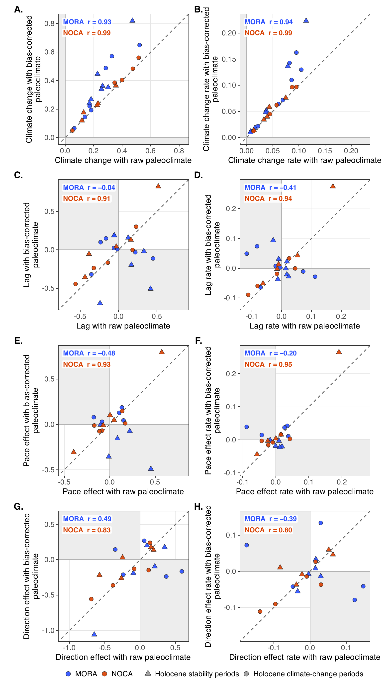

**Fig. S16. Holocene lake-periods with the raw and the bias-corrected
paleoclimate.** Each point is one lake-period, with its value from the
raw paleoclimate (x) against its value from the bias-corrected
paleoclimate (y): (A) climate change and (B) its rate, (C) the lag and
(D) its rate, (E) the pace effect and (F) its rate, (G) the direction
effect and (H) its rate. Totals over the lake-period on the left, rates
per century on the right. Blue MORA, orange NOCA, triangles Holocene
stability periods, circles Holocene climate-change periods. On the
dashed line the correction changes nothing. In the shaded quadrants the
value changes sign. The numbers in each panel are the Pearson
correlation r between the two runs across the lake-periods of each park.
Lake-periods whose observed or predicted position did not move have no
pace or direction effect. Turnover and displacement are the same in both
runs and are not shown. Climate change in standardized units, the other
quantities in CCA distance (totals) or CCA distance per century (rates).
Script:
[`R/figures/supp_bias_correction.R`](R/figures/supp_bias_correction.R).

**Result.** The correction changes the climate change of a lake-period
by a median of 14% (Fig. S16A, B), but the corrected values follow the
raw ones closely (r = 0.93 at MORA and 0.99 at NOCA). It changes the
sign of many lags. The lag keeps its sign in 3 of 14 lake-periods at
MORA and 8 of 10 at NOCA, the pace effect in 5 of 10 and 10 of 10, and
the direction effect in 6 of 10 and 8 of 10 (the rates share the sign of
the totals). The MORA Holocene lags are small, so a small shift in the
two mismatches is enough to flip them. Across the lake-periods of a
park, the corrected lag, pace effect and direction effect and their
rates follow the raw ones at NOCA (r = 0.80 to 0.95) but not at MORA,
where r is -0.04 for the lag, -0.41 for the lag rate, -0.48 for the pace
effect, -0.20 for its rate, 0.49 for the direction effect and -0.39 for
its rate. Of the 60 era contrasts (Table S3.1), 19 are significant after
the Holm adjustment with the raw paleoclimate and 24 with the
bias-corrected one. Those whose significance differs between the runs:
Direction effect, NOCA, Holocene-C - Holocene-S (Holm p 1.000 raw, 0.006
corrected); Lag, MORA, Anthropocene - Holocene-C (Holm p 0.530 raw,
0.014 corrected); Pace effect, MORA, Holocene-C - Holocene-S (Holm p
0.958 raw, \< 0.001 corrected); Pace effect (not divided by time), MORA,
Anthropocene - Holocene-S (Holm p 1.000 raw, 0.019 corrected); Pace
effect (not divided by time), MORA, Holocene-C - Holocene-S (Holm p
1.000 raw, 0.008 corrected). Of the 18 Holocene explanatory slopes
(Table S3.2), 8 have an interval that excludes zero with the raw
paleoclimate and 5 with the bias-corrected one. Those that differ (Fig.
S17): Lag rate, Climate change rate (-0.098 raw, +0.301 corrected); Pace
effect, Climate change rate (-0.300 raw, +0.315 corrected); Pace effect,
Fire activity (+0.206 raw, -0.072 corrected); Direction effect, Fire
activity (+0.101 raw, -0.184 corrected); Lag, Site (NOCA minus MORA)
(-0.676 raw, +0.505 corrected); Lag, Climate change (-0.951 raw, +0.020
corrected); Lag, Fire activity (+1.245 raw, -0.922 corrected); Direction
effect (not divided by time), Climate change (-1.653 raw, -0.408
corrected); Direction effect (not divided by time), Fire activity
(+0.676 raw, -0.274 corrected).

**Table S3.1. Era contrasts with the raw and the bias-corrected
paleoclimate.** Differences of fitted means between period types in each
park, from the era models (estimate ~ period_type \* site), with 95%
confidence intervals and Holm-adjusted p across the six period-type
contrasts of each response. Turnover rate and displacement use only the
observed positions and are the same in both runs. Units as in Figures 5
and 6.

| Response | Park | Contrast | Raw paleoclimate | Bias-corrected paleoclimate |
|:---|:---|:---|:---|:---|
| Climate change (not divided by time) | MORA | Anthropocene - Holocene-C | +0.505 (0.372 to 0.637), Holm p \< 0.001 | +0.412 (0.213 to 0.611), Holm p \< 0.001 |
| Climate change (not divided by time) | MORA | Anthropocene - Holocene-S | +0.513 (0.418 to 0.608), Holm p \< 0.001 | +0.389 (0.212 to 0.565), Holm p \< 0.001 |
| Climate change (not divided by time) | MORA | Holocene-C - Holocene-S | +0.008 (-0.189 to 0.205), Holm p = 0.935 | -0.023 (-0.359 to 0.312), Holm p = 0.892 |
| Climate change (not divided by time) | NOCA | Anthropocene - Holocene-C | +0.389 (0.221 to 0.557), Holm p \< 0.001 | +0.369 (0.191 to 0.548), Holm p \< 0.001 |
| Climate change (not divided by time) | NOCA | Anthropocene - Holocene-S | +0.564 (0.454 to 0.674), Holm p \< 0.001 | +0.549 (0.443 to 0.654), Holm p \< 0.001 |
| Climate change (not divided by time) | NOCA | Holocene-C - Holocene-S | +0.174 (-0.050 to 0.399), Holm p = 0.254 | +0.179 (-0.053 to 0.411), Holm p = 0.260 |
| Climate change rate | MORA | Anthropocene - Holocene-C | +2.522 (2.429 to 2.616), Holm p \< 0.001 | +2.496 (2.398 to 2.594), Holm p \< 0.001 |
| Climate change rate | MORA | Anthropocene - Holocene-S | +2.554 (2.459 to 2.650), Holm p \< 0.001 | +2.525 (2.416 to 2.633), Holm p \< 0.001 |
| Climate change rate | MORA | Holocene-C - Holocene-S | +0.032 (-0.006 to 0.069), Holm p = 0.191 | +0.029 (-0.039 to 0.097), Holm p = 0.524 |
| Climate change rate | NOCA | Anthropocene - Holocene-C | +2.649 (2.421 to 2.877), Holm p \< 0.001 | +2.645 (2.416 to 2.873), Holm p \< 0.001 |
| Climate change rate | NOCA | Anthropocene - Holocene-S | +2.669 (2.442 to 2.896), Holm p \< 0.001 | +2.665 (2.438 to 2.892), Holm p \< 0.001 |
| Climate change rate | NOCA | Holocene-C - Holocene-S | +0.020 (-0.015 to 0.056), Holm p = 0.262 | +0.021 (-0.015 to 0.057), Holm p = 0.524 |
| Displacement (turnover, not divided by time) | MORA | Anthropocene - Holocene-C | +0.130 (-0.009 to 0.269), Holm p = 0.331 | +0.130 (-0.009 to 0.269), Holm p = 0.331 |
| Displacement (turnover, not divided by time) | MORA | Anthropocene - Holocene-S | +0.019 (-0.187 to 0.225), Holm p = 0.964 | +0.019 (-0.187 to 0.225), Holm p = 0.964 |
| Displacement (turnover, not divided by time) | MORA | Holocene-C - Holocene-S | -0.111 (-0.409 to 0.187), Holm p = 0.964 | -0.111 (-0.409 to 0.187), Holm p = 0.964 |
| Displacement (turnover, not divided by time) | NOCA | Anthropocene - Holocene-C | +0.312 (0.235 to 0.389), Holm p \< 0.001 | +0.312 (0.235 to 0.389), Holm p \< 0.001 |
| Displacement (turnover, not divided by time) | NOCA | Anthropocene - Holocene-S | +0.171 (-0.099 to 0.442), Holm p = 0.856 | +0.171 (-0.099 to 0.442), Holm p = 0.856 |
| Displacement (turnover, not divided by time) | NOCA | Holocene-C - Holocene-S | -0.141 (-0.419 to 0.138), Holm p = 0.964 | -0.141 (-0.419 to 0.138), Holm p = 0.964 |
| Turnover rate | MORA | Anthropocene - Holocene-C | +0.841 (0.734 to 0.949), Holm p \< 0.001 | +0.841 (0.734 to 0.949), Holm p \< 0.001 |
| Turnover rate | MORA | Anthropocene - Holocene-S | +0.900 (0.808 to 0.992), Holm p \< 0.001 | +0.900 (0.808 to 0.992), Holm p \< 0.001 |
| Turnover rate | MORA | Holocene-C - Holocene-S | +0.059 (-0.020 to 0.137), Holm p = 0.285 | +0.059 (-0.020 to 0.137), Holm p = 0.285 |
| Turnover rate | NOCA | Anthropocene - Holocene-C | +2.066 (1.838 to 2.294), Holm p \< 0.001 | +2.066 (1.838 to 2.294), Holm p \< 0.001 |
| Turnover rate | NOCA | Anthropocene - Holocene-S | +1.981 (1.693 to 2.269), Holm p \< 0.001 | +1.981 (1.693 to 2.269), Holm p \< 0.001 |
| Turnover rate | NOCA | Holocene-C - Holocene-S | -0.085 (-0.301 to 0.131), Holm p = 0.441 | -0.085 (-0.301 to 0.131), Holm p = 0.441 |
| Lag | MORA | Anthropocene - Holocene-C | +0.191 (-0.029 to 0.411), Holm p = 0.530 | +0.188 (0.067 to 0.308), Holm p = 0.014 |
| Lag | MORA | Anthropocene - Holocene-S | +0.069 (-0.122 to 0.260), Holm p = 1.000 | +0.295 (0.027 to 0.562), Holm p = 0.154 |
| Lag | MORA | Holocene-C - Holocene-S | -0.122 (-0.472 to 0.228), Holm p = 1.000 | +0.107 (-0.175 to 0.389), Holm p = 1.000 |
| Lag | NOCA | Anthropocene - Holocene-C | +0.136 (-0.189 to 0.462), Holm p = 1.000 | +0.079 (-0.176 to 0.335), Holm p = 1.000 |
| Lag | NOCA | Anthropocene - Holocene-S | +0.007 (-0.395 to 0.409), Holm p = 1.000 | -0.179 (-0.586 to 0.228), Holm p = 1.000 |
| Lag | NOCA | Holocene-C - Holocene-S | -0.129 (-0.754 to 0.496), Holm p = 1.000 | -0.258 (-0.709 to 0.194), Holm p = 1.000 |
| Lag rate | MORA | Anthropocene - Holocene-C | +0.564 (0.421 to 0.708), Holm p \< 0.001 | +0.552 (0.427 to 0.677), Holm p \< 0.001 |
| Lag rate | MORA | Anthropocene - Holocene-S | +0.552 (0.431 to 0.673), Holm p \< 0.001 | +0.542 (0.417 to 0.666), Holm p \< 0.001 |
| Lag rate | MORA | Holocene-C - Holocene-S | -0.012 (-0.106 to 0.082), Holm p = 1.000 | -0.010 (-0.068 to 0.047), Holm p = 1.000 |
| Lag rate | NOCA | Anthropocene - Holocene-C | -0.034 (-0.324 to 0.257), Holm p = 1.000 | -0.050 (-0.330 to 0.230), Holm p = 1.000 |
| Lag rate | NOCA | Anthropocene - Holocene-S | -0.117 (-0.418 to 0.184), Holm p = 1.000 | -0.141 (-0.443 to 0.160), Holm p = 1.000 |
| Lag rate | NOCA | Holocene-C - Holocene-S | -0.083 (-0.283 to 0.117), Holm p = 1.000 | -0.091 (-0.232 to 0.050), Holm p = 0.818 |
| Pace effect (not divided by time) | MORA | Anthropocene - Holocene-C | +0.021 (-0.121 to 0.163), Holm p = 1.000 | -0.044 (-0.106 to 0.019), Holm p = 0.609 |
| Pace effect (not divided by time) | MORA | Anthropocene - Holocene-S | -0.070 (-0.284 to 0.144), Holm p = 1.000 | +0.266 (0.087 to 0.446), Holm p = 0.019 |
| Pace effect (not divided by time) | MORA | Holocene-C - Holocene-S | -0.091 (-0.379 to 0.197), Holm p = 1.000 | +0.310 (0.122 to 0.498), Holm p = 0.008 |
| Pace effect (not divided by time) | NOCA | Anthropocene - Holocene-C | -0.038 (-0.199 to 0.122), Holm p = 1.000 | -0.082 (-0.193 to 0.030), Holm p = 0.609 |
| Pace effect (not divided by time) | NOCA | Anthropocene - Holocene-S | -0.128 (-0.454 to 0.198), Holm p = 1.000 | -0.233 (-0.614 to 0.148), Holm p = 0.609 |
| Pace effect (not divided by time) | NOCA | Holocene-C - Holocene-S | -0.090 (-0.487 to 0.308), Holm p = 1.000 | -0.151 (-0.535 to 0.233), Holm p = 0.609 |
| Pace effect | MORA | Anthropocene - Holocene-C | +0.171 (0.061 to 0.281), Holm p = 0.012 | +0.145 (0.052 to 0.239), Holm p = 0.010 |
| Pace effect | MORA | Anthropocene - Holocene-S | +0.169 (0.075 to 0.263), Holm p = 0.003 | +0.186 (0.093 to 0.279), Holm p \< 0.001 |
| Pace effect | MORA | Holocene-C - Holocene-S | -0.002 (-0.070 to 0.066), Holm p = 0.958 | +0.041 (0.023 to 0.058), Holm p \< 0.001 |
| Pace effect | NOCA | Anthropocene - Holocene-C | -0.257 (-0.539 to 0.026), Holm p = 0.224 | -0.269 (-0.550 to 0.012), Holm p = 0.120 |
| Pace effect | NOCA | Anthropocene - Holocene-S | -0.307 (-0.603 to -0.011), Holm p = 0.167 | -0.321 (-0.626 to -0.015), Holm p = 0.118 |
| Pace effect | NOCA | Holocene-C - Holocene-S | -0.050 (-0.169 to 0.068), Holm p = 0.803 | -0.052 (-0.177 to 0.073), Holm p = 0.415 |
| Direction effect (not divided by time) | MORA | Anthropocene - Holocene-C | +0.062 (-0.257 to 0.381), Holm p = 1.000 | +0.119 (-0.101 to 0.340), Holm p = 1.000 |
| Direction effect (not divided by time) | MORA | Anthropocene - Holocene-S | +0.170 (-0.168 to 0.509), Holm p = 1.000 | +0.318 (-0.171 to 0.806), Holm p = 1.000 |
| Direction effect (not divided by time) | MORA | Holocene-C - Holocene-S | +0.108 (-0.479 to 0.695), Holm p = 1.000 | +0.198 (-0.275 to 0.672), Holm p = 1.000 |
| Direction effect (not divided by time) | NOCA | Anthropocene - Holocene-C | +0.118 (-0.369 to 0.606), Holm p = 1.000 | +0.108 (-0.165 to 0.382), Holm p = 1.000 |
| Direction effect (not divided by time) | NOCA | Anthropocene - Holocene-S | +0.095 (-0.380 to 0.571), Holm p = 1.000 | -0.065 (-0.263 to 0.132), Holm p = 1.000 |
| Direction effect (not divided by time) | NOCA | Holocene-C - Holocene-S | -0.023 (-0.915 to 0.869), Holm p = 1.000 | -0.174 (-0.422 to 0.075), Holm p = 1.000 |
| Direction effect | MORA | Anthropocene - Holocene-C | +0.344 (0.149 to 0.539), Holm p = 0.003 | +0.322 (0.131 to 0.513), Holm p = 0.005 |
| Direction effect | MORA | Anthropocene - Holocene-S | +0.349 (0.182 to 0.517), Holm p \< 0.001 | +0.361 (0.191 to 0.531), Holm p \< 0.001 |
| Direction effect | MORA | Holocene-C - Holocene-S | +0.005 (-0.109 to 0.119), Holm p = 1.000 | +0.039 (-0.044 to 0.121), Holm p = 0.360 |
| Direction effect | NOCA | Anthropocene - Holocene-C | -0.226 (-0.551 to 0.098), Holm p = 0.512 | -0.217 (-0.533 to 0.099), Holm p = 0.354 |
| Direction effect | NOCA | Anthropocene - Holocene-S | -0.252 (-0.573 to 0.069), Holm p = 0.495 | -0.282 (-0.596 to 0.032), Holm p = 0.234 |
| Direction effect | NOCA | Holocene-C - Holocene-S | -0.026 (-0.179 to 0.127), Holm p = 1.000 | -0.065 (-0.105 to -0.025), Holm p = 0.006 |

<sub>Table file:
[appendix_s3_era_contrasts.csv](report/tables/appendix_s3_era_contrasts.csv)</sub>

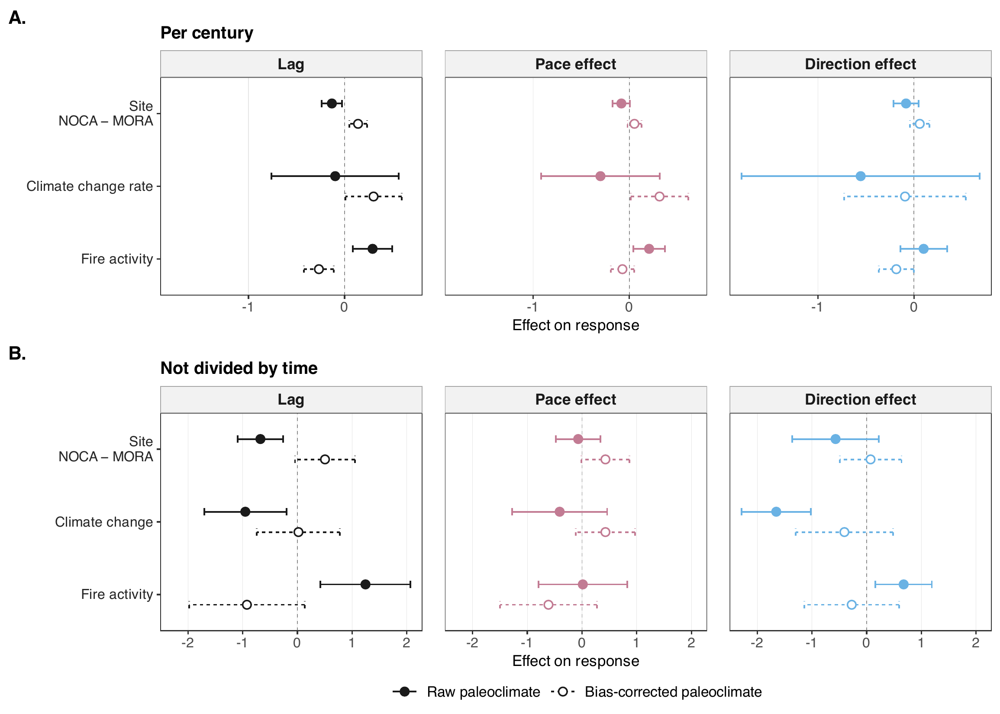

**Fig. S17. Holocene explanatory slopes with the raw and the
bias-corrected paleoclimate.** The slopes of Figure 7A and C, from the
model response ~ site + climate + fire activity on the Holocene
lake-periods, each with its conditional 95% confidence interval. Filled
points and solid lines with the raw paleoclimate, open points and dashed
lines with the bias-corrected paleoclimate. (A) The lag, the pace effect
and the direction effect per century, with the climate change rate as
the climate term. (B) The same responses not divided by time, with the
climate change as the climate term. Black lag, pink pace effect, blue
direction effect. The dashed vertical line marks no effect. Script:
[`R/figures/supp_bias_correction.R`](R/figures/supp_bias_correction.R).

**Table S3.2. Holocene explanatory-model slopes with the raw and the
bias-corrected paleoclimate.** Model response ~ site + climate + fire
activity on the Holocene lake-periods, as in Figure 7A and C, with an
AR(1) correlation within each lake, conditional 95% confidence intervals
and p. The climate term is the climate change rate for the per-century
responses and the climate change for the totals. The Anthropocene models
hold no paleoclimate and are the same in both runs. Fig. S17 draws the
same slopes.

| Response | Term | Raw paleoclimate | Bias-corrected paleoclimate |
|:---|:---|:---|:---|
| Lag | Site (NOCA minus MORA) | -0.676 (-1.093 to -0.258), p = 0.003 | +0.505 (-0.043 to 1.053), p = 0.069 |
| Lag | Climate change | -0.951 (-1.703 to -0.200), p = 0.016 | +0.020 (-0.740 to 0.780), p = 0.957 |
| Lag | Fire activity | +1.245 (0.422 to 2.068), p = 0.005 | -0.922 (-1.980 to 0.136), p = 0.084 |
| Lag rate | Site (NOCA minus MORA) | -0.133 (-0.238 to -0.027), p = 0.016 | +0.140 (0.047 to 0.232), p = 0.005 |
| Lag rate | Climate change rate | -0.098 (-0.760 to 0.564), p = 0.761 | +0.301 (0.007 to 0.594), p = 0.045 |
| Lag rate | Fire activity | +0.291 (0.085 to 0.496), p = 0.008 | -0.268 (-0.423 to -0.113), p = 0.002 |
| Pace effect (not divided by time) | Site (NOCA minus MORA) | -0.070 (-0.477 to 0.337), p = 0.720 | +0.428 (-0.009 to 0.865), p = 0.055 |
| Pace effect (not divided by time) | Climate change | -0.409 (-1.277 to 0.459), p = 0.333 | +0.428 (-0.116 to 0.972), p = 0.115 |
| Pace effect (not divided by time) | Fire activity | +0.014 (-0.799 to 0.828), p = 0.970 | -0.614 (-1.499 to 0.272), p = 0.161 |
| Pace effect | Site (NOCA minus MORA) | -0.082 (-0.173 to 0.008), p = 0.071 | +0.053 (-0.019 to 0.126), p = 0.138 |
| Pace effect | Climate change rate | -0.300 (-0.916 to 0.315), p = 0.317 | +0.315 (0.015 to 0.614), p = 0.041 |
| Pace effect | Fire activity | +0.206 (0.043 to 0.369), p = 0.016 | -0.072 (-0.194 to 0.051), p = 0.233 |
| Direction effect (not divided by time) | Site (NOCA minus MORA) | -0.569 (-1.361 to 0.223), p = 0.147 | +0.071 (-0.495 to 0.636), p = 0.794 |
| Direction effect (not divided by time) | Climate change | -1.653 (-2.288 to -1.018), p = 0.000 | -0.408 (-1.297 to 0.482), p = 0.346 |
| Direction effect (not divided by time) | Fire activity | +0.676 (0.161 to 1.190), p = 0.013 | -0.274 (-1.138 to 0.590), p = 0.511 |
| Direction effect | Site (NOCA minus MORA) | -0.083 (-0.212 to 0.047), p = 0.196 | +0.060 (-0.041 to 0.161), p = 0.225 |
| Direction effect | Climate change rate | -0.554 (-1.794 to 0.685), p = 0.357 | -0.093 (-0.725 to 0.539), p = 0.759 |
| Direction effect | Fire activity | +0.101 (-0.142 to 0.344), p = 0.393 | -0.184 (-0.366 to -0.002), p = 0.048 |

<sub>Table file:
[appendix_s3_explanatory_slopes.csv](report/tables/appendix_s3_explanatory_slopes.csv)</sub>

# Numbers for the Results text

Every number below is read from an output of the run. Rates are per
century. Intervals are 95% conditional confidence intervals (models) or
t-intervals (species). Holocene climate-change lake-periods span 200 to
900 years and stability lake-periods 200 to 2600 years between their
first and last sampled century. Anthropocene plot pairs span 27.5 to
32.5 years between the midpoints of their climate windows (about 29
years).

**Climate–community space: the climate constraints.**

**Screening.** Adding MWT and WP to MSpT + SP: pseudo-F 8.91, p = 0.0001
unrestricted and 0.0104 within parks.

| Set | Max VIF | Adjusted R² | MORA lake-centuries outside (%) | NOCA lake-centuries outside (%) |
|:---|---:|---:|---:|---:|
| All four | 29.511 | 0.149 | 88.288 | 14.414 |
| MSpT + SP | 1.077 | 0.126 | 0.000 | 0.000 |
| MWT + SP | 1.002 | 0.128 | 0.000 | 0.000 |

<sub>Table file:
[numbers_step0.csv](report/tables/numbers_step0.csv)</sub>

**Climate periods and lake-periods.**

**Lake-periods** (raw values, not model estimates). 27 lake and period
combinations had a sampled century, and 24 had two or more.

| Park | Period type | Lake-periods | Years (min) | Years (max) | Climate change rate (mean) | Fire activity (min) | Fire activity (max) | Fire activity (mean) |
|:---|:---|---:|---:|---:|---:|---:|---:|---:|
| MORA | Holocene-C | 7 | 200 | 500 | 0.074 | 0.000 | 0.417 | 0.207 |
| MORA | Holocene-S | 7 | 200 | 2400 | 0.042 | 0.000 | 0.125 | 0.090 |
| NOCA | Holocene-C | 5 | 400 | 900 | 0.059 | 0.600 | 0.889 | 0.731 |
| NOCA | Holocene-S | 5 | 300 | 2600 | 0.041 | 0.333 | 0.667 | 0.481 |

<sub>Table file:
[numbers_units.csv](report/tables/numbers_units.csv)</sub>

**Climate–community lags, pace and direction: era models, fitted means,
contrasts and folds per park.**

**Fitted means.**

| Response | Park | Period type | n | Mean | 95% CI |
|:---|:---|:---|---:|:---|:---|
| Climate change rate | MORA | Holocene-S | 7 | +0.042 | 0.012 to 0.072 |
| Climate change rate | MORA | Holocene-C | 7 | +0.074 | 0.054 to 0.094 |
| Climate change rate | MORA | Anthropocene | 328 | +2.596 | 2.505 to 2.687 |
| Climate change rate | NOCA | Holocene-S | 5 | +0.042 | 0.022 to 0.062 |
| Climate change rate | NOCA | Holocene-C | 5 | +0.062 | 0.034 to 0.090 |
| Climate change rate | NOCA | Anthropocene | 277 | +2.711 | 2.485 to 2.937 |
| Climate change (not divided by time) | MORA | Holocene-S | 7 | +0.251 | 0.161 to 0.341 |
| Climate change (not divided by time) | MORA | Holocene-C | 7 | +0.260 | 0.131 to 0.389 |
| Climate change (not divided by time) | MORA | Anthropocene | 328 | +0.764 | 0.734 to 0.795 |
| Climate change (not divided by time) | NOCA | Holocene-S | 5 | +0.206 | 0.117 to 0.295 |
| Climate change (not divided by time) | NOCA | Holocene-C | 5 | +0.381 | 0.225 to 0.536 |
| Climate change (not divided by time) | NOCA | Anthropocene | 277 | +0.770 | 0.705 to 0.834 |
| Turnover rate | MORA | Holocene-S | 7 | +0.029 | 0.007 to 0.052 |
| Turnover rate | MORA | Holocene-C | 7 | +0.088 | 0.029 to 0.147 |
| Turnover rate | MORA | Anthropocene | 328 | +0.929 | 0.840 to 1.019 |
| Turnover rate | NOCA | Holocene-S | 5 | +0.147 | -0.033 to 0.327 |
| Turnover rate | NOCA | Holocene-C | 5 | +0.062 | 0.021 to 0.103 |
| Turnover rate | NOCA | Anthropocene | 277 | +2.128 | 1.903 to 2.353 |
| Displacement (turnover, not divided by time) | MORA | Holocene-S | 7 | +0.334 | 0.131 to 0.537 |
| Displacement (turnover, not divided by time) | MORA | Holocene-C | 7 | +0.223 | 0.088 to 0.358 |
| Displacement (turnover, not divided by time) | MORA | Anthropocene | 328 | +0.353 | 0.319 to 0.387 |
| Displacement (turnover, not divided by time) | NOCA | Holocene-S | 5 | +0.506 | 0.245 to 0.767 |
| Displacement (turnover, not divided by time) | NOCA | Holocene-C | 5 | +0.366 | 0.338 to 0.393 |
| Displacement (turnover, not divided by time) | NOCA | Anthropocene | 277 | +0.678 | 0.606 to 0.750 |
| Lag rate | MORA | Holocene-S | 7 | +0.001 | -0.017 to 0.020 |
| Lag rate | MORA | Holocene-C | 7 | -0.011 | -0.090 to 0.068 |
| Lag rate | MORA | Anthropocene | 328 | +0.554 | 0.434 to 0.673 |
| Lag rate | NOCA | Holocene-S | 5 | +0.036 | -0.083 to 0.155 |
| Lag rate | NOCA | Holocene-C | 5 | -0.047 | -0.135 to 0.042 |
| Lag rate | NOCA | Anthropocene | 277 | -0.081 | -0.357 to 0.196 |
| Lag | MORA | Holocene-S | 7 | +0.093 | -0.094 to 0.281 |
| Lag | MORA | Holocene-C | 7 | -0.028 | -0.245 to 0.189 |
| Lag | MORA | Anthropocene | 328 | +0.163 | 0.127 to 0.198 |
| Lag | NOCA | Holocene-S | 5 | -0.030 | -0.424 to 0.364 |
| Lag | NOCA | Holocene-C | 5 | -0.160 | -0.475 to 0.156 |
| Lag | NOCA | Anthropocene | 277 | -0.023 | -0.102 to 0.055 |
| Pace effect | MORA | Holocene-S | 5 | +0.004 | -0.011 to 0.019 |
| Pace effect | MORA | Holocene-C | 5 | +0.002 | -0.057 to 0.061 |
| Pace effect | MORA | Anthropocene | 252 | +0.173 | 0.080 to 0.266 |
| Pace effect | NOCA | Holocene-S | 5 | +0.037 | -0.057 to 0.131 |
| Pace effect | NOCA | Holocene-C | 5 | -0.014 | -0.046 to 0.019 |
| Pace effect | NOCA | Anthropocene | 211 | -0.270 | -0.551 to 0.010 |
| Direction effect | MORA | Holocene-S | 5 | +0.001 | -0.019 to 0.022 |
| Direction effect | MORA | Holocene-C | 5 | +0.007 | -0.096 to 0.109 |
| Direction effect | MORA | Anthropocene | 252 | +0.351 | 0.184 to 0.517 |
| Direction effect | NOCA | Holocene-S | 5 | -0.012 | -0.090 to 0.066 |
| Direction effect | NOCA | Holocene-C | 5 | -0.038 | -0.127 to 0.052 |
| Direction effect | NOCA | Anthropocene | 211 | -0.264 | -0.575 to 0.048 |
| Pace effect (not divided by time) | MORA | Holocene-S | 5 | +0.119 | -0.093 to 0.330 |
| Pace effect (not divided by time) | MORA | Holocene-C | 5 | +0.028 | -0.111 to 0.167 |
| Pace effect (not divided by time) | MORA | Anthropocene | 252 | +0.049 | 0.021 to 0.076 |
| Pace effect (not divided by time) | NOCA | Holocene-S | 5 | +0.051 | -0.265 to 0.367 |
| Pace effect (not divided by time) | NOCA | Holocene-C | 5 | -0.039 | -0.178 to 0.100 |
| Pace effect (not divided by time) | NOCA | Anthropocene | 211 | -0.077 | -0.157 to 0.002 |
| Direction effect (not divided by time) | MORA | Holocene-S | 5 | -0.068 | -0.403 to 0.267 |
| Direction effect (not divided by time) | MORA | Holocene-C | 5 | +0.040 | -0.275 to 0.356 |
| Direction effect (not divided by time) | MORA | Anthropocene | 252 | +0.102 | 0.054 to 0.151 |
| Direction effect (not divided by time) | NOCA | Holocene-S | 5 | -0.169 | -0.637 to 0.298 |
| Direction effect (not divided by time) | NOCA | Holocene-C | 5 | -0.193 | -0.672 to 0.287 |
| Direction effect (not divided by time) | NOCA | Anthropocene | 211 | -0.074 | -0.162 to 0.014 |

<sub>Table file:
[numbers_era_means.csv](report/tables/numbers_era_means.csv)</sub>

**Contrasts between period types.** p (Holm) is adjusted across the six
contrasts of each response (three per park). Quote the adjusted p.

| Response | Park | Contrast | Estimate | 95% CI | p | p (Holm) |
|:---|:---|:---|:---|:---|---:|---:|
| Climate change (not divided by time) | MORA | Anthropocene - Holocene-C | +0.505 | 0.372 to 0.637 | 0.000 | 0.000 |
| Climate change (not divided by time) | MORA | Anthropocene - Holocene-S | +0.513 | 0.418 to 0.608 | 0.000 | 0.000 |
| Climate change (not divided by time) | MORA | Holocene-C - Holocene-S | +0.008 | -0.189 to 0.205 | 0.935 | 0.935 |
| Climate change (not divided by time) | NOCA | Anthropocene - Holocene-C | +0.389 | 0.221 to 0.557 | 0.000 | 0.000 |
| Climate change (not divided by time) | NOCA | Anthropocene - Holocene-S | +0.564 | 0.454 to 0.674 | 0.000 | 0.000 |
| Climate change (not divided by time) | NOCA | Holocene-C - Holocene-S | +0.174 | -0.050 to 0.399 | 0.127 | 0.254 |
| Climate change rate | MORA | Anthropocene - Holocene-C | +2.522 | 2.429 to 2.616 | 0.000 | 0.000 |
| Climate change rate | MORA | Anthropocene - Holocene-S | +2.554 | 2.459 to 2.650 | 0.000 | 0.000 |
| Climate change rate | MORA | Holocene-C - Holocene-S | +0.032 | -0.006 to 0.069 | 0.096 | 0.191 |
| Climate change rate | NOCA | Anthropocene - Holocene-C | +2.649 | 2.421 to 2.877 | 0.000 | 0.000 |
| Climate change rate | NOCA | Anthropocene - Holocene-S | +2.669 | 2.442 to 2.896 | 0.000 | 0.000 |
| Climate change rate | NOCA | Holocene-C - Holocene-S | +0.020 | -0.015 to 0.056 | 0.262 | 0.262 |
| Direction effect | MORA | Anthropocene - Holocene-C | +0.344 | 0.149 to 0.539 | 0.001 | 0.003 |
| Direction effect | MORA | Anthropocene - Holocene-S | +0.349 | 0.182 to 0.517 | 0.000 | 0.000 |
| Direction effect | MORA | Holocene-C - Holocene-S | +0.005 | -0.109 to 0.119 | 0.926 | 1.000 |
| Direction effect | NOCA | Anthropocene - Holocene-C | -0.226 | -0.551 to 0.098 | 0.171 | 0.512 |
| Direction effect | NOCA | Anthropocene - Holocene-S | -0.252 | -0.573 to 0.069 | 0.124 | 0.495 |
| Direction effect | NOCA | Holocene-C - Holocene-S | -0.026 | -0.179 to 0.127 | 0.743 | 1.000 |
| Direction effect (not divided by time) | MORA | Anthropocene - Holocene-C | +0.062 | -0.257 to 0.381 | 0.703 | 1.000 |
| Direction effect (not divided by time) | MORA | Anthropocene - Holocene-S | +0.170 | -0.168 to 0.509 | 0.323 | 1.000 |
| Direction effect (not divided by time) | MORA | Holocene-C - Holocene-S | +0.108 | -0.479 to 0.695 | 0.717 | 1.000 |
| Direction effect (not divided by time) | NOCA | Anthropocene - Holocene-C | +0.118 | -0.369 to 0.606 | 0.633 | 1.000 |
| Direction effect (not divided by time) | NOCA | Anthropocene - Holocene-S | +0.095 | -0.380 to 0.571 | 0.694 | 1.000 |
| Direction effect (not divided by time) | NOCA | Holocene-C - Holocene-S | -0.023 | -0.915 to 0.869 | 0.959 | 1.000 |
| Displacement (turnover, not divided by time) | MORA | Anthropocene - Holocene-C | +0.130 | -0.009 to 0.269 | 0.066 | 0.331 |
| Displacement (turnover, not divided by time) | MORA | Anthropocene - Holocene-S | +0.019 | -0.187 to 0.225 | 0.857 | 0.964 |
| Displacement (turnover, not divided by time) | MORA | Holocene-C - Holocene-S | -0.111 | -0.409 to 0.187 | 0.464 | 0.964 |
| Displacement (turnover, not divided by time) | NOCA | Anthropocene - Holocene-C | +0.312 | 0.235 to 0.389 | 0.000 | 0.000 |
| Displacement (turnover, not divided by time) | NOCA | Anthropocene - Holocene-S | +0.171 | -0.099 to 0.442 | 0.214 | 0.856 |
| Displacement (turnover, not divided by time) | NOCA | Holocene-C - Holocene-S | -0.141 | -0.419 to 0.138 | 0.321 | 0.964 |
| Lag | MORA | Anthropocene - Holocene-C | +0.191 | -0.029 to 0.411 | 0.088 | 0.530 |
| Lag | MORA | Anthropocene - Holocene-S | +0.069 | -0.122 to 0.260 | 0.477 | 1.000 |
| Lag | MORA | Holocene-C - Holocene-S | -0.122 | -0.472 to 0.228 | 0.495 | 1.000 |
| Lag | NOCA | Anthropocene - Holocene-C | +0.136 | -0.189 to 0.462 | 0.411 | 1.000 |
| Lag | NOCA | Anthropocene - Holocene-S | +0.007 | -0.395 to 0.409 | 0.973 | 1.000 |
| Lag | NOCA | Holocene-C - Holocene-S | -0.129 | -0.754 to 0.496 | 0.684 | 1.000 |
| Lag rate | MORA | Anthropocene - Holocene-C | +0.564 | 0.421 to 0.708 | 0.000 | 0.000 |
| Lag rate | MORA | Anthropocene - Holocene-S | +0.552 | 0.431 to 0.673 | 0.000 | 0.000 |
| Lag rate | MORA | Holocene-C - Holocene-S | -0.012 | -0.106 to 0.082 | 0.797 | 1.000 |
| Lag rate | NOCA | Anthropocene - Holocene-C | -0.034 | -0.324 to 0.257 | 0.819 | 1.000 |
| Lag rate | NOCA | Anthropocene - Holocene-S | -0.117 | -0.418 to 0.184 | 0.447 | 1.000 |
| Lag rate | NOCA | Holocene-C - Holocene-S | -0.083 | -0.283 to 0.117 | 0.414 | 1.000 |
| Pace effect | MORA | Anthropocene - Holocene-C | +0.171 | 0.061 to 0.281 | 0.002 | 0.012 |
| Pace effect | MORA | Anthropocene - Holocene-S | +0.169 | 0.075 to 0.263 | 0.000 | 0.003 |
| Pace effect | MORA | Holocene-C - Holocene-S | -0.002 | -0.070 to 0.066 | 0.958 | 0.958 |
| Pace effect | NOCA | Anthropocene - Holocene-C | -0.257 | -0.539 to 0.026 | 0.075 | 0.224 |
| Pace effect | NOCA | Anthropocene - Holocene-S | -0.307 | -0.603 to -0.011 | 0.042 | 0.167 |
| Pace effect | NOCA | Holocene-C - Holocene-S | -0.050 | -0.169 to 0.068 | 0.402 | 0.803 |
| Pace effect (not divided by time) | MORA | Anthropocene - Holocene-C | +0.021 | -0.121 to 0.163 | 0.775 | 1.000 |
| Pace effect (not divided by time) | MORA | Anthropocene - Holocene-S | -0.070 | -0.284 to 0.144 | 0.520 | 1.000 |
| Pace effect (not divided by time) | MORA | Holocene-C - Holocene-S | -0.091 | -0.379 to 0.197 | 0.536 | 1.000 |
| Pace effect (not divided by time) | NOCA | Anthropocene - Holocene-C | -0.038 | -0.199 to 0.122 | 0.639 | 1.000 |
| Pace effect (not divided by time) | NOCA | Anthropocene - Holocene-S | -0.128 | -0.454 to 0.198 | 0.440 | 1.000 |
| Pace effect (not divided by time) | NOCA | Holocene-C - Holocene-S | -0.090 | -0.487 to 0.308 | 0.657 | 1.000 |
| Turnover rate | MORA | Anthropocene - Holocene-C | +0.841 | 0.734 to 0.949 | 0.000 | 0.000 |
| Turnover rate | MORA | Anthropocene - Holocene-S | +0.900 | 0.808 to 0.992 | 0.000 | 0.000 |
| Turnover rate | MORA | Holocene-C - Holocene-S | +0.059 | -0.020 to 0.137 | 0.143 | 0.285 |
| Turnover rate | NOCA | Anthropocene - Holocene-C | +2.066 | 1.838 to 2.294 | 0.000 | 0.000 |
| Turnover rate | NOCA | Anthropocene - Holocene-S | +1.981 | 1.693 to 2.269 | 0.000 | 0.000 |
| Turnover rate | NOCA | Holocene-C - Holocene-S | -0.085 | -0.301 to 0.131 | 0.441 | 0.441 |

<sub>Table file:
[numbers_era_contrasts.csv](report/tables/numbers_era_contrasts.csv)</sub>

**Folds.** The Holocene-C fold is the one quoted as a speed.

| Response            | Park | Anthropocene over |    Fold |
|:--------------------|:-----|:------------------|--------:|
| Climate change rate | MORA | Holocene-C        |  35.068 |
| Climate change rate | MORA | Holocene-S        |  61.531 |
| Climate change rate | NOCA | Holocene-C        |  43.557 |
| Climate change rate | NOCA | Holocene-S        |  64.919 |
| Turnover rate       | MORA | Holocene-C        |  10.567 |
| Turnover rate       | MORA | Holocene-S        |  31.784 |
| Turnover rate       | NOCA | Holocene-C        |  34.295 |
| Turnover rate       | NOCA | Holocene-S        |  14.471 |
| Lag rate            | MORA | Holocene-C        | -50.519 |
| Lag rate            | MORA | Holocene-S        | 410.329 |
| Lag rate            | NOCA | Holocene-C        |   1.722 |
| Lag rate            | NOCA | Holocene-S        |  -2.227 |

<sub>Table file:
[numbers_era_folds.csv](report/tables/numbers_era_folds.csv)</sub>

**Associations with fire: Holocene explanatory models and their
Anthropocene counterpart.**

**Slopes and contrasts.** Climate change rate: per standardized unit per
century. Fire activity: per event per century per covered core. Each
model has one group contrast (site, and burned minus unburned in the
Anthropocene), so these p-values need no adjustment for multiple
contrasts.

| Response | Era | Term | Estimate | 95% CI | p |
|:---|:---|:---|:---|:---|---:|
| Lag rate | Holocene | siteNOCA | -0.133 | -0.238 to -0.027 | 0.016 |
| Lag rate | Holocene | climate_rate | -0.098 | -0.760 to 0.564 | 0.761 |
| Lag rate | Holocene | fire_activity | +0.291 | 0.085 to 0.496 | 0.008 |
| Lag rate | Anthropocene | siteNOCA | -0.650 | -0.963 to -0.336 | 0.000 |
| Lag rate | Anthropocene | burnedBurned | +0.180 | -0.805 to 1.164 | 0.720 |
| Pace effect | Holocene | siteNOCA | -0.082 | -0.173 to 0.008 | 0.071 |
| Pace effect | Holocene | climate_rate | -0.300 | -0.916 to 0.315 | 0.317 |
| Pace effect | Holocene | fire_activity | +0.206 | 0.043 to 0.369 | 0.016 |
| Pace effect | Anthropocene | siteNOCA | -0.347 | -0.651 to -0.043 | 0.025 |
| Pace effect | Anthropocene | burnedBurned | -1.194 | -2.214 to -0.174 | 0.022 |
| Direction effect | Holocene | siteNOCA | -0.083 | -0.212 to 0.047 | 0.196 |
| Direction effect | Holocene | climate_rate | -0.554 | -1.794 to 0.685 | 0.357 |
| Direction effect | Holocene | fire_activity | +0.101 | -0.142 to 0.344 | 0.393 |
| Direction effect | Anthropocene | siteNOCA | -0.680 | -1.044 to -0.315 | 0.000 |
| Direction effect | Anthropocene | burnedBurned | +0.810 | -0.332 to 1.952 | 0.164 |
| Lag (not divided by time) | Holocene | siteNOCA | -0.676 | -1.093 to -0.258 | 0.003 |
| Lag (not divided by time) | Holocene | climate_change | -0.951 | -1.703 to -0.200 | 0.016 |
| Lag (not divided by time) | Holocene | fire_activity | +1.245 | 0.422 to 2.068 | 0.005 |
| Lag (not divided by time) | Anthropocene | siteNOCA | -0.190 | -0.280 to -0.101 | 0.000 |
| Lag (not divided by time) | Anthropocene | burnedBurned | +0.052 | -0.228 to 0.331 | 0.717 |
| Pace effect (not divided by time) | Holocene | siteNOCA | -0.070 | -0.477 to 0.337 | 0.720 |
| Pace effect (not divided by time) | Holocene | climate_change | -0.409 | -1.277 to 0.459 | 0.333 |
| Pace effect (not divided by time) | Holocene | fire_activity | +0.014 | -0.799 to 0.828 | 0.970 |
| Pace effect (not divided by time) | Anthropocene | siteNOCA | -0.098 | -0.185 to -0.012 | 0.026 |
| Pace effect (not divided by time) | Anthropocene | burnedBurned | -0.340 | -0.630 to -0.050 | 0.021 |
| Direction effect (not divided by time) | Holocene | siteNOCA | -0.569 | -1.361 to 0.223 | 0.147 |
| Direction effect (not divided by time) | Holocene | climate_change | -1.653 | -2.288 to -1.018 | 0.000 |
| Direction effect (not divided by time) | Holocene | fire_activity | +0.676 | 0.161 to 1.190 | 0.013 |
| Direction effect (not divided by time) | Anthropocene | siteNOCA | -0.195 | -0.299 to -0.091 | 0.000 |
| Direction effect (not divided by time) | Anthropocene | burnedBurned | +0.230 | -0.094 to 0.553 | 0.164 |

<sub>Table file:
[numbers_step5.csv](report/tables/numbers_step5.csv)</sub>

**Species contributions.**

**Species means** per measure, park and period type (species with a
defined interval).

| Measure | Park | Period type | Species | Interval above zero | Interval below zero | Largest absolute mean |
|:---|:---|:---|---:|---:|---:|---:|
| contrib_climate | MORA | Anthropocene | 14 | 0 | 4 | 0.051 |
| contrib_climate | MORA | Holocene-C | 9 | 0 | 0 | 0.033 |
| contrib_climate | MORA | Holocene-S | 9 | 0 | 0 | 0.007 |
| contrib_climate | NOCA | Anthropocene | 13 | 2 | 0 | 0.257 |
| contrib_climate | NOCA | Holocene-C | 8 | 0 | 0 | 0.016 |
| contrib_climate | NOCA | Holocene-S | 9 | 0 | 0 | 0.065 |
| contrib_lag | MORA | Anthropocene | 14 | 4 | 1 | 0.035 |
| contrib_lag | MORA | Holocene-C | 9 | 0 | 0 | 0.020 |
| contrib_lag | MORA | Holocene-S | 9 | 0 | 0 | 0.004 |
| contrib_lag | NOCA | Anthropocene | 13 | 0 | 1 | 0.283 |
| contrib_lag | NOCA | Holocene-C | 8 | 0 | 0 | 0.023 |
| contrib_lag | NOCA | Holocene-S | 9 | 0 | 0 | 0.026 |

<sub>Table file:
[numbers_step6.csv](report/tables/numbers_step6.csv)</sub>

**Figure 3, climate rates.**

**Real-unit climate rates per century** (°C for MSpT, mm for SP).

| Kind                     | Variable | Period | cal BP | Rate per century |
|:-------------------------|:---------|:-------|-------:|-----------------:|
| period                   | MSpT     | C1     |   9150 |           -0.044 |
| period                   | SP       | C1     |   9150 |           -1.241 |
| period                   | MSpT     | C2     |   7750 |            0.051 |
| period                   | SP       | C2     |   7750 |            0.945 |
| period                   | MSpT     | C3     |   6550 |           -0.044 |
| period                   | MSpT     | C4     |   5200 |            0.031 |
| period                   | MSpT     | C5     |   2000 |            0.044 |
| largest century step     | MSpT     |        |   4300 |           -1.247 |
| largest century step     | SP       |        |  10400 |           24.000 |
| Anthropocene plot median | MSpT     | MORA   |      — |            1.300 |
| Anthropocene plot median | MSpT     | NOCA   |      — |            0.769 |
| Anthropocene plot median | SP       | MORA   |      — |         -143.639 |
| Anthropocene plot median | SP       | NOCA   |      — |          103.615 |

<sub>Table file:
[numbers_fig2.csv](report/tables/numbers_fig2.csv)</sub>

**Doubts the paper must face (`PLAN.md` section 9), with the numbers
that bear on them.**

**Doubts and the numbers that bear on them.**

| Doubt | Numbers |
|:---|:---|
| MORA fire comes from Sunrise Ridge, the vegetation lakes lie elsewhere | Lag rate fire slope +0.291 (0.085 to 0.496); Pace effect fire slope +0.206 (0.043 to 0.369); Direction effect fire slope +0.101 (-0.142 to 0.344); Lag (not divided by time) fire slope +1.245 (0.422 to 2.068); Pace effect (not divided by time) fire slope +0.014 (-0.799 to 0.828); Direction effect (not divided by time) fire slope +0.676 (0.161 to 1.190) |
| Fire values of the two parks barely overlap | MORA 0.00 to 0.42, NOCA 0.33 to 0.89 |
| Within MORA the stability periods sat at the lowest fire values | MORA Holocene-C mean 0.207, MORA Holocene-S mean 0.090, NOCA Holocene-C mean 0.731, NOCA Holocene-S mean 0.481 |
| Rates over about 29 years and over centuries are not on equal footing | Holocene climate-change lake-periods span 200 to 900 years and stability lake-periods 200 to 2600 years between their first and last sampled century. Anthropocene plot pairs span 27.5 to 32.5 years between the midpoints of their climate windows (about 29 years). |
| MSpT + SP must be argued on mechanism | Adjusted R² 0.126 with MSpT + SP against 0.149 with all four. Adding MWT and WP: p = 0.0001 unrestricted, 0.0104 within parks. |

<sub>Table file:
[numbers_doubts.csv](report/tables/numbers_doubts.csv)</sub>

**Supplement tables of `PLAN.md` section 7.**

| Table | File |
|----|----|
| Screening | [`report/tables/step0_screening.csv`](report/tables/step0_screening.csv) |
| Periods | [`report/tables/step1_periods.csv`](report/tables/step1_periods.csv) |
| Unit table | [`report/tables/step24_lake_periods.csv`](report/tables/step24_lake_periods.csv) |
| Era contrasts | [`report/tables/step5a_era_means.csv`](report/tables/step5a_era_means.csv), [`report/tables/step5a_era_contrasts.csv`](report/tables/step5a_era_contrasts.csv), [`report/tables/step5a_era_folds.csv`](report/tables/step5a_era_folds.csv) |
| Displacement and lag by duration | [`report/tables/step5a_duration_classes.csv`](report/tables/step5a_duration_classes.csv) |
| NOCA plot pairs by legacy plot area | [`report/tables/noca_plot_area_responses.csv`](report/tables/noca_plot_area_responses.csv) |
| Bias-corrected paleoclimate | [`report/tables/bias_correction_lake_periods.csv`](report/tables/bias_correction_lake_periods.csv), [`report/tables/bias_correction_sign_counts.csv`](report/tables/bias_correction_sign_counts.csv) |
| Explanatory models | [`report/tables/step5_explanatory_models.csv`](report/tables/step5_explanatory_models.csv) |
| Species means | [`report/tables/step6_species_means.csv`](report/tables/step6_species_means.csv), [`report/tables/step6_species_means_total.csv`](report/tables/step6_species_means_total.csv) (not divided by time), [`report/tables/species_contrasts.csv`](report/tables/species_contrasts.csv) |
| Species per lake-period | [`report/tables/species_lake_periods.csv`](report/tables/species_lake_periods.csv) |
| NOCA species, burned and unburned | [`report/tables/noca_burned_species_means.csv`](report/tables/noca_burned_species_means.csv) |

The last three are written by the model details page (**Model details
→** [08_models](report/details/08_models.md)).

# Limitations and open questions

CCA sample eligibility, balanced observed/predicted exclusions and
paired Figure 4 endpoints are resolved and require no further decision.
The survey-year and climate-window choices are also settled. The four
questions below remain; the SD-reference and target-origin alternatives
are optional sensitivities. The CARI449/CARI450 GPS exclusion is
resolved. Unequal modern climate-window lengths are an accepted
trade-off; the precipitation-continuity concern is separate from that
settled choice.

The chronology controls and adopted uncertainty assumptions were
reconsidered and retained on 2026-10-06. They no longer require a
decision for the current analysis. Conditional uncertainty, assumed
errors and the unverified basal-lahar correlation remain interpretation
limits documented above and in the MORA source notes; any future
chronology revision is separate work.

| Question | Current choice | Consequence | Evidence needed to resolve it |
|----|----|----|----|
| Raw versus V2.1-anchored TraCE21k climate | The active Holocene analysis uses raw TraCE21k values; the V2.1 anchoring diagnostic is not authoritative. | Absolute Holocene climate levels and cross-product comparisons may retain product bias, although the active within-series change calculations are internally consistent. | A validated overlap-period comparison showing whether anchoring reduces bias without introducing a discontinuity or changing the intended anomaly interpretation. |
| Legacy-calibration versus full-record climate SDs | Changes are divided by SDs from the 605 matched legacy CCA calibration plots. | The reference is tied to the fitted model. A full-record SD would change displayed standardized magnitudes, cross-variable weighting, the unthresholded composite, and standardized climate rates, but not CC/S boundaries under the current variable-specific 50%-of-own-maximum rule. | A prespecified full-record sensitivity with explicit temporal/site weighting and a scientific choice between calibration-relative and dataset-relative effect sizes. |
| Anthropocene precipitation continuity | Historical climate remains 1979–1989; modern climate uses adult Y−5 through Y at both sites (2026-10-07 decision). The MORA precipitation contrast is flagged. | The apparent post-2010 MORA precipitation shift may partly reflect CHELSA inhomogeneity rather than climate. | Independent station/reanalysis validation and a documented decision on whether post-2010 MORA precipitation is usable. The agreed years are not a pending decision. |
| MORA fire record location | The MORA fire values come from the Sunrise Ridge cores, while the vegetation lakes lie elsewhere in the park. | A MORA fire slope may reflect regional fire rather than fire at the lakes. | Charcoal from the vegetation lakes themselves. |
| Fire scales of the two parks | One fire slope for both parks, in events per century per covered core. MORA values span 0.10 to 0.33 and NOCA 0.33 to 0.89, partly because Panther Potholes is read at 12 years and the Sunrise Ridge cores at 42 to 48 years. | The fire slope comes from the narrow range within each park. | Records at comparable resolution, or a resolution-corrected event rate. |
| Rates over different time spans | Holocene rates span 200 to 2,600 years and Anthropocene rates about 29 years. | Longer windows give lower rates, so the folds overstate the speed difference by an unknown amount. | A rate measure that is independent of the window length, or Holocene windows of about 30 years, which the sampling does not allow. |
| Choice of MSpT and SP | Argued on mechanism: spring temperature for snowmelt timing and the start of the growing season, summer precipitation for drying stress. | Winter temperature and winter precipitation still add explained inertia (permutation test in Step 0), through the seasonal contrasts that made the four-variable fit collinear. | The screening table of Step 0 is the evidence. A mechanism-based argument stays necessary. |
| Own-origin versus common-origin taxon target geometry | Deferred: the target-alignment analysis is retired. Existing CCA scores and reference matrices are preserved; the parallel contribution decomposition does not implement that separate target-origin sensitivity. | The two cosines answer alignment relative to each trajectory’s own starting community; part of their difference can arise because LC₁ and WA₁ differ. | A prespecified common-origin sensitivity and an ecological decision about whether the estimand should condition on each starting state or hold the target vector fixed across observed and predicted movement. |
