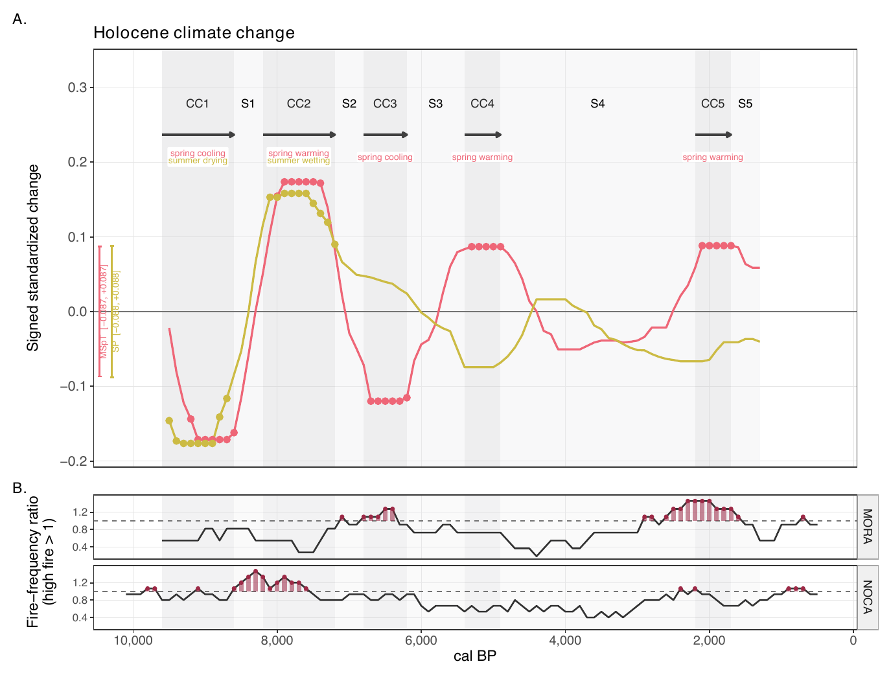
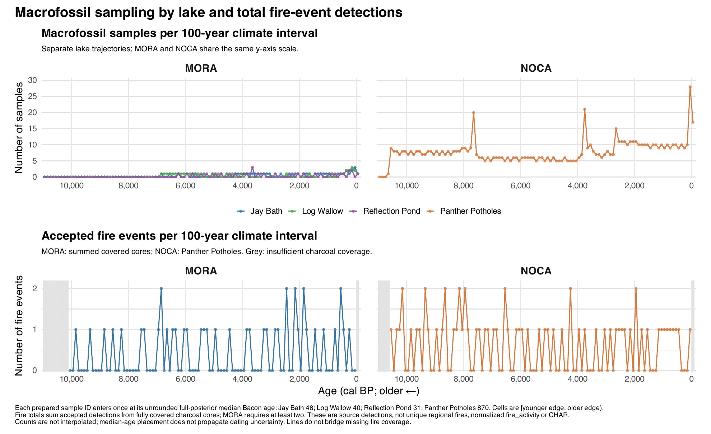
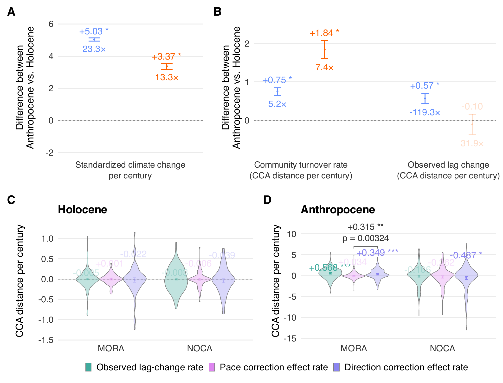
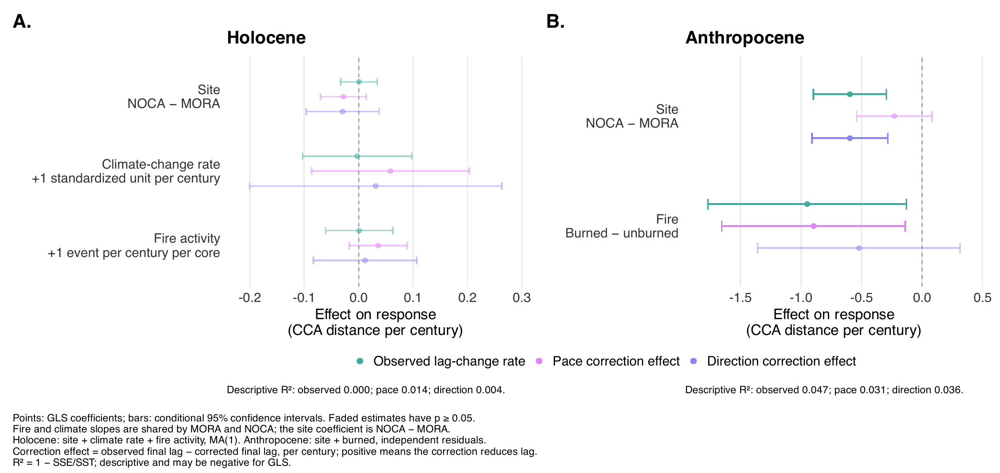
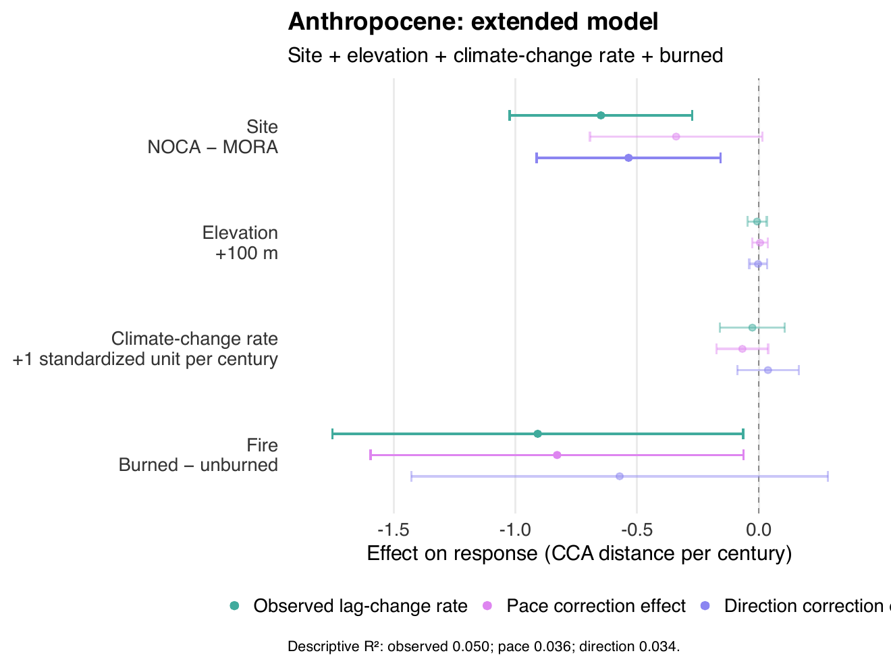
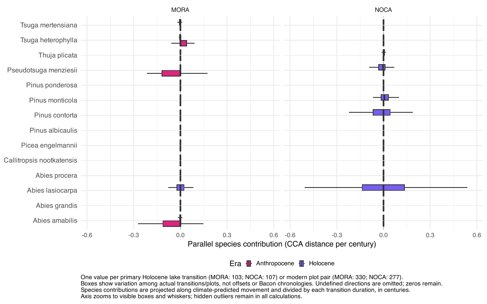
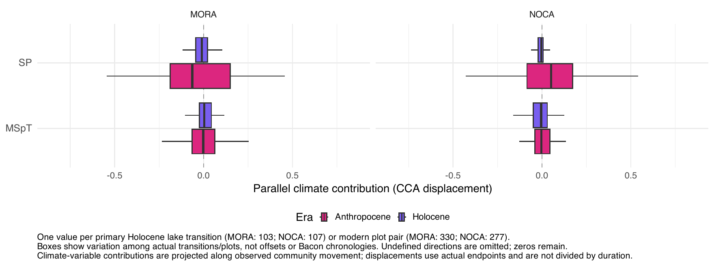

PaleoACES
================

<!-- Generated by R/build_report.R from report/README.Rmd. Edit the .Rmd, not this file. -->

PaleoACES compares climate-predicted and observed forest composition in
Mount Rainier (MORA) and North Cascades (NOCA) National Parks, using
forest resurveys and four Holocene macrofossil records. One CCA
calibrated on the legacy survey plots provides the shared coordinate
system.

This page is the supplementary appendix of the analysis. It shows every
main and supplementary figure, the tables reported in the manuscript and
the modelling code, in the order of the analysis and of the Supporting
Information (Appendix S1, Appendix S2). Data cleaning is summarized by
its figure here; the step-by-step detail sits in
[`report/details/`](report/details), linked from each section.

``` sh
Rscript R/run_all.R --offline   # run the whole analysis from the cached climate (add --age-models to refit Bacon)
Rscript R/build_report.R        # rebuild this page and report/ from the outputs
```

| Folder | Contents |
|----|----|
| `R/pipeline/` | The analysis, numbered in run order (01–15); writes `output/` only |
| `R/figures/` | Main and supplementary figures, drawn from `output/` |
| `R/worked_examples.R` | Step-by-step method illustrations |
| `R/tests/` | Scientific regression checks, run last by `R/run_all.R` |
| `R/helpers/` | Shared functions; `paths.R` declares every output file |
| `report/` | Figures, tables and detail pages of this report |
| `data/`, `Cores/`, `output/` | Raw data, Bacon runs and outputs (local, not in git) |

|  |  |
|----|----|
| Every script and output file | **Outputs and workflow →** [11_outputs_and_workflow](report/details/11_outputs_and_workflow.md) |
| Every analytical decision | **Decisions →** [10_decisions](report/details/10_decisions.md) |
| CCA constraints in this build | MSpT, SP |

Software: R with rbacon 3.5.2, tapas 0.1.5 and CharAnalysis 2.0.3, plus
`pdftoppm` (poppler) for the report.

# The remodelled analysis at a glance

The Holocene side of the analysis is being remodelled on lake-periods:
one lake within one climate period, compared from its first to its last
sampled century. Each row below is filled when its step is finished.

| Step | What it does | Result |
|----|----|----|
| Step 0 | Climate variables and CCA refit | MSpT + SP: VIF 1.08, adjusted R² 0.126 (all four 0.148), no lake-century outside the calibration climate, display rotation -23.4° |
| Step 1 | Climate periods and lake-periods | 10 periods from 9600 to 1300 cal BP (5 C, 5 S), none split |
| Steps 2 to 4 | Mismatch, lag, turnover, pace, direction, climate change rate and fire per lake-period | 24 lake-periods (MORA 14, NOCA 10, 12 C, 12 S), 200 to 2600 years long |
| Step 5 | Holocene explanatory models | Lag rate rises with climate change rate (+0.72, 0.01 to 1.43), fire goes with a larger direction effect (+0.27, 0.08 to 0.46) |
| Step 5a | Holocene against Anthropocene (era models) | (pending) |
| Step 6 | Species contributions | (pending) |

# Step 0. Climate variables and the CCA

**What and why.** The four seasonal variables come in two tightly linked
pairs: spring and winter temperature, and summer and winter
precipitation. Inside a pair the CCA cannot tell the two seasons apart,
and Holocene lakes reach seasonal combinations the modern plots never
show. The CCA is therefore constrained by one variable of each pair.
Spring temperature (MSpT) stands for snowmelt timing and the start of
the growing season. Summer precipitation (SP) stands for summer drying
stress. Because each pair is strongly correlated, the two also carry
temperature and precipitation change in general.

**Decisions.**

- 9 Nov 2026 (Bills, `PLAN.md` row 0): constrain the CCA by MSpT and SP,
  first proposed as MWT and SP. Rerun everything downstream. Rotate the
  figures only and keep every table unrotated.
- 9 Nov 2026 (taken in the run): a Holocene lake-century counts as
  extrapolated when its Mahalanobis distance from the calibration plots
  exceeds the 99th percentile of the plots’ own distances, for the
  variables of that set. All 111 century slices of each lake’s climate
  series are screened.
- 9 Nov 2026 (taken in the run): the adjusted R² of each set is vegan’s
  permutation estimate (1,000 permutations, seeded). The add-back test
  compares the nested fits with 9,999 permutations, unrestricted and
  within parks.

**Model code.**

``` r
# R/pipeline/10_cca.R
cca_formula = reformulate(CCA_VARIABLES, response = "species_past_final")
cca_model = cca(cca_formula, data = env_past_final)
```

**Result.**

**Screening of the climate constraints** on the 607 legacy calibration
plots. Holocene lake-centuries: 333 at MORA (three lakes) and 111 at
NOCA.

| Set | Variables | Largest abs. correlation | VIF | R² | Adjusted R² | MORA lake-centuries outside (%) | NOCA lake-centuries outside (%) |
|:---|:---|---:|:---|---:|---:|---:|---:|
| All four | MSpT, MWT, SP, WP | 0.956 | MSpT 29.5, MWT 26.4, SP 5.2, WP 6.7 | 0.153 | 0.148 | 88.288 | 14.414 |
| MWT + SP | MWT, SP | 0.072 | MWT 1.0, SP 1.0 | 0.130 | 0.128 | 0.000 | 0.000 |
| MSpT + SP | MSpT, SP | 0.286 | MSpT 1.1, SP 1.1 | 0.128 | 0.126 | 0.000 | 0.000 |

<sub>Table file:
[step0_screening.csv](report/tables/step0_screening.csv)</sub>

With MSpT and SP the CCA explains 12.6% of the variation in composition
(adjusted R²), against 14.8% with all four variables. Adding winter
temperature and winter precipitation back improves the fit (pseudo-F
8.89, p = 0.0001 unrestricted and p = 0.0129 within parks). That gain
comes from the seasonal contrasts within each pair, the same contrasts
that make the four-variable fit collinear (VIF up to 29.5) and that
place 88% of the MORA lake-centuries outside the calibration climate.
With MSpT and SP no lake-century in either park is outside it. The
display rotation turns the plane by -23.4 degrees so that rotated axis 1
is spring temperature increasing to the right and rotated axis 2 summer
precipitation increasing upward. The pipeline asserts that mismatch,
lag, turnover, pace and direction are identical before and after this
rotation.

Stages and helpers: [`R/pipeline/10_cca.R`](R/pipeline/10_cca.R),
[`R/helpers/cca_report.R`](R/helpers/cca_report.R) (screening and
add-back test),
[`R/helpers/cca_display_rotation.R`](R/helpers/cca_display_rotation.R),
[`R/pipeline/12_tracking.R`](R/pipeline/12_tracking.R) (rotation check).
Figure 3 is drawn in M08.

# Step 1. Climate periods

**What and why.** The Holocene is cut into climate-change (C) periods,
when the park-average climate of the lakes moved steadily in one
direction, and stability (S) periods between them. The rules of the
climate-era step are unchanged. Only their input changed: the periods
are now drawn from the two CCA variables, MSpT and SP, so that the
periods describe change along the same climate axes that the CCA uses. A
climate-change period that contains a long internal trough of low change
is split into sub-periods (a, b, c). Each period, or sub-period, is one
unit for the lake-periods of the next step.

**Decisions.**

- 9 Nov 2026 (Bills, `PLAN.md` rows 4 and 12): the period rules and
  sub-periods stay as they are. Periods are named C and S, never CC,
  after the Step 0 refit.
- 9 Nov 2026 (Bills, `PLAN.md` rows 3 and 11): boundaries are regional,
  shared by both parks and all lakes, from the park average of the
  lakes. Fire does not split periods.
- 9 Nov 2026 (taken in the run): the units of the lake-periods are the
  sub-periods where a climate-change period is split, and the periods
  otherwise (`holocene_periods.csv`). The four-variable catalog for the
  comparison is recomputed by the same rules from all four seasonal
  variables.

**Result.**

**Climate periods** drawn from MSpT and SP (used from Step 1 on) and, by
the same rules, from all four seasonal variables (the periods before
Step 0).

| Catalog | Period | Type | Older (cal BP) | Younger (cal BP) | Duration (years) | Drivers |
|:---|:---|:---|---:|---:|---:|:---|
| MSpT + SP (after Step 0) | C1 | Holocene-C | 9600 | 8600 | 1000 | spring cooling, summer drying |
| MSpT + SP (after Step 0) | S1 | Holocene-S | 8600 | 8200 | 400 |  |
| MSpT + SP (after Step 0) | C2 | Holocene-C | 8200 | 7200 | 1000 | spring warming, summer wetting |
| MSpT + SP (after Step 0) | S2 | Holocene-S | 7200 | 6800 | 400 |  |
| MSpT + SP (after Step 0) | C3 | Holocene-C | 6800 | 6200 | 600 | spring cooling |
| MSpT + SP (after Step 0) | S3 | Holocene-S | 6200 | 5400 | 800 |  |
| MSpT + SP (after Step 0) | C4 | Holocene-C | 5400 | 4900 | 500 | spring warming |
| MSpT + SP (after Step 0) | S4 | Holocene-S | 4900 | 2200 | 2700 |  |
| MSpT + SP (after Step 0) | C5 | Holocene-C | 2200 | 1700 | 500 | spring warming |
| MSpT + SP (after Step 0) | S5 | Holocene-S | 1700 | 1300 | 400 |  |
| All four seasonal variables (before Step 0) | C1a | Holocene-C | 9600 | 8600 | 1000 | spring cooling, winter warming, summer drying |
| All four seasonal variables (before Step 0) | C1b | Holocene-C | 8600 | 8200 | 400 | winter wetting |
| All four seasonal variables (before Step 0) | C1c | Holocene-C | 8200 | 7200 | 1000 | spring warming, winter warming, summer wetting |
| All four seasonal variables (before Step 0) | S1 | Holocene-S | 7200 | 6800 | 400 |  |
| All four seasonal variables (before Step 0) | C2 | Holocene-C | 6800 | 6200 | 600 | spring cooling |
| All four seasonal variables (before Step 0) | S2 | Holocene-S | 6200 | 5400 | 800 |  |
| All four seasonal variables (before Step 0) | C3 | Holocene-C | 5400 | 4900 | 500 | spring warming |
| All four seasonal variables (before Step 0) | S3 | Holocene-S | 4900 | 2200 | 2700 |  |
| All four seasonal variables (before Step 0) | C4 | Holocene-C | 2200 | 1700 | 500 | spring warming |
| All four seasonal variables (before Step 0) | S4 | Holocene-S | 1700 | 1300 | 400 |  |

<sub>Table file:
[step1_periods.csv](report/tables/step1_periods.csv)</sub>

With MSpT and SP the Holocene from 9600 to 1300 cal BP falls into 5
climate-change periods and 5 stability periods, and no climate-change
period is split. The first four-variable climate-change period (C1a to
C1c, 9600 to 7200 cal BP) becomes C1, S1 and C2: its middle part (8600
to 8200 cal BP) was driven by winter wetting alone, which is no longer a
constraint. From 7200 cal BP onward every boundary is unchanged, and the
periods are renumbered. The high-fire periods do not depend on the CCA
and are unchanged.

Stages and helpers:
[`R/pipeline/11_climate_eras_high_fire.R`](R/pipeline/11_climate_eras_high_fire.R),
[`R/helpers/holocene_climate_fire_era_functions.R`](R/helpers/holocene_climate_fire_era_functions.R).
Figure 2 is drawn in M08.

# Steps 1 to 4. Lake-periods and their responses

## Positions per sampled century

**What and why.** Each macrofossil sample has an observed position in
the CCA plane (its WA score, from the taxa it contains). Each lake also
has a climate-predicted position for every century (its LC score, from
that lake’s own climate cell). Samples are dated by the median of their
Bacon ages and grouped by century. The observed position of a century is
the centroid of its samples’ WA positions. No vegetation is interpolated
between sampled centuries. These century positions feed the lake-periods
below and the period centroids of Figure 3. No model is fitted on the
century steps any more.

**Sampled centuries per lake** on the MSpT + SP CCA.

| Park | Lake | Sampled centuries | Samples | Centuries with one sample | Oldest (cal BP) | Youngest (cal BP) |
|:---|:---|---:|---:|---:|---:|---:|
| MORA | JayBath | 44 | 48 | 41 | 6850 | -50 |
| MORA | LogWallow | 35 | 40 | 31 | 6850 | -50 |
| MORA | ReflectionPond | 27 | 31 | 24 | 6250 | -50 |
| NOCA | PantherPotholes | 108 | 812 | 1 | 10650 | -50 |

<sub>Table file:
[step1_sampled_centuries.csv](report/tables/step1_sampled_centuries.csv)</sub>

The three MORA lakes begin about 6,850 cal BP and most of their
centuries rest on a single sample. Panther Potholes (NOCA) covers the
whole Holocene with several samples per century.

Stages and helpers:
[`R/pipeline/12_tracking.R`](R/pipeline/12_tracking.R),
[`R/helpers/century_tracking.R`](R/helpers/century_tracking.R),
[`R/helpers/tracking_metrics.R`](R/helpers/tracking_metrics.R).

## Lake-periods

**What and why.** Two scoops of sediment from the same forest in the
same century differ by about as much as the forest drifts in many
centuries, because one needle caught or missed moves a sample’s
position. A lag computed between consecutive centuries is therefore
mostly that noise. Comparing the two ends of a whole climate period lets
the drift outgrow it. A lake-period is one lake within one climate
period. Its start (t1) is the oldest and its end (t2) the youngest
sampled century of that lake in that period, and a lake needs samples in
at least two centuries of a period to have a lake-period there. The
centuries in between enter no model.

At each end the mismatch M is the distance between the observed and the
climate-predicted positions. The lag rate is the change in M per
century. The turnover rate is the length of the observed movement per
century. The pace and direction effects ask how much smaller the final
mismatch would have been if the community had moved the predicted
distance in its own direction (pace) or its own distance in the
predicted direction (direction). The climate change rate is the
standardized end-to-end change of MSpT and SP in the lake’s own climate
cell, per century. Fire activity is the number of accepted fire events
between t1 and t2, per century and per charcoal core, averaged over the
cores of the park that cover the whole lake-period.

**Decisions.**

- 9 Nov 2026 (Bills, `PLAN.md` rows 1, 2, 5 and 10): one lake in one
  climate period, from the first to the last sampled century, the
  two-century rule, one century per end, the end-to-end climate change
  of the lake’s own climate.
- 9 Nov 2026 (Bills, `PLAN.md` rows 6 and 24): all responses for C and S
  lake-periods alike, fire per park in events per century per covered
  core, not rescaled within park.
- 9 Nov 2026 (taken in the run): the epsilon rule removes pace and
  direction where either the observed or the predicted position did not
  move, in both eras.
- 9 Nov 2026 (taken in the run): an Anthropocene plot is a series of one
  unit with `endpoint_var = 2` and `duration_yr` equal to the time
  between the midpoints of its two climate windows.

**Model code.** The geometry is the existing one of the tracking step,
applied once per lake-period.

``` r
# R/helpers/tracking_metrics.R
  ox = x$o1_2-x$o1; oy = x$o2_2-x$o2
  px = x$p1_2-x$p1; py = x$p2_2-x$p2
  a = sqrt(ox^2+oy^2); b = sqrt(px^2+py^2)
  x$finite_endpoints = rowSums(!is.finite(as.matrix(x[coords]))) == 0L
  x$small_observed_movement = is.finite(a) & a <= epsilon
  x$small_predicted_movement = is.finite(b) & b <= epsilon
  observed_direction = x$finite_endpoints & is.finite(a) & a > epsilon
  predicted_direction = x$finite_endpoints & is.finite(b) & b > epsilon
  x$angle_valid = observed_direction & predicted_direction
  x$pace_counterfactual_valid = observed_direction
  x$direction_counterfactual_valid = predicted_direction
  x$tracking_ratio_valid = predicted_direction
  x$delta_observed_CCA1 = ox; x$delta_observed_CCA2 = oy
  x$delta_predicted_CCA1 = px; x$delta_predicted_CCA2 = py
  x$observed_vegetation_displacement = a
  x$predicted_vegetation_displacement = b
  x$observed_turnover_rate = a/x$vegetation_dt_years*100
  x$predicted_vegetation_change_rate = b/x$climate_dt_years*100
  x$magnitude_tracking_ratio = ifelse(predicted_direction, a/b, NA_real_)
  x$rate_tracking_ratio = ifelse(predicted_direction,
    x$observed_turnover_rate/x$predicted_vegetation_change_rate, NA_real_)
  x$angle_degrees = acos(safe_cosine_2d(ox, oy, px, py, epsilon))*180/pi
  x$lag_t1 = sqrt((x$o1-x$p1)^2+(x$o2-x$p2)^2)
  x$lag_t2 = sqrt((x$o1_2-x$p1_2)^2+(x$o2_2-x$p2_2)^2)
  x$change_in_lag = x$lag_t2-x$lag_t1
  x$lag_rate_per_century = x$change_in_lag/x$climate_dt_years*100
```

``` r
# R/helpers/tracking_metrics.R
  x$pace_corrected_CCA1 = x$pace_corrected_CCA2 = rep(NA_real_, nrow(x))
  x$direction_corrected_CCA1 = x$direction_corrected_CCA2 = rep(NA_real_, nrow(x))
  i = observed_direction
  x$pace_corrected_CCA1[i] = x$o1[i]+b[i]*ox[i]/a[i]
  x$pace_corrected_CCA2[i] = x$o2[i]+b[i]*oy[i]/a[i]
  i = predicted_direction
  x$direction_corrected_CCA1[i] = x$o1[i]+a[i]*px[i]/b[i]
  x$direction_corrected_CCA2[i] = x$o2[i]+a[i]*py[i]/b[i]
  x$lag_t2_pace_corrected = sqrt((x$pace_corrected_CCA1-x$p1_2)^2+
    (x$pace_corrected_CCA2-x$p2_2)^2)
  x$lag_t2_direction_corrected = sqrt((x$direction_corrected_CCA1-x$p1_2)^2+
    (x$direction_corrected_CCA2-x$p2_2)^2)
  x$pace_effect_on_lag = x$lag_t2-x$lag_t2_pace_corrected
  x$direction_effect_on_lag = x$lag_t2-x$lag_t2_direction_corrected
  x$pace_effect_on_lag_per_century = x$pace_effect_on_lag/x$climate_dt_years*100
  x$direction_effect_on_lag_per_century = x$direction_effect_on_lag/x$climate_dt_years*100
```

**Result.**

**Lake-periods.** Rates are per century: climate change in calibration
SD, fire in events per covered core, the others in CCA distance. Pace
and direction are undefined where the observed or the predicted position
did not move.

| Park | Lake | Period | t1 (cal BP) | t2 (cal BP) | Years | Samples t1 | Samples t2 | Climate change rate | MSpT change (°C) | SP change (mm) | Fire activity | M t1 | M t2 | Lag rate | Turnover rate | Pace effect | Direction effect |
|:---|:---|:---|---:|---:|---:|---:|---:|---:|---:|---:|---:|---:|---:|---:|---:|---:|---:|
| MORA | JayBath | C3 | 6550 | 6250 | 300 | 1 | 1 | 0.119 | -0.350 | -20 | 0.222 | 0.357 | 0.455 | 0.033 | 0.092 | 0.036 | -0.004 |
| MORA | JayBath | S3 | 5950 | 5650 | 300 | 1 | 1 | 0.013 | -0.050 | -2 | 0.111 | 0.475 | 0.269 | -0.069 | 0.073 | -0.057 | -0.132 |
| MORA | JayBath | C4 | 5350 | 5050 | 300 | 1 | 1 | 0.021 | -0.150 | -1 | 0.111 | 0.506 | 0.491 | -0.005 | 0.000 | — | — |
| MORA | JayBath | S4 | 4750 | 2350 | 2400 | 1 | 1 | 0.007 | -0.267 | 8 | 0.125 | 0.280 | 0.696 | 0.017 | 0.025 | 0.019 | -0.004 |
| MORA | JayBath | C5 | 2150 | 1750 | 400 | 1 | 1 | 0.091 | 0.567 | -17 | 0.333 | 0.482 | 0.538 | 0.014 | 0.082 | -0.004 | 0.037 |
| MORA | JayBath | S5 | 1650 | 1350 | 300 | 1 | 1 | 0.049 | -0.167 | 8 | 0.111 | 0.519 | 0.691 | 0.058 | 0.107 | 0.063 | -0.018 |
| MORA | LogWallow | C3 | 6750 | 6250 | 500 | 1 | 1 | 0.105 | -1.133 | -14 | 0.200 | 0.404 | 0.219 | -0.037 | 0.026 | -0.004 | -0.018 |
| MORA | LogWallow | S3 | 6150 | 5550 | 600 | 1 | 1 | 0.076 | 0.567 | 24 | 0.111 | 0.261 | 0.475 | 0.036 | 0.042 | 0.001 | 0.041 |
| MORA | LogWallow | C4 | 5350 | 5050 | 300 | 1 | 1 | 0.019 | -0.117 | -2 | 0.111 | 0.492 | 0.303 | -0.063 | 0.075 | -0.044 | -0.127 |
| MORA | LogWallow | S4 | 4850 | 2450 | 2400 | 1 | 1 | 0.008 | -0.367 | -6 | 0.097 | 0.551 | 0.755 | 0.008 | 0.014 | 0.009 | -0.001 |
| MORA | ReflectionPond | S3 | 5950 | 5450 | 500 | 1 | 1 | 0.026 | 0.250 | 5 | 0.133 | 0.817 | 0.874 | 0.011 | 0.000 | — | — |
| MORA | ReflectionPond | C4 | 5250 | 4950 | 300 | 1 | 1 | 0.013 | -0.050 | -2 | 0.222 | 0.856 | 0.603 | -0.084 | 0.102 | -0.075 | -0.148 |
| MORA | ReflectionPond | S4 | 4750 | 2250 | 2500 | 1 | 1 | 0.005 | -0.050 | 8 | 0.120 | 0.853 | 0.905 | 0.002 | 0.033 | 0.004 | -0.018 |
| MORA | ReflectionPond | C5 | 2050 | 1850 | 200 | 1 | 1 | 0.134 | 0.583 | 7 | 0.333 | 0.925 | 1.232 | 0.154 | 0.153 | 0.078 | 0.142 |
| NOCA | PantherPotholes | C1 | 9550 | 8650 | 900 | 8 | 7 | 0.044 | -0.933 | -6 | 0.778 | 1.004 | 1.072 | 0.007 | 0.018 | -0.007 | 0.011 |
| NOCA | PantherPotholes | S1 | 8550 | 8250 | 300 | 8 | 7 | 0.075 | 0.517 | 4 | 0.667 | 1.129 | 0.958 | -0.057 | 0.100 | -0.050 | -0.020 |
| NOCA | PantherPotholes | C2 | 8150 | 7250 | 900 | 8 | 5 | 0.057 | 0.967 | 20 | 0.889 | 0.750 | 0.911 | 0.018 | 0.057 | 0.004 | 0.027 |
| NOCA | PantherPotholes | S2 | 7150 | 6850 | 300 | 5 | 6 | 0.039 | 0.283 | 0 | 0.667 | 0.784 | 1.021 | 0.079 | 0.074 | 0.043 | 0.117 |
| NOCA | PantherPotholes | C3 | 6750 | 6250 | 500 | 6 | 6 | 0.095 | -1.100 | -8 | 0.600 | 1.109 | 0.732 | -0.075 | 0.065 | -0.006 | -0.083 |
| NOCA | PantherPotholes | S3 | 6150 | 5450 | 700 | 6 | 5 | 0.033 | 0.533 | 4 | 0.429 | 0.836 | 0.481 | -0.051 | 0.062 | -0.043 | -0.033 |
| NOCA | PantherPotholes | C4 | 5350 | 4950 | 400 | 6 | 5 | 0.013 | 0.117 | -1 | 0.500 | 0.577 | 0.569 | -0.002 | 0.194 | 0.004 | -0.119 |
| NOCA | PantherPotholes | S4 | 4850 | 2250 | 2600 | 6 | 10 | 0.014 | -0.783 | -9 | 0.500 | 0.319 | 0.161 | -0.006 | 0.005 | 0.003 | -0.005 |
| NOCA | PantherPotholes | C5 | 2150 | 1750 | 400 | 11 | 8 | 0.087 | 0.633 | -14 | 0.750 | 0.241 | 0.260 | 0.005 | 0.129 | 0.043 | -0.052 |
| NOCA | PantherPotholes | S5 | 1650 | 1350 | 300 | 10 | 9 | 0.043 | -0.017 | 8 | 0.333 | 0.271 | 0.614 | 0.114 | 0.202 | 0.132 | -0.066 |

<sub>Table file:
[step24_lake_periods.csv](report/tables/step24_lake_periods.csv)</sub>

Of the 30 lake and period combinations with at least one sampled
century, 24 have samples in two or more centuries and become
lake-periods (MORA 14, NOCA 10, 12 in climate-change and 12 in stability
periods). They span 200 to 2600 years. Every MORA end rests on a single
sample, and 2 MORA lake-periods have no defined direction because the
observed or predicted position did not move. All lake-periods have fire
coverage.

Stages and helpers:
[`R/pipeline/12_tracking.R`](R/pipeline/12_tracking.R),
[`R/helpers/lake_periods.R`](R/helpers/lake_periods.R),
[`R/helpers/tracking_metrics.R`](R/helpers/tracking_metrics.R),
[`R/helpers/century_tracking.R`](R/helpers/century_tracking.R) (fire per
interval), [`R/tests/test_lake_periods.R`](R/tests/test_lake_periods.R).

# Step 5. What goes with lag rate, pace and direction in the Holocene

**What and why.** Within the Holocene lake-periods, does a period with
more climate change, or more fire, end with a larger lag, and with
better or worse pace and direction? Each response is modelled on the
park, the climate change rate and fire activity together. Consecutive
lake-periods of a lake can share an end century, so their errors are
related, and an AR(1) term on the order of the lake-periods within each
lake carries that from the start. Ends that rest on a single sample are
noisier, so each row is weighted by the sampling variance of its two
ends, and the parks keep different residual spread. In the Anthropocene
the same responses are compared between burned and unburned plots within
each park.

**Decisions.**

- 9 Nov 2026 (Bills, `PLAN.md` rows 7 and 8): AR(1) on the lake-period
  order within lake, fixed a priori. No lake random intercept, no period
  label, no interaction terms.
- 9 Nov 2026 (Bills, `PLAN.md` row 24): one fire slope for both parks,
  in events per century per covered core.
- 9 Nov 2026 (taken in the run): the partial-effect lines of Figure 6A
  hold the other predictor at the park’s own mean, over the park’s own
  range of the focal predictor. The Anthropocene model with elevation
  and the lake random-intercept sensitivity of the old analysis are no
  longer fitted.

**Model code.**

``` r
# R/pipeline/14_predictor_models.R
  # AR(1) on the lake-period order within lake, fixed a priori (PLAN.md row 7).
  # varFixed gives single-scoop ends less weight; varIdent lets the parks keep
  # different residual spread.
  captured = reconstruction_capture(function() gls(estimate ~ site + climate_rate + fire_activity,
    correlation = corAR1(form = ~ unit_index | lake),
    weights = varComb(varIdent(form = ~ 1 | site), varFixed(~ endpoint_var)),
    data = d, method = 'REML', control = glsControl(msMaxIter = 500)))
```

``` r
# R/pipeline/14_predictor_models.R
  captured = reconstruction_capture(function() gls(estimate ~ site + burned,
    weights = varIdent(form = ~ 1 | site), data = da, method = 'REML'))
```

**Result.**

**Explanatory models.** Holocene: response ~ site + climate_rate +
fire_activity on the lake-periods, AR(1) within lake, endpoint weights.
Anthropocene: response ~ site + burned on the plot pairs. Estimates in
CCA distance per century per unit of the term. Conditional 95%
confidence intervals. R² is descriptive (1 − SSE/SST).

| Response | Era | Term | Estimate | 95% CI | p | n | R² | SD ratio NOCA/MORA | AR(1) |
|:---|:---|:---|---:|:---|---:|---:|---:|---:|---:|
| Lag rate | Holocene | (Intercept) | -0.014 | -0.061 to 0.034 | 0.554 | 24 | 0.088 | 3.504 | -0.024 |
| Lag rate | Holocene | siteNOCA | 0.043 | -0.080 to 0.166 | 0.472 | 24 | 0.088 | 3.504 | -0.024 |
| Lag rate | Holocene | climate_rate | 0.719 | 0.007 to 1.431 | 0.048 | 24 | 0.088 | 3.504 | -0.024 |
| Lag rate | Holocene | fire_activity | -0.098 | -0.353 to 0.157 | 0.432 | 24 | 0.088 | 3.504 | -0.024 |
| Lag rate | Anthropocene | (Intercept) | 0.544 | 0.425 to 0.664 | 0.000 | 607 | 0.029 | 2.131 | — |
| Lag rate | Anthropocene | siteNOCA | -0.613 | -0.922 to -0.303 | 0.000 | 607 | 0.029 | 2.131 | — |
| Lag rate | Anthropocene | burnedBurned | -0.152 | -0.983 to 0.678 | 0.719 | 607 | 0.029 | 2.131 | — |
| Pace effect | Holocene | (Intercept) | -0.001 | -0.042 to 0.040 | 0.979 | 22 | 0.172 | 3.716 | 0.236 |
| Pace effect | Holocene | siteNOCA | 0.100 | -0.001 to 0.201 | 0.052 | 22 | 0.172 | 3.716 | 0.236 |
| Pace effect | Holocene | climate_rate | 0.685 | 0.139 to 1.232 | 0.017 | 22 | 0.172 | 3.716 | 0.236 |
| Pace effect | Holocene | fire_activity | -0.188 | -0.388 to 0.012 | 0.063 | 22 | 0.172 | 3.716 | 0.236 |
| Pace effect | Anthropocene | (Intercept) | 0.175 | 0.082 to 0.267 | 0.000 | 465 | 0.041 | 2.747 | — |
| Pace effect | Anthropocene | siteNOCA | -0.372 | -0.670 to -0.074 | 0.014 | 465 | 0.041 | 2.747 | — |
| Pace effect | Anthropocene | burnedBurned | -0.923 | -1.653 to -0.193 | 0.013 | 465 | 0.041 | 2.747 | — |
| Direction effect | Holocene | (Intercept) | -0.093 | -0.143 to -0.042 | 0.001 | 22 | 0.219 | 2.112 | -0.504 |
| Direction effect | Holocene | siteNOCA | -0.122 | -0.215 to -0.029 | 0.013 | 22 | 0.219 | 2.112 | -0.504 |
| Direction effect | Holocene | climate_rate | 0.500 | -0.275 to 1.275 | 0.192 | 22 | 0.219 | 2.112 | -0.504 |
| Direction effect | Holocene | fire_activity | 0.268 | 0.076 to 0.460 | 0.009 | 22 | 0.219 | 2.112 | -0.504 |
| Direction effect | Anthropocene | (Intercept) | 0.340 | 0.174 to 0.506 | 0.000 | 465 | 0.032 | 1.712 | — |
| Direction effect | Anthropocene | siteNOCA | -0.650 | -1.010 to -0.290 | 0.000 | 465 | 0.032 | 1.712 | — |
| Direction effect | Anthropocene | burnedBurned | 0.571 | -0.406 to 1.547 | 0.251 | 465 | 0.032 | 1.712 | — |

<sub>Table file:
[step5_explanatory_models.csv](report/tables/step5_explanatory_models.csv)</sub>

In the Holocene, lake-periods with faster climate change ended with a
larger lag (+0.72 (0.01 to 1.43) CCA distance per century for one more
standardized unit of climate change per century) and with a larger pace
effect (+0.69 (0.14 to 1.23)). Fire activity did not go with the lag
rate (-0.10 (-0.35 to 0.16) per extra event per century per core), but
it went with a larger direction effect (+0.27 (0.08 to 0.46)): where
fire was more frequent, the community’s direction was further from the
predicted one. The fire values of the two parks barely overlap. The site
term absorbs the difference between the parks, so the fire slope comes
from the narrow range within each park (MORA 0.10 to 0.33, NOCA 0.33 to
0.89 events per century per core).

Stages and helpers:
[`R/pipeline/14_predictor_models.R`](R/pipeline/14_predictor_models.R),
[`R/helpers/reconstruction_models.R`](R/helpers/reconstruction_models.R).
Figure 6 is drawn in M08.

# Figure 1. Conceptual framework

*To be added (conceptual figure, not produced by the code).*

# 1. Modern vegetation

Legacy surveys and resurveys of the same plots at Mount Rainier (MORA)
and North Cascades (NOCA) National Parks were matched, cleaned and
harmonized to one tree taxonomy
(`R/pipeline/01_clean_mora_vegetation.R`,
`R/pipeline/02_clean_noca_vegetation.R`).


**Fig. S1. Tree species occurrence by developmental stage in legacy
surveys and resurveys.** Number of plots in which each species was
recorded as an adult tree or seedling/regeneration at Mount Rainier
(MORA) and North Cascades (NOCA) National Parks, following taxonomic
harmonization and exclusion of understory taxa, but before applying the
CCA frequency threshold. Species could occur in both vegetation stages
within the same plot. At MORA, seedlings were defined as individuals
10–140 cm tall at both survey dates. At NOCA, however, legacy surveys
classified individuals 0–3 m tall as regeneration and those taller than
3 m as adults, whereas resurveys recorded seedlings of 10–140 cm and
adults taller than 1.4 m. Consequently, differences between vegetation
stages at NOCA should be interpreted cautiously because size-class
definitions differed between surveys.


**Fig. S2. Selection of vegetation records for canonical correspondence
analysis (CCA).** Flowchart summarizing the matching, cleaning, and
selection of legacy–resurvey plots (upper panels) and Holocene
macrofossil samples (lower panels) from Mount Rainier (MORA, blue) and
North Cascades (NOCA, orange) National Parks. The final set of eligible
paired plots was used both to calibrate the CCA using legacy community
composition and to assess contemporary community change, whereas
Holocene samples were projected into the fitted ordination. Plots
without any retained tree species at either survey date were excluded
because they could not be assigned an observed CCA position. Sample
sizes and reasons for exclusion are indicated at each step.

**Cleaning details →**
[01_vegetation_cleaning](report/details/01_vegetation_cleaning.md)
(plot-by-plot decisions, NOCA tree corrections, survey dates, raw-data
provenance).

# 2. Climate

Modern climate is CHELSA V2.1 monthly climate in a survey-specific
window for every plot (`R/pipeline/04_modern_climate.R`); Holocene
climate is CHELSA-TraCE21k at each lake and century
(`R/pipeline/07_paleo_climate.R`).


**Fig. S3. Climate conditions and survey-specific climate windows for
the Anthropocene.** Upper panels show annual climate variation from
CHELSA v2.1 (1979–2021), averaged across the paired vegetation plots at
Mount Rainier (MORA, blue) and North Cascades (NOCA, orange) National
Parks. Variables include mean annual temperature (MAT), annual
precipitation (AP), and the four seasonal seasonal variables mean spring
temperature (MSpT), mean winter temperature (MWT), summer precipitation
(SP), and winter precipitation (WP); MSpT and SP constrain the CCA.
Shaded areas indicate the common legacy climate window (1979–1989).
Lower panels show the six-year climate windows used for each resurvey
year (Y−5 through Y), together with the number of paired plots (n)
surveyed in that year. Winter calculations also included December of the
preceding calendar year. Climate conditions were therefore calculated
separately for each plot according to its resurvey year.


**Fig. S4. Correlations among climate variables during the Holocene and
Anthropocene.** Pearson correlation coefficients (r) were calculated
across lake locations and 100-year climate intervals for the Holocene
(CHELSA-TraCE21k, left) and across vegetation plots and survey periods
for the Anthropocene (CHELSA v2.1, right). Red indicates positive
correlations and blue indicates negative correlations, with numerical
values showing Pearson’s r. Climate variables include mean annual (MAT),
spring (MSpT), summer (MST), and winter (MWT) temperature, and annual
(AP), spring (SpP), summer (SP), and winter (WP) precipitation. Spring
corresponds to March–May, summer to June–August, and winter to
December–February.

**Choice of CCA constraints.** Candidate variables are screened by their
correlations (Fig. S4) and by their variance inflation in the fitted
CCA, keeping one temperature and one precipitation variable. With the
four seasonal variables MSpT, MWT, SP and WP, the two temperatures had
variance inflation factors near 30 and opposite-signed coefficients that
are not identifiable. The CCA is therefore constrained by spring
temperature, the temperature that changes most through the Holocene, and
summer precipitation. Figures in the CCA plane are rotated rigidly by
the varimax angle so that the two arrows lie along the axes; distances
and angles, and therefore every tracking metric, are unchanged by the
rotation (decision of 2026-11-09 in **Decisions →**
[10_decisions](report/details/10_decisions.md)). The constraints of this
build:

| Variable | Label                |  VIF | CCA1 score | CCA2 score |
|:---------|:---------------------|-----:|-----------:|-----------:|
| MSpT     | Spring temperature   | 1.08 |       0.53 |      -0.09 |
| SP       | Summer precipitation | 1.08 |      -0.26 |      -0.34 |

<sub>Table file:
[cca_constraint_vif.csv](report/tables/cca_constraint_vif.csv)</sub>

**Climate details →** [02_climate](report/details/02_climate.md) (survey
windows, TraCE21k against V2.1, full correlation tables).

# Appendix S1. Construction of the Holocene age–depth models

### S1.1 Why an age–depth model was required

The macrofossils are measured at known depths in a sediment core, but
depth itself does not provide an age. Sediment does not necessarily
accumulate at a constant rate: for example, 1 cm of sediment can
represent relatively few years during rapid accumulation and many more
years during slow accumulation. Chronological control is available only
at selected depths, through radiocarbon dates, dated volcanic deposits,
²¹⁰Pb dating, or other independently dated horizons. We therefore
required an age–depth model to estimate the calendar age of every depth
between these dated points and, importantly, to quantify uncertainty in
those estimated ages.

We used the rbacon R package, which reconstructs sediment accumulation
histories within a Bayesian framework (Blaauw & Christen 2011). Rather
than drawing a single line through the dated horizons, Bacon estimates
many age–depth histories that are compatible with the chronological
evidence and assumptions about sediment accumulation. The distribution
of these histories represents the posterior chronological uncertainty
shown in Fig. S5.

### S1.2 Chronological controls and radiocarbon calibration

For each core, we assembled chronological controls for which both
sediment depth and age information were available (Table S1.1). For
MORA, these consisted of the core surfaces, seven radiocarbon dates from
Jay Bath and Log Wallow, dated volcanic tephra horizons, and a basal
radiocarbon age for Reflection Pond. Reflection Pond contained no
radiocarbon dates of its own and was therefore constrained by the core
surface, tephra horizons, and this basal control. For Panther Potholes,
we reproduced the chronology archived in the Neotoma database using the
core surface, five ²¹⁰Pb ages, six Accelerator Mass Spectrometry (AMS)
radiocarbon dates, and three tephra horizons. We used the corrected
control depths archived in Neotoma rather than the depths reported in
Prichard et al. (2009), which contain documented depth errors.

Radiocarbon ages are expressed in ¹⁴C years and cannot be treated
directly as calendar ages because atmospheric ¹⁴C concentrations have
varied through time. We therefore supplied radiocarbon ages and their
laboratory errors as uncalibrated dates (cc = 1), which Bacon calibrated
against the IntCal20 Northern Hemisphere calibration curve (Reimer et
al. 2020). This converts each radiocarbon measurement into a probability
distribution of plausible calendar ages. Controls already expressed in
calendar years, including the core surfaces and tephra ages, were
supplied directly (cc = 0) and were not calibrated.

The seven MORA radiocarbon ages and their laboratory errors were taken
directly from Dunwiddie (1986). For all other chronological controls,
the source and interpretation of the assigned age uncertainty are
reported explicitly in Table S1.1. The Reflection Pond basal control is
the mean of the two basal radiocarbon ages of Jay Bath (QL-1704) and Log
Wallow (QL-1728), 6015 ± 110 ¹⁴C yr BP with the larger of the two
laboratory errors, following P. Dunwiddie’s advice that the three basins
share the same basal age (pers. comm.).

For Panther Potholes, the five ²¹⁰Pb ages were derived using a Constant
Rate of Supply (CRS) model. We retained the error values used in the
archived Gavin chronology for the primary model; however, these values
correspond numerically to the ²¹⁰Pb activity uncertainties reported by
Prichard et al. (2009), rather than to independently estimated age
uncertainties in years. We therefore evaluated this uncertainty
specification in a separate sensitivity analysis described below.

**Table S1.1. Chronological controls used in the four Bayesian age–depth
models.** For cc = 1, the entered age is an uncalibrated ¹⁴C age
calibrated with IntCal20. For cc = 0, the entered age is already in
calibrated years before present (cal yr BP; present = A.D. 1950).

| Site | Core | Chronological control | Depth (cm) | Age entered ± error | Bacon treatment | Age source | Uncertainty source |
|:---|:---|:---|:---|:---|:---|:---|:---|
| MORA | Jay Bath | Core surface | 0 | −31.5 ± 10 cal yr BP | cc = 0 | Coring date, 1981–1982 | Assumed ±10 yr to account for uncertainty in recovery of the sediment–water interface |
| MORA | Jay Bath | MSH-W tephra | 22 | 470 ± 10 cal yr BP | cc = 0 | Yamaguchi 1983; Walsh et al. 2017 | Assumed ±10 yr around the tree-ring-dated eruption age; no published statistical age error |
| MORA | Jay Bath | QL-1729 | 39.5 | 1320 ± 30 ¹⁴C yr BP | cc = 1, IntCal20 | Dunwiddie 1986 | Published laboratory error |
| MORA | Jay Bath | MR-C tephra | 62 | 2250 ± 100 cal yr BP | cc = 0 | Mullineaux 1974; Walsh et al. 2017 | Assumed ±100 yr; no published statistical age error |
| MORA | Jay Bath | QL-1730 | 70 | 2920 ± 60 ¹⁴C yr BP | cc = 1, IntCal20 | Dunwiddie 1986 | Published laboratory error |
| MORA | Jay Bath | MSH-Y tephra, upper boundary | 87 | 3650 ± 100 cal yr BP | cc = 0 | Mullineaux 1974; Walsh et al. 2017 | ±100 yr derived approximately from radiocarbon dates bracketing the eruption age (bracket half-width ≈103 yr; Mullineaux 1996) |
| MORA | Jay Bath | MSH-Y tephra, lower boundary | 105 | 3650 ± 100 cal yr BP | cc = 0 | Mullineaux 1974; Walsh et al. 2017 | Same uncertainty as upper boundary; both depths represent the same instantaneous tephra deposit |
| MORA | Jay Bath | Beta-6332 | 124.5 | 3740 ± 80 ¹⁴C yr BP | cc = 1, IntCal20 | Dunwiddie 1986 | Published laboratory error |
| MORA | Jay Bath | MR-F tephra | 142 | 5740 ± 100 cal yr BP | cc = 0 | Mullineaux 1974; Walsh et al. 2017 | Assumed ±100 yr; no published statistical age error |
| MORA | Jay Bath | QL-1704 | 152.25 | 6050 ± 110 ¹⁴C yr BP | cc = 1, IntCal20 | Dunwiddie 1986 | Published laboratory error |
| MORA | Log Wallow | Core surface | 0 | −31.5 ± 10 cal yr BP | cc = 0 | Coring date, 1981–1982 | Assumed ±10 yr to account for uncertainty in recovery of the sediment–water interface |
| MORA | Log Wallow | MSH-W tephra | 22 | 470 ± 10 cal yr BP | cc = 0 | Yamaguchi 1983; Walsh et al. 2017 | Assumed ±10 yr around the tree-ring-dated eruption age; no published statistical age error |
| MORA | Log Wallow | QL-1726 | 29 | 1650 ± 80 ¹⁴C yr BP | cc = 1, IntCal20 | Dunwiddie 1986 | Published laboratory error |
| MORA | Log Wallow | MSH-Y tephra, upper boundary | 40 | 3650 ± 100 cal yr BP | cc = 0 | Mullineaux 1974; Walsh et al. 2017 | ±100 yr derived approximately from radiocarbon dates bracketing the eruption age (bracket half-width ≈103 yr; Mullineaux 1996) |
| MORA | Log Wallow | MSH-Y tephra, lower boundary | 98 | 3650 ± 100 cal yr BP | cc = 0 | Mullineaux 1974; Walsh et al. 2017 | Same uncertainty as upper boundary; both depths represent the same instantaneous tephra deposit |
| MORA | Log Wallow | MR-F tephra | 116 | 5740 ± 100 cal yr BP | cc = 0 | Mullineaux 1974; Walsh et al. 2017 | Assumed ±100 yr; no published statistical age error |
| MORA | Log Wallow | QL-1727 | 117 | 4900 ± 80 ¹⁴C yr BP | cc = 1, IntCal20 | Dunwiddie 1986 | Published laboratory error |
| MORA | Log Wallow | QL-1728 | 140 | 5980 ± 60 ¹⁴C yr BP | cc = 1, IntCal20 | Dunwiddie 1986 | Published laboratory error |
| MORA | Reflection Pond | Core surface | 0 | −31.5 ± 10 cal yr BP | cc = 0 | Coring date, 1981–1982 | Assumed ±10 yr to account for uncertainty in recovery of the sediment–water interface |
| MORA | Reflection Pond | MSH-W tephra | 10 | 470 ± 10 cal yr BP | cc = 0 | Yamaguchi 1983; Walsh et al. 2017 | Assumed ±10 yr around the tree-ring-dated eruption age; no published statistical age error |
| MORA | Reflection Pond | MR-C tephra | 26 | 2250 ± 100 cal yr BP | cc = 0 | Mullineaux 1974; Walsh et al. 2017 | Assumed ±100 yr; no published statistical age error |
| MORA | Reflection Pond | MSH-Y tephra, upper boundary | 45 | 3650 ± 100 cal yr BP | cc = 0 | Mullineaux 1974; Walsh et al. 2017 | ±100 yr derived approximately from radiocarbon dates bracketing the eruption age (bracket half-width ≈103 yr; Mullineaux 1996) |
| MORA | Reflection Pond | MSH-Y tephra, lower boundary | 64 | 3650 ± 100 cal yr BP | cc = 0 | Mullineaux 1974; Walsh et al. 2017 | Same uncertainty as upper boundary; both depths represent the same instantaneous tephra deposit |
| MORA | Reflection Pond | MR-F tephra | 82 | 5740 ± 100 cal yr BP | cc = 0 | Mullineaux 1974; Walsh et al. 2017 | Assumed ±100 yr; no published statistical age error |
| MORA | Reflection Pond | Basal sediment, mean of QL-1704 and QL-1728 | 90 | 6015 ± 110 ¹⁴C yr BP | cc = 1, IntCal20 | Dunwiddie 1986; P. Dunwiddie, pers. comm. | Larger of the two laboratory errors (±110 yr), allowing for transfer of the Jay Bath and Log Wallow basal age to Reflection Pond |
| NOCA | Panther Potholes | Core surface | 0.5 | −49 ± 1 cal yr BP | cc = 0 | Gavin 2021 Neotoma chronology; coring year 1999 | ±1 yr retained from the archived Gavin chronology |
| NOCA | Panther Potholes | ²¹⁰Pb CRS age | 7 | −36.7; error entered = 3.47 | cc = 0 | Prichard et al. 2009; Gavin 2021 | Inherited Gavin value; 3.47 is numerically the published ²¹⁰Pb activity uncertainty in DPM g⁻¹, not a verified age error in years |
| NOCA | Panther Potholes | ²¹⁰Pb CRS age | 14 | −9; error entered = 1.15 | cc = 0 | Prichard et al. 2009; Gavin 2021 | Inherited Gavin value; 1.15 is numerically the published ²¹⁰Pb activity uncertainty in DPM g⁻¹, not a verified age error in years |
| NOCA | Panther Potholes | ²¹⁰Pb CRS age | 21 | 12; error entered = 0.72 | cc = 0 | Prichard et al. 2009; Gavin 2021 | Inherited Gavin value; 0.72 is numerically the published ²¹⁰Pb activity uncertainty in DPM g⁻¹, not a verified age error in years |
| NOCA | Panther Potholes | ²¹⁰Pb CRS age | 28 | 21; error entered = 0.74 | cc = 0 | Prichard et al. 2009; Gavin 2021 | Inherited Gavin value; 0.74 is numerically the published ²¹⁰Pb activity uncertainty in DPM g⁻¹, not a verified age error in years |
| NOCA | Panther Potholes | ²¹⁰Pb CRS age | 35 | 36; error entered = 0.77 | cc = 0 | Prichard et al. 2009; Gavin 2021 | Inherited Gavin value; 0.77 is numerically the published ²¹⁰Pb activity uncertainty in DPM g⁻¹, not a verified age error in years |
| NOCA | Panther Potholes | Beta-172005, conifer seed | 214 | 1950 ± 50 ¹⁴C yr BP | cc = 1, IntCal20 | Prichard et al. 2009 | Published laboratory error |
| NOCA | Panther Potholes | MSH-P tephra | 305.5 | 2620 ± 70 cal yr BP | cc = 0 | Gavin 2021 Neotoma chronology | Age and ±70-yr uncertainty retained from the archived chronology |
| NOCA | Panther Potholes | Beta-169623, seed | 363 | 3260 ± 40 ¹⁴C yr BP | cc = 1, IntCal20 | Prichard et al. 2009 | Published laboratory error |
| NOCA | Panther Potholes | Beta-169624, pollen cone | 389 | 3520 ± 40 ¹⁴C yr BP | cc = 1, IntCal20 | Prichard et al. 2009 | Published laboratory error |
| NOCA | Panther Potholes | MSH-Y tephra | 401 | 3660 ± 65 cal yr BP | cc = 0 | Gavin 2021 Neotoma chronology | Age and ±65-yr uncertainty retained from the archived chronology |
| NOCA | Panther Potholes | Beta-169207, pollen cone | 479 | 4500 ± 40 ¹⁴C yr BP | cc = 1, IntCal20 | Prichard et al. 2009 | Published laboratory error |
| NOCA | Panther Potholes | Mazama tephra | 629 | 7633 ± 25 cal yr BP | cc = 0 | Gavin 2021 Neotoma chronology; Egan et al. 2015 | Age and ±25-yr uncertainty retained from the archived chronology |
| NOCA | Panther Potholes | Beta-169208, seed | 678 | 7330 ± 40 ¹⁴C yr BP | cc = 1, IntCal20 | Prichard et al. 2009 | Published laboratory error |
| NOCA | Panther Potholes | Beta-169625, Pinus contorta needles | 864 | 9370 ± 40 ¹⁴C yr BP | cc = 1, IntCal20 | Prichard et al. 2009 | Published laboratory error |

<sub>Table file:
[table_S1_1_chronological_controls.csv](report/tables/table_S1_1_chronological_controls.csv)</sub>

### S1.3 Bayesian age–depth models

We fitted each core independently with Bacon using the settings
summarized in Table S1.2. Bacon divided each sediment core into 5-cm
sections and estimated an accumulation time, in yr cm⁻¹, for each
section. Accumulation times were allowed to differ among sections but
were correlated between neighbouring sections through the model’s memory
parameter. The chronological controls in Table S1.1 were then used to
update these prior expectations and generate the posterior age–depth
chronology shown in Fig. S5.

The three MORA cores were modelled using the same accumulation and
memory priors. Panther Potholes instead retained the settings of the
archived Bacon chronology in the Neotoma database so that our model
reproduced the published chronology while providing the complete
posterior age–depth draws required for subsequent analyses. All runs are
seeded (seed 42).

**Table S1.2. rbacon parameters used to construct the age–depth
models.**

| rbacon argument | What it controls | MORA | Panther Potholes | Rationale |
|:---|:---|:---|:---|:---|
| cc, cc1 | Determines whether a date requires radiocarbon calibration and which calibration curve is used | cc=1, cc1=“IntCal20” for ¹⁴C dates; cc=0 for calendar-age controls | Same | Northern Hemisphere terrestrial ¹⁴C dates were calibrated with IntCal20; already calendar-dated controls were not recalibrated |
| thick | Thickness of the sediment sections for which accumulation rates are estimated | 5 cm | 5 cm | Standard Bacon section thickness; for Panther Potholes this value reproduced the archived Gavin chronology |
| acc.mean | Mean of the prior distribution for accumulation time, in yr cm⁻¹ | 50 | 10 | MORA cores accumulate substantially more slowly; 10 yr cm⁻¹ reproduces the Gavin chronology and is close to the approximately 12.8 yr cm⁻¹ reported for Panther Potholes |
| acc.shape | Shape of the gamma prior around acc.mean; larger values impose a more concentrated accumulation prior | 1.5 | 1.5 | Broad rbacon default retained for MORA and Gavin setting retained for Panther Potholes |
| mem.mean | Prior mean dependence between accumulation rates in adjacent sediment sections | 0.5 | 0.7 | rbacon default retained for MORA; Gavin setting retained for Panther Potholes |
| mem.strength | Strength of the prior around mem.mean; larger values impose the assumed memory more strongly | 10 | 10 | Broad rbacon default retained for MORA and Gavin setting retained for Panther Potholes |
| slump | Depth intervals treated as effectively instantaneous accumulation rather than gradual sedimentation | Jay Bath: 87–105 cm; Log Wallow: 40–98 cm; Reflection Pond: 45–64 cm | 303–308, 396–406, and 623–635 cm | Prevents thick tephra deposits from being interpreted as long periods of sediment accumulation |
| normal, t.a, t.b | Distribution used to accommodate chronological-control scatter and potential outlying dates | FALSE, 3, 4 | FALSE, 15, 16 | rbacon default robust t-distribution retained for MORA; Gavin settings retained for Panther Potholes |
| ssize | Number of MCMC iterations retained for the posterior | 4,000 | 10,000 | Default sampling was retained for MORA; Panther Potholes required the larger value for adequate MCMC mixing and reproduction of the archived chronology |
| prob | Posterior interval reported for the chronology | 0.95 | 0.95 | Ages are summarized with 95% posterior intervals |
| d.max | Maximum core depth included in the model | Jay Bath: 153 cm; no manual extension for Log Wallow or Reflection Pond | 870 cm | Jay Bath was extended to 153 cm to retain its deepest macrofossil sample; Panther Potholes retained the Gavin model extent |

<sub>Table file:
[table_S1_2_rbacon_parameters.csv](report/tables/table_S1_2_rbacon_parameters.csv)</sub>

The thick volcanic deposits required one additional treatment. The MSH-Y
tephra was represented as an instantaneous depositional interval in all
three MORA cores, including the 58-cm interval at Log Wallow containing
both primary and redeposited Y tephra. At Panther Potholes, the MSH-P,
MSH-Y, and Mazama tephra intervals were treated in the same way. Bacon
therefore removed these intervals while estimating gradual sediment
accumulation and reinserted them without adding elapsed time. These
intervals are shown as vertical grey bands in Fig. S5.


**Fig. S5. Bayesian age–depth models for the Jay Bath, Log Wallow, and
Reflection Pond cores at MORA and the Panther Potholes core at NOCA.**
For each core, the three upper panels show, from left to right, the
Markov chain Monte Carlo trace, the prior (green) and posterior (grey)
distributions of sediment accumulation time, and the prior and posterior
distributions of memory. In the main panels, depth increases along the
x-axis and age is expressed as calibrated years before present. Coloured
distributions at dated depths represent the chronological controls and
their uncertainty. The grey field represents the posterior distribution
of possible age–depth relationships; the central red line shows the
posterior age–depth estimate and the outer dotted lines the 95%
posterior interval. Vertical grey bands identify tephra intervals
treated as instantaneous deposition.

For Panther Potholes, we reproduced the archived Neotoma chronology as
the primary model. However, Prichard et al. (2009) report uncertainties
for measured ²¹⁰Pb activity, in DPM g⁻¹, and the same numerical values
were entered as age errors, in years, in the archived chronology. We
therefore fitted a sensitivity model in which the five ²¹⁰Pb controls
were each assigned an assumed ±10-year age error, all other controls and
settings unchanged (Fig. S6).


**Fig. S6. Sensitivity of the Panther Potholes age–depth chronology to
uncertainty assigned to the five ²¹⁰Pb controls in the upper 35 cm of
the core.** The left panel shows that the two posterior chronologies are
nearly identical below the ²¹⁰Pb-dated section, whereas the right panel
shows the expected increase in uncertainty within the upper 35–40 cm.
The uncertainty assigned to the ²¹⁰Pb controls affects the precision of
the most recent chronology but does not materially alter the deeper
Holocene chronology used in our analyses.

**Chronology details →**
[03_chronology](report/details/03_chronology.md) (every control and its
source).

# Appendix S2. Reconstruction and classification of fire histories

### S2.1 Holocene charcoal records

For MORA, we reconstructed Holocene fire activity using the Sunrise
Lake, Shadow Lake, and Little Sunrise Lake macrocharcoal records from
Walsh et al. (2017). These records provide evidence of regional fire
activity on Sunrise Ridge and are independent of the Jay Bath, Log
Wallow, and Reflection Pond records used to reconstruct vegetation. For
NOCA, we reconstructed Holocene fire activity using the Panther Potholes
macrocharcoal record of Prichard et al. (2009), extracted from the
archived Neotoma record and dated with the Panther Potholes chronology
of Appendix S1. Thus, at NOCA fire and vegetation records share the same
core and chronology.

### S2.2 Identification of individual fire events

We reconstructed the fire-event detection analyses of Walsh et
al. (2017) and Prichard et al. (2009) within a common workflow
implemented with the R package tapas (`R/pipeline/08_fire_records.R`).
CHAR was interpolated to regular intervals, its slowly varying
background estimated by robust LOWESS, and candidate fire events
identified where the residual peak component exceeded a record-specific
threshold of the background noise. Candidates were screened with a
75-year minimum-count test (p ≤ 0.05), and consecutive exceedances were
treated as one event. Record-specific settings are given in Table S2.1.

**Table S2.1. Parameters used to reconstruct individual Holocene fire
events.** All records were also screened with the same 75-year
minimum-count test (p ≤ 0.05). MORA settings follow Walsh et al. (2017)
and Panther Potholes settings Prichard et al. (2009), except its 12-year
interpolation interval, the median resolution of our updated chronology.

| Site | Fire record | Interpolation interval (years) | Background window (years) | Peak threshold | Accepted fire events |
|:---|:---|---:|---:|:---|---:|
| MORA | Sunrise Lake | 48 | 800 | 95% | 17 |
| MORA | Shadow Lake | 47 | 1000 | 95% | 14 |
| MORA | Little Sunrise Lake | 42 | 500 | 95% | 13 |
| NOCA | Panther Potholes | 12 | 500 | 99% | 66 |

<sub>Table file:
[table_S2_1_fire_detection_parameters.csv](report/tables/table_S2_1_fire_detection_parameters.csv)</sub>


**Fig. S7. Identification of Holocene fire events in the four records.**
The residual peak component is the difference between interpolated
charcoal accumulation rates (CHAR) and the background estimated with the
record’s robust LOWESS window. Candidate events exceed the local noise
threshold (dashed line) and are then screened with a 75-year
minimum-count test (p ≤ 0.05): filled circles are accepted events, red
crosses rejected candidates. The manuscript example is Little Sunrise
Lake (lower left; 500-year background, 95th percentile).

### S2.3 Identification of high-fire periods

We calculated fire-event frequency within centered 1,000-year windows
evaluated every 100 years, normalized each record by its own maximum,
averaged the normalized MORA records wherever at least two were
available, and identified high-fire periods separately for each site
with

**High-fire threshold = median + 1.4826 × MAD (Eq. 1)**

where MAD is the median absolute deviation of the normalized site-level
fire-frequency series. Consecutive above-threshold dates form one
high-fire period; gaps are not bridged and no minimum duration is
imposed (`R/pipeline/11_climate_eras_high_fire.R`; worked example in
**Worked examples →**
[09_worked_examples](report/details/09_worked_examples.md)).

**High-fire periods identified by Eq. 1.**

| Site | Older (cal BP) | Younger (cal BP) | Duration (years) | Maximum normalized frequency | Threshold |
|:---|---:|---:|---:|---:|---:|
| MORA | 750 | 650 | 100 | 0.67 | 0.61 |
| MORA | 2650 | 1550 | 1100 | 0.89 | 0.61 |
| MORA | 2950 | 2750 | 200 | 0.67 | 0.61 |
| MORA | 6850 | 6350 | 500 | 0.78 | 0.61 |
| MORA | 7150 | 7050 | 100 | 0.67 | 0.61 |
| NOCA | 950 | 650 | 300 | 0.73 | 0.68 |
| NOCA | 2250 | 2150 | 100 | 0.73 | 0.68 |
| NOCA | 2450 | 2350 | 100 | 0.73 | 0.68 |
| NOCA | 8650 | 7550 | 1100 | 1.00 | 0.68 |
| NOCA | 9150 | 9050 | 100 | 0.73 | 0.68 |
| NOCA | 9850 | 9650 | 200 | 0.73 | 0.68 |

<sub>Table file:
[high_fire_periods.csv](report/tables/high_fire_periods.csv)</sub>

### S2.4 Reproducibility against the original studies

We compared the number of events identified by tapas with those reported
by Walsh et al. (2017) and Prichard et al. (2009), and additionally
reproduced the MORA analyses with CharAnalysis R 2.0.3 (Table S2.2).
Event counts differed from the published values, including with
CharAnalysis, suggesting that discrepancies arise partly from
differences between software implementations. We retained tapas for one
consistent detection procedure across all four records, preserving their
source-specific settings rather than tuning parameters to reproduce
published counts.

**Table S2.2. Holocene fire-event counts reported in the original
studies and reconstructed with CharAnalysis R 2.0.3 (MORA only) and
tapas (all four records).**

| Site | Lake | Published | CharAnalysis R 2.0.3 | tapas | Difference from published |
|:---|:---|---:|---:|---:|:---|
| MORA | Sunrise | 24 | 15 | 17 | -7 (-29%) |
| MORA | Shadow | 18 | 16 | 14 | -4 (-22%) |
| MORA | Little Sunrise | 16 | 14 | 13 | -3 (-19%) |
| MORA total |  | 58 | 45 | 44 | -14 (-24%) |
| NOCA | Panther Potholes | 59 | — | 66 | +7 (+12%) |
| Both sites |  | 117 | — | 110 | -7 (-6%) |

<sub>Table file:
[table_S2_2_fire_event_counts.csv](report/tables/table_S2_2_fire_event_counts.csv)</sub>

**Fire details →** [04_fire](report/details/04_fire.md) (per-record
detection, CharAnalysis reproduction, modern fire assignment of the
survey plots).

# 3. Species selection


**Fig. S8. Species occurrence frequencies across sites and periods
before CCA species selection.** Number of plots (legacy surveys and
resurveys) or macrofossil samples (Holocene) in which each tree species
was recorded at MORA and NOCA, following taxonomic harmonization and
exclusion of understory and unidentified taxa. Presence was determined
from both adult tree and seedling records. The dashed red line indicates
the minimum occurrence threshold of 20 plots or samples. Species were
retained if they reached this threshold in at least one site and period
combination, resulting in 14 species included in the CCA.

**Species-selection details →**
[05_species_selection](report/details/05_species_selection.md)
(consolidation rules, excluded taxa, occupancy through time).

# 4. Climate eras and high-fire periods

Holocene climate change is classified into eras of climate change and
relative stability from signed, calibration-standardized 1,000-year
changes of the CCA climate variables; fire is classified independently
(S2.3). Both feed Figure 2.


**Fig. S9. Holocene climate change of the four seasonal variables,
climate eras and high-fire periods.** (A) Equal-site regional median of
the signed 1,000-year change of spring temperature (MSpT), winter
temperature (MWT), summer precipitation (SP) and winter precipitation
(WP), standardized by the legacy calibration standard deviation of each
variable. Shading marks the climate-change (CC) and relative-stability
(S) eras, which are classified from the two CCA constraints, MSpT and
SP; filled points mark their qualifying cells (change beyond 50% of the
variable’s maximum, with at least 8 of 10 phases agreeing in direction).
Winter temperature and winter precipitation are shown for context and do
not define eras. Brackets at the left give each variable’s stability
range. (B) Fire-frequency ratio at each park; values above 1 are
high-fire periods (Eq. 1).



**Figure 2. Climate eras, climate-change rates and high-fire periods**
(manuscript Figure 2: the same panels with the two CCA constraints
only).

**Climate eras.**

| Era | Class | Older (cal BP) | Younger (cal BP) | Active variables |
|:---|:---|---:|---:|:---|
| C1 | climate change | 9600 | 8600 | spring cooling;summer drying |
| S1 | relative stability | 8600 | 8200 | — |
| C2 | climate change | 8200 | 7200 | spring warming;summer wetting |
| S2 | relative stability | 7200 | 6800 | — |
| C3 | climate change | 6800 | 6200 | spring cooling |
| S3 | relative stability | 6200 | 5400 | — |
| C4 | climate change | 5400 | 4900 | spring warming |
| S4 | relative stability | 4900 | 2200 | — |
| C5 | climate change | 2200 | 1700 | spring warming |
| S5 | relative stability | 1700 | 1300 | — |

<sub>Table file:
[climate_eras.csv](report/tables/climate_eras.csv)</sub>

# 5. Canonical correspondence analysis

One CCA is fitted to the legacy composition of the 607 matched plots
(MORA and NOCA pooled), constrained by the climate variables above
(scaling 1, Hill = FALSE). Resurvey plots and Holocene samples are
projected into it: their climate gives a predicted (LC) position and
their composition an observed (WA) position.

``` r
# R/pipeline/10_cca.R
cca_formula = reformulate(CCA_VARIABLES, response = "species_past_final")
cca_model = cca(cca_formula, data = env_past_final)
```

``` r
# R/pipeline/10_cca.R
predicted_present = predict(cca_model, newdata = env_present_final, type = "lc", scaling = cca_scaling, hill = cca_hill)
projected_present = predict(cca_model, newdata = species_present_final,
                            type = "wa", scaling = cca_scaling, hill = cca_hill)

predicted_paleo = predict(cca_model, newdata = env_paleo[, CCA_VARIABLES, drop = FALSE],
                          type = "lc", scaling = cca_scaling, hill = cca_hill)
projected_paleo = predict(cca_model, newdata = species_paleo[, keep_species, drop = FALSE],
                          type = "wa", scaling = cca_scaling, hill = cca_hill)
```

**CCA axes.** Constrained inertia: 12.8% of the total.

| Axis | Eigenvalue | % total inertia | % constrained inertia |
|:-----|-----------:|----------------:|----------------------:|
| CCA1 |      0.293 |           8.442 |                65.829 |
| CCA2 |      0.152 |           4.382 |                34.171 |

<sub>Table file: [cca_axes.csv](report/tables/cca_axes.csv)</sub>

**Permutation tests** (9,999 permutations, unrestricted and restricted
within parks).

| Test    | Component |  df | Pseudo-F | p (unrestricted) | p (within parks) |
|:--------|:----------|----:|---------:|-----------------:|-----------------:|
| Overall | Model     |   2 |   44.427 |                0 |                0 |
| Axis    | CCA1      |   1 |   58.492 |                0 |                0 |
| Axis    | CCA2      |   1 |   30.499 |                0 |                0 |

<sub>Table file:
[cca_permutation_tests.csv](report/tables/cca_permutation_tests.csv)</sub>


**Figure 3. Observed and climate-predicted community trajectories**
(manuscript Figure 3).

**CCA details →** [06_cca](report/details/06_cca.md) (full model output,
species and climate contributions, scaling 1 against scaling 2).

# 6. Tracking metrics

For every transition (Holocene: consecutive native centuries of a lake;
Anthropocene: legacy to resurvey of a plot) the observed (WA) and
climate-predicted (LC) positions give the community displacement, the
predicted displacement, the lag between them and its change, the
tracking ratio and the angle between the two directions
(`R/pipeline/12_tracking.R`).

``` r
# R/helpers/tracking_metrics.R
  ox = x$o1_2-x$o1; oy = x$o2_2-x$o2
  px = x$p1_2-x$p1; py = x$p2_2-x$p2
  a = sqrt(ox^2+oy^2); b = sqrt(px^2+py^2)
  x$finite_endpoints = rowSums(!is.finite(as.matrix(x[coords]))) == 0L
  x$small_observed_movement = is.finite(a) & a <= epsilon
  x$small_predicted_movement = is.finite(b) & b <= epsilon
  observed_direction = x$finite_endpoints & is.finite(a) & a > epsilon
  predicted_direction = x$finite_endpoints & is.finite(b) & b > epsilon
  x$angle_valid = observed_direction & predicted_direction
  x$pace_counterfactual_valid = observed_direction
  x$direction_counterfactual_valid = predicted_direction
  x$tracking_ratio_valid = predicted_direction
  x$delta_observed_CCA1 = ox; x$delta_observed_CCA2 = oy
  x$delta_predicted_CCA1 = px; x$delta_predicted_CCA2 = py
  x$observed_vegetation_displacement = a
  x$predicted_vegetation_displacement = b
  x$observed_turnover_rate = a/x$vegetation_dt_years*100
  x$predicted_vegetation_change_rate = b/x$climate_dt_years*100
  x$magnitude_tracking_ratio = ifelse(predicted_direction, a/b, NA_real_)
  x$rate_tracking_ratio = ifelse(predicted_direction,
    x$observed_turnover_rate/x$predicted_vegetation_change_rate, NA_real_)
  x$angle_degrees = acos(safe_cosine_2d(ox, oy, px, py, epsilon))*180/pi
  x$lag_t1 = sqrt((x$o1-x$p1)^2+(x$o2-x$p2)^2)
  x$lag_t2 = sqrt((x$o1_2-x$p1_2)^2+(x$o2_2-x$p2_2)^2)
  x$change_in_lag = x$lag_t2-x$lag_t1
  x$lag_rate_per_century = x$change_in_lag/x$climate_dt_years*100
```

``` r
# R/helpers/tracking_metrics.R
  x$pace_corrected_CCA1 = x$pace_corrected_CCA2 = rep(NA_real_, nrow(x))
  x$direction_corrected_CCA1 = x$direction_corrected_CCA2 = rep(NA_real_, nrow(x))
  i = observed_direction
  x$pace_corrected_CCA1[i] = x$o1[i]+b[i]*ox[i]/a[i]
  x$pace_corrected_CCA2[i] = x$o2[i]+b[i]*oy[i]/a[i]
  i = predicted_direction
  x$direction_corrected_CCA1[i] = x$o1[i]+a[i]*px[i]/b[i]
  x$direction_corrected_CCA2[i] = x$o2[i]+a[i]*py[i]/b[i]
  x$lag_t2_pace_corrected = sqrt((x$pace_corrected_CCA1-x$p1_2)^2+
    (x$pace_corrected_CCA2-x$p2_2)^2)
  x$lag_t2_direction_corrected = sqrt((x$direction_corrected_CCA1-x$p1_2)^2+
    (x$direction_corrected_CCA2-x$p2_2)^2)
  x$pace_effect_on_lag = x$lag_t2-x$lag_t2_pace_corrected
  x$direction_effect_on_lag = x$lag_t2-x$lag_t2_direction_corrected
  x$pace_effect_on_lag_per_century = x$pace_effect_on_lag/x$climate_dt_years*100
  x$direction_effect_on_lag_per_century = x$direction_effect_on_lag/x$climate_dt_years*100
```

**Holocene transitions per lake.**

| Site | Lake | Occupied centuries | Transitions | Gaps \> 100 yr | Median duration (yr) | Longest (yr) |
|:---|:---|---:|---:|---:|---:|---:|
| MORA | JayBath | 44 | 43 | 15 | 100 | 400 |
| MORA | LogWallow | 35 | 34 | 15 | 100 | 600 |
| MORA | ReflectionPond | 27 | 26 | 23 | 200 | 600 |
| NOCA | PantherPotholes | 108 | 107 | 0 | 100 | 100 |

<sub>Table file:
[holocene_lake_support.csv](report/tables/holocene_lake_support.csv)</sub>



**Fig. S10. Holocene sampling support.** Macrofossil samples and
accepted fire events on the native 100-year climate intervals.

**Tracking details →** [07_tracking](report/details/07_tracking.md)
(output schema, transition displays, species and climate contributions).

# 7. Era models

Each tracking response is compared between the Holocene and the
Anthropocene with a GLS with an era × site mean structure and
era-by-site variances. Holocene transitions of a lake are neighbours in
time: the primary residual structure is MA(1) within each lake series,
compared with independent and continuous-time AR(1) residuals on
identical observations.

``` r
# R/helpers/reconstruction_models.R
reconstruction_correlation = function(type) switch(type,
  Independent=NULL,MA1=nlme::corARMA(p=0,q=1,form=~time_index | series),
  CAR1=nlme::corCAR1(form=~time_centuries | series),stop('Unknown covariance family'))
```

``` r
# R/helpers/reconstruction_models.R
  fit=nlme::gls(fixed,data=d,correlation=reconstruction_correlation(type),
    weights=if(is.null(variance)) NULL else nlme::varIdent(form=as.formula(paste('~1 |',variance))),method='REML',
    na.action=na.fail,control=nlme::glsControl(msMaxIter=300))
```

``` r
# R/pipeline/13_era_models.R
  entry=reconstruction_select(selected$data,estimate~era*site,variance='era_site')
  if(is.null(entry$fit)) stop('All combined-era covariance fits failed: ',metric)
  entry$metric=metric;entry$era='Combined';entry$specification='era_by_site'
  results_dir=file.path(out('era_comparison'),metric)
  tables=reconstruction_export(list(primary=entry),results_dir,selected$excluded)
  means=emmeans(entry$fit,~era | site,data=entry$data,mode='satterthwaite')
  mt=as.data.frame(summary(means,infer=c(TRUE,FALSE)))
  group_means=as_tibble(mt) |> transmute(metric=metric,model_type=entry$selected,site,era,
    estimate=emmean,std_error=SE,df,conf_low=lower.CL,conf_high=upper.CL,
    n=map2_int(as.character(site),as.character(era),~sum(entry$data$site==.x & entry$data$era==.y)))
  ct=as.data.frame(summary(contrast(means,method=list('Anthropocene - Holocene'=c(-1,1))),
    infer=c(TRUE,TRUE),adjust='none'))
```

**Anthropocene − Holocene contrasts by response and park.**

| Response | Site | Anthropocene − Holocene | SE | 95% CI low | 95% CI high | p | Covariance |
|:---|:---|---:|---:|---:|---:|---:|:---|
| direction_effect_on_lag_per_century | MORA | 0.249 | 0.066 | 0.119 | 0.380 | 0.000 | MA1 |
| direction_effect_on_lag_per_century | NOCA | -0.130 | 0.123 | -0.371 | 0.111 | 0.290 | MA1 |
| lag_rate_per_century | MORA | 0.528 | 0.061 | 0.409 | 0.648 | 0.000 | MA1 |
| lag_rate_per_century | NOCA | -0.074 | 0.141 | -0.352 | 0.204 | 0.599 | MA1 |
| observed_turnover_rate | MORA | 0.757 | 0.049 | 0.659 | 0.854 | 0.000 | MA1 |
| observed_turnover_rate | NOCA | 1.839 | 0.116 | 1.610 | 2.068 | 0.000 | MA1 |
| pace_effect_on_lag_per_century | MORA | 0.154 | 0.047 | 0.060 | 0.247 | 0.001 | MA1 |
| pace_effect_on_lag_per_century | NOCA | -0.278 | 0.143 | -0.560 | 0.004 | 0.054 | MA1 |
| standardized_climate_change_rate | MORA | 2.448 | 0.048 | 2.354 | 2.543 | 0.000 | MA1 |
| standardized_climate_change_rate | NOCA | 2.544 | 0.116 | 2.315 | 2.772 | 0.000 | MA1 |

<sub>Table file:
[era_contrasts.csv](report/tables/era_contrasts.csv)</sub>



**Figure 4. Era contrasts, observed lag change and correction effects**
(manuscript Figure 4).

The pace and direction correction effects of a transition are estimated
jointly, with a paired MA(1) structure that keeps the two effects of the
same transition correlated:

``` r
# R/pipeline/13_era_models.R
  fit=gls(estimate~era*site*correction,data=d,correlation=corPairedMA1(),
    weights=varIdent(form=~1 | era_site_correction),method='REML',na.action=na.fail,
    control=glsControl(msMaxIter=500))
```

**Model details →** [08_models](report/details/08_models.md) (covariance
comparison, coefficients, residual checks and individual-lake checks for
every response).

# 8. Climate and fire predictors within eras

Within each era, lag change and the correction effects are related to
site, the climate-change rate and fire (Holocene: fire activity;
Anthropocene: burned plots).

``` r
# R/helpers/reconstruction_models.R
  if(era=='Holocene') {
    if('burned' %in% names(d)) d$burned=factor(rep(NA_character_,nrow(d)),levels=c('Unburned','Burned'))
    d$series=paste('H',d$site,d$lake,sep='_')
    d$time_index=d$transition_index;d$time_centuries=-d$interval_mid_cal_bp/100
    fixed=estimate~site+climate_rate+fire_activity
  } else {
    d$series=paste('A',d$site,d$plot_id,sep='_');d$time_index=0L;d$time_centuries=0
    d$burned=factor(d$burned,levels=c(FALSE,TRUE),labels=c('Unburned','Burned'))
    fixed=if(extended) estimate~site+elevation+climate_rate+burned else estimate~site+burned
  }
```



**Figure 5. Site, climate and fire effects on lag-change rates by era**
(manuscript Figure 5).



**Fig. S11. Extended Anthropocene predictor model** (site + elevation +
climate-change rate + burned).

# 9. Species and seasonal-climate contributions

Each CCA displacement is split exactly into species contributions and
seasonal-climate contributions (`R/pipeline/15_contributions.R`).



**Fig. S12. Species contributions to community displacement, by era and
park.**



**Fig. S13. Seasonal-climate contributions to predicted displacement, by
era and park.**

**Contribution details →** [07_tracking](report/details/07_tracking.md).

# 10. Limitations and open questions

CCA sample eligibility, balanced observed/predicted exclusions and
paired Figure 3 endpoints are resolved and require no further decision.
The survey-year and climate-window choices are also settled. The four
questions below remain; the SD-reference and target-origin alternatives
are optional sensitivities. The CARI449/CARI450 GPS exclusion is
resolved. Unequal modern climate-window lengths are an accepted
trade-off; the precipitation-continuity concern is separate from that
settled choice.

The chronology controls and adopted uncertainty assumptions were
reconsidered and retained on 2026-10-06. They no longer require a
decision for the current analysis. Conditional uncertainty, assumed
errors and the unverified basal-lahar correlation remain interpretation
limits documented above and in the MORA source notes; any future
chronology revision is separate work.

| Question | Current choice | Consequence | Evidence needed to resolve it |
|----|----|----|----|
| Raw versus V2.1-anchored TraCE21k climate | The active Holocene analysis uses raw TraCE21k values; the V2.1 anchoring diagnostic is not authoritative. | Absolute Holocene climate levels and cross-product comparisons may retain product bias, although the active within-series change calculations are internally consistent. | A validated overlap-period comparison showing whether anchoring reduces bias without introducing a discontinuity or changing the intended anomaly interpretation. |
| Legacy-calibration versus full-record climate SDs | Changes are divided by SDs from the 607 matched legacy CCA calibration plots. | The reference is tied to the fitted model. A full-record SD would change displayed standardized magnitudes, cross-variable weighting, the unthresholded composite, and standardized climate rates, but not CC/S boundaries under the current variable-specific 50%-of-own-maximum rule. | A prespecified full-record sensitivity with explicit temporal/site weighting and a scientific choice between calibration-relative and dataset-relative effect sizes. |
| Anthropocene precipitation continuity | Historical climate remains 1979–1989; modern climate uses adult Y−5 through Y at both sites (2026-10-07 decision). The MORA precipitation contrast is flagged. | The apparent post-2010 MORA precipitation shift may partly reflect CHELSA inhomogeneity rather than climate. | Independent station/reanalysis validation and a documented decision on whether post-2010 MORA precipitation is usable. The agreed years are not a pending decision. |
| Own-origin versus common-origin taxon target geometry | Deferred: the target-alignment analysis is retired. Existing CCA scores and reference matrices are preserved; the parallel contribution decomposition does not implement that separate target-origin sensitivity. | The two cosines answer alignment relative to each trajectory’s own starting community; part of their difference can arise because LC₁ and WA₁ differ. | A prespecified common-origin sensitivity and an ecological decision about whether the estimand should condition on each starting state or hold the target vector fixed across observed and predicted movement. |
