PaleoACES
================

<!-- Generated by R/build_report.R from report/README.Rmd. Edit the .Rmd, not this file. -->

PaleoACES compares climate-predicted and observed forest composition in
Mount Rainier (MORA) and North Cascades (NOCA) National Parks, using
forest resurveys and four Holocene macrofossil records. One CCA
calibrated on the legacy survey plots provides the shared coordinate
system.

This page is the supplementary appendix of the analysis, in the order of
the analysis: the research questions, the study area, the forest tree
communities, the climate products, climate change, fire dynamics, the
climate–community space, and then the four questions in turn (lags, pace
and direction contributions, associations with fire, species
contributions). It shows every main and supplementary figure, the tables
reported in the manuscript and the modelling code, and keeps the text of
the Supporting Information: Appendix S1 (age–depth models), Appendix S2
(climate products and the bias correction of the paleoclimate), Appendix
S3 (fire histories) and Appendix S4 (the analysis with the one-step
correction and on the raw paleoclimate). Data cleaning is summarized by
its figure here. The step-by-step detail sits in
[`report/details/`](report/details), linked from each section.

``` sh
Rscript -e 'renv::restore()'    # once: install the package versions recorded in renv.lock
Rscript R/run_all.R --offline   # run the whole analysis from the cached climate (add --age-models to refit Bacon)
Rscript R/build_report.R        # rebuild this page and report/ from the outputs
```

| Folder | Contents |
|----|----|
| `R/pipeline/` | The analysis, numbered in run order (01–16); writes `output/` only |
| `R/figures/` | Main and supplementary figures, drawn from `output/` |
| `R/worked_examples.R` | Step-by-step method illustrations |
| `R/sensitivity_paleoclimate.R` | Stages 08 to 16 with the one-step correction and on the raw paleoclimate, into `output_paleoclimate_sensitivity/` (run separately, Appendix S4) |
| `R/tests/` | Scientific regression checks, run last by `R/run_all.R` |
| `R/helpers/` | Shared functions; `paths.R` declares every output file |
| `report/` | Figures, tables and detail pages of this report |
| `data/`, `Cores/`, `output/`, `output_paleoclimate_sensitivity/` | Raw data, Bacon runs and outputs (local, not in git) |

|  |  |
|----|----|
| Every script and output file | **Outputs and workflow →** [11_outputs_and_workflow](report/details/11_outputs_and_workflow.md) |
| Every analytical decision | **Decisions →** [10_decisions](report/details/10_decisions.md) |
| CCA constraints in this build | MSpT, SP |

Software: R 4.6.2 with rbacon 4.0.2, vegan 2.7-8, tapas 0.1.5 and
CharAnalysis 2.0.3, every package at the version recorded in `renv.lock`
(renv), plus `pdftoppm` (poppler) for the report.

The page is knitted once and split into two documents with the same
figures, tables and numbers: this README, and the supplementary appendix
of the manuscript (`report/appendix.md` and
`report/PaleoACES_appendix.docx`), which leaves out the code, the links
to scripts and detail pages, the main-text figures and the running
commentary. Markers in `report/README.Rmd` say which text goes where.

# Research questions

The analysis compares forest community reassembly under Holocene and
Anthropocene climate change in Mount Rainier (MORA) and North Cascades
(NOCA), in one climate–community ordination for both eras (Fig. 1). It
asks four questions (manuscript draft, November 2026), each answered in
its own section below:

1.  Are climate–community lags smaller under slower Holocene climate
    change than under rapid Anthropocene climate change?
    ([Climate–community lags](#climatecommunity-lags-q1))
2.  When communities fail to track climate, is this because observed
    community turnover is slower than climate-predicted turnover,
    because communities reorganize in a different direction from that
    predicted by climate, or both? ([Pace and direction
    contributions](#pace-and-direction-contributions-q2))
3.  Is fire associated with differences in the pace and direction of
    climate tracking? ([Associations with
    fire](#associations-with-fire-q3))
4.  Which species contribute the most to the discrepancies between
    observed and climate-predicted community change? ([Species
    contributions](#species-contributions-q4))

**Fig. 1. Conceptual framework.** *To be added (conceptual figure, not
produced by the code).*

Caption revisions: the drawing is unchanged. In panel B, the lag is the
difference between the mismatches at t2 and t1, the first and last
sampled century of a lake-period (one lake within one climate period),
and the lag rate is that difference per century. In panel C, “at the
same time point t” becomes “at t2”. The axis labels may read “Spring
temperature” and “Summer precipitation”.

# Study area

The study covers Mount Rainier National Park (MORA) and the North
Cascades National Park Service Complex (NOCA), Washington, USA. In each
park, legacy vegetation plots were resurveyed decades later, and small
lakes hold Holocene records in their sediments. Fig. 2 shows the plot
pairs that enter the CCA, whether each burned between the two surveys,
and the cored lakes by what each record contributes. At MORA, the
vegetation comes from Jay Bath, Log Wallow and Reflection Pond
(Dunwiddie 1986) and the fire from the Sunrise Ridge lakes of Walsh et
al. (2017). At NOCA, vegetation and fire come from the same core at
Panther Potholes (Prichard et al. 2009).

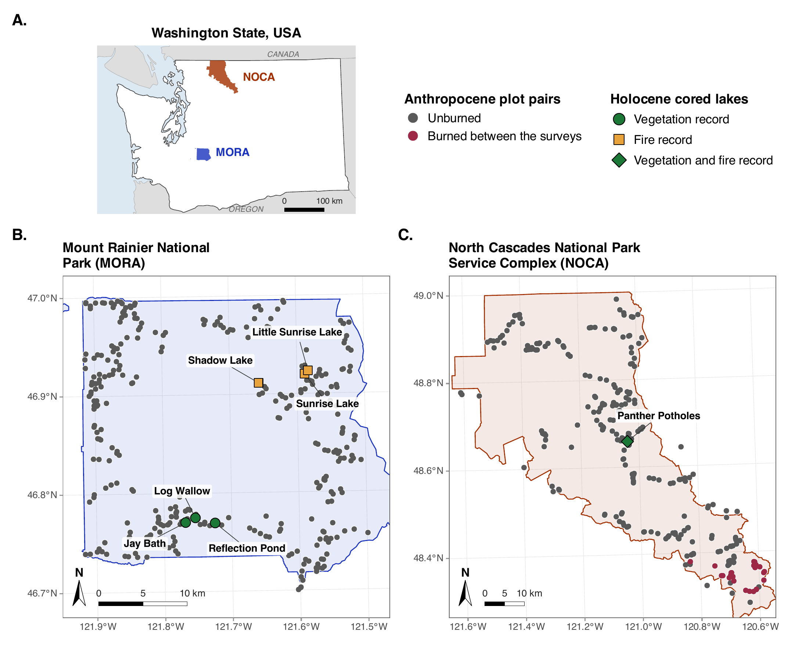

**Fig. 2. Study area.** (A) The two parks in Washington State, USA. (B)
Mount Rainier National Park (MORA) and (C) the North Cascades National
Park Service Complex (NOCA), which joins the national park with the Ross
Lake and Lake Chelan National Recreation Areas. The points are the
legacy–resurvey plot pairs that enter the CCA, 328 at MORA and 277 at
NOCA. They are grey when unburned and red when burned between the two
surveys (0 at MORA and 24 at NOCA). The two MORA plots that burned are
left out of the analysis. The large symbols are the cored lakes:
vegetation records (green circles, macrofossils, Dunwiddie 1986), fire
records (orange squares, charcoal, Walsh et al. 2017) and Panther
Potholes, whose core gives both (green diamond, Prichard et al. 2009).
The two park maps have the same size and therefore different scales,
shown by the same 10 km scale bar on each. Park maps in UTM zone 10N,
the Washington map in an equal-area projection. Park boundaries from the
National Park Service administrative boundaries, Sunrise Ridge lake
coordinates from Walsh et al. (2017, Table 1). Script:
[`R/figures/main_fig2_study_area.R`](R/figures/main_fig2_study_area.R).

# Forest tree communities

## Legacy surveys and resurveys

Legacy surveys and resurveys of the same plots at Mount Rainier (MORA)
and North Cascades (NOCA) National Parks were matched, cleaned and
harmonized to one tree taxonomy
(`R/pipeline/01_clean_mora_vegetation.R`,
`R/pipeline/02_clean_noca_vegetation.R`).

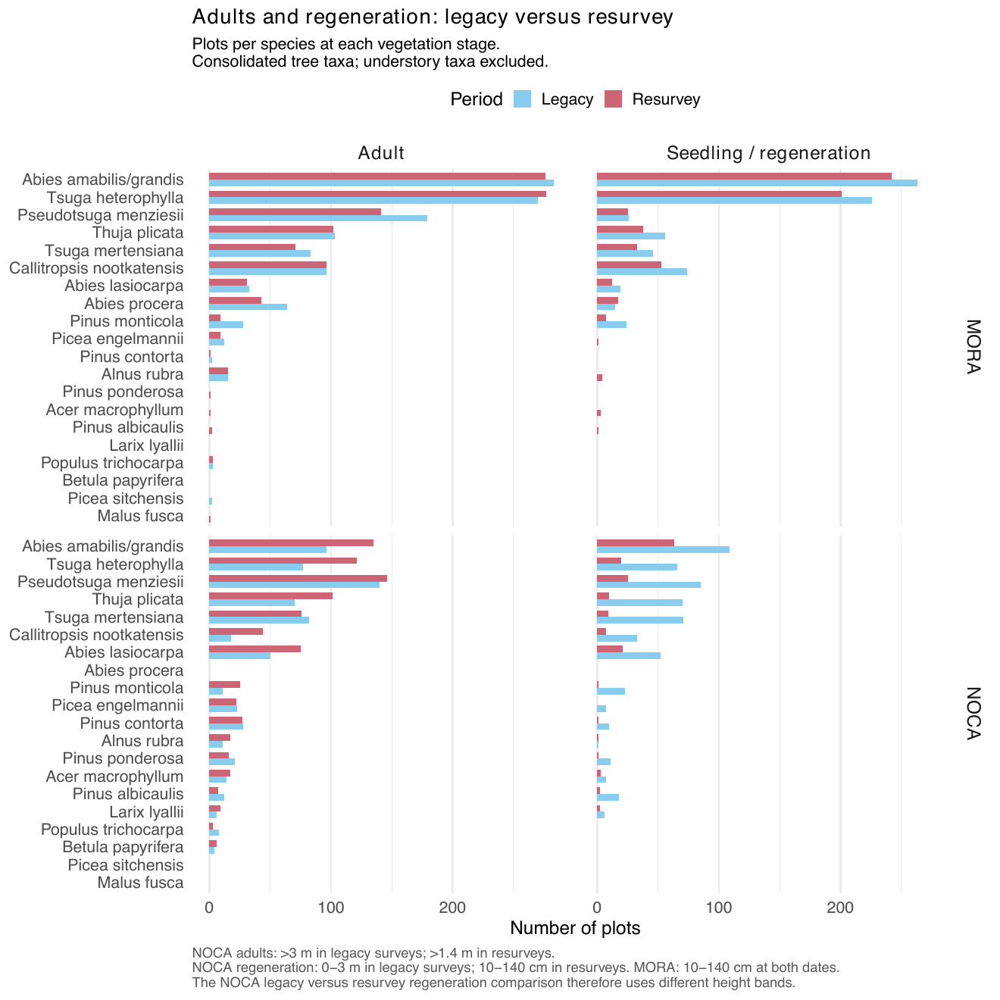

**Fig. S1. Occurrence of tree species as adult trees and as seedlings in
the legacy surveys and the resurveys.** Number of plots in which each
species was recorded as an adult tree or as a seedling at Mount Rainier
(MORA) and North Cascades (NOCA), after taxonomic harmonization and
exclusion of understory taxa, but before the selection of species for
the CCA. A species could be recorded in both stages in the same plot. At
MORA, seedlings were individuals of 10–140 cm height in both surveys. At
NOCA, however, the legacy surveys recorded individuals of 0–3 m height
as regeneration and taller individuals as adults, whereas the resurveys
recorded seedlings of 10–140 cm and adults taller than 1.4 m.
Differences between the two stages at NOCA should therefore be
interpreted with caution, because the size classes differed between the
surveys.

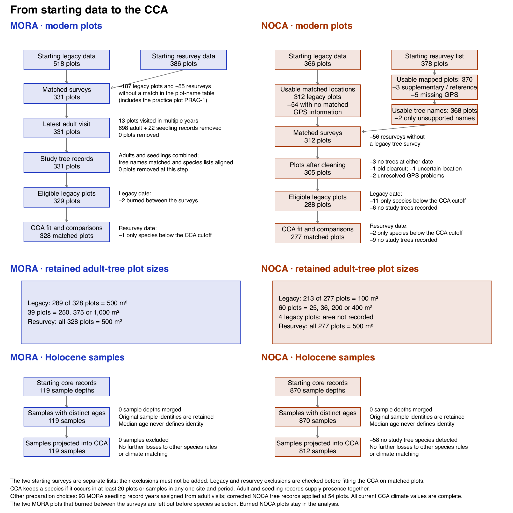

**Fig. S2. Selection of forest plots and macrofossil samples for the
canonical correspondence analysis (CCA).** Flowchart of the matching,
cleaning, and selection of the plot pairs (legacy survey and resurvey;
upper panels) and of the Holocene macrofossil samples (lower panels) at
Mount Rainier (MORA, blue) and North Cascades (NOCA, dark red). The plot
pairs that remained were used both to fit the CCA (with the legacy
surveys) and to quantify community change in the Anthropocene, whereas
the Holocene samples were projected into the fitted climate–community
space. Plots without any of the retained tree species at one of the two
surveys were excluded, because they have no observed position in this
space. Sample sizes and reasons for exclusion are given at each step.
The middle panels give the plot sizes of the retained plot pairs in each
park: the adult-tree plot area of the legacy survey and of the resurvey.

**Legacy plot size at NOCA.** Both parks were resurveyed with 500-m²
plots, whereas the legacy plots at NOCA ranged from 25 to 400 m². To
test whether the smaller legacy plots missed species, which would be
counted as community turnover at the resurvey, we compared species
richness, turnover rate, lag, and lag rate among the legacy plot sizes
at NOCA (Table S1).

**Table S1. Plot pairs at NOCA by legacy plot size.** Richness is the
mean number of the 13 tree species of the analysis that were present in
a plot. Turnover rate, lag, and lag rate are means with 95% confidence
intervals (t-intervals, no model): the turnover rate and the lag rate in
CCA distance per century, and the lag in CCA distance. The single 36-m²
plot has no interval.

| Legacy area (m²) | Plots | Richness, legacy | Richness, resurvey | Turnover rate | Lag | Lag rate |
|:---|---:|:---|:---|:---|:---|:---|
| 25 | 37 | 2.89 | 3.05 | 1.741 (1.082 to 2.400) | -0.134 (-0.370 to 0.103) | -0.470 (-1.302 to 0.362) |
| 36 | 1 | 2.00 | 3.00 | 1.728 | -0.498 | -1.812 |
| 100 | 213 | 2.81 | 2.86 | 2.077 (1.834 to 2.321) | -0.041 (-0.119 to 0.038) | -0.140 (-0.416 to 0.136) |
| 200 | 2 | 4.00 | 1.50 | 2.529 (-29.602 to 34.660) | 0.884 (-9.509 to 11.278) | 3.102 (-33.366 to 39.571) |
| 400 | 20 | 2.10 | 2.15 | 2.604 (1.169 to 4.040) | 0.017 (-0.491 to 0.526) | 0.064 (-1.722 to 1.849) |
| not recorded | 4 | 1.50 | 2.00 | 1.657 (-1.614 to 4.928) | 0.325 (-0.185 to 0.834) | 1.171 (-0.675 to 3.016) |
| all NOCA plot pairs | 277 | 2.75 | 2.82 | 2.066 (1.836 to 2.296) | -0.039 (-0.115 to 0.038) | -0.133 (-0.403 to 0.137) |

<sub>Table file:
[noca_plot_area_responses.csv](report/tables/noca_plot_area_responses.csv)</sub>

The smallest legacy plots did not hold fewer species than the larger
ones (2.89 species per 25-m² plot against 2.81 per 100-m² plot), and
their turnover rate was not higher (1.74 against 2.08 CCA distance per
century). The confidence intervals of the three most common plot sizes
overlapped for all quantities. The Anthropocene results at NOCA
therefore do not depend on the small legacy plots.

**Cleaning details →**
[01_vegetation_cleaning](report/details/01_vegetation_cleaning.md)
(plot-by-plot decisions, NOCA tree corrections, survey dates, raw-data
provenance).

## Species selection

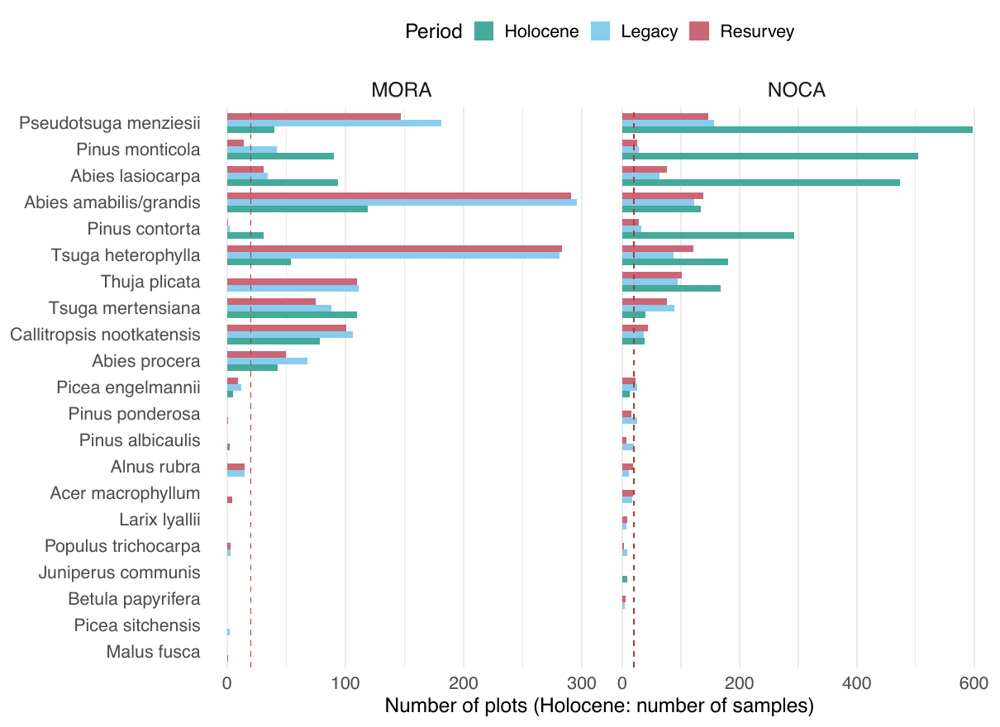

**Fig. S3. Occurrence of tree species in the two parks and the three
survey periods, before the selection of species for the CCA.** Number of
plots (legacy surveys and resurveys) or macrofossil samples (Holocene)
in which each tree species was recorded at MORA and NOCA, after
taxonomic harmonization and exclusion of understory and unidentified
taxa. A species was counted as present when it was recorded as an adult
tree or as a seedling. The dashed red line shows the threshold of 20
plots or samples. We retained the species that reached this threshold in
at least one park and period, which gave the 13 species of the CCA.

**The *Abies amabilis/grandis* aggregate.** The needles of *Abies
amabilis* and *A. grandis* cannot be told apart, so the macrofossil
records cannot separate the two species. In the Panther Potholes record,
Prichard et al. (2009) classified them to genus (*Abies*
undifferentiated, the *Abies* needles other than *A. lasiocarpa*), and
the *A. amabilis* of the MORA records can hold *A. grandis*. We
therefore treated the two species as one taxon, *Abies
amabilis/grandis*, in both eras and both parks, and aggregated the
survey plots in the same way. The aggregate occurs in 134 Panther
Potholes samples and 119 MORA samples, and in 296 and 291 MORA plots and
123 and 138 NOCA plots in the legacy surveys and the resurveys.

**Species-selection details →**
[05_species_selection](report/details/05_species_selection.md)
(consolidation rules, excluded taxa, occupancy through time).

## Holocene macrofossil records

The Holocene communities come from plant macrofossils in dated
lake-sediment cores, three at MORA and one at NOCA (Fig. 2 of the main
text). We dated each sample with the age–depth model of its core
(Appendix S1).

### Appendix S1. Age–depth models of the Holocene records

#### S1.1 Why new age–depth models were needed

To place the macrofossil samples in time, we needed a calendar age, with
its uncertainty, for each sample. The published chronologies did not
provide this. At MORA, the ages of Dunwiddie (1986) are radiocarbon ages
that were not calibrated to calendar years. At NOCA, the chronology of
Prichard et al. (2009) is calibrated, but the median ages of the single
macrofossil samples were not available to us. We therefore built a
Bayesian age–depth model for each of the four cores with the same method
(R package rbacon; Blaauw & Christen, 2011).

#### S1.2 Chronological controls

To build the models from the same information as the original studies,
we used the published chronological controls of each core, i.e., the
depths with a known age: the core surface, radiocarbon dates, tephra
layers, and, at Panther Potholes, ²¹⁰Pb ages (Table S2). We entered the
radiocarbon ages as uncalibrated ages, which rbacon calibrated with the
IntCal20 curve (Reimer et al., 2020), and the other controls as calendar
ages. Two decisions differ from the original studies. Reflection Pond
has no radiocarbon date of its own, so we gave it the mean basal age of
Jay Bath and Log Wallow. For Panther Potholes, we used the depths of the
controls archived in the Neotoma database, which correct depth errors in
Prichard et al. (2009).

**Table S2. Chronological controls used in the four Bayesian age–depth
models.** For cc = 1, the entered age is an uncalibrated ¹⁴C age
calibrated with IntCal20. For cc = 0, the entered age is already in
calibrated years before present (cal yr BP; present = A.D. 1950).

| Site | Core | Chronological control | Depth (cm) | Age entered ± error | Bacon treatment | Age source | Uncertainty source |
|:---|:---|:---|:---|:---|:---|:---|:---|
| MORA | Jay Bath | Core surface | 0 | −31.5 ± 10 cal yr BP | cc = 0 | Coring date, 1981–1982 | Assumed ±10 yr to account for uncertainty in recovery of the sediment–water interface |
| MORA | Jay Bath | MSH-W tephra | 22 | 470 ± 10 cal yr BP | cc = 0 | Yamaguchi 1983; Walsh et al. 2017 | Assumed ±10 yr around the tree-ring-dated eruption age; no published statistical age error |
| MORA | Jay Bath | QL-1729 | 39.5 | 1320 ± 30 ¹⁴C yr BP | cc = 1, IntCal20 | Dunwiddie 1986 | Published laboratory error |
| MORA | Jay Bath | MR-C tephra | 62 | 2250 ± 100 cal yr BP | cc = 0 | Mullineaux 1974; Walsh et al. 2017 | Assumed ±100 yr; no published statistical age error |
| MORA | Jay Bath | QL-1730 | 70 | 2920 ± 60 ¹⁴C yr BP | cc = 1, IntCal20 | Dunwiddie 1986 | Published laboratory error |
| MORA | Jay Bath | MSH-Y tephra, upper boundary | 87 | 3650 ± 100 cal yr BP | cc = 0 | Mullineaux 1974; Walsh et al. 2017 | ±100 yr derived approximately from radiocarbon dates bracketing the eruption age (bracket half-width ≈103 yr; Mullineaux 1996) |
| MORA | Jay Bath | MSH-Y tephra, lower boundary | 105 | 3650 ± 100 cal yr BP | cc = 0 | Mullineaux 1974; Walsh et al. 2017 | Same uncertainty as upper boundary; both depths represent the same instantaneous tephra deposit |
| MORA | Jay Bath | Beta-6332 | 124.5 | 3740 ± 80 ¹⁴C yr BP | cc = 1, IntCal20 | Dunwiddie 1986 | Published laboratory error |
| MORA | Jay Bath | MR-F tephra | 142 | 5740 ± 100 cal yr BP | cc = 0 | Mullineaux 1974; Walsh et al. 2017 | Assumed ±100 yr; no published statistical age error |
| MORA | Jay Bath | QL-1704 | 152.25 | 6050 ± 110 ¹⁴C yr BP | cc = 1, IntCal20 | Dunwiddie 1986 | Published laboratory error |
| MORA | Log Wallow | Core surface | 0 | −31.5 ± 10 cal yr BP | cc = 0 | Coring date, 1981–1982 | Assumed ±10 yr to account for uncertainty in recovery of the sediment–water interface |
| MORA | Log Wallow | MSH-W tephra | 22 | 470 ± 10 cal yr BP | cc = 0 | Yamaguchi 1983; Walsh et al. 2017 | Assumed ±10 yr around the tree-ring-dated eruption age; no published statistical age error |
| MORA | Log Wallow | QL-1726 | 29 | 1650 ± 80 ¹⁴C yr BP | cc = 1, IntCal20 | Dunwiddie 1986 | Published laboratory error |
| MORA | Log Wallow | MSH-Y tephra, upper boundary | 40 | 3650 ± 100 cal yr BP | cc = 0 | Mullineaux 1974; Walsh et al. 2017 | ±100 yr derived approximately from radiocarbon dates bracketing the eruption age (bracket half-width ≈103 yr; Mullineaux 1996) |
| MORA | Log Wallow | MSH-Y tephra, lower boundary | 98 | 3650 ± 100 cal yr BP | cc = 0 | Mullineaux 1974; Walsh et al. 2017 | Same uncertainty as upper boundary; both depths represent the same instantaneous tephra deposit |
| MORA | Log Wallow | MR-F tephra | 116 | 5740 ± 100 cal yr BP | cc = 0 | Mullineaux 1974; Walsh et al. 2017 | Assumed ±100 yr; no published statistical age error |
| MORA | Log Wallow | QL-1727 | 117 | 4900 ± 80 ¹⁴C yr BP | cc = 1, IntCal20 | Dunwiddie 1986 | Published laboratory error |
| MORA | Log Wallow | QL-1728 | 140 | 5980 ± 60 ¹⁴C yr BP | cc = 1, IntCal20 | Dunwiddie 1986 | Published laboratory error |
| MORA | Reflection Pond | Core surface | 0 | −31.5 ± 10 cal yr BP | cc = 0 | Coring date, 1981–1982 | Assumed ±10 yr to account for uncertainty in recovery of the sediment–water interface |
| MORA | Reflection Pond | MSH-W tephra | 10 | 470 ± 10 cal yr BP | cc = 0 | Yamaguchi 1983; Walsh et al. 2017 | Assumed ±10 yr around the tree-ring-dated eruption age; no published statistical age error |
| MORA | Reflection Pond | MR-C tephra | 26 | 2250 ± 100 cal yr BP | cc = 0 | Mullineaux 1974; Walsh et al. 2017 | Assumed ±100 yr; no published statistical age error |
| MORA | Reflection Pond | MSH-Y tephra, upper boundary | 45 | 3650 ± 100 cal yr BP | cc = 0 | Mullineaux 1974; Walsh et al. 2017 | ±100 yr derived approximately from radiocarbon dates bracketing the eruption age (bracket half-width ≈103 yr; Mullineaux 1996) |
| MORA | Reflection Pond | MSH-Y tephra, lower boundary | 64 | 3650 ± 100 cal yr BP | cc = 0 | Mullineaux 1974; Walsh et al. 2017 | Same uncertainty as upper boundary; both depths represent the same instantaneous tephra deposit |
| MORA | Reflection Pond | MR-F tephra | 82 | 5740 ± 100 cal yr BP | cc = 0 | Mullineaux 1974; Walsh et al. 2017 | Assumed ±100 yr; no published statistical age error |
| MORA | Reflection Pond | Basal sediment, mean of QL-1704 and QL-1728 | 90 | 6015 ± 110 ¹⁴C yr BP | cc = 1, IntCal20 | Dunwiddie 1986; P. Dunwiddie, pers. comm. | Larger of the two laboratory errors (±110 yr), allowing for transfer of the Jay Bath and Log Wallow basal age to Reflection Pond |
| NOCA | Panther Potholes | Core surface | 0.5 | −49 ± 1 cal yr BP | cc = 0 | Gavin 2021 Neotoma chronology; coring year 1999 | ±1 yr retained from the archived Gavin chronology |
| NOCA | Panther Potholes | ²¹⁰Pb CRS age | 7 | −36.7; error entered = 3.47 | cc = 0 | Prichard et al. 2009; Gavin 2021 | Inherited Gavin value; 3.47 is numerically the published ²¹⁰Pb activity uncertainty in DPM g⁻¹, not a verified age error in years |
| NOCA | Panther Potholes | ²¹⁰Pb CRS age | 14 | −9; error entered = 1.15 | cc = 0 | Prichard et al. 2009; Gavin 2021 | Inherited Gavin value; 1.15 is numerically the published ²¹⁰Pb activity uncertainty in DPM g⁻¹, not a verified age error in years |
| NOCA | Panther Potholes | ²¹⁰Pb CRS age | 21 | 12; error entered = 0.72 | cc = 0 | Prichard et al. 2009; Gavin 2021 | Inherited Gavin value; 0.72 is numerically the published ²¹⁰Pb activity uncertainty in DPM g⁻¹, not a verified age error in years |
| NOCA | Panther Potholes | ²¹⁰Pb CRS age | 28 | 21; error entered = 0.74 | cc = 0 | Prichard et al. 2009; Gavin 2021 | Inherited Gavin value; 0.74 is numerically the published ²¹⁰Pb activity uncertainty in DPM g⁻¹, not a verified age error in years |
| NOCA | Panther Potholes | ²¹⁰Pb CRS age | 35 | 36; error entered = 0.77 | cc = 0 | Prichard et al. 2009; Gavin 2021 | Inherited Gavin value; 0.77 is numerically the published ²¹⁰Pb activity uncertainty in DPM g⁻¹, not a verified age error in years |
| NOCA | Panther Potholes | Beta-172005, conifer seed | 214 | 1950 ± 50 ¹⁴C yr BP | cc = 1, IntCal20 | Prichard et al. 2009 | Published laboratory error |
| NOCA | Panther Potholes | MSH-P tephra | 305.5 | 2620 ± 70 cal yr BP | cc = 0 | Gavin 2021 Neotoma chronology | Age and ±70-yr uncertainty retained from the archived chronology |
| NOCA | Panther Potholes | Beta-169623, seed | 363 | 3260 ± 40 ¹⁴C yr BP | cc = 1, IntCal20 | Prichard et al. 2009 | Published laboratory error |
| NOCA | Panther Potholes | Beta-169624, pollen cone | 389 | 3520 ± 40 ¹⁴C yr BP | cc = 1, IntCal20 | Prichard et al. 2009 | Published laboratory error |
| NOCA | Panther Potholes | MSH-Y tephra | 401 | 3660 ± 65 cal yr BP | cc = 0 | Gavin 2021 Neotoma chronology | Age and ±65-yr uncertainty retained from the archived chronology |
| NOCA | Panther Potholes | Beta-169207, pollen cone | 479 | 4500 ± 40 ¹⁴C yr BP | cc = 1, IntCal20 | Prichard et al. 2009 | Published laboratory error |
| NOCA | Panther Potholes | Mazama tephra | 629 | 7633 ± 25 cal yr BP | cc = 0 | Gavin 2021 Neotoma chronology; Egan et al. 2015 | Age and ±25-yr uncertainty retained from the archived chronology |
| NOCA | Panther Potholes | Beta-169208, seed | 678 | 7330 ± 40 ¹⁴C yr BP | cc = 1, IntCal20 | Prichard et al. 2009 | Published laboratory error |
| NOCA | Panther Potholes | Beta-169625, Pinus contorta needles | 864 | 9370 ± 40 ¹⁴C yr BP | cc = 1, IntCal20 | Prichard et al. 2009 | Published laboratory error |

<sub>Table file:
[chronological_controls.csv](report/tables/chronological_controls.csv)</sub>

#### S1.3 Age–depth models

To estimate the age of every depth between the controls, rbacon models
how fast sediment accumulated along the core, and returns many age–depth
curves that are compatible with the controls (Fig. S4; settings in Table
S3). We used the same settings for the three MORA cores. For Panther
Potholes, we kept the settings of the chronology archived in Neotoma, so
that our model reproduced the published chronology. Thick tephra layers
were treated as deposited instantaneously (grey bands in Fig. S4). We
dated each macrofossil sample by the median of its ages.

**Table S3. rbacon parameters used to construct the age–depth models.**

| rbacon argument | What it controls | MORA | Panther Potholes | Rationale |
|:---|:---|:---|:---|:---|
| cc, cc1 | Determines whether a date requires radiocarbon calibration and which calibration curve is used | cc=1, cc1=“IntCal20” for ¹⁴C dates; cc=0 for calendar-age controls | Same | Northern Hemisphere terrestrial ¹⁴C dates were calibrated with IntCal20; already calendar-dated controls were not recalibrated |
| thick | Thickness of the sediment sections for which accumulation rates are estimated | 5 cm | 5 cm | Standard Bacon section thickness; for Panther Potholes this value reproduced the archived Gavin chronology |
| acc.mean | Mean of the prior distribution for accumulation time, in yr cm⁻¹ | 50 | 10 | MORA cores accumulate substantially more slowly; 10 yr cm⁻¹ reproduces the Gavin chronology and is close to the approximately 12.8 yr cm⁻¹ reported for Panther Potholes |
| acc.shape | Shape of the gamma prior around acc.mean; larger values impose a more concentrated accumulation prior | 1.5 | 1.5 | Broad rbacon default retained for MORA and Gavin setting retained for Panther Potholes |
| mem.mean | Prior mean dependence between accumulation rates in adjacent sediment sections | 0.5 | 0.7 | rbacon default retained for MORA; Gavin setting retained for Panther Potholes |
| mem.strength | Strength of the prior around mem.mean; larger values impose the assumed memory more strongly | 10 | 10 | Broad rbacon default retained for MORA and Gavin setting retained for Panther Potholes |
| slump | Depth intervals treated as effectively instantaneous accumulation rather than gradual sedimentation | Jay Bath: 87–105 cm; Log Wallow: 40–98 cm; Reflection Pond: 45–64 cm | 303–308, 396–406, and 623–635 cm | Prevents thick tephra deposits from being interpreted as long periods of sediment accumulation |
| normal, t.a, t.b | Distribution used to accommodate chronological-control scatter and potential outlying dates | FALSE, 3, 4 | FALSE, 15, 16 | rbacon default robust t-distribution retained for MORA; Gavin settings retained for Panther Potholes |
| ssize | Number of MCMC iterations retained for the posterior | 4,000 | 10,000 | Default sampling was retained for MORA; Panther Potholes required the larger value for adequate MCMC mixing and reproduction of the archived chronology |
| prob | Posterior interval reported for the chronology | 0.95 | 0.95 | Ages are summarized with 95% posterior intervals |
| d.max | Maximum core depth included in the model | Jay Bath: 153 cm; no manual extension for Log Wallow or Reflection Pond | 870 cm | Jay Bath was extended to 153 cm to retain its deepest macrofossil sample; Panther Potholes retained the Gavin model extent |

<sub>Table file:
[rbacon_parameters.csv](report/tables/rbacon_parameters.csv)</sub>

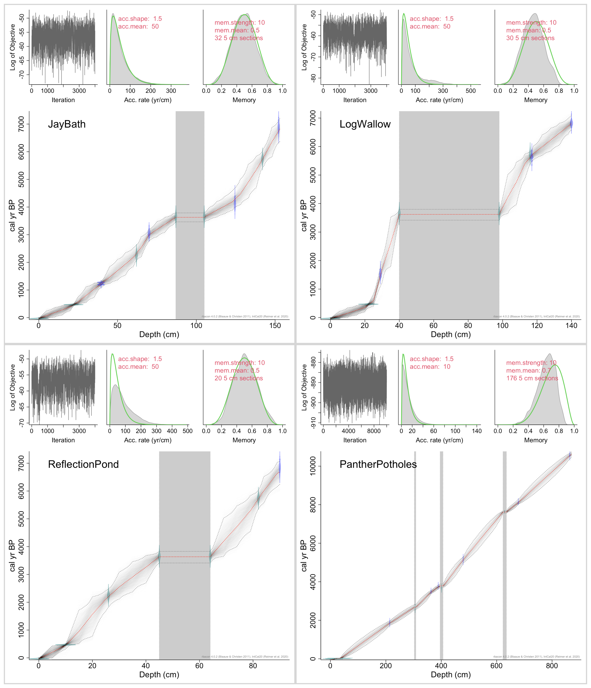

**Fig. S4. Bayesian age–depth models for the Jay Bath, Log Wallow, and
Reflection Pond cores at MORA and the Panther Potholes core at NOCA.**
For each core, the three upper panels show, from left to right, the
Markov chain Monte Carlo trace, the prior (green) and posterior (grey)
distributions of sediment accumulation time, and the prior and posterior
distributions of memory. In the main panels, depth increases along the
x-axis and age is expressed as calibrated years before present. Coloured
distributions at dated depths represent the chronological controls and
their uncertainty. The grey field represents the posterior distribution
of possible age–depth relationships. The red dotted line in the middle
shows the mean posterior age–depth estimate, and the outer grey dotted
lines the 95% posterior interval. Vertical grey bands identify tephra
intervals treated as instantaneous deposition.

#### S1.4 Sensitivity of the Panther Potholes chronology

In the archived chronology of Panther Potholes, the errors of the five
²¹⁰Pb ages are the uncertainties of the measured ²¹⁰Pb activity, and not
age errors in years. To test whether this affects the chronology, we
fitted a second model with an assumed error of ±10 years for these five
ages. The two chronologies were nearly identical below the upper 35 to
40 cm of the core, so that this choice does not affect the Holocene ages
of the analysis (Fig. S5).

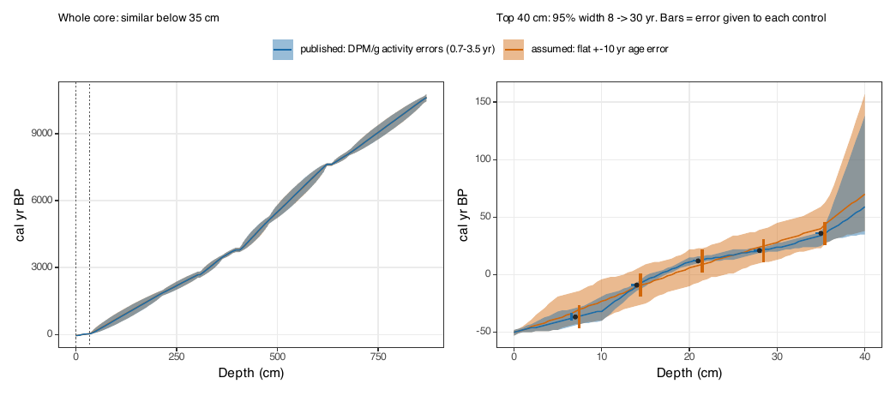

**Fig. S5. Sensitivity of the Panther Potholes age–depth chronology to
uncertainty assigned to the five ²¹⁰Pb controls in the upper 35 cm of
the core.** The left panel shows that the two posterior chronologies are
nearly identical below the ²¹⁰Pb-dated section, whereas the right panel
shows the expected increase in uncertainty within the upper 35–40 cm.
The uncertainty assigned to the ²¹⁰Pb controls affects the precision of
the most recent chronology but does not materially alter the deeper
Holocene chronology used in our analyses.

**Chronology details →**
[03_chronology](report/details/03_chronology.md)
(every control and its source).

# Climate products

## Appendix S2. Climate products and the bias correction of the Holocene climate

We fitted the climate–community space with CHELSA V2.1 at the forest
plots, whereas the climate-predicted positions of the Holocene
communities come from CHELSA-TraCE21k at the lakes. If the two products
differ in the level of temperature or precipitation, a Holocene climate
is placed elsewhere in the climate–community space than the same climate
would be with CHELSA V2.1, and this difference enters every mismatch and
every lag. We therefore corrected the Holocene climate to the level of
CHELSA V2.1.

To correct it, we followed the change-factor approach that is commonly
used for paleoclimate simulations (Lorenz et al., 2016): the difference
between two products is calculated over the years that they have in
common, and is then applied to all time steps of the product to be
corrected. CHELSA-TraCE21k and CHELSA V2.1 cannot be compared directly,
because the most recent time step of CHELSA-TraCE21k is the mean of the
years 1900 to 1990, whereas CHELSA V2.1 starts in 1979. We therefore
used CHELSAcruts (1901 to 2016), which has years in common with both
products, as a link between them (Table S4). Over the years that the
three products have in common, they differed in the level of temperature
and precipitation (Fig. S6).

**Table S4. The four CHELSA products.** All four products have the same
grid of 30 arcsec.

| Product | Version | Years read | What it is |
|----|----|----|----|
| CHELSA-TraCE21k | 1.0 | timeIDs 16 to 20 (1500 to 1990, century means) | Downscaled TraCE-21k transient simulation; timeID 20 is the mean of 1900 to 1990 |
| CHELSAcruts | 1.0 | 1901 to 2016, monthly | CRU TS anomalies downscaled with the CHELSA V1 climatology |
| CHELSA V1.2 | 1.2.1 | 1979 to 2013, monthly | CHELSA time series, first version |
| CHELSA V2.1 | 2.1 | 1979 to 2021, monthly | CHELSA time series, current version; the climate of the climate–community space |

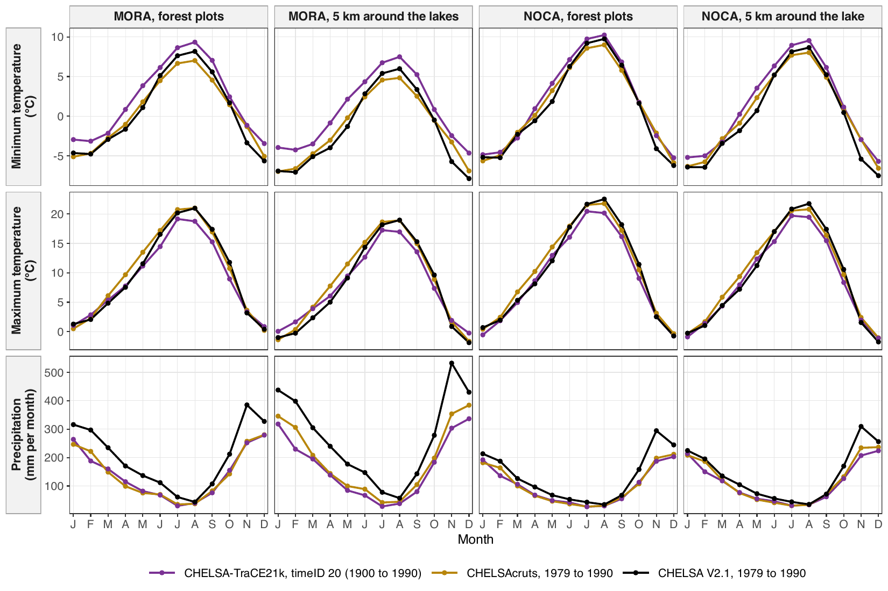

**Fig. S6. The three climate products of the bias correction, without
correction.** Monthly minimum temperature, maximum temperature, and
precipitation over the years that the three products have in common: the
most recent time step of CHELSA-TraCE21k (timeID 20, the mean of 1900 to
1990; purple), and CHELSAcruts (gold) and CHELSA V2.1 (black) over 1979
to 1990. For each point, the values of CHELSAcruts and CHELSA V2.1 were
averaged over these years. Each line is the median over the forest plots
of a park (331 at MORA and 305 at NOCA) or over the grid cells within 5
km of its lakes (136 at MORA and 136 at NOCA). CHELSA V2.1 has no
temperature for January 1979, so that its January temperatures are means
over 1980 to 1990. Script:
[`R/figures/supp_climate_products.R`](R/figures/supp_climate_products.R);
medians in `climate_products_point_medians.csv` of
[`R/pipeline/07_climate_products.R`](R/pipeline/07_climate_products.R).

The correction thus has two steps (Fig. S7). In step 1, we corrected
CHELSA-TraCE21k to CHELSAcruts over 1900 to 1990, and in step 2,
CHELSAcruts to CHELSA V2.1 over 1979 to 2016. For each park and calendar
month, each step is an offset that we added to minimum and maximum
temperature, and a ratio by which we multiplied precipitation. We
calculated both steps from the mean over the grid cells within 5 km of
the lakes of each park, and applied them to all time steps of
CHELSA-TraCE21k. Step 1 was needed because CHELSA-TraCE21k and
CHELSAcruts did not agree over the years that they have in common,
although both are downscaled with the same method (Table
S5). Scripts:
[`R/pipeline/07_climate_products.R`](R/pipeline/07_climate_products.R),
[`R/pipeline/08_paleo_climate.R`](R/pipeline/08_paleo_climate.R). The
factors of every park, variable and month are written to
`climate_bias_correction_factors.csv`. **Climate
details →**
[02_climate](report/details/02_climate.md).

Note that this correction assumes that the difference between the
products was constant through the Holocene. We therefore repeated the
analysis with step 2 alone and without correction, and report how the
results changed in the sensitivity analysis of Appendix S4.

**Table S5. Comparison of CHELSA-TraCE21k and CHELSAcruts over the years
that they have in common, without correction.** The most recent time
step of CHELSA-TraCE21k (timeID 20, the mean of 1900 to 1990) and
CHELSAcruts (1901 to 1990), on the grid cells within 5 km of the lakes
(disc), at the grid cells of the lakes (MORA: mean of the three lakes),
and as the mean over the forest plots. Difference: CHELSAcruts
subtracted from CHELSA-TraCE21k. Ratio: CHELSA-TraCE21k divided by
CHELSAcruts.

| Park | Place | Variable | TraCE21k timeID 20 | CHELSAcruts 1901-1990 | Difference | Ratio |
|:---|:---|:---|---:|---:|---:|---:|
| MORA | MORA disc | Spring temperature (°C) | 2.87 | 2.07 | 0.80 | 1.39 |
| MORA | MORA disc | Summer precipitation (mm) | 135.57 | 161.50 | -25.94 | 0.84 |
| MORA | MORA lakes | Spring temperature (°C) | 3.40 | 2.78 | 0.62 | 1.22 |
| MORA | MORA lakes | Summer precipitation (mm) | 128.00 | 167.13 | -39.13 | 0.77 |
| MORA | MORA plots | Spring temperature (°C) | 4.45 | 4.18 | 0.27 | 1.07 |
| MORA | MORA plots | Summer precipitation (mm) | 140.26 | 140.02 | 0.24 | 1.00 |
| NOCA | NOCA disc | Spring temperature (°C) | 4.05 | 3.73 | 0.32 | 1.08 |
| NOCA | NOCA disc | Summer precipitation (mm) | 112.85 | 95.13 | 17.72 | 1.19 |
| NOCA | NOCA lakes | Spring temperature (°C) | 4.20 | 3.96 | 0.24 | 1.06 |
| NOCA | NOCA lakes | Summer precipitation (mm) | 101.00 | 108.26 | -7.26 | 0.93 |
| NOCA | NOCA plots | Spring temperature (°C) | 4.52 | 4.37 | 0.14 | 1.03 |
| NOCA | NOCA plots | Summer precipitation (mm) | 105.26 | 88.80 | 16.46 | 1.19 |

<sub>Table file:
[appendix_s2_trace_cruts_check.csv](report/tables/appendix_s2_trace_cruts_check.csv)</sub>

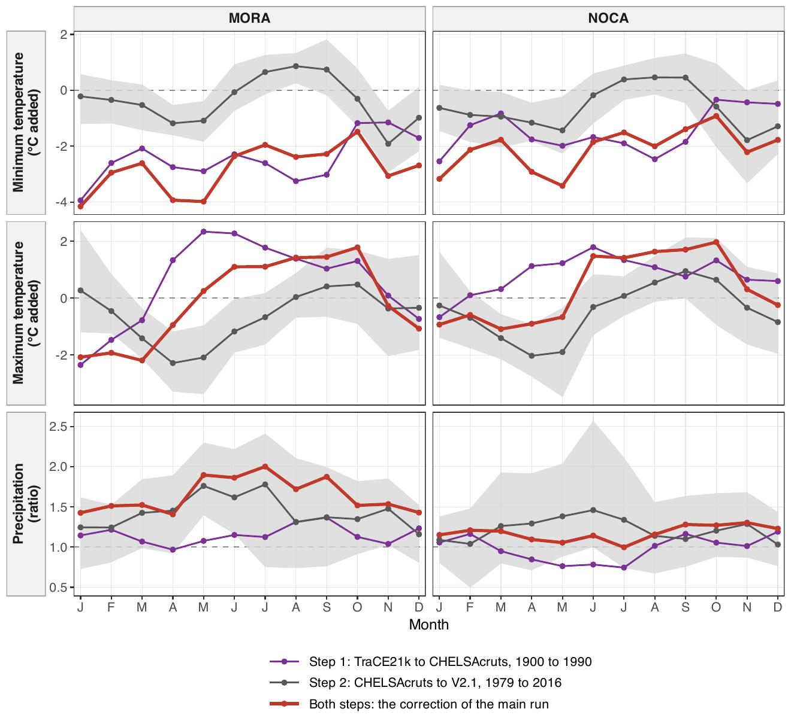

**Fig. S7. The two steps of the bias correction of the Holocene
climate.** For each park and calendar month, the offset added to
temperature (°C) or the ratio by which precipitation was multiplied,
calculated on the grid cells within 5 km of the lakes. Purple: step 1
(CHELSA-TraCE21k to CHELSAcruts, 1900 to 1990). Grey: step 2
(CHELSAcruts to CHELSA V2.1, 1979 to 2016), with the 10th to 90th
percentile of the yearly values in light grey. Red: both steps together,
i.e., the correction of the main analysis. On the dashed line, a step
changes nothing. Script:
[`R/figures/supp_climate_products.R`](R/figures/supp_climate_products.R).

# Climate change and comparisons within eras

## Climate data

Modern climate is CHELSA V2.1 monthly climate in a survey-specific
window for every plot (`R/pipeline/04_modern_climate.R`). Holocene
climate is CHELSA-TraCE21k at each lake and century, bias-corrected onto
CHELSA V2.1 (Appendix S2; `R/pipeline/08_paleo_climate.R`).

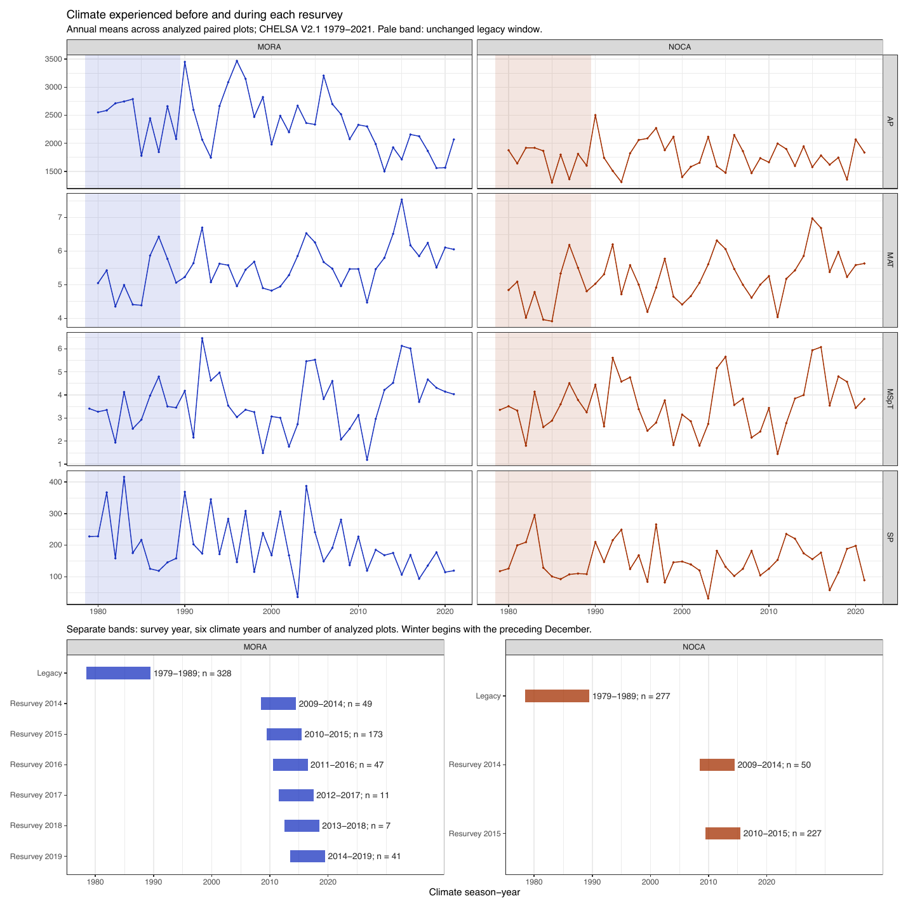

**Fig. S8. Climate of the Anthropocene and the climate windows of the
surveys.** Upper panels: annual climate from CHELSA V2.1 (1979–2021),
averaged over the plot pairs at Mount Rainier (MORA, blue) and North
Cascades (NOCA, dark red), for mean annual temperature (MAT), annual
precipitation (AP), mean spring temperature (MSpT), and summer
precipitation (SP). Spring temperature and summer precipitation are the
two variables of the climate–community space. The shaded area shows the
climate window of the legacy surveys (1979–1989), which is the same for
all plots. Lower panels: the six-year climate window of each resurvey
year (from five years before the resurvey to the year of the resurvey),
with the number of plot pairs (n) resurveyed in that year. Winter
included December of the preceding year. The climate of the resurvey was
therefore calculated separately for each plot, according to the year of
its resurvey. CHELSA V2.1 is the product to which the Holocene climate
was corrected (Appendix S2), and is itself not corrected.

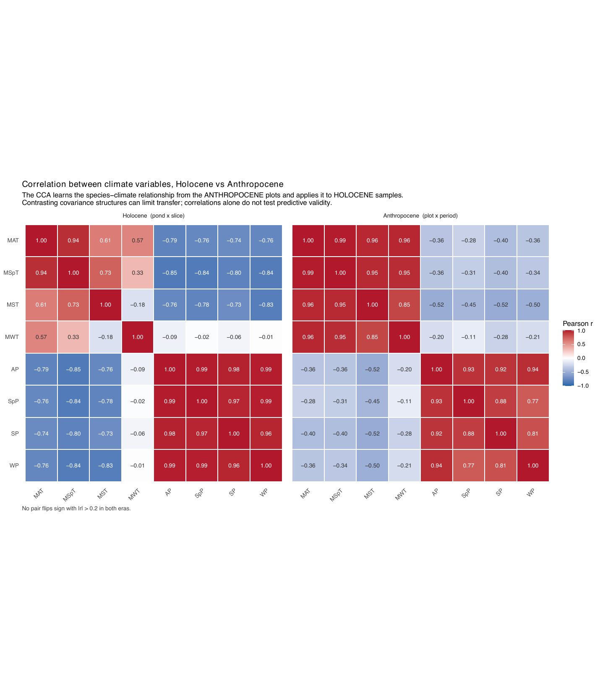

**Fig. S9. Correlations among climate variables in the Holocene and the
Anthropocene.** Pearson correlation coefficients (r) across lakes and
centuries for the Holocene (CHELSA-TraCE21k after the bias correction of
Appendix S2, left), and across forest plots and surveys for the
Anthropocene (CHELSA V2.1, right). Red shows positive and blue negative
correlations, and the numbers give r. The variables are mean annual
(MAT), spring (MSpT), summer (MST), and winter (MWT) temperature, and
annual (AP), spring (SpP), summer (SP), and winter (WP) precipitation.
Spring is March–May, summer June–August, and winter December–February.

**Climate details →**
[02_climate](report/details/02_climate.md) (survey
windows, TraCE21k against V2.1, full correlation tables).

## Climate periods

**What and why.** The Holocene is cut into climate-change (C) periods,
when the park-average climate of the lakes moved steadily in one
direction, and stability (S) periods between them. The rules of the
climate-era step are unchanged. Only their input changed: the periods
are now drawn from the two CCA variables, MSpT and SP, so that the
periods describe change along the same climate axes that the CCA uses. A
climate-change period that contains a long internal trough of low change
is split into sub-periods (a, b, c). Each period, or sub-period, is one
unit for the lake-periods (see Climate–community lags).

**Result.**

**Table S6. Climate periods of the Holocene.** Climate-change (C) and
stability (S) periods defined from spring temperature (MSpT) and summer
precipitation (SP), which are used in the analysis, and, with the same
rules, from the four seasonal variables, for comparison. Both are
defined from the Holocene climate after the bias correction (Appendix
S2). Drivers: the variables whose change defined a climate-change
period.

| Variables | Period | Type | Older (cal BP) | Younger (cal BP) | Duration (years) | Drivers |
|:---|:---|:---|---:|---:|---:|:---|
| Spring temperature and summer precipitation (used) | C1 | Holocene-C | 9650 | 8650 | 1000 | spring cooling, summer drying |
| Spring temperature and summer precipitation (used) | S1 | Holocene-S | 8650 | 8250 | 400 |  |
| Spring temperature and summer precipitation (used) | C2 | Holocene-C | 8250 | 7250 | 1000 | spring warming, summer wetting |
| Spring temperature and summer precipitation (used) | S2 | Holocene-S | 7250 | 6850 | 400 |  |
| Spring temperature and summer precipitation (used) | C3 | Holocene-C | 6850 | 6250 | 600 | spring cooling |
| Spring temperature and summer precipitation (used) | S3 | Holocene-S | 6250 | 5450 | 800 |  |
| Spring temperature and summer precipitation (used) | C4 | Holocene-C | 5450 | 4950 | 500 | spring warming |
| Spring temperature and summer precipitation (used) | S4 | Holocene-S | 4950 | 2250 | 2700 |  |
| Spring temperature and summer precipitation (used) | C5 | Holocene-C | 2250 | 1750 | 500 | spring warming |
| Spring temperature and summer precipitation (used) | S5 | Holocene-S | 1750 | 1350 | 400 |  |
| Four seasonal variables (comparison) | C1a | Holocene-C | 9650 | 8650 | 1000 | spring cooling, winter warming, summer drying |
| Four seasonal variables (comparison) | C1b | Holocene-C | 8650 | 8250 | 400 | winter wetting |
| Four seasonal variables (comparison) | C1c | Holocene-C | 8250 | 7250 | 1000 | spring warming, winter warming, summer wetting |
| Four seasonal variables (comparison) | S1 | Holocene-S | 7250 | 6850 | 400 |  |
| Four seasonal variables (comparison) | C2 | Holocene-C | 6850 | 6250 | 600 | spring cooling |
| Four seasonal variables (comparison) | S2 | Holocene-S | 6250 | 5450 | 800 |  |
| Four seasonal variables (comparison) | C3 | Holocene-C | 5450 | 4950 | 500 | spring warming |
| Four seasonal variables (comparison) | S3 | Holocene-S | 4950 | 2250 | 2700 |  |
| Four seasonal variables (comparison) | C4 | Holocene-C | 2250 | 1750 | 500 | spring warming |
| Four seasonal variables (comparison) | S4 | Holocene-S | 1750 | 1350 | 400 |  |

<sub>Table file:
[step1_periods.csv](report/tables/step1_periods.csv)</sub>

With MSpT and SP the Holocene from 9650 to 1350 cal BP falls into 5
climate-change periods and 5 stability periods, and no climate-change
period is split. The first four-variable climate-change period (C1a to
C1c, 9650 to 7250 cal BP) becomes C1, S1 and C2: its middle part (8650
to 8250 cal BP) was driven by winter wetting alone, which is no longer a
constraint. From 7250 cal BP onward every boundary is unchanged, and the
periods are renumbered.

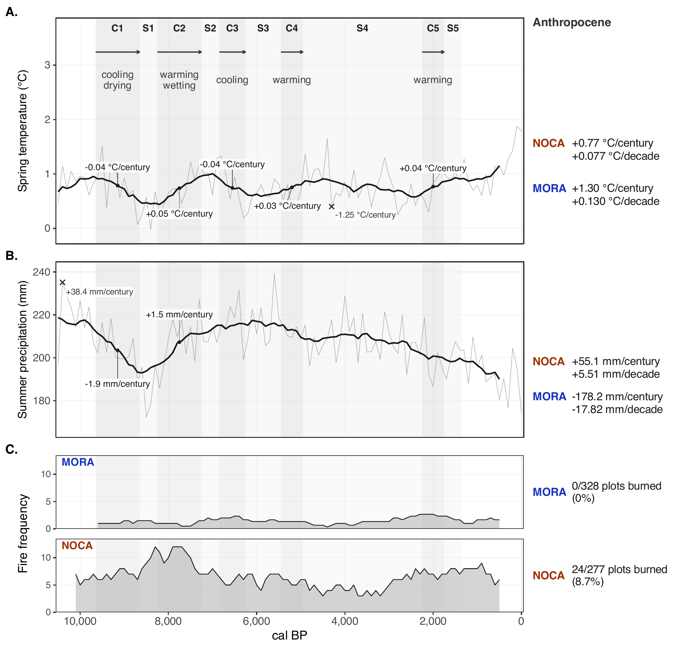

**Fig. 3. Holocene climate and fire.** (A) Spring temperature (°C) and
(B) summer precipitation (mm), the two CCA constraints, averaged over
the lakes of each park with the two parks weighted equally
(CHELSA-TraCE21k after the bias correction of Appendix S2). Bold lines
are 1,000-year running means and thin lines the centennial series.
Shading marks the climate-change (C) and stability (S) periods, with the
change that drove each climate-change period written below its name
(cooling or warming of spring temperature, drying or wetting of summer
precipitation). Labels linked to the bold lines give the change per
century over a period for each variable that drove it. A cross marks the
largest step between two consecutive centuries, labelled with its rate.
To the right of each panel, the Anthropocene change per century, and
beneath it per decade, from the legacy to the resurvey climate window,
the median over plots in each park: spring temperature +1.30 °C per
century at MORA and +0.77 °C per century at NOCA, summer precipitation
-178.2 mm per century at MORA and +55.1 mm per century at NOCA. These
come from a change over about 29 years, while each Holocene rate spans a
whole period of 400 to 2,700 years. (C) Fire frequency of each park:
accepted fire events per 1,000 years, counted in a 1,000-year window
centred every 100 years. At MORA it is the mean of the three Sunrise
Ridge cores of Walsh et al. (2017) wherever at least two cover the date,
at NOCA the Panther Potholes core (Prichard et al. 2009). The two parks
share one y axis, but their frequencies are not directly comparable:
Panther Potholes is resampled every 12 years and the Sunrise Ridge cores
every 42 to 48 years, and a finer record resolves more events, so part
of the gap between the parks comes from the records. The MORA cores lie
on Sunrise Ridge, away from the vegetation lakes (Fig. S13). The models
do not use this curve: their fire activity counts the same accepted
events between the two ends of each lake-period, per century and per
covered core (see Climate–community lags). To the right, the
Anthropocene plot pairs of each park that burned between the two surveys
(MORA’s two burned plots are left out of the analysis).

Stages and helpers:
[`R/pipeline/12_climate_eras_fire_frequency.R`](R/pipeline/12_climate_eras_fire_frequency.R),
[`R/helpers/holocene_climate_fire_era_functions.R`](R/helpers/holocene_climate_fire_era_functions.R),
[`R/figures/main_fig3_climate_eras_fire.R`](R/figures/main_fig3_climate_eras_fire.R).

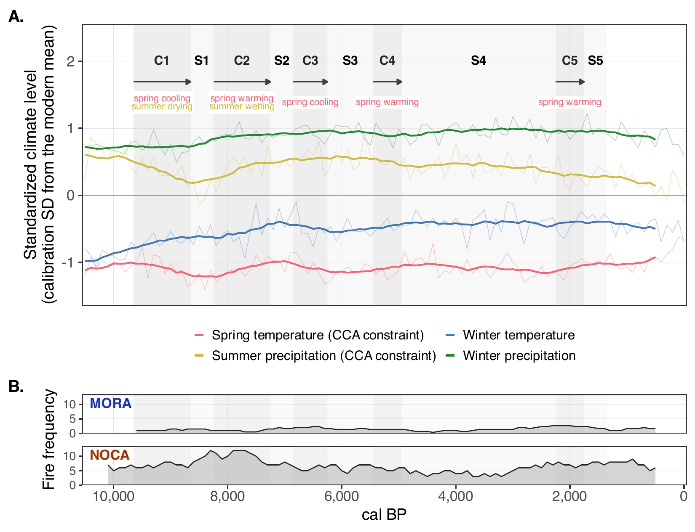

**Fig. S10. Holocene climate for the four seasonal variables.** (A)
Standardized levels, in standard deviations of the legacy plots from
their mean, of spring temperature, winter temperature, summer
precipitation, and winter precipitation: 1,000-year running means (bold)
and the centennial series (thin), averaged over the lakes of each park
with the two parks weighted equally. The Holocene climate is
CHELSA-TraCE21k after the bias correction (Appendix S2). Only spring
temperature and summer precipitation are used in the climate–community
space and define the climate periods. (B) Fire frequency as in Fig. 3C
of the main text.

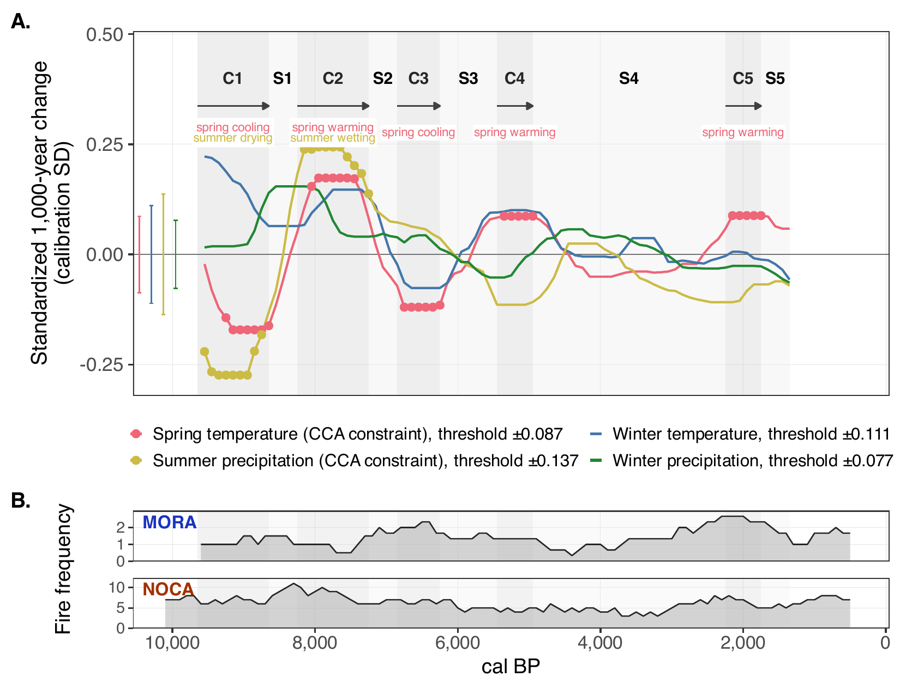

**Fig. S11. How the climate periods were defined.** (A) Change of each
of the four seasonal variables over 1,000 years (Holocene climate after
the bias correction of Appendix S2), with its sign, as the mean of the
two parks (weighted equally), taken as the median over the ten phases of
the 1,000-year bins, and standardized by the standard deviation across
the legacy plots. Filled points mark the time steps at which one of the
two variables of the climate–community space changed in one direction
(more than 50% of the maximum change of the variable, with at least 8 of
10 phases in the same direction). We defined the climate periods from
these points. Winter temperature and winter precipitation are shown for
comparison. Brackets on the left mark the stability range of each
variable, whose threshold is given in the legend. (B) Fire frequency as
in Fig. 3C of the main text.

# Fire dynamics

## Appendix S3. Fire histories of the Holocene

### S3.1 Charcoal records

To describe fire activity through the Holocene in each park, we used
published records of macroscopic charcoal in lake sediments: Sunrise
Lake, Shadow Lake, and Little Sunrise Lake at MORA (Walsh et al., 2017),
and Panther Potholes at NOCA (Prichard et al., 2009). At MORA, these
records come from Sunrise Ridge and not from the lakes of the forest
records (see S3.5). At NOCA, the fire record and the forest record come
from the same core and have the same chronology (Appendix S1).

### S3.2 Fire events

To identify fire events in the same way in the four records, we repeated
the peak detection of the two original studies in one workflow (R
package tapas), with the settings of each original study (Table S7). In
this workflow, a fire event is a peak in the charcoal accumulation rate
that exceeds the background noise of the record and passes a
minimum-count test (Fig. S12). Script:
[`R/pipeline/09_fire_records.R`](R/pipeline/09_fire_records.R).

**Table S7. Parameters used to reconstruct individual Holocene fire
events.** All records were also screened with the same 75-year
minimum-count test (p ≤ 0.05). MORA settings follow Walsh et al. (2017)
and Panther Potholes settings Prichard et al. (2009), except its 12-year
interpolation interval, the median resolution of our updated chronology.

| Site | Fire record | Interpolation interval (years) | Background window (years) | Peak threshold | Accepted fire events |
|:---|:---|---:|---:|:---|---:|
| MORA | Sunrise Lake | 48 | 800 | 95% | 17 |
| MORA | Shadow Lake | 47 | 1000 | 95% | 14 |
| MORA | Little Sunrise Lake | 42 | 500 | 95% | 13 |
| NOCA | Panther Potholes | 12 | 500 | 99% | 70 |

<sub>Table file:
[fire_detection_parameters.csv](report/tables/fire_detection_parameters.csv)</sub>

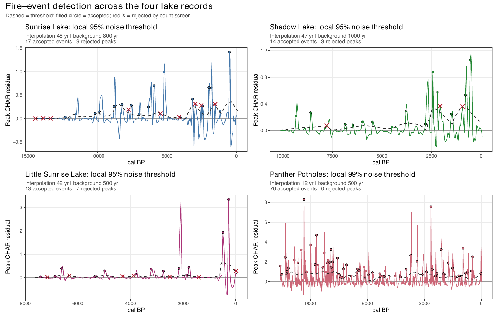

**Fig. S12. Identification of Holocene fire events in the four
records.** The residual peak component is the difference between
interpolated charcoal accumulation rates (CHAR) and the background
estimated with the record’s robust LOWESS window. Candidate events
exceed the local noise threshold (dashed line) and are then screened
with a 75-year minimum-count test (p ≤ 0.05): filled circles are
accepted events, and red crosses are rejected candidates.

### S3.3 Fire frequency

To show how fire activity changed through the Holocene (Fig. 3C of the
main text), we counted the fire events of each record in windows of
1,000 years, moved in steps of 100 years. The MORA series is the mean of
the three Sunrise Ridge records, and the NOCA series is the Panther
Potholes record. The records differ in resolution, so that fire
frequencies cannot be compared between the parks. Note that the models
do not use this fire frequency, but the number of fire events between t1
and t2 of each lake-period (see Methods of the main
text). Script:
[`R/pipeline/12_climate_eras_fire_frequency.R`](R/pipeline/12_climate_eras_fire_frequency.R).

### S3.4 Comparison with the original studies

To check the workflow, we compared the numbers of fire events that we
identified with those of the original studies, and repeated the analysis
of the MORA records with a second software (CharAnalysis; Table S8). The
numbers differed from the published ones, also with CharAnalysis, which
suggests that part of the difference comes from the software. We kept
one workflow for the four records, with the settings of the original
studies, and did not tune the settings to match the published numbers.

**Table S8. Holocene fire-event counts reported in the original studies
and reconstructed with CharAnalysis R 2.0.3 (MORA only) and tapas (all
four records).**

| Site | Lake | Published | CharAnalysis R 2.0.3 | tapas | Difference from published |
|:---|:---|---:|---:|---:|:---|
| MORA | Sunrise | 24 | 15 | 17 | -7 (-29%) |
| MORA | Shadow | 18 | 16 | 14 | -4 (-22%) |
| MORA | Little Sunrise | 16 | 14 | 13 | -3 (-19%) |
| MORA total |  | 58 | 45 | 44 | -14 (-24%) |
| NOCA | Panther Potholes | 59 | — | 70 | +11 (+19%) |
| Both sites |  | 117 | — | 114 | -3 (-3%) |

<sub>Table file:
[fire_event_counts.csv](report/tables/fire_event_counts.csv)</sub>

**Fire details →**
[04_fire](report/details/04_fire.md) (per-record
detection, CharAnalysis reproduction, modern fire assignment of the
survey plots).

### S3.5 Fire records and forest records at MORA

At MORA, the fire records and the forest records come from different
lakes. We did not use the charcoal of the forest records, i.e., the
charcoal fragments that Dunwiddie (1986) counted in the macrofossil
samples of Jay Bath, Log Wallow, and Reflection Pond, for two reasons.
First, to compare the two parks, fire had to be reconstructed in the
same way at MORA and at NOCA, i.e., as fire events identified from peaks
in charcoal accumulation rates. Second, this is not possible with the
forest records. The detection of fire events requires charcoal
accumulation rates (fragments per cm² per year), i.e., the charcoal
concentration of a sample (fragments per cm³) multiplied by the
sedimentation rate (cm per year). Dunwiddie (1986) reported the charcoal
as the number of fragments in each sample, and not as accumulation
rates. Moreover, each sample covers about 80 to 200 years, so that
single fire events could not be separated even with accumulation rates.
We therefore used the Sunrise Ridge records, and assessed what they can
describe.

Macroscopic charcoal records the fires around a lake, and the records of
nearby lakes therefore do not have to agree. This was the case at MORA.
The three Sunrise Ridge records were only weakly correlated with one
another (Spearman correlations of +0.45, +0.31, and +0.09), and the
three forest records were correlated with one another with +0.19, +0.32,
and -0.09. The forest records did not follow the Sunrise Ridge records
either (Fig. S13). No single record can therefore describe fire in the
park. For this reason, we used the mean of the three Sunrise Ridge
records, which is high when several watersheds burned in the same
period. We interpret this mean as an indication of periods of high fire
activity in the region, and not as the fire history at the lakes of the
forest records. Note that the comparison with the forest records is
coarse, for the same two reasons, so that the lack of agreement may
partly come from the records themselves.

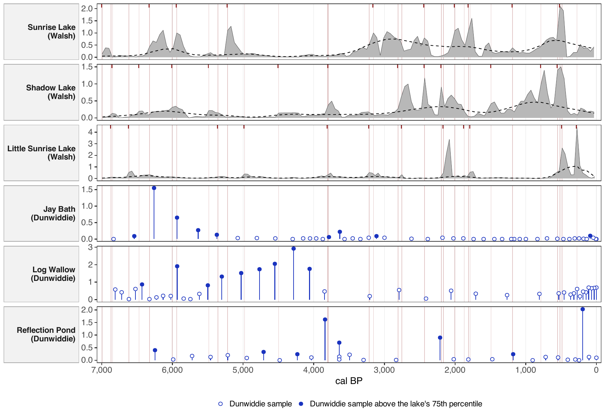

**Fig. S13. Charcoal in the fire records of Sunrise Ridge (Walsh et al.,
2017) and in the forest records of MORA (Dunwiddie, 1986).** Upper three
rows: charcoal accumulation rate of each Sunrise Ridge record (grey),
with its background (dashed) and the fire events that we identified
(dark red ticks at the top of each row). Lower three rows: number of
charcoal fragments in each macrofossil sample of Dunwiddie (1986). This
number is a concentration, because all samples of a core had the same
volume, and the samples above the 75th percentile of each lake are
filled. Each fire event of the Sunrise Ridge records is drawn as a faint
line through all rows. Time runs from 7,000 cal BP to the present, which
is the time span of the forest records. The correlations in the text are
Spearman correlations of the charcoal of two records over bins of 500
years. Script:
[`R/figures/supp_charcoal_dunwiddie_walsh.R`](R/figures/supp_charcoal_dunwiddie_walsh.R).

## Fire between the two surveys

In the Anthropocene a plot pair counts as burned when a fire falls
between its two surveys. At MORA this comes from the National Park
Service LandTrendr landscape-change polygons of 1987 to 2017 (a fire
polygon within 100 m of the plot), at NOCA from the assignment of Wilson
et al. (2024). Of the plot pairs in the analysis, 0 at MORA and 24 at
NOCA burned (Figs. 2 and 3C). The two MORA plots that burned are left
out of the analysis, so the Anthropocene fire comparison is a NOCA
comparison.

# Climate–community space

One CCA is fitted to the legacy composition of the 605 matched plots
(MORA and NOCA pooled), constrained by the climate variables above
(scaling 1, Hill = FALSE). Resurvey plots and Holocene samples are
projected into it: their climate gives a predicted (LC) position and
their composition an observed (WA) position.

**What and why.** The four seasonal variables come in two tightly linked
pairs: spring and winter temperature, and summer and winter
precipitation. Inside a pair the CCA cannot tell the two seasons apart,
and Holocene lakes reach seasonal combinations the modern plots never
show. The CCA is therefore constrained by one variable of each pair.
Spring temperature (MSpT) stands for snowmelt timing and the start of
the growing season. Summer precipitation (SP) stands for summer drying
stress. Because each pair is strongly correlated, the two also carry
temperature and precipitation change in general.

**How it is calculated.**

``` r
# R/pipeline/11_cca.R
# The CCA is fitted once, on the legacy survey only.
#   species_past_final: one row per calibration plot (605), one column per tree
#     species (13), the presence (1) or absence (0) of each species in the plot.
#   env_past_final: the same 605 plots, two columns, MSpT (mean spring
#     temperature) and SP (summer precipitation) of the plot's legacy climate
#     window.
# The formula reads "species ~ MSpT + SP". vegan::cca finds the two axes,
# each a weighted sum of MSpT and SP, along which species composition changes
# most. With two climate variables there are exactly two axes. All later
# positions (plots at both surveys, lake samples) live in this 2-D space.
cca_formula = reformulate(CCA_VARIABLES, response = "species_past_final")
cca_model = cca(cca_formula, data = env_past_final)
```

``` r
# R/pipeline/11_cca.R
# Two positions for every community, both on the fitted axes:
#   type = "lc" (linear combination): where its CLIMATE alone puts it, the
#     predicted position. It uses only MSpT and SP.
#   type = "wa" (weighted average): where its SPECIES put it, the observed
#     position, the average of the scores of the species present.
# The lag M of a community is the distance between the two.
predicted_present = predict(cca_model, newdata = env_present_final, type = "lc", scaling = cca_scaling, hill = cca_hill)
projected_present = predict(cca_model, newdata = species_present_final,
                            type = "wa", scaling = cca_scaling, hill = cca_hill)

predicted_paleo = predict(cca_model, newdata = env_paleo[, CCA_VARIABLES, drop = FALSE],
                          type = "lc", scaling = cca_scaling, hill = cca_hill)
projected_paleo = predict(cca_model, newdata = species_paleo[, keep_species, drop = FALSE],
                          type = "wa", scaling = cca_scaling, hill = cca_hill)
```

**Result.**

**Table S9. Choice of the climate variables of the climate–community
space.** CCA fitted to the 605 legacy plots with three sets of climate
variables. VIF, variance inflation factor. The last two columns give the
percentage of the centuries of the Holocene records (333 at MORA, three
lakes, and 111 at NOCA) whose climate, after the bias correction
(Appendix S2), was outside the climate of the legacy plots.

| Set | Variables | Largest abs. correlation | VIF | R² | Adjusted R² | MORA lake-centuries outside (%) | NOCA lake-centuries outside (%) |
|:---|:---|---:|:---|---:|---:|---:|---:|
| All four | MSpT, MWT, SP, WP | 0.956 | MSpT 29.6, MWT 26.4, SP 5.2, WP 6.7 | 0.166 | 0.161 | 63.964 | 28.829 |
| MWT + SP | MWT, SP | 0.071 | MWT 1.0, SP 1.0 | 0.141 | 0.138 | 0.000 | 0.000 |
| MSpT + SP | MSpT, SP | 0.286 | MSpT 1.1, SP 1.1 | 0.138 | 0.136 | 0.000 | 0.000 |

<sub>Table file:
[step0_screening.csv](report/tables/step0_screening.csv)</sub>

With MSpT and SP the CCA explains 13.6% of the variation in composition
(adjusted R²), against 16.1% with all four variables. Adding winter
temperature and winter precipitation back improves the fit (pseudo-F
9.87, p = 0.0001 unrestricted and p = 0.0061 within parks). That gain
comes from the seasonal contrasts within each pair, the same contrasts
that make the four-variable fit collinear (VIF up to 29.6) and that
place 64% of the MORA lake-centuries outside the calibration climate.
With MSpT and SP no lake-century in either park is outside it. The
display rotation turns the plane by -20.7 degrees so that rotated axis 1
is spring temperature increasing to the right and rotated axis 2 summer
precipitation increasing upward. The pipeline asserts that mismatch,
lag, turnover, pace and direction are identical before and after this
rotation.

**Choice of CCA constraints.** Candidate variables are screened by their
correlations (Fig. S9) and by their variance inflation in the fitted
CCA, keeping one temperature and one precipitation variable. With the
four seasonal variables MSpT, MWT, SP and WP, the two temperatures had
variance inflation factors near 30 and opposite-signed coefficients that
are not identifiable. The CCA is therefore constrained by spring
temperature, the temperature that changes most through the Holocene, and
summer precipitation. Figures in the CCA plane are rotated rigidly by
the varimax angle so that the two arrows lie along the axes. Distances
and angles, and therefore every tracking metric, are unchanged by the
rotation (decision of 2026-11-09 in **Decisions →**
[10_decisions](report/details/10_decisions.md)). The
constraints of this build:

**Table S10. The two climate variables of the climate–community space.**
Variance inflation factor (VIF) and biplot score of each variable on the
two unrotated CCA axes.

| Variable | Label                |  VIF | CCA1 score | CCA2 score |
|:---------|:---------------------|-----:|-----------:|-----------:|
| MSpT     | Spring temperature   | 1.08 |       0.52 |      -0.07 |
| SP       | Summer precipitation | 1.08 |      -0.23 |      -0.35 |

<sub>Table file:
[cca_constraint_vif.csv](report/tables/cca_constraint_vif.csv)</sub>

**Table S11. Axes of the CCA.** The two climate variables explained
13.8% of the variation in composition (constrained inertia).

| Axis | Eigenvalue | % total inertia | % constrained inertia |
|:-----|-----------:|----------------:|----------------------:|
| CCA1 |      0.279 |           9.025 |                65.285 |
| CCA2 |      0.149 |           4.799 |                34.715 |

<sub>Table file:
[cca_axes.csv](report/tables/cca_axes.csv)</sub>

**Table S12. Permutation tests of the CCA.** 9,999 permutations,
unrestricted and restricted within parks. df, degrees of freedom of each
component.

| Test    | Component |  df | Pseudo-F | p (unrestricted) | p (within parks) |
|:--------|:----------|----:|---------:|-----------------:|-----------------:|
| Overall | Model     |   2 |   48.284 |                0 |                0 |
| Axis    | CCA1      |   1 |   63.044 |                0 |                0 |
| Axis    | CCA2      |   1 |   33.594 |                0 |                0 |

<sub>Table file:
[cca_permutation_tests.csv](report/tables/cca_permutation_tests.csv)</sub>

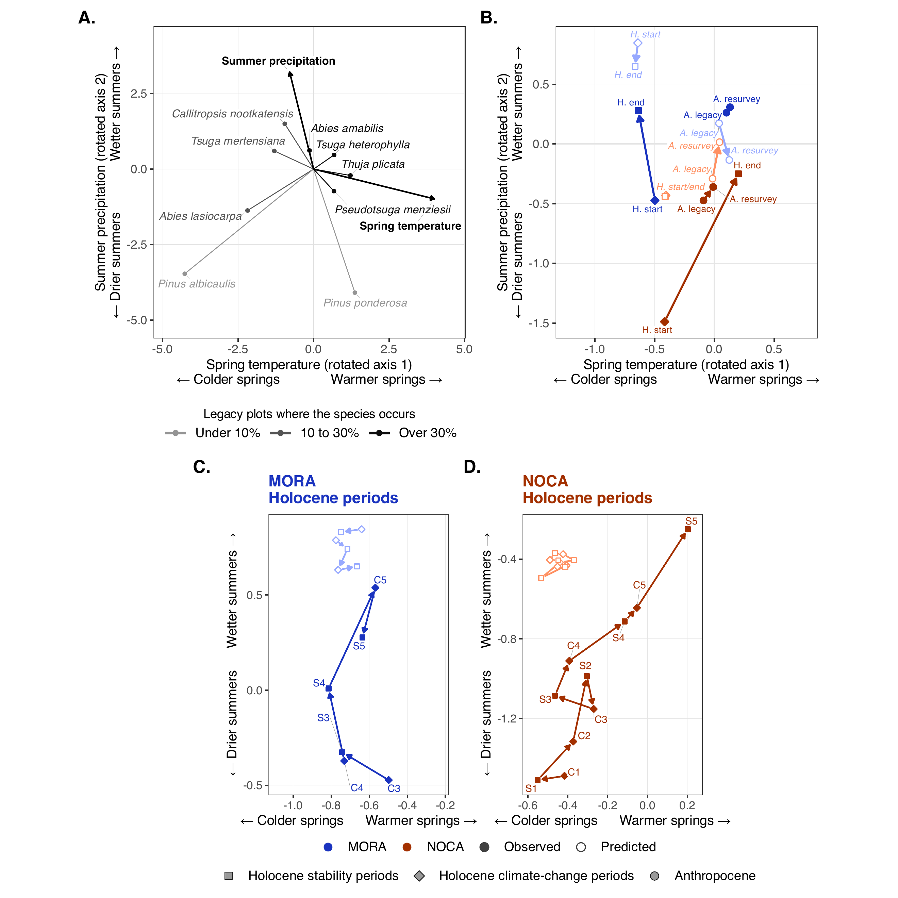

**Fig. 4. Climate and community positions in the CCA plane.** (A) The
species that carry more than half an equal share of the constrained
inertia (50% divided by the 13 taxa), 8 taxa holding 89% of it (vectors
from the centre), and the two climate constraints (bold arrows) of the
CCA fitted on 605 legacy plots. The species are shaded by how common
they are: the share of the legacy plots in which they occur, under 10%,
10 to 30% or over 30%. All taxa are shown in Fig. S14, and their shares
of the inertia against their commonness in Fig. S15. (B) Observed and
climate-predicted movement of each park: in the Holocene from the first
to the last climate period with samples, in the Anthropocene from the
legacy survey to the resurvey (averaged over 328 MORA and 277 NOCA plot
pairs). Observed positions are filled symbols in the dark park colour,
predicted positions open symbols in the light park colour. The symbol
gives the period type: diamonds for Holocene climate-change periods,
squares for Holocene stability periods and circles for the Anthropocene.
Each line is tagged once with its era, the tags of predicted lines in
italics. The MORA arrows run from C3 to S5 (6850 to 1350 cal BP), and
the first MORA period rests on 9 samples in 9 lake-centuries. The NOCA
arrows run from C1 to S5 (9650 to 1350 cal BP). (C, D) The full Holocene
sequence of period centroids at MORA and NOCA, observed and predicted,
each period named at its observed centroid (C, climate-change period, S,
stability period) and drawn with the symbol of its period type. The
steps of the predicted MORA Holocene and the predicted NOCA Holocene
sequences are short, and their centroids are joined by plain lines
without arrowheads. Where two symbols lie close, the arrowhead is drawn
smaller, and where they lie too close for an arrowhead, they are joined
by a plain line. Each centroid averages the sampled centuries of each
lake within the period, with the lakes weighted equally. MORA C3 (6850
to 6250 cal BP) averages 2 of the 3 lakes, because Reflection Pond has
no samples in it. The observed MORA step from C3 to S3 is 0.26 CCA units
as drawn and 0.09 over Jay Bath and Log Wallow alone, so it mostly shows
a lake joining the mean. Axes orthogonally rotated (varimax, -20.7
degrees) for display, so that axis 1 follows spring temperature and axis
2 summer precipitation. All metrics are rotation-invariant. The
unrotated biplot is Fig. S14.

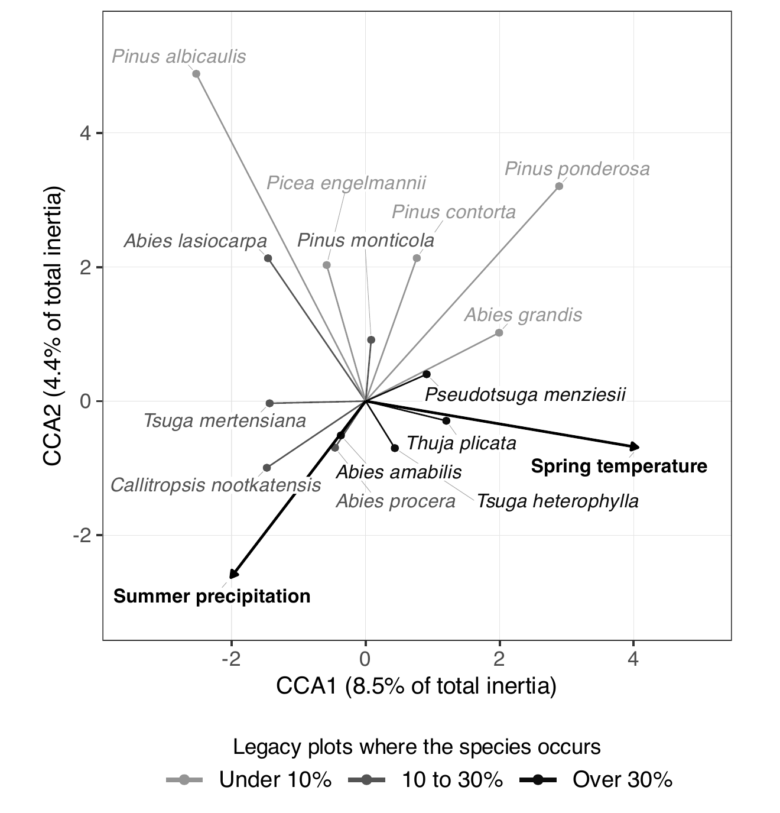

**Fig. S14. The climate–community space on the unrotated CCA axes, with
all species.** As Fig. 4A of the main text, on the unrotated axes
(labelled with the share of the variation in composition that each axis
explained) and with all 13 species.

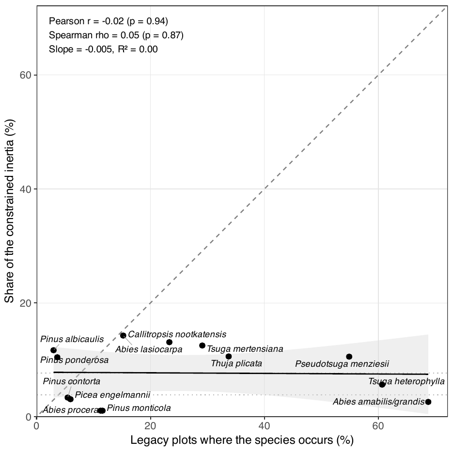

**Fig. S15. Share of the constrained inertia against commonness of the
species.** Each point is one of the 13 taxa of the CCA: its share of the
constrained inertia against the share of the legacy plots in which it
occurs. Dashed line: 1:1. Solid line and band: linear fit with its 95%
confidence band. Dotted lines: an equal share of the constrained inertia
(7.7%, 100% divided by the number of taxa) and half of it, the threshold
above which a species is drawn in Fig. 4A. Share and commonness are not
related (Pearson r = -0.02, p = 0.94, and Spearman rho = 0.05, p = 0.87,
with a slope of the fit of -0.005 percentage points of inertia per
percentage point of plots, R² = 0.00). Only *Pinus albicaulis* and
*Pinus ponderosa* carry a larger share of the inertia than of the plots.

Stages and helpers: [`R/pipeline/11_cca.R`](R/pipeline/11_cca.R),
[`R/helpers/cca_report.R`](R/helpers/cca_report.R) (screening and
add-back test),
[`R/helpers/cca_display_rotation.R`](R/helpers/cca_display_rotation.R),
[`R/pipeline/13_tracking.R`](R/pipeline/13_tracking.R) (rotation check),
[`R/figures/main_fig4_cca_trajectories.R`](R/figures/main_fig4_cca_trajectories.R),
[`R/figures/supp_cca_inertia_commonness.R`](R/figures/supp_cca_inertia_commonness.R)
(Fig. S15).

**CCA details →** [06_cca](report/details/06_cca.md)
(full model output, species and climate contributions, scaling 1 against
scaling 2).

## Holocene samples in the climate–community space

**What and why.** Each macrofossil sample has an observed position in
the CCA plane (its WA score, from the taxa it contains). Each lake also
has a climate-predicted position for every century (its LC score, from
that lake’s own climate cell). Samples are dated by the median of their
Bacon ages and grouped by century. The observed position of a century is
the centroid of its samples’ WA positions. No vegetation is interpolated
between sampled centuries. These century positions feed the lake-periods
(Climate–community lags) and the period centroids of Fig. 4. No model is
fitted on the century steps any more.

**Table S13. Sampled centuries of each lake.** A sampled century is a
century with at least one macrofossil sample.

| Park | Lake | Sampled centuries | Samples | Centuries with one sample | Oldest (cal BP) | Youngest (cal BP) |
|:---|:---|---:|---:|---:|---:|---:|
| MORA | JayBath | 42 | 48 | 37 | 6800 | 0 |
| MORA | LogWallow | 34 | 40 | 29 | 6800 | 0 |
| MORA | ReflectionPond | 28 | 31 | 26 | 6200 | 0 |
| NOCA | PantherPotholes | 107 | 812 | 0 | 10600 | 0 |

<sub>Table file:
[step1_sampled_centuries.csv](report/tables/step1_sampled_centuries.csv)</sub>

The records of the three MORA lakes start between 6,200 and 6,800 cal
BP, and most of their sampled centuries hold a single sample. The
Panther Potholes record (NOCA) covers the whole Holocene, with several
samples per century.

Stages and helpers:
[`R/pipeline/13_tracking.R`](R/pipeline/13_tracking.R),
[`R/helpers/century_tracking.R`](R/helpers/century_tracking.R),
[`R/helpers/tracking_metrics.R`](R/helpers/tracking_metrics.R).

# Climate–community lags (Q1)

## Lake-periods

**What and why.** Two scoops of sediment from the same forest in the
same century differ by about as much as the forest drifts in many
centuries, because one needle caught or missed moves a sample’s
position. A lag computed between consecutive centuries is therefore
mostly that noise. Comparing the two ends of a whole climate period lets
the drift outgrow it. A lake-period is one lake within one climate
period. Its start (t1) is the oldest and its end (t2) the youngest
sampled century of that lake in that period, and a lake needs samples in
at least two centuries of a period to have a lake-period there. The
centuries in between enter no model.

At each end the mismatch M is the distance between the observed and the
climate-predicted positions. The lag rate is the change in M per
century. The turnover rate is the length of the observed movement per
century. The pace and direction contributions ask how much smaller the
final mismatch would have been if the community had moved the predicted
distance in its own direction (pace) or its own distance in the
predicted direction (direction). The climate change rate is the
standardized end-to-end change of MSpT and SP in the lake’s own climate
cell, per century. Fire activity is the number of accepted fire events
between t1 and t2, per century and per charcoal core, averaged over the
cores of the park that cover the whole lake-period.

**How it is calculated.** The code below computes every quantity from
the two ends of a unit, a Holocene lake-period or an Anthropocene plot
pair. The comments say what each step means.

``` r
# R/helpers/tracking_metrics.R
  # One row per unit (a Holocene lake-period or an Anthropocene plot pair),
  # with two ends, t1 (older) and t2 (younger). At each end the community has
  # an observed position (o1, o2: from its species) and a predicted position
  # (p1, p2: from its climate) on the two CCA axes. The suffix _2 marks t2.
  # Movement from t1 to t2: observed (ox, oy), predicted (px, py), and their
  # lengths a (observed distance) and b (predicted distance).
  ox = x$o1_2-x$o1; oy = x$o2_2-x$o2
  px = x$p1_2-x$p1; py = x$p2_2-x$p2
  a = sqrt(ox^2+oy^2); b = sqrt(px^2+py^2)
  # A movement shorter than epsilon has no direction, so the angle, the pace
  # and direction contributions and the tracking ratio are left undefined there.
  x$finite_endpoints = rowSums(!is.finite(as.matrix(x[coords]))) == 0L
  x$small_observed_movement = is.finite(a) & a <= epsilon
  x$small_predicted_movement = is.finite(b) & b <= epsilon
  observed_direction = x$finite_endpoints & is.finite(a) & a > epsilon
  predicted_direction = x$finite_endpoints & is.finite(b) & b > epsilon
  x$angle_valid = observed_direction & predicted_direction
  x$pace_counterfactual_valid = observed_direction
  x$direction_counterfactual_valid = predicted_direction
  x$tracking_ratio_valid = predicted_direction
  x$delta_observed_CCA1 = ox; x$delta_observed_CCA2 = oy
  x$delta_predicted_CCA1 = px; x$delta_predicted_CCA2 = py
  x$observed_vegetation_displacement = a
  x$predicted_vegetation_displacement = b
  # Turnover rate: observed distance moved, per century. Tracking ratio:
  # observed over predicted distance (1 = moved as far as climate asked).
  # Angle: between the observed and the predicted movement (0 = same way).
  x$observed_turnover_rate = a/x$vegetation_dt_years*100
  x$predicted_vegetation_change_rate = b/x$climate_dt_years*100
  x$magnitude_tracking_ratio = ifelse(predicted_direction, a/b, NA_real_)
  x$rate_tracking_ratio = ifelse(predicted_direction,
    x$observed_turnover_rate/x$predicted_vegetation_change_rate, NA_real_)
  x$angle_degrees = acos(safe_cosine_2d(ox, oy, px, py, epsilon))*180/pi
  # Lag M at each end: the distance between observed and predicted position,
  # how far the community is from where its climate would put it. The lag is
  # M at t2 minus M at t1 (positive: the gap grew), the lag rate the same per
  # century.
  x$lag_t1 = sqrt((x$o1-x$p1)^2+(x$o2-x$p2)^2)
  x$lag_t2 = sqrt((x$o1_2-x$p1_2)^2+(x$o2_2-x$p2_2)^2)
  x$change_in_lag = x$lag_t2-x$lag_t1
  x$lag_rate_per_century = x$change_in_lag/x$climate_dt_years*100
```

``` r
# R/helpers/tracking_metrics.R
  # Two "what if" end points at t2, both starting from the observed t1 position:
  #   pace-corrected: the community's own direction, but the predicted
  #     distance b (as if it had moved at the climate's pace);
  #   direction-corrected: the predicted direction, but its own distance a
  #     (as if it had moved the climate's way).
  # Each contribution is the observed lag at t2 minus the lag at that "what if" end
  # point, per century. Positive: the community's own pace (or direction)
  # widened the lag. Negative: it narrowed the lag.
  x$pace_corrected_CCA1 = x$pace_corrected_CCA2 = rep(NA_real_, nrow(x))
  x$direction_corrected_CCA1 = x$direction_corrected_CCA2 = rep(NA_real_, nrow(x))
  i = observed_direction
  x$pace_corrected_CCA1[i] = x$o1[i]+b[i]*ox[i]/a[i]
  x$pace_corrected_CCA2[i] = x$o2[i]+b[i]*oy[i]/a[i]
  i = predicted_direction
  x$direction_corrected_CCA1[i] = x$o1[i]+a[i]*px[i]/b[i]
  x$direction_corrected_CCA2[i] = x$o2[i]+a[i]*py[i]/b[i]
  x$lag_t2_pace_corrected = sqrt((x$pace_corrected_CCA1-x$p1_2)^2+
    (x$pace_corrected_CCA2-x$p2_2)^2)
  x$lag_t2_direction_corrected = sqrt((x$direction_corrected_CCA1-x$p1_2)^2+
    (x$direction_corrected_CCA2-x$p2_2)^2)
  x$pace_effect_on_lag = x$lag_t2-x$lag_t2_pace_corrected
  x$direction_effect_on_lag = x$lag_t2-x$lag_t2_direction_corrected
  x$pace_effect_on_lag_per_century = x$pace_effect_on_lag/x$climate_dt_years*100
  x$direction_effect_on_lag_per_century = x$direction_effect_on_lag/x$climate_dt_years*100
```

**Result.**

**Table S14. Lake-periods.** One row for each lake within each climate
period, from its oldest (t1) to its youngest (t2) sampled century. The
climate is the Holocene climate after the bias correction (Appendix S2).
M, climate–community mismatch. Rates are per century: the climate change
rate in SD of the legacy plots, fire activity in fire events per
charcoal record, and the other rates in CCA distance. The pace
contribution and the direction contribution are undefined when the
observed or the climate-predicted position did not move.

| Park | Lake | Period | t1 (cal BP) | t2 (cal BP) | Years | Samples t1 | Samples t2 | Climate change rate | MSpT change (°C) | SP change (mm) | Fire activity | M t1 | M t2 | Lag rate | Turnover rate | Pace contribution | Direction contribution |
|:---|:---|:---|---:|---:|---:|---:|---:|---:|---:|---:|---:|---:|---:|---:|---:|---:|---:|
| MORA | JayBath | C3 | 6800 | 6300 | 500 | 1 | 1 | 0.129 | -1.183 | -25.777 | 0.200 | 1.259 | 1.283 | 0.005 | 0.055 | -0.007 | 0.010 |
| MORA | JayBath | S3 | 5900 | 5600 | 300 | 1 | 1 | 0.136 | 0.083 | 25.040 | 0.000 | 1.539 | 1.566 | 0.009 | 0.073 | -0.009 | 0.023 |
| MORA | JayBath | C4 | 5400 | 5100 | 300 | 1 | 1 | 0.021 | -0.150 | -1.000 | 0.222 | 1.490 | 1.491 | 0.000 | 0.000 | — | — |
| MORA | JayBath | S4 | 4800 | 2400 | 2400 | 1 | 1 | 0.011 | -0.267 | 14.312 | 0.125 | 0.762 | 0.347 | -0.017 | 0.025 | -0.017 | 0.002 |
| MORA | JayBath | C5 | 2200 | 1900 | 300 | 1 | 1 | 0.155 | 0.417 | -26.621 | 0.333 | 0.638 | 0.395 | -0.081 | 0.140 | 0.008 | -0.153 |
| MORA | JayBath | S5 | 1700 | 1400 | 300 | 1 | 1 | 0.084 | -0.167 | 14.908 | 0.111 | 0.428 | 0.532 | 0.035 | 0.000 | — | — |
| MORA | LogWallow | C3 | 6800 | 6300 | 500 | 1 | 1 | 0.126 | -1.133 | -25.777 | 0.200 | 1.443 | 1.174 | -0.054 | 0.030 | 0.033 | -0.038 |
| MORA | LogWallow | S3 | 6200 | 5500 | 700 | 1 | 1 | 0.048 | 0.550 | 15.318 | 0.095 | 1.262 | 0.983 | -0.040 | 0.058 | -0.028 | -0.031 |
| MORA | LogWallow | C4 | 5300 | 5000 | 300 | 1 | 1 | 0.015 | -0.067 | -2.139 | 0.111 | 1.060 | 1.114 | 0.018 | 0.076 | 0.022 | -0.033 |
| MORA | LogWallow | S4 | 4800 | 2400 | 2400 | 1 | 1 | 0.012 | -0.267 | 16.032 | 0.125 | 0.741 | 0.633 | -0.004 | 0.014 | -0.005 | 0.004 |
| MORA | ReflectionPond | S3 | 6200 | 5500 | 700 | 1 | 1 | 0.045 | 0.550 | 13.456 | 0.095 | 0.811 | 0.949 | 0.020 | 0.000 | — | — |
| MORA | ReflectionPond | S4 | 4900 | 2800 | 2100 | 1 | 1 | 0.024 | -0.900 | -20.338 | 0.095 | 1.069 | 0.275 | -0.038 | 0.032 | -0.017 | -0.053 |
| MORA | ReflectionPond | C5 | 2200 | 1800 | 400 | 1 | 1 | 0.130 | 0.483 | -29.506 | 0.417 | 0.234 | 0.337 | 0.026 | 0.084 | 0.028 | -0.002 |
| NOCA | PantherPotholes | C1 | 9600 | 8700 | 900 | 7 | 7 | 0.044 | -0.933 | -5.983 | 0.667 | 1.063 | 1.457 | 0.044 | 0.050 | 0.023 | 0.036 |
| NOCA | PantherPotholes | S1 | 8600 | 8300 | 300 | 8 | 7 | 0.076 | 0.517 | 4.614 | 0.333 | 1.015 | 1.175 | 0.053 | 0.140 | 0.030 | 0.078 |
| NOCA | PantherPotholes | C2 | 8200 | 7300 | 900 | 8 | 6 | 0.060 | 0.967 | 22.242 | 1.222 | 0.829 | 0.652 | -0.020 | 0.033 | -0.001 | -0.019 |
| NOCA | PantherPotholes | S2 | 7200 | 6900 | 300 | 5 | 6 | 0.039 | 0.283 | -0.409 | 0.333 | 0.476 | 0.604 | 0.042 | 0.046 | 0.023 | 0.039 |
| NOCA | PantherPotholes | C3 | 6800 | 6300 | 500 | 5 | 6 | 0.096 | -1.100 | -8.894 | 0.600 | 1.169 | 0.732 | -0.087 | 0.103 | -0.022 | -0.122 |
| NOCA | PantherPotholes | S3 | 6200 | 5500 | 700 | 5 | 6 | 0.033 | 0.533 | 4.093 | 0.571 | 0.588 | 0.378 | -0.030 | 0.073 | -0.019 | -0.044 |
| NOCA | PantherPotholes | C4 | 5400 | 5000 | 400 | 6 | 6 | 0.013 | 0.117 | -1.185 | 1.250 | 0.469 | 0.399 | -0.017 | 0.095 | -0.008 | -0.095 |
| NOCA | PantherPotholes | S4 | 4900 | 2300 | 2600 | 5 | 11 | 0.014 | -0.783 | -9.468 | 0.462 | 0.268 | 0.561 | 0.011 | 0.017 | 0.008 | 0.005 |
| NOCA | PantherPotholes | C5 | 2200 | 1800 | 400 | 10 | 10 | 0.091 | 0.633 | -15.620 | 0.750 | 0.445 | 0.415 | -0.008 | 0.077 | 0.022 | -0.041 |
| NOCA | PantherPotholes | S5 | 1700 | 1400 | 300 | 8 | 9 | 0.049 | -0.017 | 9.144 | 0.333 | 0.273 | 1.087 | 0.271 | 0.281 | 0.259 | 0.047 |

<sub>Table file:
[step24_lake_periods.csv](report/tables/step24_lake_periods.csv)</sub>

Of the 27 combinations of lake and climate period with at least one
sampled century, 23 had samples in two or more centuries and are
therefore lake-periods (13 at MORA and 10 at NOCA, of which 11 in
climate-change periods and 12 in stability periods). The lake-periods
span 300 to 2600 years. At MORA, t1 and t2 of every lake-period hold a
single sample, and 3 lake-periods have no pace or direction
contribution, because the observed or the climate-predicted position did
not move. The charcoal records cover all lake-periods.

Stages and helpers:
[`R/pipeline/13_tracking.R`](R/pipeline/13_tracking.R),
[`R/helpers/lake_periods.R`](R/helpers/lake_periods.R),
[`R/helpers/tracking_metrics.R`](R/helpers/tracking_metrics.R),
[`R/helpers/century_tracking.R`](R/helpers/century_tracking.R) (fire per
interval), [`R/tests/test_lake_periods.R`](R/tests/test_lake_periods.R).

## Comparison among period types

**What and why.** Each response is compared between the Holocene
stability periods, the Holocene climate-change periods and the
Anthropocene, within each park. The two Holocene types are never pooled,
so back-and-forth change in the stability periods cannot cancel the
directional change of the climate-change periods, and the parks are
never pooled. The Holocene rows are the lake-periods and the
Anthropocene rows are the plot pairs, in one model per response with
group-specific residual spread, the endpoint weights and the AR(1)
within each lake. Fire stays out of these models, because it is measured
differently in the two eras. Rates over a few decades and over centuries
are not on equal footing, since longer windows give lower rates, and
every comparison states both time spans. The three contrasts between
period types in each park are tested together for both parks, so each
response has six contrasts, and their p-values are Holm-adjusted within
that family. Significance is read from the adjusted p-values. The
intervals are the unadjusted 95% intervals.

**How it is calculated.**

``` r
# R/pipeline/14_era_models.R
  # One model per response (climate change rate, climate change, turnover rate,
  # displacement, lag rate, lag, pace contribution, direction contribution and their totals).
  # Climate change, displacement, lag and the contribution totals are totals between
  # the two ends, the others per century.
  # Each row is a Holocene lake-period or an
  # Anthropocene plot pair; `estimate` is its value of the response.
  # Mean part, period_type * site: one mean for each period type (Holocene-S,
  # Holocene-C, Anthropocene) in each park. The era means, the contrasts
  # (Anthropocene minus each Holocene type) and the folds come from these.
  # gls (generalized least squares, nlme) is a regression whose errors may be
  # correlated and unequal:
  #   correlation: lake-periods of one lake are correlated, AR(1) within each
  #     series (a lake; each Anthropocene plot is a series of one unit).
  #     unit_index is the position of the lake-period's climate period (C1 = 1
  #     to S5 = 10), so two lake-periods k periods apart correlate by phi^k,
  #     also where the periods between them are missing;
  #   weights: each period type in each park has its own spread (varIdent), and
  #     ends that rest on few samples are noisier, in proportion to
  #     endpoint_var = 1/n_start + 1/n_end (varFixed).
  captured = reconstruction_capture(function() gls(estimate ~ period_type * site,
    correlation = corAR1(form = ~ unit_index | series),
    weights = varComb(varIdent(form = ~ 1 | period_type_site), varFixed(~ endpoint_var)),
    data = d, method = 'REML', control = glsControl(msMaxIter = 500)))
```

**Result.**

**Table S15. Comparison among period types: estimated means for each
period type and park.** Generalized least-squares models with period
type, park, and their interaction as fixed effects (see Methods of the
main text). The Holocene climate is CHELSA-TraCE21k after the bias
correction (Appendix S2). SE, standard error. df, residual degrees of
freedom of the model, used for the 95% confidence interval (CI). Climate
change is in SD of the legacy plots, and turnover, lag, pace
contribution, and direction contribution are in CCA distance. The
quantities named “rate”, and the pace contribution and the direction
contribution without “(not divided by time)”, are per century. The
lake-periods span 300 to 900 years in the Holocene climate-change
periods and 300 to 2600 years in the Holocene stability periods, and the
Anthropocene plot pairs span 27.5 to 32.5 years.

| Quantity | Park | Period type | n | Estimated mean | SE | df | 95% CI |
|:---|:---|:---|---:|---:|---:|---:|:---|
| Climate change rate | MORA | Holocene-S | 7 | 0.052 | 0.017 | 622 | 0.018 to 0.085 |
| Climate change rate | MORA | Holocene-C | 6 | 0.096 | 0.025 | 622 | 0.047 to 0.145 |
| Climate change rate | MORA | Anthropocene | 328 | 3.102 | 0.053 | 622 | 2.999 to 3.205 |
| Climate change rate | NOCA | Holocene-S | 5 | 0.044 | 0.010 | 622 | 0.023 to 0.064 |
| Climate change rate | NOCA | Holocene-C | 5 | 0.063 | 0.015 | 622 | 0.034 to 0.093 |
| Climate change rate | NOCA | Anthropocene | 277 | 2.104 | 0.100 | 622 | 1.907 to 2.300 |
| Climate change (not divided by time) | MORA | Holocene-S | 7 | 0.329 | 0.037 | 622 | 0.256 to 0.401 |
| Climate change (not divided by time) | MORA | Holocene-C | 6 | 0.398 | 0.121 | 622 | 0.162 to 0.635 |
| Climate change (not divided by time) | MORA | Anthropocene | 328 | 0.913 | 0.018 | 622 | 0.878 to 0.948 |
| Climate change (not divided by time) | NOCA | Holocene-S | 5 | 0.216 | 0.040 | 622 | 0.137 to 0.294 |
| Climate change (not divided by time) | NOCA | Holocene-C | 5 | 0.378 | 0.076 | 622 | 0.230 to 0.526 |
| Climate change (not divided by time) | NOCA | Anthropocene | 277 | 0.597 | 0.029 | 622 | 0.541 to 0.653 |
| Turnover rate | MORA | Holocene-S | 7 | 0.029 | 0.012 | 622 | 0.006 to 0.052 |
| Turnover rate | MORA | Holocene-C | 6 | 0.080 | 0.022 | 622 | 0.037 to 0.123 |
| Turnover rate | MORA | Anthropocene | 328 | 0.936 | 0.046 | 622 | 0.847 to 1.026 |
| Turnover rate | NOCA | Holocene-S | 5 | 0.146 | 0.070 | 622 | 0.009 to 0.284 |
| Turnover rate | NOCA | Holocene-C | 5 | 0.061 | 0.019 | 622 | 0.024 to 0.099 |
| Turnover rate | NOCA | Anthropocene | 277 | 2.066 | 0.117 | 622 | 1.837 to 2.296 |
| Turnover (not divided by time) | MORA | Holocene-S | 7 | 0.315 | 0.103 | 622 | 0.113 to 0.517 |
| Turnover (not divided by time) | MORA | Holocene-C | 6 | 0.245 | 0.062 | 622 | 0.124 to 0.366 |
| Turnover (not divided by time) | MORA | Anthropocene | 328 | 0.356 | 0.017 | 622 | 0.322 to 0.390 |
| Turnover (not divided by time) | NOCA | Holocene-S | 5 | 0.495 | 0.116 | 622 | 0.267 to 0.723 |
| Turnover (not divided by time) | NOCA | Holocene-C | 5 | 0.373 | 0.042 | 622 | 0.291 to 0.454 |
| Turnover (not divided by time) | NOCA | Anthropocene | 277 | 0.659 | 0.037 | 622 | 0.585 to 0.732 |
| Lag rate | MORA | Holocene-S | 7 | -0.005 | 0.011 | 622 | -0.026 to 0.016 |
| Lag rate | MORA | Holocene-C | 6 | -0.015 | 0.017 | 622 | -0.049 to 0.019 |
| Lag rate | MORA | Anthropocene | 328 | 0.687 | 0.062 | 622 | 0.565 to 0.810 |
| Lag rate | NOCA | Holocene-S | 5 | 0.083 | 0.057 | 622 | -0.029 to 0.194 |
| Lag rate | NOCA | Holocene-C | 5 | -0.015 | 0.020 | 622 | -0.053 to 0.024 |
| Lag rate | NOCA | Anthropocene | 277 | -0.133 | 0.137 | 622 | -0.402 to 0.137 |
| Lag | MORA | Holocene-S | 7 | -0.189 | 0.128 | 622 | -0.440 to 0.062 |
| Lag | MORA | Holocene-C | 6 | -0.053 | 0.066 | 622 | -0.182 to 0.077 |
| Lag | MORA | Anthropocene | 328 | 0.201 | 0.018 | 622 | 0.165 to 0.237 |
| Lag | NOCA | Holocene-S | 5 | 0.293 | 0.170 | 622 | -0.041 to 0.626 |
| Lag | NOCA | Holocene-C | 5 | -0.039 | 0.127 | 622 | -0.288 to 0.210 |
| Lag | NOCA | Anthropocene | 277 | -0.039 | 0.039 | 622 | -0.115 to 0.038 |
| Pace contribution | MORA | Holocene-S | 5 | -0.016 | 0.004 | 474 | -0.024 to -0.007 |
| Pace contribution | MORA | Holocene-C | 5 | 0.018 | 0.008 | 474 | 0.002 to 0.033 |
| Pace contribution | MORA | Anthropocene | 252 | 0.125 | 0.047 | 474 | 0.032 to 0.218 |
| Pace contribution | NOCA | Holocene-S | 5 | 0.081 | 0.052 | 474 | -0.022 to 0.184 |
| Pace contribution | NOCA | Holocene-C | 5 | 0.007 | 0.008 | 474 | -0.009 to 0.024 |
| Pace contribution | NOCA | Anthropocene | 208 | -0.226 | 0.154 | 474 | -0.528 to 0.076 |
| Direction contribution | MORA | Holocene-S | 5 | -0.016 | 0.023 | 474 | -0.060 to 0.029 |
| Direction contribution | MORA | Holocene-C | 5 | -0.044 | 0.046 | 474 | -0.135 to 0.048 |
| Direction contribution | MORA | Anthropocene | 252 | 0.531 | 0.081 | 474 | 0.372 to 0.691 |
| Direction contribution | NOCA | Holocene-S | 5 | 0.048 | 0.026 | 474 | -0.003 to 0.098 |
| Direction contribution | NOCA | Holocene-C | 5 | -0.025 | 0.031 | 474 | -0.086 to 0.036 |
| Direction contribution | NOCA | Anthropocene | 208 | -0.347 | 0.147 | 474 | -0.637 to -0.058 |
| Pace contribution (not divided by time) | MORA | Holocene-S | 5 | -0.227 | 0.082 | 474 | -0.388 to -0.067 |
| Pace contribution (not divided by time) | MORA | Holocene-C | 5 | 0.065 | 0.038 | 474 | -0.009 to 0.139 |
| Pace contribution (not divided by time) | MORA | Anthropocene | 252 | 0.034 | 0.014 | 474 | 0.007 to 0.062 |
| Pace contribution (not divided by time) | NOCA | Holocene-S | 5 | 0.281 | 0.162 | 474 | -0.038 to 0.599 |
| Pace contribution (not divided by time) | NOCA | Holocene-C | 5 | 0.055 | 0.053 | 474 | -0.049 to 0.159 |
| Pace contribution (not divided by time) | NOCA | Anthropocene | 208 | -0.065 | 0.044 | 474 | -0.151 to 0.021 |
| Direction contribution (not divided by time) | MORA | Holocene-S | 5 | -0.266 | 0.303 | 474 | -0.862 to 0.330 |
| Direction contribution (not divided by time) | MORA | Holocene-C | 5 | -0.148 | 0.116 | 474 | -0.377 to 0.080 |
| Direction contribution (not divided by time) | MORA | Anthropocene | 252 | 0.155 | 0.024 | 474 | 0.108 to 0.201 |
| Direction contribution (not divided by time) | NOCA | Holocene-S | 5 | 0.126 | 0.102 | 474 | -0.075 to 0.327 |
| Direction contribution (not divided by time) | NOCA | Holocene-C | 5 | -0.135 | 0.157 | 474 | -0.443 to 0.173 |
| Direction contribution (not divided by time) | NOCA | Anthropocene | 208 | -0.099 | 0.042 | 474 | -0.181 to -0.016 |

<sub>Table file:
[step5a_era_means.csv](report/tables/step5a_era_means.csv)</sub>

**Table S16. Comparison among period types: differences between period
types within each park.** Models and units as in Table S15. Two-sided
t-tests on the residual degrees of freedom (df) of the model, with 95%
confidence intervals (CI, not adjusted). p (Holm) is adjusted with the
Holm method across the six differences of each quantity, three per park.
The lake-periods span 300 to 900 years in the Holocene climate-change
periods and 300 to 2600 years in the Holocene stability periods, and the
Anthropocene plot pairs span 27.5 to 32.5 years.

| Quantity | Park | Contrast | Estimate | SE | df | t | 95% CI | p | p (Holm) |
|:---|:---|:---|---:|---:|---:|---:|:---|---:|---:|
| Climate change (not divided by time) | MORA | Anthropocene - Holocene-C | 0.515 | 0.122 | 622 | 4.224 | 0.275 to 0.754 | 0.000 | 0.000 |
| Climate change (not divided by time) | MORA | Anthropocene - Holocene-S | 0.584 | 0.041 | 622 | 14.308 | 0.504 to 0.665 | 0.000 | 0.000 |
| Climate change (not divided by time) | MORA | Holocene-C - Holocene-S | 0.070 | 0.136 | 622 | 0.513 | -0.197 to 0.336 | 0.608 | 0.608 |
| Climate change (not divided by time) | NOCA | Anthropocene - Holocene-C | 0.219 | 0.081 | 622 | 2.707 | 0.060 to 0.377 | 0.007 | 0.021 |
| Climate change (not divided by time) | NOCA | Anthropocene - Holocene-S | 0.381 | 0.049 | 622 | 7.754 | 0.284 to 0.477 | 0.000 | 0.000 |
| Climate change (not divided by time) | NOCA | Holocene-C - Holocene-S | 0.162 | 0.097 | 622 | 1.665 | -0.029 to 0.353 | 0.096 | 0.193 |
| Climate change rate | MORA | Anthropocene - Holocene-C | 3.007 | 0.058 | 622 | 51.700 | 2.892 to 3.121 | 0.000 | 0.000 |
| Climate change rate | MORA | Anthropocene - Holocene-S | 3.051 | 0.055 | 622 | 55.255 | 2.942 to 3.159 | 0.000 | 0.000 |
| Climate change rate | MORA | Holocene-C - Holocene-S | 0.044 | 0.030 | 622 | 1.485 | -0.014 to 0.103 | 0.138 | 0.276 |
| Climate change rate | NOCA | Anthropocene - Holocene-C | 2.040 | 0.101 | 622 | 20.127 | 1.841 to 2.239 | 0.000 | 0.000 |
| Climate change rate | NOCA | Anthropocene - Holocene-S | 2.060 | 0.101 | 622 | 20.434 | 1.862 to 2.258 | 0.000 | 0.000 |
| Climate change rate | NOCA | Holocene-C - Holocene-S | 0.020 | 0.018 | 622 | 1.106 | -0.015 to 0.055 | 0.269 | 0.276 |
| Direction contribution | MORA | Anthropocene - Holocene-C | 0.575 | 0.093 | 474 | 6.158 | 0.392 to 0.759 | 0.000 | 0.000 |
| Direction contribution | MORA | Anthropocene - Holocene-S | 0.547 | 0.084 | 474 | 6.498 | 0.382 to 0.712 | 0.000 | 0.000 |
| Direction contribution | MORA | Holocene-C - Holocene-S | -0.028 | 0.032 | 474 | -0.880 | -0.091 to 0.035 | 0.380 | 0.380 |
| Direction contribution | NOCA | Anthropocene - Holocene-C | -0.322 | 0.151 | 474 | -2.138 | -0.618 to -0.026 | 0.033 | 0.066 |
| Direction contribution | NOCA | Anthropocene - Holocene-S | -0.395 | 0.150 | 474 | -2.639 | -0.689 to -0.101 | 0.009 | 0.026 |
| Direction contribution | NOCA | Holocene-C - Holocene-S | -0.073 | 0.014 | 474 | -5.099 | -0.101 to -0.045 | 0.000 | 0.000 |
| Direction contribution (not divided by time) | MORA | Anthropocene - Holocene-C | 0.303 | 0.119 | 474 | 2.554 | 0.070 to 0.536 | 0.011 | 0.066 |
| Direction contribution (not divided by time) | MORA | Anthropocene - Holocene-S | 0.420 | 0.304 | 474 | 1.382 | -0.177 to 1.018 | 0.168 | 0.503 |
| Direction contribution (not divided by time) | MORA | Holocene-C - Holocene-S | 0.117 | 0.253 | 474 | 0.464 | -0.379 to 0.614 | 0.643 | 1.000 |
| Direction contribution (not divided by time) | NOCA | Anthropocene - Holocene-C | 0.036 | 0.162 | 474 | 0.225 | -0.282 to 0.355 | 0.822 | 1.000 |
| Direction contribution (not divided by time) | NOCA | Anthropocene - Holocene-S | -0.225 | 0.111 | 474 | -2.033 | -0.442 to -0.008 | 0.043 | 0.170 |
| Direction contribution (not divided by time) | NOCA | Holocene-C - Holocene-S | -0.261 | 0.106 | 474 | -2.467 | -0.469 to -0.053 | 0.014 | 0.070 |
| Turnover (not divided by time) | MORA | Anthropocene - Holocene-C | 0.111 | 0.064 | 622 | 1.729 | -0.015 to 0.236 | 0.084 | 0.422 |
| Turnover (not divided by time) | MORA | Anthropocene - Holocene-S | 0.041 | 0.104 | 622 | 0.394 | -0.164 to 0.246 | 0.694 | 1.000 |
| Turnover (not divided by time) | MORA | Holocene-C - Holocene-S | -0.070 | 0.132 | 622 | -0.526 | -0.329 to 0.190 | 0.599 | 1.000 |
| Turnover (not divided by time) | NOCA | Anthropocene - Holocene-C | 0.286 | 0.056 | 622 | 5.118 | 0.176 to 0.396 | 0.000 | 0.000 |
| Turnover (not divided by time) | NOCA | Anthropocene - Holocene-S | 0.164 | 0.122 | 622 | 1.342 | -0.076 to 0.403 | 0.180 | 0.720 |
| Turnover (not divided by time) | NOCA | Holocene-C - Holocene-S | -0.123 | 0.135 | 622 | -0.910 | -0.387 to 0.142 | 0.363 | 1.000 |
| Lag | MORA | Anthropocene - Holocene-C | 0.254 | 0.068 | 622 | 3.719 | 0.120 to 0.388 | 0.000 | 0.001 |
| Lag | MORA | Anthropocene - Holocene-S | 0.390 | 0.129 | 622 | 3.024 | 0.137 to 0.643 | 0.003 | 0.013 |
| Lag | MORA | Holocene-C - Holocene-S | 0.136 | 0.139 | 622 | 0.979 | -0.137 to 0.409 | 0.328 | 0.656 |
| Lag | NOCA | Anthropocene - Holocene-C | 0.000 | 0.133 | 622 | 0.002 | -0.260 to 0.261 | 0.998 | 0.998 |
| Lag | NOCA | Anthropocene - Holocene-S | -0.332 | 0.174 | 622 | -1.903 | -0.674 to 0.011 | 0.058 | 0.230 |
| Lag | NOCA | Holocene-C - Holocene-S | -0.332 | 0.202 | 622 | -1.646 | -0.728 to 0.064 | 0.100 | 0.301 |
| Lag rate | MORA | Anthropocene - Holocene-C | 0.702 | 0.065 | 622 | 10.850 | 0.575 to 0.829 | 0.000 | 0.000 |
| Lag rate | MORA | Anthropocene - Holocene-S | 0.693 | 0.063 | 622 | 10.949 | 0.568 to 0.817 | 0.000 | 0.000 |
| Lag rate | MORA | Holocene-C - Holocene-S | -0.010 | 0.021 | 622 | -0.463 | -0.051 to 0.032 | 0.644 | 0.787 |
| Lag rate | NOCA | Anthropocene - Holocene-C | -0.118 | 0.139 | 622 | -0.854 | -0.391 to 0.154 | 0.394 | 0.787 |
| Lag rate | NOCA | Anthropocene - Holocene-S | -0.216 | 0.148 | 622 | -1.451 | -0.507 to 0.076 | 0.147 | 0.462 |
| Lag rate | NOCA | Holocene-C - Holocene-S | -0.097 | 0.062 | 622 | -1.577 | -0.218 to 0.024 | 0.115 | 0.462 |
| Pace contribution | MORA | Anthropocene - Holocene-C | 0.108 | 0.048 | 474 | 2.236 | 0.013 to 0.202 | 0.026 | 0.103 |
| Pace contribution | MORA | Anthropocene - Holocene-S | 0.141 | 0.048 | 474 | 2.953 | 0.047 to 0.234 | 0.003 | 0.017 |
| Pace contribution | MORA | Holocene-C - Holocene-S | 0.033 | 0.008 | 474 | 4.080 | 0.017 to 0.049 | 0.000 | 0.000 |
| Pace contribution | NOCA | Anthropocene - Holocene-C | -0.233 | 0.154 | 474 | -1.516 | -0.536 to 0.069 | 0.130 | 0.260 |
| Pace contribution | NOCA | Anthropocene - Holocene-S | -0.307 | 0.162 | 474 | -1.891 | -0.626 to 0.012 | 0.059 | 0.178 |
| Pace contribution | NOCA | Holocene-C - Holocene-S | -0.074 | 0.050 | 474 | -1.475 | -0.172 to 0.025 | 0.141 | 0.260 |
| Pace contribution (not divided by time) | MORA | Anthropocene - Holocene-C | -0.031 | 0.040 | 474 | -0.766 | -0.110 to 0.048 | 0.444 | 0.444 |
| Pace contribution (not divided by time) | MORA | Anthropocene - Holocene-S | 0.262 | 0.083 | 474 | 3.152 | 0.099 to 0.425 | 0.002 | 0.009 |
| Pace contribution (not divided by time) | MORA | Holocene-C - Holocene-S | 0.292 | 0.079 | 474 | 3.719 | 0.138 to 0.447 | 0.000 | 0.001 |
| Pace contribution (not divided by time) | NOCA | Anthropocene - Holocene-C | -0.120 | 0.069 | 474 | -1.744 | -0.255 to 0.015 | 0.082 | 0.245 |
| Pace contribution (not divided by time) | NOCA | Anthropocene - Holocene-S | -0.346 | 0.168 | 474 | -2.061 | -0.675 to -0.016 | 0.040 | 0.160 |
| Pace contribution (not divided by time) | NOCA | Holocene-C - Holocene-S | -0.226 | 0.147 | 474 | -1.540 | -0.514 to 0.062 | 0.124 | 0.248 |
| Turnover rate | MORA | Anthropocene - Holocene-C | 0.857 | 0.051 | 622 | 16.872 | 0.757 to 0.956 | 0.000 | 0.000 |
| Turnover rate | MORA | Anthropocene - Holocene-S | 0.908 | 0.047 | 622 | 19.201 | 0.815 to 1.001 | 0.000 | 0.000 |
| Turnover rate | MORA | Holocene-C - Holocene-S | 0.051 | 0.031 | 622 | 1.633 | -0.010 to 0.113 | 0.103 | 0.206 |
| Turnover rate | NOCA | Anthropocene - Holocene-C | 2.005 | 0.118 | 622 | 16.936 | 1.773 to 2.238 | 0.000 | 0.000 |
| Turnover rate | NOCA | Anthropocene - Holocene-S | 1.920 | 0.136 | 622 | 14.106 | 1.653 to 2.187 | 0.000 | 0.000 |
| Turnover rate | NOCA | Holocene-C - Holocene-S | -0.085 | 0.086 | 622 | -0.990 | -0.253 to 0.084 | 0.323 | 0.323 |

<sub>Table file:
[step5a_era_contrasts.csv](report/tables/step5a_era_contrasts.csv)</sub>

**Table S17. How many times higher the rates were in the Anthropocene
than in the Holocene.** The estimated mean of the Anthropocene divided
by the estimated mean of each Holocene period type (Table S15). The
lake-periods span 300 to 900 years in the Holocene climate-change
periods and 300 to 2600 years in the Holocene stability periods, and the
Anthropocene plot pairs span 27.5 to 32.5 years.

| Quantity            | Park | Anthropocene over |     Fold | Quoted as speed |
|:--------------------|:-----|:------------------|---------:|:----------------|
| Climate change rate | MORA | Holocene-C        |   32.415 | yes             |
| Climate change rate | MORA | Holocene-S        |   60.154 | no              |
| Climate change rate | NOCA | Holocene-C        |   33.163 | yes             |
| Climate change rate | NOCA | Holocene-S        |   48.133 | no              |
| Turnover rate       | MORA | Holocene-C        |   11.722 | yes             |
| Turnover rate       | MORA | Holocene-S        |   32.653 | no              |
| Turnover rate       | NOCA | Holocene-C        |   33.642 | yes             |
| Turnover rate       | NOCA | Holocene-S        |   14.117 | no              |
| Lag rate            | MORA | Holocene-C        |  -45.945 | no              |
| Lag rate            | MORA | Holocene-S        | -131.451 | no              |
| Lag rate            | NOCA | Holocene-C        |    9.139 | no              |
| Lag rate            | NOCA | Holocene-S        |   -1.609 | no              |

<sub>Table file:
[step5a_era_folds.csv](report/tables/step5a_era_folds.csv)</sub>

Climate changed 32 times faster at MORA and 33 times faster at NOCA in
the Anthropocene than in the Holocene climate-change periods. The forest
turned over 12 times faster at MORA and 34 times faster at NOCA (Fig.
5A, B). At MORA the lag grew in the Anthropocene and did not grow in
either Holocene type (Anthropocene minus Holocene-C +0.70 (0.58 to 0.83,
Holm p \< 0.001), minus Holocene-S +0.69 (0.57 to 0.82, Holm p \< 0.001)
CCA distance per century, Fig. 5C). At NOCA the lag rate did not differ
between the period types (-0.12 (-0.39 to 0.15, Holm p = 0.787) against
Holocene-C). Within the Holocene, the C and S lake-periods differed in
the direction contribution at NOCA (-0.07 (-0.10 to -0.04, Holm p \<
0.001)), the pace contribution at MORA (+0.03 (0.02 to 0.05, Holm p \<
0.001)) and the pace contribution (not divided by time) at MORA (+0.29
(0.14 to 0.45, Holm p = 0.001)), and in no other lag, pace or direction
response. The lake-periods span 300 to 900 years in the Holocene
climate-change periods and 300 to 2600 years in the Holocene stability
periods, and the Anthropocene plot pairs span 27.5 to 32.5 years.

Not divided by time (Fig. S16), the climate still shifted further in the
few decades of the Anthropocene than over a whole Holocene lake-period
(Anthropocene minus Holocene-C +0.51 (0.28 to 0.75, Holm p \< 0.001)
calibration SD at MORA, +0.22 (0.06 to 0.38, Holm p = 0.021) at NOCA).
The distance the community moved (the displacement) tells a different
story from its rate: in a few decades the plots moved about as far as,
or further than, the Holocene communities did over whole lake-periods
(Anthropocene minus Holocene, in CCA distance). At MORA the plots did
not differ significantly from the climate-change periods (+0.11 (-0.02
to 0.24, Holm p = 0.422)) and did not differ significantly from the
stability periods (+0.04 (-0.16 to 0.25, Holm p = 1.000)). At NOCA the
plots moved further than in the climate-change periods (+0.29 (0.18 to
0.40, Holm p \< 0.001)) and did not differ significantly from the
stability periods (+0.16 (-0.08 to 0.40, Holm p = 0.720)).

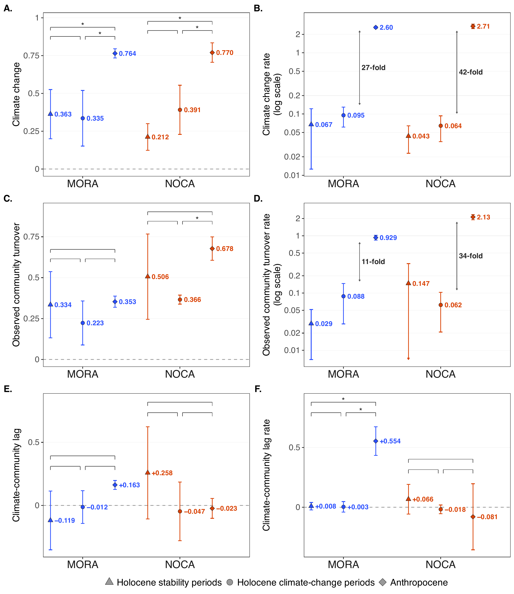

**Fig. 5. Rates of climate change, community turnover and
climate–community lag, and the pace and direction contributions to the
lag, in the Holocene and the Anthropocene.** For each park, the fitted
mean and 95% confidence interval per century of the Holocene stability
periods (squares), the Holocene climate-change periods (diamonds) and
the Anthropocene plot pairs (circles), with the fitted mean printed
beside each point: (A) the standardized climate change, the distance
between the climates at the two ends of a lake-period or plot pair; (B)
the observed community turnover, the distance the community moved in CCA
space; (C) the climate-community lag, the change in mismatch between the
two ends (M at t2 minus M at t1); (D) the pace contribution and (E) the
direction contribution to the lag. Each contribution is the lag at the
end of the period minus the lag the community would have had at the
climate-predicted pace (D, keeping its own direction) or in the
climate-predicted direction (E, keeping its own distance). A positive
contribution means that the community’s own pace or direction widened
the lag, a negative one that it narrowed the lag. C, D and E share one y
scale, because all three are a change in mismatch in CCA distance per
century over the same interval. A and B are on log axes, where equal
distances are equal folds, and the arrow gives the fold between the
Anthropocene and the Holocene climate-change means. C, D and E are on
linear axes without folds. Their connectors show the three differences
between period types within each park: on the lower level, the Holocene
stability against the Holocene climate-change periods (left) and the
Holocene climate-change periods against the Anthropocene (right), and on
the upper level, the Holocene stability periods against the
Anthropocene. A star marks a difference that differs from zero
(two-sided t test, Holm-adjusted p \< 0.05 across the six differences of
each response, three per park). The intervals are unadjusted. Means come
from the model response ~ period type × site, with an AR(1) correlation
within each lake and weights for the number of samples at each end,
fitted on 6 climate-change and 7 stability lake-periods and 328 plot
pairs at MORA, and 5, 5 and 277 at NOCA. Lake-periods and plots whose
observed or predicted position did not move have no pace or direction
contribution: D and E hold 5 climate-change and 5 stability lake-periods
at MORA. The lake-periods of the Holocene climate-change periods span
300 to 900 years, and those of the stability periods 300 to 2600 years,
between t1 and t2. The Anthropocene plot pairs span 27.5 to 32.5 years
between the midpoints of their two climate windows (about 29 years).
Longer windows give lower rates, so the rates of the two eras are not on
equal footing. The same quantities not divided by time are in Fig. S16.
Units: the climate change in calibration standard deviations per
century, the others in CCA distance per century. The Holocene climate is
CHELSA-TraCE21k after the bias correction of Appendix S2.

**Quantities not divided by time.** The main text compares the rates per
century (Fig. 5). The same models fitted on the quantities not divided
by time give the means and differences in Fig. S16 (Tables S15 and S16).

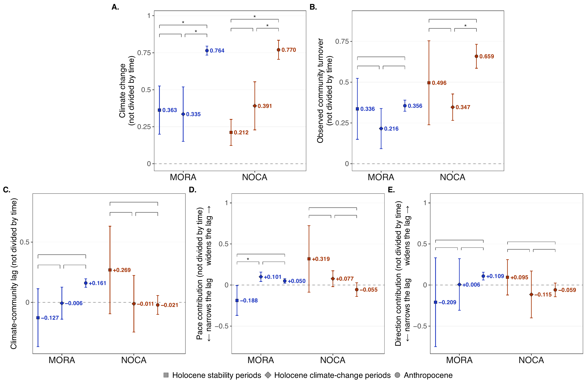

**Fig. S16. Climate change, community turnover, climate–community lag,
and the pace and direction contributions not divided by time.** As Fig.
5 of the main text, for the totals over a whole lake-period or plot
pair: (A) the standardized climate change between the two ends, (B) the
observed community turnover, (C) the climate–community lag, (D) the pace
contribution, and (E) the direction contribution to the lag. For each
park, the fitted mean and 95% confidence interval of the Holocene
stability periods (squares), the Holocene climate-change periods
(diamonds), and the Anthropocene plot pairs (circles), with the fitted
mean printed beside each point. All panels are on linear axes, and D and
E share one y scale. Connectors show the three differences between
period types within each park, and a star marks a difference that
differs from zero (two-sided t test, Holm-adjusted p \< 0.05 across the
six differences of each quantity, three per park). The intervals are
unadjusted. The totals build up over a whole lake-period in the Holocene
and over the few decades between the two surveys in the Anthropocene.
The lake-periods of the Holocene climate-change periods span 300 to 900
years, and those of the stability periods 300 to 2600 years, between t1
and t2. The Anthropocene plot pairs span 27.5 to 32.5 years between the
midpoints of their two climate windows (about 29 years). Units: the
climate change in calibration standard deviations, the others in CCA
distance.

**Turnover and lag by the duration of the lake-periods.** To test
whether longer lake-periods had more turnover and larger lags only
because they are longer, we compared the lake-periods among three
classes of duration (Table S18).

**Table S18. Turnover and lag of the lake-periods by duration.** Means
over the Holocene lake-periods of each park and class of duration.
Turnover is the distance that the community moved in the
climate–community space between t1 and t2. The absolute lag is the size
of the change in mismatch between t1 and t2 without its sign, and the
lag is the same change with its sign. All three are in CCA distance and
not divided by time.

| Park | Duration | Lake-periods | Stability / climate-change | Years | Mean turnover | Mean absolute lag | Mean lag |
|:---|:---|---:|:---|:---|---:|---:|---:|
| MORA | 1,000 years or more | 3 | 3 / 0 | 2100 to 2400 | 0.535 | 0.439 | -0.439 |
| MORA | 200 to 400 years | 6 | 2 / 4 | 300 to 400 | 0.200 | 0.089 | 0.008 |
| MORA | 500 to 900 years | 4 | 2 / 2 | 500 to 700 | 0.209 | 0.178 | -0.096 |
| NOCA | 1,000 years or more | 1 | 1 / 0 | 2600 to 2600 | 0.430 | 0.293 | 0.293 |
| NOCA | 200 to 400 years | 5 | 3 / 2 | 300 to 400 | 0.418 | 0.240 | 0.200 |
| NOCA | 500 to 900 years | 4 | 1 / 3 | 500 to 900 | 0.442 | 0.304 | -0.108 |

<sub>Table file:
[step5a_duration_classes.csv](report/tables/step5a_duration_classes.csv)</sub>

At MORA, the 3 longest lake-periods (2,100 to 2,400 years) had a higher
turnover than the shorter ones (mean of 0.535 against 0.200 for 200 to
400 years and 0.209 for 500 to 900 years). At NOCA, turnover did not
increase with duration (0.418, 0.442, and 0.430, the last from a single
lake-period). The absolute lag ranged from 0.089 to 0.439 at MORA and
from 0.240 to 0.304 at NOCA among the classes. Turnover is the net
movement of the community between t1 and t2, so movements back and forth
within a lake-period do not add to it, and it does not increase in
proportion to time. This is one reason why the rates of the long
lake-periods are low.

**Model checks.** To check the models of the comparison among period
types (see Methods of the main text), we report their fit (Table S19)
and their residuals (Fig. S17). The coefficients of
every model are on the **model details page →**
[08_models](report/details/08_models.md).

**Table S19. Comparison among period types: fit of the models.** Units,
number of lake-periods and plot pairs. AR(1), parameter of the
first-order autoregressive correlation between successive lake-periods
of a lake. The residual standard deviation (SD) of each period type and
park is relative to that of the Anthropocene at MORA, and is multiplied
by the square root of the variance from the number of samples at t1 and
t2. Residual df, units with the coefficients subtracted. The residual SE
is that of the Anthropocene at MORA for a variance of 1. The models were
fitted with restricted maximum likelihood (REML), so that the
log-likelihood and the AIC can only be compared among models with the
same fixed effects. R² is descriptive (the residual sum of squares
divided by the total sum of squares, subtracted from 1).

| Quantity | Units | Coefficients | Residual df | Residual SE | AR(1) | Residual SD by period type and park | Log-likelihood (REML) | AIC | Descriptive R² | Warnings |
|:---|---:|---:|---:|---:|---:|:---|---:|---:|---:|:---|
| Climate change rate | 628 | 6 | 622 | 0.672 | 0.026 | Anthropocene NOCA=1.754, Holocene-C MORA=0.064, Holocene-S MORA=0.047, Holocene-C NOCA=0.093, Holocene-S NOCA=0.064 | -955.567 | 1937.134 | 0.218 | none |
| Climate change (not divided by time) | 628 | 6 | 622 | 0.227 | -0.211 | Anthropocene NOCA=1.480, Holocene-C MORA=0.912, Holocene-S MORA=0.298, Holocene-C NOCA=1.360, Holocene-S NOCA=0.702 | -276.583 | 579.166 | 0.167 | none |
| Turnover rate | 628 | 6 | 622 | 0.586 | -0.558 | Anthropocene NOCA=2.345, Holocene-C MORA=0.059, Holocene-S MORA=0.033, Holocene-C NOCA=0.112, Holocene-S NOCA=0.397 | -952.621 | 1931.242 | 0.156 | none |
| Turnover (not divided by time) | 628 | 6 | 622 | 0.222 | -0.178 | Anthropocene NOCA=1.979, Holocene-C MORA=0.477, Holocene-S MORA=0.853, Holocene-C NOCA=0.770, Holocene-S NOCA=2.096 | -349.593 | 725.186 | 0.094 | none |
| Lag rate | 628 | 6 | 622 | 0.798 | -0.051 | Anthropocene NOCA=2.023, Holocene-C MORA=0.038, Holocene-S MORA=0.025, Holocene-C NOCA=0.104, Holocene-S NOCA=0.291 | -1101.602 | 2229.204 | 0.053 | none |
| Lag | 628 | 6 | 622 | 0.234 | 0.056 | Anthropocene NOCA=1.960, Holocene-C MORA=0.486, Holocene-S MORA=1.018, Holocene-C NOCA=2.268, Holocene-S NOCA=2.969 | -386.945 | 799.891 | 0.058 | none |
| Pace contribution | 480 | 6 | 474 | 0.532 | 0.203 | Anthropocene NOCA=2.945, Holocene-C MORA=0.024, Holocene-S MORA=0.013, Holocene-C NOCA=0.064, Holocene-S NOCA=0.392 | -715.246 | 1456.492 | 0.012 | none |
| Direction contribution | 480 | 6 | 474 | 0.909 | 0.686 | Anthropocene NOCA=1.652, Holocene-C MORA=0.073, Holocene-S MORA=0.035, Holocene-C NOCA=0.106, Holocene-S NOCA=0.085 | -849.535 | 1725.070 | 0.061 | none |
| Pace contribution (not divided by time) | 480 | 6 | 474 | 0.156 | 0.262 | Anthropocene NOCA=2.867, Holocene-C MORA=0.380, Holocene-S MORA=0.814, Holocene-C NOCA=1.371, Holocene-S NOCA=4.079 | -175.569 | 377.137 | 0.016 | none |
| Direction contribution (not divided by time) | 480 | 6 | 474 | 0.264 | 0.501 | Anthropocene NOCA=1.615, Holocene-C MORA=0.665, Holocene-S MORA=1.684, Holocene-C NOCA=2.113, Holocene-S NOCA=1.341 | -309.252 | 644.504 | 0.067 | none |

<sub>Table file:
[era_model_summary.csv](report/tables/era_model_summary.csv)</sub>
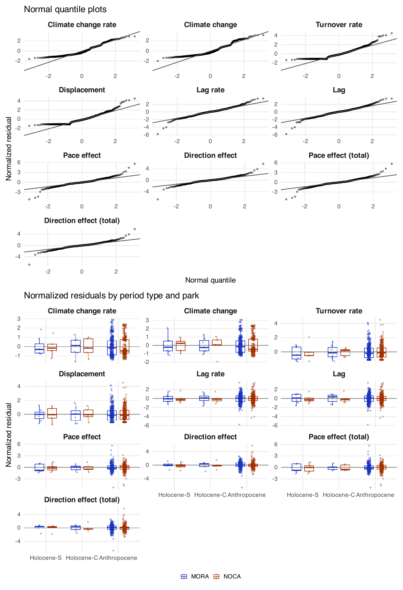

**Fig. S17. Residuals of the ten models of the comparison among period
types.** Top: normal quantile plots of the normalized residuals, one for
each quantity. Bottom: normalized residuals for each period type and
park (points, with boxes for the quartiles). The models have no
continuous explanatory variable, so the fitted values take one value for
each period type and park, and the residuals for each group show what a
plot against the fitted values would show. Turnover and turnover rate
are positive by construction, and their residuals are skewed to the
right. The residuals of the lag, the lag rate, and the pace and
direction contributions have heavy tails, which come from a few
Anthropocene plot pairs.

Stages and helpers:
[`R/pipeline/14_era_models.R`](R/pipeline/14_era_models.R),
[`R/helpers/tracking_model_reporting.R`](R/helpers/tracking_model_reporting.R)
(period types),
[`R/helpers/reconstruction_models.R`](R/helpers/reconstruction_models.R),
[`R/figures/main_fig5_era_contrasts.R`](R/figures/main_fig5_era_contrasts.R).

# Pace and direction contributions (Q2)

**What and why.** The pace contribution and the direction contribution,
defined with the lake-periods above, ask whether a lag comes from how
far the community moved or from the direction it took. They are compared
between the period types with the same era models as the lag (code, fit
statistics and residuals in Q1: Table S19, Fig. S17).

**Result.**

Per century (Fig. 5D, E), the MORA pace contribution of the Anthropocene
does not differ from Holocene-C (+0.11 (0.01 to 0.20, Holm p = 0.103))
and exceeds that of Holocene-S (+0.14 (0.05 to 0.23, Holm p = 0.017)),
and the MORA direction contribution exceeds that of Holocene-C (+0.58
(0.39 to 0.76, Holm p \< 0.001)) and exceeds that of Holocene-S (+0.55
(0.38 to 0.71, Holm p \< 0.001)). At NOCA the per-century pace
contribution does not differ from either Holocene type (-0.23 (-0.54 to
0.07, Holm p = 0.260) against Holocene-C, -0.31 (-0.63 to 0.01, Holm p =
0.178) against Holocene-S), and the direction contribution does not
differ from Holocene-C (-0.32 (-0.62 to -0.03, Holm p = 0.066)) and
falls below that of Holocene-S (-0.39 (-0.69 to -0.10, Holm p = 0.026)).
Not divided by time (Fig. S16D, E), 1 of the 8 contrasts between the
Anthropocene and a Holocene period type is significant after the
adjustment: pace contribution (not divided by time) at MORA,
Anthropocene - Holocene-S (+0.26 (0.10 to 0.42, Holm p = 0.009)). The
Anthropocene contributions are large per century mainly because they
build up over a few decades.

**Sign of the lag and of the pace and direction contributions with the
three versions of the Holocene climate.** The main analysis uses the
Holocene climate after the two-step correction: CHELSA-TraCE21k
corrected first to CHELSAcruts (step 1, over 1900 to 1990) and then to
CHELSA V2.1 (step 2, over 1979 to 2016; Appendix S2). The one-step
correction applies step 2 alone, i.e., it assumes that CHELSA-TraCE21k
and CHELSAcruts agree. Without correction, the Holocene climate is
CHELSA-TraCE21k as published. To assess whether the sign of the lag and
of the two contributions depends on the correction of the Holocene
climate, we counted the lake-periods in which they had the same sign as
in the main analysis, with the one-step correction and without
correction (Table S20; see Appendix S4).
[`R/sensitivity_paleoclimate.R`](R/sensitivity_paleoclimate.R) reruns
stages 08 to 16 into `output_paleoclimate_sensitivity/` and leaves the
main outputs untouched. Each run draws its climate periods from its own
series, so the lake-periods are compared where all three runs have the
same lake, period type and ends.

**Table S20. Lake-periods in which the lag, the pace contribution, and
the direction contribution had the same sign as in the main analysis,
with the one-step correction and without correction of the Holocene
climate.** The quantities are not divided by time. A pace or direction
contribution is undefined when the observed or the climate-predicted
position did not move.

| Holocene climate | Quantity | Park | Lake-periods | Defined in both analyses | Same sign as in the main analysis | Opposite sign |
|:---|:---|:---|---:|---:|---:|---:|
| One-step correction | Lag | MORA | 13 | 13 | 12 | 1 |
| One-step correction | Lag | NOCA | 10 | 10 | 9 | 1 |
| One-step correction | Pace contribution | MORA | 13 | 10 | 10 | 0 |
| One-step correction | Pace contribution | NOCA | 10 | 10 | 8 | 2 |
| One-step correction | Direction contribution | MORA | 13 | 10 | 8 | 2 |
| One-step correction | Direction contribution | NOCA | 10 | 10 | 9 | 1 |
| No correction | Lag | MORA | 13 | 13 | 5 | 8 |
| No correction | Lag | NOCA | 10 | 10 | 8 | 2 |
| No correction | Pace contribution | MORA | 13 | 10 | 5 | 5 |
| No correction | Pace contribution | NOCA | 10 | 10 | 7 | 3 |
| No correction | Direction contribution | MORA | 13 | 10 | 6 | 4 |
| No correction | Direction contribution | NOCA | 10 | 10 | 7 | 3 |

<sub>Table file:
[paleoclimate_sensitivity_sign_counts.csv](report/tables/paleoclimate_sensitivity_sign_counts.csv)</sub>

Stages and helpers:
[`R/pipeline/14_era_models.R`](R/pipeline/14_era_models.R),
[`R/helpers/tracking_model_reporting.R`](R/helpers/tracking_model_reporting.R)
(period types),
[`R/figures/main_fig5_era_contrasts.R`](R/figures/main_fig5_era_contrasts.R),
[`R/sensitivity_paleoclimate.R`](R/sensitivity_paleoclimate.R).

# Associations with fire (Q3)

**What and why.** Within the Holocene lake-periods, does a period with
more climate change, or more fire, end with a larger lag, and with
better or worse pace and direction? Each response is modelled on the
park, the climate change rate and fire activity together. The
lake-periods of one lake come from the same core and catchment, so their
errors can be related. An AR(1) term within each lake carries that,
counted in climate periods: two lake-periods one period apart are
correlated by φ, two periods apart by φ², also where the period between
them has no lake-period. Ends that rest on a single sample are noisier,
so each row is weighted by the sampling variance of its two ends, and
the parks keep different residual spread. In the Anthropocene the same
responses are compared between burned and unburned plots, in a model
with the park and fire (burned or not). Only NOCA plots burned between
the two surveys, so the fire comparison is a NOCA comparison.

**How it is calculated.**

``` r
# R/pipeline/15_predictor_models.R
  # Holocene lake-periods only. Does the response go with more climate change
  # or more fire? Fitted twice: per century (lag rate, pace contribution, direction
  # contribution) with climate = climate_rate, the climate change rate, and as totals
  # not divided by time (lag, pace and direction contribution totals) with
  # climate = climate_change, the climate change between the two ends.
  #   site: a separate level for each park;
  #   climate: the slope per unit of climate change (rate or total);
  #   fire_activity: the slope per accepted fire event per century per core.
  # Lake-periods of a lake are correlated, AR(1) within lake on unit_index, the
  # position of the lake-period's climate period (C1 = 1 to S5 = 10): two
  # lake-periods k periods apart correlate by phi^k, also across missing periods.
  # varIdent lets the parks keep a different spread, and varFixed gives ends
  # resting on single samples less weight (endpoint_var = 1/n_start + 1/n_end).
  model = reformulate(c('site', climate, 'fire_activity'), response = 'estimate')
  captured = reconstruction_capture(function() gls(model,
    correlation = corAR1(form = ~ unit_index | lake),
    weights = varComb(varIdent(form = ~ 1 | site), varFixed(~ endpoint_var)),
    data = d, method = 'REML', control = glsControl(msMaxIter = 500)))
```

``` r
# R/pipeline/15_predictor_models.R
  # Anthropocene plot pairs only: the same responses against site and burned
  # (whether the plot burned between the two surveys). Plots are independent,
  # each park keeps its own spread.
  captured = reconstruction_capture(function() gls(estimate ~ site + burned,
    weights = varIdent(form = ~ 1 | site), data = da, method = 'REML'))
```

**Result.**

**Table S21. Associations with fire: coefficients of the models.**
Holocene: models of the lake-periods with park, climate change rate (or
climate change, for the quantities not divided by time), and fire
activity as fixed effects, a first-order autoregressive correlation
within each lake, and weights for the number of samples at t1 and t2.
Anthropocene: models of the plot pairs with park and fire (burned or
unburned) as fixed effects (see Methods of the main text). Terms:
siteNOCA, difference between NOCA and MORA; burnedBurned, difference
between burned and unburned plot pairs. Estimates are in CCA distance
(per century for the rates) for one unit of the term. SE, standard
error. Two-sided t-tests on the residual degrees of freedom (df) of the
model, with 95% confidence intervals (CI). n, number of lake-periods or
plot pairs. R² is descriptive. The fit of the models is given in Table
S22.

| Quantity | Era | Term | Estimate | SE | df | t | 95% CI | p | n | R² |
|:---|:---|:---|---:|---:|---:|---:|:---|---:|---:|---:|
| Lag rate | Holocene | (Intercept) | 0.010 | 0.018 | 19 | 0.536 | -0.028 to 0.047 | 0.598 | 23 | 0.228 |
| Lag rate | Holocene | siteNOCA | 0.091 | 0.046 | 19 | 1.991 | -0.005 to 0.187 | 0.061 | 23 | 0.228 |
| Lag rate | Holocene | climate_rate | -0.036 | 0.190 | 19 | -0.191 | -0.435 to 0.362 | 0.850 | 23 | 0.228 |
| Lag rate | Holocene | fire_activity | -0.103 | 0.071 | 19 | -1.451 | -0.252 to 0.046 | 0.163 | 23 | 0.228 |
| Lag rate | Anthropocene | (Intercept) | 0.687 | 0.062 | 602 | 11.024 | 0.565 to 0.810 | 0.000 | 605 | 0.052 |
| Lag rate | Anthropocene | siteNOCA | -0.798 | 0.157 | 602 | -5.089 | -1.105 to -0.490 | 0.000 | 605 | 0.052 |
| Lag rate | Anthropocene | burnedBurned | -0.260 | 0.489 | 602 | -0.533 | -1.220 to 0.699 | 0.594 | 605 | 0.052 |
| Pace contribution | Holocene | (Intercept) | -0.006 | 0.009 | 16 | -0.672 | -0.025 to 0.013 | 0.511 | 20 | -0.032 |
| Pace contribution | Holocene | siteNOCA | 0.014 | 0.031 | 16 | 0.452 | -0.052 to 0.080 | 0.657 | 20 | -0.032 |
| Pace contribution | Holocene | climate_rate | 0.016 | 0.083 | 16 | 0.193 | -0.161 to 0.193 | 0.849 | 20 | -0.032 |
| Pace contribution | Holocene | fire_activity | 0.033 | 0.044 | 16 | 0.741 | -0.061 to 0.127 | 0.470 | 20 | -0.032 |
| Pace contribution | Anthropocene | (Intercept) | 0.125 | 0.047 | 457 | 2.638 | 0.032 to 0.218 | 0.009 | 460 | 0.034 |
| Pace contribution | Anthropocene | siteNOCA | -0.246 | 0.166 | 457 | -1.482 | -0.571 to 0.080 | 0.139 | 460 | 0.034 |
| Pace contribution | Anthropocene | burnedBurned | -1.292 | 0.555 | 457 | -2.325 | -2.383 to -0.200 | 0.020 | 460 | 0.034 |
| Direction contribution | Holocene | (Intercept) | 0.018 | 0.032 | 16 | 0.570 | -0.049 to 0.086 | 0.576 | 20 | 0.245 |
| Direction contribution | Holocene | siteNOCA | 0.068 | 0.039 | 16 | 1.761 | -0.014 to 0.151 | 0.097 | 20 | 0.245 |
| Direction contribution | Holocene | climate_rate | -0.324 | 0.232 | 16 | -1.398 | -0.816 to 0.168 | 0.181 | 20 | 0.245 |
| Direction contribution | Holocene | fire_activity | -0.109 | 0.032 | 16 | -3.416 | -0.176 to -0.041 | 0.004 | 20 | 0.245 |
| Direction contribution | Anthropocene | (Intercept) | 0.531 | 0.081 | 457 | 6.559 | 0.372 to 0.691 | 0.000 | 460 | 0.062 |
| Direction contribution | Anthropocene | siteNOCA | -0.894 | 0.174 | 457 | -5.136 | -1.236 to -0.552 | 0.000 | 460 | 0.062 |
| Direction contribution | Anthropocene | burnedBurned | 0.189 | 0.539 | 457 | 0.350 | -0.870 to 1.248 | 0.727 | 460 | 0.062 |
| Lag (not divided by time) | Holocene | (Intercept) | 0.074 | 0.152 | 19 | 0.486 | -0.244 to 0.391 | 0.633 | 23 | 0.240 |
| Lag (not divided by time) | Holocene | siteNOCA | 0.381 | 0.201 | 19 | 1.895 | -0.040 to 0.802 | 0.073 | 23 | 0.240 |
| Lag (not divided by time) | Holocene | climate_change | -0.404 | 0.372 | 19 | -1.086 | -1.183 to 0.375 | 0.291 | 23 | 0.240 |
| Lag (not divided by time) | Holocene | fire_activity | -0.343 | 0.311 | 19 | -1.102 | -0.994 to 0.308 | 0.284 | 23 | 0.240 |
| Lag (not divided by time) | Anthropocene | (Intercept) | 0.201 | 0.018 | 602 | 11.004 | 0.165 to 0.237 | 0.000 | 605 | 0.054 |
| Lag (not divided by time) | Anthropocene | siteNOCA | -0.234 | 0.045 | 602 | -5.215 | -0.322 to -0.146 | 0.000 | 605 | 0.054 |
| Lag (not divided by time) | Anthropocene | burnedBurned | -0.073 | 0.139 | 602 | -0.529 | -0.346 to 0.199 | 0.597 | 605 | 0.054 |
| Pace contribution (not divided by time) | Holocene | (Intercept) | -0.064 | 0.117 | 16 | -0.551 | -0.312 to 0.183 | 0.589 | 20 | 0.192 |
| Pace contribution (not divided by time) | Holocene | siteNOCA | 0.360 | 0.166 | 16 | 2.170 | 0.008 to 0.713 | 0.045 | 20 | 0.192 |
| Pace contribution (not divided by time) | Holocene | climate_change | 0.106 | 0.269 | 16 | 0.393 | -0.464 to 0.675 | 0.700 | 20 | 0.192 |
| Pace contribution (not divided by time) | Holocene | fire_activity | -0.324 | 0.286 | 16 | -1.133 | -0.930 to 0.282 | 0.274 | 20 | 0.192 |
| Pace contribution (not divided by time) | Anthropocene | (Intercept) | 0.034 | 0.014 | 457 | 2.473 | 0.007 to 0.062 | 0.014 | 460 | 0.034 |
| Pace contribution (not divided by time) | Anthropocene | siteNOCA | -0.069 | 0.047 | 457 | -1.468 | -0.162 to 0.023 | 0.143 | 460 | 0.034 |
| Pace contribution (not divided by time) | Anthropocene | burnedBurned | -0.367 | 0.158 | 457 | -2.326 | -0.678 to -0.057 | 0.020 | 460 | 0.034 |
| Direction contribution (not divided by time) | Holocene | (Intercept) | -0.031 | 0.228 | 16 | -0.137 | -0.515 to 0.452 | 0.892 | 20 | 0.121 |
| Direction contribution (not divided by time) | Holocene | siteNOCA | 0.312 | 0.229 | 16 | 1.360 | -0.174 to 0.798 | 0.193 | 20 | 0.121 |
| Direction contribution (not divided by time) | Holocene | climate_change | -0.216 | 0.422 | 16 | -0.511 | -1.111 to 0.680 | 0.616 | 20 | 0.121 |
| Direction contribution (not divided by time) | Holocene | fire_activity | -0.385 | 0.225 | 16 | -1.716 | -0.862 to 0.091 | 0.105 | 20 | 0.121 |
| Direction contribution (not divided by time) | Anthropocene | (Intercept) | 0.155 | 0.024 | 457 | 6.563 | 0.108 to 0.201 | 0.000 | 460 | 0.062 |
| Direction contribution (not divided by time) | Anthropocene | siteNOCA | -0.258 | 0.050 | 457 | -5.182 | -0.355 to -0.160 | 0.000 | 460 | 0.062 |
| Direction contribution (not divided by time) | Anthropocene | burnedBurned | 0.054 | 0.153 | 457 | 0.349 | -0.248 to 0.355 | 0.727 | 460 | 0.062 |

<sub>Table file:
[step5_explanatory_models.csv](report/tables/step5_explanatory_models.csv)</sub>

In the Holocene, faster climate change did not go with the lag rate
(-0.04 (-0.43 to 0.36)) and did not go with the pace contribution (+0.02
(-0.16 to 0.19)). More frequent fire did not go with the lag rate (-0.10
(-0.25 to 0.05)) and went with a smaller direction contribution (-0.11
(-0.18 to -0.04)). The slopes are in CCA distance per century for one
more standardized unit of climate change per century, or for one more
event per century per core. The fire values of the two parks overlap in
5 of the 23 lake-periods. The site term absorbs the difference between
the parks, so the fire slope comes from the variation within each park
(MORA 0.00 to 0.42, NOCA 0.33 to 1.25 events per century per core).

The same models on the responses not divided by time (Fig. S18) use the
climate change between the two ends in place of its rate, and the slopes
are in CCA distance per standardized unit of climate change or per event
per century per core. More climate change did not go with the lag (-0.40
(-1.18 to 0.37)), did not go with the pace contribution (+0.11 (-0.46 to
0.68)) and did not go with the direction contribution (-0.22 (-1.11 to
0.68)). More fire did not go with the lag (-0.34 (-0.99 to 0.31)), did
not go with the pace contribution (-0.32 (-0.93 to 0.28)) and did not go
with the direction contribution (-0.39 (-0.86 to 0.09)). Of the 12
Holocene climate and fire slopes, 1 has an interval that excludes zero.
They rest on 23 lake-periods (20 for the pace and direction
contributions). Without the correction of the Holocene climate, the one
slope whose interval excludes zero changes its sign (Appendix S4), so it
is fragile. In the Anthropocene (burned minus unburned plots), burned
plots had lower values for the pace contribution (-1.29, -2.38 to
-0.20), the pace contribution (not divided by time) (-0.37, -0.68 to
-0.06). In addition, burned and unburned plots did not differ in the lag
rate (-0.26, -1.22 to 0.70), the direction contribution (+0.19, -0.87 to
1.25), the lag (not divided by time) (-0.07, -0.35 to 0.20), the
direction contribution (not divided by time) (+0.05, -0.25 to 0.35).
Fire activity stays a frequency in both forms, because a count of events
would grow with the length of the lake-period.

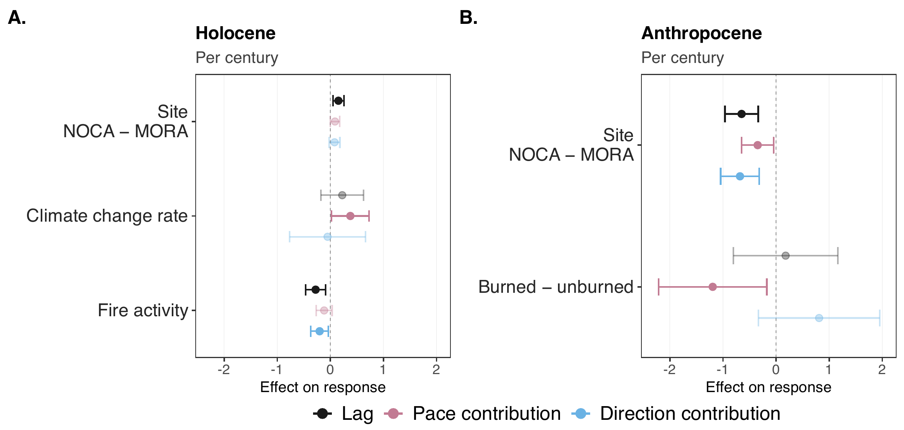

**Fig. 6. Climate and fire associations.** Model slopes with conditional
95% confidence intervals for the lag (black), the pace contribution
(pink) and the direction contribution (blue) per century, side by side
for each term, in the colours of Fig. 1. Faded estimates have intervals
that include zero. The two panels share one x scale. (A) Holocene
lake-periods, model response ~ site + climate change rate + fire
activity with an AR(1) correlation within each lake and weights for the
number of samples at each end: 13 MORA and 10 NOCA lake-periods for the
lag, and 10 and 10 for pace and direction. The climate slope is per
standardized unit of climate change per century, and the fire slope per
accepted event per century per covered core. (B) Anthropocene plot
pairs, model response ~ site + burned with park-specific variances: 605
plot pairs for the lag and 460 for pace and direction. The descriptive
R² and the degrees of freedom of each model are in Tables S21 and S22.
The same models on the responses not divided by time are in Fig. S18.
Both panels also show the site term (NOCA minus MORA). The lake-periods
of the Holocene climate-change periods span 300 to 900 years, and those
of the stability periods 300 to 2600 years, between t1 and t2. The
Anthropocene plot pairs span 27.5 to 32.5 years between the midpoints of
their two climate windows (about 29 years). Slopes are in CCA distance
per century per unit of the term.

**Associations not divided by time.** The main text gives the
associations per century (Fig. 6). The same models on the responses not
divided by time, with the climate change between the two ends in place
of its rate, give the slopes in Fig. S18.

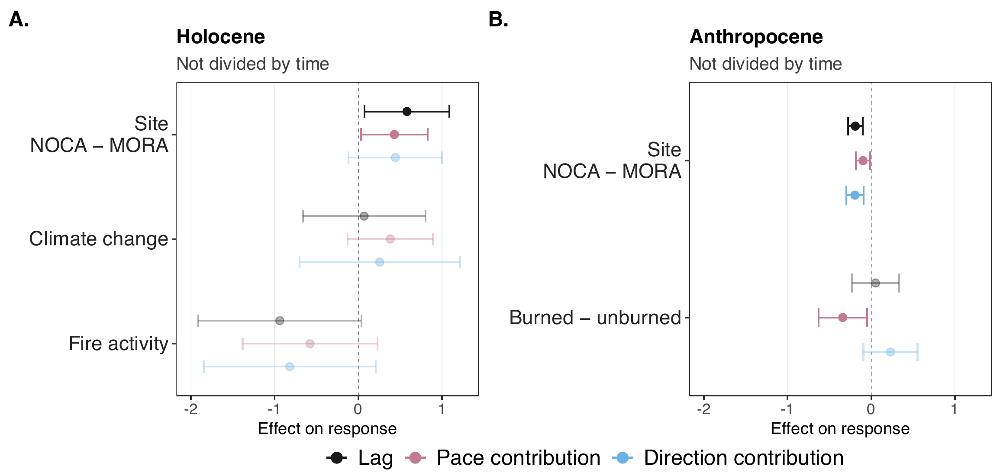

**Fig. S18. Climate and fire associations not divided by time.** As Fig.
6 of the main text, for the lag, the pace contribution, and the
direction contribution not divided by time: the change in mismatch, or
the reduction in final mismatch under the pace or direction correction,
between the two ends. Model slopes with conditional 95% confidence
intervals, the lag in black, the pace contribution in pink, and the
direction contribution in blue. Faded estimates have intervals that
include zero, and the two panels share one x scale. (A) Holocene
lake-periods, model response ~ site + climate change + fire activity,
where climate change is the standardized climate change between the two
ends, with an AR(1) correlation within each lake and weights for the
number of samples at each end. (B) Anthropocene plot pairs, model
response ~ site + burned with park-specific variances. The climate slope
is per standardized unit of climate change, and the fire slope per
accepted event per century per covered core. Both panels also show the
site term (NOCA minus MORA). Slopes are in CCA distance per unit of the
term. The lake-periods of the Holocene climate-change periods span 300
to 900 years, and those of the stability periods 300 to 2600 years,
between t1 and t2. The Anthropocene plot pairs span 27.5 to 32.5 years
between the midpoints of their two climate windows (about 29 years).

**Model checks.** The fit of these models is given in Table
S22. The rows left out are on the
**model details page →**
[08_models](report/details/08_models.md).

**Table S22. Associations with fire: fit of the models.** MORA and NOCA,
number of lake-periods or plot pairs of each park. AR(1), parameter of
the first-order autoregressive correlation within each lake. Residual
df, lake-periods or plot pairs with the coefficients subtracted. The
residual SE is that of MORA (for a variance of 1 in the Holocene
models). The models were fitted with restricted maximum likelihood
(REML), so that the log-likelihood and the AIC can only be compared
among models with the same fixed effects. R² is descriptive.

| Quantity | Era | Model | MORA | NOCA | Coefficients | Residual df | Residual SE | AR(1) | SD ratio NOCA/MORA | Log-likelihood (REML) | AIC | Descriptive R² | Warnings |
|:---|:---|:---|---:|---:|---:|---:|---:|---:|---:|---:|---:|---:|:---|
| Lag rate | Holocene | site + climate_rate + fire_activity | 13 | 10 | 4 | 19 | 0.026 | -0.089 | 6.780 | 27.332 | -40.664 | 0.228 | none |
| Lag rate | Anthropocene | site + burned | 328 | 277 | 3 | 602 | 1.129 | — | 2.026 | -1128.711 | 2267.422 | 0.052 | none |
| Pace contribution | Holocene | site + climate_rate + fire_activity | 10 | 10 | 4 | 16 | 0.012 | -0.495 | 16.592 | 26.595 | -39.190 | -0.032 | none |
| Pace contribution | Anthropocene | site + burned | 252 | 208 | 3 | 457 | 0.753 | — | 2.914 | -745.940 | 1501.879 | 0.034 | none |
| Direction contribution | Holocene | site + climate_rate + fire_activity | 10 | 10 | 4 | 16 | 0.042 | 0.494 | 2.149 | 25.267 | -36.533 | 0.245 | none |
| Direction contribution | Anthropocene | site + burned | 252 | 208 | 3 | 457 | 1.286 | — | 1.656 | -874.090 | 1758.179 | 0.062 | none |
| Lag | Holocene | site + climate_change + fire_activity | 13 | 10 | 4 | 19 | 0.196 | -0.045 | 3.082 | -6.260 | 26.520 | 0.240 | none |
| Lag | Anthropocene | site + burned | 328 | 277 | 3 | 602 | 0.331 | — | 1.962 | -381.940 | 773.880 | 0.054 | none |
| Pace contribution (not divided by time) | Holocene | site + climate_change + fire_activity | 10 | 10 | 4 | 16 | 0.139 | -0.446 | 4.147 | -1.638 | 17.276 | 0.192 | none |
| Pace contribution (not divided by time) | Anthropocene | site + burned | 252 | 208 | 3 | 457 | 0.220 | — | 2.837 | -178.059 | 366.118 | 0.034 | none |
| Direction contribution (not divided by time) | Holocene | site + climate_change + fire_activity | 10 | 10 | 4 | 16 | 0.292 | 0.279 | 1.666 | -6.511 | 27.022 | 0.121 | none |
| Direction contribution (not divided by time) | Anthropocene | site + burned | 252 | 208 | 3 | 457 | 0.374 | — | 1.619 | -305.018 | 620.036 | 0.062 | none |

<sub>Table file:
[explanatory_model_performance.csv](report/tables/explanatory_model_performance.csv)</sub>

Stages and helpers:
[`R/pipeline/15_predictor_models.R`](R/pipeline/15_predictor_models.R),
[`R/helpers/reconstruction_models.R`](R/helpers/reconstruction_models.R),
[`R/figures/main_fig6_climate_fire_associations.R`](R/figures/main_fig6_climate_fire_associations.R).

# Species contributions (Q4)

**What and why.** The observed movement of a community between t1 and t2
is the sum of one vector per species: the change in the species’ share
times the species’ fixed position in the CCA plane (asserted).
Projecting each species’ vector on the direction in which the
climate-predicted position moved says how far that species carried the
community along with the climate. This is `contrib_climate`, per century
of the interval between the two vegetation samples. A positive value
means the species moved the community in the climate-predicted
direction, a negative value that it moved it against that direction.
Where the observed or the climate-predicted position did not move, the
direction is undefined, and so is the contribution, so those
lake-periods and plot pairs are left out.

**How it is calculated.**

``` r
# R/helpers/cca_transition_contributions.R
step6_species_contributions = function(context, first, last, positions, endpoints, dt, lag_dt) {
  # rows: one row per unit (a Holocene lake-period or an Anthropocene plot pair)
  # and species. A species' vector is its change in share between t1 and t2
  # times its fixed position in the CCA plane; the vectors of a unit add up to
  # the observed movement (checked). parallel_contribution is the vector
  # projected on the direction in which the climate-predicted position moved.
  # (step6_lag_contributions also adds contrib_lag, which is not reported.)
  rows = step6_lag_contributions(context, first, last, positions, endpoints, lag_dt)
  index = rep(seq_len(nrow(context)), each = ncol(first))
  # Where the observed or the predicted position did not move, the direction is
  # undefined (epsilon rule), and so is the contribution.
  defined = endpoints$direction_defined[index]
  # contrib_climate, per century of the vegetation interval dt: positive, the
  # species moved the community in the climate-predicted direction; negative,
  # against it.
  rows$contrib_climate = ifelse(defined, rows$parallel_contribution * 100 / dt[index], NA_real_)
  lag_columns = c('lag_projection', 'contrib_lag')
  rows[c(setdiff(names(rows), c(lag_columns, 'contrib_climate')), 'contrib_climate', lag_columns)]
}
```

``` r
# R/pipeline/16_contributions.R
# For one species in one park and period type, x holds its contribution in
# every lake-period (or plot pair). The result is the plain mean with a 95%
# t-interval: mean plus or minus t(0.975, n - 1) times the standard error
# sd / sqrt(n). With a single value the interval is undefined.
group_mean = function(x) {
  n = length(x); m = mean(x); se = if (n > 1) sd(x) / sqrt(n) else NA_real_
  q = if (n > 1) qt(.975, n - 1) else NA_real_
  tibble(n, estimate = m, std_error = se, conf_low = m - q * se, conf_high = m + q * se,
    interval_defined = n > 1 && is.finite(se) && se > 0)
}
```

**Result.**

**Table S23. Species contributions in the climate-predicted direction
per century.** Mean and 95% confidence interval (t-interval) in CCA
distance per century, for each species, park, and period type: how far
the species moved the community in the climate-predicted direction
(positive values) or against it (negative values). “absent”: the species
was not found in that park and period type. Lake-periods and plot pairs
in which the observed or the climate-predicted position did not move are
left out.

| Species | Park | Holocene-S | Holocene-C | Anthropocene |
|:---|:---|:---|:---|:---|
| Abies amabilis/grandis | MORA | -0.000 (-0.003 to 0.003) | +0.005 (-0.007 to 0.017) | -0.032 (-0.061 to -0.003) |
| Abies amabilis/grandis | NOCA | +0.001 (-0.002 to 0.004) | +0.001 (-0.002 to 0.004) | +0.023 (-0.008 to 0.054) |
| Abies lasiocarpa | MORA | +0.002 (-0.008 to 0.011) | -0.000 (-0.023 to 0.023) | -0.009 (-0.044 to 0.026) |
| Abies lasiocarpa | NOCA | +0.061 (-0.042 to 0.163) | -0.029 (-0.075 to 0.018) | -0.028 (-0.168 to 0.112) |
| Abies procera | MORA | -0.003 (-0.007 to 0.001) | +0.002 (-0.005 to 0.009) | +0.030 (-0.001 to 0.061) |
| Abies procera | NOCA | absent | absent | absent |
| Callitropsis nootkatensis | MORA | +0.003 (-0.001 to 0.006) | -0.030 (-0.114 to 0.054) | -0.003 (-0.072 to 0.065) |
| Callitropsis nootkatensis | NOCA | -0.007 (-0.024 to 0.011) | -0.008 (-0.030 to 0.014) | +0.061 (0.002 to 0.119) |
| Picea engelmannii | MORA | absent | absent | -0.005 (-0.021 to 0.010) |
| Picea engelmannii | NOCA | -0.003 (-0.012 to 0.006) | +0.001 (-0.002 to 0.003) | -0.026 (-0.097 to 0.044) |
| Pinus albicaulis | MORA | absent | absent | +0.006 (-0.002 to 0.013) |
| Pinus albicaulis | NOCA | absent | absent | +0.264 (0.094 to 0.434) |
| Pinus contorta | MORA | +0.008 (-0.002 to 0.018) | -0.003 (-0.013 to 0.008) | -0.003 (-0.014 to 0.009) |
| Pinus contorta | NOCA | -0.004 (-0.023 to 0.016) | +0.008 (-0.013 to 0.030) | +0.040 (-0.050 to 0.130) |
| Pinus monticola | MORA | -0.001 (-0.008 to 0.006) | -0.001 (-0.007 to 0.004) | -0.044 (-0.062 to -0.027) |
| Pinus monticola | NOCA | +0.008 (-0.043 to 0.059) | +0.001 (-0.013 to 0.014) | +0.005 (-0.032 to 0.042) |
| Pinus ponderosa | MORA | absent | absent | +0.009 (-0.009 to 0.027) |
| Pinus ponderosa | NOCA | absent | absent | +0.207 (-0.054 to 0.468) |
| Pseudotsuga menziesii | MORA | +0.001 (-0.003 to 0.005) | -0.010 (-0.035 to 0.016) | -0.052 (-0.101 to -0.002) |
| Pseudotsuga menziesii | NOCA | -0.008 (-0.025 to 0.009) | -0.005 (-0.027 to 0.017) | -0.023 (-0.101 to 0.055) |
| Thuja plicata | MORA | absent | absent | +0.005 (-0.022 to 0.031) |
| Thuja plicata | NOCA | -0.002 (-0.007 to 0.002) | -0.004 (-0.013 to 0.006) | +0.038 (-0.018 to 0.094) |
| Tsuga heterophylla | MORA | +0.004 (-0.013 to 0.022) | -0.000 (-0.024 to 0.024) | -0.051 (-0.072 to -0.030) |
| Tsuga heterophylla | NOCA | +0.007 (-0.014 to 0.028) | +0.001 (-0.002 to 0.004) | +0.108 (0.060 to 0.155) |
| Tsuga mertensiana | MORA | +0.001 (-0.002 to 0.004) | +0.014 (-0.014 to 0.042) | +0.011 (-0.017 to 0.039) |
| Tsuga mertensiana | NOCA | +0.002 (-0.002 to 0.005) | absent | +0.049 (-0.011 to 0.109) |

<sub>Table file:
[step6_species_means.csv](report/tables/step6_species_means.csv)</sub>

The species vectors add up to the observed movement for every
lake-period and plot pair (asserted).

In the Holocene every species mean is close to zero in both parks
(largest absolute value 0.061 CCA distance per century). None of the 37
Holocene intervals excludes zero. Each Holocene mean rests on 5
lake-periods. In the Anthropocene, a species’ interval excludes zero
more often. At MORA, among the species whose interval excludes zero,
none moved the communities in the climate-predicted direction, and 4
moved the communities against that direction (*Abies amabilis/grandis*
(-0.032), *Pinus monticola* (-0.044), *Pseudotsuga menziesii* (-0.052),
*Tsuga heterophylla* (-0.051)). At NOCA, among the species whose
interval excludes zero, 3 moved the communities in the climate-predicted
direction (*Callitropsis nootkatensis* (+0.061), *Pinus albicaulis*
(+0.264), *Tsuga heterophylla* (+0.108)), and none moved the communities
against that direction. Values are in CCA distance per century.

The period types of a species are compared with Welch tests, three
contrasts per species and park, and the p-values are Holm-adjusted
within each park across all species and contrasts. Of 69 testable
contrasts, 14 have p \< 0.05 before the adjustment and 6 after it
(*Pinus monticola* at MORA, Anthropocene - Holocene-C; *Pinus monticola*
at MORA, Anthropocene - Holocene-S; *Tsuga heterophylla* at MORA,
Anthropocene - Holocene-C; *Tsuga heterophylla* at MORA, Anthropocene -
Holocene-S; *Tsuga heterophylla* at NOCA, Anthropocene - Holocene-C;
*Tsuga heterophylla* at NOCA, Anthropocene - Holocene-S). All of them
set the Anthropocene against a Holocene period type.

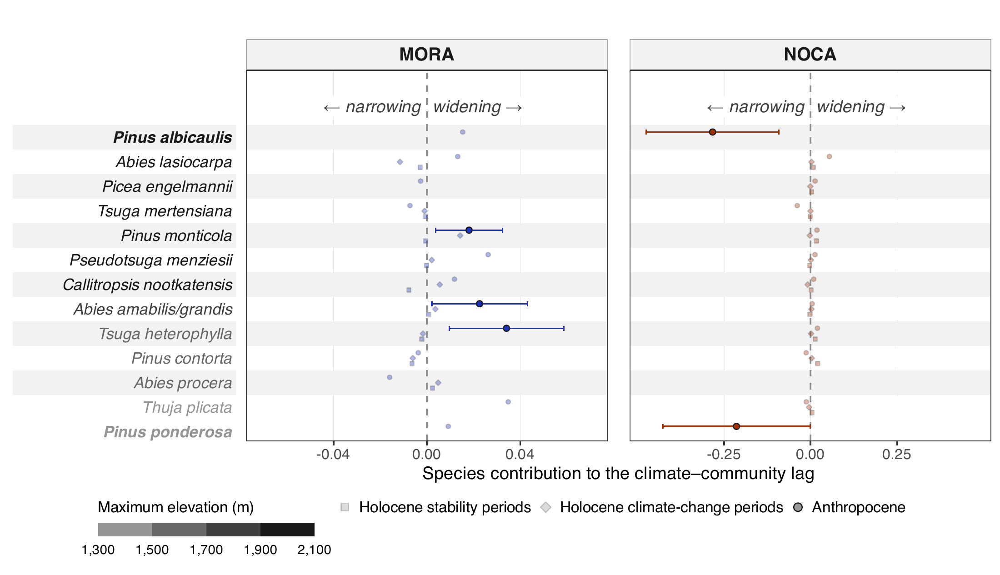

**Fig. 7. Species contributions in the climate-predicted direction in
the Holocene and the Anthropocene.** Each species’ vector is its change
in share between the first and the last sampled century of a
lake-period, or between the legacy survey and the resurvey of a plot,
times its fixed position in the CCA plane. The vectors are projected on
the direction in which the climate-predicted position moved. Labels at
the top of each panel give the meaning of each side of zero: a species
moved the community against or following the climate-predicted
direction. Lake-periods and plot pairs whose observed or
climate-predicted position did not move are left out. Values are per
century of the interval between the two vegetation samples. Species are
ordered by the maximum elevation of the plots where they occur (the 605
plot pairs, both surveys, both parks), the highest at the top. Their
names are shaded by that maximum in four grey steps, lightest below
1,500 m and black above 1,900 m (key below the figure). Names in bold
are species absent from the Holocene record of both parks. Symbols are
means: squares, Holocene stability periods, diamonds, Holocene
climate-change periods, circles, Anthropocene plot pairs (burned and
unburned together), each with its 95% t-interval. Means whose interval
excludes zero are large and dark, and means whose interval includes zero
are small and faded, with faded intervals. A species with no Holocene
symbols in a park is absent from that park’s Holocene record. Each park
has its own x scale, symmetric around zero. The lake-periods of the
Holocene climate-change periods span 300 to 900 years, and those of the
stability periods 300 to 2600 years, between t1 and t2. The Anthropocene
plot pairs span 27.5 to 32.5 years between the midpoints of their two
climate windows (about 29 years). Contributions are in CCA distance per
century.

**Species contributions not divided by time.** Per century, the species
contributions of the Holocene are small partly because the lake-periods
are long, and those of the Anthropocene are large partly because the
time between the two surveys is short. To test whether this explains the
difference between the two eras, we also calculated the species
contributions without dividing by time (Fig. S19, Table S24).

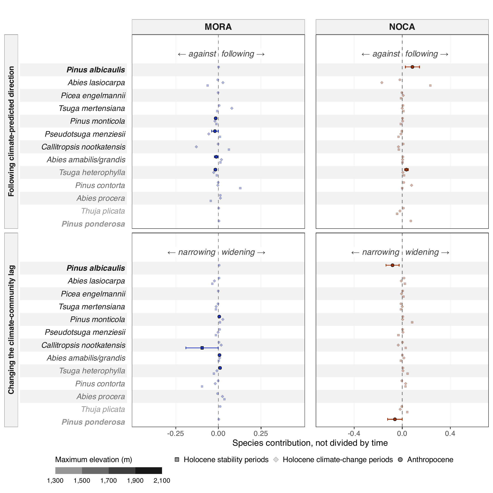

Not divided by time, the mean contributions of the Holocene were at
least as large as those of the Anthropocene (mean absolute value 0.034
against 0.008 at MORA and 0.039 against 0.023 at NOCA, CCA distance).
However, they varied so much among the few lake-periods that the
confidence interval excluded zero for 0 of the 37 Holocene means (0 per
century). In the Anthropocene, it excluded zero for 7 means, against 7
per century, for the same species in the same parks. Thus, within a
lake-period, the species of the Holocene moved the communities in or
against the climate-predicted direction at least as far as those of the
Anthropocene, but too variably among lake-periods to identify which
species did so.

**Fig. S19. Species contributions in the climate-predicted direction not
divided by time.** As Fig. 7 of the main text, with the contribution of
each species between t1 and t2 and not per century: how far each species
moved the community in the climate-predicted direction (positive values)
or against it (negative values). Means with 95% confidence intervals
(t-intervals). Symbols, order of the species, and shading as in Fig. 7.
The lake-periods of the Holocene climate-change periods span 300 to 900
years, and those of the stability periods 300 to 2600 years, between t1
and t2. The Anthropocene plot pairs span 27.5 to 32.5 years between the
midpoints of their two climate windows (about 29 years). Contributions
are in CCA distance.

**Table S24. Species contributions in the climate-predicted direction
not divided by time.** Mean and 95% confidence interval (t-interval) in
CCA distance, for each species, park, and period type. Columns as in
Table S23.

| Species | Park | Holocene-S | Holocene-C | Anthropocene |
|:---|:---|:---|:---|:---|
| Abies amabilis/grandis | MORA | +0.015 (-0.014 to 0.043) | +0.019 (-0.029 to 0.067) | -0.012 (-0.023 to -0.001) |
| Abies amabilis/grandis | NOCA | +0.003 (-0.007 to 0.012) | +0.004 (-0.009 to 0.017) | +0.007 (-0.003 to 0.017) |
| Abies lasiocarpa | MORA | -0.017 (-0.100 to 0.066) | -0.001 (-0.092 to 0.091) | -0.003 (-0.016 to 0.010) |
| Abies lasiocarpa | NOCA | +0.228 (-0.202 to 0.658) | -0.205 (-0.510 to 0.101) | -0.009 (-0.054 to 0.035) |
| Abies procera | MORA | -0.045 (-0.114 to 0.023) | +0.010 (-0.024 to 0.044) | +0.012 (-0.000 to 0.024) |
| Abies procera | NOCA | absent | absent | absent |
| Callitropsis nootkatensis | MORA | +0.059 (-0.030 to 0.148) | -0.120 (-0.458 to 0.217) | -0.001 (-0.027 to 0.024) |
| Callitropsis nootkatensis | NOCA | -0.028 (-0.080 to 0.024) | -0.031 (-0.119 to 0.056) | +0.019 (0.001 to 0.038) |
| Picea engelmannii | MORA | absent | absent | -0.002 (-0.008 to 0.004) |
| Picea engelmannii | NOCA | -0.010 (-0.036 to 0.017) | +0.008 (-0.015 to 0.031) | -0.008 (-0.031 to 0.014) |
| Pinus albicaulis | MORA | absent | absent | +0.002 (-0.001 to 0.005) |
| Pinus albicaulis | NOCA | absent | absent | +0.085 (0.030 to 0.139) |
| Pinus contorta | MORA | +0.114 (-0.054 to 0.282) | -0.008 (-0.050 to 0.035) | -0.001 (-0.006 to 0.003) |
| Pinus contorta | NOCA | -0.002 (-0.077 to 0.073) | +0.080 (-0.096 to 0.257) | +0.013 (-0.016 to 0.041) |
| Pinus monticola | MORA | -0.050 (-0.144 to 0.044) | -0.004 (-0.026 to 0.019) | -0.017 (-0.023 to -0.010) |
| Pinus monticola | NOCA | -0.012 (-0.214 to 0.190) | +0.006 (-0.067 to 0.078) | +0.002 (-0.010 to 0.013) |
| Pinus ponderosa | MORA | absent | absent | +0.004 (-0.003 to 0.010) |
| Pinus ponderosa | NOCA | absent | absent | +0.066 (-0.017 to 0.150) |
| Pseudotsuga menziesii | MORA | +0.022 (-0.042 to 0.085) | -0.029 (-0.106 to 0.047) | -0.020 (-0.039 to -0.000) |
| Pseudotsuga menziesii | NOCA | -0.028 (-0.095 to 0.039) | -0.006 (-0.139 to 0.127) | -0.008 (-0.032 to 0.017) |
| Thuja plicata | MORA | absent | absent | +0.002 (-0.008 to 0.012) |
| Thuja plicata | NOCA | -0.043 (-0.155 to 0.069) | -0.014 (-0.054 to 0.025) | +0.012 (-0.006 to 0.030) |
| Tsuga heterophylla | MORA | -0.014 (-0.128 to 0.100) | -0.000 (-0.120 to 0.120) | -0.019 (-0.027 to -0.011) |
| Tsuga heterophylla | NOCA | +0.011 (-0.064 to 0.087) | +0.005 (-0.008 to 0.017) | +0.034 (0.019 to 0.050) |
| Tsuga mertensiana | MORA | +0.026 (-0.046 to 0.098) | +0.062 (-0.054 to 0.177) | +0.004 (-0.007 to 0.015) |
| Tsuga mertensiana | NOCA | +0.013 (-0.013 to 0.039) | absent | +0.016 (-0.004 to 0.035) |

<sub>Table file:
[step6_species_means_total.csv](report/tables/step6_species_means_total.csv)</sub>

Stages and helpers:
[`R/pipeline/16_contributions.R`](R/pipeline/16_contributions.R),
[`R/helpers/cca_transition_contributions.R`](R/helpers/cca_transition_contributions.R),
[`R/figures/main_fig7_species.R`](R/figures/main_fig7_species.R).

# Appendix S4. Sensitivity of the results to the correction of the Holocene climate

The bias correction of the Holocene climate assumes that the difference
between the climate products was constant through the Holocene (Appendix
S2). To assess how much the results depend on this correction, we
repeated the analysis with two other versions of the Holocene climate:
with the one-step correction (step 2 alone, i.e., CHELSAcruts to CHELSA
V2.1), and without correction. Among the three analyses, only the
climate-predicted positions of the Holocene communities and the climate
periods can change, whereas the observed positions, community turnover,
and all quantities of the Anthropocene do not. We compared three results
among the analyses: the lag and the pace and direction contributions of
each lake-period (Fig. S20, Table S20), the differences between period
types (Table S16, Fig. S21), and the associations with climate change
and fire in the Holocene (Fig. S22).
[`R/sensitivity_paleoclimate.R`](R/sensitivity_paleoclimate.R) reruns
stages 08 to 16 twice into `output_paleoclimate_sensitivity/` and leaves
the main outputs untouched. The raw TraCE21k was the paleoclimate of the
analysis until 11 November 2026. The counts below are read from the
tables that the script writes to
`output_paleoclimate_sensitivity/comparison/`.

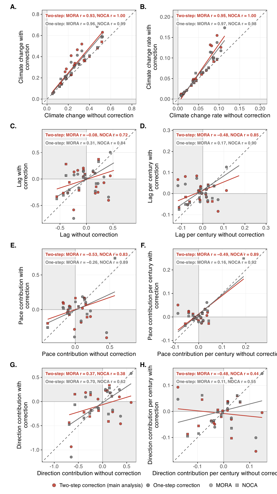

**Fig. S20. Holocene lake-periods with and without correction of the
Holocene climate.** Each point is one lake-period that the three
analyses have in common, with its value without correction (x-axis)
against its value with the two-step correction of the main analysis
(red) and with the one-step correction (grey), each with its
least-squares line: (A) climate change and (B) its rate, (C) the lag and
(D) its rate, (E) the pace contribution and (F) its rate, (G) the
direction contribution and (H) its rate. Left: quantities between t1 and
t2. Right: their rates per century. Circles are MORA and squares NOCA.
On the dashed line, a correction changes nothing, and in the shaded
quadrants, the value changes sign. The numbers in each panel are the
Pearson correlations (r), across the lake-periods of each park, between
each corrected analysis and the analysis without correction.
Lake-periods in which the observed or the climate-predicted position did
not move have no pace or direction contribution. Community turnover is
the same in the three analyses and is not shown. Climate change is in SD
of the legacy plots, and the other quantities are in CCA distance (left)
or in CCA distance per century (right). Script:
[`R/figures/supp_paleoclimate_sensitivity.R`](R/figures/supp_paleoclimate_sensitivity.R).

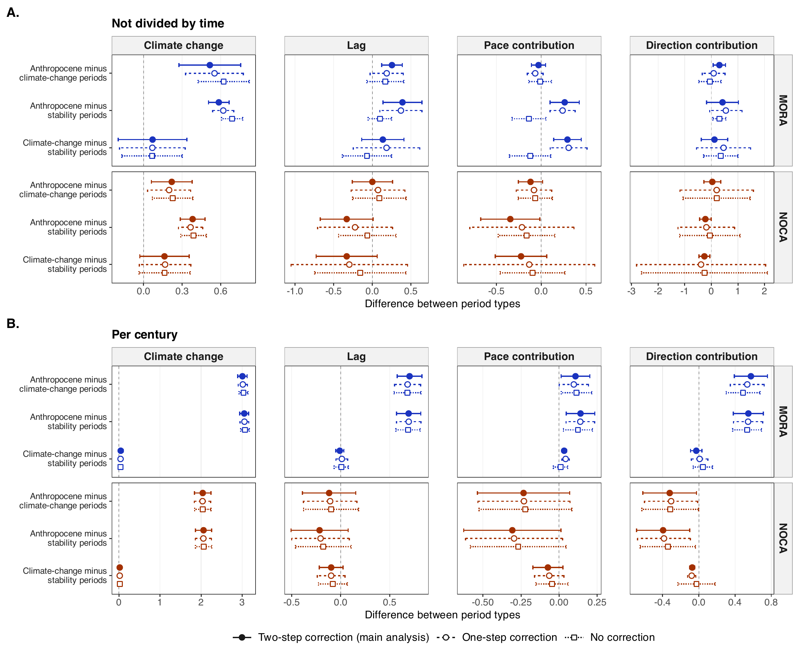

**Fig. S21. Differences between period types with the three versions of
the Holocene climate.** The differences between the estimated means of
two period types within each park (Table S16 for the main analysis),
each with its 95% confidence interval (not adjusted): filled points and
solid lines with the two-step correction of the main analysis, open
circles and dashed lines with the one-step correction, and open squares
and dotted lines without correction. Upper row of each panel: MORA
(blue). Lower row: NOCA (dark red). (A) Climate change, lag, pace
contribution, and direction contribution between t1 and t2. (B) Their
rates per century. Community turnover is the same in the three analyses
and is not shown. Climate change is in SD of the legacy plots, and the
other quantities are in CCA distance (A) or in CCA distance per century
(B). The dashed vertical line marks zero. Script:
[`R/figures/supp_paleoclimate_sensitivity.R`](R/figures/supp_paleoclimate_sensitivity.R).

**Lake-periods.** The three analyses had the same 10 climate periods and
the same 23 lake-periods. With the one-step correction, the lag had the
same sign as in the main analysis in 12 of 13 lake-periods at MORA and
in 9 of 10 at NOCA. Without correction, it had the same sign in 5 of 13
lake-periods at MORA and in 8 of 10 at NOCA (Fig. S20C). The pace and
direction contributions are given in Table S20.

**Differences between the Anthropocene and the Holocene.** Of the 17
differences that were significant in the main analysis (Table S16, Fig.
S21; turnover, which the correction does not touch, left out), 15 were
also significant, with the same sign, with the one-step correction, and
12 without correction. The sign changed for: pace contribution (not
divided by time) at MORA, Anthropocene against Holocene stability
periods.

**Differences within the Holocene.** Of the 3 differences between the
climate-change and the stability periods that were significant in the
main analysis (direction contribution at NOCA; pace contribution at
MORA; pace contribution (not divided by time) at MORA), 3 were also
significant, with the same sign, with the one-step correction, and 0
without correction.

**Associations with climate change and fire in the Holocene.** Of the
climate and fire coefficients whose confidence interval excluded zero in
the main analysis (1), 1 had the same sign with the one-step correction
(0 of them with a confidence interval that still excluded zero), and 0
without correction (0 of them with an interval that still excluded zero;
Fig. S22).

**Consequences for the conclusions.** The comparison between the
Anthropocene and the Holocene depends in part on the correction of the
Holocene climate: 1 of the differences that were significant in the main
analysis changed sign. The results that rest on the Holocene alone
depend on it more, i.e., the lags of single lake-periods, the
differences between the climate-change and the stability periods, and
the associations with climate change and fire. We therefore interpret
these three results with caution.

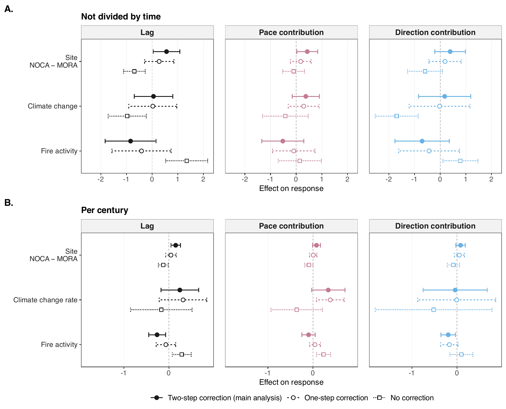

**Fig. S22. Associations with climate change and fire in the Holocene,
with the three versions of the Holocene climate.** Coefficients of Fig.
6A of the main text and Fig. S18A, from the models of the Holocene
lake-periods with park, climate change, and fire activity as explanatory
variables, each with its 95% confidence interval: filled points and
solid lines with the two-step correction of the main analysis, open
circles and dashed lines with the one-step correction, and open squares
and dotted lines without correction. (A) The lag, the pace contribution,
and the direction contribution not divided by time, with the climate
change between t1 and t2. (B) The same quantities per century, with the
climate change rate. Black: lag. Pink: pace contribution. Blue:
direction contribution. The dashed vertical line marks
zero. Script:
[`R/figures/supp_paleoclimate_sensitivity.R`](R/figures/supp_paleoclimate_sensitivity.R).
