PaleoACES
================

<!-- Generated by R/build_report.R from report/README.Rmd. Edit the .Rmd, not this file. -->

PaleoACES compares climate-predicted and observed forest composition in
Mount Rainier (MORA) and North Cascades (NOCA) National Parks, using
forest resurveys and four Holocene macrofossil records. One CCA
calibrated on the legacy survey plots provides the shared coordinate
system.

This page is the supplementary appendix of the analysis. It shows every
main and supplementary figure, the tables reported in the manuscript and
the modelling code, in the order of the analysis and of the Supporting
Information (Appendix S1, Appendix S2). Data cleaning is summarized by
its figure here; the step-by-step detail sits in
[`report/details/`](report/details), linked from each section.

``` sh
Rscript R/run_all.R --offline   # run the whole analysis from the cached climate (add --age-models to refit Bacon)
Rscript R/build_report.R        # rebuild this page and report/ from the outputs
```

| Folder | Contents |
|----|----|
| `R/pipeline/` | The analysis, numbered in run order (01–15); writes `output/` only |
| `R/figures/` | Main and supplementary figures, drawn from `output/` |
| `R/worked_examples.R` | Step-by-step method illustrations |
| `R/sensitivity_bias_corrected.R` | Stages 07 to 15 with the bias-corrected paleoclimate, into `output_bias_corrected/` (run separately) |
| `R/tests/` | Scientific regression checks, run last by `R/run_all.R` |
| `R/helpers/` | Shared functions; `paths.R` declares every output file |
| `report/` | Figures, tables and detail pages of this report |
| `data/`, `Cores/`, `output/`, `output_bias_corrected/` | Raw data, Bacon runs and outputs (local, not in git) |

|  |  |
|----|----|
| Every script and output file | **Outputs and workflow →** [11_outputs_and_workflow](report/details/11_outputs_and_workflow.md) |
| Every analytical decision | **Decisions →** [10_decisions](report/details/10_decisions.md) |
| CCA constraints in this build | MSpT, SP |

Software: R with rbacon 3.5.2, tapas 0.1.5 and CharAnalysis 2.0.3, plus
`pdftoppm` (poppler) for the report.

# The remodelled analysis at a glance

The Holocene side of the analysis is being remodelled on lake-periods:
one lake within one climate period, compared from its first to its last
sampled century. Each row below is filled when its step is finished.

| Step | What it does | Result |
|----|----|----|
| Step 0 | Climate variables and CCA refit | MSpT + SP: VIF 1.08, adjusted R² 0.126 (all four 0.148), no lake-century outside the calibration climate, display rotation -23.4° |
| Step 1 | Climate periods and lake-periods | 10 periods from 9600 to 1300 cal BP (5 C, 5 S), none split |
| Steps 2 to 4 | Mismatch, lag, turnover, pace, direction, climate change rate and fire per lake-period | 24 lake-periods (MORA 14, NOCA 10, 12 C, 12 S), 200 to 2600 years long |
| Step 5 | Holocene explanatory models | Lag rate rises with climate change rate (+0.72, 0.01 to 1.43), fire goes with a larger direction effect (+0.27, 0.08 to 0.46) |
| Step 5a | Holocene against Anthropocene (era models) | Anthropocene climate change 36 (MORA) and 44 (NOCA) times faster than in Holocene-C periods, turnover 12 and 27 times faster |
| Step 6 | Species contributions | Holocene species means near zero (67 of 70 intervals span zero). Anthropocene lag rate split into species and climate: 2 of 27 species-park means narrow the lag, 4 widen it |

# Step 0. Climate variables and the CCA

**What and why.** The four seasonal variables come in two tightly linked
pairs: spring and winter temperature, and summer and winter
precipitation. Inside a pair the CCA cannot tell the two seasons apart,
and Holocene lakes reach seasonal combinations the modern plots never
show. The CCA is therefore constrained by one variable of each pair.
Spring temperature (MSpT) stands for snowmelt timing and the start of
the growing season. Summer precipitation (SP) stands for summer drying
stress. Because each pair is strongly correlated, the two also carry
temperature and precipitation change in general.

**How it is calculated.**

``` r
# R/pipeline/10_cca.R
# The CCA is fitted once, on the legacy survey only.
#   species_past_final: one row per calibration plot (607), one column per tree
#     species (14), the counts of each species in the plot.
#   env_past_final: the same 607 plots, two columns, MSpT (mean spring
#     temperature) and SP (summer precipitation) of the plot's legacy climate
#     window.
# The formula reads "species ~ MSpT + SP". vegan::cca finds the two axes,
# each a weighted sum of MSpT and SP, along which species composition changes
# most. With two climate variables there are exactly two axes. All later
# positions (plots at both surveys, lake samples) live in this 2-D space.
cca_formula = reformulate(CCA_VARIABLES, response = "species_past_final")
cca_model = cca(cca_formula, data = env_past_final)
```

``` r
# R/pipeline/10_cca.R
# Two positions for every community, both on the fitted axes:
#   type = "lc" (linear combination): where its CLIMATE alone puts it, the
#     predicted position. It uses only MSpT and SP.
#   type = "wa" (weighted average): where its SPECIES put it, the observed
#     position, the average of the species' scores weighted by their counts.
# The lag M of a community is the distance between the two.
predicted_present = predict(cca_model, newdata = env_present_final, type = "lc", scaling = cca_scaling, hill = cca_hill)
projected_present = predict(cca_model, newdata = species_present_final,
                            type = "wa", scaling = cca_scaling, hill = cca_hill)

predicted_paleo = predict(cca_model, newdata = env_paleo[, CCA_VARIABLES, drop = FALSE],
                          type = "lc", scaling = cca_scaling, hill = cca_hill)
projected_paleo = predict(cca_model, newdata = species_paleo[, keep_species, drop = FALSE],
                          type = "wa", scaling = cca_scaling, hill = cca_hill)
```

**Result.**

**Screening of the climate constraints** on the 607 legacy calibration
plots. Holocene lake-centuries: 333 at MORA (three lakes) and 111 at
NOCA.

| Set | Variables | Largest abs. correlation | VIF | R² | Adjusted R² | MORA lake-centuries outside (%) | NOCA lake-centuries outside (%) |
|:---|:---|---:|:---|---:|---:|---:|---:|
| All four | MSpT, MWT, SP, WP | 0.956 | MSpT 29.5, MWT 26.4, SP 5.2, WP 6.7 | 0.153 | 0.148 | 88.288 | 14.414 |
| MWT + SP | MWT, SP | 0.072 | MWT 1.0, SP 1.0 | 0.130 | 0.128 | 0.000 | 0.000 |
| MSpT + SP | MSpT, SP | 0.286 | MSpT 1.1, SP 1.1 | 0.128 | 0.126 | 0.000 | 0.000 |

<sub>Table file:
[step0_screening.csv](report/tables/step0_screening.csv)</sub>

With MSpT and SP the CCA explains 12.6% of the variation in composition
(adjusted R²), against 14.8% with all four variables. Adding winter
temperature and winter precipitation back improves the fit (pseudo-F
8.89, p = 0.0001 unrestricted and p = 0.0129 within parks). That gain
comes from the seasonal contrasts within each pair, the same contrasts
that make the four-variable fit collinear (VIF up to 29.5) and that
place 88% of the MORA lake-centuries outside the calibration climate.
With MSpT and SP no lake-century in either park is outside it. The
display rotation turns the plane by -23.4 degrees so that rotated axis 1
is spring temperature increasing to the right and rotated axis 2 summer
precipitation increasing upward. The pipeline asserts that mismatch,
lag, turnover, pace and direction are identical before and after this
rotation.

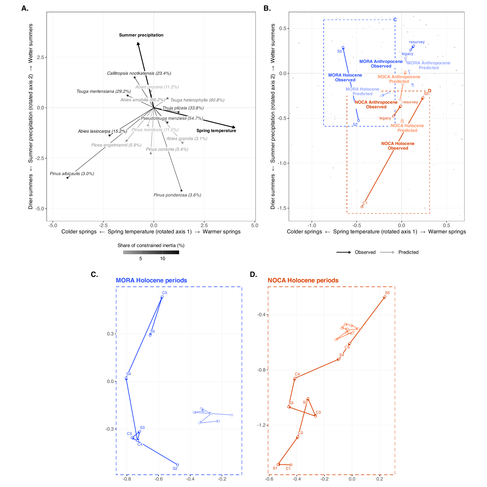

**Figure 3. Climate and community positions in the CCA plane.** (A) The
species that carry more than an equal share of the constrained inertia
(100% divided by the 14 taxa), 7 taxa holding 80% of it (vectors from
the centre, shaded from light to dark by their share, with the
percentage of legacy plots in which each occurs), and the two climate
constraints (bold arrows) of the CCA fitted on 607 legacy plots. All
taxa are shown in Fig. A3. (B) Observed (dark colours) and
climate-predicted (light colours) movement of each park: in the Holocene
from the first to the last climate period with samples, in the
Anthropocene from the legacy survey to the resurvey (averaged over 330
MORA and 277 NOCA plot pairs). The MORA arrows run from S2 to S5 (7200
to 1300 cal BP), and the first MORA period rests on 2 samples in 2
lake-centuries. The NOCA arrows run from C1 to S5 (9600 to 1300 cal BP).
Grey dots are the legacy calibration plots. Labels mark the Holocene
start and end and the legacy survey and resurvey. (C, D) The full
Holocene sequence of period centroids at MORA and NOCA, observed and
predicted, each period named at its observed centroid (C, climate-change
period, S, stability period). Each centroid averages the sampled
centuries of each lake within the period, with the lakes weighted
equally. Axes orthogonally rotated (varimax, -23.4 degrees) for display,
so that axis 1 follows spring temperature and axis 2 summer
precipitation. All metrics are rotation-invariant. The unrotated biplot
is Fig. A3.

Stages and helpers: [`R/pipeline/10_cca.R`](R/pipeline/10_cca.R),
[`R/helpers/cca_report.R`](R/helpers/cca_report.R) (screening and
add-back test),
[`R/helpers/cca_display_rotation.R`](R/helpers/cca_display_rotation.R),
[`R/pipeline/12_tracking.R`](R/pipeline/12_tracking.R) (rotation check),
[`R/figures/main_fig3_cca_trajectories.R`](R/figures/main_fig3_cca_trajectories.R).

# Step 1. Climate periods

**What and why.** The Holocene is cut into climate-change (C) periods,
when the park-average climate of the lakes moved steadily in one
direction, and stability (S) periods between them. The rules of the
climate-era step are unchanged. Only their input changed: the periods
are now drawn from the two CCA variables, MSpT and SP, so that the
periods describe change along the same climate axes that the CCA uses. A
climate-change period that contains a long internal trough of low change
is split into sub-periods (a, b, c). Each period, or sub-period, is one
unit for the lake-periods of the next step.

**Result.**

**Climate periods** drawn from MSpT and SP (used from Step 1 on) and, by
the same rules, from all four seasonal variables (the periods before
Step 0).

| Catalog | Period | Type | Older (cal BP) | Younger (cal BP) | Duration (years) | Drivers |
|:---|:---|:---|---:|---:|---:|:---|
| MSpT + SP (after Step 0) | C1 | Holocene-C | 9600 | 8600 | 1000 | spring cooling, summer drying |
| MSpT + SP (after Step 0) | S1 | Holocene-S | 8600 | 8200 | 400 |  |
| MSpT + SP (after Step 0) | C2 | Holocene-C | 8200 | 7200 | 1000 | spring warming, summer wetting |
| MSpT + SP (after Step 0) | S2 | Holocene-S | 7200 | 6800 | 400 |  |
| MSpT + SP (after Step 0) | C3 | Holocene-C | 6800 | 6200 | 600 | spring cooling |
| MSpT + SP (after Step 0) | S3 | Holocene-S | 6200 | 5400 | 800 |  |
| MSpT + SP (after Step 0) | C4 | Holocene-C | 5400 | 4900 | 500 | spring warming |
| MSpT + SP (after Step 0) | S4 | Holocene-S | 4900 | 2200 | 2700 |  |
| MSpT + SP (after Step 0) | C5 | Holocene-C | 2200 | 1700 | 500 | spring warming |
| MSpT + SP (after Step 0) | S5 | Holocene-S | 1700 | 1300 | 400 |  |
| All four seasonal variables (before Step 0) | C1a | Holocene-C | 9600 | 8600 | 1000 | spring cooling, winter warming, summer drying |
| All four seasonal variables (before Step 0) | C1b | Holocene-C | 8600 | 8200 | 400 | winter wetting |
| All four seasonal variables (before Step 0) | C1c | Holocene-C | 8200 | 7200 | 1000 | spring warming, winter warming, summer wetting |
| All four seasonal variables (before Step 0) | S1 | Holocene-S | 7200 | 6800 | 400 |  |
| All four seasonal variables (before Step 0) | C2 | Holocene-C | 6800 | 6200 | 600 | spring cooling |
| All four seasonal variables (before Step 0) | S2 | Holocene-S | 6200 | 5400 | 800 |  |
| All four seasonal variables (before Step 0) | C3 | Holocene-C | 5400 | 4900 | 500 | spring warming |
| All four seasonal variables (before Step 0) | S3 | Holocene-S | 4900 | 2200 | 2700 |  |
| All four seasonal variables (before Step 0) | C4 | Holocene-C | 2200 | 1700 | 500 | spring warming |
| All four seasonal variables (before Step 0) | S4 | Holocene-S | 1700 | 1300 | 400 |  |

<sub>Table file:
[step1_periods.csv](report/tables/step1_periods.csv)</sub>

With MSpT and SP the Holocene from 9600 to 1300 cal BP falls into 5
climate-change periods and 5 stability periods, and no climate-change
period is split. The first four-variable climate-change period (C1a to
C1c, 9600 to 7200 cal BP) becomes C1, S1 and C2: its middle part (8600
to 8200 cal BP) was driven by winter wetting alone, which is no longer a
constraint. From 7200 cal BP onward every boundary is unchanged, and the
periods are renumbered. The high-fire periods do not depend on the CCA
and are unchanged.

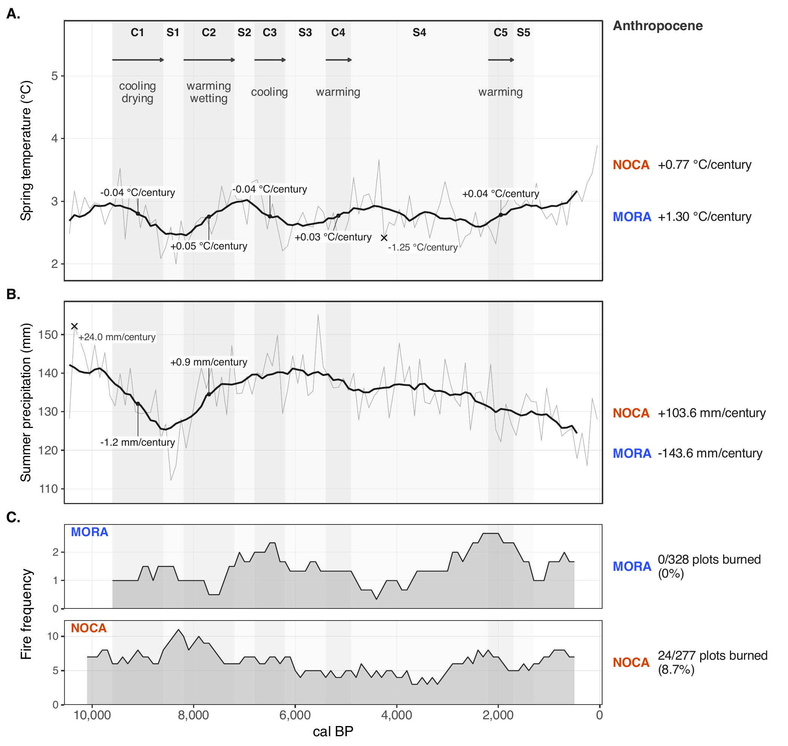

**Figure 2. Holocene climate and fire.** (A) Spring temperature (°C) and
(B) summer precipitation (mm), the two CCA constraints, averaged over
the lakes of each park with the two parks weighted equally
(CHELSA-TraCE21k). Bold lines are 1,000-year running means and thin
lines the centennial series. Shading marks the climate-change (C) and
stability (S) periods, with the change that drove each climate-change
period written below its name (cooling or warming of spring temperature,
drying or wetting of summer precipitation). Labels linked to the bold
lines give the change per century over a period for each variable that
drove it. A cross marks the largest step between two consecutive
centuries, labelled with its rate. To the right of each panel, the
Anthropocene change per century from the legacy to the resurvey climate
window, the median over plots in each park: spring temperature +1.29 °C
at MORA and +0.77 °C at NOCA, summer precipitation -142.6 mm at MORA and
+103.6 mm at NOCA. These come from a change over about 29 years, while
each Holocene rate spans a whole period of 400 to 2,700 years. (C)
Fire-frequency ratio of each park, the frequency of accepted fire events
relative to the park’s high-fire threshold. Values above 1 (red) are
high-fire periods.

Stages and helpers:
[`R/pipeline/11_climate_eras_high_fire.R`](R/pipeline/11_climate_eras_high_fire.R),
[`R/helpers/holocene_climate_fire_era_functions.R`](R/helpers/holocene_climate_fire_era_functions.R),
[`R/figures/main_fig2_climate_eras_fire.R`](R/figures/main_fig2_climate_eras_fire.R).

# Steps 1 to 4. Lake-periods and their responses

## Positions per sampled century

**What and why.** Each macrofossil sample has an observed position in
the CCA plane (its WA score, from the taxa it contains). Each lake also
has a climate-predicted position for every century (its LC score, from
that lake’s own climate cell). Samples are dated by the median of their
Bacon ages and grouped by century. The observed position of a century is
the centroid of its samples’ WA positions. No vegetation is interpolated
between sampled centuries. These century positions feed the lake-periods
below and the period centroids of Figure 3. No model is fitted on the
century steps any more.

**Sampled centuries per lake** on the MSpT + SP CCA.

| Park | Lake | Sampled centuries | Samples | Centuries with one sample | Oldest (cal BP) | Youngest (cal BP) |
|:---|:---|---:|---:|---:|---:|---:|
| MORA | JayBath | 44 | 48 | 41 | 6850 | -50 |
| MORA | LogWallow | 35 | 40 | 31 | 6850 | -50 |
| MORA | ReflectionPond | 27 | 31 | 24 | 6250 | -50 |
| NOCA | PantherPotholes | 108 | 812 | 1 | 10650 | -50 |

<sub>Table file:
[step1_sampled_centuries.csv](report/tables/step1_sampled_centuries.csv)</sub>

The three MORA lakes begin about 6,850 cal BP and most of their
centuries rest on a single sample. Panther Potholes (NOCA) covers the
whole Holocene with several samples per century.

Stages and helpers:
[`R/pipeline/12_tracking.R`](R/pipeline/12_tracking.R),
[`R/helpers/century_tracking.R`](R/helpers/century_tracking.R),
[`R/helpers/tracking_metrics.R`](R/helpers/tracking_metrics.R).

## Lake-periods

**What and why.** Two scoops of sediment from the same forest in the
same century differ by about as much as the forest drifts in many
centuries, because one needle caught or missed moves a sample’s
position. A lag computed between consecutive centuries is therefore
mostly that noise. Comparing the two ends of a whole climate period lets
the drift outgrow it. A lake-period is one lake within one climate
period. Its start (t1) is the oldest and its end (t2) the youngest
sampled century of that lake in that period, and a lake needs samples in
at least two centuries of a period to have a lake-period there. The
centuries in between enter no model.

At each end the mismatch M is the distance between the observed and the
climate-predicted positions. The lag rate is the change in M per
century. The turnover rate is the length of the observed movement per
century. The pace and direction effects ask how much smaller the final
mismatch would have been if the community had moved the predicted
distance in its own direction (pace) or its own distance in the
predicted direction (direction). The climate change rate is the
standardized end-to-end change of MSpT and SP in the lake’s own climate
cell, per century. Fire activity is the number of accepted fire events
between t1 and t2, per century and per charcoal core, averaged over the
cores of the park that cover the whole lake-period.

**How it is calculated.** The code below computes every quantity from
the two ends of a unit, a Holocene lake-period or an Anthropocene plot
pair. The comments say what each step means.

``` r
# R/helpers/tracking_metrics.R
  # One row per unit (a Holocene lake-period or an Anthropocene plot pair),
  # with two ends, t1 (older) and t2 (younger). At each end the community has
  # an observed position (o1, o2: from its species) and a predicted position
  # (p1, p2: from its climate) on the two CCA axes. The suffix _2 marks t2.
  # Movement from t1 to t2: observed (ox, oy), predicted (px, py), and their
  # lengths a (observed distance) and b (predicted distance).
  ox = x$o1_2-x$o1; oy = x$o2_2-x$o2
  px = x$p1_2-x$p1; py = x$p2_2-x$p2
  a = sqrt(ox^2+oy^2); b = sqrt(px^2+py^2)
  # A movement shorter than epsilon has no direction, so the angle, the pace
  # and direction effects and the tracking ratio are left undefined there.
  x$finite_endpoints = rowSums(!is.finite(as.matrix(x[coords]))) == 0L
  x$small_observed_movement = is.finite(a) & a <= epsilon
  x$small_predicted_movement = is.finite(b) & b <= epsilon
  observed_direction = x$finite_endpoints & is.finite(a) & a > epsilon
  predicted_direction = x$finite_endpoints & is.finite(b) & b > epsilon
  x$angle_valid = observed_direction & predicted_direction
  x$pace_counterfactual_valid = observed_direction
  x$direction_counterfactual_valid = predicted_direction
  x$tracking_ratio_valid = predicted_direction
  x$delta_observed_CCA1 = ox; x$delta_observed_CCA2 = oy
  x$delta_predicted_CCA1 = px; x$delta_predicted_CCA2 = py
  x$observed_vegetation_displacement = a
  x$predicted_vegetation_displacement = b
  # Turnover rate: observed distance moved, per century. Tracking ratio:
  # observed over predicted distance (1 = moved as far as climate asked).
  # Angle: between the observed and the predicted movement (0 = same way).
  x$observed_turnover_rate = a/x$vegetation_dt_years*100
  x$predicted_vegetation_change_rate = b/x$climate_dt_years*100
  x$magnitude_tracking_ratio = ifelse(predicted_direction, a/b, NA_real_)
  x$rate_tracking_ratio = ifelse(predicted_direction,
    x$observed_turnover_rate/x$predicted_vegetation_change_rate, NA_real_)
  x$angle_degrees = acos(safe_cosine_2d(ox, oy, px, py, epsilon))*180/pi
  # Lag M at each end: the distance between observed and predicted position,
  # how far the community is from where its climate would put it. The lag is
  # M at t2 minus M at t1 (positive: the gap grew), the lag rate the same per
  # century.
  x$lag_t1 = sqrt((x$o1-x$p1)^2+(x$o2-x$p2)^2)
  x$lag_t2 = sqrt((x$o1_2-x$p1_2)^2+(x$o2_2-x$p2_2)^2)
  x$change_in_lag = x$lag_t2-x$lag_t1
  x$lag_rate_per_century = x$change_in_lag/x$climate_dt_years*100
```

``` r
# R/helpers/tracking_metrics.R
  # Two "what if" end points at t2, both starting from the observed t1 position:
  #   pace-corrected: the community's own direction, but the predicted
  #     distance b (as if it had moved at the climate's pace);
  #   direction-corrected: the predicted direction, but its own distance a
  #     (as if it had moved the climate's way).
  # Each effect is the observed lag at t2 minus the lag at that "what if" end
  # point, per century. Positive: the community's own pace (or direction)
  # widened the lag. Negative: it narrowed the lag.
  x$pace_corrected_CCA1 = x$pace_corrected_CCA2 = rep(NA_real_, nrow(x))
  x$direction_corrected_CCA1 = x$direction_corrected_CCA2 = rep(NA_real_, nrow(x))
  i = observed_direction
  x$pace_corrected_CCA1[i] = x$o1[i]+b[i]*ox[i]/a[i]
  x$pace_corrected_CCA2[i] = x$o2[i]+b[i]*oy[i]/a[i]
  i = predicted_direction
  x$direction_corrected_CCA1[i] = x$o1[i]+a[i]*px[i]/b[i]
  x$direction_corrected_CCA2[i] = x$o2[i]+a[i]*py[i]/b[i]
  x$lag_t2_pace_corrected = sqrt((x$pace_corrected_CCA1-x$p1_2)^2+
    (x$pace_corrected_CCA2-x$p2_2)^2)
  x$lag_t2_direction_corrected = sqrt((x$direction_corrected_CCA1-x$p1_2)^2+
    (x$direction_corrected_CCA2-x$p2_2)^2)
  x$pace_effect_on_lag = x$lag_t2-x$lag_t2_pace_corrected
  x$direction_effect_on_lag = x$lag_t2-x$lag_t2_direction_corrected
  x$pace_effect_on_lag_per_century = x$pace_effect_on_lag/x$climate_dt_years*100
  x$direction_effect_on_lag_per_century = x$direction_effect_on_lag/x$climate_dt_years*100
```

**Result.**

**Lake-periods.** Rates are per century: climate change in calibration
SD, fire in events per covered core, the others in CCA distance. Pace
and direction are undefined where the observed or the predicted position
did not move.

| Park | Lake | Period | t1 (cal BP) | t2 (cal BP) | Years | Samples t1 | Samples t2 | Climate change rate | MSpT change (°C) | SP change (mm) | Fire activity | M t1 | M t2 | Lag rate | Turnover rate | Pace effect | Direction effect |
|:---|:---|:---|---:|---:|---:|---:|---:|---:|---:|---:|---:|---:|---:|---:|---:|---:|---:|
| MORA | JayBath | C3 | 6550 | 6250 | 300 | 1 | 1 | 0.119 | -0.350 | -20 | 0.222 | 0.357 | 0.455 | 0.033 | 0.092 | 0.036 | -0.004 |
| MORA | JayBath | S3 | 5950 | 5650 | 300 | 1 | 1 | 0.013 | -0.050 | -2 | 0.111 | 0.475 | 0.269 | -0.069 | 0.073 | -0.057 | -0.132 |
| MORA | JayBath | C4 | 5350 | 5050 | 300 | 1 | 1 | 0.021 | -0.150 | -1 | 0.111 | 0.506 | 0.491 | -0.005 | 0.000 | — | — |
| MORA | JayBath | S4 | 4750 | 2350 | 2400 | 1 | 1 | 0.007 | -0.267 | 8 | 0.125 | 0.280 | 0.696 | 0.017 | 0.025 | 0.019 | -0.004 |
| MORA | JayBath | C5 | 2150 | 1750 | 400 | 1 | 1 | 0.091 | 0.567 | -17 | 0.333 | 0.482 | 0.538 | 0.014 | 0.082 | -0.004 | 0.037 |
| MORA | JayBath | S5 | 1650 | 1350 | 300 | 1 | 1 | 0.049 | -0.167 | 8 | 0.111 | 0.519 | 0.691 | 0.058 | 0.107 | 0.063 | -0.018 |
| MORA | LogWallow | C3 | 6750 | 6250 | 500 | 1 | 1 | 0.105 | -1.133 | -14 | 0.200 | 0.404 | 0.219 | -0.037 | 0.026 | -0.004 | -0.018 |
| MORA | LogWallow | S3 | 6150 | 5550 | 600 | 1 | 1 | 0.076 | 0.567 | 24 | 0.111 | 0.261 | 0.475 | 0.036 | 0.042 | 0.001 | 0.041 |
| MORA | LogWallow | C4 | 5350 | 5050 | 300 | 1 | 1 | 0.019 | -0.117 | -2 | 0.111 | 0.492 | 0.303 | -0.063 | 0.075 | -0.044 | -0.127 |
| MORA | LogWallow | S4 | 4850 | 2450 | 2400 | 1 | 1 | 0.008 | -0.367 | -6 | 0.097 | 0.551 | 0.755 | 0.008 | 0.014 | 0.009 | -0.001 |
| MORA | ReflectionPond | S3 | 5950 | 5450 | 500 | 1 | 1 | 0.026 | 0.250 | 5 | 0.133 | 0.817 | 0.874 | 0.011 | 0.000 | — | — |
| MORA | ReflectionPond | C4 | 5250 | 4950 | 300 | 1 | 1 | 0.013 | -0.050 | -2 | 0.222 | 0.856 | 0.603 | -0.084 | 0.102 | -0.075 | -0.148 |
| MORA | ReflectionPond | S4 | 4750 | 2250 | 2500 | 1 | 1 | 0.005 | -0.050 | 8 | 0.120 | 0.853 | 0.905 | 0.002 | 0.033 | 0.004 | -0.018 |
| MORA | ReflectionPond | C5 | 2050 | 1850 | 200 | 1 | 1 | 0.134 | 0.583 | 7 | 0.333 | 0.925 | 1.232 | 0.154 | 0.153 | 0.078 | 0.142 |
| NOCA | PantherPotholes | C1 | 9550 | 8650 | 900 | 8 | 7 | 0.044 | -0.933 | -6 | 0.778 | 1.004 | 1.072 | 0.007 | 0.018 | -0.007 | 0.011 |
| NOCA | PantherPotholes | S1 | 8550 | 8250 | 300 | 8 | 7 | 0.075 | 0.517 | 4 | 0.667 | 1.129 | 0.958 | -0.057 | 0.100 | -0.050 | -0.020 |
| NOCA | PantherPotholes | C2 | 8150 | 7250 | 900 | 8 | 5 | 0.057 | 0.967 | 20 | 0.889 | 0.750 | 0.911 | 0.018 | 0.057 | 0.004 | 0.027 |
| NOCA | PantherPotholes | S2 | 7150 | 6850 | 300 | 5 | 6 | 0.039 | 0.283 | 0 | 0.667 | 0.784 | 1.021 | 0.079 | 0.074 | 0.043 | 0.117 |
| NOCA | PantherPotholes | C3 | 6750 | 6250 | 500 | 6 | 6 | 0.095 | -1.100 | -8 | 0.600 | 1.109 | 0.732 | -0.075 | 0.065 | -0.006 | -0.083 |
| NOCA | PantherPotholes | S3 | 6150 | 5450 | 700 | 6 | 5 | 0.033 | 0.533 | 4 | 0.429 | 0.836 | 0.481 | -0.051 | 0.062 | -0.043 | -0.033 |
| NOCA | PantherPotholes | C4 | 5350 | 4950 | 400 | 6 | 5 | 0.013 | 0.117 | -1 | 0.500 | 0.577 | 0.569 | -0.002 | 0.194 | 0.004 | -0.119 |
| NOCA | PantherPotholes | S4 | 4850 | 2250 | 2600 | 6 | 10 | 0.014 | -0.783 | -9 | 0.500 | 0.319 | 0.161 | -0.006 | 0.005 | 0.003 | -0.005 |
| NOCA | PantherPotholes | C5 | 2150 | 1750 | 400 | 11 | 8 | 0.087 | 0.633 | -14 | 0.750 | 0.241 | 0.260 | 0.005 | 0.129 | 0.043 | -0.052 |
| NOCA | PantherPotholes | S5 | 1650 | 1350 | 300 | 10 | 9 | 0.043 | -0.017 | 8 | 0.333 | 0.271 | 0.614 | 0.114 | 0.202 | 0.132 | -0.066 |

<sub>Table file:
[step24_lake_periods.csv](report/tables/step24_lake_periods.csv)</sub>

Of the 30 lake and period combinations with at least one sampled
century, 24 have samples in two or more centuries and become
lake-periods (MORA 14, NOCA 10, 12 in climate-change and 12 in stability
periods). They span 200 to 2600 years. Every MORA end rests on a single
sample, and 2 MORA lake-periods have no defined direction because the
observed or predicted position did not move. All lake-periods have fire
coverage.

Stages and helpers:
[`R/pipeline/12_tracking.R`](R/pipeline/12_tracking.R),
[`R/helpers/lake_periods.R`](R/helpers/lake_periods.R),
[`R/helpers/tracking_metrics.R`](R/helpers/tracking_metrics.R),
[`R/helpers/century_tracking.R`](R/helpers/century_tracking.R) (fire per
interval), [`R/tests/test_lake_periods.R`](R/tests/test_lake_periods.R).

# Step 5. What goes with lag rate, pace and direction in the Holocene

**What and why.** Within the Holocene lake-periods, does a period with
more climate change, or more fire, end with a larger lag, and with
better or worse pace and direction? Each response is modelled on the
park, the climate change rate and fire activity together. Consecutive
lake-periods of a lake can share an end century, so their errors are
related, and an AR(1) term on the order of the lake-periods within each
lake carries that from the start. Ends that rest on a single sample are
noisier, so each row is weighted by the sampling variance of its two
ends, and the parks keep different residual spread. In the Anthropocene
the same responses are compared between burned and unburned plots within
each park.

**How it is calculated.**

``` r
# R/pipeline/14_predictor_models.R
  # Holocene lake-periods only. Does the response go with more climate change
  # or more fire? Fitted twice: per century (lag rate, pace effect, direction
  # effect) with climate = climate_rate, the climate change rate, and as totals
  # not divided by time (lag, pace and direction effect totals) with
  # climate = climate_change, the climate change between the two ends.
  #   site: a separate level for each park;
  #   climate: the slope per unit of climate change (rate or total);
  #   fire_activity: the slope per accepted fire event per century per core.
  # Consecutive lake-periods of a lake are correlated (AR(1) within lake).
  # varIdent lets the parks keep a different spread, and varFixed gives ends
  # resting on single samples less weight (endpoint_var = 1/n_start + 1/n_end).
  model = reformulate(c('site', climate, 'fire_activity'), response = 'estimate')
  captured = reconstruction_capture(function() gls(model,
    correlation = corAR1(form = ~ unit_index | lake),
    weights = varComb(varIdent(form = ~ 1 | site), varFixed(~ endpoint_var)),
    data = d, method = 'REML', control = glsControl(msMaxIter = 500)))
```

``` r
# R/pipeline/14_predictor_models.R
  # Anthropocene plot pairs only: the same responses against site and burned
  # (whether the plot burned between the two surveys). Plots are independent,
  # each park keeps its own spread.
  captured = reconstruction_capture(function() gls(estimate ~ site + burned,
    weights = varIdent(form = ~ 1 | site), data = da, method = 'REML'))
```

**Result.**

**Explanatory models.** Holocene: response ~ site + climate_rate +
fire_activity for the per-century responses and response ~ site +
climate_change + fire_activity for the responses not divided by time, on
the lake-periods, AR(1) within lake, endpoint weights. Anthropocene:
response ~ site + burned on the plot pairs. Estimates in CCA distance
(per century for the per-century responses) per unit of the term.
Conditional 95% confidence intervals. R² is descriptive (1 − SSE/SST).

| Response | Era | Term | Estimate | 95% CI | p | n | R² | SD ratio NOCA/MORA | AR(1) |
|:---|:---|:---|---:|:---|---:|---:|---:|---:|---:|
| Lag rate | Holocene | (Intercept) | -0.014 | -0.061 to 0.034 | 0.554 | 24 | 0.088 | 3.504 | -0.024 |
| Lag rate | Holocene | siteNOCA | 0.043 | -0.080 to 0.166 | 0.472 | 24 | 0.088 | 3.504 | -0.024 |
| Lag rate | Holocene | climate_rate | 0.719 | 0.007 to 1.431 | 0.048 | 24 | 0.088 | 3.504 | -0.024 |
| Lag rate | Holocene | fire_activity | -0.098 | -0.353 to 0.157 | 0.432 | 24 | 0.088 | 3.504 | -0.024 |
| Lag rate | Anthropocene | (Intercept) | 0.544 | 0.425 to 0.664 | 0.000 | 607 | 0.029 | 2.131 | — |
| Lag rate | Anthropocene | siteNOCA | -0.613 | -0.922 to -0.303 | 0.000 | 607 | 0.029 | 2.131 | — |
| Lag rate | Anthropocene | burnedBurned | -0.152 | -0.983 to 0.678 | 0.719 | 607 | 0.029 | 2.131 | — |
| Pace effect | Holocene | (Intercept) | -0.001 | -0.042 to 0.040 | 0.979 | 22 | 0.172 | 3.716 | 0.236 |
| Pace effect | Holocene | siteNOCA | 0.100 | -0.001 to 0.201 | 0.052 | 22 | 0.172 | 3.716 | 0.236 |
| Pace effect | Holocene | climate_rate | 0.685 | 0.139 to 1.232 | 0.017 | 22 | 0.172 | 3.716 | 0.236 |
| Pace effect | Holocene | fire_activity | -0.188 | -0.388 to 0.012 | 0.063 | 22 | 0.172 | 3.716 | 0.236 |
| Pace effect | Anthropocene | (Intercept) | 0.175 | 0.082 to 0.267 | 0.000 | 465 | 0.041 | 2.747 | — |
| Pace effect | Anthropocene | siteNOCA | -0.372 | -0.670 to -0.074 | 0.014 | 465 | 0.041 | 2.747 | — |
| Pace effect | Anthropocene | burnedBurned | -0.923 | -1.653 to -0.193 | 0.013 | 465 | 0.041 | 2.747 | — |
| Direction effect | Holocene | (Intercept) | -0.093 | -0.143 to -0.042 | 0.001 | 22 | 0.219 | 2.112 | -0.504 |
| Direction effect | Holocene | siteNOCA | -0.122 | -0.215 to -0.029 | 0.013 | 22 | 0.219 | 2.112 | -0.504 |
| Direction effect | Holocene | climate_rate | 0.500 | -0.275 to 1.275 | 0.192 | 22 | 0.219 | 2.112 | -0.504 |
| Direction effect | Holocene | fire_activity | 0.268 | 0.076 to 0.460 | 0.009 | 22 | 0.219 | 2.112 | -0.504 |
| Direction effect | Anthropocene | (Intercept) | 0.340 | 0.174 to 0.506 | 0.000 | 465 | 0.032 | 1.712 | — |
| Direction effect | Anthropocene | siteNOCA | -0.650 | -1.010 to -0.290 | 0.000 | 465 | 0.032 | 1.712 | — |
| Direction effect | Anthropocene | burnedBurned | 0.571 | -0.406 to 1.547 | 0.251 | 465 | 0.032 | 1.712 | — |
| Lag (not divided by time) | Holocene | (Intercept) | 0.030 | -0.162 to 0.222 | 0.749 | 24 | 0.032 | 3.249 | -0.069 |
| Lag (not divided by time) | Holocene | siteNOCA | -0.088 | -0.526 to 0.350 | 0.680 | 24 | 0.032 | 3.249 | -0.069 |
| Lag (not divided by time) | Holocene | climate_change | 0.058 | -0.663 to 0.778 | 0.869 | 24 | 0.032 | 3.249 | -0.069 |
| Lag (not divided by time) | Holocene | fire_activity | 0.051 | -0.890 to 0.992 | 0.911 | 24 | 0.032 | 3.249 | -0.069 |
| Lag (not divided by time) | Anthropocene | (Intercept) | 0.160 | 0.125 to 0.195 | 0.000 | 607 | 0.031 | 2.058 | — |
| Lag (not divided by time) | Anthropocene | siteNOCA | -0.180 | -0.268 to -0.092 | 0.000 | 607 | 0.031 | 2.058 | — |
| Lag (not divided by time) | Anthropocene | burnedBurned | -0.040 | -0.278 to 0.199 | 0.744 | 607 | 0.031 | 2.058 | — |
| Pace effect (not divided by time) | Holocene | (Intercept) | 0.095 | -0.102 to 0.293 | 0.325 | 22 | -0.001 | 2.629 | 0.225 |
| Pace effect (not divided by time) | Holocene | siteNOCA | 0.175 | -0.204 to 0.553 | 0.345 | 22 | -0.001 | 2.629 | 0.225 |
| Pace effect (not divided by time) | Holocene | climate_change | 0.174 | -0.470 to 0.817 | 0.577 | 22 | -0.001 | 2.629 | 0.225 |
| Pace effect (not divided by time) | Holocene | fire_activity | -0.431 | -1.202 to 0.340 | 0.255 | 22 | -0.001 | 2.629 | 0.225 |
| Pace effect (not divided by time) | Anthropocene | (Intercept) | 0.049 | 0.022 to 0.076 | 0.000 | 465 | 0.041 | 2.673 | — |
| Pace effect (not divided by time) | Anthropocene | siteNOCA | -0.105 | -0.190 to -0.021 | 0.015 | 465 | 0.041 | 2.673 | — |
| Pace effect (not divided by time) | Anthropocene | burnedBurned | -0.265 | -0.475 to -0.055 | 0.014 | 465 | 0.041 | 2.673 | — |
| Direction effect (not divided by time) | Holocene | (Intercept) | -0.441 | -0.617 to -0.266 | 0.000 | 22 | 0.268 | 3.250 | -0.454 |
| Direction effect (not divided by time) | Holocene | siteNOCA | -0.445 | -0.796 to -0.094 | 0.016 | 22 | 0.268 | 3.250 | -0.454 |
| Direction effect (not divided by time) | Holocene | climate_change | 0.778 | 0.164 to 1.393 | 0.016 | 22 | 0.268 | 3.250 | -0.454 |
| Direction effect (not divided by time) | Holocene | fire_activity | 0.899 | 0.133 to 1.665 | 0.024 | 22 | 0.268 | 3.250 | -0.454 |
| Direction effect (not divided by time) | Anthropocene | (Intercept) | 0.099 | 0.051 to 0.148 | 0.000 | 465 | 0.032 | 1.670 | — |
| Direction effect (not divided by time) | Anthropocene | siteNOCA | -0.187 | -0.289 to -0.084 | 0.000 | 465 | 0.032 | 1.670 | — |
| Direction effect (not divided by time) | Anthropocene | burnedBurned | 0.164 | -0.115 to 0.442 | 0.249 | 465 | 0.032 | 1.670 | — |

<sub>Table file:
[step5_explanatory_models.csv](report/tables/step5_explanatory_models.csv)</sub>

In the Holocene, lake-periods with faster climate change ended with a
larger lag (+0.72 (0.01 to 1.43) CCA distance per century for one more
standardized unit of climate change per century) and with a larger pace
effect (+0.69 (0.14 to 1.23)). Fire activity did not go with the lag
rate (-0.10 (-0.35 to 0.16) per extra event per century per core), but
it went with a larger direction effect (+0.27 (0.08 to 0.46)): where
fire was more frequent, the community’s direction was further from the
predicted one. The fire values of the two parks barely overlap. The site
term absorbs the difference between the parks, so the fire slope comes
from the narrow range within each park (MORA 0.10 to 0.33, NOCA 0.33 to
0.89 events per century per core).

The same models on the responses not divided by time, with the climate
change between the two ends in place of its rate, give a different
picture. The lag of a lake-period went with neither climate change
(+0.06 (-0.66 to 0.78) CCA distance per standardized unit of climate
change) nor fire (+0.05 (-0.89 to 0.99)), and neither did the pace
effect. The direction effect went with both: lake-periods with more
climate change (+0.78 (0.16 to 1.39)) and more fire (+0.90 (0.13 to
1.66)) ended with directions further from the predicted one. The
lag-rate and pace associations with the climate change rate therefore
rest on the division by time, while the direction association with fire
holds in both forms. In the Anthropocene, burned plots had a smaller
total pace effect than unburned ones (-0.26 (-0.47 to -0.05)). Fire
activity stays a frequency in both forms, because a count of events
would grow with the length of the lake-period.

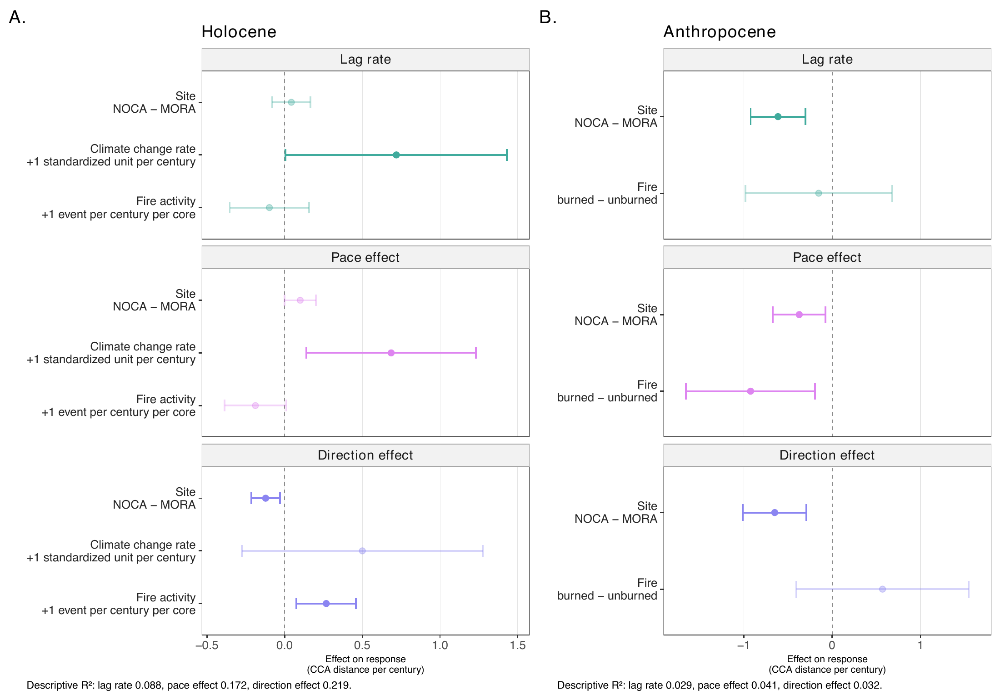

**Figure 6. Climate and fire associations.** Model slopes with
conditional 95% confidence intervals for the lag (black), the pace
effect (pink) and the direction effect (blue), side by side for each
term, in the colours of Figure 1. Faded estimates have intervals that
include zero. Top row (A, B): the responses per century, the change in
mismatch or the reduction in final mismatch under the pace or direction
correction divided by the elapsed time. Bottom row (C, D): the same
responses not divided by time. The panels of a row share one x scale.
(A, C) Holocene lake-periods, model response ~ site + climate + fire
activity with an AR(1) correlation within each lake and weights for the
number of samples at each end, where climate is the climate change rate
in A and the climate change between the two ends in C: 14 MORA and 10
NOCA lake-periods for the lag, and 12 and 10 for pace and direction. The
climate slope is per standardized unit of climate change per century (A)
or per standardized unit of climate change (C), and the fire slope per
accepted event per century per covered core. (B, D) Anthropocene plot
pairs, model response ~ site + burned with park-specific variances: 607
plot pairs for the lag and 465 for pace and direction. Descriptive R² is
given below each panel. Holocene climate-change lake-periods span 200 to
900 years and stability lake-periods 300 to 2600 years between their
first and last sampled century. Anthropocene plot pairs span 27.5 to
32.5 years between the midpoints of their climate windows (about 29
years). Effects are in CCA distance per century (A, B) or CCA distance
(C, D) per unit of the term.

Stages and helpers:
[`R/pipeline/14_predictor_models.R`](R/pipeline/14_predictor_models.R),
[`R/helpers/reconstruction_models.R`](R/helpers/reconstruction_models.R),
[`R/figures/main_fig6_climate_fire_associations.R`](R/figures/main_fig6_climate_fire_associations.R).

# Step 5a. Holocene against Anthropocene

**What and why.** Each response is compared between the Holocene
stability periods, the Holocene climate-change periods and the
Anthropocene, within each park. The two Holocene types are never pooled,
so back-and-forth change in the stability periods cannot cancel the
directional change of the climate-change periods, and the parks are
never pooled. The Holocene rows are the lake-periods and the
Anthropocene rows are the plot pairs, in one model per response with
group-specific residual spread, the endpoint weights and the AR(1)
within each lake. Fire stays out of these models, because it is measured
differently in the two eras. Rates over a few decades and over centuries
are not on equal footing, since longer windows give lower rates, and
every comparison states both time spans. The three contrasts between
period types in each park are tested together for both parks, so each
response has six contrasts, and their p-values are Holm-adjusted within
that family. Significance is read from the adjusted p-values. The
intervals are the unadjusted 95% intervals.

**How it is calculated.**

``` r
# R/pipeline/13_era_models.R
  # One model per response (climate change rate, climate change, turnover rate,
  # displacement, lag rate, lag, pace effect, direction effect and their totals).
  # Climate change, displacement, lag and the effect totals are totals between
  # the two ends, the others per century.
  # Each row is a Holocene lake-period or an
  # Anthropocene plot pair; `estimate` is its value of the response.
  # Mean part, period_type * site: one mean for each period type (Holocene-S,
  # Holocene-C, Anthropocene) in each park. The era means, the contrasts
  # (Anthropocene minus each Holocene type) and the folds come from these.
  # gls (generalized least squares, nlme) is a regression whose errors may be
  # correlated and unequal:
  #   correlation: consecutive lake-periods of one lake are correlated, AR(1)
  #     along the unit order within each series (a lake; each Anthropocene plot
  #     is a series of one unit);
  #   weights: each period type in each park has its own spread (varIdent), and
  #     ends that rest on few samples are noisier, in proportion to
  #     endpoint_var = 1/n_start + 1/n_end (varFixed).
  captured = reconstruction_capture(function() gls(estimate ~ period_type * site,
    correlation = corAR1(form = ~ unit_index | series),
    weights = varComb(varIdent(form = ~ 1 | period_type_site), varFixed(~ endpoint_var)),
    data = d, method = 'REML', control = glsControl(msMaxIter = 500)))
```

``` r
# R/pipeline/13_era_models.R
  # Pace and direction effects in one model, two rows per unit (correction =
  # pace or direction), so that the two effects of the same unit can be
  # compared with their correlation taken into account (corPairedAR1: the AR(1)
  # above plus a correlation between the two rows of a unit). Same weights.
  gls(estimate ~ period_type * site * correction, data = d,
    correlation = corPairedAR1(sort(unique(d$pair_group))),
    weights = varComb(varIdent(form = ~ 1 | period_type_site_correction), varFixed(~ endpoint_var)),
    method = 'REML', na.action = na.fail, control = glsControl(msMaxIter = 500))
```

**Result.**

**Fitted means by period type and park.** Climate change rate in
calibration SD per century, the climate change in calibration SD, the
displacement, the lag and the effect totals in CCA distance, the other
responses in CCA distance per century. Holocene-C lake-periods span 200
to 900 years, Holocene-S lake-periods 300 to 2600 years, and the
Anthropocene plot pairs 27.5 to 32.5 years.

| Response | Park | Period type | n | Fitted mean | 95% CI |
|:---|:---|:---|---:|---:|:---|
| Climate change rate | MORA | Holocene-S | 7 | 0.027 | 0.007 to 0.046 |
| Climate change rate | MORA | Holocene-C | 7 | 0.072 | 0.033 to 0.110 |
| Climate change rate | MORA | Anthropocene | 330 | 2.596 | 2.505 to 2.687 |
| Climate change rate | NOCA | Holocene-S | 5 | 0.041 | 0.022 to 0.061 |
| Climate change rate | NOCA | Holocene-C | 5 | 0.062 | 0.034 to 0.090 |
| Climate change rate | NOCA | Anthropocene | 277 | 2.715 | 2.488 to 2.941 |
| Climate change (not divided by time) | MORA | Holocene-S | 7 | 0.173 | 0.070 to 0.275 |
| Climate change (not divided by time) | MORA | Holocene-C | 7 | 0.242 | 0.094 to 0.390 |
| Climate change (not divided by time) | MORA | Anthropocene | 330 | 0.764 | 0.734 to 0.795 |
| Climate change (not divided by time) | NOCA | Holocene-S | 5 | 0.210 | 0.127 to 0.293 |
| Climate change (not divided by time) | NOCA | Holocene-C | 5 | 0.370 | 0.230 to 0.511 |
| Climate change (not divided by time) | NOCA | Anthropocene | 277 | 0.771 | 0.706 to 0.835 |
| Turnover rate | MORA | Holocene-S | 7 | 0.040 | 0.010 to 0.070 |
| Turnover rate | MORA | Holocene-C | 7 | 0.077 | 0.035 to 0.119 |
| Turnover rate | MORA | Anthropocene | 330 | 0.932 | 0.843 to 1.021 |
| Turnover rate | NOCA | Holocene-S | 5 | 0.108 | 0.032 to 0.185 |
| Turnover rate | NOCA | Holocene-C | 5 | 0.080 | 0.014 to 0.145 |
| Turnover rate | NOCA | Anthropocene | 277 | 2.130 | 1.905 to 2.355 |
| Displacement (turnover, not divided by time) | MORA | Holocene-S | 7 | 0.364 | 0.164 to 0.564 |
| Displacement (turnover, not divided by time) | MORA | Holocene-C | 7 | 0.223 | 0.134 to 0.312 |
| Displacement (turnover, not divided by time) | MORA | Anthropocene | 330 | 0.354 | 0.320 to 0.388 |
| Displacement (turnover, not divided by time) | NOCA | Holocene-S | 5 | 0.350 | 0.172 to 0.528 |
| Displacement (turnover, not divided by time) | NOCA | Holocene-C | 5 | 0.452 | 0.256 to 0.648 |
| Displacement (turnover, not divided by time) | NOCA | Anthropocene | 277 | 0.678 | 0.607 to 0.750 |
| Lag rate | MORA | Holocene-S | 7 | 0.008 | -0.022 to 0.037 |
| Lag rate | MORA | Holocene-C | 7 | 0.000 | -0.059 to 0.059 |
| Lag rate | MORA | Anthropocene | 330 | 0.543 | 0.424 to 0.663 |
| Lag rate | NOCA | Holocene-S | 5 | 0.021 | -0.050 to 0.093 |
| Lag rate | NOCA | Holocene-C | 5 | -0.009 | -0.041 to 0.023 |
| Lag rate | NOCA | Anthropocene | 277 | -0.082 | -0.359 to 0.195 |
| Lag | MORA | Holocene-S | 7 | 0.128 | -0.014 to 0.270 |
| Lag | MORA | Holocene-C | 7 | -0.026 | -0.173 to 0.121 |
| Lag | MORA | Anthropocene | 330 | 0.160 | 0.125 to 0.195 |
| Lag | NOCA | Holocene-S | 5 | 0.003 | -0.260 to 0.267 |
| Lag | NOCA | Holocene-C | 5 | -0.021 | -0.193 to 0.151 |
| Lag | NOCA | Anthropocene | 277 | -0.024 | -0.102 to 0.055 |
| Pace effect | MORA | Holocene-S | 6 | 0.010 | -0.029 to 0.050 |
| Pace effect | MORA | Holocene-C | 6 | 0.000 | -0.054 to 0.055 |
| Pace effect | MORA | Anthropocene | 254 | 0.167 | 0.075 to 0.260 |
| Pace effect | NOCA | Holocene-S | 5 | 0.025 | -0.047 to 0.097 |
| Pace effect | NOCA | Holocene-C | 5 | 0.014 | -0.007 to 0.035 |
| Pace effect | NOCA | Anthropocene | 211 | -0.272 | -0.553 to 0.009 |
| Direction effect | MORA | Holocene-S | 6 | -0.022 | -0.068 to 0.024 |
| Direction effect | MORA | Holocene-C | 6 | -0.019 | -0.104 to 0.067 |
| Direction effect | MORA | Anthropocene | 254 | 0.344 | 0.179 to 0.510 |
| Direction effect | NOCA | Holocene-S | 5 | -0.011 | -0.069 to 0.047 |
| Direction effect | NOCA | Holocene-C | 5 | -0.039 | -0.091 to 0.012 |
| Direction effect | NOCA | Anthropocene | 211 | -0.264 | -0.576 to 0.048 |
| Pace effect (not divided by time) | MORA | Holocene-S | 6 | 0.141 | -0.068 to 0.350 |
| Pace effect (not divided by time) | MORA | Holocene-C | 6 | -0.014 | -0.147 to 0.119 |
| Pace effect (not divided by time) | MORA | Anthropocene | 254 | 0.047 | 0.020 to 0.074 |
| Pace effect (not divided by time) | NOCA | Holocene-S | 5 | 0.053 | -0.184 to 0.291 |
| Pace effect (not divided by time) | NOCA | Holocene-C | 5 | 0.048 | -0.039 to 0.135 |
| Pace effect (not divided by time) | NOCA | Anthropocene | 211 | -0.078 | -0.157 to 0.002 |
| Direction effect (not divided by time) | MORA | Holocene-S | 6 | -0.127 | -0.336 to 0.083 |
| Direction effect (not divided by time) | MORA | Holocene-C | 6 | -0.082 | -0.315 to 0.151 |
| Direction effect (not divided by time) | MORA | Anthropocene | 254 | 0.101 | 0.053 to 0.149 |
| Direction effect (not divided by time) | NOCA | Holocene-S | 5 | -0.073 | -0.259 to 0.112 |
| Direction effect (not divided by time) | NOCA | Holocene-C | 5 | -0.141 | -0.401 to 0.118 |
| Direction effect (not divided by time) | NOCA | Anthropocene | 211 | -0.074 | -0.163 to 0.014 |

<sub>Table file:
[step5a_era_means.csv](report/tables/step5a_era_means.csv)</sub>

**Contrasts between period types within each park**, with conditional
95% confidence intervals (unadjusted). p (Holm) is adjusted across the
six contrasts of each response, three per park. Holocene-C lake-periods
span 200 to 900 years, Holocene-S lake-periods 300 to 2600 years, and
the Anthropocene plot pairs 27.5 to 32.5 years.

| Response | Park | Contrast | Estimate | 95% CI | p | p (Holm) |
|:---|:---|:---|---:|:---|---:|---:|
| Climate change (not divided by time) | MORA | Anthropocene - Holocene-C | 0.522 | 0.371 to 0.673 | 0.000 | 0.000 |
| Climate change (not divided by time) | MORA | Anthropocene - Holocene-S | 0.591 | 0.485 to 0.698 | 0.000 | 0.000 |
| Climate change (not divided by time) | MORA | Holocene-C - Holocene-S | 0.069 | -0.129 to 0.268 | 0.493 | 0.493 |
| Climate change (not divided by time) | NOCA | Anthropocene - Holocene-C | 0.401 | 0.246 to 0.555 | 0.000 | 0.000 |
| Climate change (not divided by time) | NOCA | Anthropocene - Holocene-S | 0.561 | 0.456 to 0.666 | 0.000 | 0.000 |
| Climate change (not divided by time) | NOCA | Holocene-C - Holocene-S | 0.160 | -0.021 to 0.341 | 0.082 | 0.164 |
| Climate change rate | MORA | Anthropocene - Holocene-C | 2.524 | 2.426 to 2.623 | 0.000 | 0.000 |
| Climate change rate | MORA | Anthropocene - Holocene-S | 2.569 | 2.476 to 2.662 | 0.000 | 0.000 |
| Climate change rate | MORA | Holocene-C - Holocene-S | 0.045 | 0.002 to 0.088 | 0.038 | 0.077 |
| Climate change rate | NOCA | Anthropocene - Holocene-C | 2.653 | 2.425 to 2.881 | 0.000 | 0.000 |
| Climate change rate | NOCA | Anthropocene - Holocene-S | 2.673 | 2.446 to 2.901 | 0.000 | 0.000 |
| Climate change rate | NOCA | Holocene-C - Holocene-S | 0.021 | -0.013 to 0.054 | 0.230 | 0.230 |
| Direction effect | MORA | Anthropocene - Holocene-C | 0.363 | 0.177 to 0.549 | 0.000 | 0.001 |
| Direction effect | MORA | Anthropocene - Holocene-S | 0.367 | 0.195 to 0.538 | 0.000 | 0.000 |
| Direction effect | MORA | Holocene-C - Holocene-S | 0.003 | -0.096 to 0.103 | 0.947 | 0.963 |
| Direction effect | NOCA | Anthropocene - Holocene-C | -0.224 | -0.541 to 0.092 | 0.164 | 0.492 |
| Direction effect | NOCA | Anthropocene - Holocene-S | -0.253 | -0.571 to 0.064 | 0.118 | 0.470 |
| Direction effect | NOCA | Holocene-C - Holocene-S | -0.029 | -0.109 to 0.052 | 0.482 | 0.963 |
| Direction effect (not divided by time) | MORA | Anthropocene - Holocene-C | 0.183 | -0.055 to 0.421 | 0.131 | 0.656 |
| Direction effect (not divided by time) | MORA | Anthropocene - Holocene-S | 0.227 | 0.012 to 0.442 | 0.038 | 0.230 |
| Direction effect (not divided by time) | MORA | Holocene-C - Holocene-S | 0.044 | -0.260 to 0.348 | 0.775 | 1.000 |
| Direction effect (not divided by time) | NOCA | Anthropocene - Holocene-C | 0.067 | -0.207 to 0.341 | 0.629 | 1.000 |
| Direction effect (not divided by time) | NOCA | Anthropocene - Holocene-S | -0.001 | -0.206 to 0.205 | 0.995 | 1.000 |
| Direction effect (not divided by time) | NOCA | Holocene-C - Holocene-S | -0.068 | -0.375 to 0.239 | 0.664 | 1.000 |
| Displacement (turnover, not divided by time) | MORA | Anthropocene - Holocene-C | 0.131 | 0.036 to 0.227 | 0.007 | 0.034 |
| Displacement (turnover, not divided by time) | MORA | Anthropocene - Holocene-S | -0.010 | -0.213 to 0.193 | 0.923 | 0.923 |
| Displacement (turnover, not divided by time) | MORA | Holocene-C - Holocene-S | -0.141 | -0.352 to 0.069 | 0.188 | 0.563 |
| Displacement (turnover, not divided by time) | NOCA | Anthropocene - Holocene-C | 0.226 | 0.018 to 0.435 | 0.034 | 0.135 |
| Displacement (turnover, not divided by time) | NOCA | Anthropocene - Holocene-S | 0.329 | 0.136 to 0.521 | 0.001 | 0.005 |
| Displacement (turnover, not divided by time) | NOCA | Holocene-C - Holocene-S | 0.102 | -0.148 to 0.352 | 0.423 | 0.846 |
| Lag | MORA | Anthropocene - Holocene-C | 0.186 | 0.035 to 0.337 | 0.016 | 0.096 |
| Lag | MORA | Anthropocene - Holocene-S | 0.032 | -0.114 to 0.178 | 0.669 | 1.000 |
| Lag | MORA | Holocene-C - Holocene-S | -0.154 | -0.366 to 0.058 | 0.155 | 0.773 |
| Lag | NOCA | Anthropocene - Holocene-C | -0.002 | -0.192 to 0.187 | 0.980 | 1.000 |
| Lag | NOCA | Anthropocene - Holocene-S | -0.027 | -0.302 to 0.248 | 0.847 | 1.000 |
| Lag | NOCA | Holocene-C - Holocene-S | -0.025 | -0.351 to 0.302 | 0.883 | 1.000 |
| Lag rate | MORA | Anthropocene - Holocene-C | 0.544 | 0.411 to 0.677 | 0.000 | 0.000 |
| Lag rate | MORA | Anthropocene - Holocene-S | 0.536 | 0.413 to 0.658 | 0.000 | 0.000 |
| Lag rate | MORA | Holocene-C - Holocene-S | -0.008 | -0.079 to 0.063 | 0.826 | 1.000 |
| Lag rate | NOCA | Anthropocene - Holocene-C | -0.073 | -0.352 to 0.206 | 0.608 | 1.000 |
| Lag rate | NOCA | Anthropocene - Holocene-S | -0.103 | -0.389 to 0.183 | 0.480 | 1.000 |
| Lag rate | NOCA | Holocene-C - Holocene-S | -0.030 | -0.115 to 0.055 | 0.488 | 1.000 |
| Pace effect | MORA | Anthropocene - Holocene-C | 0.167 | 0.060 to 0.274 | 0.002 | 0.013 |
| Pace effect | MORA | Anthropocene - Holocene-S | 0.157 | 0.057 to 0.257 | 0.002 | 0.013 |
| Pace effect | MORA | Holocene-C - Holocene-S | -0.010 | -0.056 to 0.036 | 0.671 | 1.000 |
| Pace effect | NOCA | Anthropocene - Holocene-C | -0.286 | -0.568 to -0.004 | 0.047 | 0.179 |
| Pace effect | NOCA | Anthropocene - Holocene-S | -0.297 | -0.587 to -0.007 | 0.045 | 0.179 |
| Pace effect | NOCA | Holocene-C - Holocene-S | -0.011 | -0.071 to 0.049 | 0.713 | 1.000 |
| Pace effect (not divided by time) | MORA | Anthropocene - Holocene-C | 0.061 | -0.074 to 0.197 | 0.375 | 1.000 |
| Pace effect (not divided by time) | MORA | Anthropocene - Holocene-S | -0.094 | -0.305 to 0.117 | 0.382 | 1.000 |
| Pace effect (not divided by time) | MORA | Holocene-C - Holocene-S | -0.155 | -0.342 to 0.032 | 0.104 | 0.521 |
| Pace effect (not divided by time) | NOCA | Anthropocene - Holocene-C | -0.125 | -0.243 to -0.007 | 0.037 | 0.223 |
| Pace effect (not divided by time) | NOCA | Anthropocene - Holocene-S | -0.131 | -0.382 to 0.120 | 0.306 | 1.000 |
| Pace effect (not divided by time) | NOCA | Holocene-C - Holocene-S | -0.005 | -0.205 to 0.195 | 0.958 | 1.000 |
| Turnover rate | MORA | Anthropocene - Holocene-C | 0.856 | 0.757 to 0.954 | 0.000 | 0.000 |
| Turnover rate | MORA | Anthropocene - Holocene-S | 0.892 | 0.798 to 0.986 | 0.000 | 0.000 |
| Turnover rate | MORA | Holocene-C - Holocene-S | 0.037 | -0.026 to 0.100 | 0.255 | 0.511 |
| Turnover rate | NOCA | Anthropocene - Holocene-C | 2.051 | 1.816 to 2.285 | 0.000 | 0.000 |
| Turnover rate | NOCA | Anthropocene - Holocene-S | 2.022 | 1.784 to 2.259 | 0.000 | 0.000 |
| Turnover rate | NOCA | Holocene-C - Holocene-S | -0.029 | -0.154 to 0.097 | 0.653 | 0.653 |

<sub>Table file:
[step5a_era_contrasts.csv](report/tables/step5a_era_contrasts.csv)</sub>

**Folds**: the Anthropocene fitted mean divided by the Holocene fitted
mean of each type. Holocene-C lake-periods span 200 to 900 years,
Holocene-S lake-periods 300 to 2600 years, and the Anthropocene plot
pairs 27.5 to 32.5 years.

| Response            | Park | Anthropocene over |      Fold | Quoted as speed |
|:--------------------|:-----|:------------------|----------:|:----------------|
| Climate change rate | MORA | Holocene-C        |    36.204 | yes             |
| Climate change rate | MORA | Holocene-S        |    97.728 | no              |
| Climate change rate | NOCA | Holocene-C        |    43.715 | yes             |
| Climate change rate | NOCA | Holocene-S        |    65.474 | no              |
| Turnover rate       | MORA | Holocene-C        |    12.162 | yes             |
| Turnover rate       | MORA | Holocene-S        |    23.243 | no              |
| Turnover rate       | NOCA | Holocene-C        |    26.742 | yes             |
| Turnover rate       | NOCA | Holocene-S        |    19.655 | no              |
| Lag rate            | MORA | Holocene-C        | -3004.436 | no              |
| Lag rate            | MORA | Holocene-S        |    69.820 | no              |
| Lag rate            | NOCA | Holocene-C        |     9.305 | no              |
| Lag rate            | NOCA | Holocene-S        |    -3.827 | no              |

<sub>Table file:
[step5a_era_folds.csv](report/tables/step5a_era_folds.csv)</sub>

Climate changed 36 times faster at MORA and 44 times faster at NOCA in
the Anthropocene than in the Holocene climate-change periods. The forest
turned over 12 times faster at MORA and 27 times faster at NOCA. At MORA
the lag grew in the Anthropocene and did not grow in either Holocene
type (Anthropocene minus Holocene-C +0.54 (0.41 to 0.68, Holm p \<
0.001), minus Holocene-S +0.54 (0.41 to 0.66, Holm p \< 0.001) CCA
distance per century). At NOCA the lag rate did not differ between the
period types (-0.07 (-0.35 to 0.21, Holm p = 1.000) against Holocene-C).
Within the Holocene, the C and S lake-periods did not differ in lag,
pace or direction in either park. Holocene-C lake-periods span 200 to
900 years, Holocene-S lake-periods 300 to 2600 years, and the
Anthropocene plot pairs 27.5 to 32.5 years.

Not divided by time, the climate still shifted further in the few
decades of the Anthropocene than over a whole Holocene lake-period
(Anthropocene minus Holocene-C +0.52 (0.37 to 0.67, Holm p \< 0.001)
calibration SD at MORA, +0.40 (0.25 to 0.56, Holm p \< 0.001) at NOCA).
The distance the community moved (the displacement) tells a different
story from its rate. At MORA the plots moved more in a few decades than
the communities of the Holocene climate-change periods did in centuries
(Anthropocene minus Holocene-C +0.13 (0.04 to 0.23, Holm p = 0.034) CCA
distance), and as much as those of the stability periods (-0.01 (-0.21
to 0.19, Holm p = 0.923)). At NOCA the plots moved more than in the
stability periods (+0.33 (0.14 to 0.52, Holm p = 0.005)), while their
difference from the climate-change periods is not significant after the
adjustment (+0.23 (0.02 to 0.44, Holm p = 0.135)). The pace and
direction effects lose their era differences when they are not divided
by time. At MORA, the per-century pace effect of the Anthropocene
exceeds that of both Holocene types (+0.17 (0.06 to 0.27, Holm p =
0.013) against Holocene-C), and so does the per-century direction effect
(+0.36 (0.18 to 0.55, Holm p \< 0.001)). As totals, no contrast between
the Anthropocene and a Holocene period type is significant after the
adjustment in either park (for example MORA direction against Holocene-S
+0.23 (0.01 to 0.44, Holm p = 0.230), NOCA pace against Holocene-C -0.13
(-0.24 to -0.01, Holm p = 0.223)). At NOCA the per-century pace and
direction effects do not differ between the eras either (pace against
Holocene-C -0.29 (-0.57 to -0.00, Holm p = 0.179)). The Anthropocene
effects are large per century mainly because they build up over a few
decades.

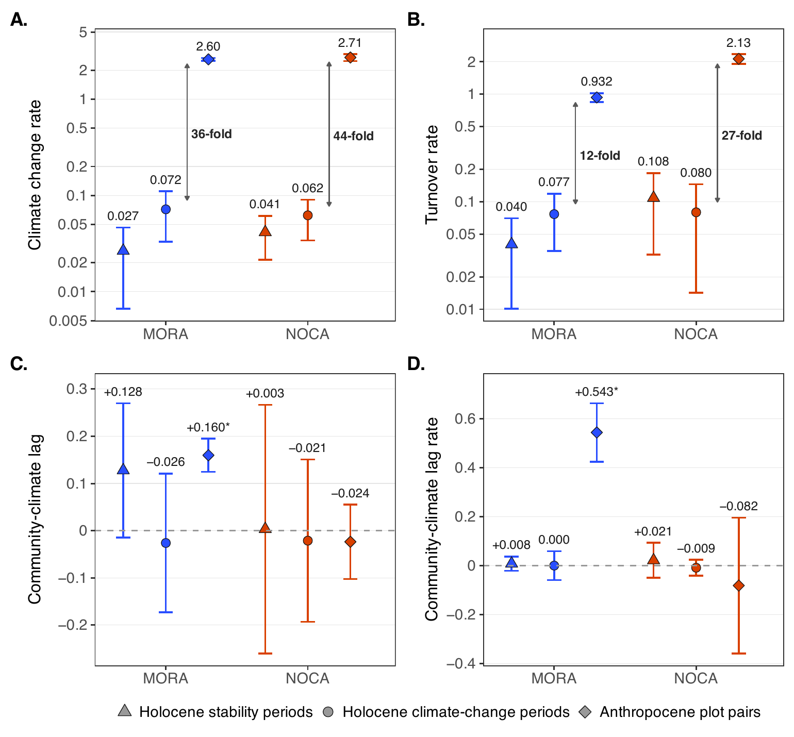

**Figure 4. Climate change, community turnover and climate-community lag
in the Holocene and the Anthropocene.** For each park, the fitted mean
and 95% confidence interval of the Holocene stability periods
(triangles), the Holocene climate-change periods (circles) and the
Anthropocene plot pairs (diamonds). Each row shows a total between the
two ends of a lake-period or plot pair (left) and its rate per century
(right): (A) the standardized climate change, the distance between the
climates at the two ends, and (B) its rate; (C) the observed community
turnover, the distance the community moved in CCA space, and (D) its
rate; (E) the climate-community lag, the change in mismatch between the
two ends (M at t2 minus M at t1), and (F) its rate. The fitted mean is
printed beside each point. B and D are on log axes, where equal
distances are equal folds, and the arrow gives the fold between the
Anthropocene and the Holocene climate-change means. A, C, E and F are on
linear axes without folds. Their connectors link the Anthropocene to the
Holocene climate-change periods (lower) and to the Holocene stability
periods (upper) within each park, and a star marks a contrast that
differs from zero (two-sided t test, Holm-adjusted p \< 0.05 across the
six period-type contrasts of each response, three per park). The
intervals are unadjusted. The totals in A, C and E build up over a whole
lake-period in the Holocene and over the few decades between the two
surveys in the Anthropocene. Means come from the model response ~ period
type × site, with an AR(1) correlation within each lake and weights for
the number of samples at each end, fitted on 7 climate-change and 7
stability lake-periods and 330 plot pairs at MORA, and 5, 5 and 277 at
NOCA. Holocene climate-change lake-periods span 200 to 900 years and
stability lake-periods 300 to 2600 years between their first and last
sampled century. Anthropocene plot pairs span 27.5 to 32.5 years between
the midpoints of their climate windows (about 29 years). Longer windows
give lower rates, so the rates of the two eras are not on equal footing.
Units: the climate change rate in calibration standard deviations per
century, the climate change in calibration standard deviations, the
turnover and lag rates in CCA distance per century, the turnover and the
lag in CCA distance.

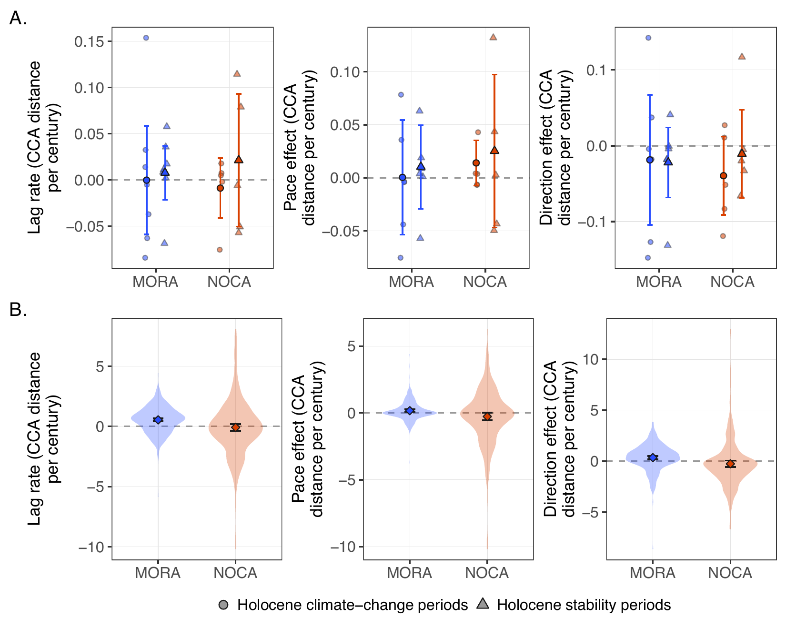

**Figure 5. Pace effect and direction effect in the Holocene and the
Anthropocene.** For each park, the fitted mean and 95% confidence
interval of the Holocene stability periods (triangles), the Holocene
climate-change periods (circles) and the Anthropocene (diamonds), with
the fitted mean printed beside each point. Each row shows an effect over
the whole lake-period or plot pair (left, not divided by time) and per
century (right): (A) the pace effect and (B) its rate, (C) the direction
effect and (D) its rate. The two totals share one y scale and the two
rates another. Each effect is the lag at the end of the period minus the
lag the community would have had at the climate-predicted pace (A, B,
keeping its own direction) or in the climate-predicted direction (C, D,
keeping its own distance). A positive effect means that the community’s
own pace or direction widened the lag. A negative effect means that it
narrowed the lag. Connectors link the Anthropocene to the Holocene
climate-change periods (lower) and to the Holocene stability periods
(upper) within each park, and a star marks a contrast that differs from
zero (two-sided t test, Holm-adjusted p \< 0.05 across the six
period-type contrasts of each response). Fitted means and contrasts come
from the same models as Figure 4, whose panel F shows the lag rate.
Lake-periods and plots whose observed or predicted position did not move
have no pace or direction effect: the panels hold 6 climate-change and 6
stability lake-periods at MORA. Holocene climate-change lake-periods
span 200 to 900 years and stability lake-periods 300 to 2600 years
between their first and last sampled century. Anthropocene plot pairs
span 27.5 to 32.5 years between the midpoints of their climate windows
(about 29 years). The totals are in CCA distance, the rates in CCA
distance per century.

**Check: displacement and lag by lake-period duration.** Displacement
and lag are totals, so a longer lake-period could show more of both only
because it is longer. The table gives their plain means (no model) for
the three duration classes the lake-periods fall into.

**Displacement and lag of the lake-periods by duration.** Plain means
over the Holocene lake-periods of each park and duration class. The
displacement is the distance the community moved in CCA space from the
first to the last sampled century. The absolute lag is the size of the
change in mismatch, \|M at t2 minus M at t1\|, and the lag is the same
change with its sign. All three are in CCA distance and not divided by
time.

| Park | Duration | Lake-periods | Stability / climate-change | Years | Mean displacement | Mean absolute lag | Mean lag |
|:---|:---|---:|:---|:---|---:|---:|---:|
| MORA | 200 to 400 years | 8 | 2 / 6 | 200 to 400 | 0.248 | 0.162 | -0.004 |
| MORA | 500 to 900 years | 3 | 2 / 1 | 500 to 600 | 0.126 | 0.152 | 0.028 |
| MORA | over 2,000 years | 3 | 3 / 0 | 2400 to 2500 | 0.585 | 0.224 | 0.224 |
| NOCA | 200 to 400 years | 5 | 3 / 2 | 300 to 400 | 0.484 | 0.156 | 0.084 |
| NOCA | 500 to 900 years | 4 | 1 / 3 | 500 to 900 | 0.359 | 0.240 | -0.126 |
| NOCA | over 2,000 years | 1 | 1 / 0 | 2600 to 2600 | 0.126 | 0.157 | -0.157 |

<sub>Table file:
[step5a_duration_classes.csv](report/tables/step5a_duration_classes.csv)</sub>

At MORA the three longest lake-periods (over 2,000 years) moved further
than the shorter ones (mean displacement 0.585 against 0.248 for 200 to
400 years and 0.126 for 500 to 900 years). At NOCA the displacement did
not grow with duration (0.484, 0.359 and 0.126, the last from a single
lake-period). The absolute lag ranged from 0.152 to 0.224 at MORA and
from 0.156 to 0.240 at NOCA across the classes. The displacement is the
net movement from the first to the last century, so movement back and
forth within a lake-period does not add to it, and it does not grow in
proportion to time. The rates of the long lake-periods are low partly
for that reason.

**Check: sensitivity to the paleoclimate bias correction.** The primary
run uses the raw CHELSA-TraCE21k paleoclimate. Its modern slice differs
from the CHELSA V2.1 climate the CCA is calibrated on, by a fixed offset
per lake and month for temperature and a fixed ratio for precipitation.
[`R/sensitivity_bias_corrected.R`](R/sensitivity_bias_corrected.R)
reruns stages 07 to 15 with that difference removed
(`PALEO_USE_BIAS_CORRECTED = TRUE`) into `output_bias_corrected/`, and
leaves the primary outputs untouched. The climate periods are defined on
the raw series in both runs, so the same lake-periods are compared. Only
the climate-predicted Holocene positions change. The observed positions
and the Anthropocene do not.

**Era contrasts with the raw and the bias-corrected paleoclimate**, from
the same era models, with Holm-adjusted p (six contrasts per response).
The Anthropocene values are the same in both runs.

| Response | Park | Contrast | Raw | Bias-corrected |
|:---|:---|:---|:---|:---|
| Direction effect | MORA | Anthropocene - Holocene-C | +0.363 (0.177 to 0.549), Holm p \< 0.001 | +0.368 (0.202 to 0.535), Holm p \< 0.001 |
| Direction effect | MORA | Anthropocene - Holocene-S | +0.367 (0.195 to 0.538), Holm p \< 0.001 | +0.370 (0.201 to 0.539), Holm p \< 0.001 |
| Direction effect | NOCA | Anthropocene - Holocene-C | -0.224 (-0.541 to 0.092), Holm p = 0.492 | -0.198 (-0.520 to 0.124), Holm p = 0.454 |
| Direction effect | NOCA | Anthropocene - Holocene-S | -0.253 (-0.571 to 0.064), Holm p = 0.470 | -0.278 (-0.593 to 0.037), Holm p = 0.251 |
| Lag | MORA | Anthropocene - Holocene-C | +0.186 (0.035 to 0.337), Holm p = 0.096 | +0.181 (0.099 to 0.264), Holm p \< 0.001 |
| Lag | MORA | Anthropocene - Holocene-S | +0.032 (-0.114 to 0.178), Holm p = 1.000 | +0.365 (0.134 to 0.595), Holm p = 0.010 |
| Lag | NOCA | Anthropocene - Holocene-C | -0.002 (-0.192 to 0.187), Holm p = 1.000 | +0.109 (-0.133 to 0.351), Holm p = 1.000 |
| Lag | NOCA | Anthropocene - Holocene-S | -0.027 (-0.302 to 0.248), Holm p = 1.000 | -0.091 (-0.490 to 0.308), Holm p = 1.000 |
| Lag rate | MORA | Anthropocene - Holocene-C | +0.544 (0.411 to 0.677), Holm p \< 0.001 | +0.542 (0.421 to 0.664), Holm p \< 0.001 |
| Lag rate | MORA | Anthropocene - Holocene-S | +0.536 (0.413 to 0.658), Holm p \< 0.001 | +0.563 (0.441 to 0.685), Holm p \< 0.001 |
| Lag rate | NOCA | Anthropocene - Holocene-C | -0.073 (-0.352 to 0.206), Holm p = 1.000 | -0.057 (-0.337 to 0.223), Holm p = 0.757 |
| Lag rate | NOCA | Anthropocene - Holocene-S | -0.103 (-0.389 to 0.183), Holm p = 1.000 | -0.132 (-0.426 to 0.162), Holm p = 0.757 |
| Pace effect | MORA | Anthropocene - Holocene-C | +0.167 (0.060 to 0.274), Holm p = 0.013 | +0.150 (0.057 to 0.243), Holm p = 0.007 |
| Pace effect | MORA | Anthropocene - Holocene-S | +0.157 (0.057 to 0.257), Holm p = 0.013 | +0.188 (0.092 to 0.284), Holm p \< 0.001 |
| Pace effect | NOCA | Anthropocene - Holocene-C | -0.286 (-0.568 to -0.004), Holm p = 0.179 | -0.279 (-0.564 to 0.006), Holm p = 0.110 |
| Pace effect | NOCA | Anthropocene - Holocene-S | -0.297 (-0.587 to -0.007), Holm p = 0.179 | -0.326 (-0.623 to -0.029), Holm p = 0.095 |

<sub>Table file:
[bias_correction_era_contrasts.csv](report/tables/bias_correction_era_contrasts.csv)</sub>

The result is poor at MORA. There the lag kept its sign in 5 of 14
lake-periods and the pace effect in 3 of 12, while the direction effect
kept it in 11 of 12. At NOCA the lag kept its sign in 8 of 10, the pace
effect in 8 of 10 and the direction effect in 9 of 10. The correction
shifts the spring temperature of each lake by a fixed offset and scales
its summer precipitation by a fixed ratio, so it moves the
climate-predicted positions of a lake together and changes the mismatch
at both ends of a lake-period. Most MORA Holocene lags and pace effects
are small, and a small change in the two mismatches is enough to flip
their sign. The Holocene values of each lake-period are therefore not
robust at MORA. The era comparisons are more robust, because the
Anthropocene values are far from the Holocene ones: the MORA lag rate,
Anthropocene minus Holocene-C, is +0.544 (Holm p \< 0.001) raw and
+0.542 (Holm p \< 0.001) corrected. The MORA lag contrasts change their
meaning: against Holocene-C the lag goes from +0.186 (Holm p = 0.096) to
+0.181 (Holm p \< 0.001), and against Holocene-S from +0.032 (Holm p =
1.000) to +0.365 (Holm p = 0.010), the latter because the long MORA S4
lake-periods turn from positive to negative lags. Whether the MORA
Anthropocene lag, not divided by time, exceeds the Holocene one
therefore depends on the paleoclimate correction. The NOCA pace contrast
against Holocene-C is -0.286 (Holm p = 0.179) raw and -0.279 (Holm p =
0.110) corrected.

Stages and helpers:
[`R/pipeline/13_era_models.R`](R/pipeline/13_era_models.R),
[`R/helpers/tracking_model_reporting.R`](R/helpers/tracking_model_reporting.R)
(period types, paired AR(1) correlation),
[`R/helpers/reconstruction_models.R`](R/helpers/reconstruction_models.R),
[`R/figures/main_fig4_era_contrasts.R`](R/figures/main_fig4_era_contrasts.R),
[`R/figures/main_fig5_lag_pace_direction.R`](R/figures/main_fig5_lag_pace_direction.R).

# Step 6. Species

**What and why.** The observed movement of a community between t1 and t2
is the sum of one vector per species: the change in the species’ share
times the species’ fixed position in the CCA plane. Projecting each
species’ vector on a reference direction says how much that species
moved the community along it. Two measures are used, both per century.
Along the direction the prediction moved (`contrib_climate`), a positive
value means the species carried the community with the climate. The
second measure, `contrib_lag`, splits the lag rate itself. The mismatch
g, from the predicted to the observed position, is taken at both ends
(g1 at t1, g2 at t2), and m is their sum divided by the sum of their
lengths. Each species’ vector projected on m is that species’ part of
the lag rate, and the predicted movement projected on m, with its sign
reversed, is the climate’s part. Because the change in mismatch, g2 −
g1, is the observed movement minus the predicted movement, and (g2 −
g1)·m is exactly the change in the length of the mismatch, the species
parts and the climate part add up exactly to the lag rate (asserted). A
negative species value means the species narrowed the lag, a positive
value that it widened it. Swapping the two surveys reverses every value,
so the measure has no direction of its own. It replaces `contrib_gap`,
the projection on the mismatch at the start alone. That measure leaned
positive: a community sampled away from its predicted position tends to
come back towards it by chance, and run backwards in time it also
appeared to close the gap. `contrib_lag` is per century of the same
interval as the lag rate.

**How it is calculated.**

``` r
# R/helpers/cca_transition_contributions.R
step6_species_contributions = function(context, first, last, positions, endpoints, dt, lag_dt) {
  # rows: one row per unit and species, with the species' vector (its change in
  # share times its CCA position) in contribution_CCA1 and contribution_CCA2.
  rows = contribution_species(context, first, last, positions, endpoints)
  contribution_close((last - first) %*% positions,
    as.matrix(endpoints[c('delta_observed_CCA1', 'delta_observed_CCA2')]), 'Species vectors sum to dWA')
  index = rep(seq_len(nrow(context)), each = ncol(first))
  defined = endpoints$direction_defined[index]
  # contrib_climate: the vector along the predicted movement, per century.
  rows$contrib_climate = ifelse(defined, rows$parallel_contribution * 100 / dt[index], NA_real_)
  # contrib_lag: the vector projected on m (dot product), per century of the lag rate.
  m = step6_lag_direction(endpoints)
  rows$lag_projection = rows$contribution_CCA1 * m$x[index] + rows$contribution_CCA2 * m$y[index]
  rows$contrib_lag = rows$lag_projection * 100 / lag_dt[index]
  rows
}

# The direction m of each unit: the mismatch at the start (g1) plus the
# mismatch at the end (g2), divided by the sum of their lengths.
step6_lag_direction = function(endpoints) {
  g1x = endpoints$o1 - endpoints$p1; g1y = endpoints$o2 - endpoints$p2
  g2x = endpoints$o1_2 - endpoints$p1_2; g2y = endpoints$o2_2 - endpoints$p2_2
  total = sqrt(g1x^2 + g1y^2) + sqrt(g2x^2 + g2y^2)
  if (any(!(total > CCA_CONTRIBUTION_EPSILON))) stop('A unit has no mismatch at either end: contrib_lag undefined')
  list(x = (g1x + g2x) / total, y = (g1y + g2y) / total)
}
```

``` r
# R/pipeline/15_contributions.R
# For one species in one park and period type, x holds its contribution in
# every lake-period (or plot pair). The result is the plain mean with a 95%
# t-interval: mean plus or minus t(0.975, n - 1) times the standard error
# sd / sqrt(n). With a single value the interval is undefined.
group_mean = function(x) {
  n = length(x); m = mean(x); se = if (n > 1) sd(x) / sqrt(n) else NA_real_
  q = if (n > 1) qt(.975, n - 1) else NA_real_
  tibble(n, estimate = m, std_error = se, conf_low = m - q * se, conf_high = m + q * se,
    interval_defined = n > 1 && is.finite(se) && se > 0)
}
```

**Result.**

**Species contributions**, mean and 95% t-interval in CCA distance per
century, per species, park and period type. Columns: measure
(contrib_climate along the predicted movement, contrib_lag the species’
part of the lag rate) and period type. “absent”: the species does not
occur in that park and period type. contrib_lag includes the units where
the community did not move (all species values zero), contrib_climate
does not (epsilon rule).

| Species | Park | contrib_climate_Holocene-S | contrib_climate_Holocene-C | contrib_climate_Anthropocene | contrib_lag_Holocene-S | contrib_lag_Holocene-C | contrib_lag_Anthropocene |
|:---|:---|:---|:---|:---|:---|:---|:---|
| Abies amabilis | MORA | +0.002 (0.000 to 0.004) | +0.001 (-0.005 to 0.006) | -0.042 (-0.073 to -0.011) | +0.002 (0.000 to 0.003) | -0.009 (-0.027 to 0.009) | +0.030 (0.008 to 0.051) |
| Abies amabilis | NOCA | absent | absent | +0.021 (-0.016 to 0.059) | absent | absent | +0.005 (-0.014 to 0.025) |
| Abies grandis | MORA | absent | absent | -0.018 (-0.057 to 0.021) | absent | absent | -0.027 (-0.050 to -0.004) |
| Abies grandis | NOCA | absent | absent | -0.056 (-0.142 to 0.031) | absent | absent | -0.063 (-0.135 to 0.010) |
| Abies lasiocarpa | MORA | -0.000 (-0.012 to 0.012) | -0.014 (-0.048 to 0.020) | -0.009 (-0.041 to 0.023) | -0.002 (-0.008 to 0.005) | -0.009 (-0.033 to 0.015) | +0.015 (-0.036 to 0.066) |
| Abies lasiocarpa | NOCA | +0.045 (-0.024 to 0.113) | +0.000 (-0.067 to 0.067) | -0.062 (-0.205 to 0.082) | -0.006 (-0.105 to 0.094) | +0.032 (-0.005 to 0.069) | +0.057 (-0.069 to 0.182) |
| Abies procera | MORA | +0.003 (-0.002 to 0.008) | -0.001 (-0.005 to 0.002) | +0.029 (-0.001 to 0.059) | -0.000 (-0.004 to 0.003) | -0.004 (-0.011 to 0.002) | -0.019 (-0.042 to 0.004) |
| Abies procera | NOCA | absent | absent | absent | absent | absent | absent |
| Callitropsis nootkatensis | MORA | +0.003 (-0.002 to 0.008) | -0.012 (-0.046 to 0.022) | +0.001 (-0.067 to 0.068) | +0.003 (-0.001 to 0.006) | +0.040 (-0.061 to 0.140) | +0.007 (-0.040 to 0.054) |
| Callitropsis nootkatensis | NOCA | -0.005 (-0.019 to 0.009) | -0.016 (-0.059 to 0.028) | +0.023 (-0.017 to 0.063) | -0.002 (-0.007 to 0.003) | -0.003 (-0.011 to 0.005) | +0.010 (-0.037 to 0.057) |
| Picea engelmannii | MORA | absent | absent | -0.004 (-0.017 to 0.009) | absent | absent | -0.001 (-0.020 to 0.017) |
| Picea engelmannii | NOCA | -0.006 (-0.023 to 0.011) | absent | -0.013 (-0.088 to 0.063) | +0.008 (-0.014 to 0.030) | absent | +0.006 (-0.056 to 0.068) |
| Pinus albicaulis | MORA | absent | absent | +0.003 (-0.001 to 0.008) | absent | absent | +0.015 (-0.006 to 0.037) |
| Pinus albicaulis | NOCA | absent | absent | +0.257 (0.079 to 0.435) | absent | absent | -0.284 (-0.476 to -0.091) |
| Pinus contorta | MORA | +0.011 (-0.024 to 0.046) | +0.002 (-0.008 to 0.013) | -0.002 (-0.013 to 0.008) | +0.006 (-0.013 to 0.026) | +0.002 (-0.007 to 0.011) | -0.004 (-0.013 to 0.006) |
| Pinus contorta | NOCA | +0.005 (-0.006 to 0.017) | +0.001 (-0.028 to 0.031) | +0.039 (-0.064 to 0.143) | -0.007 (-0.073 to 0.059) | -0.030 (-0.091 to 0.031) | -0.022 (-0.106 to 0.063) |
| Pinus monticola | MORA | -0.002 (-0.005 to 0.001) | +0.012 (-0.018 to 0.042) | -0.041 (-0.057 to -0.025) | -0.002 (-0.004 to 0.001) | +0.004 (-0.004 to 0.011) | +0.017 (0.003 to 0.030) |
| Pinus monticola | NOCA | +0.006 (-0.038 to 0.049) | -0.001 (-0.008 to 0.005) | +0.009 (-0.029 to 0.046) | +0.020 (-0.031 to 0.071) | -0.001 (-0.016 to 0.013) | +0.020 (-0.005 to 0.044) |
| Pinus ponderosa | MORA | absent | absent | +0.009 (-0.009 to 0.026) | absent | absent | +0.009 (-0.009 to 0.026) |
| Pinus ponderosa | NOCA | absent | absent | +0.216 (-0.036 to 0.468) | absent | absent | -0.192 (-0.404 to 0.019) |
| Pseudotsuga menziesii | MORA | +0.001 (-0.001 to 0.003) | -0.003 (-0.010 to 0.003) | -0.050 (-0.099 to -0.001) | +0.001 (-0.002 to 0.004) | -0.001 (-0.006 to 0.003) | +0.031 (0.000 to 0.061) |
| Pseudotsuga menziesii | NOCA | -0.017 (-0.062 to 0.029) | -0.006 (-0.035 to 0.023) | -0.009 (-0.080 to 0.061) | -0.005 (-0.016 to 0.006) | +0.001 (-0.008 to 0.009) | +0.018 (-0.044 to 0.079) |
| Thuja plicata | MORA | absent | absent | +0.005 (-0.024 to 0.034) | absent | absent | +0.035 (-0.000 to 0.070) |
| Thuja plicata | NOCA | +0.002 (-0.005 to 0.009) | -0.004 (-0.015 to 0.007) | +0.033 (-0.012 to 0.079) | -0.001 (-0.004 to 0.001) | -0.001 (-0.004 to 0.002) | -0.016 (-0.058 to 0.027) |
| Tsuga heterophylla | MORA | -0.006 (-0.023 to 0.010) | +0.011 (-0.008 to 0.030) | -0.045 (-0.065 to -0.025) | -0.004 (-0.015 to 0.006) | +0.009 (-0.006 to 0.024) | +0.031 (0.008 to 0.055) |
| Tsuga heterophylla | NOCA | +0.001 (-0.004 to 0.005) | +0.002 (-0.003 to 0.007) | +0.108 (0.062 to 0.155) | +0.001 (-0.004 to 0.006) | +0.001 (-0.001 to 0.003) | +0.018 (-0.011 to 0.046) |
| Tsuga mertensiana | MORA | +0.003 (0.000 to 0.006) | +0.012 (-0.027 to 0.052) | +0.013 (-0.017 to 0.043) | +0.003 (-0.000 to 0.007) | -0.018 (-0.047 to 0.010) | -0.009 (-0.034 to 0.016) |
| Tsuga mertensiana | NOCA | +0.002 (-0.004 to 0.008) | -0.002 (-0.007 to 0.003) | +0.011 (-0.027 to 0.048) | -0.001 (-0.003 to 0.002) | -0.000 (-0.002 to 0.001) | -0.042 (-0.094 to 0.011) |

<sub>Table file:
[step6_species_means.csv](report/tables/step6_species_means.csv)</sub>

**The lag rate split into the species and the climate.** Plain means
over the lake-periods or plot pairs with 95% t-intervals, in CCA
distance per century. In every unit the sum over species plus the
climate part equals the lag rate. Positive values widen the lag.

| Park | Period type | Units | Lag rate | Species (sum) | Climate part |
|:---|:---|---:|:---|:---|:---|
| MORA | Holocene-S | 7 | +0.009 (-0.027 to +0.045) | +0.008 (-0.031 to +0.046) | +0.002 (-0.014 to +0.017) |
| MORA | Holocene-C | 7 | +0.002 (-0.071 to +0.074) | +0.012 (-0.063 to +0.087) | -0.010 (-0.037 to +0.017) |
| MORA | Anthropocene | 330 | +0.543 (+0.424 to +0.663) | +0.130 (+0.030 to +0.229) | +0.414 (+0.342 to +0.485) |
| NOCA | Holocene-S | 5 | +0.016 (-0.080 to +0.112) | +0.008 (-0.101 to +0.117) | +0.008 (-0.012 to +0.028) |
| NOCA | Holocene-C | 5 | -0.009 (-0.056 to +0.037) | -0.003 (-0.031 to +0.025) | -0.007 (-0.035 to +0.021) |
| NOCA | Anthropocene | 277 | -0.082 (-0.359 to +0.196) | -0.485 (-0.766 to -0.204) | +0.403 (+0.290 to +0.516) |

<sub>Table file:
[step6_lag_decomposition.csv](report/tables/step6_lag_decomposition.csv)</sub>

The species vectors add up to the observed movement for every
lake-period and plot pair (asserted).

In the Holocene every species mean is close to zero in both parks
(largest absolute value 0.045 CCA distance per century). 3 of 70
Holocene intervals exclude zero (Abies amabilis, MORA, Holocene-S,
contrib_climate; Tsuga mertensiana, MORA, Holocene-S, contrib_climate;
Abies amabilis, MORA, Holocene-S, contrib_lag), all smaller than 0.003
in absolute value. The Anthropocene means are larger.

In the Anthropocene the climate’s part of the lag rate is about the same
in both parks (+0.41 at MORA, +0.40 at NOCA, CCA distance per century):
the predicted positions moved away from the communities. The parks
differ in their species. At MORA the species added to the lag (sum
+0.13), so the lag rate was +0.54. At NOCA they narrowed it by more than
the climate widened it (sum -0.48), so the lag rate was -0.08. Species
whose interval lies below zero, which narrowed the lag: Abies grandis
(MORA, -0.027), Pinus albicaulis (NOCA, -0.284). Species whose interval
lies above zero, which widened it: Abies amabilis (MORA, +0.030), Pinus
monticola (MORA, +0.017), Pseudotsuga menziesii (MORA, +0.031), Tsuga
heterophylla (MORA, +0.031). Across species the two measures are
negatively correlated in the Anthropocene (r = -0.56 at MORA, -0.84 at
NOCA): species that moved the community with the climate-predicted
direction narrowed the lag, and those that moved it against that
direction widened it.

The period types of a species are compared with Welch tests, three
contrasts per species, measure and park, and the p-values are
Holm-adjusted within each measure and park across all species and
contrasts. Of 144 testable contrasts, 20 have p \< 0.05 before the
adjustment and 4 after it (Pinus monticola MORA, Anthropocene -
Holocene-S, contrib_climate; Tsuga heterophylla MORA, Anthropocene -
Holocene-C, contrib_climate; Tsuga heterophylla NOCA, Anthropocene -
Holocene-C, contrib_climate; Tsuga heterophylla NOCA, Anthropocene -
Holocene-S, contrib_climate). All of them set the Anthropocene against a
Holocene period type.

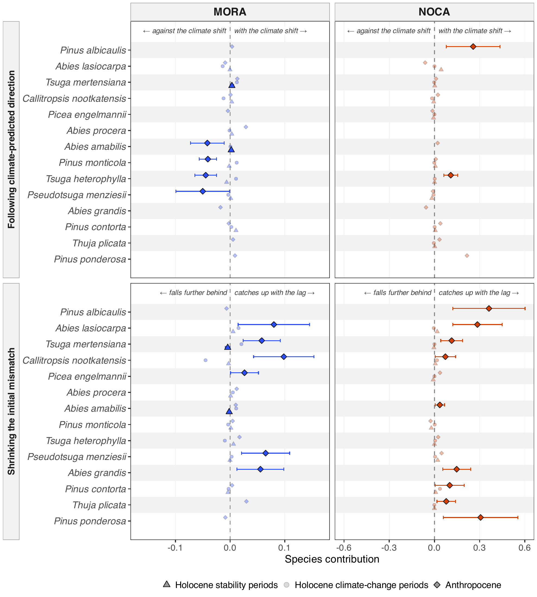

**Figure 7. Species contributions in the Holocene and the
Anthropocene.** Each species’ vector is its change in share between the
first and the last sampled century of a lake-period, or between the
legacy survey and the resurvey of a plot, times its fixed position in
the CCA plane. The upper row (following climate-predicted direction)
projects these vectors on the direction in which the climate-predicted
position moved, and the lower row (changing the climate-community lag)
on the average direction of the mismatch at the two ends, so that the
species’ values plus the climate’s part add up to the lag rate. Labels
at the top of each panel read with the row title: a species moved the
community following or against the climate-predicted direction (upper
row), and narrowed or widened the climate-community lag (lower row). The
lower row includes the lake-periods and plot pairs whose composition did
not change (all species values zero) and is per century of the same
interval as the lag rate. Species are ordered by the maximum elevation
of the plots where they occur (the 607 plot pairs, both surveys, both
parks), the highest at the top. Their names are shaded by that maximum
in four grey steps, lightest below 1,500 m and black above 1,900 m, and
the maximum follows each name in metres. Names in bold are species
absent from the Holocene record of both parks. Symbols are means:
triangles, Holocene stability periods, circles, Holocene climate-change
periods, diamonds, Anthropocene plot pairs (burned and unburned
together). Large symbols with bars are means whose 95% t-interval
excludes zero, small faded symbols are means whose interval includes
zero. A species with no Holocene symbols in a park is absent from that
park’s Holocene record. Each park has its own x scale, symmetric around
zero. Holocene climate-change lake-periods span 200 to 900 years and
stability lake-periods 300 to 2600 years between their first and last
sampled century. Anthropocene plot pairs span 27.5 to 32.5 years between
the midpoints of their climate windows (about 29 years). Contributions
are in CCA distance per century.

Stages and helpers:
[`R/pipeline/15_contributions.R`](R/pipeline/15_contributions.R),
[`R/helpers/cca_transition_contributions.R`](R/helpers/cca_transition_contributions.R),
[`R/figures/main_fig7_species.R`](R/figures/main_fig7_species.R).

# Numbers for the Results text

Every number below is read from an output of the run. Rates are per
century. Intervals are 95% conditional confidence intervals (models) or
t-intervals (species). Holocene climate-change lake-periods span 200 to
900 years and stability lake-periods 300 to 2600 years between their
first and last sampled century. Anthropocene plot pairs span 27.5 to
32.5 years between the midpoints of their climate windows (about 29
years).

**Step 0, climate variables.**

**Screening.** Adding MWT and WP to MSpT + SP: pseudo-F 8.89, p = 0.0001
unrestricted and 0.0129 within parks.

| Set | Max VIF | Adjusted R² | MORA lake-centuries outside (%) | NOCA lake-centuries outside (%) |
|:---|---:|---:|---:|---:|
| All four | 29.504 | 0.148 | 88.288 | 14.414 |
| MSpT + SP | 1.077 | 0.126 | 0.000 | 0.000 |
| MWT + SP | 1.002 | 0.128 | 0.000 | 0.000 |

<sub>Table file:
[numbers_step0.csv](report/tables/numbers_step0.csv)</sub>

**Steps 1 to 4, periods and lake-periods.**

**Lake-periods** (raw values, not model estimates). 30 lake and period
combinations had a sampled century, and 24 had two or more.

| Park | Period type | Lake-periods | Years (min) | Years (max) | Climate change rate (mean) | Fire activity (min) | Fire activity (max) | Fire activity (mean) |
|:---|:---|---:|---:|---:|---:|---:|---:|---:|
| MORA | Holocene-C | 7 | 200 | 500 | 0.072 | 0.111 | 0.333 | 0.219 |
| MORA | Holocene-S | 7 | 300 | 2500 | 0.026 | 0.097 | 0.133 | 0.116 |
| NOCA | Holocene-C | 5 | 400 | 900 | 0.059 | 0.500 | 0.889 | 0.703 |
| NOCA | Holocene-S | 5 | 300 | 2600 | 0.041 | 0.333 | 0.667 | 0.519 |

<sub>Table file:
[numbers_units.csv](report/tables/numbers_units.csv)</sub>

**Step 5a, era models: fitted means, contrasts and folds per park.**

**Fitted means.**

| Response | Park | Period type | n | Mean | 95% CI |
|:---|:---|:---|---:|:---|:---|
| Climate change rate | MORA | Holocene-S | 7 | +0.027 | 0.007 to 0.046 |
| Climate change rate | MORA | Holocene-C | 7 | +0.072 | 0.033 to 0.110 |
| Climate change rate | MORA | Anthropocene | 330 | +2.596 | 2.505 to 2.687 |
| Climate change rate | NOCA | Holocene-S | 5 | +0.041 | 0.022 to 0.061 |
| Climate change rate | NOCA | Holocene-C | 5 | +0.062 | 0.034 to 0.090 |
| Climate change rate | NOCA | Anthropocene | 277 | +2.715 | 2.488 to 2.941 |
| Climate change (not divided by time) | MORA | Holocene-S | 7 | +0.173 | 0.070 to 0.275 |
| Climate change (not divided by time) | MORA | Holocene-C | 7 | +0.242 | 0.094 to 0.390 |
| Climate change (not divided by time) | MORA | Anthropocene | 330 | +0.764 | 0.734 to 0.795 |
| Climate change (not divided by time) | NOCA | Holocene-S | 5 | +0.210 | 0.127 to 0.293 |
| Climate change (not divided by time) | NOCA | Holocene-C | 5 | +0.370 | 0.230 to 0.511 |
| Climate change (not divided by time) | NOCA | Anthropocene | 277 | +0.771 | 0.706 to 0.835 |
| Turnover rate | MORA | Holocene-S | 7 | +0.040 | 0.010 to 0.070 |
| Turnover rate | MORA | Holocene-C | 7 | +0.077 | 0.035 to 0.119 |
| Turnover rate | MORA | Anthropocene | 330 | +0.932 | 0.843 to 1.021 |
| Turnover rate | NOCA | Holocene-S | 5 | +0.108 | 0.032 to 0.185 |
| Turnover rate | NOCA | Holocene-C | 5 | +0.080 | 0.014 to 0.145 |
| Turnover rate | NOCA | Anthropocene | 277 | +2.130 | 1.905 to 2.355 |
| Displacement (turnover, not divided by time) | MORA | Holocene-S | 7 | +0.364 | 0.164 to 0.564 |
| Displacement (turnover, not divided by time) | MORA | Holocene-C | 7 | +0.223 | 0.134 to 0.312 |
| Displacement (turnover, not divided by time) | MORA | Anthropocene | 330 | +0.354 | 0.320 to 0.388 |
| Displacement (turnover, not divided by time) | NOCA | Holocene-S | 5 | +0.350 | 0.172 to 0.528 |
| Displacement (turnover, not divided by time) | NOCA | Holocene-C | 5 | +0.452 | 0.256 to 0.648 |
| Displacement (turnover, not divided by time) | NOCA | Anthropocene | 277 | +0.678 | 0.607 to 0.750 |
| Lag rate | MORA | Holocene-S | 7 | +0.008 | -0.022 to 0.037 |
| Lag rate | MORA | Holocene-C | 7 | -0.000 | -0.059 to 0.059 |
| Lag rate | MORA | Anthropocene | 330 | +0.543 | 0.424 to 0.663 |
| Lag rate | NOCA | Holocene-S | 5 | +0.021 | -0.050 to 0.093 |
| Lag rate | NOCA | Holocene-C | 5 | -0.009 | -0.041 to 0.023 |
| Lag rate | NOCA | Anthropocene | 277 | -0.082 | -0.359 to 0.195 |
| Lag | MORA | Holocene-S | 7 | +0.128 | -0.014 to 0.270 |
| Lag | MORA | Holocene-C | 7 | -0.026 | -0.173 to 0.121 |
| Lag | MORA | Anthropocene | 330 | +0.160 | 0.125 to 0.195 |
| Lag | NOCA | Holocene-S | 5 | +0.003 | -0.260 to 0.267 |
| Lag | NOCA | Holocene-C | 5 | -0.021 | -0.193 to 0.151 |
| Lag | NOCA | Anthropocene | 277 | -0.024 | -0.102 to 0.055 |
| Pace effect | MORA | Holocene-S | 6 | +0.010 | -0.029 to 0.050 |
| Pace effect | MORA | Holocene-C | 6 | +0.000 | -0.054 to 0.055 |
| Pace effect | MORA | Anthropocene | 254 | +0.167 | 0.075 to 0.260 |
| Pace effect | NOCA | Holocene-S | 5 | +0.025 | -0.047 to 0.097 |
| Pace effect | NOCA | Holocene-C | 5 | +0.014 | -0.007 to 0.035 |
| Pace effect | NOCA | Anthropocene | 211 | -0.272 | -0.553 to 0.009 |
| Direction effect | MORA | Holocene-S | 6 | -0.022 | -0.068 to 0.024 |
| Direction effect | MORA | Holocene-C | 6 | -0.019 | -0.104 to 0.067 |
| Direction effect | MORA | Anthropocene | 254 | +0.344 | 0.179 to 0.510 |
| Direction effect | NOCA | Holocene-S | 5 | -0.011 | -0.069 to 0.047 |
| Direction effect | NOCA | Holocene-C | 5 | -0.039 | -0.091 to 0.012 |
| Direction effect | NOCA | Anthropocene | 211 | -0.264 | -0.576 to 0.048 |
| Pace effect (not divided by time) | MORA | Holocene-S | 6 | +0.141 | -0.068 to 0.350 |
| Pace effect (not divided by time) | MORA | Holocene-C | 6 | -0.014 | -0.147 to 0.119 |
| Pace effect (not divided by time) | MORA | Anthropocene | 254 | +0.047 | 0.020 to 0.074 |
| Pace effect (not divided by time) | NOCA | Holocene-S | 5 | +0.053 | -0.184 to 0.291 |
| Pace effect (not divided by time) | NOCA | Holocene-C | 5 | +0.048 | -0.039 to 0.135 |
| Pace effect (not divided by time) | NOCA | Anthropocene | 211 | -0.078 | -0.157 to 0.002 |
| Direction effect (not divided by time) | MORA | Holocene-S | 6 | -0.127 | -0.336 to 0.083 |
| Direction effect (not divided by time) | MORA | Holocene-C | 6 | -0.082 | -0.315 to 0.151 |
| Direction effect (not divided by time) | MORA | Anthropocene | 254 | +0.101 | 0.053 to 0.149 |
| Direction effect (not divided by time) | NOCA | Holocene-S | 5 | -0.073 | -0.259 to 0.112 |
| Direction effect (not divided by time) | NOCA | Holocene-C | 5 | -0.141 | -0.401 to 0.118 |
| Direction effect (not divided by time) | NOCA | Anthropocene | 211 | -0.074 | -0.163 to 0.014 |

<sub>Table file:
[numbers_era_means.csv](report/tables/numbers_era_means.csv)</sub>

**Contrasts between period types.** p (Holm) is adjusted across the six
contrasts of each response (three per park). Quote the adjusted p.

| Response | Park | Contrast | Estimate | 95% CI | p | p (Holm) |
|:---|:---|:---|:---|:---|---:|---:|
| Climate change (not divided by time) | MORA | Anthropocene - Holocene-C | +0.522 | 0.371 to 0.673 | 0.000 | 0.000 |
| Climate change (not divided by time) | MORA | Anthropocene - Holocene-S | +0.591 | 0.485 to 0.698 | 0.000 | 0.000 |
| Climate change (not divided by time) | MORA | Holocene-C - Holocene-S | +0.069 | -0.129 to 0.268 | 0.493 | 0.493 |
| Climate change (not divided by time) | NOCA | Anthropocene - Holocene-C | +0.401 | 0.246 to 0.555 | 0.000 | 0.000 |
| Climate change (not divided by time) | NOCA | Anthropocene - Holocene-S | +0.561 | 0.456 to 0.666 | 0.000 | 0.000 |
| Climate change (not divided by time) | NOCA | Holocene-C - Holocene-S | +0.160 | -0.021 to 0.341 | 0.082 | 0.164 |
| Climate change rate | MORA | Anthropocene - Holocene-C | +2.524 | 2.426 to 2.623 | 0.000 | 0.000 |
| Climate change rate | MORA | Anthropocene - Holocene-S | +2.569 | 2.476 to 2.662 | 0.000 | 0.000 |
| Climate change rate | MORA | Holocene-C - Holocene-S | +0.045 | 0.002 to 0.088 | 0.038 | 0.077 |
| Climate change rate | NOCA | Anthropocene - Holocene-C | +2.653 | 2.425 to 2.881 | 0.000 | 0.000 |
| Climate change rate | NOCA | Anthropocene - Holocene-S | +2.673 | 2.446 to 2.901 | 0.000 | 0.000 |
| Climate change rate | NOCA | Holocene-C - Holocene-S | +0.021 | -0.013 to 0.054 | 0.230 | 0.230 |
| Direction effect | MORA | Anthropocene - Holocene-C | +0.363 | 0.177 to 0.549 | 0.000 | 0.001 |
| Direction effect | MORA | Anthropocene - Holocene-S | +0.367 | 0.195 to 0.538 | 0.000 | 0.000 |
| Direction effect | MORA | Holocene-C - Holocene-S | +0.003 | -0.096 to 0.103 | 0.947 | 0.963 |
| Direction effect | NOCA | Anthropocene - Holocene-C | -0.224 | -0.541 to 0.092 | 0.164 | 0.492 |
| Direction effect | NOCA | Anthropocene - Holocene-S | -0.253 | -0.571 to 0.064 | 0.118 | 0.470 |
| Direction effect | NOCA | Holocene-C - Holocene-S | -0.029 | -0.109 to 0.052 | 0.482 | 0.963 |
| Direction effect (not divided by time) | MORA | Anthropocene - Holocene-C | +0.183 | -0.055 to 0.421 | 0.131 | 0.656 |
| Direction effect (not divided by time) | MORA | Anthropocene - Holocene-S | +0.227 | 0.012 to 0.442 | 0.038 | 0.230 |
| Direction effect (not divided by time) | MORA | Holocene-C - Holocene-S | +0.044 | -0.260 to 0.348 | 0.775 | 1.000 |
| Direction effect (not divided by time) | NOCA | Anthropocene - Holocene-C | +0.067 | -0.207 to 0.341 | 0.629 | 1.000 |
| Direction effect (not divided by time) | NOCA | Anthropocene - Holocene-S | -0.001 | -0.206 to 0.205 | 0.995 | 1.000 |
| Direction effect (not divided by time) | NOCA | Holocene-C - Holocene-S | -0.068 | -0.375 to 0.239 | 0.664 | 1.000 |
| Displacement (turnover, not divided by time) | MORA | Anthropocene - Holocene-C | +0.131 | 0.036 to 0.227 | 0.007 | 0.034 |
| Displacement (turnover, not divided by time) | MORA | Anthropocene - Holocene-S | -0.010 | -0.213 to 0.193 | 0.923 | 0.923 |
| Displacement (turnover, not divided by time) | MORA | Holocene-C - Holocene-S | -0.141 | -0.352 to 0.069 | 0.188 | 0.563 |
| Displacement (turnover, not divided by time) | NOCA | Anthropocene - Holocene-C | +0.226 | 0.018 to 0.435 | 0.034 | 0.135 |
| Displacement (turnover, not divided by time) | NOCA | Anthropocene - Holocene-S | +0.329 | 0.136 to 0.521 | 0.001 | 0.005 |
| Displacement (turnover, not divided by time) | NOCA | Holocene-C - Holocene-S | +0.102 | -0.148 to 0.352 | 0.423 | 0.846 |
| Lag | MORA | Anthropocene - Holocene-C | +0.186 | 0.035 to 0.337 | 0.016 | 0.096 |
| Lag | MORA | Anthropocene - Holocene-S | +0.032 | -0.114 to 0.178 | 0.669 | 1.000 |
| Lag | MORA | Holocene-C - Holocene-S | -0.154 | -0.366 to 0.058 | 0.155 | 0.773 |
| Lag | NOCA | Anthropocene - Holocene-C | -0.002 | -0.192 to 0.187 | 0.980 | 1.000 |
| Lag | NOCA | Anthropocene - Holocene-S | -0.027 | -0.302 to 0.248 | 0.847 | 1.000 |
| Lag | NOCA | Holocene-C - Holocene-S | -0.025 | -0.351 to 0.302 | 0.883 | 1.000 |
| Lag rate | MORA | Anthropocene - Holocene-C | +0.544 | 0.411 to 0.677 | 0.000 | 0.000 |
| Lag rate | MORA | Anthropocene - Holocene-S | +0.536 | 0.413 to 0.658 | 0.000 | 0.000 |
| Lag rate | MORA | Holocene-C - Holocene-S | -0.008 | -0.079 to 0.063 | 0.826 | 1.000 |
| Lag rate | NOCA | Anthropocene - Holocene-C | -0.073 | -0.352 to 0.206 | 0.608 | 1.000 |
| Lag rate | NOCA | Anthropocene - Holocene-S | -0.103 | -0.389 to 0.183 | 0.480 | 1.000 |
| Lag rate | NOCA | Holocene-C - Holocene-S | -0.030 | -0.115 to 0.055 | 0.488 | 1.000 |
| Pace effect | MORA | Anthropocene - Holocene-C | +0.167 | 0.060 to 0.274 | 0.002 | 0.013 |
| Pace effect | MORA | Anthropocene - Holocene-S | +0.157 | 0.057 to 0.257 | 0.002 | 0.013 |
| Pace effect | MORA | Holocene-C - Holocene-S | -0.010 | -0.056 to 0.036 | 0.671 | 1.000 |
| Pace effect | NOCA | Anthropocene - Holocene-C | -0.286 | -0.568 to -0.004 | 0.047 | 0.179 |
| Pace effect | NOCA | Anthropocene - Holocene-S | -0.297 | -0.587 to -0.007 | 0.045 | 0.179 |
| Pace effect | NOCA | Holocene-C - Holocene-S | -0.011 | -0.071 to 0.049 | 0.713 | 1.000 |
| Pace effect (not divided by time) | MORA | Anthropocene - Holocene-C | +0.061 | -0.074 to 0.197 | 0.375 | 1.000 |
| Pace effect (not divided by time) | MORA | Anthropocene - Holocene-S | -0.094 | -0.305 to 0.117 | 0.382 | 1.000 |
| Pace effect (not divided by time) | MORA | Holocene-C - Holocene-S | -0.155 | -0.342 to 0.032 | 0.104 | 0.521 |
| Pace effect (not divided by time) | NOCA | Anthropocene - Holocene-C | -0.125 | -0.243 to -0.007 | 0.037 | 0.223 |
| Pace effect (not divided by time) | NOCA | Anthropocene - Holocene-S | -0.131 | -0.382 to 0.120 | 0.306 | 1.000 |
| Pace effect (not divided by time) | NOCA | Holocene-C - Holocene-S | -0.005 | -0.205 to 0.195 | 0.958 | 1.000 |
| Turnover rate | MORA | Anthropocene - Holocene-C | +0.856 | 0.757 to 0.954 | 0.000 | 0.000 |
| Turnover rate | MORA | Anthropocene - Holocene-S | +0.892 | 0.798 to 0.986 | 0.000 | 0.000 |
| Turnover rate | MORA | Holocene-C - Holocene-S | +0.037 | -0.026 to 0.100 | 0.255 | 0.511 |
| Turnover rate | NOCA | Anthropocene - Holocene-C | +2.051 | 1.816 to 2.285 | 0.000 | 0.000 |
| Turnover rate | NOCA | Anthropocene - Holocene-S | +2.022 | 1.784 to 2.259 | 0.000 | 0.000 |
| Turnover rate | NOCA | Holocene-C - Holocene-S | -0.029 | -0.154 to 0.097 | 0.653 | 0.653 |

<sub>Table file:
[numbers_era_contrasts.csv](report/tables/numbers_era_contrasts.csv)</sub>

**Folds.** The Holocene-C fold is the one quoted as a speed.

| Response            | Park | Anthropocene over |      Fold |
|:--------------------|:-----|:------------------|----------:|
| Climate change rate | MORA | Holocene-C        |    36.204 |
| Climate change rate | MORA | Holocene-S        |    97.728 |
| Climate change rate | NOCA | Holocene-C        |    43.715 |
| Climate change rate | NOCA | Holocene-S        |    65.474 |
| Turnover rate       | MORA | Holocene-C        |    12.162 |
| Turnover rate       | MORA | Holocene-S        |    23.243 |
| Turnover rate       | NOCA | Holocene-C        |    26.742 |
| Turnover rate       | NOCA | Holocene-S        |    19.655 |
| Lag rate            | MORA | Holocene-C        | -3004.436 |
| Lag rate            | MORA | Holocene-S        |    69.820 |
| Lag rate            | NOCA | Holocene-C        |     9.305 |
| Lag rate            | NOCA | Holocene-S        |    -3.827 |

<sub>Table file:
[numbers_era_folds.csv](report/tables/numbers_era_folds.csv)</sub>

**Step 5, Holocene explanatory models and their Anthropocene
counterpart.**

**Slopes and contrasts.** Climate change rate: per standardized unit per
century. Fire activity: per event per century per covered core. Each
model has one group contrast (site, and burned minus unburned in the
Anthropocene), so these p-values need no adjustment for multiple
contrasts.

| Response | Era | Term | Estimate | 95% CI | p |
|:---|:---|:---|:---|:---|---:|
| Lag rate | Holocene | siteNOCA | +0.043 | -0.080 to 0.166 | 0.472 |
| Lag rate | Holocene | climate_rate | +0.719 | 0.007 to 1.431 | 0.048 |
| Lag rate | Holocene | fire_activity | -0.098 | -0.353 to 0.157 | 0.432 |
| Lag rate | Anthropocene | siteNOCA | -0.613 | -0.922 to -0.303 | 0.000 |
| Lag rate | Anthropocene | burnedBurned | -0.152 | -0.983 to 0.678 | 0.719 |
| Pace effect | Holocene | siteNOCA | +0.100 | -0.001 to 0.201 | 0.052 |
| Pace effect | Holocene | climate_rate | +0.685 | 0.139 to 1.232 | 0.017 |
| Pace effect | Holocene | fire_activity | -0.188 | -0.388 to 0.012 | 0.063 |
| Pace effect | Anthropocene | siteNOCA | -0.372 | -0.670 to -0.074 | 0.014 |
| Pace effect | Anthropocene | burnedBurned | -0.923 | -1.653 to -0.193 | 0.013 |
| Direction effect | Holocene | siteNOCA | -0.122 | -0.215 to -0.029 | 0.013 |
| Direction effect | Holocene | climate_rate | +0.500 | -0.275 to 1.275 | 0.192 |
| Direction effect | Holocene | fire_activity | +0.268 | 0.076 to 0.460 | 0.009 |
| Direction effect | Anthropocene | siteNOCA | -0.650 | -1.010 to -0.290 | 0.000 |
| Direction effect | Anthropocene | burnedBurned | +0.571 | -0.406 to 1.547 | 0.251 |
| Lag (not divided by time) | Holocene | siteNOCA | -0.088 | -0.526 to 0.350 | 0.680 |
| Lag (not divided by time) | Holocene | climate_change | +0.058 | -0.663 to 0.778 | 0.869 |
| Lag (not divided by time) | Holocene | fire_activity | +0.051 | -0.890 to 0.992 | 0.911 |
| Lag (not divided by time) | Anthropocene | siteNOCA | -0.180 | -0.268 to -0.092 | 0.000 |
| Lag (not divided by time) | Anthropocene | burnedBurned | -0.040 | -0.278 to 0.199 | 0.744 |
| Pace effect (not divided by time) | Holocene | siteNOCA | +0.175 | -0.204 to 0.553 | 0.345 |
| Pace effect (not divided by time) | Holocene | climate_change | +0.174 | -0.470 to 0.817 | 0.577 |
| Pace effect (not divided by time) | Holocene | fire_activity | -0.431 | -1.202 to 0.340 | 0.255 |
| Pace effect (not divided by time) | Anthropocene | siteNOCA | -0.105 | -0.190 to -0.021 | 0.015 |
| Pace effect (not divided by time) | Anthropocene | burnedBurned | -0.265 | -0.475 to -0.055 | 0.014 |
| Direction effect (not divided by time) | Holocene | siteNOCA | -0.445 | -0.796 to -0.094 | 0.016 |
| Direction effect (not divided by time) | Holocene | climate_change | +0.778 | 0.164 to 1.393 | 0.016 |
| Direction effect (not divided by time) | Holocene | fire_activity | +0.899 | 0.133 to 1.665 | 0.024 |
| Direction effect (not divided by time) | Anthropocene | siteNOCA | -0.187 | -0.289 to -0.084 | 0.000 |
| Direction effect (not divided by time) | Anthropocene | burnedBurned | +0.164 | -0.115 to 0.442 | 0.249 |

<sub>Table file:
[numbers_step5.csv](report/tables/numbers_step5.csv)</sub>

**Step 6, species.**

**Species means** per measure, park and period type (species with a
defined interval).

| Measure | Park | Period type | Species | Interval above zero | Interval below zero | Largest absolute mean |
|:---|:---|:---|---:|---:|---:|---:|
| contrib_climate | MORA | Anthropocene | 14 | 0 | 4 | 0.050 |
| contrib_climate | MORA | Holocene-C | 9 | 0 | 0 | 0.014 |
| contrib_climate | MORA | Holocene-S | 9 | 2 | 0 | 0.011 |
| contrib_climate | NOCA | Anthropocene | 13 | 2 | 0 | 0.257 |
| contrib_climate | NOCA | Holocene-C | 8 | 0 | 0 | 0.016 |
| contrib_climate | NOCA | Holocene-S | 9 | 0 | 0 | 0.045 |
| contrib_lag | MORA | Anthropocene | 14 | 4 | 1 | 0.035 |
| contrib_lag | MORA | Holocene-C | 9 | 0 | 0 | 0.040 |
| contrib_lag | MORA | Holocene-S | 9 | 1 | 0 | 0.006 |
| contrib_lag | NOCA | Anthropocene | 13 | 0 | 1 | 0.284 |
| contrib_lag | NOCA | Holocene-C | 8 | 0 | 0 | 0.032 |
| contrib_lag | NOCA | Holocene-S | 9 | 0 | 0 | 0.020 |

<sub>Table file:
[numbers_step6.csv](report/tables/numbers_step6.csv)</sub>

**Figure 2, climate rates.**

**Real-unit climate rates per century** (°C for MSpT, mm for SP).

| Kind                     | Variable | Period | cal BP | Rate per century |
|:-------------------------|:---------|:-------|-------:|-----------------:|
| period                   | MSpT     | C1     |   9100 |           -0.044 |
| period                   | SP       | C1     |   9100 |           -1.241 |
| period                   | MSpT     | C2     |   7700 |            0.051 |
| period                   | SP       | C2     |   7700 |            0.945 |
| period                   | MSpT     | C3     |   6500 |           -0.044 |
| period                   | MSpT     | C4     |   5150 |            0.031 |
| period                   | MSpT     | C5     |   1950 |            0.044 |
| largest century step     | MSpT     |        |   4250 |           -1.247 |
| largest century step     | SP       |        |  10350 |           24.000 |
| Anthropocene plot median | MSpT     | MORA   |      — |            1.288 |
| Anthropocene plot median | MSpT     | NOCA   |      — |            0.769 |
| Anthropocene plot median | SP       | MORA   |      — |         -142.637 |
| Anthropocene plot median | SP       | NOCA   |      — |          103.615 |

<sub>Table file:
[numbers_fig2.csv](report/tables/numbers_fig2.csv)</sub>

**Doubts the paper must face (`PLAN.md` section 9), with the numbers
that bear on them.**

**Doubts and the numbers that bear on them.**

| Doubt | Numbers |
|:---|:---|
| MORA fire comes from Sunrise Ridge, the vegetation lakes lie elsewhere | Lag rate fire slope -0.098 (-0.353 to 0.157); Pace effect fire slope -0.188 (-0.388 to 0.012); Direction effect fire slope +0.268 (0.076 to 0.460); Lag (not divided by time) fire slope +0.051 (-0.890 to 0.992); Pace effect (not divided by time) fire slope -0.431 (-1.202 to 0.340); Direction effect (not divided by time) fire slope +0.899 (0.133 to 1.665) |
| Fire values of the two parks barely overlap | MORA 0.10 to 0.33, NOCA 0.33 to 0.89 |
| Within MORA the stability periods sat at the lowest fire values | MORA Holocene-C mean 0.219, MORA Holocene-S mean 0.116, NOCA Holocene-C mean 0.703, NOCA Holocene-S mean 0.519 |
| Rates over about 29 years and over centuries are not on equal footing | Holocene climate-change lake-periods span 200 to 900 years and stability lake-periods 300 to 2600 years between their first and last sampled century. Anthropocene plot pairs span 27.5 to 32.5 years between the midpoints of their climate windows (about 29 years). |
| MSpT + SP must be argued on mechanism | Adjusted R² 0.126 with MSpT + SP against 0.148 with all four. Adding MWT and WP: p = 0.0001 unrestricted, 0.0129 within parks. |

<sub>Table file:
[numbers_doubts.csv](report/tables/numbers_doubts.csv)</sub>

**Supplement tables of `PLAN.md` section 7.**

| Table | File |
|----|----|
| Screening | [`report/tables/step0_screening.csv`](report/tables/step0_screening.csv) |
| Periods | [`report/tables/step1_periods.csv`](report/tables/step1_periods.csv) |
| Unit table | [`report/tables/step24_lake_periods.csv`](report/tables/step24_lake_periods.csv) |
| Era contrasts | [`report/tables/step5a_era_means.csv`](report/tables/step5a_era_means.csv), [`report/tables/step5a_era_contrasts.csv`](report/tables/step5a_era_contrasts.csv), [`report/tables/step5a_era_folds.csv`](report/tables/step5a_era_folds.csv) |
| Displacement and lag by duration | [`report/tables/step5a_duration_classes.csv`](report/tables/step5a_duration_classes.csv) |
| NOCA plot pairs by legacy plot area | [`report/tables/noca_plot_area_responses.csv`](report/tables/noca_plot_area_responses.csv) |
| Bias-corrected paleoclimate | [`report/tables/bias_correction_lake_periods.csv`](report/tables/bias_correction_lake_periods.csv), [`report/tables/bias_correction_sign_counts.csv`](report/tables/bias_correction_sign_counts.csv) |
| Explanatory models | [`report/tables/step5_explanatory_models.csv`](report/tables/step5_explanatory_models.csv) |
| Species means | [`report/tables/step6_species_means.csv`](report/tables/step6_species_means.csv), [`report/tables/species_contrasts.csv`](report/tables/species_contrasts.csv) |
| Species per lake-period | [`report/tables/species_lake_periods.csv`](report/tables/species_lake_periods.csv) |
| NOCA species, burned and unburned | [`report/tables/noca_burned_species_means.csv`](report/tables/noca_burned_species_means.csv) |

The last three are written by the model details page (**Model details
→** [08_models](report/details/08_models.md)).

# Appendix figures of the remodelled analysis

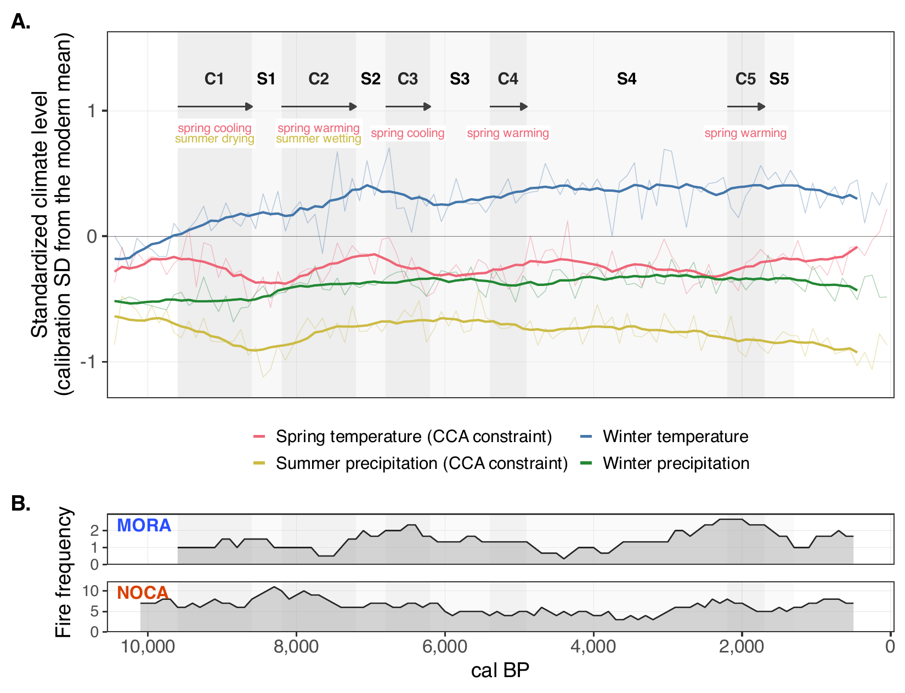

**Fig. A1. Holocene climate levels of the four seasonal variables.** As
Figure 2A for spring temperature, winter temperature, summer
precipitation and winter precipitation, without the rate labels. Only
spring temperature and summer precipitation constrain the CCA and define
the periods. (B) Fire-frequency ratio as in Figure 2B.

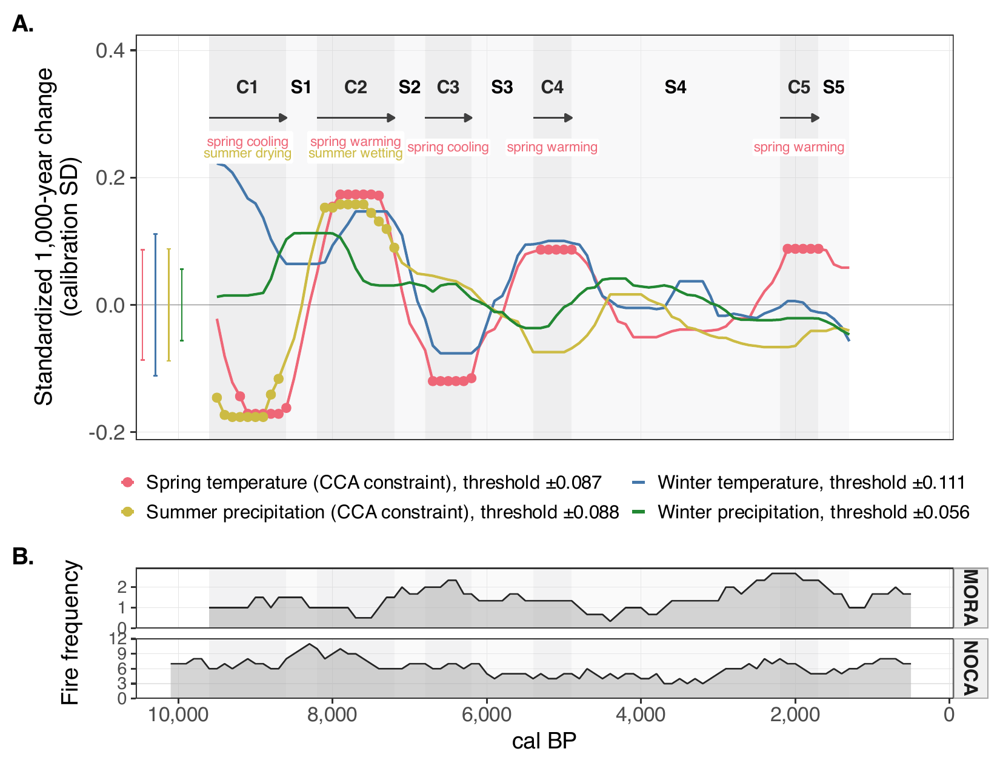

**Fig. A2. How the climate periods were drawn.** (A) Equal-site regional
median of the signed 1,000-year change of the four seasonal variables,
standardized by the legacy calibration standard deviation. Filled points
mark the cells of the two CCA constraints that qualify as directional
change (beyond 50% of the variable’s maximum, with at least 8 of 10
phases agreeing in direction). The periods are classified from these
points. Winter temperature and winter precipitation are shown for
context. Brackets at the left give each variable’s stability range. (B)
Fire-frequency ratio as in Figure 2B.

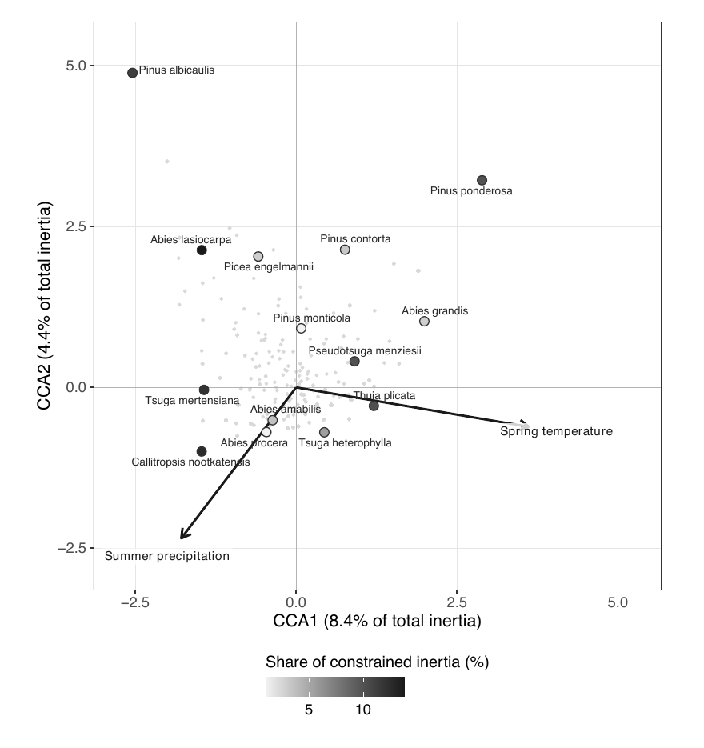

**Fig. A3. Unrotated CCA biplot.** As Figure 3A on the unrotated axes,
labelled with their share of the total inertia, with all taxa.

**Figure 1. Conceptual framework (caption revisions).** The drawing is
unchanged. In panel B, the lag is the difference between the mismatches
at t2 and t1, the first and last sampled century of a lake-period (one
lake within one climate period), and the lag rate is that difference per
century. In panel C, “at the same time point t” becomes “at t2”. The
axis labels may read “Spring temperature” and “Summer precipitation”.

# Figure 1. Conceptual framework

*To be added (conceptual figure, not produced by the code).*

# 1. Modern vegetation

Legacy surveys and resurveys of the same plots at Mount Rainier (MORA)
and North Cascades (NOCA) National Parks were matched, cleaned and
harmonized to one tree taxonomy
(`R/pipeline/01_clean_mora_vegetation.R`,
`R/pipeline/02_clean_noca_vegetation.R`).


**Fig. S1. Tree species occurrence by developmental stage in legacy
surveys and resurveys.** Number of plots in which each species was
recorded as an adult tree or seedling/regeneration at Mount Rainier
(MORA) and North Cascades (NOCA) National Parks, following taxonomic
harmonization and exclusion of understory taxa, but before applying the
CCA frequency threshold. Species could occur in both vegetation stages
within the same plot. At MORA, seedlings were defined as individuals
10–140 cm tall at both survey dates. At NOCA, however, legacy surveys
classified individuals 0–3 m tall as regeneration and those taller than
3 m as adults, whereas resurveys recorded seedlings of 10–140 cm and
adults taller than 1.4 m. Consequently, differences between vegetation
stages at NOCA should be interpreted cautiously because size-class
definitions differed between surveys.


**Fig. S2. Selection of vegetation records for canonical correspondence
analysis (CCA).** Flowchart summarizing the matching, cleaning, and
selection of legacy–resurvey plots (upper panels) and Holocene
macrofossil samples (lower panels) from Mount Rainier (MORA, blue) and
North Cascades (NOCA, orange) National Parks. The final set of eligible
paired plots was used both to calibrate the CCA using legacy community
composition and to assess contemporary community change, whereas
Holocene samples were projected into the fitted ordination. Plots
without any retained tree species at either survey date were excluded
because they could not be assigned an observed CCA position. Sample
sizes and reasons for exclusion are indicated at each step.

**Legacy plot area at NOCA.** Every resurvey plot is 500 m², but the
NOCA legacy plots range from 25 to 400 m². A small legacy plot can miss
species that the resurvey then records, which would show up as turnover.
The table gives the NOCA plot pairs used in the analysis by legacy plot
area, with their richness and the Anthropocene responses of Step 5a. It
is descriptive only.

**NOCA plot pairs by legacy plot area.** Richness is the mean number of
the retained CCA taxa present in a plot. Turnover rate, lag and lag rate
are plain means with 95% t-intervals (no model): the turnover and lag
rates in CCA distance per century, the lag in CCA distance. The single
36 m² plot has no interval.

| Legacy area (m²) | Plots | Richness, legacy | Richness, resurvey | Turnover rate | Lag | Lag rate |
|:---|---:|:---|:---|:---|:---|:---|
| 25 | 37 | 2.89 | 3.05 | 1.890 (1.213 to 2.567) | -0.114 (-0.358 to 0.130) | -0.399 (-1.256 to 0.459) |
| 36 | 1 | 2.00 | 3.00 | 1.725 | -0.502 | -1.826 |
| 100 | 213 | 2.81 | 2.91 | 2.128 (1.895 to 2.362) | -0.027 (-0.109 to 0.055) | -0.093 (-0.383 to 0.196) |
| 200 | 2 | 4.00 | 1.50 | 2.538 (-29.705 to 34.780) | 0.960 (-9.107 to 11.026) | 3.367 (-31.954 to 38.689) |
| 400 | 20 | 2.10 | 2.15 | 2.555 (1.157 to 3.953) | 0.083 (-0.410 to 0.577) | 0.294 (-1.438 to 2.026) |
| not recorded | 4 | 1.50 | 2.00 | 2.221 (-2.829 to 7.270) | 0.085 (-0.127 to 0.297) | 0.311 (-0.460 to 1.081) |
| all NOCA plot pairs | 277 | 2.76 | 2.85 | 2.130 (1.905 to 2.356) | -0.024 (-0.102 to 0.055) | -0.082 (-0.359 to 0.196) |

<sub>Table file:
[noca_plot_area_responses.csv](report/tables/noca_plot_area_responses.csv)</sub>

The smallest legacy plots did not record fewer of the CCA taxa: 2.89
taxa per 25 m² plot against 2.81 per 100 m² plot. Their turnover rate
was not higher (1.89 against 2.13 CCA distance per century), and the
intervals of the three common areas overlap for every response. The NOCA
Anthropocene results do not rest on the small legacy plots.

**Cleaning details →**
[01_vegetation_cleaning](report/details/01_vegetation_cleaning.md)
(plot-by-plot decisions, NOCA tree corrections, survey dates, raw-data
provenance).

# 2. Climate

Modern climate is CHELSA V2.1 monthly climate in a survey-specific
window for every plot (`R/pipeline/04_modern_climate.R`); Holocene
climate is CHELSA-TraCE21k at each lake and century
(`R/pipeline/07_paleo_climate.R`).

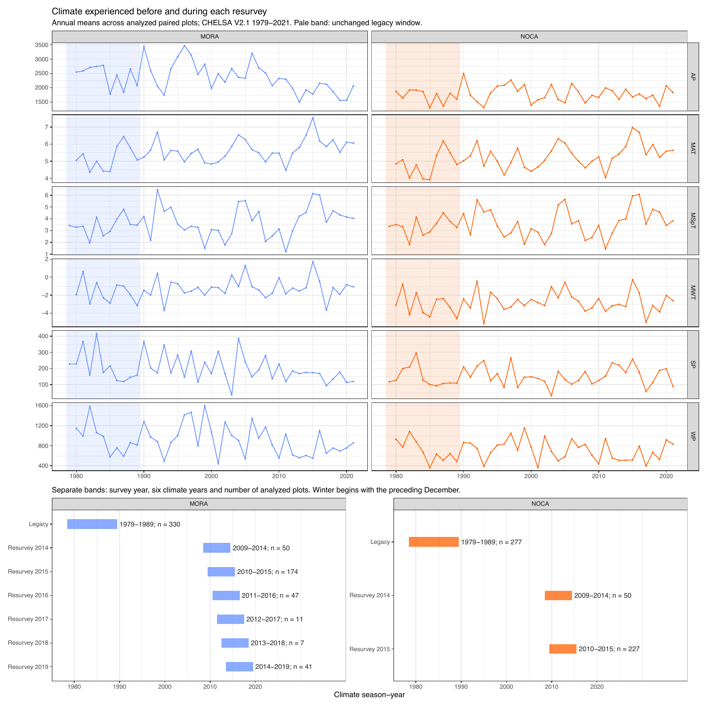

**Fig. S3. Climate conditions and survey-specific climate windows for
the Anthropocene.** Upper panels show annual climate variation from
CHELSA v2.1 (1979–2021), averaged across the paired vegetation plots at
Mount Rainier (MORA, blue) and North Cascades (NOCA, orange) National
Parks. Variables include mean annual temperature (MAT), annual
precipitation (AP), and the four seasonal seasonal variables mean spring
temperature (MSpT), mean winter temperature (MWT), summer precipitation
(SP), and winter precipitation (WP); MSpT and SP constrain the CCA.
Shaded areas indicate the common legacy climate window (1979–1989).
Lower panels show the six-year climate windows used for each resurvey
year (Y−5 through Y), together with the number of paired plots (n)
surveyed in that year. Winter calculations also included December of the
preceding calendar year. Climate conditions were therefore calculated
separately for each plot according to its resurvey year.

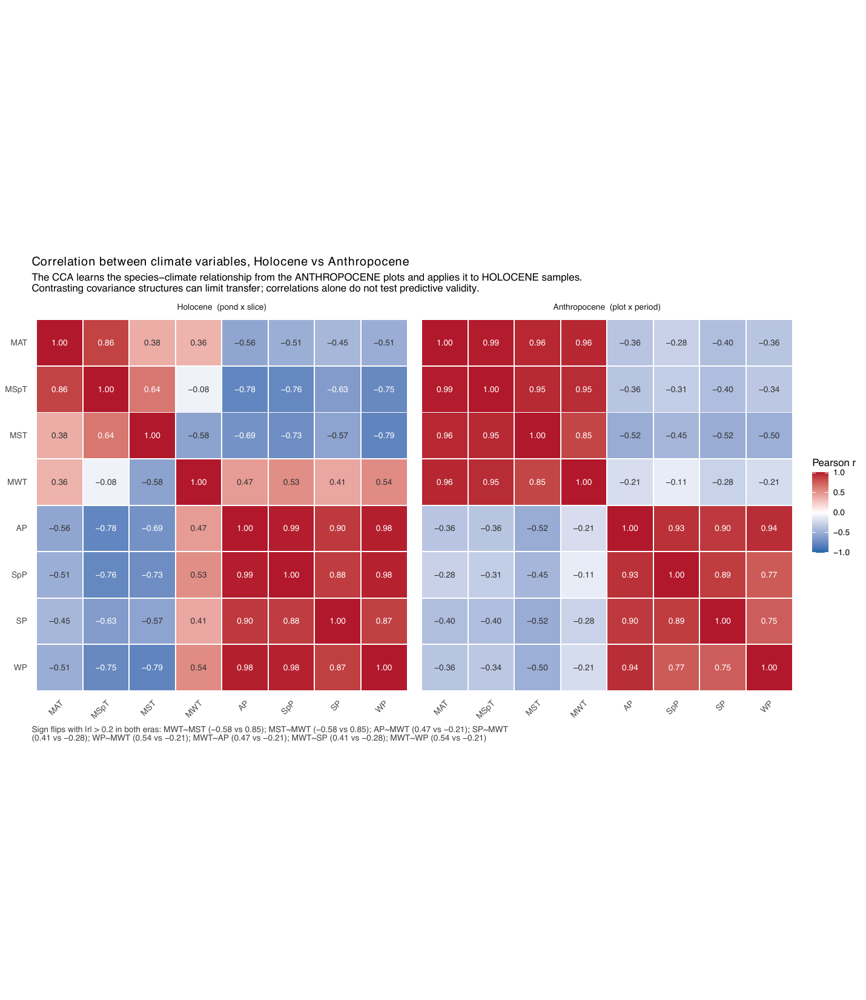

**Fig. S4. Correlations among climate variables during the Holocene and
Anthropocene.** Pearson correlation coefficients (r) were calculated
across lake locations and 100-year climate intervals for the Holocene
(CHELSA-TraCE21k, left) and across vegetation plots and survey periods
for the Anthropocene (CHELSA v2.1, right). Red indicates positive
correlations and blue indicates negative correlations, with numerical
values showing Pearson’s r. Climate variables include mean annual (MAT),
spring (MSpT), summer (MST), and winter (MWT) temperature, and annual
(AP), spring (SpP), summer (SP), and winter (WP) precipitation. Spring
corresponds to March–May, summer to June–August, and winter to
December–February.

**Choice of CCA constraints.** Candidate variables are screened by their
correlations (Fig. S4) and by their variance inflation in the fitted
CCA, keeping one temperature and one precipitation variable. With the
four seasonal variables MSpT, MWT, SP and WP, the two temperatures had
variance inflation factors near 30 and opposite-signed coefficients that
are not identifiable. The CCA is therefore constrained by spring
temperature, the temperature that changes most through the Holocene, and
summer precipitation. Figures in the CCA plane are rotated rigidly by
the varimax angle so that the two arrows lie along the axes; distances
and angles, and therefore every tracking metric, are unchanged by the
rotation (decision of 2026-11-09 in **Decisions →**
[10_decisions](report/details/10_decisions.md)). The constraints of this
build:

| Variable | Label                |  VIF | CCA1 score | CCA2 score |
|:---------|:---------------------|-----:|-----------:|-----------:|
| MSpT     | Spring temperature   | 1.08 |       0.53 |      -0.09 |
| SP       | Summer precipitation | 1.08 |      -0.26 |      -0.34 |

<sub>Table file:
[cca_constraint_vif.csv](report/tables/cca_constraint_vif.csv)</sub>

**Climate details →** [02_climate](report/details/02_climate.md) (survey
windows, TraCE21k against V2.1, full correlation tables).

# Appendix S1. Construction of the Holocene age–depth models

### S1.1 Why an age–depth model was required

The macrofossils are measured at known depths in a sediment core, but
depth itself does not provide an age. Sediment does not necessarily
accumulate at a constant rate: for example, 1 cm of sediment can
represent relatively few years during rapid accumulation and many more
years during slow accumulation. Chronological control is available only
at selected depths, through radiocarbon dates, dated volcanic deposits,
²¹⁰Pb dating, or other independently dated horizons. We therefore
required an age–depth model to estimate the calendar age of every depth
between these dated points and, importantly, to quantify uncertainty in
those estimated ages.

We used the rbacon R package, which reconstructs sediment accumulation
histories within a Bayesian framework (Blaauw & Christen 2011). Rather
than drawing a single line through the dated horizons, Bacon estimates
many age–depth histories that are compatible with the chronological
evidence and assumptions about sediment accumulation. The distribution
of these histories represents the posterior chronological uncertainty
shown in Fig. S5.

### S1.2 Chronological controls and radiocarbon calibration

For each core, we assembled chronological controls for which both
sediment depth and age information were available (Table S1.1). For
MORA, these consisted of the core surfaces, seven radiocarbon dates from
Jay Bath and Log Wallow, dated volcanic tephra horizons, and a basal
radiocarbon age for Reflection Pond. Reflection Pond contained no
radiocarbon dates of its own and was therefore constrained by the core
surface, tephra horizons, and this basal control. For Panther Potholes,
we reproduced the chronology archived in the Neotoma database using the
core surface, five ²¹⁰Pb ages, six Accelerator Mass Spectrometry (AMS)
radiocarbon dates, and three tephra horizons. We used the corrected
control depths archived in Neotoma rather than the depths reported in
Prichard et al. (2009), which contain documented depth errors.

Radiocarbon ages are expressed in ¹⁴C years and cannot be treated
directly as calendar ages because atmospheric ¹⁴C concentrations have
varied through time. We therefore supplied radiocarbon ages and their
laboratory errors as uncalibrated dates (cc = 1), which Bacon calibrated
against the IntCal20 Northern Hemisphere calibration curve (Reimer et
al. 2020). This converts each radiocarbon measurement into a probability
distribution of plausible calendar ages. Controls already expressed in
calendar years, including the core surfaces and tephra ages, were
supplied directly (cc = 0) and were not calibrated.

The seven MORA radiocarbon ages and their laboratory errors were taken
directly from Dunwiddie (1986). For all other chronological controls,
the source and interpretation of the assigned age uncertainty are
reported explicitly in Table S1.1. The Reflection Pond basal control is
the mean of the two basal radiocarbon ages of Jay Bath (QL-1704) and Log
Wallow (QL-1728), 6015 ± 110 ¹⁴C yr BP with the larger of the two
laboratory errors, following P. Dunwiddie’s advice that the three basins
share the same basal age (pers. comm.).

For Panther Potholes, the five ²¹⁰Pb ages were derived using a Constant
Rate of Supply (CRS) model. We retained the error values used in the
archived Gavin chronology for the primary model; however, these values
correspond numerically to the ²¹⁰Pb activity uncertainties reported by
Prichard et al. (2009), rather than to independently estimated age
uncertainties in years. We therefore evaluated this uncertainty
specification in a separate sensitivity analysis described below.

**Table S1.1. Chronological controls used in the four Bayesian age–depth
models.** For cc = 1, the entered age is an uncalibrated ¹⁴C age
calibrated with IntCal20. For cc = 0, the entered age is already in
calibrated years before present (cal yr BP; present = A.D. 1950).

| Site | Core | Chronological control | Depth (cm) | Age entered ± error | Bacon treatment | Age source | Uncertainty source |
|:---|:---|:---|:---|:---|:---|:---|:---|
| MORA | Jay Bath | Core surface | 0 | −31.5 ± 10 cal yr BP | cc = 0 | Coring date, 1981–1982 | Assumed ±10 yr to account for uncertainty in recovery of the sediment–water interface |
| MORA | Jay Bath | MSH-W tephra | 22 | 470 ± 10 cal yr BP | cc = 0 | Yamaguchi 1983; Walsh et al. 2017 | Assumed ±10 yr around the tree-ring-dated eruption age; no published statistical age error |
| MORA | Jay Bath | QL-1729 | 39.5 | 1320 ± 30 ¹⁴C yr BP | cc = 1, IntCal20 | Dunwiddie 1986 | Published laboratory error |
| MORA | Jay Bath | MR-C tephra | 62 | 2250 ± 100 cal yr BP | cc = 0 | Mullineaux 1974; Walsh et al. 2017 | Assumed ±100 yr; no published statistical age error |
| MORA | Jay Bath | QL-1730 | 70 | 2920 ± 60 ¹⁴C yr BP | cc = 1, IntCal20 | Dunwiddie 1986 | Published laboratory error |
| MORA | Jay Bath | MSH-Y tephra, upper boundary | 87 | 3650 ± 100 cal yr BP | cc = 0 | Mullineaux 1974; Walsh et al. 2017 | ±100 yr derived approximately from radiocarbon dates bracketing the eruption age (bracket half-width ≈103 yr; Mullineaux 1996) |
| MORA | Jay Bath | MSH-Y tephra, lower boundary | 105 | 3650 ± 100 cal yr BP | cc = 0 | Mullineaux 1974; Walsh et al. 2017 | Same uncertainty as upper boundary; both depths represent the same instantaneous tephra deposit |
| MORA | Jay Bath | Beta-6332 | 124.5 | 3740 ± 80 ¹⁴C yr BP | cc = 1, IntCal20 | Dunwiddie 1986 | Published laboratory error |
| MORA | Jay Bath | MR-F tephra | 142 | 5740 ± 100 cal yr BP | cc = 0 | Mullineaux 1974; Walsh et al. 2017 | Assumed ±100 yr; no published statistical age error |
| MORA | Jay Bath | QL-1704 | 152.25 | 6050 ± 110 ¹⁴C yr BP | cc = 1, IntCal20 | Dunwiddie 1986 | Published laboratory error |
| MORA | Log Wallow | Core surface | 0 | −31.5 ± 10 cal yr BP | cc = 0 | Coring date, 1981–1982 | Assumed ±10 yr to account for uncertainty in recovery of the sediment–water interface |
| MORA | Log Wallow | MSH-W tephra | 22 | 470 ± 10 cal yr BP | cc = 0 | Yamaguchi 1983; Walsh et al. 2017 | Assumed ±10 yr around the tree-ring-dated eruption age; no published statistical age error |
| MORA | Log Wallow | QL-1726 | 29 | 1650 ± 80 ¹⁴C yr BP | cc = 1, IntCal20 | Dunwiddie 1986 | Published laboratory error |
| MORA | Log Wallow | MSH-Y tephra, upper boundary | 40 | 3650 ± 100 cal yr BP | cc = 0 | Mullineaux 1974; Walsh et al. 2017 | ±100 yr derived approximately from radiocarbon dates bracketing the eruption age (bracket half-width ≈103 yr; Mullineaux 1996) |
| MORA | Log Wallow | MSH-Y tephra, lower boundary | 98 | 3650 ± 100 cal yr BP | cc = 0 | Mullineaux 1974; Walsh et al. 2017 | Same uncertainty as upper boundary; both depths represent the same instantaneous tephra deposit |
| MORA | Log Wallow | MR-F tephra | 116 | 5740 ± 100 cal yr BP | cc = 0 | Mullineaux 1974; Walsh et al. 2017 | Assumed ±100 yr; no published statistical age error |
| MORA | Log Wallow | QL-1727 | 117 | 4900 ± 80 ¹⁴C yr BP | cc = 1, IntCal20 | Dunwiddie 1986 | Published laboratory error |
| MORA | Log Wallow | QL-1728 | 140 | 5980 ± 60 ¹⁴C yr BP | cc = 1, IntCal20 | Dunwiddie 1986 | Published laboratory error |
| MORA | Reflection Pond | Core surface | 0 | −31.5 ± 10 cal yr BP | cc = 0 | Coring date, 1981–1982 | Assumed ±10 yr to account for uncertainty in recovery of the sediment–water interface |
| MORA | Reflection Pond | MSH-W tephra | 10 | 470 ± 10 cal yr BP | cc = 0 | Yamaguchi 1983; Walsh et al. 2017 | Assumed ±10 yr around the tree-ring-dated eruption age; no published statistical age error |
| MORA | Reflection Pond | MR-C tephra | 26 | 2250 ± 100 cal yr BP | cc = 0 | Mullineaux 1974; Walsh et al. 2017 | Assumed ±100 yr; no published statistical age error |
| MORA | Reflection Pond | MSH-Y tephra, upper boundary | 45 | 3650 ± 100 cal yr BP | cc = 0 | Mullineaux 1974; Walsh et al. 2017 | ±100 yr derived approximately from radiocarbon dates bracketing the eruption age (bracket half-width ≈103 yr; Mullineaux 1996) |
| MORA | Reflection Pond | MSH-Y tephra, lower boundary | 64 | 3650 ± 100 cal yr BP | cc = 0 | Mullineaux 1974; Walsh et al. 2017 | Same uncertainty as upper boundary; both depths represent the same instantaneous tephra deposit |
| MORA | Reflection Pond | MR-F tephra | 82 | 5740 ± 100 cal yr BP | cc = 0 | Mullineaux 1974; Walsh et al. 2017 | Assumed ±100 yr; no published statistical age error |
| MORA | Reflection Pond | Basal sediment, mean of QL-1704 and QL-1728 | 90 | 6015 ± 110 ¹⁴C yr BP | cc = 1, IntCal20 | Dunwiddie 1986; P. Dunwiddie, pers. comm. | Larger of the two laboratory errors (±110 yr), allowing for transfer of the Jay Bath and Log Wallow basal age to Reflection Pond |
| NOCA | Panther Potholes | Core surface | 0.5 | −49 ± 1 cal yr BP | cc = 0 | Gavin 2021 Neotoma chronology; coring year 1999 | ±1 yr retained from the archived Gavin chronology |
| NOCA | Panther Potholes | ²¹⁰Pb CRS age | 7 | −36.7; error entered = 3.47 | cc = 0 | Prichard et al. 2009; Gavin 2021 | Inherited Gavin value; 3.47 is numerically the published ²¹⁰Pb activity uncertainty in DPM g⁻¹, not a verified age error in years |
| NOCA | Panther Potholes | ²¹⁰Pb CRS age | 14 | −9; error entered = 1.15 | cc = 0 | Prichard et al. 2009; Gavin 2021 | Inherited Gavin value; 1.15 is numerically the published ²¹⁰Pb activity uncertainty in DPM g⁻¹, not a verified age error in years |
| NOCA | Panther Potholes | ²¹⁰Pb CRS age | 21 | 12; error entered = 0.72 | cc = 0 | Prichard et al. 2009; Gavin 2021 | Inherited Gavin value; 0.72 is numerically the published ²¹⁰Pb activity uncertainty in DPM g⁻¹, not a verified age error in years |
| NOCA | Panther Potholes | ²¹⁰Pb CRS age | 28 | 21; error entered = 0.74 | cc = 0 | Prichard et al. 2009; Gavin 2021 | Inherited Gavin value; 0.74 is numerically the published ²¹⁰Pb activity uncertainty in DPM g⁻¹, not a verified age error in years |
| NOCA | Panther Potholes | ²¹⁰Pb CRS age | 35 | 36; error entered = 0.77 | cc = 0 | Prichard et al. 2009; Gavin 2021 | Inherited Gavin value; 0.77 is numerically the published ²¹⁰Pb activity uncertainty in DPM g⁻¹, not a verified age error in years |
| NOCA | Panther Potholes | Beta-172005, conifer seed | 214 | 1950 ± 50 ¹⁴C yr BP | cc = 1, IntCal20 | Prichard et al. 2009 | Published laboratory error |
| NOCA | Panther Potholes | MSH-P tephra | 305.5 | 2620 ± 70 cal yr BP | cc = 0 | Gavin 2021 Neotoma chronology | Age and ±70-yr uncertainty retained from the archived chronology |
| NOCA | Panther Potholes | Beta-169623, seed | 363 | 3260 ± 40 ¹⁴C yr BP | cc = 1, IntCal20 | Prichard et al. 2009 | Published laboratory error |
| NOCA | Panther Potholes | Beta-169624, pollen cone | 389 | 3520 ± 40 ¹⁴C yr BP | cc = 1, IntCal20 | Prichard et al. 2009 | Published laboratory error |
| NOCA | Panther Potholes | MSH-Y tephra | 401 | 3660 ± 65 cal yr BP | cc = 0 | Gavin 2021 Neotoma chronology | Age and ±65-yr uncertainty retained from the archived chronology |
| NOCA | Panther Potholes | Beta-169207, pollen cone | 479 | 4500 ± 40 ¹⁴C yr BP | cc = 1, IntCal20 | Prichard et al. 2009 | Published laboratory error |
| NOCA | Panther Potholes | Mazama tephra | 629 | 7633 ± 25 cal yr BP | cc = 0 | Gavin 2021 Neotoma chronology; Egan et al. 2015 | Age and ±25-yr uncertainty retained from the archived chronology |
| NOCA | Panther Potholes | Beta-169208, seed | 678 | 7330 ± 40 ¹⁴C yr BP | cc = 1, IntCal20 | Prichard et al. 2009 | Published laboratory error |
| NOCA | Panther Potholes | Beta-169625, Pinus contorta needles | 864 | 9370 ± 40 ¹⁴C yr BP | cc = 1, IntCal20 | Prichard et al. 2009 | Published laboratory error |

<sub>Table file:
[table_S1_1_chronological_controls.csv](report/tables/table_S1_1_chronological_controls.csv)</sub>

### S1.3 Bayesian age–depth models

We fitted each core independently with Bacon using the settings
summarized in Table S1.2. Bacon divided each sediment core into 5-cm
sections and estimated an accumulation time, in yr cm⁻¹, for each
section. Accumulation times were allowed to differ among sections but
were correlated between neighbouring sections through the model’s memory
parameter. The chronological controls in Table S1.1 were then used to
update these prior expectations and generate the posterior age–depth
chronology shown in Fig. S5.

The three MORA cores were modelled using the same accumulation and
memory priors. Panther Potholes instead retained the settings of the
archived Bacon chronology in the Neotoma database so that our model
reproduced the published chronology while providing the complete
posterior age–depth draws required for subsequent analyses. All runs are
seeded (seed 42).

**Table S1.2. rbacon parameters used to construct the age–depth
models.**

| rbacon argument | What it controls | MORA | Panther Potholes | Rationale |
|:---|:---|:---|:---|:---|
| cc, cc1 | Determines whether a date requires radiocarbon calibration and which calibration curve is used | cc=1, cc1=“IntCal20” for ¹⁴C dates; cc=0 for calendar-age controls | Same | Northern Hemisphere terrestrial ¹⁴C dates were calibrated with IntCal20; already calendar-dated controls were not recalibrated |
| thick | Thickness of the sediment sections for which accumulation rates are estimated | 5 cm | 5 cm | Standard Bacon section thickness; for Panther Potholes this value reproduced the archived Gavin chronology |
| acc.mean | Mean of the prior distribution for accumulation time, in yr cm⁻¹ | 50 | 10 | MORA cores accumulate substantially more slowly; 10 yr cm⁻¹ reproduces the Gavin chronology and is close to the approximately 12.8 yr cm⁻¹ reported for Panther Potholes |
| acc.shape | Shape of the gamma prior around acc.mean; larger values impose a more concentrated accumulation prior | 1.5 | 1.5 | Broad rbacon default retained for MORA and Gavin setting retained for Panther Potholes |
| mem.mean | Prior mean dependence between accumulation rates in adjacent sediment sections | 0.5 | 0.7 | rbacon default retained for MORA; Gavin setting retained for Panther Potholes |
| mem.strength | Strength of the prior around mem.mean; larger values impose the assumed memory more strongly | 10 | 10 | Broad rbacon default retained for MORA and Gavin setting retained for Panther Potholes |
| slump | Depth intervals treated as effectively instantaneous accumulation rather than gradual sedimentation | Jay Bath: 87–105 cm; Log Wallow: 40–98 cm; Reflection Pond: 45–64 cm | 303–308, 396–406, and 623–635 cm | Prevents thick tephra deposits from being interpreted as long periods of sediment accumulation |
| normal, t.a, t.b | Distribution used to accommodate chronological-control scatter and potential outlying dates | FALSE, 3, 4 | FALSE, 15, 16 | rbacon default robust t-distribution retained for MORA; Gavin settings retained for Panther Potholes |
| ssize | Number of MCMC iterations retained for the posterior | 4,000 | 10,000 | Default sampling was retained for MORA; Panther Potholes required the larger value for adequate MCMC mixing and reproduction of the archived chronology |
| prob | Posterior interval reported for the chronology | 0.95 | 0.95 | Ages are summarized with 95% posterior intervals |
| d.max | Maximum core depth included in the model | Jay Bath: 153 cm; no manual extension for Log Wallow or Reflection Pond | 870 cm | Jay Bath was extended to 153 cm to retain its deepest macrofossil sample; Panther Potholes retained the Gavin model extent |

<sub>Table file:
[table_S1_2_rbacon_parameters.csv](report/tables/table_S1_2_rbacon_parameters.csv)</sub>

The thick volcanic deposits required one additional treatment. The MSH-Y
tephra was represented as an instantaneous depositional interval in all
three MORA cores, including the 58-cm interval at Log Wallow containing
both primary and redeposited Y tephra. At Panther Potholes, the MSH-P,
MSH-Y, and Mazama tephra intervals were treated in the same way. Bacon
therefore removed these intervals while estimating gradual sediment
accumulation and reinserted them without adding elapsed time. These
intervals are shown as vertical grey bands in Fig. S5.

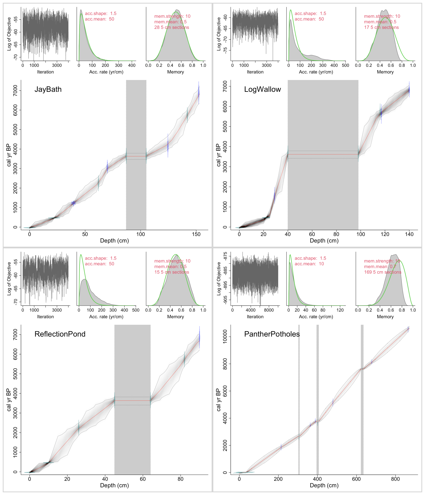

**Fig. S5. Bayesian age–depth models for the Jay Bath, Log Wallow, and
Reflection Pond cores at MORA and the Panther Potholes core at NOCA.**
For each core, the three upper panels show, from left to right, the
Markov chain Monte Carlo trace, the prior (green) and posterior (grey)
distributions of sediment accumulation time, and the prior and posterior
distributions of memory. In the main panels, depth increases along the
x-axis and age is expressed as calibrated years before present. Coloured
distributions at dated depths represent the chronological controls and
their uncertainty. The grey field represents the posterior distribution
of possible age–depth relationships; the central red line shows the
posterior age–depth estimate and the outer dotted lines the 95%
posterior interval. Vertical grey bands identify tephra intervals
treated as instantaneous deposition.

For Panther Potholes, we reproduced the archived Neotoma chronology as
the primary model. However, Prichard et al. (2009) report uncertainties
for measured ²¹⁰Pb activity, in DPM g⁻¹, and the same numerical values
were entered as age errors, in years, in the archived chronology. We
therefore fitted a sensitivity model in which the five ²¹⁰Pb controls
were each assigned an assumed ±10-year age error, all other controls and
settings unchanged (Fig. S6).

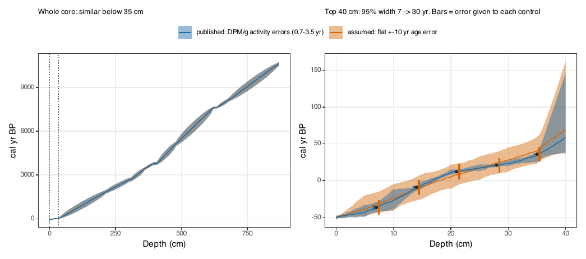

**Fig. S6. Sensitivity of the Panther Potholes age–depth chronology to
uncertainty assigned to the five ²¹⁰Pb controls in the upper 35 cm of
the core.** The left panel shows that the two posterior chronologies are
nearly identical below the ²¹⁰Pb-dated section, whereas the right panel
shows the expected increase in uncertainty within the upper 35–40 cm.
The uncertainty assigned to the ²¹⁰Pb controls affects the precision of
the most recent chronology but does not materially alter the deeper
Holocene chronology used in our analyses.

**Chronology details →**
[03_chronology](report/details/03_chronology.md) (every control and its
source).

# Appendix S2. Reconstruction and classification of fire histories

### S2.1 Holocene charcoal records

For MORA, we reconstructed Holocene fire activity using the Sunrise
Lake, Shadow Lake, and Little Sunrise Lake macrocharcoal records from
Walsh et al. (2017). These records provide evidence of regional fire
activity on Sunrise Ridge and are independent of the Jay Bath, Log
Wallow, and Reflection Pond records used to reconstruct vegetation. For
NOCA, we reconstructed Holocene fire activity using the Panther Potholes
macrocharcoal record of Prichard et al. (2009), extracted from the
archived Neotoma record and dated with the Panther Potholes chronology
of Appendix S1. Thus, at NOCA fire and vegetation records share the same
core and chronology.

### S2.2 Identification of individual fire events

We reconstructed the fire-event detection analyses of Walsh et
al. (2017) and Prichard et al. (2009) within a common workflow
implemented with the R package tapas (`R/pipeline/08_fire_records.R`).
CHAR was interpolated to regular intervals, its slowly varying
background estimated by robust LOWESS, and candidate fire events
identified where the residual peak component exceeded a record-specific
threshold of the background noise. Candidates were screened with a
75-year minimum-count test (p ≤ 0.05), and consecutive exceedances were
treated as one event. Record-specific settings are given in Table S2.1.

**Table S2.1. Parameters used to reconstruct individual Holocene fire
events.** All records were also screened with the same 75-year
minimum-count test (p ≤ 0.05). MORA settings follow Walsh et al. (2017)
and Panther Potholes settings Prichard et al. (2009), except its 12-year
interpolation interval, the median resolution of our updated chronology.

| Site | Fire record | Interpolation interval (years) | Background window (years) | Peak threshold | Accepted fire events |
|:---|:---|---:|---:|:---|---:|
| MORA | Sunrise Lake | 48 | 800 | 95% | 17 |
| MORA | Shadow Lake | 47 | 1000 | 95% | 14 |
| MORA | Little Sunrise Lake | 42 | 500 | 95% | 13 |
| NOCA | Panther Potholes | 12 | 500 | 99% | 66 |

<sub>Table file:
[table_S2_1_fire_detection_parameters.csv](report/tables/table_S2_1_fire_detection_parameters.csv)</sub>


**Fig. S7. Identification of Holocene fire events in the four records.**
The residual peak component is the difference between interpolated
charcoal accumulation rates (CHAR) and the background estimated with the
record’s robust LOWESS window. Candidate events exceed the local noise
threshold (dashed line) and are then screened with a 75-year
minimum-count test (p ≤ 0.05): filled circles are accepted events, red
crosses rejected candidates. The manuscript example is Little Sunrise
Lake (lower left; 500-year background, 95th percentile).

### S2.3 Identification of high-fire periods

We calculated fire-event frequency within centered 1,000-year windows
evaluated every 100 years, normalized each record by its own maximum,
averaged the normalized MORA records wherever at least two were
available, and identified high-fire periods separately for each site
with

**High-fire threshold = median + 1.4826 × MAD (Eq. 1)**

where MAD is the median absolute deviation of the normalized site-level
fire-frequency series. Consecutive above-threshold dates form one
high-fire period; gaps are not bridged and no minimum duration is
imposed (`R/pipeline/11_climate_eras_high_fire.R`; worked example in
**Worked examples →**
[09_worked_examples](report/details/09_worked_examples.md)).

**High-fire periods identified by Eq. 1.**

| Site | Older (cal BP) | Younger (cal BP) | Duration (years) | Maximum normalized frequency | Threshold |
|:---|---:|---:|---:|---:|---:|
| MORA | 750 | 650 | 100 | 0.67 | 0.61 |
| MORA | 2650 | 1550 | 1100 | 0.89 | 0.61 |
| MORA | 2950 | 2750 | 200 | 0.67 | 0.61 |
| MORA | 6850 | 6350 | 500 | 0.78 | 0.61 |
| MORA | 7150 | 7050 | 100 | 0.67 | 0.61 |
| NOCA | 950 | 650 | 300 | 0.73 | 0.68 |
| NOCA | 2250 | 2150 | 100 | 0.73 | 0.68 |
| NOCA | 2450 | 2350 | 100 | 0.73 | 0.68 |
| NOCA | 8650 | 7550 | 1100 | 1.00 | 0.68 |
| NOCA | 9150 | 9050 | 100 | 0.73 | 0.68 |
| NOCA | 9850 | 9650 | 200 | 0.73 | 0.68 |

<sub>Table file:
[high_fire_periods.csv](report/tables/high_fire_periods.csv)</sub>

### S2.4 Reproducibility against the original studies

We compared the number of events identified by tapas with those reported
by Walsh et al. (2017) and Prichard et al. (2009), and additionally
reproduced the MORA analyses with CharAnalysis R 2.0.3 (Table S2.2).
Event counts differed from the published values, including with
CharAnalysis, suggesting that discrepancies arise partly from
differences between software implementations. We retained tapas for one
consistent detection procedure across all four records, preserving their
source-specific settings rather than tuning parameters to reproduce
published counts.

**Table S2.2. Holocene fire-event counts reported in the original
studies and reconstructed with CharAnalysis R 2.0.3 (MORA only) and
tapas (all four records).**

| Site | Lake | Published | CharAnalysis R 2.0.3 | tapas | Difference from published |
|:---|:---|---:|---:|---:|:---|
| MORA | Sunrise | 24 | 15 | 17 | -7 (-29%) |
| MORA | Shadow | 18 | 16 | 14 | -4 (-22%) |
| MORA | Little Sunrise | 16 | 14 | 13 | -3 (-19%) |
| MORA total |  | 58 | 45 | 44 | -14 (-24%) |
| NOCA | Panther Potholes | 59 | — | 66 | +7 (+12%) |
| Both sites |  | 117 | — | 110 | -7 (-6%) |

<sub>Table file:
[table_S2_2_fire_event_counts.csv](report/tables/table_S2_2_fire_event_counts.csv)</sub>

**Fire details →** [04_fire](report/details/04_fire.md) (per-record
detection, CharAnalysis reproduction, modern fire assignment of the
survey plots).

# 3. Species selection


**Fig. S8. Species occurrence frequencies across sites and periods
before CCA species selection.** Number of plots (legacy surveys and
resurveys) or macrofossil samples (Holocene) in which each tree species
was recorded at MORA and NOCA, following taxonomic harmonization and
exclusion of understory and unidentified taxa. Presence was determined
from both adult tree and seedling records. The dashed red line indicates
the minimum occurrence threshold of 20 plots or samples. Species were
retained if they reached this threshold in at least one site and period
combination, resulting in 14 species included in the CCA.

**Species-selection details →**
[05_species_selection](report/details/05_species_selection.md)
(consolidation rules, excluded taxa, occupancy through time).

# 4. Canonical correspondence analysis

One CCA is fitted to the legacy composition of the 607 matched plots
(MORA and NOCA pooled), constrained by the climate variables above
(scaling 1, Hill = FALSE). Resurvey plots and Holocene samples are
projected into it: their climate gives a predicted (LC) position and
their composition an observed (WA) position.

``` r
# R/pipeline/10_cca.R
# The CCA is fitted once, on the legacy survey only.
#   species_past_final: one row per calibration plot (607), one column per tree
#     species (14), the counts of each species in the plot.
#   env_past_final: the same 607 plots, two columns, MSpT (mean spring
#     temperature) and SP (summer precipitation) of the plot's legacy climate
#     window.
# The formula reads "species ~ MSpT + SP". vegan::cca finds the two axes,
# each a weighted sum of MSpT and SP, along which species composition changes
# most. With two climate variables there are exactly two axes. All later
# positions (plots at both surveys, lake samples) live in this 2-D space.
cca_formula = reformulate(CCA_VARIABLES, response = "species_past_final")
cca_model = cca(cca_formula, data = env_past_final)
```

``` r
# R/pipeline/10_cca.R
# Two positions for every community, both on the fitted axes:
#   type = "lc" (linear combination): where its CLIMATE alone puts it, the
#     predicted position. It uses only MSpT and SP.
#   type = "wa" (weighted average): where its SPECIES put it, the observed
#     position, the average of the species' scores weighted by their counts.
# The lag M of a community is the distance between the two.
predicted_present = predict(cca_model, newdata = env_present_final, type = "lc", scaling = cca_scaling, hill = cca_hill)
projected_present = predict(cca_model, newdata = species_present_final,
                            type = "wa", scaling = cca_scaling, hill = cca_hill)

predicted_paleo = predict(cca_model, newdata = env_paleo[, CCA_VARIABLES, drop = FALSE],
                          type = "lc", scaling = cca_scaling, hill = cca_hill)
projected_paleo = predict(cca_model, newdata = species_paleo[, keep_species, drop = FALSE],
                          type = "wa", scaling = cca_scaling, hill = cca_hill)
```

**CCA axes.** Constrained inertia: 12.8% of the total.

| Axis | Eigenvalue | % total inertia | % constrained inertia |
|:-----|-----------:|----------------:|----------------------:|
| CCA1 |      0.293 |           8.442 |                65.829 |
| CCA2 |      0.152 |           4.382 |                34.171 |

<sub>Table file: [cca_axes.csv](report/tables/cca_axes.csv)</sub>

**Permutation tests** (9,999 permutations, unrestricted and restricted
within parks).

| Test    | Component |  df | Pseudo-F | p (unrestricted) | p (within parks) |
|:--------|:----------|----:|---------:|-----------------:|-----------------:|
| Overall | Model     |   2 |   44.427 |                0 |                0 |
| Axis    | CCA1      |   1 |   58.492 |                0 |                0 |
| Axis    | CCA2      |   1 |   30.499 |                0 |                0 |

<sub>Table file:
[cca_permutation_tests.csv](report/tables/cca_permutation_tests.csv)</sub>

Figure 3 is shown in the Step 0 section above.

**CCA details →** [06_cca](report/details/06_cca.md) (full model output,
species and climate contributions, scaling 1 against scaling 2).

# 5. Limitations and open questions

CCA sample eligibility, balanced observed/predicted exclusions and
paired Figure 3 endpoints are resolved and require no further decision.
The survey-year and climate-window choices are also settled. The four
questions below remain; the SD-reference and target-origin alternatives
are optional sensitivities. The CARI449/CARI450 GPS exclusion is
resolved. Unequal modern climate-window lengths are an accepted
trade-off; the precipitation-continuity concern is separate from that
settled choice.

The chronology controls and adopted uncertainty assumptions were
reconsidered and retained on 2026-10-06. They no longer require a
decision for the current analysis. Conditional uncertainty, assumed
errors and the unverified basal-lahar correlation remain interpretation
limits documented above and in the MORA source notes; any future
chronology revision is separate work.

| Question | Current choice | Consequence | Evidence needed to resolve it |
|----|----|----|----|
| Raw versus V2.1-anchored TraCE21k climate | The active Holocene analysis uses raw TraCE21k values; the V2.1 anchoring diagnostic is not authoritative. | Absolute Holocene climate levels and cross-product comparisons may retain product bias, although the active within-series change calculations are internally consistent. | A validated overlap-period comparison showing whether anchoring reduces bias without introducing a discontinuity or changing the intended anomaly interpretation. |
| Legacy-calibration versus full-record climate SDs | Changes are divided by SDs from the 607 matched legacy CCA calibration plots. | The reference is tied to the fitted model. A full-record SD would change displayed standardized magnitudes, cross-variable weighting, the unthresholded composite, and standardized climate rates, but not CC/S boundaries under the current variable-specific 50%-of-own-maximum rule. | A prespecified full-record sensitivity with explicit temporal/site weighting and a scientific choice between calibration-relative and dataset-relative effect sizes. |
| Anthropocene precipitation continuity | Historical climate remains 1979–1989; modern climate uses adult Y−5 through Y at both sites (2026-10-07 decision). The MORA precipitation contrast is flagged. | The apparent post-2010 MORA precipitation shift may partly reflect CHELSA inhomogeneity rather than climate. | Independent station/reanalysis validation and a documented decision on whether post-2010 MORA precipitation is usable. The agreed years are not a pending decision. |
| MORA fire record location | The MORA fire values come from the Sunrise Ridge cores, while the vegetation lakes lie elsewhere in the park. | A MORA fire slope may reflect regional fire rather than fire at the lakes. | Charcoal from the vegetation lakes themselves. |
| Fire scales of the two parks | One fire slope for both parks, in events per century per covered core. MORA values span 0.10 to 0.33 and NOCA 0.33 to 0.89, partly because Panther Potholes is read at 12 years and the Sunrise Ridge cores at 42 to 48 years. | The fire slope comes from the narrow range within each park. | Records at comparable resolution, or a resolution-corrected event rate. |
| Rates over different time spans | Holocene rates span 200 to 2,600 years and Anthropocene rates about 29 years. | Longer windows give lower rates, so the folds overstate the speed difference by an unknown amount. | A rate measure that is independent of the window length, or Holocene windows of about 30 years, which the sampling does not allow. |
| Choice of MSpT and SP | Argued on mechanism: spring temperature for snowmelt timing and the start of the growing season, summer precipitation for drying stress. | Winter temperature and winter precipitation still add explained inertia (permutation test in Step 0), through the seasonal contrasts that made the four-variable fit collinear. | The screening table of Step 0 is the evidence. A mechanism-based argument stays necessary. |
| Own-origin versus common-origin taxon target geometry | Deferred: the target-alignment analysis is retired. Existing CCA scores and reference matrices are preserved; the parallel contribution decomposition does not implement that separate target-origin sensitivity. | The two cosines answer alignment relative to each trajectory’s own starting community; part of their difference can arise because LC₁ and WA₁ differ. | A prespecified common-origin sensitivity and an ecological decision about whether the estimand should condition on each starting state or hold the target vector fixed across observed and predicted movement. |
