**Snapshot of existing outputs · 2026-10-09.** Figures and CCA summaries use verified existing analysis outputs.

PaleoACES asks how observed forest composition moves relative to the composition
predicted by climate, comparing modern forest resurveys with four Holocene
records. This review follows the [workflow](WORKFLOW.md), showing preparation,
methods, diagnostics and manuscript figures. [Scientific decisions](SCIENTIFIC_DECISIONS.md)
records the adopted choices; [figure captions](FIGURE_CAPTIONS.md) provides the
publication text.

## Study design and inputs

Mount Rainier (MORA) and North Cascades (NOCA) share one CCA calibrated on legacy
forest plots. Resurveys and dated plant-macrofossil samples are projected into
that ordination. MORA's Holocene vegetation comes from Jay Bath, Log Wallow and
Reflection Pond; NOCA's comes from Panther Potholes. MORA fire evidence comes
from Sunrise, Shadow and Little Sunrise lakes, while NOCA charcoal comes from
Panther Potholes. Vegetation and fire therefore have different spatial support.

The [input inventory](REPOSITORY_INVENTORY.md#raw-duplicates-and-authority),
[MORA data notes](../data/MORA/README_data_raw.md), [NOCA paleo notes](../data/NOCA/NOCA_paleo/SOURCES.md)
and [chronology sources](../Cores/SOURCES_MORA.md) identify the source materials.

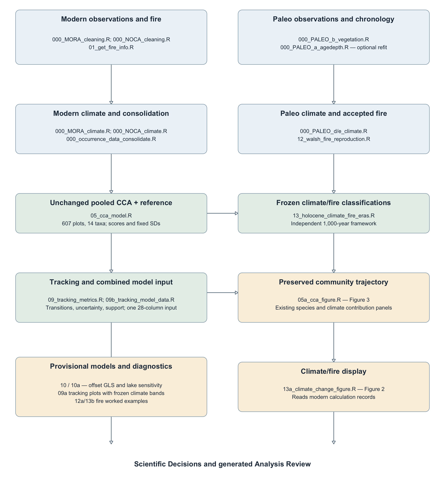

The arrows show dependencies. The table below gives the exact execution order,
including figure production; figure numbers retain their manuscript meaning.
The [combined script](review/00_main_analysis_review.R) contains these stages
verbatim for reading. Run the workflow for an analysis rebuild.

| Order | Analysis step | Scripts |
| --- | --- | --- |
| 1–3 | Modern vegetation and fire | [000_MORA_cleaning.R](../R/stages/000_MORA_cleaning.R); [000_NOCA_cleaning.R](../R/stages/000_NOCA_cleaning.R); [01_get_fire_info.R](../R/stages/01_get_fire_info.R) |
| 4–5 | Modern climate | [000_MORA_climate.R](../R/stages/000_MORA_climate.R); [000_NOCA_climate.R](../R/stages/000_NOCA_climate.R) |
| 6 | Chronology (optional refit) | [000_PALEO_a_agedepth.R](../R/stages/000_PALEO_a_agedepth.R) |
| 7–9 | Paleo vegetation and fire | [000_PALEO_b_vegetation.R](../R/stages/000_PALEO_b_vegetation.R); [000_FIRE_cleaning.R](../R/stages/000_FIRE_cleaning.R); [000_PALEO_c_fire.R](../R/stages/000_PALEO_c_fire.R) |
| 10–11 | Paleo climate | [000_PALEO_d_climate_download.R](../R/stages/000_PALEO_d_climate_download.R); [000_PALEO_e_climate.R](../R/stages/000_PALEO_e_climate.R) |
| 12 | Taxonomy consolidation | [000_occurrence_data_consolidate.R](../R/stages/000_occurrence_data_consolidate.R) |
| 13 | CCA eligibility, calibration and reference | [05_cca_model.R](../R/stages/05_cca_model.R) |
| 14–15 | Fire catalog and climate eras | [12_walsh_fire_reproduction.R](../R/stages/12_walsh_fire_reproduction.R); [13_holocene_climate_fire_eras.R](../R/stages/13_holocene_climate_fire_eras.R) |
| 16 | Canonical lake/plot tracking | [09_tracking_metrics.R](../R/stages/09_tracking_metrics.R) |
| 17 | Combined transition input | [09b_tracking_model_data.R](../R/stages/09b_tracking_model_data.R) |
| 18 | Provisional offset GLS comparisons | [10_tracking_era_models.R](../R/stages/10_tracking_era_models.R) |
| 19 | Offset-0 lake sensitivity | [10a_tracking_lake_sensitivity.R](../R/stages/10a_tracking_lake_sensitivity.R) |
| 20 | Community trajectories: Figure 3 | [05a_cca_figure.R](../R/stages/05a_cca_figure.R) |
| 21–22 | Tracking and fire-detection examples | [09a_tracking_example_and_visualizations.R](../R/stages/09a_tracking_example_and_visualizations.R); [12a_fire_event_detection_worked_example.R](../R/stages/12a_fire_event_detection_worked_example.R) |
| 23–24 | Climate/fire display: Figure 2 and example | [13a_climate_change_figure.R](../R/stages/13a_climate_change_figure.R); [13b_fire_method_worked_example.R](../R/stages/13b_fire_method_worked_example.R) |

| Prepared input | Rows | Plot/sample IDs | Taxa |
| --- | --- | --- | --- |
| MORA | 2490 | 331 | 23 |
| NOCA | 1775 | 305 | 31 |
| paleo | 9590 | 963 | 12 |
| consolidated | 13690 | 1599 | 22 |

[Full cleaning summary table](assets/analysis/tables/cleaning_summary.csv).

## Modern vegetation preparation

Presence means an adult **or** regeneration record. MORA uses the original legacy
workbook and cleaned resurvey tree and seedling files. NOCA applies the received
corrected-tree workbook before building occurrences; unsupported identification
labels are discarded. Both cleaners retain matched survey plots.

**MORA's adult resurvey date is authoritative (decision 2026-10-07).** Seedling
records are assigned to their corresponding adult visit before presence is
constructed. For the 13 plots visited in multiple years, only the latest adult
visit and its matching seedlings are retained; visits tied within a year remain
pooled. This replaces pooling across years and using the earliest tree/seedling
year. The received CSVs are preserved.

The source-year comparison identifies 95 supplied plot names, including 48 analyzed
pairs. That total includes `PRAC-1`, a practice plot without a standardized ID;
94 have standardized IDs. Conflicting years already occur in the original CSVs
and pass unchanged through their upstream cleaner. The earlier export process
is unknown. The [95-plot source table](assets/analysis/tables/year_source_discrepancies.csv)
records the conflicting years, adult dates, treatment and evidence locations;
[survey-year notes](../data/SOURCES_SURVEY_YEARS.md) give the rationale.

| Plot | Adult visits | Selected year | Selected date | Adult records kept | Earlier records removed |
| --- | --- | --- | --- | --- | --- |
| CHIN-084 | 2014; 2015 | 2015 | 8/27/15 | 44 | 56 |
| GOAT-468 | 2014; 2016 | 2016 | 6/30/16 | 14 | 48 |
| LONG-356 | 2015; 2016 | 2016 | 6/21/16 | 25 | 36 |
| LOWE-045 | 2015; 2016 | 2016 | 6/22/16 | 10 | 19 |
| RAMP-093 | 2015; 2016 | 2016 | 6/23/16 | 23 | 36 |
| RAMP-505 | 2018; 2019 | 2019 | 7/11/19 | 40 | 85 |
| RAMP-506 | 2018; 2019 | 2019 | 7/11/19 | 75 | 103 |
| SMO-364 | 2016; 2019 | 2019 | 8/22/19 | 47 | 55 |
| SUNS-046 | 2015; 2016 | 2016 | 6/22/16 | 10 | 22 |
| TAHO-003 | 2014; 2016 | 2016 | 6/24/16 | 21 | 18 |
| WHIT-071 | 2014; 2016 | 2016 | 6/30/16 | 22 | 66 |
| WHIT-273 | 2014; 2016 | 2016 | 6/28/16 | 82 | 121 |
| WHIT-307 | 2015; 2016 | 2016 | 6/29/16 | 20 | 33 |

[Full mora repeat visits table](assets/analysis/tables/mora_repeat_visits.csv).

NOCA excludes `BAK487` for its old clearcut, `BEAV6061` for uncertain relocation,
and `CARI449`/`CARI450` for GPS problems. The latter share coordinates despite
conflicting elevations, and Rachel's notes supply no verified correction.
These exclusions apply to both dates. The cleaned NOCA data contain 305 pairs;
CCA eligibility is assessed later. The [cleaning guide](methods/000_NOCA_cleaning_guide.md)
and [GPS source note](review/NOCA_GPS_EXCLUSION.md) explain the decisions.

| Patch audit status | Affected plot IDs |
| --- | --- |
| excluded | 3 |
| included | 51 |

| Study-excluded plot | Reason |
| --- | --- |
| BAK487 | old clearcut; removed from Wilson final analysis |
| BEAV6061 | historic plot location uncertain; resurvey is an avalanche chute |
| CARI449 | GPS problem; shared coordinates conflict with elevations; no verified correction |
| CARI450 | GPS problem; shared coordinates conflict with elevations; no verified correction |

[Complete correction audit](assets/analysis/tables/correction_audit.csv), [study exclusions](assets/analysis/tables/study_exclusions.csv), and [excluded GPS-coordinate collision](assets/analysis/tables/coordinate_collision.csv).

### Show which NOCA plots remain after cleaning

The cleaned data contain more plots than the final CCA comparisons. Plots empty at one date and the agreed plot exclusions are shown separately.

Script: [000_NOCA_cleaning.R](../R/stages/000_NOCA_cleaning.R). [Complete PDF](../plot/test_figures/NOCA_cleaning.pdf) (3 pages).

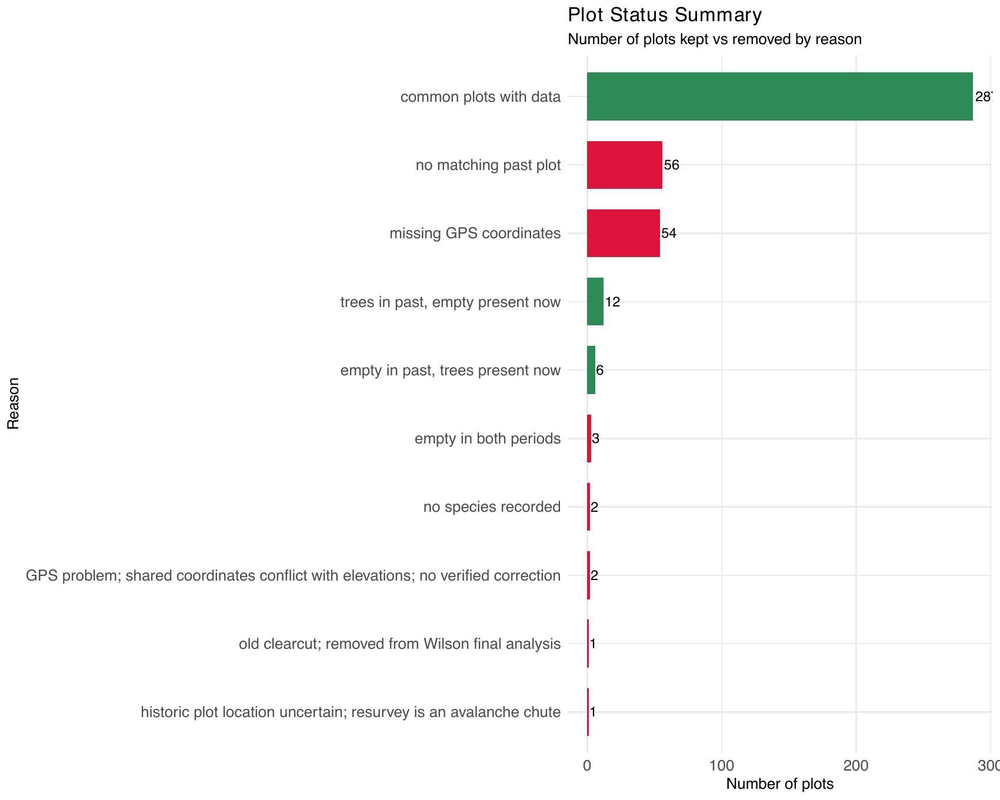

### Show species counts before model taxon selection

Counts reflect adult-or-regeneration presence in cleaned survey plots; they do not measure abundance.

Script: [000_MORA_cleaning.R](../R/stages/000_MORA_cleaning.R). [Complete PDF](../plot/test_figures/MORA_dynamics.pdf) (3 pages).

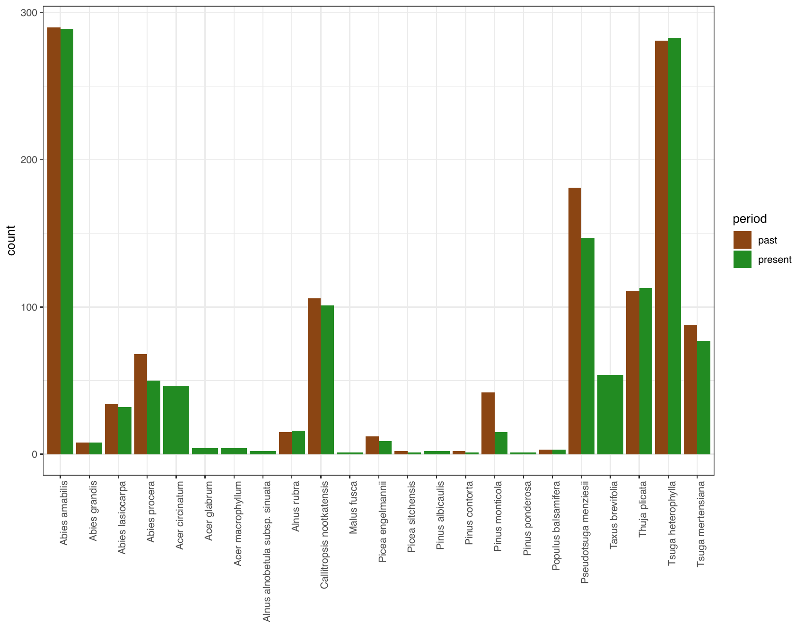

### Compare corrected legacy and resurvey species counts

Species differences describe cleaned surveys before cross-site harmonization and the CCA threshold.

Script: [000_NOCA_cleaning.R](../R/stages/000_NOCA_cleaning.R). [Complete PDF](../plot/test_figures/NOCA_dynamics.pdf) (3 pages).

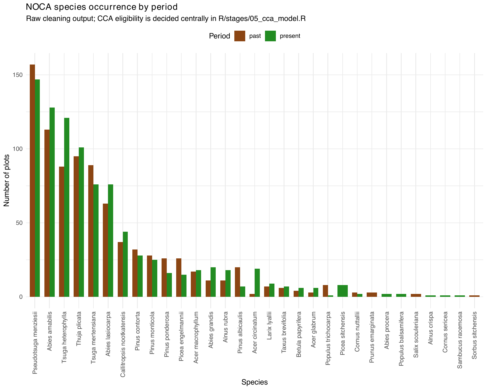

## Modern fire assignments

Mapped disturbance records identify fire exposure for the paired modern plots.
NOCA has 32 burned and 273 unburned plots, with matching assignments on all 303
plots shared with Wilson's reference. MORA's mapped record covers 1987–2017,
so no mapped fire does not establish that a plot remained unburned throughout
the full survey interval.

### Audit NOCA modern fire assignment against Wilson reference plots

The 303 shared plots agree. The cleaned 305-plot universe excludes CARI449/CARI450 for GPS problems; the Wilson reference is not substituted for it.

Script: [01_get_fire_info.R](../R/stages/01_get_fire_info.R). [Complete PDF](../plot/test_figures/NOCA_fire_map_Wilson2024_PaleoACES.pdf) (1 page).

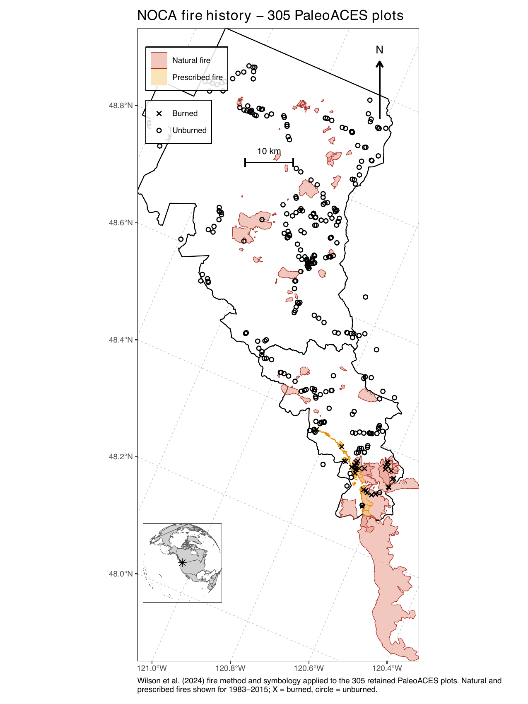

## Modern climate preparation

CHELSA V2.1 monthly values supply spring temperature (MSpT), winter temperature
(MWT), summer precipitation (SP) and winter precipitation (WP). Temperature is
the midpoint of monthly minima and maxima, then averaged over the season;
precipitation is summed. These are seasonal climate proxies, not direct measures
of growing degree days, soil moisture or snowpack.

Spring is March–May, summer June–August and winter December–February. Modern
December belongs to the following winter. All three months are required;
temperatures are in °C and precipitation in mm per season.

**Climate-year selection.** Historical climate remains **1979–1989** at both
sites. Each modern plot uses its adult resurvey year **Y** and the five preceding
years: **Y−5 through Y, inclusive**. We average these six years to represent the
interannual climate dynamics that the community experienced before and during
the survey. A 2014 resurvey therefore uses 2009–2014, with December 2008 included
in winter 2009. Every modern constraint requires six complete season-years.

Climate rates use the interval from the historical midpoint **1984** to the
plot-specific modern midpoint **Y−2.5**: **27.5–32.5 years at MORA** and
**27.5–28.5 years at NOCA**. Vegetation rates use the selected adult year and
legacy references of 1977.5 (MORA) or 1983 (NOCA). Missing January 1979 leaves ten
complete legacy winters; spring and summer retain eleven years. The historical
window choice remains settled, and possible MORA precipitation inhomogeneity
remains a limitation.

| Site | Period | Plots | Spring years | Winter years | Summer years | Winter precipitation years |
| --- | --- | --- | --- | --- | --- | --- |
| MORA | past | 331 | 11 | 10 | 11 | 10 |
| MORA | present | 331 | 6 | 6 | 6 | 6 |
| NOCA | past | 305 | 11 | 10 | 11 | 10 |
| NOCA | present | 305 | 6 | 6 | 6 | 6 |

[Full climate windows table](assets/analysis/tables/climate_windows.csv).

The following cohorts and diagnostic use the final paired comparison plots.
The annual lines show those same plots; separate colored bands show each cohort's
window without hiding overlapping windows. MORA is blue and NOCA orange.

| Site | Survey | Adult resurvey year | First climate year | Last climate year | Analyzed plots |
| --- | --- | --- | --- | --- | --- |
| MORA | past | — | 1979 | 1989 | 330 |
| MORA | present | 2014 | 2009 | 2014 | 50 |
| MORA | present | 2015 | 2010 | 2015 | 174 |
| MORA | present | 2016 | 2011 | 2016 | 47 |
| MORA | present | 2017 | 2012 | 2017 | 11 |
| MORA | present | 2018 | 2013 | 2018 | 7 |
| MORA | present | 2019 | 2014 | 2019 | 41 |
| NOCA | past | — | 1979 | 1989 | 277 |
| NOCA | present | 2014 | 2009 | 2014 | 50 |
| NOCA | present | 2015 | 2010 | 2015 | 227 |

[Full survey climate windows table](assets/analysis/tables/survey_climate_windows.csv).

### Compare selected survey windows with the full 1979–2021 record

Detrending does not resolve CHELSA product continuity. Apparent precipitation anomalies remain a scientific limitation.

Script: [test_survey_year_anomaly.R](../R/diagnostics/test_survey_year_anomaly.R). [Complete PDF](../plot/test_figures/test_survey_year_anomaly.pdf) (1 page).

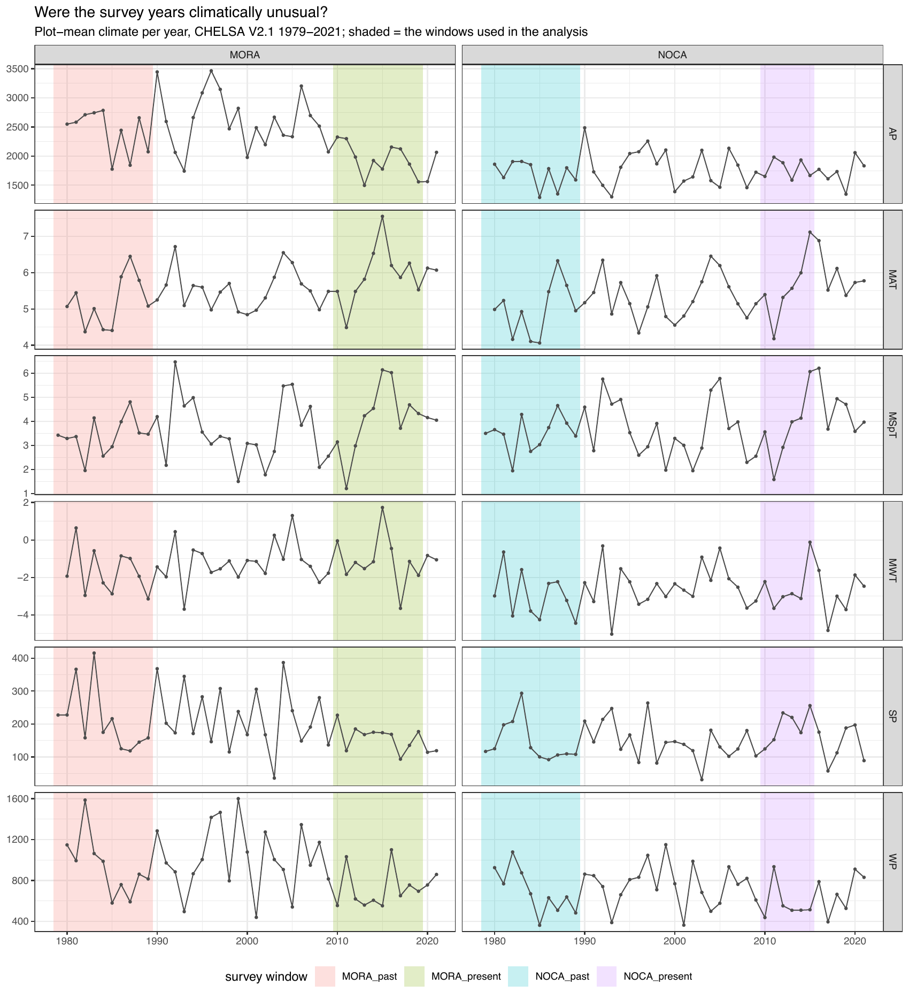

## Chronology and uncertainty

The four Bacon models provide sample ages, allowing vegetation to be matched
to climate through time. The [control-point register](../Cores/CONTROL_POINTS.md)
explains radiocarbon dates, tephra ages, surface controls and instantaneous layers.
Tracking uses 100 whole-chronology draws per core, preserving temporal dependence
within each core.

**The chronology choices are retained for this analysis.** Some tephra errors
are assumed bracket half-widths, rather than verified statistical standard
deviations. Reflection Pond's basal-lahar control also retains an assumed age
error and an unverified core-to-deposit correlation. The draws describe
uncertainty conditional on these controls and the Bacon model; they do not
represent every source of dating uncertainty. The [MORA reconsideration](../Cores/SOURCES_MORA.md#basal-lahar-reconsideration-2026-10-06)
records the sources and reason for retaining the existing model.

Panther Potholes' primary chronology deliberately retains inherited Pb210
activity errors for reproduction. The existing **assumed ±10-year age-error
sensitivity** examines that limitation without replacing the primary chronology.
The deeper models are similar, not identical: the
[stored comparison](review/PB210_STORED_SENSITIVITY_COMPARISON.csv) finds maximum
differences below 35 cm of 15 years in median age and 24/28 years in the lower/upper
95% bounds. The [NOCA source notes](../data/NOCA/NOCA_paleo/SOURCES.md) preserve the
earlier discussion. This report uses stored chronologies; no chronology model is refitted.

### Inspect four fitted age-depth models and slump treatment

The four age-depth curves show sediment accumulation, removed instantaneous layers and modeled age ranges. Those ranges are conditional on the adopted controls and Bacon settings.

Script: [000_PALEO_a_agedepth.R](../R/stages/000_PALEO_a_agedepth.R). [Complete PDF](../plot/test_figures/fig_bacon_agedepth_slump.pdf) (1 page).


### Compare published activity errors with assumed ±10-year age uncertainty

The sensitivity concerns the upper 35–40 cm of Panther Potholes; uncertainty in published fire chronologies is not equivalent across sites. **Chronology sensitivity**.

Script: [000_PALEO_a_agedepth.R](../R/stages/000_PALEO_a_agedepth.R). [Complete PDF](../plot/test_figures/fig_bacon_pb210_sensitivity.pdf) (1 page).

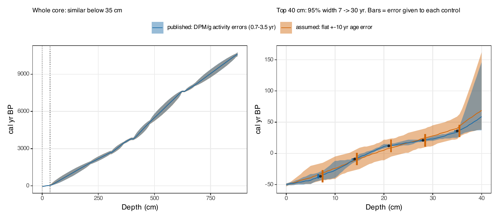

## Paleo vegetation and fire preparation

Macrofossil records are harmonized into presence/absence observations while
retaining their lake, sample depth and modeled age. Macrofossil percentages and
survey stem counts are not combined as abundance. A sample without detected
tree taxa does not demonstrate an absence of forest.

Charcoal and charred-needle information is prepared separately from vegetation.
The MORA published charcoal chronologies and the Panther Potholes core do not
have equivalent timing precision or spatial support. Later fire classification
uses the accepted-event catalog described below.

## Paleo climate preparation

CHELSA-TraCE21k supplies climate at the four pond locations. Each vegetation
sample is matched to the available climate slice nearest its own age, within
the 50-year tolerance. The seasonal variables and units match the modern
analysis; December remains within its paleo climatology slice.

Raw TraCE21k is the current input. A V2.1-based correction is planned as a
sensitivity and has not been applied. The comparison at the end of this review
shows the available recent overlap and its different averaging windows.

### Inspect redundancy among candidate climate variables

Only page 2 (correlations) is inline. Page 1 and associated pace tables retain the former 500-year sensitivity and are not primary rate evidence. **Correlation diagnostic; full PDF includes 500-year sensitivity**.

Script: [test_climate_change_variables.R](../R/diagnostics/test_climate_change_variables.R). [Complete PDF](../plot/test_figures/climate_holocene_timeseries.pdf) (2 pages).

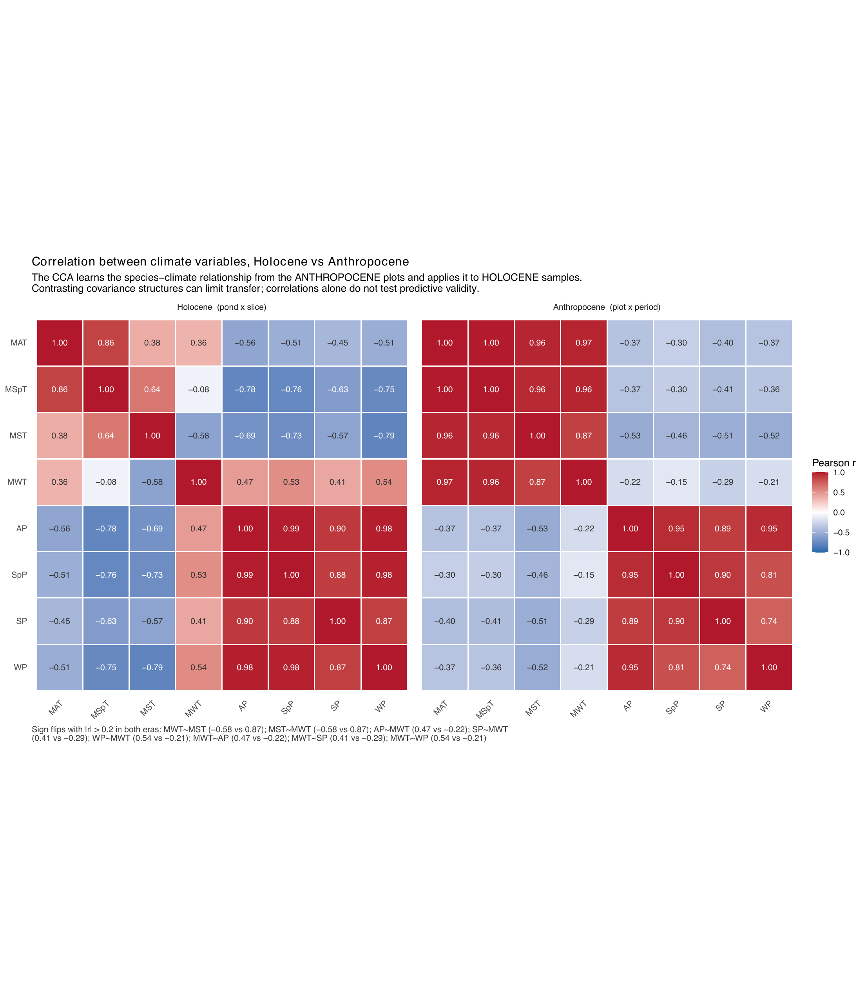

Only the correlation page is shown here. The full climate diagnostic also
contains older **500-year sensitivity** calculations; those are separate from
primary climate-rate results.

## Taxonomy and species selection

[Consolidation](methods/README_occurrence_consolidation.md) aligns Populus,
Picea and Abies identifications across surveys and macrofossils. Acer circinatum
and Taxus brevifolia are removed for stratum compatibility. Pinus ponderosa's
manual exclusion was [reversed on 2026-10-08](SCIENTIFIC_DECISIONS.md#ponderosa-reinstatement);
it is now retained and follows the ordinary frequency rule below.

CCA retains a taxon when it occurs in **at least 20 plots or samples in any one
site × period group**. The rule does not require 20 in every group. Pinus
albicaulis reaches exactly 20 and remains included. Selection rests on taxon
relevance and ordination interpretation; increased explained inertia alone is
not its justification. Resurvey and paleo counts influence selection even
though those observations do not calibrate the CCA.

| Taxon | MORA legacy | MORA resurvey | MORA paleo | NOCA legacy | NOCA resurvey | NOCA paleo | CCA retained |
| --- | --- | --- | --- | --- | --- | --- | --- |
| Abies amabilis | 290 | 288 | 117 | 113 | 128 | 0 | TRUE |
| Abies lasiocarpa | 34 | 31 | 92 | 63 | 76 | 468 | TRUE |
| Abies procera | 68 | 50 | 43 | 0 | 0 | 0 | TRUE |
| Callitropsis nootkatensis | 106 | 101 | 78 | 37 | 44 | 38 | TRUE |
| Picea engelmannii | 12 | 9 | 5 | 26 | 22 | 12 | TRUE |
| Pinus contorta | 2 | 1 | 31 | 32 | 28 | 285 | TRUE |
| Pinus monticola | 42 | 14 | 90 | 28 | 25 | 489 | TRUE |
| Pseudotsuga menziesii | 181 | 147 | 40 | 157 | 147 | 594 | TRUE |
| Tsuga heterophylla | 281 | 283 | 54 | 88 | 121 | 179 | TRUE |
| Tsuga mertensiana | 88 | 75 | 108 | 89 | 76 | 39 | TRUE |
| Abies grandis | 8 | 7 | 0 | 11 | 20 | 0 | TRUE |
| Alnus rubra | 15 | 15 | 0 | 11 | 18 | 0 | FALSE |
| Picea sitchensis | 2 | 0 | 0 | 0 | 0 | 0 | FALSE |
| Populus trichocarpa | 3 | 3 | 0 | 8 | 3 | 0 | FALSE |
| Thuja plicata | 111 | 110 | 0 | 95 | 101 | 159 | TRUE |
| Acer macrophyllum | 0 | 4 | 0 | 17 | 18 | 0 | FALSE |
| Malus fusca | 0 | 1 | 0 | 0 | 0 | 0 | FALSE |
| Pinus albicaulis | 0 | 2 | 0 | 20 | 7 | 0 | TRUE |
| Pinus ponderosa | 0 | 1 | 0 | 26 | 16 | 0 | TRUE |
| Juniperus communis | 0 | 0 | 0 | 0 | 0 | 8 | FALSE |
| Betula papyrifera | 0 | 0 | 0 | 4 | 6 | 0 | FALSE |
| Larix lyallii | 0 | 0 | 0 | 7 | 9 | 0 | FALSE |

[Full CCA taxa table](assets/analysis/tables/cca_taxa.csv).

NOCA size classes differ between dates: legacy regeneration spans 0–3 m and
adults exceed 3 m; resurvey seedlings span 10–140 cm and trees exceed 1.4 m.
These strata are not identical measurements across surveys.

### Inspect consolidated occurrence counts in each site-period group

Retention requires at least 20 plots or samples in one group. The threshold is not required in every group.

Script: [000_occurrence_data_consolidate.R](../R/stages/000_occurrence_data_consolidate.R). [Complete PDF](../plot/test_figures/species_counts_consolidated.pdf) (1 page).

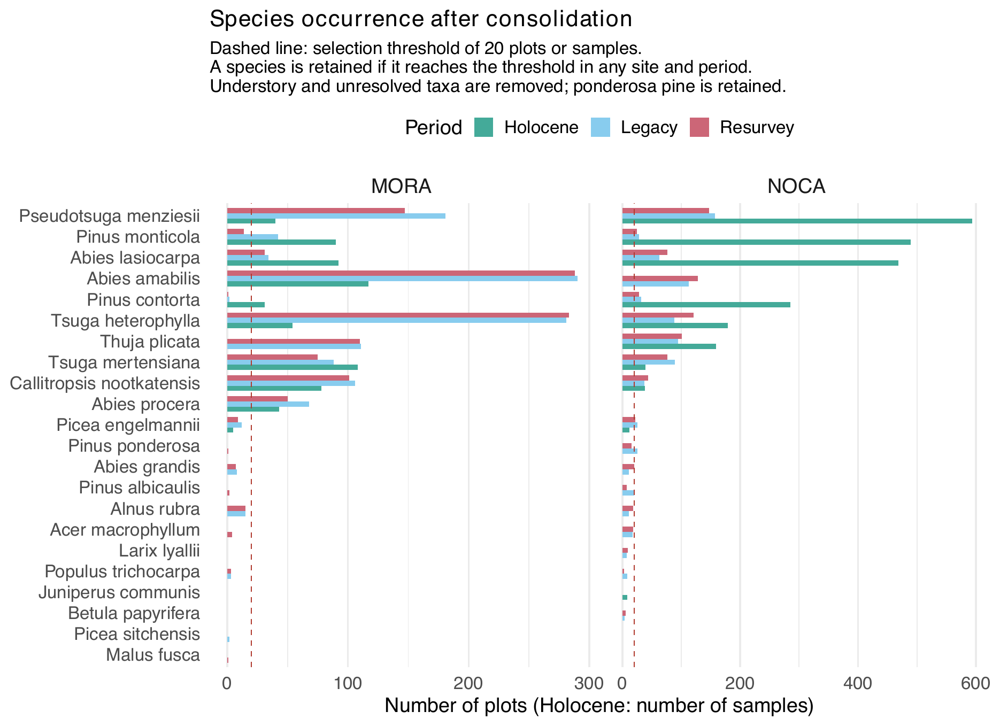

### Expose adult versus regeneration support for presence

Adult and regeneration sources contribute to presence; stem counts and macrofossil percentages are not combined as abundance.

Script: [000_occurrence_data_consolidate.R](../R/stages/000_occurrence_data_consolidate.R). [Complete PDF](../plot/test_figures/stage_adult_seedling_past_present.pdf) (1 page).

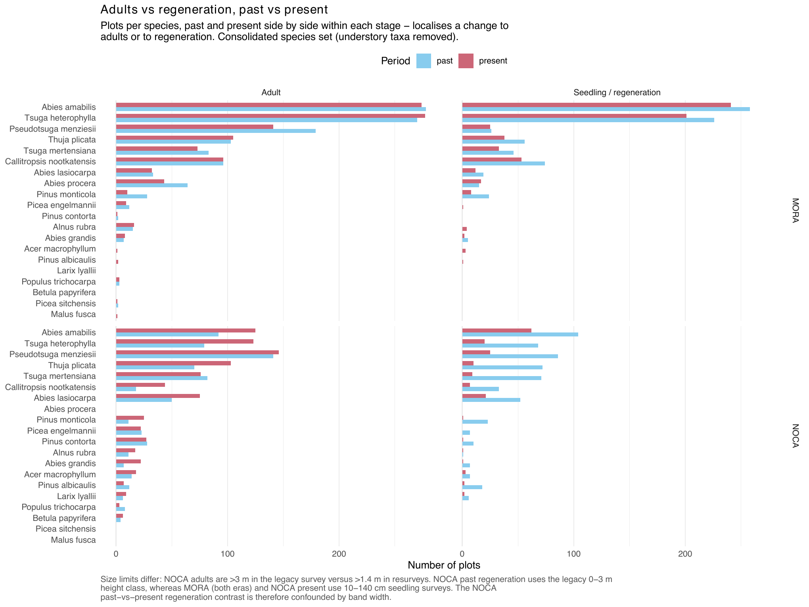

### Inspect taxon site confounding and temporal occupancy

This explicitly retains the 500-year occupancy sensitivity. Sparse sampling is shown; the primary tracking analysis uses 1,000 years. **500-year sensitivity**.

Script: [test_species_through_time.R](../R/diagnostics/test_species_through_time.R). [Complete PDF](../plot/test_figures/species_through_time.pdf) (1 page).

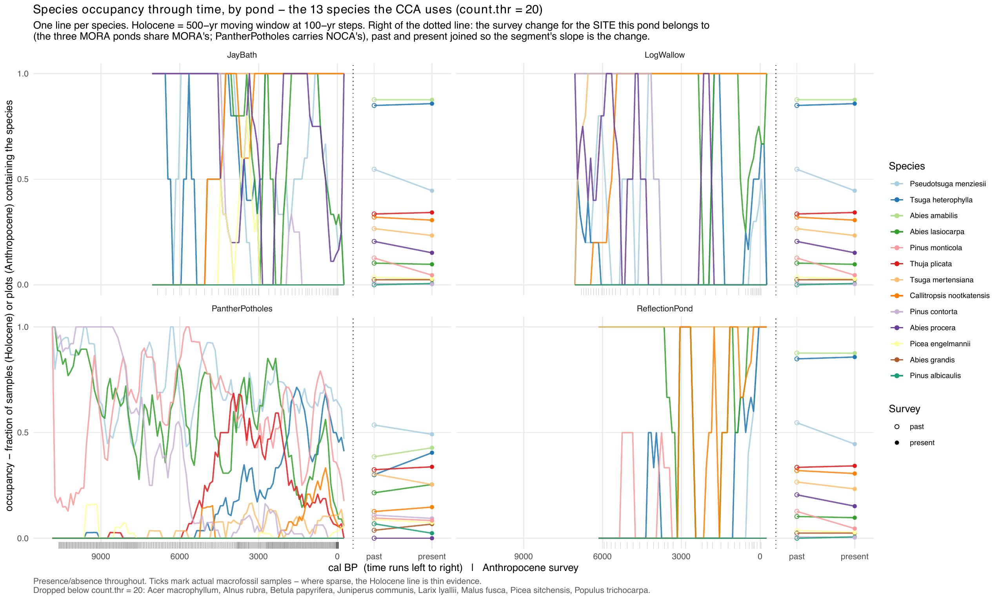

The occupancy display is explicitly a **500-year sensitivity**. Primary
Holocene tracking uses 1,000-year intervals.

## Plots and samples included in CCA

The following diagram starts with the supplied survey lists and core sample
depths. It shows losses during matching and cleaning, then the species and
climate checks required for CCA. The starting legacy and resurvey counts are
separate; their exclusions must not be added together. Core depths sharing one
modeled age are combined, rather than excluded.

### From starting plots and core samples to the CCA

Each count shows plots or samples remaining. Reasons beside the arrows explain losses; repeated visits and sample depths combined at the same modeled age are distinguished from exclusions. The middle panels show legacy adult-tree areas among retained plots and the confirmed 500 m² resurvey area at both sites.

Script: [plot_sample_selection.R](../R/diagnostics/plot_sample_selection.R). [Complete PDF](../plot/test_figures/plots_to_cca.pdf) (1 page).

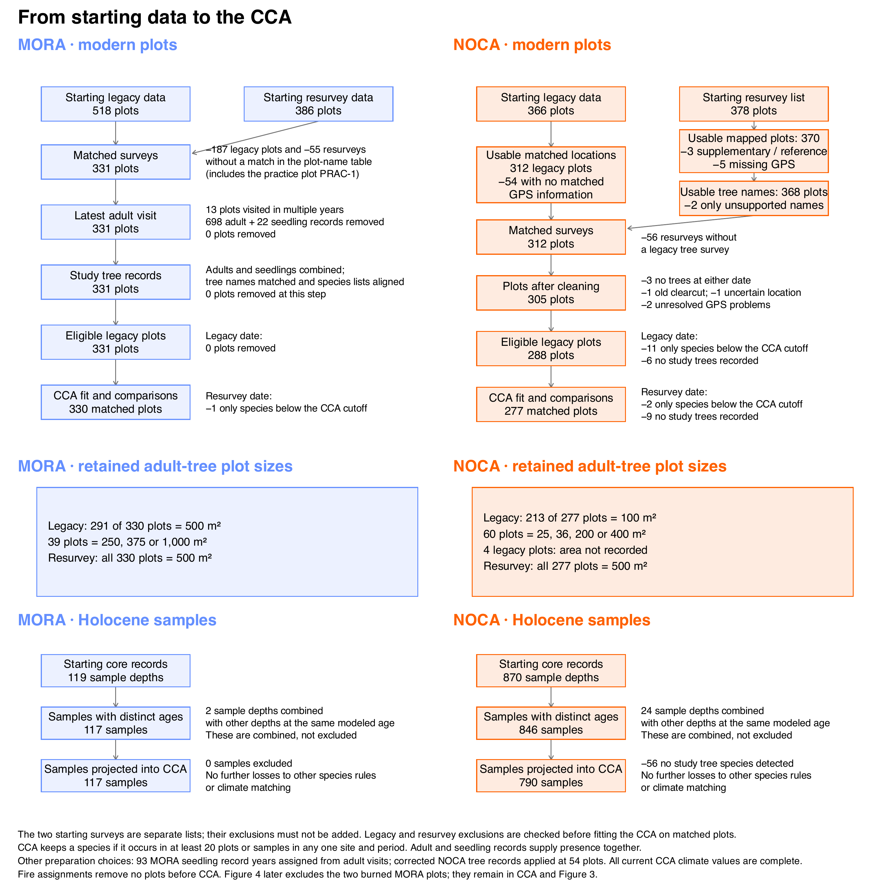

The [counts at each step](assets/analysis/tables/sample_selection_counts.csv)
and [choices affecting records](assets/analysis/tables/sample_selection_choices.csv)
are available as tables.

The diagram also shows the [legacy adult-tree plot sizes](assets/analysis/tables/sample_selection_plot_sizes.csv)
among the plots retained for CCA. Adult-tree resurvey plots cover **500 m² at both
sites**. Legacy areas vary, so matching plot identities does not mean that the
sampled areas were equal. Plot size currently does not determine eligibility.

Choices such as correcting tree records and keeping the latest adult visit
change the observations without necessarily removing plots. They are shown
alongside the count changes. All current CCA climate values are complete.
The two burned MORA plots remain in CCA and in the canonical 607-plot tracking table.

[05_cca_model.R](../R/stages/05_cca_model.R) resolves eligibility **before fitting
or projecting**. An observation with no retained taxa has no observed WA
position. It is excluded from both observed and climate-predicted comparisons.
Modern endpoints use the same eligible pairs at both dates; Holocene WA and LC
positions also use identical samples. The CCA is fitted on the legacy observations
of these same matched plots; a plot excluded at resurvey is also excluded from
calibration. The diagram's final modern counts therefore serve both fitting and
comparison.

| Era | Site | Use | Prepared plots/samples | Excluded | Included |
| --- | --- | --- | --- | --- | --- |
| anthropocene | MORA | Legacy calibration | 331 | 1 | 330 |
| anthropocene | MORA | Modern paired comparison | 331 | 1 | 330 |
| anthropocene | NOCA | Legacy calibration | 305 | 28 | 277 |
| anthropocene | NOCA | Modern paired comparison | 305 | 28 | 277 |
| holocene | MORA | Paleo projection | 117 | 0 | 117 |
| holocene | NOCA | Paleo projection | 846 | 56 | 790 |

[Full CCA eligibility counts table](assets/analysis/tables/cca_eligibility_counts.csv).

Exclusion reasons are separated below. Each modern pair is counted once,
against its first failing endpoint, with legacy checked first. Calibration and
paired-comparison counts overlap and must not be added together. Holocene
counts are samples before age draws or temporal binning.

| Era | Site | Use | Excluded at | Reason | Count |
| --- | --- | --- | --- | --- | --- |
| anthropocene | MORA | Legacy calibration | present | Only taxa excluded by CCA species selection | 1 |
| anthropocene | MORA | Modern paired comparison | present | Only taxa excluded by CCA species selection | 1 |
| anthropocene | NOCA | Legacy calibration | past | No tree taxa recorded at legacy | 6 |
| anthropocene | NOCA | Legacy calibration | past | Only taxa excluded by CCA species selection | 11 |
| anthropocene | NOCA | Legacy calibration | present | Loss of all recorded tree-taxon presence at resurvey | 9 |
| anthropocene | NOCA | Legacy calibration | present | Only taxa excluded by CCA species selection | 2 |
| anthropocene | NOCA | Modern paired comparison | past | No tree taxa recorded at legacy | 6 |
| anthropocene | NOCA | Modern paired comparison | past | Only taxa excluded by CCA species selection | 11 |
| anthropocene | NOCA | Modern paired comparison | present | Loss of all recorded tree-taxon presence at resurvey | 9 |
| anthropocene | NOCA | Modern paired comparison | present | Only taxa excluded by CCA species selection | 2 |
| holocene | NOCA | Paleo projection | paleo | No tree taxa detected in paleo sample | 56 |

[Full CCA exclusion summary table](assets/analysis/tables/cca_exclusion_summary.csv).

“Loss of all recorded tree-taxon presence at resurvey” describes absence in the
sampled taxa and strata, not proven biological extinction. “No tree taxa detected
in paleo sample” describes macrofossil non-detection. Cases holding only taxa
removed during consolidation or CCA selection are listed separately. Missing
climate and unmatched endpoints are also classified if encountered.

The [sample table](assets/analysis/tables/cca_sample_eligibility.csv) and
[paired-plot table](assets/analysis/tables/cca_pair_eligibility.csv) retain the
individual reasons. The cleaned data retain these observations even when they
cannot enter CCA tracking.

## CCA calibration and geometry

One pooled legacy CCA relates composition to the four climate variables, using
the same matched plots used in both-date comparisons (330 MORA and 277 NOCA).
This matched calibration was selected on 2026-10-08; the former fit used 619
eligible legacy plots. The ≥20 species-selection rule and 14 taxa are unchanged.
Observed **weighted-average (WA)** scores describe composition; predicted
**linear-combination (LC)** scores describe the position expected from climate.
Modern resurveys and paleo samples enter the existing ordination without
recalibrating it.

| Fitted model quantity | Value |
| --- | --- |
| Legacy calibration plots | 607 |
| Retained taxa | 14 |
| Minimum occupancy in one site × period | 20 |
| CCA score scaling | Site scaling (1) |
| Hill scaling | Off |
| Climate variables | MSpT;MWT;SP;WP |
| Total inertia | 3.465 |
| Climate-constrained inertia | 0.531 |
| Constrained inertia (%) | 15.33 |
| Modern plots and paleo samples before eligibility | 1599 |
| Eligible modern pairs and paleo samples | 1514 |

[Full CCA summary table](assets/analysis/tables/cca_summary.csv).

| Site | Period | Prepared climate samples | Calibrated | Positioned projection |
| --- | --- | --- | --- | --- |
| MORA | paleo | 117 | — | 117 |
| MORA | past | 331 | 330 | — |
| MORA | present | 331 | — | 330 |
| NOCA | paleo | 846 | — | 790 |
| NOCA | past | 305 | 277 | — |
| NOCA | present | 305 | — | 277 |

[Full CCA counts table](assets/analysis/tables/cca_counts.csv).

CCA1–CCA2 and site scaling (1), with Hill scaling off, define all distances and
angles. Display arrow multipliers do not enter calculations. Binary presence
still carries CCA's row and taxon weighting. The displayed axes represent only
part of total community inertia, and correlated climate variables prevent
adding their marginal contributions as independent shares. Projections are
descriptive scores rather than independently validated forecasts.

### Compare scaling 1 and 2 of the same fitted CCA

Site scaling (1), Hill off and CCA1–CCA2 define the primary geometry. Unequal rescaling of axes changes distances and angles; display arrow multipliers are excluded from the calculations.

Script: [test_cca_scaling_comparison.R](../R/diagnostics/test_cca_scaling_comparison.R). [Complete PDF](../plot/test_figures/fig_cca_scaling_comparison.pdf) (1 page).

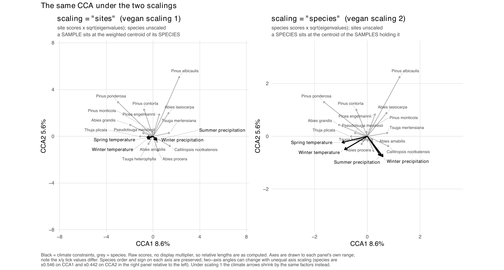

## Tracking calculations

Observed movement is the change in WA position; climate-predicted movement is
the change in LC position. Endpoint lag is the distance between LC and WA.
**Δlag is final lag minus initial lag**: positive values mean the mismatch opens.
The tracking ratio compares observed and predicted movement rates; the angle
compares their directions and is undefined when either movement is stationary.

Primary Holocene calculations treat each lake separately before calculating nonlinear
metrics for consecutive **1,000-year intervals**. Each core contributes 100
chronology draws, and ten 100-year offsets assess sensitivity to interval
placement. Draws are summarized within offset before offsets are combined.
These realizations are not additional ecological replicates. One-sample bins
remain flagged, with an existing minimum-two-sample sensitivity.

## Accepted fire events and climate eras

The accepted-event catalog uses the shared tapas detector with core-specific
interpolation, background smoothing and local thresholds. All cores use
unlogged charcoal accumulation, robust LOWESS background, a local Gaussian-mixture
threshold and a 75-year count screen with p ≤ 0.05. Accepted totals are 17
Sunrise, 14 Shadow, 13 Little Sunrise and 66 Panther Potholes. The existing
12.5-year NOCA interpolation sensitivity yields 72 events.

| Lake | Engine | Interpolation years | Background years | Local threshold |
| --- | --- | --- | --- | --- |
| Sunrise Lake | tapas | 48 | 800 | 0.95 |
| Shadow Lake | tapas | 47 | 1000 | 0.95 |
| Little Sunrise Lake | tapas | 42 | 500 | 0.95 |
| PantherPotholes | tapas | 12 | 500 | 0.99 |

[Full fire settings table](assets/analysis/tables/fire_settings.csv).

| Lake | Candidates | Count rejected | Accepted |
| --- | --- | --- | --- |
| Sunrise Lake | 26 | 9 | 17 |
| Shadow Lake | 17 | 3 | 14 |
| Little Sunrise Lake | 20 | 7 | 13 |
| PantherPotholes | 66 | 0 | 66 |

[Full event audit table](assets/analysis/tables/event_audit.csv).

The official CharAnalysis comparison is separate from the primary catalog.
Its discrepancy with Walsh's publication is retained without threshold tuning.

| Lake | Official R episodes | Published total | Difference |
| --- | --- | --- | --- |
| Little Sunrise Lake | 14 | 16 | -2 |
| Shadow Lake | 16 | 18 | -2 |
| Sunrise Lake | 15 | 24 | -9 |

[Full walsh audit table](assets/analysis/tables/walsh_audit.csv).

### Compare official CharAnalysis results with published Walsh totals

The official CharAnalysis implementation and Walsh publication give different event totals. This comparison is separate from the primary tapas event catalog, whose thresholds were not tuned to force agreement.

Script: [12_walsh_fire_reproduction.R](../R/stages/12_walsh_fire_reproduction.R). [Complete PDF](../plot/test_figures/fig_walsh_charanalysis_reproduction.pdf) (3 pages).

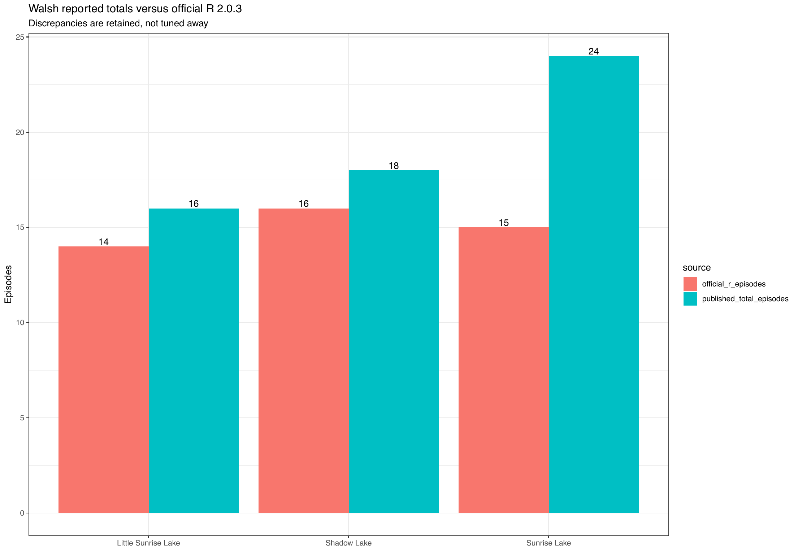

Climate eras are defined independently of vegetation, fire and literature.
Signed 1,000-year changes are divided by legacy-calibration standard deviations;
MORA lakes are averaged first, then MORA and NOCA receive equal regional weight.
A variable qualifies at 50% of its own maximum absolute regional median, with
at least eight of ten offsets supporting its direction. Any qualifying variable
marks climate change; adjacent cells merge into eras. The unsigned four-variable
composite provides context, rather than defining a boundary. Complete offset
support spans 9.6–1.3 ka.

| Era | Class | Older cal BP | Younger cal BP | Duration years |
| --- | --- | --- | --- | --- |
| CC1 | climate change | 9600 | 7200 | 2400 |
| S1 | relative stability | 7200 | 6800 | 400 |
| CC2 | climate change | 6800 | 6200 | 600 |
| S2 | relative stability | 6200 | 5400 | 800 |
| CC3 | climate change | 5400 | 4900 | 500 |
| S3 | relative stability | 4900 | 2200 | 2700 |
| CC4 | climate change | 2200 | 1700 | 500 |
| S4 | relative stability | 1700 | 1300 | 400 |

[Full era catalog table](assets/analysis/tables/era_catalog.csv).

High-fire periods are defined independently from centered 1,000-year event
frequencies. Each core is normalized by its own maximum; MORA averages covered
cores equally and requires at least two. A site's frequency must exceed its
median plus 1.4826 × MAD. Above-threshold periods are retained without bridging
coverage gaps. Five MORA and six NOCA high-fire periods result. These categories
use fixed median event chronologies, without propagating event-timing uncertainty.

## Community trajectories

Figure 3 connects observed and predicted centroids for each site through the
CC1–S4 eras. These are separate WA and LC trajectories within the same fitted
ordination. Modern arrows use exactly the same eligible pairs at both endpoints;
their matched legacy observations also provide the CCA calibration.

| Site | Survey | Same paired plots | Observed CCA1 | Observed CCA2 | Predicted CCA1 | Predicted CCA2 |
| --- | --- | --- | --- | --- | --- | --- |
| MORA | legacy | 330 | 0.01916 | -0.2931 | 0.02739 | -0.2841 |
| MORA | resurvey | 330 | 0.007418 | -0.3313 | -0.3602 | -0.1502 |
| NOCA | legacy | 277 | -0.1207 | 0.4995 | -0.1007 | 0.455 |
| NOCA | resurvey | 277 | -0.1448 | 0.3547 | -0.24 | 0.4876 |

[Full modern centroids table](assets/analysis/tables/modern_centroids.csv).

| Site | Era | Positioned dates | Observed CCA1 | Observed CCA2 | Predicted CCA1 | Predicted CCA2 |
| --- | --- | --- | --- | --- | --- | --- |
| MORA | CC1 | 3 | 0.1855 | 0.4639 | -0.03907 | -0.823 |
| MORA | S1 | 4 | 0.2911 | 0.5599 | 0.07978 | -0.809 |
| MORA | CC2 | 6 | 0.3504 | 0.5708 | 0.1344 | -0.7955 |
| MORA | S2 | 8 | 0.5449 | 0.5334 | 0.1561 | -0.7924 |
| MORA | CC3 | 5 | 0.5979 | 0.5077 | 0.1145 | -0.7755 |
| MORA | S3 | 27 | 0.6901 | 0.2025 | 0.05787 | -0.8415 |
| MORA | CC4 | 5 | 0.7129 | -0.1067 | 0.05517 | -0.8728 |
| MORA | S4 | 4 | 0.705 | -0.02137 | 0.007844 | -0.8396 |
| NOCA | CC1 | 24 | -0.1834 | 1.359 | -0.3362 | 0.372 |
| NOCA | S1 | 4 | -0.1626 | 0.9889 | -0.3979 | 0.2585 |
| NOCA | CC2 | 6 | -0.1517 | 1.027 | -0.343 | 0.2691 |
| NOCA | S2 | 8 | -0.05666 | 0.904 | -0.3159 | 0.26 |
| NOCA | CC3 | 5 | -0.08602 | 0.7052 | -0.3443 | 0.2513 |
| NOCA | S3 | 27 | -0.1752 | 0.6288 | -0.3358 | 0.2229 |
| NOCA | CC4 | 5 | -0.2261 | 0.3776 | -0.3364 | 0.25 |
| NOCA | S4 | 4 | -0.2744 | 0.1739 | -0.356 | 0.2696 |

[Full era centroids table](assets/analysis/tables/era_centroids.csv).

### CCA model, contributions and tests

The model below is fitted to the **607 matched legacy plots and 14 retained
tree species**. Species values are binary presence, combining adults and
regeneration. The climate rows use those same plots in the same order.
`MSpT` is spring temperature, `MWT` winter temperature, `SP` summer precipitation
and `WP` winter precipitation. The fitting and resurvey-projection lines are
copied from [05_cca_model.R](../R/stages/05_cca_model.R), with the current scaling
settings shown explicitly.

The [calibration reference bundle](assets/analysis/cca_calibration_reference.rds)
preserves the fitted CCA, calibration matrices and identities, species and
climate scores, scaling, prepared endpoints and provenance for future work.

```r
# Current settings; presence and climate tables are prepared above in 05_cca_model.R.
CCA_VARIABLES = c("MSpT", "MWT", "SP", "WP")
cca_scaling = "sites"
cca_hill = FALSE

# Matched legacy observations used to calibrate the CCA.
species_past_final = species_past[present_pairs, keep_species, drop = FALSE]
env_past_final = env_past[present_pairs, CCA_VARIABLES, drop = FALSE]

cca_formula = reformulate(CCA_VARIABLES, response = "species_past_final")
cca_model = cca(cca_formula, data = env_past_final)

# Resurvey positions: climate-predicted (LC) and observed (WA).
predicted_present = predict(cca_model, newdata = env_present_final, type = "lc", scaling = cca_scaling, hill = cca_hill)
projected_present = predict(cca_model, newdata = species_present_final,
                            type = "wa", scaling = cca_scaling, hill = cca_hill)
```

**Fitted model output.** Inertia measures variation in community composition;
the constrained part is the variation explained by these climate variables.

```text

Call: cca(formula = species_past_final ~ MSpT + MWT + SP + WP, data =
env_past_final)

              Inertia Proportion Rank
Total          3.4648     1.0000
Constrained    0.5310     0.1533    4
Unconstrained  2.9338     0.8467   13

Inertia is scaled Chi-square

Eigenvalues for constrained axes:
   CCA1    CCA2    CCA3    CCA4
0.29766 0.19574 0.03152 0.00606

Eigenvalues for unconstrained axes:
   CA1    CA2    CA3    CA4    CA5    CA6    CA7    CA8    CA9   CA10   CA11
0.4902 0.3697 0.3563 0.3219 0.2565 0.2345 0.2029 0.1781 0.1375 0.1253 0.1153
  CA12   CA13
0.0993 0.0462
```

| Axis | Eigenvalue | % total inertia | % constrained inertia |
| --- | --- | --- | --- |
| CCA1 | 0.2977 | 8.591 | 56.06 |
| CCA2 | 0.1957 | 5.649 | 36.86 |
| CCA3 | 0.03152 | 0.9098 | 5.937 |
| CCA4 | 0.006062 | 0.175 | 1.142 |

[Full CCA axes table](assets/analysis/tables/cca_axes.csv).

**Permutation ANOVA.** The overall test assesses the four climate variables
together. Axis tests assess each axis after accounting for preceding axes.
All reported tests use **9,999 permutations**, with seed `20261008`.
Unrestricted permutations shuffle plots across the whole calibration set;
within-park permutations shuffle plots within MORA and NOCA separately.
Neither design accounts for finer spatial dependence among plots. These are
tests of association, rather than predictive validation. See the
[vegan ANOVA methods](https://vegandevs.github.io/vegan/reference/anova.cca.html).

| Model / axis | df | Pseudo-F | p: unrestricted | p: within parks |
| --- | --- | --- | --- | --- |
| Whole model | 4 | 27.24 | 0.0001 | 0.0001 |
| CCA1 | 1 | 61.08 | 0.0001 | 0.0001 |
| CCA2 | 1 | 40.35 | 0.0001 | 0.0001 |
| CCA3 | 1 | 6.536 | 0.0001 | 0.0001 |
| CCA4 | 1 | 1.262 | 0.1712 | 0.1176 |

[Full CCA anova table](assets/analysis/tables/cca_anova.csv).

CCA1, CCA2 and CCA3 meet p < 0.05 when plots are shuffled within parks. CCA4 does not meet that threshold.

[Complete ANOVA output](assets/analysis/cca_anova_output.txt) includes residual
degrees of freedom and all overall, axis and climate-variable tests.
These calculations are reproduced by [the reporting functions](../R/helpers/analysis_report.R).

**Species contributions.** Each percentage is a species' contribution to the
total climate-explained inertia, across all four constrained axes. These
contributions sum to 100% and match the species bars in Figure 3. The score
columns describe position on CCA1–CCA2; distance from the origin is a different
quantity from contribution. See [vegan's inertia decomposition](https://vegandevs.github.io/vegan/reference/goodness.cca.html).

| Species | Legacy plots | % climate-explained inertia | CCA1 score | CCA2 score |
| --- | --- | --- | --- | --- |
| Abies lasiocarpa | 92 | 12.37 | 1.376 | 2.049 |
| Pinus albicaulis | 18 | 11.74 | 2.274 | 5.141 |
| Tsuga mertensiana | 177 | 11.73 | 1.443 | 0.2977 |
| Callitropsis nootkatensis | 142 | 11.2 | 1.507 | -0.8713 |
| Pinus ponderosa | 22 | 9.647 | -3.055 | 2.979 |
| Thuja plicata | 205 | 9.629 | -1.194 | -0.007594 |
| Pseudotsuga menziesii | 332 | 8.46 | -0.9106 | 0.2949 |
| Tsuga heterophylla | 369 | 5.792 | -0.4345 | -0.7207 |
| Abies procera | 68 | 4.753 | 0.4455 | -1.324 |
| Pinus contorta | 33 | 4.187 | -0.7881 | 2.347 |
| Abies amabilis | 402 | 3.868 | 0.3899 | -0.5322 |
| Picea engelmannii | 36 | 2.885 | 0.5463 | 1.938 |
| Abies grandis | 19 | 2.568 | -2.027 | 1.011 |
| Pinus monticola | 70 | 1.173 | -0.06523 | 0.4517 |

[Full CCA species contributions table](assets/analysis/tables/cca_species_contributions.csv).

**Climate contributions and tests.** Each percentage is the inertia lost when
that variable is removed while the other three remain, divided by the full
model's climate-explained inertia. These are the unique effects shown in Figure 3;
they do not sum to 100% because the predictors are correlated. Their tests use
`anova(..., by = "margin")`. VIF describes predictor overlap: larger values mean
stronger collinearity, limiting separate interpretation of climate variables.

| Climate variable | Unique % climate-explained inertia | VIF | Pseudo-F | p: unrestricted | p: within parks |
| --- | --- | --- | --- | --- | --- |
| Spring temperature | 7.094 | 29.5 | 7.729 | 0.0001 | 0.9646 |
| Winter temperature | 9.042 | 26.35 | 9.852 | 0.0001 | 0.9303 |
| Summer precipitation | 2.269 | 5.2 | 2.473 | 0.0032 | 0.001 |
| Winter precipitation | 3.617 | 6.695 | 3.94 | 0.0001 | 0.0001 |

[Full CCA climate contributions table](assets/analysis/tables/cca_climate_contributions.csv).

Spring temperature and winter temperature meet p < 0.05 with unrestricted permutations, but do not meet that threshold when plots are shuffled within parks. Summer precipitation and winter precipitation meet p < 0.05 under both permutation designs.

The existing tracking calculations use CCA1–CCA2. These tests describe the
fitted model; they do not change the selected axes or the analysis settings.

### Figure 3. Observed and climate-predicted community trajectories


[Full PDF](../plot/fig_cca_trajectories.pdf) · [Figure script](../R/stages/05a_cca_figure.R) · [Publication captions](FIGURE_CAPTIONS.md).

## Tracking example, descriptive visualizations and climate/fire display

The metric example below shows how displacement, lag, ratio and angle follow
from WA and LC endpoints. The next two descriptive figures use four lake columns
with aligned cal-BP axes. Thin trajectories show offsets at actual transition
midpoints; thick response lines reuse the maintained complete-offset medians.
Climate/fire predictor medians are reconstructed from canonical transitions
with the same half-open intervals and complete-offset rule. The original model,
uncertainty and seven-response reporting CSVs are unchanged.
The rates figure has rows for tracking responses together, standardized climate
rate and fire activity. The other figure gives magnitude ratio, angle, climate
and fire one row each, omitting the duplicate Holocene rate-ratio display.
Both ratios remain in the model inputs and can differ for modern plots.

Both figures reuse the regional climate-period catalog and subdivisions shown
in Figure 2. Darker gray marks climate change (CC) and lighter gray relative
stability (S) across all Holocene rows. Top-row labels include CC1a, CC1b and
CC1c; dotted lines mark their internal boundaries. These are shared regional
annotations, with unshaded margins outside the classified 9,600–1,300 cal-BP
domain. Adding these bands does not change response values, predictors or
climate classifications. The modern boxplots have no climate-period bands.

A fifth column shows MORA/NOCA paired-plot boxplots with matching colors and
separate labeled y-scales. It uses all 607 pairs, retaining finite values per
response independently. Modern continuous fire activity is unavailable and is
annotated; binary burned assignments remain in the model input. MORA vegetation
lakes share regional fire exposure. Missing values break trajectories and sparse
supported transitions remain visible. Offsets are sensitivity placements,
not independent ecological replicates.
The fire-detection examples distinguish individual events from the subsequent
classification of high-fire periods.

### Work through WA/LC movement, lag, ratio, and angle

One actual Panther Potholes lake transition shows WA/LC endpoints, pace/direction counterfactuals, focused responses and valid chronology-draw distributions. Corrections are nonadditive.

Script: [09a_tracking_example_and_visualizations.R](../R/stages/09a_tracking_example_and_visualizations.R). [Complete PDF](../plot/test_figures/fig_method_worked_example.pdf) (1 page).

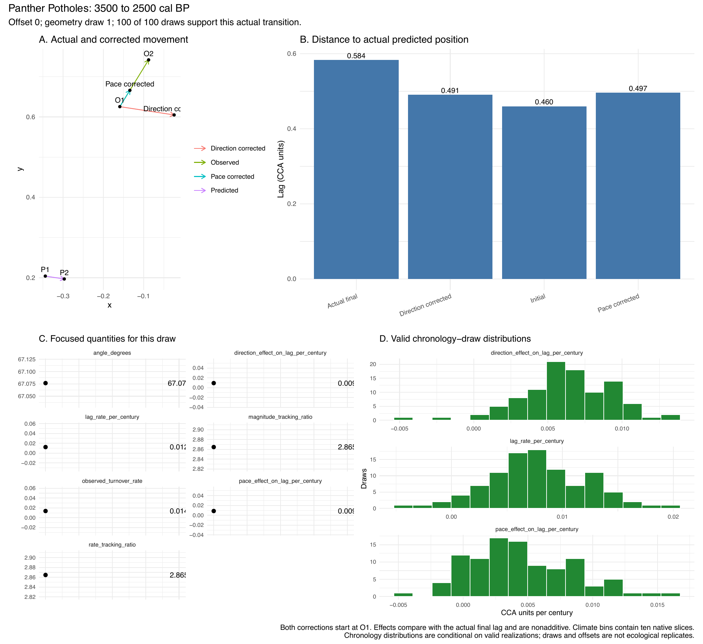

### Compare tracking responses, climate and fire under established regional climate-period bands, with Anthropocene boxplots

Rows show four tracking rates together, standardized physical climate-change rate, and continuous fire activity. Four Holocene lake columns share aligned cal-BP axes and scales by row; thin lines show offsets and thick lines show complete-offset medians. Frozen Figure 2 era/subphase products supply darker CC and lighter stability bands across all Holocene rows, including CC1a/CC1b/CC1c labels and internal boundaries; margins outside the classified domain are unshaded. A fifth column shows identically colored MORA/NOCA paired-plot boxplots using separate labeled y-scales. Modern continuous fire activity is unavailable and is annotated. MORA vegetation lakes share regional fire exposure. Offsets are sensitivity placements, not independent replicates.

Script: [09a_tracking_example_and_visualizations.R](../R/stages/09a_tracking_example_and_visualizations.R). [Complete PDF](../plot/test_figures/fig_tracking_offset_rates.pdf) (1 page).

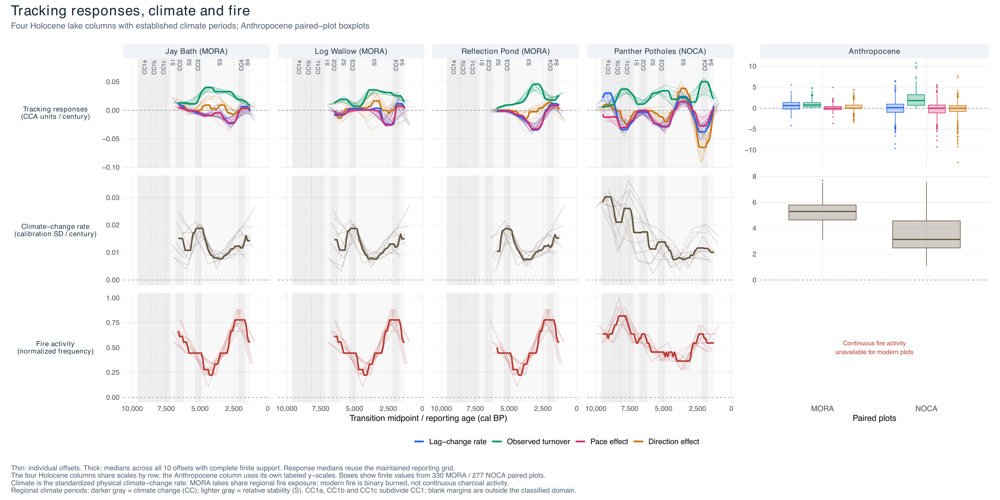

### Compare magnitude tracking ratio, angle, climate and fire under the same regional climate-period bands, one variable per row

Four lake columns show magnitude tracking ratio, movement angle, standardized climate-change rate and fire activity in separate rows. The same frozen Figure 2 era/subphase products annotate all Holocene rows with darker CC and lighter stability bands, CC1 subdivisions and unshaded margins outside the classified domain. The duplicate Holocene rate-ratio display is omitted; both ratios remain in the model inputs and can differ in the Anthropocene. A fifth column shows MORA/NOCA plot boxplots with matching colors and separate labeled y-scales; modern continuous fire activity is unavailable and annotated. Thin offset trajectories and thick complete-offset medians retain actual gaps and observed ranges.

Script: [09a_tracking_example_and_visualizations.R](../R/stages/09a_tracking_example_and_visualizations.R). [Complete PDF](../plot/test_figures/fig_tracking_offset_ratios_angles.pdf) (1 page).

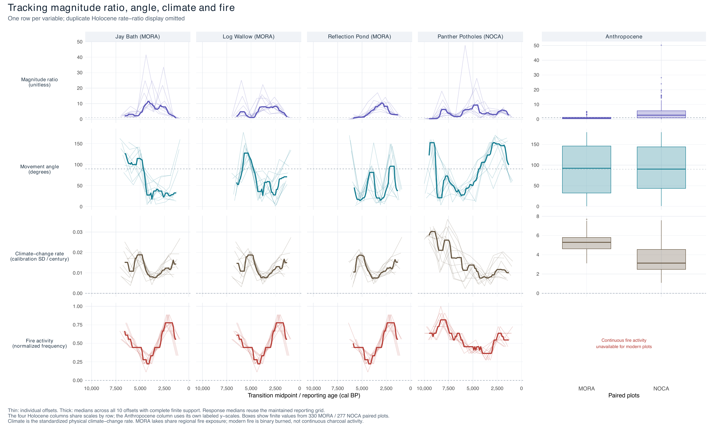

### Compare fire-event detection in all four lake records

Each panel shows the charcoal residual, the local noise threshold (dashed), accepted events (filled circles), and peaks rejected by the minimum-count screen (red crosses). The three MORA records use 95% thresholds; Panther Potholes uses 99%. These events are used later to identify high-fire periods.

Script: [12a_fire_event_detection_worked_example.R](../R/stages/12a_fire_event_detection_worked_example.R). [Complete PDF](../plot/test_figures/fig_fire_event_detection_workflow.pdf) (3 pages).

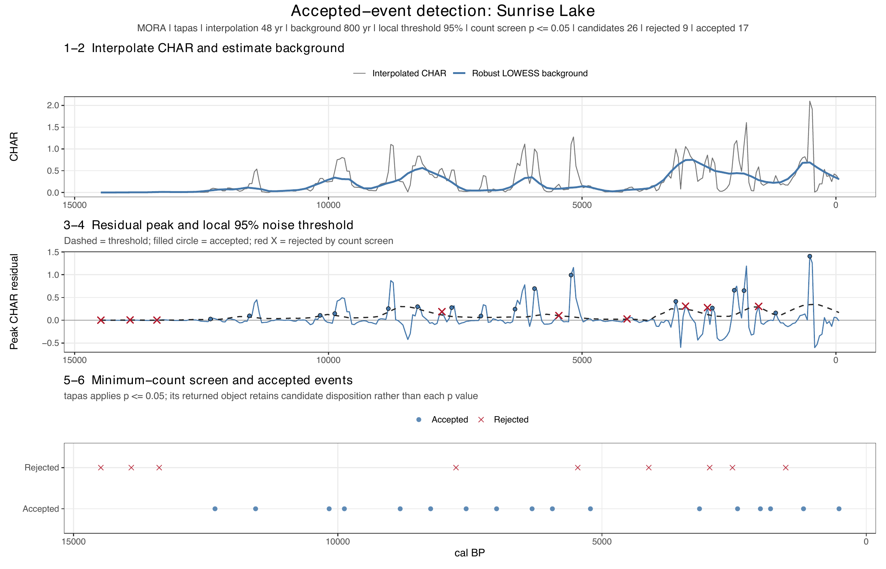

Figure 2 aligns independently defined climate eras and high-fire periods.
Its rate comparison retains signed temperatures in °C/century and precipitation
in mm/century. Modern rates describe the agreed survey-window contrasts.

| Constraint | Units | Holocene regional signed maximum | Peak cal BP | MORA modern median | NOCA modern median |
| --- | --- | --- | --- | --- | --- |
| Spring temperature | deg C / century | 0.04175 | 7500 | 1.288 | 0.7691 |
| Winter temperature | deg C / century | 0.05504 | 9500 | 3.271 | 1.359 |
| Summer precipitation | mm / century | -1.087 | 8900 | -142.6 | 103.6 |
| Winter precipitation | mm / century | 2.338 | 8100 | -937.2 | -411.2 |

[Full raw climate rates table](assets/analysis/tables/raw_climate_rates.csv).

### Figure 2. Climate eras, climate rates and high-fire periods


[Full PDF](../plot/fig_standardized_climate_change_eras_fire.pdf) · [Figure script](../R/stages/13a_climate_change_figure.R) · [Publication captions](FIGURE_CAPTIONS.md).

### Expose signed changes, phase support, and era construction

Any qualifying variable creates a climate-change cell. Only adjacent cells merge; the unsigned composite is context.

Script: [13_holocene_climate_fire_eras.R](../R/stages/13_holocene_climate_fire_eras.R). [Complete PDF](../plot/test_figures/fig_holocene_climate_period_method_worked_example.pdf) (1 page).

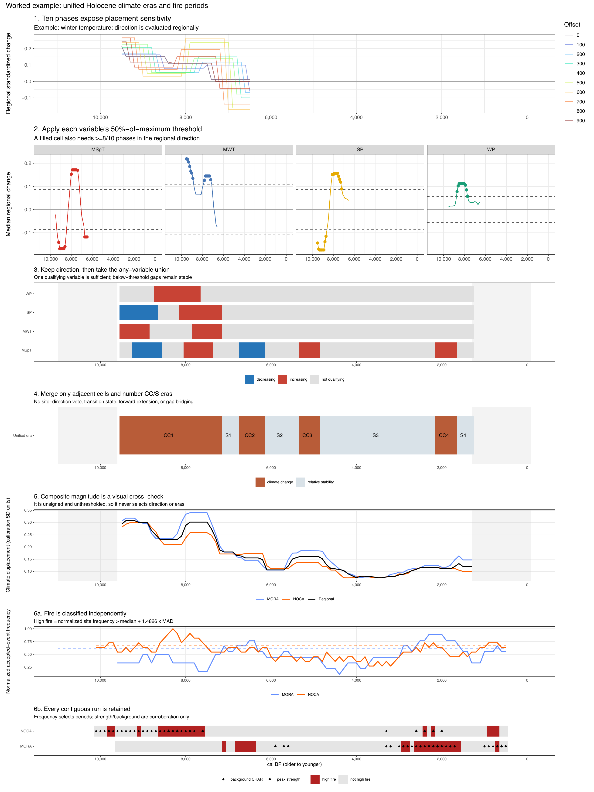

### Work through centered event frequencies at 2,300 cal BP

Within-core normalization and site-specific robust thresholds yield MORA high fire and NOCA no high fire for the worked date.

Script: [13b_fire_method_worked_example.R](../R/stages/13b_fire_method_worked_example.R). [Complete PDF](../plot/test_figures/fig_holocene_fire_method_worked_example.pdf) (1 page).

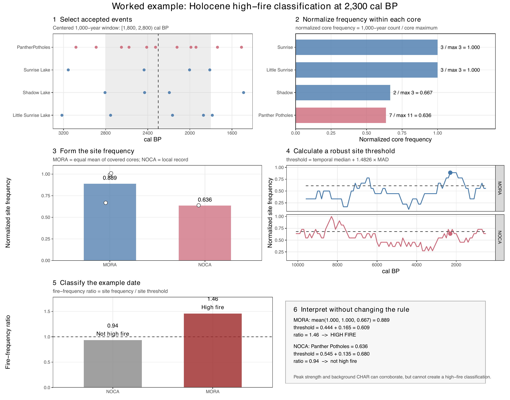

## Lake-level tracking datasets and support

The canonical tracking analysis calculates each lake independently in the same
pooled CCA. Stage 09 derives seven products from detailed records: two compact
source inputs, long chronology uncertainty, lake and modern calculation audits,
seven-response descriptive reporting and sampling/coverage diagnostics.
Stage 09b assembles the combined transition model input without recalculating responses.
The model inputs share exactly the same seven response names and definitions:
[273 lake/offset transitions, 23 columns](assets/analysis/tables/lake_by_offset.csv),
[607 modern pairs, 21 columns](assets/analysis/tables/modern_model_input.csv).
Separate records expose [chronology uncertainty, 15 columns](assets/analysis/tables/lake_uncertainty.csv),
[detailed modern calculations](assets/analysis/tables/modern_calculations.csv), and
[column definitions and units](assets/analysis/tables/tracking_schema.csv).

The [combined transition input, 28 columns](assets/analysis/tables/era_by_offset.csv)
contains 6,160 rows: seven responses for each of 273 actual lake/offset transitions
and 607 modern pairs. Modern observations are stored once per response, with
an absent offset; each model fit selects one Holocene offset and the same modern
pairs. No across-offset median or 100-year grid is used for modeling. Holocene
estimates remain finite-draw medians within actual transitions. Dates, both
elapsed times, predictors, sampling support and WGS84 identities are retained.
Undefined responses remain rows and are filtered separately using `response_valid`.
Missing charcoal exposure stays missing; modern fire remains binary burned.
The previous reporting-grid model input and model trials are retired.

| Lake | Offset | Samples | Transitions | Minimum draws | Two-sample realizations |
| --- | --- | --- | --- | --- | --- |
| JayBath | 0 | 48 | 7 | 24 | 583 |
| JayBath | 100 | 48 | 7 | 13 | 586 |
| JayBath | 200 | 48 | 6 | 98 | 595 |
| JayBath | 300 | 48 | 6 | 98 | 582 |
| JayBath | 400 | 48 | 6 | 95 | 567 |
| JayBath | 500 | 48 | 6 | 90 | 540 |
| JayBath | 600 | 48 | 6 | 85 | 528 |
| JayBath | 700 | 48 | 6 | 76 | 511 |
| JayBath | 800 | 48 | 6 | 63 | 488 |
| JayBath | 900 | 48 | 7 | 39 | 584 |
| LogWallow | 0 | 40 | 7 | 2 | 521 |
| LogWallow | 100 | 40 | 6 | 99 | 539 |
| LogWallow | 200 | 40 | 6 | 98 | 525 |
| LogWallow | 300 | 40 | 6 | 100 | 521 |
| LogWallow | 400 | 40 | 6 | 100 | 522 |
| LogWallow | 500 | 40 | 6 | 100 | 501 |
| LogWallow | 600 | 40 | 6 | 99 | 484 |
| LogWallow | 700 | 40 | 6 | 88 | 465 |
| LogWallow | 800 | 40 | 6 | 57 | 439 |
| LogWallow | 900 | 40 | 7 | 19 | 506 |
| ReflectionPond | 0 | 29 | 6 | 29 | 474 |
| ReflectionPond | 100 | 29 | 6 | 15 | 458 |
| ReflectionPond | 200 | 29 | 6 | 9 | 433 |
| ReflectionPond | 300 | 29 | 6 | 6 | 417 |
| ReflectionPond | 400 | 29 | 6 | 1 | 425 |
| ReflectionPond | 500 | 29 | 5 | 98 | 440 |
| ReflectionPond | 600 | 29 | 5 | 98 | 460 |
| ReflectionPond | 700 | 29 | 5 | 92 | 453 |
| ReflectionPond | 800 | 29 | 5 | 77 | 431 |
| ReflectionPond | 900 | 29 | 6 | 59 | 490 |
| PantherPotholes | 0 | 790 | 10 | 100 | 1000 |
| PantherPotholes | 100 | 790 | 9 | 100 | 900 |
| PantherPotholes | 200 | 790 | 9 | 100 | 900 |
| PantherPotholes | 300 | 790 | 9 | 100 | 900 |
| PantherPotholes | 400 | 790 | 9 | 100 | 900 |
| PantherPotholes | 500 | 790 | 9 | 100 | 900 |
| PantherPotholes | 600 | 790 | 9 | 100 | 900 |
| PantherPotholes | 700 | 790 | 9 | 100 | 900 |
| PantherPotholes | 800 | 790 | 9 | 100 | 900 |
| PantherPotholes | 900 | 790 | 10 | 100 | 1000 |

[Full lake support table](assets/analysis/tables/lake_support.csv).

No majority-draw cutoff is imposed. `n_draws_present` counts existing transitions
before response validity; `n_draws_nmin2` counts present draws with at least two
samples in both endpoint bins. Model responses are independent finite-draw
medians. The uncertainty table records expected, present, eligible, valid and
undefined draws for each response under `all` and `nmin2`, retaining empty
sensitivity groups with missing statistics. Quantiles describe chronology
uncertainty conditional on valid realizations, not model confidence intervals.

The descriptive grid contains only seven responses and requires a finite median
from every offset separately for each lake/date/response. At Reflection Pond,
5,900 cal BP, angle and pace have nine valid offsets: only those two reporting
values are excluded, while the other five responses and all underlying transition
records remain available.

The 273 Holocene rows span ten alternative bin placements. Offsets are sensitivity
realizations, not independent ecological replicates. The intended primary
statistical approach is to analyze non-overlapping transitions separately within
each offset, considering lake identity and temporal dependence during later
model development. Adjacent transitions share endpoint information.
There are approximately 5–6 majority-supported transitions per MORA lake per
offset and 9–10 for Panther Potholes. Four lakes and two fire histories provide
limited independent support for a later three-way interaction. Provisional
AR1/MA1/independent GLS comparisons are shown below; final distributions, covariance choices
and lake/chronology uncertainty treatment remain open.

Each MORA vegetation lake uses its own climate but shares regional fire exposure.
Numerators and core maxima use fully covered windows of identical duration and
matching half-open interval conventions. Covered zero-event intervals have zero
activity; inadequate coverage gives both `fire_activity=NA` and `high_fire=NA`. Full-window denominators match the
existing 1,000-year references. [Scientific definitions](SCIENTIFIC_DECISIONS.md#lake-tracking-metrics)
explain the formulas, units, stationary cases and nonadditive counterfactuals.
[NOCA migration validation](review/NOCA_TRACKING_MIGRATION_CHECK.csv) records the
full 9,200-realization comparison before legacy outputs were removed.
The [tracking validation report](review/TRACKING_DATA_VALIDATION.md) gives the
schemas, exclusion counts, independent checks and limits for later modeling.

### Tracking metric calculations

These calculation excerpts are generated directly from
[tracking_metrics.R](../R/helpers/tracking_metrics.R). The generated R reading
copy includes the same excerpts. `x` contains the observed and predicted
endpoints, seasonal climate values and their respective elapsed times.
`epsilon` is the movement tolerance (default `1e-8`), and `scaling` supplies the
fixed pooled-calibration SDs. In the cosine calculation, `ax,ay` and `bx,by`
are the observed and predicted displacement components.

**Endpoint geometry and lag/turnover rates.**

```r
coords = c("o1", "o2", "o1_2", "o2_2", "p1", "p2", "p1_2", "p2_2")
ox = x$o1_2-x$o1; oy = x$o2_2-x$o2
px = x$p1_2-x$p1; py = x$p2_2-x$p2
a = sqrt(ox^2+oy^2); b = sqrt(px^2+py^2)
x$finite_endpoints = rowSums(!is.finite(as.matrix(x[coords]))) == 0L
observed_direction = x$finite_endpoints & is.finite(a) & a > epsilon
predicted_direction = x$finite_endpoints & is.finite(b) & b > epsilon
x$observed_vegetation_displacement = a
x$predicted_vegetation_displacement = b
x$observed_turnover_rate = a/x$vegetation_dt_years*100
x$predicted_vegetation_change_rate = b/x$climate_dt_years*100
x$lag_t1 = sqrt((x$o1-x$p1)^2+(x$o2-x$p2)^2)
x$lag_t2 = sqrt((x$o1_2-x$p1_2)^2+(x$o2_2-x$p2_2)^2)
x$change_in_lag = x$lag_t2-x$lag_t1
x$lag_rate_per_century = x$change_in_lag/x$climate_dt_years*100
```

**Tracking ratios and turnover angle.**

```r
x$magnitude_tracking_ratio = ifelse(predicted_direction, a/b, NA_real_)
x$rate_tracking_ratio = ifelse(predicted_direction,
  x$observed_turnover_rate/x$predicted_vegetation_change_rate, NA_real_)
x$angle_degrees = acos(safe_cosine_2d(ox, oy, px, py, epsilon))*180/pi
```

**Guarded cosine used internally for the angle.**

```r
a = sqrt(ax^2 + ay^2); b = sqrt(bx^2 + by^2)
ok = is.finite(a) & is.finite(b) & a > epsilon & b > epsilon
result = rep(NA_real_, n)
result[ok] = pmax(-1, pmin(1, (ax[ok]*bx[ok] + ay[ok]*by[ok])/(a[ok]*b[ok])))
```

**Pace and direction counterfactual effects.**

```r
# Only divide by a direction's magnitude when that direction is defined.
x$pace_corrected_CCA1 = x$pace_corrected_CCA2 = rep(NA_real_, nrow(x))
x$direction_corrected_CCA1 = x$direction_corrected_CCA2 = rep(NA_real_, nrow(x))
i = observed_direction
x$pace_corrected_CCA1[i] = x$o1[i]+b[i]*ox[i]/a[i]
x$pace_corrected_CCA2[i] = x$o2[i]+b[i]*oy[i]/a[i]
i = predicted_direction
x$direction_corrected_CCA1[i] = x$o1[i]+a[i]*px[i]/b[i]
x$direction_corrected_CCA2[i] = x$o2[i]+a[i]*py[i]/b[i]
x$lag_t2_pace_corrected = sqrt((x$pace_corrected_CCA1-x$p1_2)^2+
  (x$pace_corrected_CCA2-x$p2_2)^2)
x$lag_t2_direction_corrected = sqrt((x$direction_corrected_CCA1-x$p1_2)^2+
  (x$direction_corrected_CCA2-x$p2_2)^2)
x$pace_effect_on_lag = x$lag_t2-x$lag_t2_pace_corrected
x$direction_effect_on_lag = x$lag_t2-x$lag_t2_direction_corrected
x$pace_effect_on_lag_per_century = x$pace_effect_on_lag/x$climate_dt_years*100
x$direction_effect_on_lag_per_century = x$direction_effect_on_lag/x$climate_dt_years*100
```

**Physical seasonal climate changes and standardized rate.**

```r
z_change_cols = character(0)
z_rate_cols = character(0)
for (v in vars) {
  s = scaling$sd[match(v, scaling$variable)]
  delta = x[[paste0(v, "_2")]] - x[[v]]
  x[[paste0(v, "_change")]] = delta
  x[[paste0(v, "_rate_per_century")]] = delta / x$climate_dt_years * 100
  x[[paste0(v, "_z_change")]] = delta / s
  x[[paste0(v, "_z_rate_per_century")]] = delta / s / x$climate_dt_years * 100
  z_change_cols = c(z_change_cols, paste0(v, "_z_change"))
  z_rate_cols = c(z_rate_cols, paste0(v, "_z_rate_per_century"))
}
x$standardized_climate_displacement = sqrt(rowSums(x[z_change_cols]^2))
x$standardized_climate_change_rate = sqrt(rowSums(x[z_rate_cols]^2))
```

### Effects of the 2026-10-07 survey-date decision

The comparison below isolates the survey-date update from its preserved
pre-update analysis. At that time, legacy occurrences and climate, the 618-plot
CCA fit, its 13 taxa, and all Holocene results were unchanged. The subsequent
2026-10-08 ponderosa reinstatement first refitted that model with 14 taxa and
619 legacy plots; matched calibration then restricted fitting to 607 plots.
These tables describe the earlier survey-date decision alone.
Latest-visit selection removes earlier-only presence from
seven cleaned MORA plots; one loss is a taxon already excluded during
consolidation, so six modeled observed positions change. Modern climate changes for all 330 MORA plots and the 50 NOCA plots surveyed in
2014. Climate elapsed time changes for 319 MORA plots and those same 50 NOCA
plots; 2017 MORA resurveys retain the former 30.5-year midpoint interval.
The 225 NOCA plots surveyed in 2015 retain their former 2010–2015 window.
Figures 2 and 3 and the lake/plot tracking datasets use the updated inputs.

| Plot | Presence removed from pooled resurvey |
| --- | --- |
| LONG-356 | Thuja plicata |
| LOWE-045 | Acer circinatum |
| RAMP-505 | Abies amabilis |
| RAMP-505 | Abies grandis |
| RAMP-505 | Pinus monticola |
| RAMP-505 | Thuja plicata |
| SMO-364 | Tsuga mertensiana |
| SUNS-046 | Thuja plicata |
| WHIT-273 | Abies lasiocarpa |
| WHIT-273 | Alnus rubra |
| WHIT-273 | Picea sitchensis |
| WHIT-307 | Tsuga mertensiana |

[Full latest visit composition effects table](assets/analysis/tables/latest_visit_composition_effects.csv).

| Site | Quantity | Changed plots | Before median | After median |
| --- | --- | --- | --- | --- |
| MORA | Adult resurvey year | 50 | 2015 | 2015 |
| MORA | Climate interval (years) | 319 | 30.5 | 28.5 |
| MORA | Observed displacement (CCA units) | 6 | 0.3168 | 0.3182 |
| MORA | Predicted displacement (CCA units) | 330 | 0.4074 | 0.3809 |
| MORA | Rate tracking ratio | 254 | 0.6559 | 0.6124 |
| MORA | Change in lag (CCA units) | 330 | 0.1644 | 0.1189 |
| MORA | Lag rate (CCA units/century) | 330 | 0.5389 | 0.4171 |
| NOCA | Adult resurvey year | 0 | 2015 | 2015 |
| NOCA | Climate interval (years) | 50 | 28.5 | 28.5 |
| NOCA | Observed displacement (CCA units) | 0 | 0.5205 | 0.5205 |
| NOCA | Predicted displacement (CCA units) | 50 | 0.2114 | 0.204 |
| NOCA | Rate tracking ratio | 40 | 2.263 | 2.436 |
| NOCA | Change in lag (CCA units) | 50 | -0.002621 | 0.005775 |
| NOCA | Lag rate (CCA units/century) | 50 | -0.009197 | 0.021 |

[Full survey decision effects table](assets/analysis/tables/survey_decision_effects.csv).

## Provisional offset GLS comparisons

[Stage 10](../R/stages/10_tracking_era_models.R) fits lag-change rate separately
at offsets 0–900 years, using actual 1,000-year transitions plus all 607 modern
pairs. AR1, MA1 and independent residuals share the same `estimate ~ era * site` fixed effects, REML
and separate era/site residual variances. All 30 fits converged in the current
run. The [120 coefficient rows](assets/analysis/tables/tracking_model_coefficients.csv)
flag offset and `model_type` and include standard errors, unadjusted 95% t
intervals, group counts and the fitted correlation parameter.

The [60 park contrasts](assets/analysis/tables/tracking_model_contrasts.csv)
compare Anthropocene minus Holocene within MORA and within NOCA for every
offset and covariance type. Positive estimates indicate a higher Anthropocene
lag-change rate. Their unadjusted 95% intervals use Satterthwaite degrees of
freedom. The contrast figure places all three covariance types together in each park panel.

MA1 restricts residual correlation to observations one actual time step apart
within a lake; missing transitions retain their original indices. Modern pairs
are singleton series. AR1 permits longer-lag correlation. The independent
candidate retains era/site residual variances with `correlation=NULL`. AIC comparisons are
between covariance types within the same offset; the ten offsets are sensitivity
fits that reuse modern pairs. These models do not propagate chronology uncertainty,
add lake random intercepts or include climate/fire fixed effects. Their covariance,
distribution and inference remain provisional.

The [30 fit comparisons](assets/analysis/tables/tracking_model_comparison.csv)
include likelihoods, parameter counts, AIC, within-offset ΔAIC and relative
Akaike weights. The AIC figure shows only paired within-offset ΔAIC boxplots;
raw AIC values remain in the CSV.
Select using comparisons within the same offset: raw AICs across offsets
involve different observations, and the offsets are not independent samples.
MA1 has the lowest AIC at five offsets, independent residuals at four and AR1
at one. AR1–MA1 differences are below 1.2 AIC units at all offsets. No candidate
is automatically selected.

[Complete results for all offset/covariance fits](assets/analysis/model_results.txt).

### Compare provisional AR1, MA1 and independent-residual coefficients across all ten offsets

Lag-change rate is fitted with identical era-by-site fixed effects, REML and era/site residual variances for each offset and covariance type. Points show coefficients and bars unadjusted 95% t intervals. Offsets reuse the same modern plots and are sensitivity fits, not independent replications. **Provisional**.

Script: [10_tracking_era_models.R](../R/stages/10_tracking_era_models.R). [Complete PDF](../plot/test_figures/fig_tracking_model_coefficients_lag_rate_per_century.pdf) (1 page).

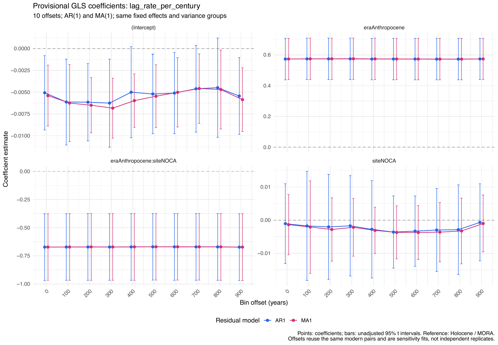

### Compare Anthropocene minus Holocene within each park across offsets and covariance choices

Each MORA/NOCA panel shows model-based era contrasts for AR1, MA1 and independent residuals at all ten offsets. Positive estimates indicate higher Anthropocene lag-change rates. Bars are unadjusted 95% intervals using Satterthwaite degrees of freedom; park panels have separate y-scales. Offsets reuse modern pairs and are sensitivity fits, not independent replications. Inference remains provisional. **Provisional**.

Script: [10_tracking_era_models.R](../R/stages/10_tracking_era_models.R). [Complete PDF](../plot/test_figures/fig_tracking_model_contrasts_lag_rate_per_century.pdf) (1 page).

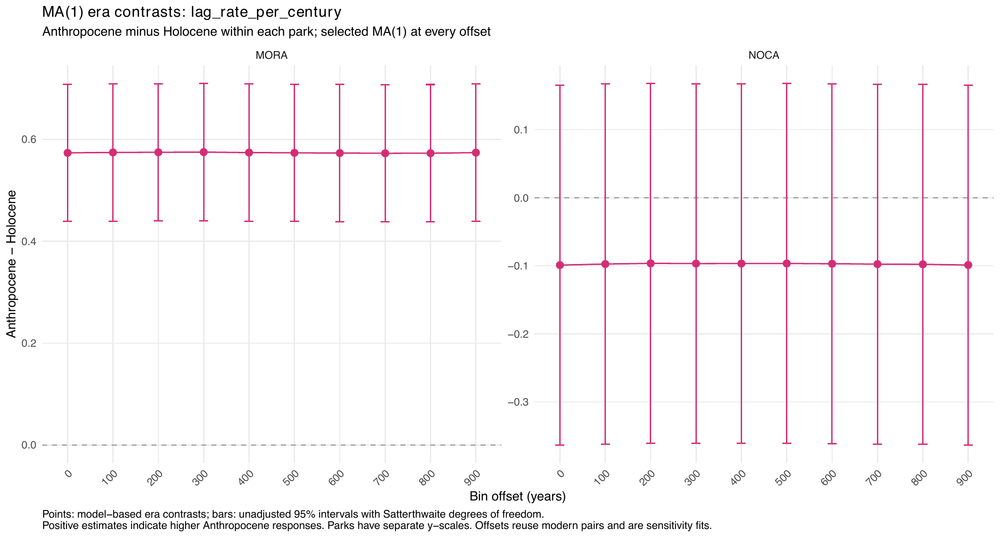

### Evaluate residuals for all three covariance models at every offset

Each offset row shows AR1 scatter, normal Q-Q and Holocene residual lag products, then the same three checks for MA1 and independent residuals. Normalized residuals account for the fitted variance/correlation structure. Lag products preserve actual within-lake gaps and exclude modern singleton series; pair counts are shown, without formal tests. Only 26–30 Holocene transitions support each fit; covariance and distribution remain provisional. **Provisional**.

Script: [10_tracking_era_models.R](../R/stages/10_tracking_era_models.R). [Complete PDF](../plot/test_figures/fig_tracking_model_residuals_lag_rate_per_century.pdf) (1 page).

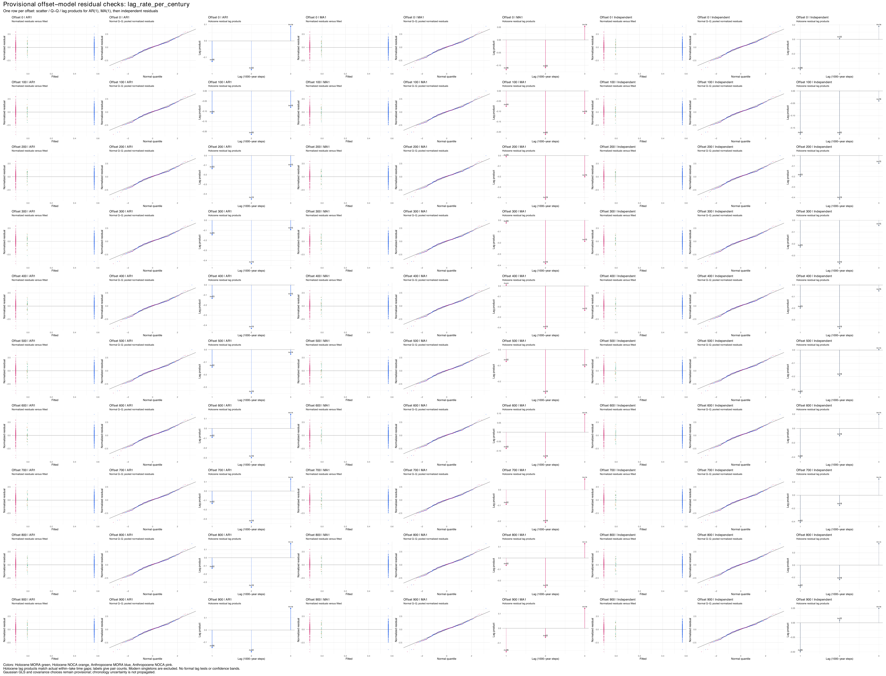

### Compare AR1, MA1 and no temporal autocorrelation using AIC across all ten offsets

Boxes summarize within-offset delta AIC; raw AIC values remain in the comparison CSV; dots show each fit and lines link the same offset. All candidates within an offset share observations, fixed effects, REML and era/site residual variances. Use paired within-offset differences for selection: offsets have different observations and are sensitivity fits, not independent replicates. MA1 minimizes AIC at five offsets, independent residuals at four and AR1 at one; AR1-MA1 differences remain below 1.2. No covariance choice is automatically selected. **Provisional covariance comparison**.

Script: [10_tracking_era_models.R](../R/stages/10_tracking_era_models.R). [Complete PDF](../plot/test_figures/fig_tracking_model_aic_lag_rate_per_century.pdf) (1 page).

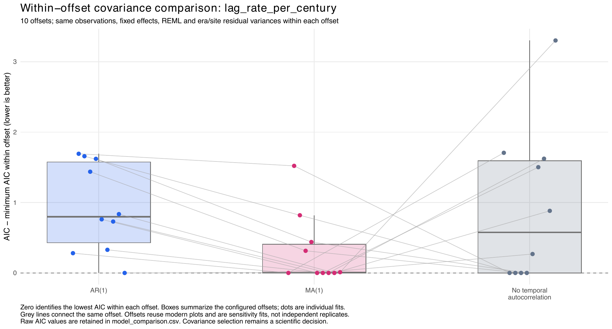

## Offset-0 lake sensitivity

[Stage 10a](../R/stages/10a_tracking_lake_sensitivity.R) compares each Holocene
lake separately with modern plots from its own park under AR1 and MA1. The
eight fits use `estimate ~ era`, REML, era-specific residual variances and the
original time gaps. The [16 coefficient rows](assets/analysis/tables/tracking_lake_coefficients.csv)
and [eight contrasts](assets/analysis/tables/tracking_lake_contrasts.csv) retain
lake identity, sample counts and correlation-boundary flags.

Reflection Pond and Panther Potholes MA1 fits approach the parameter boundary;
triangles identify absolute parameters above 0.98. These fits are retained.
MORA lake comparisons reuse the same modern plots and are overlapping
sensitivities. The workflow runs this sensitivity at offset 0 only, without
choosing a final covariance model or maintaining MA(2).

[Complete offset-0 lake sensitivity results](assets/analysis/lake_model_results.txt).

### Compare individual-lake offset-0 coefficients under AR1 and MA1

Each Holocene lake is compared with all finite modern responses from its own park. Fits use era fixed effects, REML, AR1/MA1 and separate residual variances by era. Bars show unadjusted 95% intervals. Triangles flag absolute correlation parameters above 0.98; Reflection Pond and Panther Potholes MA1 fits are near the boundary. MORA comparisons reuse modern plots and are not independent. Statistical choices remain provisional. **Provisional lake sensitivity**.

Script: [10a_tracking_lake_sensitivity.R](../R/stages/10a_tracking_lake_sensitivity.R). [Complete PDF](../plot/test_figures/fig_tracking_lake_coefficients_lag_rate_per_century_offset_0.pdf) (1 page).

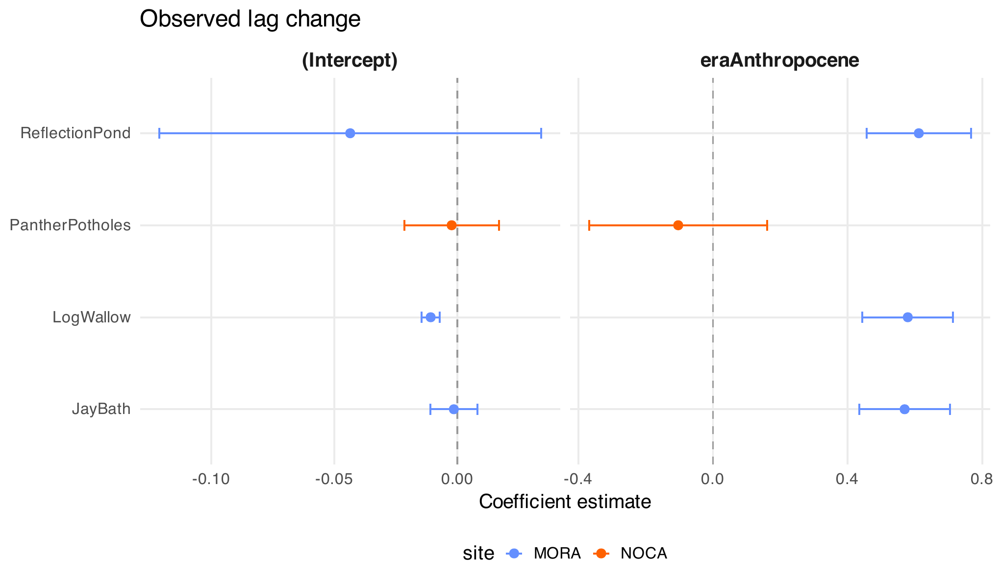

### Compare Anthropocene minus Holocene separately for each lake at offset 0

Each Holocene lake is compared with all finite modern responses from its own park. Fits use era fixed effects, REML, AR1/MA1 and separate residual variances by era. Bars show unadjusted 95% intervals. Triangles flag absolute correlation parameters above 0.98; Reflection Pond and Panther Potholes MA1 fits are near the boundary. MORA comparisons reuse modern plots and are not independent. Statistical choices remain provisional. **Provisional lake sensitivity**.

Script: [10a_tracking_lake_sensitivity.R](../R/stages/10a_tracking_lake_sensitivity.R). [Complete PDF](../plot/test_figures/fig_tracking_lake_contrasts_lag_rate_per_century_offset_0.pdf) (1 page).

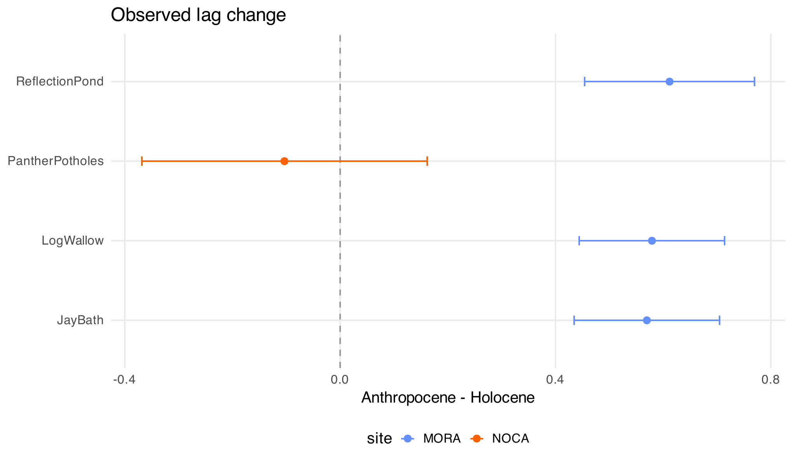

## Limitations and remaining questions

The chronology controls, survey windows, GPS exclusions and paired CCA
eligibility are settled for this analysis. Their interpretation limits remain:
conditional dating uncertainty, differing fire-proxy support, unequal survey
size classes, site-confounded paleo occupancy, overlapping temporal samples
and possible climate-product discontinuities.

The remaining questions below come from the
[scientific decision register](SCIENTIFIC_DECISIONS.md#remaining-scientific-questions).
They distinguish planned or optional sensitivities from decisions already made.

| Question | Current choice | Consequence | Evidence needed to resolve it |
|---|---|---|---|
| Raw versus V2.1-anchored TraCE21k climate | The active Holocene analysis uses raw TraCE21k values; the V2.1 anchoring diagnostic is not authoritative. | Absolute Holocene climate levels and cross-product comparisons may retain product bias, although the active within-series change calculations are internally consistent. | A validated overlap-period comparison showing whether anchoring reduces bias without introducing a discontinuity or changing the intended anomaly interpretation. |
| Legacy-calibration versus full-record climate SDs | Changes are divided by SDs from the 607 matched legacy CCA calibration plots. | The reference is tied to the fitted model. A full-record SD would change displayed standardized magnitudes, cross-variable weighting, the unthresholded composite, and standardized climate rates, but not CC/S boundaries under the current variable-specific 50%-of-own-maximum rule. | A prespecified full-record sensitivity with explicit temporal/site weighting and a scientific choice between calibration-relative and dataset-relative effect sizes. |
| Anthropocene precipitation continuity | Historical climate remains 1979–1989; modern climate uses adult Y−5 through Y at both sites (2026-10-07 decision). The MORA precipitation contrast is flagged. | The apparent post-2010 MORA precipitation shift may partly reflect CHELSA inhomogeneity rather than climate. | Independent station/reanalysis validation and a documented decision on whether post-2010 MORA precipitation is usable. The agreed years are not a pending decision. |
| Own-origin versus common-origin taxon target geometry | Deferred: the target-alignment analysis is retired. Existing CCA scores and reference matrices are preserved for future contribution analysis. | The two cosines answer alignment relative to each trajectory's own starting community; part of their difference can arise because LC₁ and WA₁ differ. | A prespecified common-origin sensitivity and an ecological decision about whether the estimand should condition on each starting state or hold the target vector fixed across observed and predicted movement. |

This snapshot uses verified existing analysis outputs, including stored CCA summaries and permutation tests. It does not represent a new full analysis run. [Checks and rebuilding instructions](WORKFLOW.md#tests-and-decisions).

## Diagnostic PDFs

The selected pages above show the relevant evidence; these links open the full
figures. The older CHELSAcruts comparison is a historical reference, outside the
current-results analysis.

| Diagnostic PDF | Purpose | Script | Shown pages | Analysis or sensitivity |
| --- | --- | --- | --- | --- |
| [NOCA_cleaning.pdf](../plot/test_figures/NOCA_cleaning.pdf) | Show which NOCA plots remain after cleaning. | [000_NOCA_cleaning.R](../R/stages/000_NOCA_cleaning.R) | 1 | current |
| [MORA_dynamics.pdf](../plot/test_figures/MORA_dynamics.pdf) | Show species counts before model taxon selection. | [000_MORA_cleaning.R](../R/stages/000_MORA_cleaning.R) | 3 | current |
| [NOCA_dynamics.pdf](../plot/test_figures/NOCA_dynamics.pdf) | Compare corrected legacy and resurvey species counts. | [000_NOCA_cleaning.R](../R/stages/000_NOCA_cleaning.R) | 3 | current |
| [species_counts_consolidated.pdf](../plot/test_figures/species_counts_consolidated.pdf) | Inspect consolidated occurrence counts in each site-period group. | [000_occurrence_data_consolidate.R](../R/stages/000_occurrence_data_consolidate.R) | 1 | current |
| [stage_adult_seedling_past_present.pdf](../plot/test_figures/stage_adult_seedling_past_present.pdf) | Expose adult versus regeneration support for presence. | [000_occurrence_data_consolidate.R](../R/stages/000_occurrence_data_consolidate.R) | 1 | current |
| [species_through_time.pdf](../plot/test_figures/species_through_time.pdf) | Inspect taxon site confounding and temporal occupancy. | [test_species_through_time.R](../R/diagnostics/test_species_through_time.R) | 1 | 500-year sensitivity |
| [plots_to_cca.pdf](../plot/test_figures/plots_to_cca.pdf) | From starting plots and core samples to the CCA. | [plot_sample_selection.R](../R/diagnostics/plot_sample_selection.R) | 1 | current |
| [fig_bacon_agedepth_slump.pdf](../plot/test_figures/fig_bacon_agedepth_slump.pdf) | Inspect four fitted age-depth models and slump treatment. | [000_PALEO_a_agedepth.R](../R/stages/000_PALEO_a_agedepth.R) | 1 | current |
| [fig_bacon_pb210_sensitivity.pdf](../plot/test_figures/fig_bacon_pb210_sensitivity.pdf) | Compare published activity errors with assumed ±10-year age uncertainty. | [000_PALEO_a_agedepth.R](../R/stages/000_PALEO_a_agedepth.R) | 1 | chronology sensitivity |
| [test_survey_year_anomaly.pdf](../plot/test_figures/test_survey_year_anomaly.pdf) | Compare selected survey windows with the full 1979–2021 record. | [test_survey_year_anomaly.R](../R/diagnostics/test_survey_year_anomaly.R) | 1 | current |
| [climate_holocene_timeseries.pdf](../plot/test_figures/climate_holocene_timeseries.pdf) | Inspect redundancy among candidate climate variables. | [test_climate_change_variables.R](../R/diagnostics/test_climate_change_variables.R) | 2 | correlation diagnostic; full PDF includes 500-year sensitivity |
| [fig_cca_scaling_comparison.pdf](../plot/test_figures/fig_cca_scaling_comparison.pdf) | Compare scaling 1 and 2 of the same fitted CCA. | [test_cca_scaling_comparison.R](../R/diagnostics/test_cca_scaling_comparison.R) | 1 | current |
| [NOCA_fire_map_Wilson2024_PaleoACES.pdf](../plot/test_figures/NOCA_fire_map_Wilson2024_PaleoACES.pdf) | Audit NOCA modern fire assignment against Wilson reference plots. | [01_get_fire_info.R](../R/stages/01_get_fire_info.R) | 1 | current |
| [fig_fire_event_detection_workflow.pdf](../plot/test_figures/fig_fire_event_detection_workflow.pdf) | Compare fire-event detection in all four lake records. | [12a_fire_event_detection_worked_example.R](../R/stages/12a_fire_event_detection_worked_example.R) | 2 | current |
| [fig_walsh_charanalysis_reproduction.pdf](../plot/test_figures/fig_walsh_charanalysis_reproduction.pdf) | Compare official CharAnalysis results with published Walsh totals. | [12_walsh_fire_reproduction.R](../R/stages/12_walsh_fire_reproduction.R) | 3 | current |
| [fig_holocene_climate_period_method_worked_example.pdf](../plot/test_figures/fig_holocene_climate_period_method_worked_example.pdf) | Expose signed changes, phase support, and era construction. | [13_holocene_climate_fire_eras.R](../R/stages/13_holocene_climate_fire_eras.R) | 1 | current |
| [fig_holocene_fire_method_worked_example.pdf](../plot/test_figures/fig_holocene_fire_method_worked_example.pdf) | Work through centered event frequencies at 2,300 cal BP. | [13b_fire_method_worked_example.R](../R/stages/13b_fire_method_worked_example.R) | 1 | current |
| [fig_method_worked_example.pdf](../plot/test_figures/fig_method_worked_example.pdf) | Work through WA/LC movement, lag, ratio, and angle. | [09a_tracking_example_and_visualizations.R](../R/stages/09a_tracking_example_and_visualizations.R) | 1 | current |
| [fig_tracking_offset_rates.pdf](../plot/test_figures/fig_tracking_offset_rates.pdf) | Compare tracking responses, climate and fire under established regional climate-period bands, with Anthropocene boxplots. | [09a_tracking_example_and_visualizations.R](../R/stages/09a_tracking_example_and_visualizations.R) | 1 | current |
| [fig_tracking_offset_ratios_angles.pdf](../plot/test_figures/fig_tracking_offset_ratios_angles.pdf) | Compare magnitude tracking ratio, angle, climate and fire under the same regional climate-period bands, one variable per row. | [09a_tracking_example_and_visualizations.R](../R/stages/09a_tracking_example_and_visualizations.R) | 1 | current |
| [test_chelsa_cruts_vs_present.pdf](../plot/test_figures/test_chelsa_cruts_vs_present.pdf) | Retain the older product-comparison reference outside current results. | [test_chelsa_cruts_vs_present.R](../R/diagnostics/test_chelsa_cruts_vs_present.R) | Full PDF only | historical reference |
| [fig_tracking_model_coefficients_lag_rate_per_century.pdf](../plot/test_figures/fig_tracking_model_coefficients_lag_rate_per_century.pdf) | Compare provisional AR1, MA1 and independent-residual coefficients across all ten offsets. | [10_tracking_era_models.R](../R/stages/10_tracking_era_models.R) | 1 | provisional |
| [fig_tracking_model_contrasts_lag_rate_per_century.pdf](../plot/test_figures/fig_tracking_model_contrasts_lag_rate_per_century.pdf) | Compare Anthropocene minus Holocene within each park across offsets and covariance choices. | [10_tracking_era_models.R](../R/stages/10_tracking_era_models.R) | 1 | provisional |
| [fig_tracking_model_residuals_lag_rate_per_century.pdf](../plot/test_figures/fig_tracking_model_residuals_lag_rate_per_century.pdf) | Evaluate residuals for all three covariance models at every offset. | [10_tracking_era_models.R](../R/stages/10_tracking_era_models.R) | 1 | provisional |
| [fig_tracking_model_aic_lag_rate_per_century.pdf](../plot/test_figures/fig_tracking_model_aic_lag_rate_per_century.pdf) | Compare AR1, MA1 and no temporal autocorrelation using AIC across all ten offsets. | [10_tracking_era_models.R](../R/stages/10_tracking_era_models.R) | 1 | provisional covariance comparison |
| [fig_tracking_lake_coefficients_lag_rate_per_century_offset_0.pdf](../plot/test_figures/fig_tracking_lake_coefficients_lag_rate_per_century_offset_0.pdf) | Compare individual-lake offset-0 coefficients under AR1 and MA1. | [10a_tracking_lake_sensitivity.R](../R/stages/10a_tracking_lake_sensitivity.R) | 1 | provisional lake sensitivity |
| [fig_tracking_lake_contrasts_lag_rate_per_century_offset_0.pdf](../plot/test_figures/fig_tracking_lake_contrasts_lag_rate_per_century_offset_0.pdf) | Compare Anthropocene minus Holocene separately for each lake at offset 0. | [10a_tracking_lake_sensitivity.R](../R/stages/10a_tracking_lake_sensitivity.R) | 1 | provisional lake sensitivity |

## TraCE21k–V2.1 comparison and planned sensitivity

[Climate-product comparison PDF (two pages)](review/chelsa_trace_v21/TraCE21k_vs_V21_1980_1990.pdf).

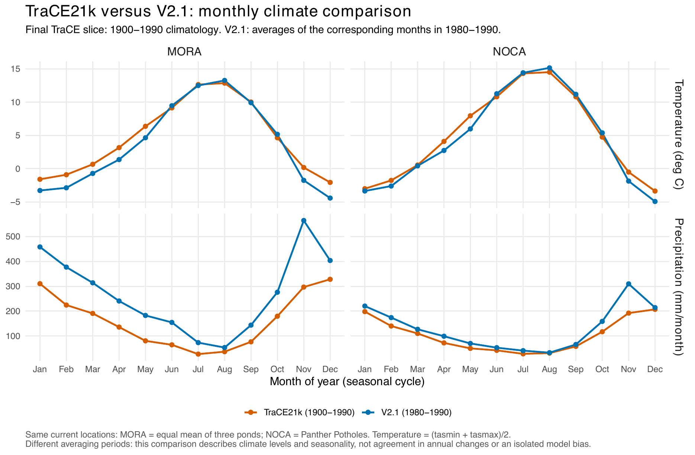

This supplementary snapshot was prepared on 2026-10-07 from existing native caches at the same four pond locations. It compares the final TraCE21k slice's **1900–1990 climatology** with **V2.1 monthly averages for 1980–1990**. MORA averages its three ponds equally; NOCA uses Panther Potholes. The averaging periods differ, so the comparison describes climate levels and seasonality rather than matched annual changes or an isolated estimate of model bias.

**Planned sensitivity — not yet performed:** Apply temperature offsets and precipitation correction factors to TraCE21k, then compare climate-change metrics, climate-predicted vegetation trajectories, Δlag and main conclusions with the current raw-TraCE21k results. Document the correction reference and factors explicitly. The current analysis remains unchanged; this comparison does not apply a correction or constitute the sensitivity analysis.
