**Snapshot of existing outputs · 2026-10-12.** Figures and CCA summaries use verified existing analysis outputs.

PaleoACES asks how observed forest composition moves relative to the composition
predicted by climate, comparing modern forest resurveys with four Holocene
records. This review follows the [workflow](WORKFLOW.md), showing preparation,
methods, diagnostics and manuscript figures. [Scientific decisions](SCIENTIFIC_DECISIONS.md)
records the adopted choices.

## Study design and inputs

Mount Rainier (MORA) and North Cascades (NOCA) share one CCA calibrated on legacy
forest plots. Resurveys and dated plant-macrofossil samples are projected into
that ordination. MORA's Holocene vegetation comes from Jay Bath, Log Wallow and
Reflection Pond; NOCA's comes from Panther Potholes. MORA fire evidence comes
from Sunrise, Shadow and Little Sunrise lakes, while NOCA charcoal comes from
Panther Potholes. Vegetation and fire therefore have different spatial support.

The [input inventory](REPOSITORY_INVENTORY.md#raw-duplicates-and-authority),
[MORA data notes](../data/MORA/README_data_raw.md), [NOCA paleo notes](../data/NOCA/NOCA_paleo/SOURCES.md)
and [chronology sources](../Cores/SOURCES_MORA.md) identify the source materials.


The arrows show dependencies. The table below gives the exact execution order,
including figure production; figure numbers retain their manuscript meaning.
The [combined script](review/00_main_analysis_review.R) contains these stages
verbatim for reading. Run the workflow for an analysis rebuild.

| Execution order | Role | Script |
| --- | --- | --- |
| 1 | Preparation | [000_MORA_cleaning.R](../R/stages/000_MORA_cleaning.R) |
| 2 | Preparation | [000_NOCA_cleaning.R](../R/stages/000_NOCA_cleaning.R) |
| 3 | Analysis | [01_get_fire_info.R](../R/stages/01_get_fire_info.R) |
| 4 | Preparation | [000_MORA_climate.R](../R/stages/000_MORA_climate.R) |
| 5 | Preparation | [000_NOCA_climate.R](../R/stages/000_NOCA_climate.R) |
| 6 | Preparation | [000_PALEO_a_agedepth.R](../R/stages/000_PALEO_a_agedepth.R) |
| 7 | Preparation | [000_PALEO_b_vegetation.R](../R/stages/000_PALEO_b_vegetation.R) |
| 8 | Preparation | [000_FIRE_cleaning.R](../R/stages/000_FIRE_cleaning.R) |
| 9 | Preparation | [000_PALEO_c_fire.R](../R/stages/000_PALEO_c_fire.R) |
| 10 | Preparation | [000_PALEO_d_climate_download.R](../R/stages/000_PALEO_d_climate_download.R) |
| 11 | Preparation | [000_PALEO_e_climate.R](../R/stages/000_PALEO_e_climate.R) |
| 12 | Analysis | [02_walsh_fire_reproduction.R](../R/stages/02_walsh_fire_reproduction.R) |
| 13 | Analysis | [03_fire_event_detection_worked_example.R](../R/stages/03_fire_event_detection_worked_example.R) |
| 14 | Preparation | [000_occurrence_data_consolidate.R](../R/stages/000_occurrence_data_consolidate.R) |
| 15 | Analysis | [04_cca_model.R](../R/stages/04_cca_model.R) |
| 16 | Analysis | [05_holocene_climate_fire_eras.R](../R/stages/05_holocene_climate_fire_eras.R) |
| 17 | Analysis | [06_fire_method_worked_example.R](../R/stages/06_fire_method_worked_example.R) |
| 18 | Analysis | [07_tracking_metrics.R](../R/stages/07_tracking_metrics.R) |
| 19 | Analysis | [08_cca_figure.R](../R/stages/08_cca_figure.R) |
| 20 | Analysis | [09_tracking_example_and_visualizations.R](../R/stages/09_tracking_example_and_visualizations.R) |
| 21 | Analysis | [10_climate_change_figure.R](../R/stages/10_climate_change_figure.R) |
| 22 | Analysis | [11_tracking_model_data.R](../R/stages/11_tracking_model_data.R) |
| 23 | Analysis | [12_tracking_era_models.R](../R/stages/12_tracking_era_models.R) |
| 24 | Analysis | [13_tracking_lake_sensitivity.R](../R/stages/13_tracking_lake_sensitivity.R) |
| 25 | Analysis | [14_tracking_manuscript_figure.R](../R/stages/14_tracking_manuscript_figure.R) |
| 26 | Analysis | [15_tracking_predictor_models.R](../R/stages/15_tracking_predictor_models.R) |
| 27 | Analysis | [16_cca_transition_contributions.R](../R/stages/16_cca_transition_contributions.R) |
| 28 | Analysis | [17_species_contribution_models.R](../R/stages/17_species_contribution_models.R) |

| Prepared input | Rows | Plot/sample IDs | Taxa |
| --- | --- | --- | --- |
| MORA | 2490 | 331 | 23 |
| NOCA | 1775 | 305 | 31 |
| paleo | 9850 | 989 | 12 |
| consolidated | 13950 | 1625 | 22 |

[Full cleaning summary table](assets/analysis/tables/cleaning_summary.csv).

## Modern vegetation preparation

Presence means an adult **or** regeneration record. MORA uses the original legacy
workbook and cleaned resurvey tree and seedling files. NOCA applies the received
corrected-tree workbook before building occurrences; unsupported identification
labels are discarded. Both cleaners retain matched survey plots.

**MORA's adult resurvey date is authoritative (decision 2026-10-07).** Seedling
records are assigned to their corresponding adult visit before presence is
constructed. For the 13 plots visited in multiple years, only the latest adult
visit and its matching seedlings are retained; visits tied within a year remain
pooled. This replaces pooling across years and using the earliest tree/seedling
year. The received CSVs are preserved.

The source-year comparison identifies 95 supplied plot names, including 48 analyzed
pairs. That total includes `PRAC-1`, a practice plot without a standardized ID;
94 have standardized IDs. Conflicting years already occur in the original CSVs
and pass unchanged through their upstream cleaner. The earlier export process
is unknown. The [95-plot source table](assets/analysis/tables/year_source_discrepancies.csv)
records the conflicting years, adult dates, treatment and evidence locations;
[survey-year notes](../data/SOURCES_SURVEY_YEARS.md) give the rationale.

| Plot | Adult visits | Selected year | Selected date | Adult records kept | Earlier records removed |
| --- | --- | --- | --- | --- | --- |
| CHIN-084 | 2014; 2015 | 2015 | 8/27/15 | 44 | 56 |
| GOAT-468 | 2014; 2016 | 2016 | 6/30/16 | 14 | 48 |
| LONG-356 | 2015; 2016 | 2016 | 6/21/16 | 25 | 36 |
| LOWE-045 | 2015; 2016 | 2016 | 6/22/16 | 10 | 19 |
| RAMP-093 | 2015; 2016 | 2016 | 6/23/16 | 23 | 36 |
| RAMP-505 | 2018; 2019 | 2019 | 7/11/19 | 40 | 85 |
| RAMP-506 | 2018; 2019 | 2019 | 7/11/19 | 75 | 103 |
| SMO-364 | 2016; 2019 | 2019 | 8/22/19 | 47 | 55 |
| SUNS-046 | 2015; 2016 | 2016 | 6/22/16 | 10 | 22 |
| TAHO-003 | 2014; 2016 | 2016 | 6/24/16 | 21 | 18 |
| WHIT-071 | 2014; 2016 | 2016 | 6/30/16 | 22 | 66 |
| WHIT-273 | 2014; 2016 | 2016 | 6/28/16 | 82 | 121 |
| WHIT-307 | 2015; 2016 | 2016 | 6/29/16 | 20 | 33 |

[Full mora repeat visits table](assets/analysis/tables/mora_repeat_visits.csv).

NOCA excludes `BAK487` for its old clearcut, `BEAV6061` for uncertain relocation,
and `CARI449`/`CARI450` for GPS problems. The latter share coordinates despite
conflicting elevations, and Rachel's notes supply no verified correction.
These exclusions apply to both dates. The cleaned NOCA data contain 305 pairs;
CCA eligibility is assessed later. The [cleaning guide](review/000_NOCA_cleaning_guide.md)
and [GPS source note](review/NOCA_GPS_EXCLUSION.md) explain the decisions.

| Patch audit status | Affected plot IDs |
| --- | --- |
| excluded | 3 |
| included | 51 |

| Study-excluded plot | Reason |
| --- | --- |
| BAK487 | old clearcut; removed from Wilson final analysis |
| BEAV6061 | historic plot location uncertain; resurvey is an avalanche chute |
| CARI449 | GPS problem; shared coordinates conflict with elevations; no verified correction |
| CARI450 | GPS problem; shared coordinates conflict with elevations; no verified correction |

[Complete correction audit](assets/analysis/tables/correction_audit.csv), [study exclusions](assets/analysis/tables/study_exclusions.csv), and [excluded GPS-coordinate collision](assets/analysis/tables/coordinate_collision.csv).

### Show which NOCA plots remain after cleaning

The cleaned data contain more plots than the final CCA comparisons. Plots empty at one date and the agreed plot exclusions are shown separately.

Script: [000_NOCA_cleaning.R](../R/stages/000_NOCA_cleaning.R). [Complete PDF](../plot/test_figures/NOCA_cleaning.pdf) (3 pages).


### Show species counts before model taxon selection

Counts reflect adult-or-regeneration presence in cleaned survey plots; they do not measure abundance.

Script: [000_MORA_cleaning.R](../R/stages/000_MORA_cleaning.R). [Complete PDF](../plot/test_figures/MORA_dynamics.pdf) (3 pages).


### Compare corrected legacy and resurvey species counts

Species differences describe cleaned surveys before cross-site harmonization and the CCA threshold.

Script: [000_NOCA_cleaning.R](../R/stages/000_NOCA_cleaning.R). [Complete PDF](../plot/test_figures/NOCA_dynamics.pdf) (3 pages).


## Modern fire assignments

Mapped disturbance records identify fire exposure for the paired modern plots.
NOCA has 32 burned and 273 unburned plots, with matching assignments on all 303
plots shared with Wilson's reference. MORA's mapped record covers 1987–2017,
so no mapped fire does not establish that a plot remained unburned throughout
the full survey interval.

### Audit NOCA modern fire assignment against Wilson reference plots

The 303 shared plots agree. The cleaned 305-plot universe excludes CARI449/CARI450 for GPS problems; the Wilson reference is not substituted for it.

Script: [01_get_fire_info.R](../R/stages/01_get_fire_info.R). [Complete PDF](../plot/test_figures/NOCA_fire_map_Wilson2024_PaleoACES.pdf) (1 page).


## Modern climate preparation

CHELSA V2.1 monthly values supply spring temperature (MSpT), winter temperature
(MWT), summer precipitation (SP) and winter precipitation (WP). Temperature is
the midpoint of monthly minima and maxima, then averaged over the season;
precipitation is summed. These are seasonal climate proxies, not direct measures
of growing degree days, soil moisture or snowpack.

Spring is March–May, summer June–August and winter December–February. Modern
December belongs to the following winter. All three months are required;
temperatures are in °C and precipitation in mm per season.

**Climate-year selection.** Historical climate remains **1979–1989** at both
sites. Each modern plot uses its adult resurvey year **Y** and the five preceding
years: **Y−5 through Y, inclusive**. We average these six years to represent the
interannual climate dynamics that the community experienced before and during
the survey. A 2014 resurvey therefore uses 2009–2014, with December 2008 included
in winter 2009. Every modern constraint requires six complete season-years.

Climate rates use the interval from the historical midpoint **1984** to the
plot-specific modern midpoint **Y−2.5**: **27.5–32.5 years at MORA** and
**27.5–28.5 years at NOCA**. Vegetation rates use the selected adult year and
legacy references of 1977.5 (MORA) or 1983 (NOCA). Missing January 1979 leaves ten
complete legacy winters; spring and summer retain eleven years. The historical
window choice remains settled, and possible MORA precipitation inhomogeneity
remains a limitation.

| Site | Period | Plots | Spring years | Winter years | Summer years | Winter precipitation years |
| --- | --- | --- | --- | --- | --- | --- |
| MORA | past | 331 | 11 | 10 | 11 | 10 |
| MORA | present | 331 | 6 | 6 | 6 | 6 |
| NOCA | past | 305 | 11 | 10 | 11 | 10 |
| NOCA | present | 305 | 6 | 6 | 6 | 6 |

[Full climate windows table](assets/analysis/tables/climate_windows.csv).

The following cohorts and diagnostic use the final paired comparison plots.
The annual lines show those same plots; separate colored bands show each cohort's
window without hiding overlapping windows. MORA is blue and NOCA orange.

| Site | Survey | Adult resurvey year | First climate year | Last climate year | Analyzed plots |
| --- | --- | --- | --- | --- | --- |
| MORA | past | — | 1979 | 1989 | 330 |
| MORA | present | 2014 | 2009 | 2014 | 50 |
| MORA | present | 2015 | 2010 | 2015 | 174 |
| MORA | present | 2016 | 2011 | 2016 | 47 |
| MORA | present | 2017 | 2012 | 2017 | 11 |
| MORA | present | 2018 | 2013 | 2018 | 7 |
| MORA | present | 2019 | 2014 | 2019 | 41 |
| NOCA | past | — | 1979 | 1989 | 277 |
| NOCA | present | 2014 | 2009 | 2014 | 50 |
| NOCA | present | 2015 | 2010 | 2015 | 227 |

[Full survey climate windows table](assets/analysis/tables/survey_climate_windows.csv).

### Compare selected survey windows with the full 1979–2021 record

Detrending does not resolve CHELSA product continuity. Apparent precipitation anomalies remain a scientific limitation.

Script: [test_survey_year_anomaly.R](../R/diagnostics/test_survey_year_anomaly.R). [Complete PDF](../plot/test_figures/test_survey_year_anomaly.pdf) (1 page).


## Chronology and uncertainty

The existing stored Bacon models are retained. Each primary original sample receives
its **unrounded median age over all stored posterior rows**, not the median of a
selected draw subset. Original sample identities do not depend on estimated ages.

The sensitivity uses 1,000 reproducibly selected complete posterior chronologies per
lake. One selected posterior row supplies all sample and NOCA fire-event ages within
that lake. No MCMC or CCA recalibration is performed. MORA regional charcoal chronologies
remain fixed. Primary confidence intervals are conditional on the primary reconstruction;
separate refits examine changes in coefficient direction, magnitude and statistical support.

### Inspect four fitted age-depth models and slump treatment

The four age-depth curves show sediment accumulation, removed instantaneous layers and modeled age ranges. Those ranges are conditional on the adopted controls and Bacon settings.

Script: [000_PALEO_a_agedepth.R](../R/stages/000_PALEO_a_agedepth.R). [Complete PDF](../plot/test_figures/fig_bacon_agedepth_slump.pdf) (1 page).


### Compare published activity errors with assumed ±10-year age uncertainty

The sensitivity concerns the upper 35–40 cm of Panther Potholes; uncertainty in published fire chronologies is not equivalent across sites. **Chronology sensitivity**.

Script: [000_PALEO_a_agedepth.R](../R/stages/000_PALEO_a_agedepth.R). [Complete PDF](../plot/test_figures/fig_bacon_pb210_sensitivity.pdf) (1 page).


## Paleo vegetation and fire preparation

Taxonomic categories are harmonized within original samples. Separate depths and
Neotoma sample IDs remain separate even when their posterior median ages coincide.
Samples with no retained taxa remain in the exclusion audit and have no WA position.
Accepted charcoal-event detection and its descriptive products remain unchanged.
The ecological exposure uses whole vegetation-transition durations and coherent NOCA redating.

## Paleo climate preparation

CHELSA-TraCE21k supplies climate at the four pond locations. Each vegetation
sample is matched to the available climate slice nearest its own age, within
the 50-year tolerance. The seasonal variables and units match the modern
analysis; December remains within its paleo climatology slice.

Raw TraCE21k is the current input. A V2.1-based correction is planned as a
sensitivity and has not been applied. The comparison at the end of this review
shows the available recent overlap and its different averaging windows.

### Inspect redundancy among candidate climate variables

Only page 2 (correlations) is inline. Page 1 and associated pace tables retain the former 500-year sensitivity and are not primary rate evidence. **Correlation diagnostic; full PDF includes 500-year sensitivity**.

Script: [test_climate_change_variables.R](../R/diagnostics/test_climate_change_variables.R). [Complete PDF](../plot/test_figures/climate_holocene_timeseries.pdf) (2 pages).


Only the correlation page is shown here. The full climate diagnostic also
contains older **500-year sensitivity** calculations; those are separate from
primary climate-rate results.

## Accepted fire events

The accepted-event catalog uses the shared tapas detector with core-specific
interpolation, background smoothing and local thresholds. All cores use
unlogged charcoal accumulation, robust LOWESS background, a local Gaussian-mixture
threshold and a 75-year count screen with p ≤ 0.05. Accepted totals are 17
Sunrise, 14 Shadow, 13 Little Sunrise and 66 Panther Potholes. The existing
12.5-year NOCA interpolation sensitivity yields 72 events.

| Lake | Engine | Interpolation years | Background years | Local threshold |
| --- | --- | --- | --- | --- |
| Sunrise Lake | tapas | 48 | 800 | 0.95 |
| Shadow Lake | tapas | 47 | 1000 | 0.95 |
| Little Sunrise Lake | tapas | 42 | 500 | 0.95 |
| PantherPotholes | tapas | 12 | 500 | 0.99 |

[Full fire settings table](assets/analysis/tables/fire_settings.csv).

| Lake | Candidates | Count rejected | Accepted |
| --- | --- | --- | --- |
| Sunrise Lake | 26 | 9 | 17 |
| Shadow Lake | 17 | 3 | 14 |
| Little Sunrise Lake | 20 | 7 | 13 |
| PantherPotholes | 66 | 0 | 66 |

[Full event audit table](assets/analysis/tables/event_audit.csv).

The official CharAnalysis comparison is separate from the primary catalog.
Its discrepancy with Walsh's publication is retained without threshold tuning.

| Lake | Official R episodes | Published total | Difference |
| --- | --- | --- | --- |
| Little Sunrise Lake | 14 | 16 | -2 |
| Shadow Lake | 16 | 18 | -2 |
| Sunrise Lake | 15 | 24 | -9 |

[Full walsh audit table](assets/analysis/tables/walsh_audit.csv).

### Compare official CharAnalysis results with published Walsh totals

The official CharAnalysis implementation and Walsh publication give different event totals. This comparison is separate from the primary tapas event catalog, whose thresholds were not tuned to force agreement.

Script: [02_walsh_fire_reproduction.R](../R/stages/02_walsh_fire_reproduction.R). [Complete PDF](../plot/test_figures/fig_walsh_charanalysis_reproduction.pdf) (3 pages).


### Compare fire-event detection in all four lake records

Each panel shows the charcoal residual, the local noise threshold (dashed), accepted events (filled circles), and peaks rejected by the minimum-count screen (red crosses). The three MORA records use 95% thresholds; Panther Potholes uses 99%. These events are used later to identify high-fire periods.

Script: [03_fire_event_detection_worked_example.R](../R/stages/03_fire_event_detection_worked_example.R). [Complete PDF](../plot/test_figures/worked_examples/fig_fire_event_detection_workflow.pdf) (3 pages).


## Taxonomy and species selection

[Consolidation](review/README_occurrence_consolidation.md) aligns Populus,
Picea and Abies identifications across surveys and macrofossils. Acer circinatum
and Taxus brevifolia are removed for stratum compatibility. Pinus ponderosa's
manual exclusion was [reversed on 2026-10-08](SCIENTIFIC_DECISIONS.md#ponderosa-reinstatement);
it is now retained and follows the ordinary frequency rule below.

CCA retains a taxon when it occurs in **at least 20 plots or samples in any one
site × period group**. The rule does not require 20 in every group. Pinus
albicaulis reaches exactly 20 and remains included. Selection rests on taxon
relevance and ordination interpretation; increased explained inertia alone is
not its justification. The existing selected taxa and matched-legacy calibration are frozen during this migration;
new paleo identities affect projection records and diagnostics, not calibration.

| Taxon | MORA legacy | MORA resurvey | MORA paleo | NOCA legacy | NOCA resurvey | NOCA paleo | CCA retained |
| --- | --- | --- | --- | --- | --- | --- | --- |
| Abies amabilis | 290 | 288 | 119 | 113 | 128 | 0 | TRUE |
| Abies lasiocarpa | 34 | 31 | 94 | 63 | 76 | 473 | TRUE |
| Abies procera | 68 | 50 | 43 | 0 | 0 | 0 | TRUE |
| Callitropsis nootkatensis | 106 | 101 | 78 | 37 | 44 | 38 | TRUE |
| Picea engelmannii | 12 | 9 | 5 | 26 | 22 | 12 | TRUE |
| Pinus contorta | 2 | 1 | 31 | 32 | 28 | 293 | TRUE |
| Pinus monticola | 42 | 14 | 90 | 28 | 25 | 504 | TRUE |
| Pseudotsuga menziesii | 181 | 147 | 40 | 157 | 147 | 597 | TRUE |
| Tsuga heterophylla | 281 | 283 | 54 | 88 | 121 | 180 | TRUE |
| Tsuga mertensiana | 88 | 75 | 110 | 89 | 76 | 39 | TRUE |
| Abies grandis | 8 | 7 | 0 | 11 | 20 | 0 | TRUE |
| Alnus rubra | 15 | 15 | 0 | 11 | 18 | 0 | FALSE |
| Picea sitchensis | 2 | 0 | 0 | 0 | 0 | 0 | FALSE |
| Populus trichocarpa | 3 | 3 | 0 | 8 | 3 | 0 | FALSE |
| Thuja plicata | 111 | 110 | 0 | 95 | 101 | 168 | TRUE |
| Acer macrophyllum | 0 | 4 | 0 | 17 | 18 | 0 | FALSE |
| Malus fusca | 0 | 1 | 0 | 0 | 0 | 0 | FALSE |
| Pinus albicaulis | 0 | 2 | 0 | 20 | 7 | 0 | TRUE |
| Pinus ponderosa | 0 | 1 | 0 | 26 | 16 | 0 | TRUE |
| Juniperus communis | 0 | 0 | 0 | 0 | 0 | 8 | FALSE |
| Betula papyrifera | 0 | 0 | 0 | 4 | 6 | 0 | FALSE |
| Larix lyallii | 0 | 0 | 0 | 7 | 9 | 0 | FALSE |

[Full CCA taxa table](assets/analysis/tables/cca_taxa.csv).

NOCA size classes differ between dates: legacy regeneration spans 0–3 m and
adults exceed 3 m; resurvey seedlings span 10–140 cm and trees exceed 1.4 m.
These strata are not identical measurements across surveys.

### Inspect consolidated occurrence counts in each site-period group

Retention requires at least 20 plots or samples in one group. The threshold is not required in every group.

Script: [000_occurrence_data_consolidate.R](../R/stages/000_occurrence_data_consolidate.R). [Complete PDF](../plot/test_figures/species_counts_consolidated.pdf) (1 page).


### Expose adult versus regeneration support for presence

Adult and regeneration sources contribute to presence; stem counts and macrofossil percentages are not combined as abundance.

Script: [000_occurrence_data_consolidate.R](../R/stages/000_occurrence_data_consolidate.R). [Complete PDF](../plot/test_figures/stage_adult_seedling_past_present.pdf) (1 page).


### Inspect taxon site confounding and temporal occupancy

Presence/absence occupancy in native 100-year cells using original samples and unrounded posterior median ages.

Script: [test_species_through_time.R](../R/diagnostics/test_species_through_time.R). [Complete PDF](../plot/test_figures/species_through_time.pdf) (1 page).


The occupancy display uses original samples placed on the native 100-year grid.

## Plots and samples included in CCA

The following diagram starts with the supplied survey lists and core sample
depths. It shows losses during matching and cleaning, then the species and
climate checks required for CCA. The starting legacy and resurvey counts are
separate; their exclusions must not be added together. Original sample identities are retained when median ages coincide.

### From starting plots and core samples to the CCA

Each count shows plots or samples remaining. Reasons beside the arrows explain losses; repeated visits and sample depths combined at the same modeled age are distinguished from exclusions. The middle panels show legacy adult-tree areas among retained plots and the confirmed 500 m² resurvey area at both sites.

Script: [plot_sample_selection.R](../R/diagnostics/plot_sample_selection.R). [Complete PDF](../plot/test_figures/plots_to_cca.pdf) (1 page).


The [counts at each step](assets/analysis/tables/sample_selection_counts.csv)
and [choices affecting records](assets/analysis/tables/sample_selection_choices.csv)
are available as tables.

The diagram also shows the [legacy adult-tree plot sizes](assets/analysis/tables/sample_selection_plot_sizes.csv)
among the plots retained for CCA. Adult-tree resurvey plots cover **500 m² at both
sites**. Legacy areas vary, so matching plot identities does not mean that the
sampled areas were equal. Plot size currently does not determine eligibility.

Choices such as correcting tree records and keeping the latest adult visit
change the observations without necessarily removing plots. They are shown
alongside the count changes. All current CCA climate values are complete.
The two burned MORA plots remain in CCA and in the canonical 607-plot tracking table.

[04_cca_model.R](../R/stages/04_cca_model.R) resolves eligibility **before fitting
or projecting**. An observation with no retained taxa has no observed WA
position. It is excluded from both observed and climate-predicted comparisons.
Modern endpoints use the same eligible pairs at both dates; Holocene WA and LC
positions also use identical samples. The CCA is fitted on the legacy observations
of these same matched plots; a plot excluded at resurvey is also excluded from
calibration. The diagram's final modern counts therefore serve both fitting and
comparison.

| Era | Site | Use | Prepared plots/samples | Excluded | Included |
| --- | --- | --- | --- | --- | --- |
| anthropocene | MORA | Legacy calibration | 331 | 1 | 330 |
| anthropocene | MORA | Modern paired comparison | 331 | 1 | 330 |
| anthropocene | NOCA | Legacy calibration | 305 | 28 | 277 |
| anthropocene | NOCA | Modern paired comparison | 305 | 28 | 277 |
| holocene | MORA | Paleo projection | 119 | 0 | 119 |
| holocene | NOCA | Paleo projection | 870 | 58 | 812 |

[Full CCA eligibility counts table](assets/analysis/tables/cca_eligibility_counts.csv).

Exclusion reasons are separated below. Each modern pair is counted once,
against its first failing endpoint, with legacy checked first. Calibration and
paired-comparison counts overlap and must not be added together. Holocene
counts are samples before age draws or temporal binning.

| Era | Site | Use | Excluded at | Reason | Count |
| --- | --- | --- | --- | --- | --- |
| anthropocene | MORA | Legacy calibration | present | Only taxa excluded by CCA species selection | 1 |
| anthropocene | MORA | Modern paired comparison | present | Only taxa excluded by CCA species selection | 1 |
| anthropocene | NOCA | Legacy calibration | past | No tree taxa recorded at legacy | 6 |
| anthropocene | NOCA | Legacy calibration | past | Only taxa excluded by CCA species selection | 11 |
| anthropocene | NOCA | Legacy calibration | present | Loss of all recorded tree-taxon presence at resurvey | 9 |
| anthropocene | NOCA | Legacy calibration | present | Only taxa excluded by CCA species selection | 2 |
| anthropocene | NOCA | Modern paired comparison | past | No tree taxa recorded at legacy | 6 |
| anthropocene | NOCA | Modern paired comparison | past | Only taxa excluded by CCA species selection | 11 |
| anthropocene | NOCA | Modern paired comparison | present | Loss of all recorded tree-taxon presence at resurvey | 9 |
| anthropocene | NOCA | Modern paired comparison | present | Only taxa excluded by CCA species selection | 2 |
| holocene | NOCA | Paleo projection | paleo | No tree taxa detected in paleo sample | 58 |

[Full CCA exclusion summary table](assets/analysis/tables/cca_exclusion_summary.csv).

“Loss of all recorded tree-taxon presence at resurvey” describes absence in the
sampled taxa and strata, not proven biological extinction. “No tree taxa detected
in paleo sample” describes macrofossil non-detection. Cases holding only taxa
removed during consolidation or CCA selection are listed separately. Missing
climate and unmatched endpoints are also classified if encountered.

The [sample table](assets/analysis/tables/cca_sample_eligibility.csv) and
[paired-plot table](assets/analysis/tables/cca_pair_eligibility.csv) retain the
individual reasons. The cleaned data retain these observations even when they
cannot enter CCA tracking.

## Holocene sampling support on native climate intervals

The pre-CCA diagnostic places every original macrofossil sample once at its unrounded
full-posterior median Bacon age, including samples subsequently excluded from WA projection.
Macrofossil lakes remain distinguished with the same MORA/NOCA count scale. Fire panels
show accepted-event totals by park; MORA regional cores are combined, not plotted as separate
vegetation lakes. Covered zero-event cells remain zero and missing coverage breaks the line.
These descriptive counts use native climate intervals and are not transition-model observations.

### Inspect macrofossil sampling and accepted fire detections on native 100-year climate cells before CCA

Each prepared macrofossil ID is counted once at its median age across the 100 cached Bacon draws. Separate lake lines share the same MORA/NOCA sample-count scale. Fire lines sum accepted detections from fully covered cores: at least two MORA regional cores, or Panther Potholes for NOCA. Grey cells lack adequate charcoal coverage; covered zero-event cells remain zero and lines do not bridge gaps. MORA totals may use two or three covered cores and do not deduplicate regional fires. Fire counts are source detections, not normalized fire_activity or CHAR, and differing source resolution prevents interpreting raw park counts as comparable fire intensity. Median-age placement does not propagate dating uncertainty; these cells are descriptive counts, not independent 100-year vegetation responses.

Script: [000_occurrence_data_consolidate.R](../R/stages/000_occurrence_data_consolidate.R). [Complete PDF](../plot/test_figures/fig_holocene_sampling_fire_100yr.pdf) (1 page).

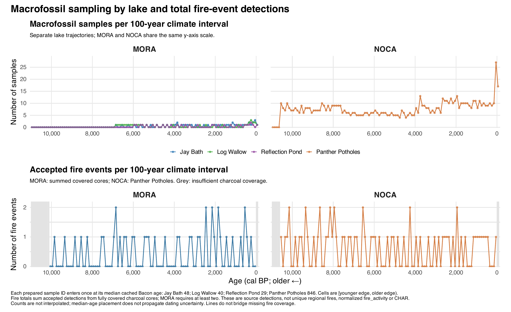

## CCA calibration and geometry

One pooled legacy CCA relates composition to the four climate variables, using
the same matched plots used in both-date comparisons (330 MORA and 277 NOCA).
This matched calibration was selected on 2026-10-08; the former fit used 619
eligible legacy plots. The ≥20 species-selection rule and 14 taxa are unchanged.
Observed **weighted-average (WA)** scores describe composition; predicted
**linear-combination (LC)** scores describe the position expected from climate.
Modern resurveys and paleo samples enter the existing ordination without
recalibrating it.

| Fitted model quantity | Value |
| --- | --- |
| Legacy calibration plots | 607 |
| Retained taxa | 14 |
| Minimum occupancy in one site × period | 20 |
| CCA score scaling | Site scaling (1) |
| Hill scaling | Off |
| Climate variables | MSpT;MWT;SP;WP |
| Total inertia | 3.465 |
| Climate-constrained inertia | 0.531 |
| Constrained inertia (%) | 15.33 |
| Modern plots and paleo samples before eligibility | 1625 |
| Eligible modern pairs and paleo samples | 1538 |

[Full CCA summary table](assets/analysis/tables/cca_summary.csv).

| Site | Period | Prepared climate samples | Calibrated | Positioned projection |
| --- | --- | --- | --- | --- |
| MORA | paleo | 119 | — | 119 |
| MORA | past | 331 | 330 | — |
| MORA | present | 331 | — | 330 |
| NOCA | paleo | 870 | — | 812 |
| NOCA | past | 305 | 277 | — |
| NOCA | present | 305 | — | 277 |

[Full CCA counts table](assets/analysis/tables/cca_counts.csv).

CCA1–CCA2 and site scaling (1), with Hill scaling off, define all distances and
angles. Display arrow multipliers do not enter calculations. Binary presence
still carries CCA's row and taxon weighting. The displayed axes represent only
part of total community inertia, and correlated climate variables prevent
adding their marginal contributions as independent shares. Projections are
descriptive scores rather than independently validated forecasts.

### Compare scaling 1 and 2 of the same fitted CCA

Site scaling (1), Hill off and CCA1–CCA2 define the primary geometry. Unequal rescaling of axes changes distances and angles; display arrow multipliers are excluded from the calculations.

Script: [test_cca_scaling_comparison.R](../R/diagnostics/test_cca_scaling_comparison.R). [Complete PDF](../plot/test_figures/fig_cca_scaling_comparison.pdf) (1 page).


### CCA model, contributions and tests

The model below is fitted to the **607 matched legacy plots and 14 retained
tree species**. Species values are binary presence, combining adults and
regeneration. The climate rows use those same plots in the same order.
`MSpT` is spring temperature, `MWT` winter temperature, `SP` summer precipitation
and `WP` winter precipitation. The fitting and resurvey-projection lines are
copied from [04_cca_model.R](../R/stages/04_cca_model.R), with the current scaling
settings shown explicitly.

The [calibration reference bundle](assets/analysis/cca_calibration_reference.rds)
preserves the fitted CCA, calibration matrices and identities, species and
climate scores, scaling, prepared endpoints and provenance for future work.

```r
# Current settings; presence and climate tables are prepared above in 04_cca_model.R.
CCA_VARIABLES = c("MSpT", "MWT", "SP", "WP")
cca_scaling = "sites"
cca_hill = FALSE

# Matched legacy observations used to calibrate the CCA.
species_past_final = species_past[present_pairs, keep_species, drop = FALSE]
env_past_final = env_past[present_pairs, CCA_VARIABLES, drop = FALSE]

cca_formula = reformulate(CCA_VARIABLES, response = "species_past_final")
reference_path=here('output/cca_calibration_reference.rds')
if(file.exists(reference_path) && count.thr==CCA_COUNT_THRESHOLD && !length(extra_exclude) && !nzchar(cca_suffix)) {
  frozen=readRDS(reference_path)
  if(!isTRUE(all.equal(species_past_final,frozen$legacy_species,tolerance=0)) ||
     !isTRUE(all.equal(env_past_final,frozen$legacy_climate,tolerance=0)) ||
     !identical(keep_species,frozen$retained_species))
    stop('Fixed CCA calibration inputs changed; do not recalibrate during reconstruction migration')
  cca_model=frozen$model
} else cca_model=cca(cca_formula,data=env_past_final)

# Resurvey positions: climate-predicted (LC) and observed (WA).
predicted_present = predict(cca_model, newdata = env_present_final, type = "lc", scaling = cca_scaling, hill = cca_hill)
projected_present = predict(cca_model, newdata = species_present_final,
                            type = "wa", scaling = cca_scaling, hill = cca_hill)
```

**Fitted model output.** Inertia measures variation in community composition;
the constrained part is the variation explained by these climate variables.

```text

Call: cca(formula = species_past_final ~ MSpT + MWT + SP + WP, data =
env_past_final)

              Inertia Proportion Rank
Total          3.4648     1.0000
Constrained    0.5310     0.1533    4
Unconstrained  2.9338     0.8467   13

Inertia is scaled Chi-square

Eigenvalues for constrained axes:
   CCA1    CCA2    CCA3    CCA4
0.29766 0.19574 0.03152 0.00606

Eigenvalues for unconstrained axes:
   CA1    CA2    CA3    CA4    CA5    CA6    CA7    CA8    CA9   CA10   CA11
0.4902 0.3697 0.3563 0.3219 0.2565 0.2345 0.2029 0.1781 0.1375 0.1253 0.1153
  CA12   CA13
0.0993 0.0462
```

| Axis | Eigenvalue | % total inertia | % constrained inertia |
| --- | --- | --- | --- |
| CCA1 | 0.2977 | 8.591 | 56.06 |
| CCA2 | 0.1957 | 5.649 | 36.86 |
| CCA3 | 0.03152 | 0.9098 | 5.937 |
| CCA4 | 0.006062 | 0.175 | 1.142 |

[Full CCA axes table](assets/analysis/tables/cca_axes.csv).

**Permutation ANOVA.** The overall test assesses the four climate variables
together. Axis tests assess each axis after accounting for preceding axes.
All reported tests use **9,999 permutations**, with seed `20261008`.
Unrestricted permutations shuffle plots across the whole calibration set;
within-park permutations shuffle plots within MORA and NOCA separately.
Neither design accounts for finer spatial dependence among plots. These are
tests of association, rather than predictive validation. See the
[vegan ANOVA methods](https://vegandevs.github.io/vegan/reference/anova.cca.html).

| Model / axis | df | Pseudo-F | p: unrestricted | p: within parks |
| --- | --- | --- | --- | --- |
| Whole model | 4 | 27.24 | 0.0001 | 0.0001 |
| CCA1 | 1 | 61.08 | 0.0001 | 0.0001 |
| CCA2 | 1 | 40.35 | 0.0001 | 0.0001 |
| CCA3 | 1 | 6.536 | 0.0001 | 0.0001 |
| CCA4 | 1 | 1.262 | 0.1712 | 0.1176 |

[Full CCA anova table](assets/analysis/tables/cca_anova.csv).

CCA1, CCA2 and CCA3 meet p < 0.05 when plots are shuffled within parks. CCA4 does not meet that threshold.

[Complete ANOVA output](assets/analysis/cca_anova_output.txt) includes residual
degrees of freedom and all overall, axis and climate-variable tests.
These calculations are reproduced by [the reporting functions](../R/helpers/analysis_report.R).

**Species contributions.** Each percentage is a species' contribution to the
total climate-explained inertia, across all four constrained axes. These
contributions sum to 100% and determine the species arrow and annotation colors in Figure 3A. The score
columns describe position on CCA1–CCA2; distance from the origin is a different
quantity from contribution. See [vegan's inertia decomposition](https://vegandevs.github.io/vegan/reference/goodness.cca.html).

| Species | Legacy plots | % climate-explained inertia | CCA1 score | CCA2 score |
| --- | --- | --- | --- | --- |
| Abies lasiocarpa | 92 | 12.37 | 1.376 | 2.049 |
| Pinus albicaulis | 18 | 11.74 | 2.274 | 5.141 |
| Tsuga mertensiana | 177 | 11.73 | 1.443 | 0.2977 |
| Callitropsis nootkatensis | 142 | 11.2 | 1.507 | -0.8713 |
| Pinus ponderosa | 22 | 9.647 | -3.055 | 2.979 |
| Thuja plicata | 205 | 9.629 | -1.194 | -0.007594 |
| Pseudotsuga menziesii | 332 | 8.46 | -0.9106 | 0.2949 |
| Tsuga heterophylla | 369 | 5.792 | -0.4345 | -0.7207 |
| Abies procera | 68 | 4.753 | 0.4455 | -1.324 |
| Pinus contorta | 33 | 4.187 | -0.7881 | 2.347 |
| Abies amabilis | 402 | 3.868 | 0.3899 | -0.5322 |
| Picea engelmannii | 36 | 2.885 | 0.5463 | 1.938 |
| Abies grandis | 19 | 2.568 | -2.027 | 1.011 |
| Pinus monticola | 70 | 1.173 | -0.06523 | 0.4517 |

[Full CCA species contributions table](assets/analysis/tables/cca_species_contributions.csv).

**Climate contributions and tests.** Each percentage is the inertia lost when
that variable is removed while the other three remain, divided by the full
model's climate-explained inertia. These are the unique effects shown in Figure 3;
they do not sum to 100% because the predictors are correlated. Their tests use
`anova(..., by = "margin")`. VIF describes predictor overlap: larger values mean
stronger collinearity, limiting separate interpretation of climate variables.

| Climate variable | Unique % climate-explained inertia | VIF | Pseudo-F | p: unrestricted | p: within parks |
| --- | --- | --- | --- | --- | --- |
| Spring temperature | 7.094 | 29.5 | 7.729 | 0.0001 | 0.9646 |
| Winter temperature | 9.042 | 26.35 | 9.852 | 0.0001 | 0.9303 |
| Summer precipitation | 2.269 | 5.2 | 2.473 | 0.0032 | 0.001 |
| Winter precipitation | 3.617 | 6.695 | 3.94 | 0.0001 | 0.0001 |

[Full CCA climate contributions table](assets/analysis/tables/cca_climate_contributions.csv).

Spring temperature and winter temperature meet p < 0.05 with unrestricted permutations, but do not meet that threshold when plots are shuffled within parks. Summer precipitation and winter precipitation meet p < 0.05 under both permutation designs.

The existing tracking calculations use CCA1–CCA2. These tests describe the
fitted model; they do not change the selected axes or the analysis settings.

## Climate eras and high-fire periods

Climate eras are defined independently of vegetation, fire and literature.
Signed 1,000-year changes are divided by legacy-calibration standard deviations;
MORA lakes are averaged first, then MORA and NOCA receive equal regional weight.
A variable qualifies at 50% of its own maximum absolute regional median, with
at least eight of ten offsets supporting its direction. Any qualifying variable
marks climate change; adjacent cells merge into eras. The unsigned four-variable
composite provides context, rather than defining a boundary. Complete offset
support spans 9.6–1.3 ka.

| Era | Class | Older cal BP | Younger cal BP | Duration years |
| --- | --- | --- | --- | --- |
| CC1 | climate change | 9600 | 7200 | 2400 |
| S1 | relative stability | 7200 | 6800 | 400 |
| CC2 | climate change | 6800 | 6200 | 600 |
| S2 | relative stability | 6200 | 5400 | 800 |
| CC3 | climate change | 5400 | 4900 | 500 |
| S3 | relative stability | 4900 | 2200 | 2700 |
| CC4 | climate change | 2200 | 1700 | 500 |
| S4 | relative stability | 1700 | 1300 | 400 |

[Full era catalog table](assets/analysis/tables/era_catalog.csv).

High-fire periods are defined independently from centered 1,000-year event
frequencies. Each core is normalized by its own maximum; MORA averages covered
cores equally and requires at least two. A site's frequency must exceed its
median plus 1.4826 × MAD. Above-threshold periods are retained without bridging
coverage gaps. Five MORA and six NOCA high-fire periods result. These categories
use fixed median event chronologies, without propagating event-timing uncertainty.

### Expose signed changes, phase support, and era construction

Any qualifying variable creates a climate-change cell. Only adjacent cells merge; the unsigned composite is context.

Script: [05_holocene_climate_fire_eras.R](../R/stages/05_holocene_climate_fire_eras.R). [Complete PDF](../plot/test_figures/worked_examples/fig_holocene_climate_period_method_worked_example.pdf) (1 page).


### Work through centered event frequencies at 2,300 cal BP

Within-core normalization and site-specific robust thresholds yield MORA high fire and NOCA no high fire for the worked date.

Script: [06_fire_method_worked_example.R](../R/stages/06_fire_method_worked_example.R). [Complete PDF](../plot/test_figures/worked_examples/fig_holocene_fire_method_worked_example.pdf) (1 page).


## Tracking calculations

One primary reconstructed series is built for each lake. Original samples are projected
through the fixed CCA before sample WA coordinates are averaged within their own native
CHELSA cells, `[lower, upper)`. Occupied cell centers currently end in 50 cal BP.
Consecutive occupied centuries are connected, including gaps; vegetation is never interpolated.
Both endpoint climate records belong to that lake. All Holocene rates use the actual elapsed
time, `age_hi - age_lo`, and response validity is handled independently.

Primary support counts describe actual endpoint samples. Chronology occupancy is diagnostic,
with no authorized occupancy or joint-support exclusion threshold. The physical climate-rate
index uses changes in MSpT, MWT, SP and WP divided by their fixed pooled legacy SDs, then
combined by Euclidean norm and multiplied by 100/elapsed years. It is separate from LC movement.

Fire exposure counts accepted events over `[age_lo, age_hi)`. Each fully covered core contributes
`events × 100 / elapsed years`. MORA averages at least two fully covered regional cores equally;
NOCA requires complete Panther Potholes coverage. Covered zeros remain zero and inadequate
coverage remains NA. The unit is events per century per eligible core. This differs from the
unchanged normalized 1,000-year fire measure used in descriptive climate/fire-period comparisons.

| Lake | Occupied centuries | Transitions | Gaps over 100 years | Median duration (years) | Missing fire exposure |
| --- | --- | --- | --- | --- | --- |
| JayBath | 44 | 43 | 15 | 100 | 0 |
| LogWallow | 35 | 34 | 15 | 100 | 0 |
| ReflectionPond | 28 | 27 | 20 | 200 | 0 |
| PantherPotholes | 108 | 107 | 0 | 100 | 1 |

[Full lake support table](assets/analysis/tables/lake_support.csv).

**Endpoint geometry and lag/turnover rates.**

```r
coords = c("o1", "o2", "o1_2", "o2_2", "p1", "p2", "p1_2", "p2_2")
ox = x$o1_2-x$o1; oy = x$o2_2-x$o2
px = x$p1_2-x$p1; py = x$p2_2-x$p2
a = sqrt(ox^2+oy^2); b = sqrt(px^2+py^2)
x$finite_endpoints = rowSums(!is.finite(as.matrix(x[coords]))) == 0L
observed_direction = x$finite_endpoints & is.finite(a) & a > epsilon
predicted_direction = x$finite_endpoints & is.finite(b) & b > epsilon
x$observed_vegetation_displacement = a
x$predicted_vegetation_displacement = b
x$observed_turnover_rate = a/x$vegetation_dt_years*100
x$predicted_vegetation_change_rate = b/x$climate_dt_years*100
x$lag_t1 = sqrt((x$o1-x$p1)^2+(x$o2-x$p2)^2)
x$lag_t2 = sqrt((x$o1_2-x$p1_2)^2+(x$o2_2-x$p2_2)^2)
x$change_in_lag = x$lag_t2-x$lag_t1
x$lag_rate_per_century = x$change_in_lag/x$climate_dt_years*100
```

**Tracking ratios and turnover angle.**

```r
x$magnitude_tracking_ratio = ifelse(predicted_direction, a/b, NA_real_)
x$rate_tracking_ratio = ifelse(predicted_direction,
  x$observed_turnover_rate/x$predicted_vegetation_change_rate, NA_real_)
x$angle_degrees = acos(safe_cosine_2d(ox, oy, px, py, epsilon))*180/pi
```

**Guarded cosine used internally for the angle.**

```r
a = sqrt(ax^2 + ay^2); b = sqrt(bx^2 + by^2)
ok = is.finite(a) & is.finite(b) & a > epsilon & b > epsilon
result = rep(NA_real_, n)
result[ok] = pmax(-1, pmin(1, (ax[ok]*bx[ok] + ay[ok]*by[ok])/(a[ok]*b[ok])))
```

**Pace and direction counterfactual effects.**

```r
# Only divide by a direction's magnitude when that direction is defined.
x$pace_corrected_CCA1 = x$pace_corrected_CCA2 = rep(NA_real_, nrow(x))
x$direction_corrected_CCA1 = x$direction_corrected_CCA2 = rep(NA_real_, nrow(x))
i = observed_direction
x$pace_corrected_CCA1[i] = x$o1[i]+b[i]*ox[i]/a[i]
x$pace_corrected_CCA2[i] = x$o2[i]+b[i]*oy[i]/a[i]
i = predicted_direction
x$direction_corrected_CCA1[i] = x$o1[i]+a[i]*px[i]/b[i]
x$direction_corrected_CCA2[i] = x$o2[i]+a[i]*py[i]/b[i]
x$lag_t2_pace_corrected = sqrt((x$pace_corrected_CCA1-x$p1_2)^2+
  (x$pace_corrected_CCA2-x$p2_2)^2)
x$lag_t2_direction_corrected = sqrt((x$direction_corrected_CCA1-x$p1_2)^2+
  (x$direction_corrected_CCA2-x$p2_2)^2)
x$pace_effect_on_lag = x$lag_t2-x$lag_t2_pace_corrected
x$direction_effect_on_lag = x$lag_t2-x$lag_t2_direction_corrected
x$pace_effect_on_lag_per_century = x$pace_effect_on_lag/x$climate_dt_years*100
x$direction_effect_on_lag_per_century = x$direction_effect_on_lag/x$climate_dt_years*100
```

**Auxiliary corrected lag-change rates retained for geometric auditing (not fitted responses).**

```r
x$pace_corrected_lag_rate_per_century = ifelse(x$pace_counterfactual_valid,
  (x$lag_t2_pace_corrected-x$lag_t1)*100/x$climate_dt_years, NA_real_)
x$direction_corrected_lag_rate_per_century = ifelse(x$direction_counterfactual_valid,
  (x$lag_t2_direction_corrected-x$lag_t1)*100/x$climate_dt_years, NA_real_)
```

**Physical seasonal climate changes and standardized rate.**

```r
z_change_cols = character(0)
z_rate_cols = character(0)
for (v in vars) {
  s = scaling$sd[match(v, scaling$variable)]
  delta = x[[paste0(v, "_2")]] - x[[v]]
  x[[paste0(v, "_change")]] = delta
  x[[paste0(v, "_rate_per_century")]] = delta / x$climate_dt_years * 100
  x[[paste0(v, "_z_change")]] = delta / s
  x[[paste0(v, "_z_rate_per_century")]] = delta / s / x$climate_dt_years * 100
  z_change_cols = c(z_change_cols, paste0(v, "_z_change"))
  z_rate_cols = c(z_rate_cols, paste0(v, "_z_rate_per_century"))
}
x$standardized_climate_displacement = sqrt(rowSums(x[z_change_cols]^2))
x$standardized_climate_change_rate = sqrt(rowSums(x[z_rate_cols]^2))
```

| Plot | Presence removed from pooled resurvey |
| --- | --- |
| LONG-356 | Thuja plicata |
| LOWE-045 | Acer circinatum |
| RAMP-505 | Abies amabilis |
| RAMP-505 | Abies grandis |
| RAMP-505 | Pinus monticola |
| RAMP-505 | Thuja plicata |
| SMO-364 | Tsuga mertensiana |
| SUNS-046 | Thuja plicata |
| WHIT-273 | Abies lasiocarpa |
| WHIT-273 | Alnus rubra |
| WHIT-273 | Picea sitchensis |
| WHIT-307 | Tsuga mertensiana |

[Full latest visit composition effects table](assets/analysis/tables/latest_visit_composition_effects.csv).

| Site | Quantity | Changed plots | Before median | After median |
| --- | --- | --- | --- | --- |
| MORA | Adult resurvey year | 50 | 2015 | 2015 |
| MORA | Climate interval (years) | 319 | 30.5 | 28.5 |
| MORA | Observed displacement (CCA units) | 6 | 0.3168 | 0.3182 |
| MORA | Predicted displacement (CCA units) | 330 | 0.4074 | 0.3809 |
| MORA | Rate tracking ratio | 254 | 0.6559 | 0.6124 |
| MORA | Change in lag (CCA units) | 330 | 0.1644 | 0.1189 |
| MORA | Lag rate (CCA units/century) | 330 | 0.5389 | 0.4171 |
| NOCA | Adult resurvey year | 0 | 2015 | 2015 |
| NOCA | Climate interval (years) | 50 | 28.5 | 28.5 |
| NOCA | Observed displacement (CCA units) | 0 | 0.5205 | 0.5205 |
| NOCA | Predicted displacement (CCA units) | 50 | 0.2114 | 0.204 |
| NOCA | Rate tracking ratio | 40 | 2.263 | 2.436 |
| NOCA | Change in lag (CCA units) | 50 | -0.002621 | 0.005775 |
| NOCA | Lag rate (CCA units/century) | 50 | -0.009197 | 0.021 |

[Full survey decision effects table](assets/analysis/tables/survey_decision_effects.csv).

## Community trajectories

Figure 3 places **A, the species/climate biplot**, beside **B, the trajectory projections**
in a wider, two-panel layout. Panel A labels all 14 taxa, including those near the origin.
Species names give occurrence percentages across the 607 calibration plots; arrow and
annotation colors encode each species' share of total constrained inertia. Climate arrow
and annotation colors encode unique marginal percentages of that same denominator.
A blue–purple–orange gradient uses the manuscript park colors as its endpoints; exact
inertia percentages remain in the tables rather than beside the arrows. Species shares sum to 100%; climate unique
effects do not partition the total because predictors share explanatory variation. The tables above retain all exact values from
the former contribution bars. Climate arrows retain their common display multiplier;
arrow length is not the inertia color statistic.

Panel B is zoomed to the trajectories, with the calibration cloud cropped only for display.
Observed paths retain park colors; predicted paths and annotations use lighter, fully opaque
versions of those colors. The observed/predicted arrow legend remains dark/light grey.
Jointly placed direct labels and time annotations use leader lines to reduce collisions.

Holocene period centroids first average primary
occupied centuries within lake/period, then average available lakes equally. Period membership
uses the unchanged CC/S catalog boundaries. Missing lake/period coverage is not manufactured.
The fitted species/climate panels remain based on the unchanged CCA.

| Site | Survey | Same paired plots | Observed CCA1 | Observed CCA2 | Predicted CCA1 | Predicted CCA2 |
| --- | --- | --- | --- | --- | --- | --- |
| MORA | legacy | 330 | 0.01916 | -0.2931 | 0.02739 | -0.2841 |
| MORA | resurvey | 330 | 0.007418 | -0.3313 | -0.3602 | -0.1502 |
| NOCA | legacy | 277 | -0.1207 | 0.4995 | -0.1007 | 0.455 |
| NOCA | resurvey | 277 | -0.1448 | 0.3547 | -0.24 | 0.4876 |

[Full modern centroids table](assets/analysis/tables/modern_centroids.csv).

| Site | Era | Positioned dates | Observed CCA1 | Observed CCA2 | Predicted CCA1 | Predicted CCA2 |
| --- | --- | --- | --- | --- | --- | --- |
| MORA | S1 | 2 | 0.2127 | 0.4883 | -0.03114 | -0.8229 |
| MORA | CC2 | 8 | 0.2847 | 0.5589 | 0.1101 | -0.8018 |
| MORA | S2 | 13 | 0.5182 | 0.5153 | 0.1399 | -0.7939 |
| MORA | CC3 | 6 | 0.5117 | 0.5778 | 0.1425 | -0.7903 |
| MORA | S3 | 35 | 0.7423 | 0.2939 | 0.07991 | -0.8344 |
| MORA | CC4 | 7 | 0.7548 | -0.2904 | 0.1232 | -0.8378 |
| MORA | S4 | 5 | 0.7197 | 0.006679 | 0.05344 | -0.9019 |
| NOCA | CC1 | 24 | -0.1832 | 1.375 | -0.3386 | 0.3744 |
| NOCA | S1 | 4 | -0.1259 | 0.8604 | -0.4065 | 0.2482 |
| NOCA | CC2 | 6 | -0.2318 | 1.012 | -0.3466 | 0.2963 |
| NOCA | S2 | 8 | -0.01874 | 0.9342 | -0.3134 | 0.2727 |
| NOCA | CC3 | 5 | 0.02032 | 0.7776 | -0.3194 | 0.19 |
| NOCA | S3 | 27 | -0.2153 | 0.6146 | -0.3436 | 0.207 |
| NOCA | CC4 | 5 | -0.2352 | 0.4099 | -0.328 | 0.3002 |
| NOCA | S4 | 4 | -0.3268 | 0.06199 | -0.3654 | 0.2114 |

[Full era centroids table](assets/analysis/tables/era_centroids.csv).

### Figure 3. Observed and climate-predicted community trajectories

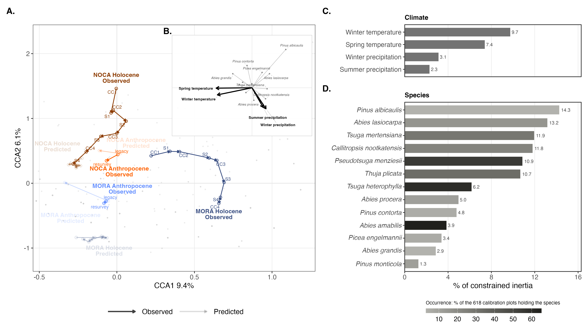

[Full PDF](../plot/fig_cca_trajectories.pdf) · [Figure script](../R/stages/08_cca_figure.R).

## Tracking example and actual-transition displays

The worked example uses one primary actual transition. Temporal displays show actual transition
midpoints and spans with matching climate and fire exposure. Both tracking ratios remain in the
tables; their identical Holocene values need only one display. Modern fire activity is unavailable
as a continuous charcoal measure; original binary burned assignments remain available.

### Work through WA/LC movement, lag, ratio, and angle

One actual primary Panther Potholes transition shows WA/LC endpoints, counterfactuals, seven responses, endpoint samples and actual elapsed time. Corrections are nonadditive.

Script: [09_tracking_example_and_visualizations.R](../R/stages/09_tracking_example_and_visualizations.R). [Complete PDF](../plot/test_figures/worked_examples/fig_method_worked_example.pdf) (1 page).


### Compare tracking responses, climate and fire under established regional climate-period bands, with Anthropocene boxplots

Actual primary transition estimates, without vegetation interpolation or bin offsets. Fire is events per century per eligible core. **Primary reconstruction; conditional inference**.

Script: [09_tracking_example_and_visualizations.R](../R/stages/09_tracking_example_and_visualizations.R). [Complete PDF](../plot/test_figures/fig_tracking_transition_rates.pdf) (1 page).

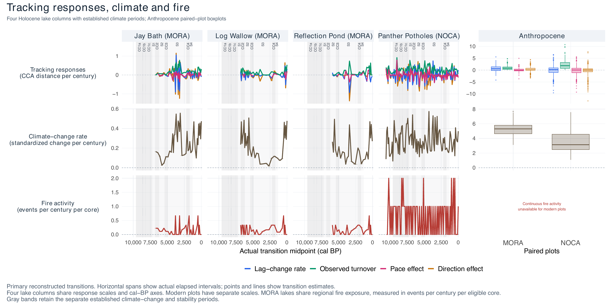

### Compare magnitude tracking ratio, angle, climate and fire under the same regional climate-period bands, one variable per row

Actual primary transition estimates, without vegetation interpolation or bin offsets. Fire is events per century per eligible core. **Primary reconstruction; conditional inference**.

Script: [09_tracking_example_and_visualizations.R](../R/stages/09_tracking_example_and_visualizations.R). [Complete PDF](../plot/test_figures/fig_tracking_transition_ratios_angles.pdf) (1 page).

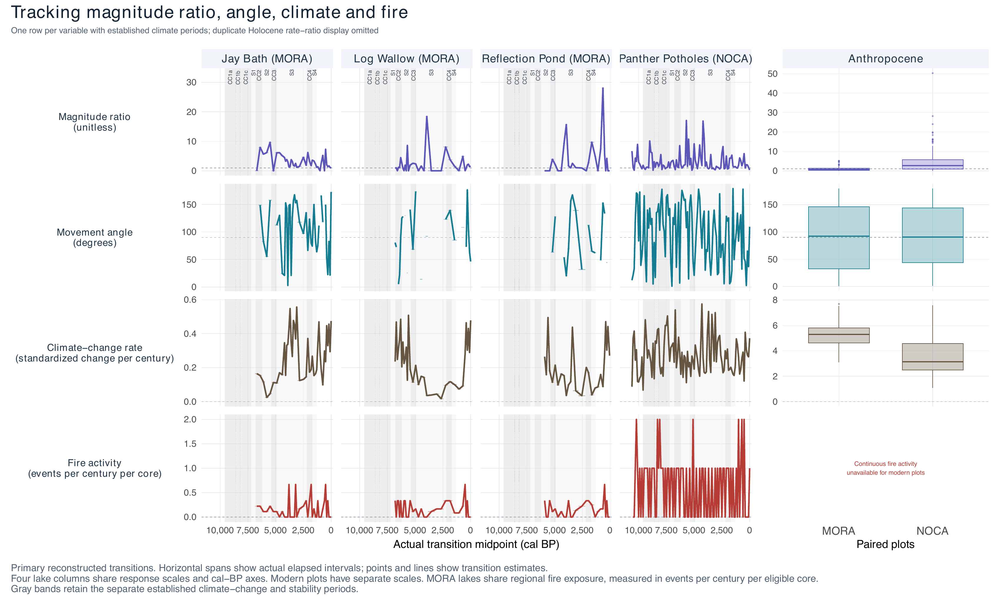

| Constraint | Units | Holocene regional signed maximum | Peak cal BP | MORA modern median | NOCA modern median |
| --- | --- | --- | --- | --- | --- |
| Spring temperature | deg C / century | 0.04175 | 7500 | 1.288 | 0.7691 |
| Winter temperature | deg C / century | 0.05504 | 9500 | 3.271 | 1.359 |
| Summer precipitation | mm / century | -1.087 | 8900 | -142.6 | 103.6 |
| Winter precipitation | mm / century | 2.338 | 8100 | -937.2 | -411.2 |

[Full raw climate rates table](assets/analysis/tables/raw_climate_rates.csv).

### Figure 2. Climate eras, climate rates and high-fire periods

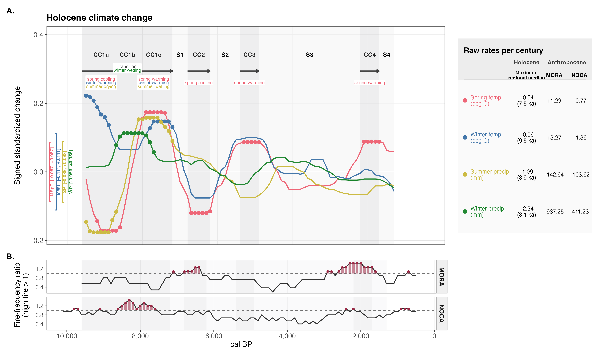

[Full PDF](../plot/fig_standardized_climate_change_eras_fire.pdf) · [Figure script](../R/stages/10_climate_change_figure.R).

## Primary models and residual covariance comparisons

Primary, Bacon sensitivity and lake-check results use separate folders. Metric-specific figures
are consolidated into multipage PDFs by purpose, with one labeled response per page.

[Primary, Bacon sensitivity and lake-check folder guide](assets/analysis/tracking_result_guide.txt).

### Residual covariance comparison

Combined-era models use `estimate ~ era * site` and separate residual variances by era/site.
Modern plots are singleton series. Applicable Holocene models compare independent residuals,
neighboring-transition MA(1), and continuous-time AR(1). Transition indices are assigned before
exclusions; gaps are not renumbered. Continuous-time correlation uses actual midpoints in centuries.
Compare REML AIC only on identical rows and fixed effects. **MA(1) is the primary covariance
for every model containing Holocene observations**, as explicitly retained by the user.
Independent and CAR1 are comparison diagnostics only; AIC recommendations never replace
MA(1). Failed fits and boundary/covariance warnings remain in the result tables.
Modern-only models retain independent residuals.

```r
# Same fixed effects and rows; Independent/CAR1 are comparisons only.
correlation = NULL
correlation = nlme::corARMA(p = 0, q = 1, form = ~ time_index | series)
correlation = nlme::corCAR1(form = ~ time_centuries | series)
# Primary Holocene community and species explanatory models: MA(1).
correlation = nlme::corARMA(p = 0, q = 1, form = ~ time_index | series)
nlme::gls(estimate ~ site + climate_rate + fire_activity, data = d,
  correlation = correlation, weights = nlme::varIdent(form = ~ 1 | site),
  method = 'REML', na.action = na.fail)
# Anthropocene species and basic community model:
nlme::gls(estimate ~ site + burned, data = d,
  weights = nlme::varIdent(form = ~ 1 | site), method = 'REML')
# Extended Anthropocene COMMUNITY model only:
nlme::gls(estimate ~ site + elevation + climate_rate + burned, data = d,
  weights = nlme::varIdent(form = ~ 1 | site), method = 'REML')
```

### Observed lag change

### Compare independent, neighboring MA(1), and continuous-time AR(1) residual covariance on identical primary observations

One primary median-age reconstruction. MA(1) is primary for models containing Holocene observations; Independent and CAR1 are comparisons only. Confidence intervals are conditional on the reconstruction. **Primary reconstruction; conditional inference**.

Script: [12_tracking_era_models.R](../R/stages/12_tracking_era_models.R). [Complete PDF](../plot/test_figures/primary_models/fig_tracking_model_aic.pdf) (5 pages).


### Selected-covariance fitted Holocene/Anthropocene group means and contrasts for the primary reconstruction

One primary median-age reconstruction. MA(1) is primary for models containing Holocene observations; Independent and CAR1 are comparisons only. Confidence intervals are conditional on the reconstruction. **Primary reconstruction; conditional inference**.

Script: [12_tracking_era_models.R](../R/stages/12_tracking_era_models.R). [Complete PDF](../plot/test_figures/primary_models/fig_tracking_model_group_means.pdf) (5 pages).

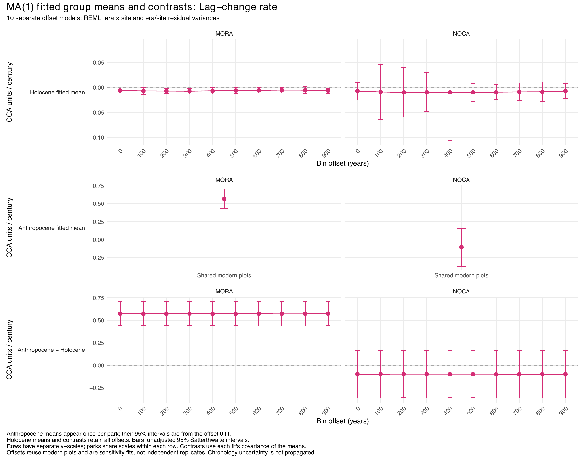

### Selected-covariance coefficients for the primary reconstruction

One primary median-age reconstruction. MA(1) is primary for models containing Holocene observations; Independent and CAR1 are comparisons only. Confidence intervals are conditional on the reconstruction. **Primary reconstruction; conditional inference**.

Script: [12_tracking_era_models.R](../R/stages/12_tracking_era_models.R). [Complete PDF](../plot/test_figures/primary_models/fig_tracking_model_coefficients.pdf) (5 pages).


### Selected-covariance Anthropocene-minus-Holocene contrasts for the primary reconstruction within each park

One primary median-age reconstruction. MA(1) is primary for models containing Holocene observations; Independent and CAR1 are comparisons only. Confidence intervals are conditional on the reconstruction. **Primary reconstruction; conditional inference**.

Script: [12_tracking_era_models.R](../R/stages/12_tracking_era_models.R). [Complete PDF](../plot/test_figures/primary_models/fig_tracking_model_contrasts.pdf) (5 pages).


### Residual checks for the selected Selected-covariance for the primary reconstruction

One primary median-age reconstruction. MA(1) is primary for models containing Holocene observations; Independent and CAR1 are comparisons only. Confidence intervals are conditional on the reconstruction. **Primary reconstruction; conditional inference**.

Script: [12_tracking_era_models.R](../R/stages/12_tracking_era_models.R). [Complete PDF](../plot/test_figures/primary_models/fig_tracking_model_residuals.pdf) (5 pages).


[Complete primary results and covariance comparisons](assets/analysis/model_results.txt).

### Selected-covariance individual-lake coefficients for the primary reconstruction

Primary individual-lake comparison with modern plots in its park; the primary MA(1) covariance is reestimated. **Primary reconstruction; conditional inference**.

Script: [13_tracking_lake_sensitivity.R](../R/stages/13_tracking_lake_sensitivity.R). [Complete PDF](../plot/test_figures/sensitivity/lake_checks/fig_tracking_lake_coefficients.pdf) (5 pages).


### Selected-covariance Anthropocene-minus-Holocene lake contrasts for the primary reconstruction

Primary individual-lake comparison with modern plots in its park; the primary MA(1) covariance is reestimated. **Primary reconstruction; conditional inference**.

Script: [13_tracking_lake_sensitivity.R](../R/stages/13_tracking_lake_sensitivity.R). [Complete PDF](../plot/test_figures/sensitivity/lake_checks/fig_tracking_lake_contrasts.pdf) (5 pages).


[Complete primary lake sensitivity results](assets/analysis/lake_model_results.txt).

### Community turnover

### Compare independent, neighboring MA(1), and continuous-time AR(1) residual covariance on identical primary observations

One primary median-age reconstruction. MA(1) is primary for models containing Holocene observations; Independent and CAR1 are comparisons only. Confidence intervals are conditional on the reconstruction. **Primary reconstruction; conditional inference**.

Script: [12_tracking_era_models.R](../R/stages/12_tracking_era_models.R). [Complete PDF](../plot/test_figures/primary_models/fig_tracking_model_aic.pdf) (5 pages).

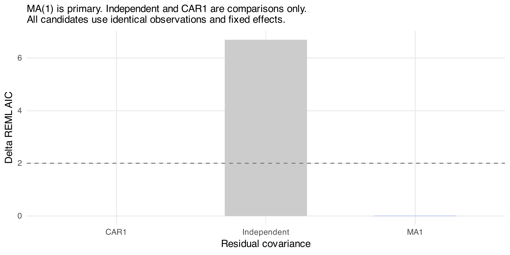

### Observed turnover: Selected-covariance fitted Holocene/Anthropocene group means and contrasts for the primary reconstruction

One primary median-age reconstruction. MA(1) is primary for models containing Holocene observations; Independent and CAR1 are comparisons only. Confidence intervals are conditional on the reconstruction. **Primary reconstruction; conditional inference**.

Script: [12_tracking_era_models.R](../R/stages/12_tracking_era_models.R). [Complete PDF](../plot/test_figures/primary_models/fig_tracking_model_group_means.pdf) (5 pages).

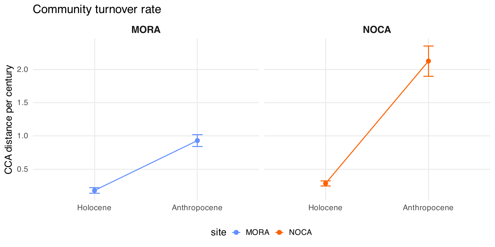

### Observed turnover: Selected-covariance coefficients for the primary reconstruction

One primary median-age reconstruction. MA(1) is primary for models containing Holocene observations; Independent and CAR1 are comparisons only. Confidence intervals are conditional on the reconstruction. **Primary reconstruction; conditional inference**.

Script: [12_tracking_era_models.R](../R/stages/12_tracking_era_models.R). [Complete PDF](../plot/test_figures/primary_models/fig_tracking_model_coefficients.pdf) (5 pages).

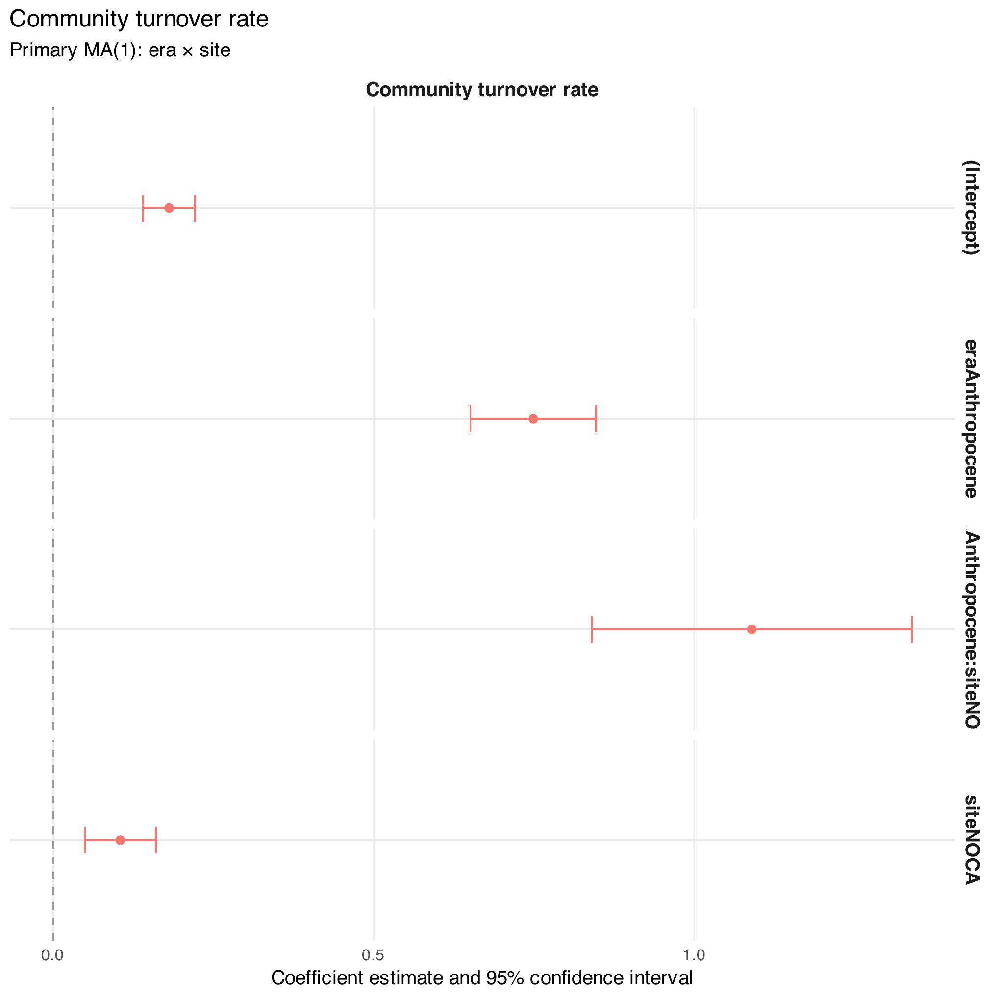

### Observed turnover: Selected-covariance Anthropocene-minus-Holocene contrasts for the primary reconstruction within each park

One primary median-age reconstruction. MA(1) is primary for models containing Holocene observations; Independent and CAR1 are comparisons only. Confidence intervals are conditional on the reconstruction. **Primary reconstruction; conditional inference**.

Script: [12_tracking_era_models.R](../R/stages/12_tracking_era_models.R). [Complete PDF](../plot/test_figures/primary_models/fig_tracking_model_contrasts.pdf) (5 pages).

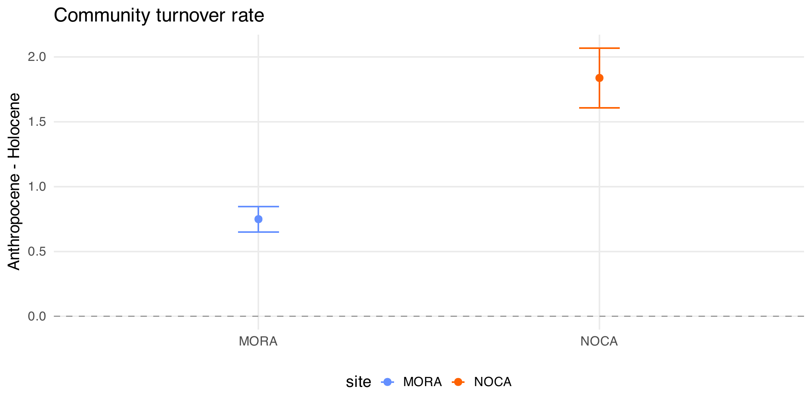

### Observed turnover: residual checks for the selected Selected-covariance for the primary reconstruction

One primary median-age reconstruction. MA(1) is primary for models containing Holocene observations; Independent and CAR1 are comparisons only. Confidence intervals are conditional on the reconstruction. **Primary reconstruction; conditional inference**.

Script: [12_tracking_era_models.R](../R/stages/12_tracking_era_models.R). [Complete PDF](../plot/test_figures/primary_models/fig_tracking_model_residuals.pdf) (5 pages).

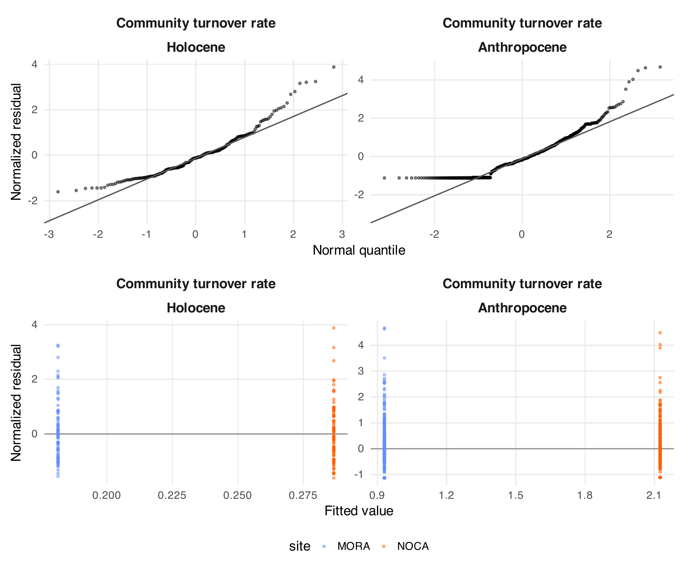

[Complete observed-turnover primary covariance fit results](assets/analysis/turnover_model_results.txt).

### Observed turnover: Selected-covariance individual-lake coefficients for the primary reconstruction

Primary individual-lake comparison with modern plots in its park; the primary MA(1) covariance is reestimated. **Primary reconstruction; conditional inference**.

Script: [13_tracking_lake_sensitivity.R](../R/stages/13_tracking_lake_sensitivity.R). [Complete PDF](../plot/test_figures/sensitivity/lake_checks/fig_tracking_lake_coefficients.pdf) (5 pages).

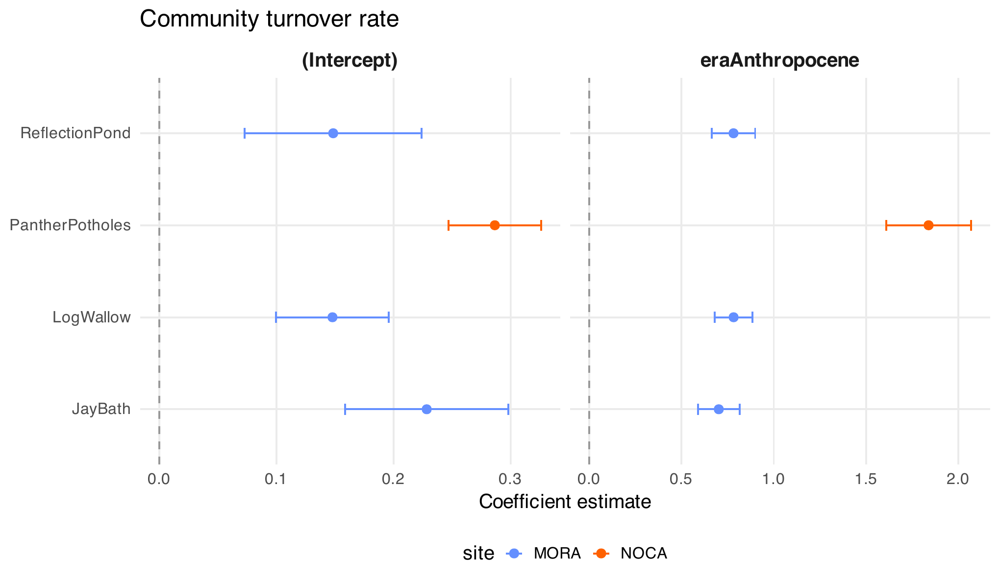

### Observed turnover: Selected-covariance Anthropocene-minus-Holocene lake contrasts for the primary reconstruction

Primary individual-lake comparison with modern plots in its park; the primary MA(1) covariance is reestimated. **Primary reconstruction; conditional inference**.

Script: [13_tracking_lake_sensitivity.R](../R/stages/13_tracking_lake_sensitivity.R). [Complete PDF](../plot/test_figures/sensitivity/lake_checks/fig_tracking_lake_contrasts.pdf) (5 pages).

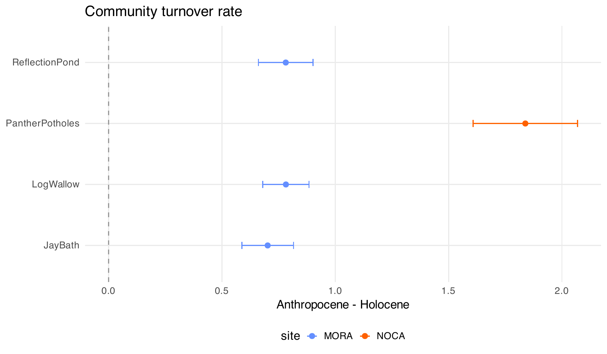

[Complete observed-turnover primary lake sensitivity results](assets/analysis/turnover_lake_results.txt).

### Standardized climate-change rate

### Compare independent, neighboring MA(1), and continuous-time AR(1) residual covariance on identical primary observations

One primary median-age reconstruction. MA(1) is primary for models containing Holocene observations; Independent and CAR1 are comparisons only. Confidence intervals are conditional on the reconstruction. **Primary reconstruction; conditional inference**.

Script: [12_tracking_era_models.R](../R/stages/12_tracking_era_models.R). [Complete PDF](../plot/test_figures/primary_models/fig_tracking_model_aic.pdf) (5 pages).

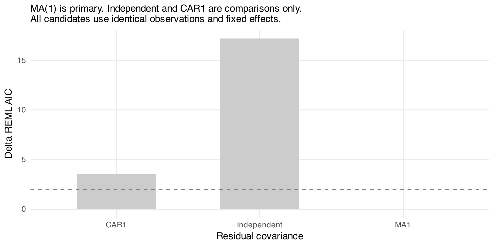

### Untransformed physical climate-change rate: Selected-covariance fitted Holocene/Anthropocene group means and contrasts for the primary reconstruction

One primary median-age reconstruction. MA(1) is primary for models containing Holocene observations; Independent and CAR1 are comparisons only. Confidence intervals are conditional on the reconstruction. **Primary reconstruction; conditional inference**.

Script: [12_tracking_era_models.R](../R/stages/12_tracking_era_models.R). [Complete PDF](../plot/test_figures/primary_models/fig_tracking_model_group_means.pdf) (5 pages).

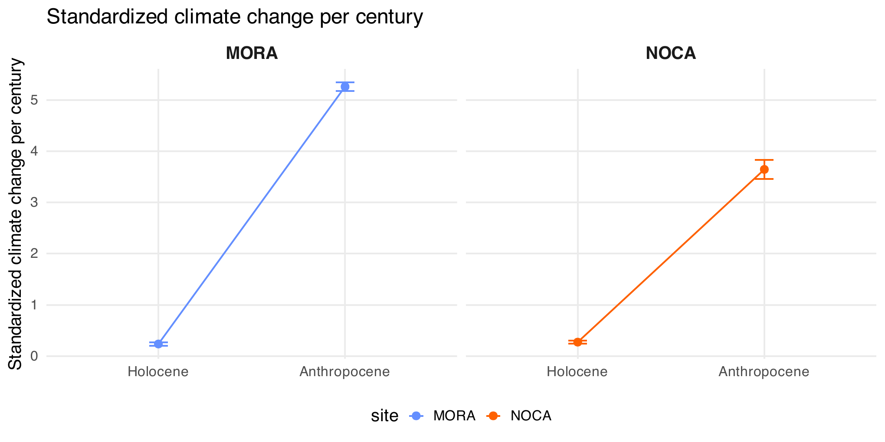

### Untransformed physical climate-change rate: Selected-covariance coefficients for the primary reconstruction

One primary median-age reconstruction. MA(1) is primary for models containing Holocene observations; Independent and CAR1 are comparisons only. Confidence intervals are conditional on the reconstruction. **Primary reconstruction; conditional inference**.

Script: [12_tracking_era_models.R](../R/stages/12_tracking_era_models.R). [Complete PDF](../plot/test_figures/primary_models/fig_tracking_model_coefficients.pdf) (5 pages).

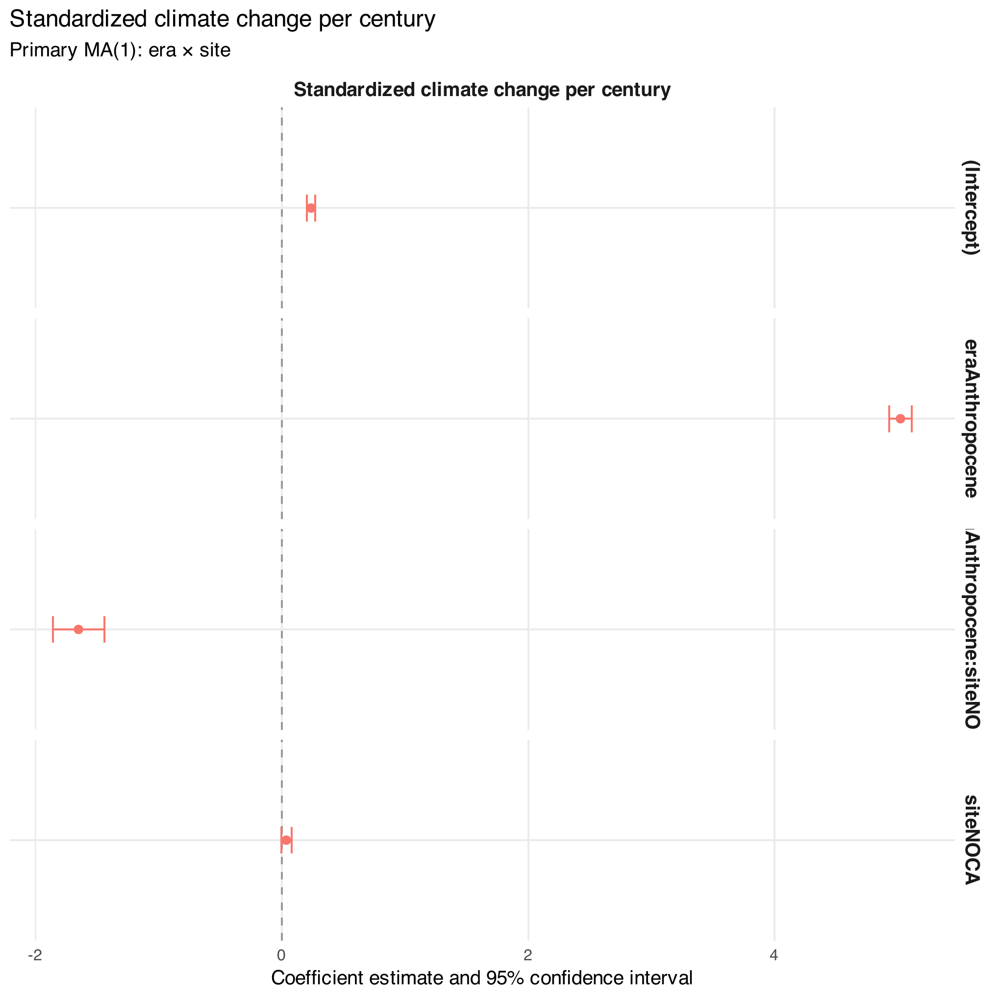

### Untransformed physical climate-change rate: Selected-covariance Anthropocene-minus-Holocene contrasts for the primary reconstruction within each park

One primary median-age reconstruction. MA(1) is primary for models containing Holocene observations; Independent and CAR1 are comparisons only. Confidence intervals are conditional on the reconstruction. **Primary reconstruction; conditional inference**.

Script: [12_tracking_era_models.R](../R/stages/12_tracking_era_models.R). [Complete PDF](../plot/test_figures/primary_models/fig_tracking_model_contrasts.pdf) (5 pages).

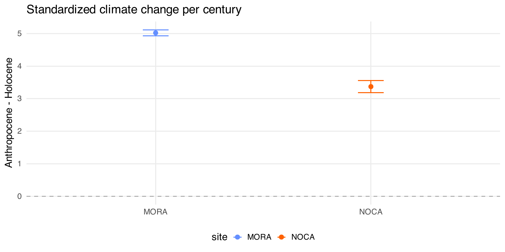

### Untransformed physical climate-change rate: residual checks for the selected Selected-covariance for the primary reconstruction

One primary median-age reconstruction. MA(1) is primary for models containing Holocene observations; Independent and CAR1 are comparisons only. Confidence intervals are conditional on the reconstruction. **Primary reconstruction; conditional inference**.

Script: [12_tracking_era_models.R](../R/stages/12_tracking_era_models.R). [Complete PDF](../plot/test_figures/primary_models/fig_tracking_model_residuals.pdf) (5 pages).

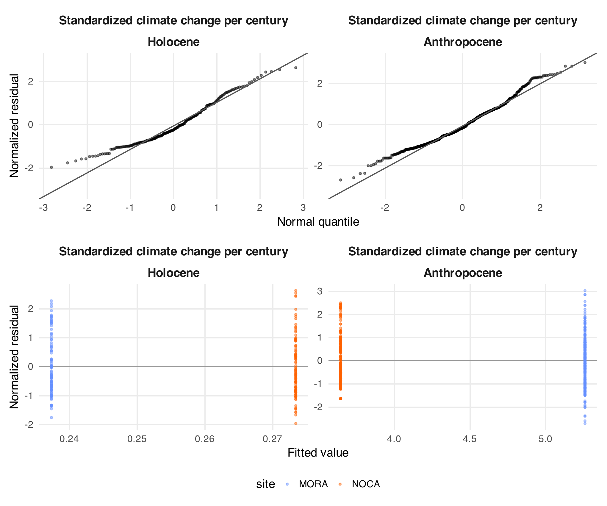

[Complete raw climate-rate primary covariance fit results](assets/analysis/climate_model_results.txt).

### Untransformed physical climate-change rate: Selected-covariance individual-lake coefficients for the primary reconstruction

Primary individual-lake comparison with modern plots in its park; the primary MA(1) covariance is reestimated. **Primary reconstruction; conditional inference**.

Script: [13_tracking_lake_sensitivity.R](../R/stages/13_tracking_lake_sensitivity.R). [Complete PDF](../plot/test_figures/sensitivity/lake_checks/fig_tracking_lake_coefficients.pdf) (5 pages).

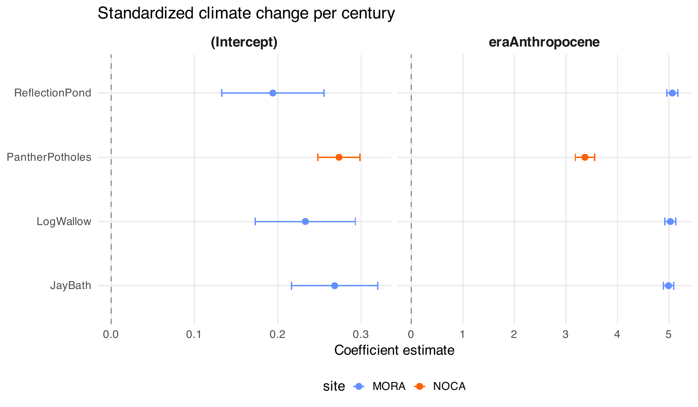

### Untransformed physical climate-change rate: Selected-covariance Anthropocene-minus-Holocene lake contrasts for the primary reconstruction

Primary individual-lake comparison with modern plots in its park; the primary MA(1) covariance is reestimated. **Primary reconstruction; conditional inference**.

Script: [13_tracking_lake_sensitivity.R](../R/stages/13_tracking_lake_sensitivity.R). [Complete PDF](../plot/test_figures/sensitivity/lake_checks/fig_tracking_lake_contrasts.pdf) (5 pages).

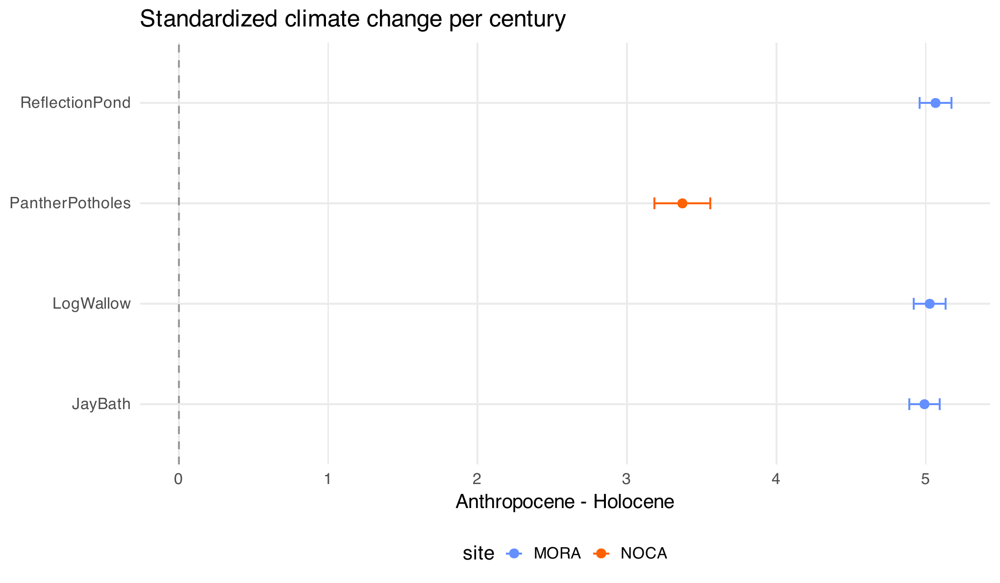

[Complete raw climate-rate primary lake sensitivity results](assets/analysis/climate_lake_results.txt).

### Pace and direction correction effects

### Compare independent, neighboring MA(1), and continuous-time AR(1) residual covariance on identical primary observations

One primary median-age reconstruction. MA(1) is primary for models containing Holocene observations; Independent and CAR1 are comparisons only. Confidence intervals are conditional on the reconstruction. **Primary reconstruction; conditional inference**.

Script: [12_tracking_era_models.R](../R/stages/12_tracking_era_models.R). [Complete PDF](../plot/test_figures/primary_models/fig_tracking_model_aic.pdf) (5 pages).

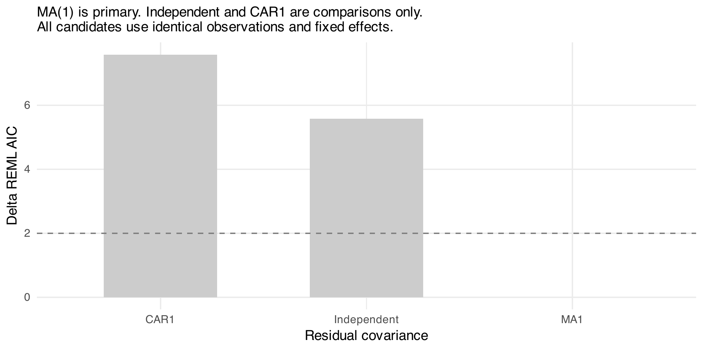

### Pace correction effect: group means for the primary reconstruction

One primary median-age reconstruction. MA(1) is primary for models containing Holocene observations; Independent and CAR1 are comparisons only. Confidence intervals are conditional on the reconstruction. **Primary reconstruction; conditional inference**.

Script: [12_tracking_era_models.R](../R/stages/12_tracking_era_models.R). [Complete PDF](../plot/test_figures/primary_models/fig_tracking_model_group_means.pdf) (5 pages).

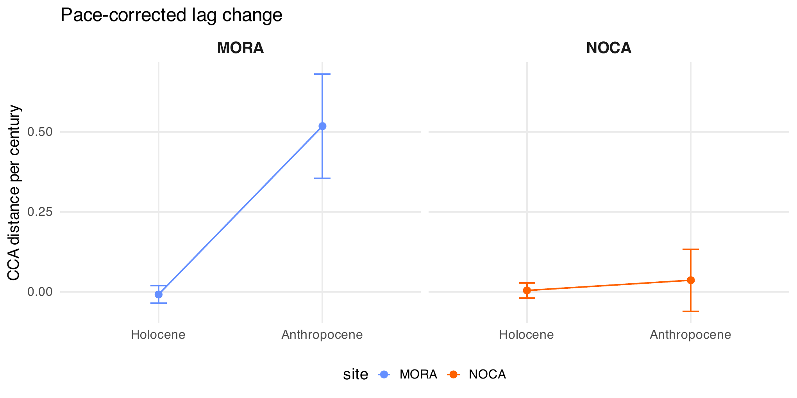

### Pace correction effect: coefficients for the primary reconstruction

One primary median-age reconstruction. MA(1) is primary for models containing Holocene observations; Independent and CAR1 are comparisons only. Confidence intervals are conditional on the reconstruction. **Primary reconstruction; conditional inference**.

Script: [12_tracking_era_models.R](../R/stages/12_tracking_era_models.R). [Complete PDF](../plot/test_figures/primary_models/fig_tracking_model_coefficients.pdf) (5 pages).

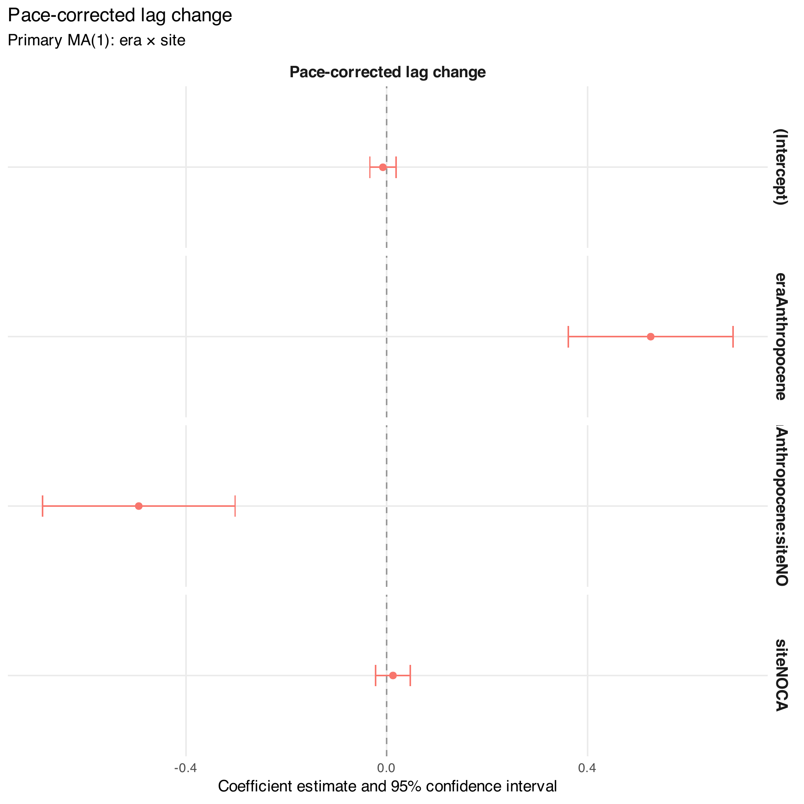

### Pace correction effect: contrasts for the primary reconstruction

One primary median-age reconstruction. MA(1) is primary for models containing Holocene observations; Independent and CAR1 are comparisons only. Confidence intervals are conditional on the reconstruction. **Primary reconstruction; conditional inference**.

Script: [12_tracking_era_models.R](../R/stages/12_tracking_era_models.R). [Complete PDF](../plot/test_figures/primary_models/fig_tracking_model_contrasts.pdf) (5 pages).

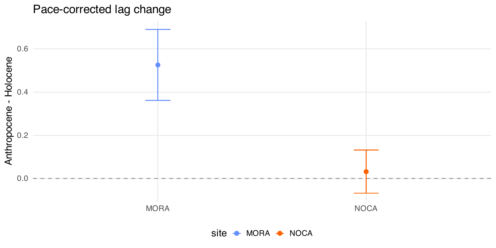

### Pace correction effect: residuals for the primary reconstruction

One primary median-age reconstruction. MA(1) is primary for models containing Holocene observations; Independent and CAR1 are comparisons only. Confidence intervals are conditional on the reconstruction. **Primary reconstruction; conditional inference**.

Script: [12_tracking_era_models.R](../R/stages/12_tracking_era_models.R). [Complete PDF](../plot/test_figures/primary_models/fig_tracking_model_residuals.pdf) (5 pages).

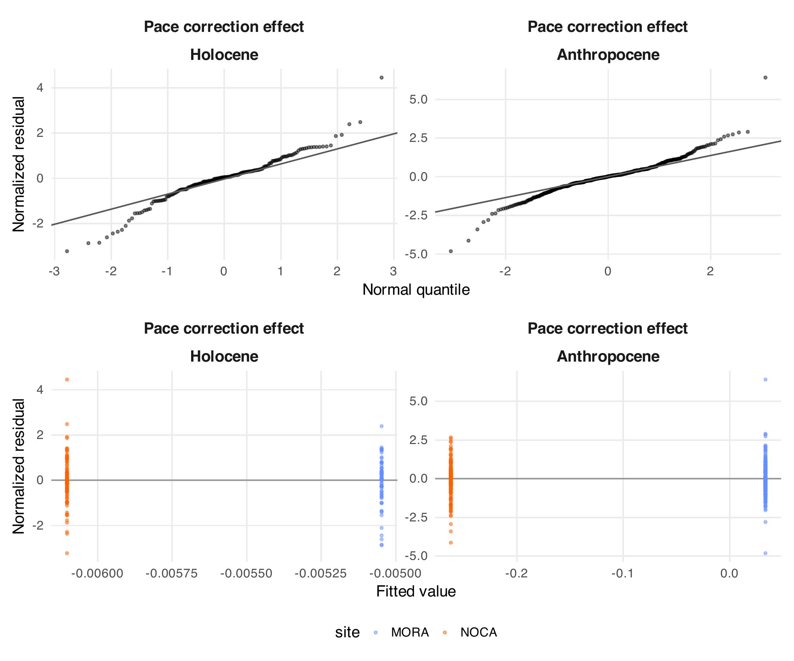

[Complete pace correction effect model results](assets/analysis/pace_model_results.txt).

### Pace correction effect: primary lake sensitivity coefficients

Primary individual-lake comparison with modern plots in its park; the primary MA(1) covariance is reestimated. **Primary reconstruction; conditional inference**.

Script: [13_tracking_lake_sensitivity.R](../R/stages/13_tracking_lake_sensitivity.R). [Complete PDF](../plot/test_figures/sensitivity/lake_checks/fig_tracking_lake_coefficients.pdf) (5 pages).

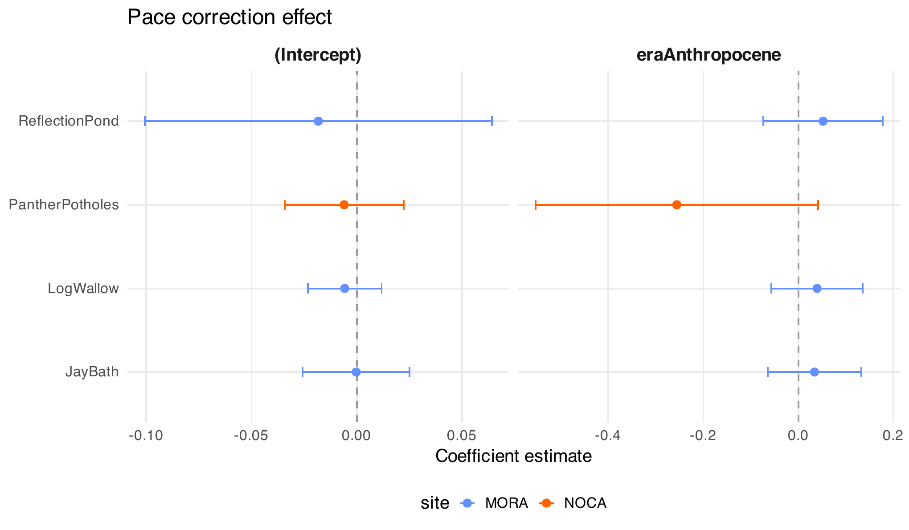

### Pace correction effect: primary lake sensitivity contrasts

Primary individual-lake comparison with modern plots in its park; the primary MA(1) covariance is reestimated. **Primary reconstruction; conditional inference**.

Script: [13_tracking_lake_sensitivity.R](../R/stages/13_tracking_lake_sensitivity.R). [Complete PDF](../plot/test_figures/sensitivity/lake_checks/fig_tracking_lake_contrasts.pdf) (5 pages).

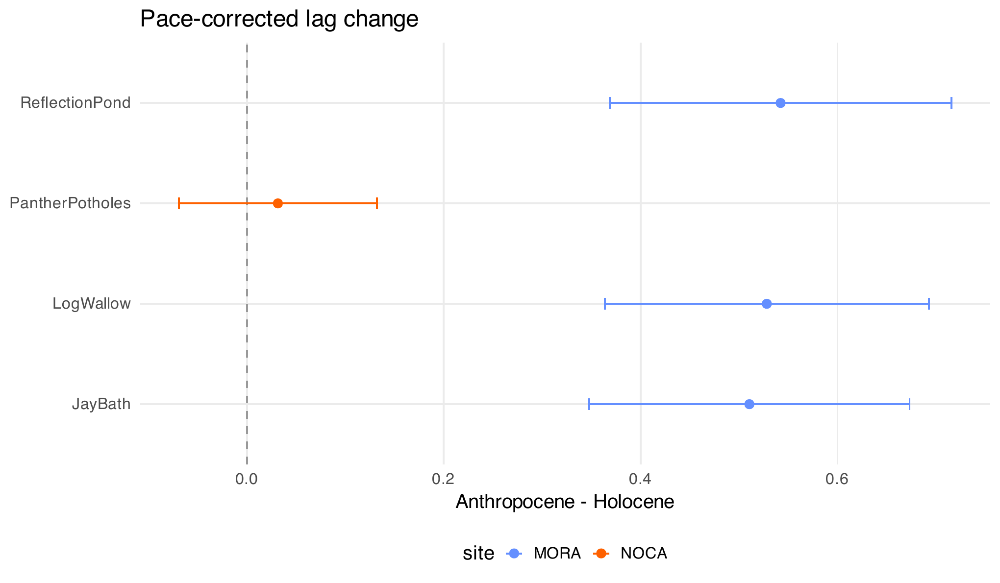

[Complete pace correction effect lake results](assets/analysis/pace_lake_results.txt).

### Compare independent, neighboring MA(1), and continuous-time AR(1) residual covariance on identical primary observations

One primary median-age reconstruction. MA(1) is primary for models containing Holocene observations; Independent and CAR1 are comparisons only. Confidence intervals are conditional on the reconstruction. **Primary reconstruction; conditional inference**.

Script: [12_tracking_era_models.R](../R/stages/12_tracking_era_models.R). [Complete PDF](../plot/test_figures/primary_models/fig_tracking_model_aic.pdf) (5 pages).

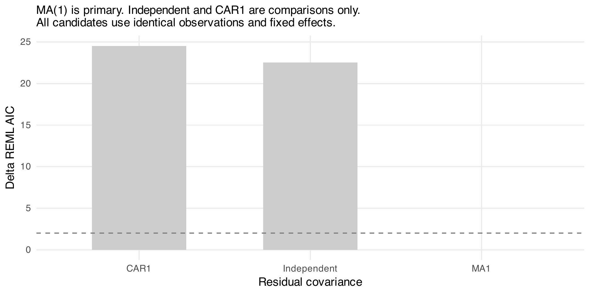

### Direction correction effect: group means for the primary reconstruction

One primary median-age reconstruction. MA(1) is primary for models containing Holocene observations; Independent and CAR1 are comparisons only. Confidence intervals are conditional on the reconstruction. **Primary reconstruction; conditional inference**.

Script: [12_tracking_era_models.R](../R/stages/12_tracking_era_models.R). [Complete PDF](../plot/test_figures/primary_models/fig_tracking_model_group_means.pdf) (5 pages).

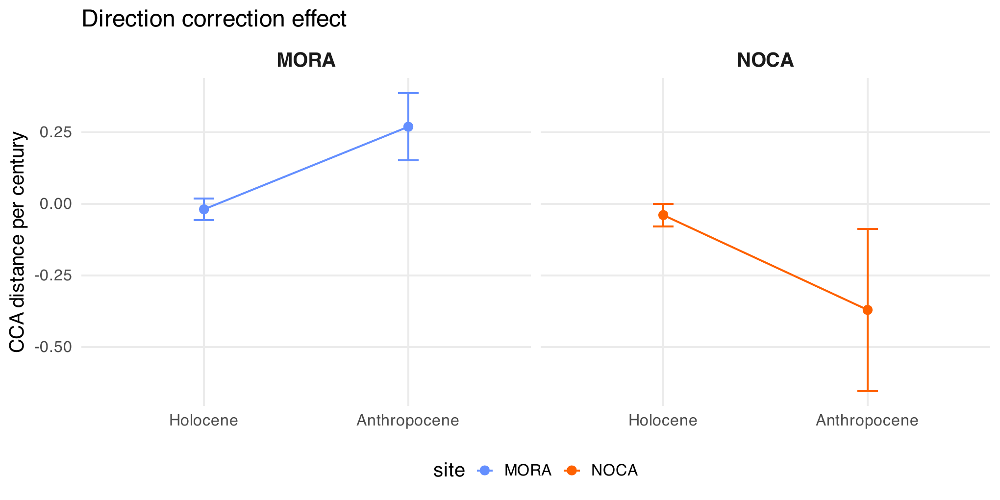

### Direction correction effect: coefficients for the primary reconstruction

One primary median-age reconstruction. MA(1) is primary for models containing Holocene observations; Independent and CAR1 are comparisons only. Confidence intervals are conditional on the reconstruction. **Primary reconstruction; conditional inference**.

Script: [12_tracking_era_models.R](../R/stages/12_tracking_era_models.R). [Complete PDF](../plot/test_figures/primary_models/fig_tracking_model_coefficients.pdf) (5 pages).

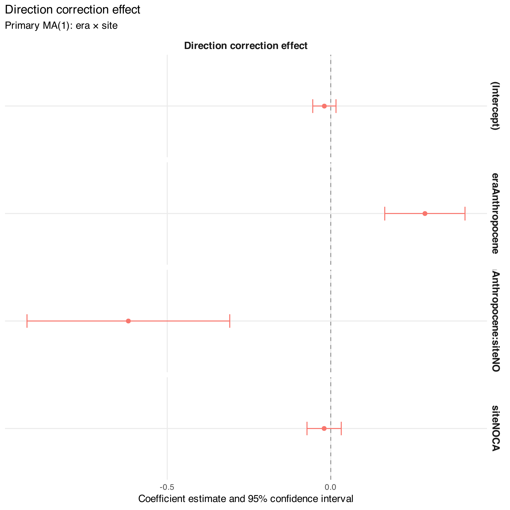

### Direction correction effect: contrasts for the primary reconstruction

One primary median-age reconstruction. MA(1) is primary for models containing Holocene observations; Independent and CAR1 are comparisons only. Confidence intervals are conditional on the reconstruction. **Primary reconstruction; conditional inference**.

Script: [12_tracking_era_models.R](../R/stages/12_tracking_era_models.R). [Complete PDF](../plot/test_figures/primary_models/fig_tracking_model_contrasts.pdf) (5 pages).

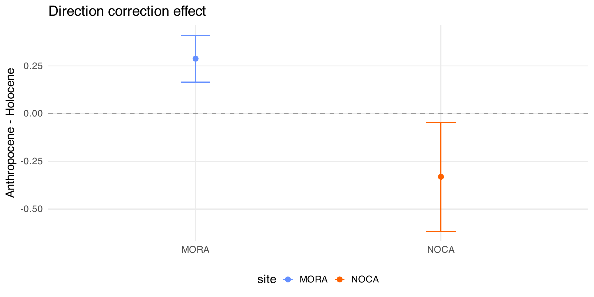

### Direction correction effect: residuals for the primary reconstruction

One primary median-age reconstruction. MA(1) is primary for models containing Holocene observations; Independent and CAR1 are comparisons only. Confidence intervals are conditional on the reconstruction. **Primary reconstruction; conditional inference**.

Script: [12_tracking_era_models.R](../R/stages/12_tracking_era_models.R). [Complete PDF](../plot/test_figures/primary_models/fig_tracking_model_residuals.pdf) (5 pages).

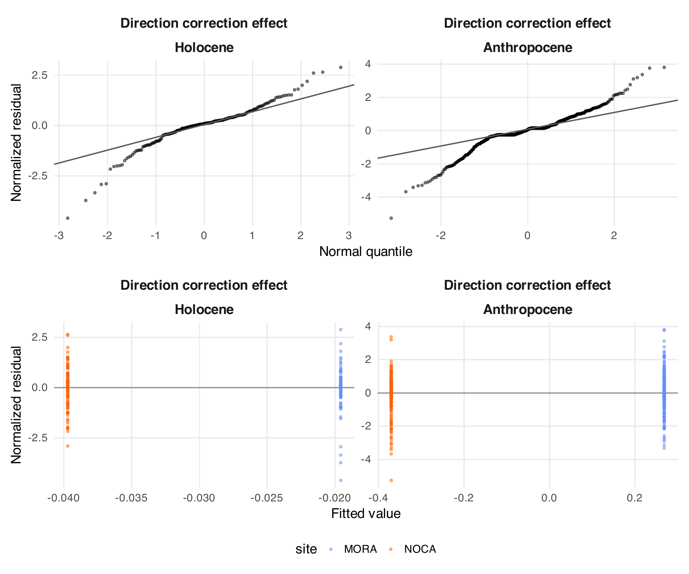

[Complete direction correction effect model results](assets/analysis/direction_model_results.txt).

### Direction correction effect: primary lake sensitivity coefficients

Primary individual-lake comparison with modern plots in its park; the primary MA(1) covariance is reestimated. **Primary reconstruction; conditional inference**.

Script: [13_tracking_lake_sensitivity.R](../R/stages/13_tracking_lake_sensitivity.R). [Complete PDF](../plot/test_figures/sensitivity/lake_checks/fig_tracking_lake_coefficients.pdf) (5 pages).

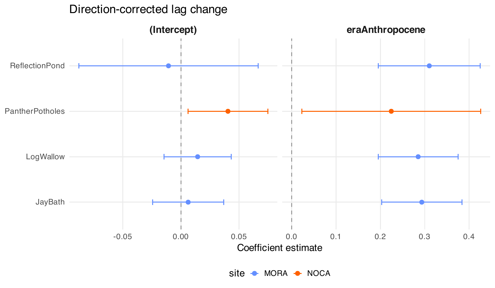

### Direction correction effect: primary lake sensitivity contrasts

Primary individual-lake comparison with modern plots in its park; the primary MA(1) covariance is reestimated. **Primary reconstruction; conditional inference**.

Script: [13_tracking_lake_sensitivity.R](../R/stages/13_tracking_lake_sensitivity.R). [Complete PDF](../plot/test_figures/sensitivity/lake_checks/fig_tracking_lake_contrasts.pdf) (5 pages).

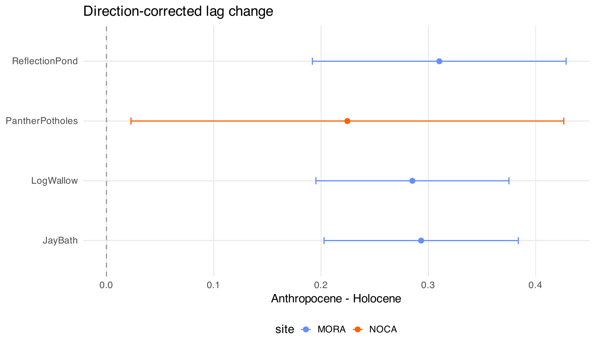

[Complete direction correction effect lake results](assets/analysis/direction_lake_results.txt).

### Joint pace/direction correction model

The separate response models above remain intact. The additional joint model includes
**pace and direction correction effects only**, with all era × park × correction interactions:

```r
fit_joint = nlme::gls(
  estimate ~ era * site * correction,
  correlation = corPairedMA1(form = ~ time_index | series),
  weights = nlme::varIdent(form = ~ 1 | era_site_correction),
  data = paired_corrections,
  method = "REML"
)
```

`corPairedMA1()` is the validated shared correlation helper. Its temporal part is MA(1)
on the original transition indices; its outcome part allows the two corrections on the
same transition to correlate, separately by era/park. Their product defines the full
within-series correlation. Modern plots have two outcomes but one time point each.
Separate residual SDs apply to the eight era/park/correction groups. Stacking the two
corrections as independent observations would give incorrect contrast uncertainty.

Only transitions with both corrections defined enter: 185 Holocene transitions
(78 MORA, 107 NOCA) and 465 modern pairs (254 MORA, 211 NOCA), giving 1,300 response rows.
No values are imputed and temporal indices are not renumbered. These paired fitted means
can differ from separate-model means, which retain each response's own eligible records.
This joint model is primary-only. Convergence, boundary estimates and covariance uncertainty
are reported with the current fit below.

| Era | Park | Direction − Pace | 95% lower | 95% upper | Holm p | Stars |
| --- | --- | --- | --- | --- | --- | --- |
| Holocene | MORA | -0.02115 | -0.07303 | 0.03073 | 0.4161 | — |
| Anthropocene | MORA | 0.3155 | 0.1322 | 0.4988 | 0.003264 | ** |
| Holocene | NOCA | -0.03324 | -0.07496 | 0.008478 | 0.3487 | — |
| Anthropocene | NOCA | -0.2246 | -0.5292 | 0.08002 | 0.3487 | — |

Differences are **Direction − Pace**, in CCA distance per century. P-values are Holm-adjusted
across the four within-era/park comparisons; intervals are unadjusted conditional 95% intervals.
Current estimates and significance appear in the table above; they are refitted to correction
effects, not copied from the retired corrected-lag responses. Correction-by-era interaction
p-values use their own Holm family of two park comparisons. Positive effects mean the
correction reduces final lag; a positive Direction − Pace contrast means the direction
correction provides the larger reduction.

[Joint coefficients](assets/analysis/tables/joint_correction_model_coefficients.csv),
[fitted means](assets/analysis/tables/joint_correction_model_group_means.csv),
[correction comparisons](assets/analysis/tables/joint_correction_correction_contrasts.csv),
[era comparisons](assets/analysis/tables/joint_correction_era_contrasts.csv),
[correction-by-era interactions](assets/analysis/tables/joint_correction_correction_by_era_contrasts.csv),
[displayed mean tests against zero](assets/analysis/tables/joint_correction_displayed_mean_zero_tests.csv),
[matched input](assets/analysis/tables/joint_correction_model_input.csv), and
[excluded unmatched records](assets/analysis/tables/joint_correction_model_exclusions.csv).

[Complete paired correction GLS results, means and contrast tests](assets/analysis/joint_correction_model_results.txt).

### Paired pace/direction model normalized-residual diagnostics

Joint era × park × correction GLS on transitions with both corrections defined. Temporal MA(1) and paired correction correlation are modeled together; normalized residuals account for the full fitted covariance. **Primary reconstruction; conditional inference**.

Script: [12_tracking_era_models.R](../R/stages/12_tracking_era_models.R). [Complete PDF](../plot/test_figures/primary_models/fig_tracking_joint_correction_residuals.pdf) (1 page).

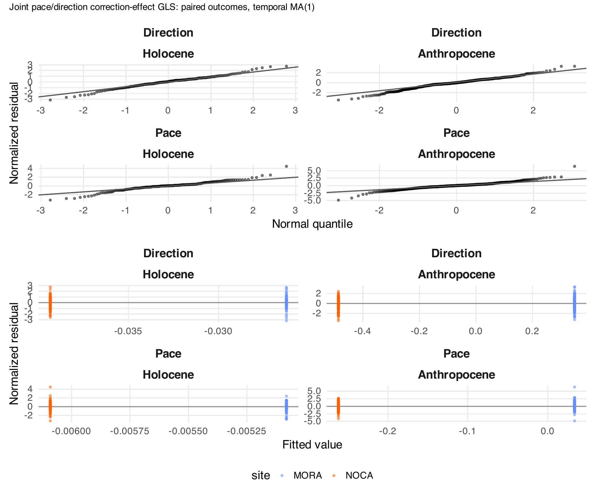

## Manuscript comparison from the primary reconstruction

Figure 4 has four labeled sections: **A**, standardized climate era contrasts;
**B**, community-turnover and observed-lag era contrasts; **C**, Holocene lag distributions;
**D**, Anthropocene lag distributions. Panels C/D have MORA and NOCA on the x-axis and their
own era-specific scales. The y-axis is **CCA distance per century**. The legend identifies
**Observed lag-change rate** (green), **Pace correction effect rate** (pink), and
**Direction correction effect rate** (purple). Filled small dots and capped error bars show fitted means and conditional
95% Satterthwaite intervals. Large signed numerical annotations label the means to three decimals.

Observed violins and means use the existing observed-response model and all its eligible
records (211 Holocene transitions, 607 modern pairs). Correction-effect violins and means use the
new joint model's complete paired records; observed is **not** a third joint-model level.
Each input observation enters once within its displayed response.

Stars on mean labels test whether that mean differs from **zero**, using unadjusted two-sided
Satterthwaite t tests: * p < 0.05, ** p < 0.01, *** p < 0.001. Non-significant mean points,
intervals and labels are faded; transparency has no legend entry. Brackets compare
**direction minus pace**, and are shown only where their Holm-adjusted comparison is significant;
the bracket labels report the difference, stars and adjusted p-value. These are different tests:
a direction-effect mean can differ from zero even if its difference from pace is unsupported.

The correction-effect responses are existing geometric quantities:

- `pace_effect_on_lag_per_century = (observed final lag − pace-corrected final lag) × 100 / elapsed climate years`.
- `direction_effect_on_lag_per_century = (observed final lag − direction-corrected final lag) × 100 / elapsed climate years`.

Thus positive means indicate a lag reduction from the correction, negative means indicate a
lag increase, and zero indicates no effect. These are different from corrected lag-change
rates measured relative to initial lag. Both effects are independently verified from endpoints,
and undefined counterfactual directions remain excluded only for the affected response.

Correction-effect era contrasts from the separate models remain a separate figure.
The top-row climate, turnover and observed-lag contrasts retain their original definitions.
Signed fitted-mean ratios are descriptive and can be unstable near a zero mean.

### Figure 4. Primary era contrasts, observed lag change and correction effects

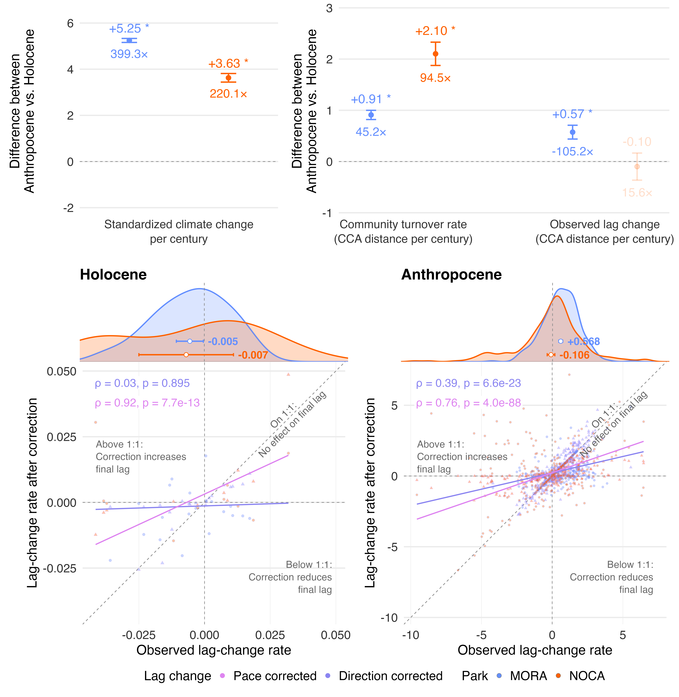

[Full PDF](../plot/fig_tracking_era_distributions.pdf) · [Figure script](../R/stages/14_tracking_manuscript_figure.R).

### Primary correction-effect era contrasts

Selected primary GLS Anthropocene-minus-Holocene contrasts for pace- and direction correction effects, with conditional 95% Satterthwaite intervals in CCA distance per century. MORA/NOCA are blue/orange; correction labels retain their colors. Stars mark unadjusted p < 0.05; nonsignificant dots, bars and annotations are faint. Signed fitted-mean ratios are descriptive and can be unstable near zero. Bacon model sensitivity is currently on hold. **Primary reconstruction; conditional inference**.

Script: [14_tracking_manuscript_figure.R](../R/stages/14_tracking_manuscript_figure.R). [Complete PDF](../plot/test_figures/primary_models/fig_tracking_correction_effect_contrasts.pdf) (1 page).

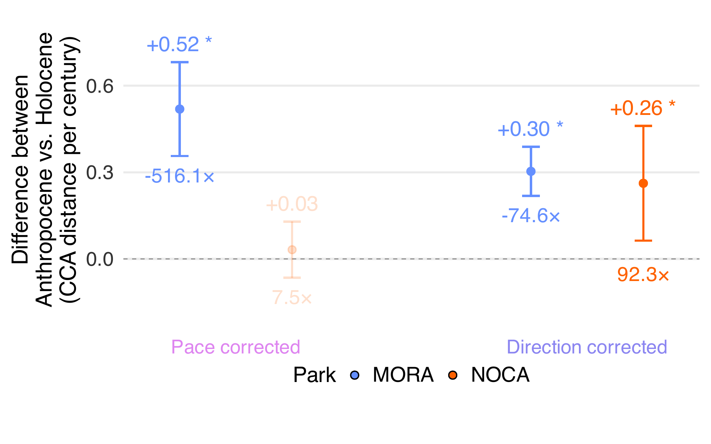

## Within-era climate, fire and elevation predictor models

Primary Holocene explanatory models fit observed lag-change rate and the two correction-effect rates against
`site + climate_rate + fire_activity`, with site-specific residual variances and selected covariance.
Primary Anthropocene basic models use `site + burned`; extended community models also include
`elevation + climate_rate`. Responses remain untransformed. Modern-only models retain independent residuals.

The main coefficient figure compares **Holocene** and **Anthropocene** predictor effects on
**observed lag-change rate**, **pace correction effect** and **direction correction effect**,
shown in green, pink and purple respectively.
The site coefficient is **NOCA − MORA**. These additive models have shared climate/fire slopes
across parks, so the figure does not present duplicated slopes as separate park estimates.
Holocene fire is the effect of one additional event per century per eligible core;
Anthropocene fire is **burned − unburned**. The Anthropocene main figure uses `site + burned`.
Intercepts are omitted, and conditional 95% intervals accompany the coefficients.
Each era's caption gives each response model's descriptive R² (`1 − SSE/SST`); negative values
are retained because GLS minimizes a covariance-weighted criterion rather than ordinary SSE.
The eras have separate coefficient-axis scales. Coefficients refer to their stated predictor
increments, not standardized effect sizes.

### Figure 5. Site, climate and fire effects on lag-change rates by era


[Full PDF](../plot/fig_tracking_predictor_era_coefficients.pdf) · [Figure script](../R/stages/15_tracking_predictor_models.R).

### Appendix: extended Anthropocene coefficients

The `site + elevation + climate_rate + burned` model remains fitted and reported as an
appendix analysis. Its separate figure omits intercepts and shows elevation effects per
100 m for readability, without changing the fitted model or its original coefficient table.
Its caption gives the three extended-model R² values.

### Appendix: extended Anthropocene predictor coefficients

Site + elevation + climate-change rate + burned, with independent residuals and park-specific residual variances. Intercepts are omitted. Elevation is displayed per 100 m; model fitting uses the original untransformed covariates. Conditional 95% intervals and descriptive R² are shown for observed lag change, pace correction effect and direction correction effect. **Primary reconstruction; conditional inference**.

Script: [15_tracking_predictor_models.R](../R/stages/15_tracking_predictor_models.R). [Complete PDF](../plot/test_figures/primary_models/fig_tracking_predictor_extended_coefficients.pdf) (1 page).

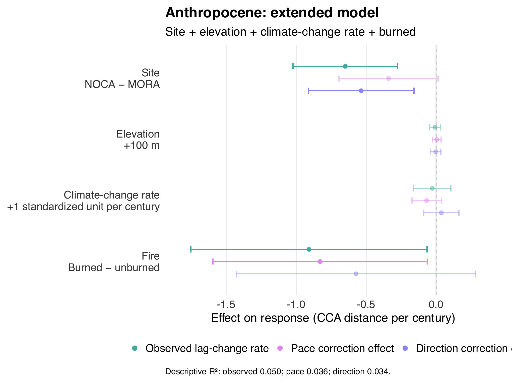

### Model diagnostics and lake sensitivity

The lake random-intercept sensitivity uses the same primary observations and selected covariance.
Its actual variance, coefficient changes and covariance-interval status are reported below; the older
near-zero variance result is not assumed to recur.

| Response | Lake SD | Maximum coefficient change | Covariance uncertainty | Lake-SD interval available |
| --- | --- | --- | --- | --- |
| lag_rate_per_century | 0.01664 | 0.02304 | positive_definite | TRUE |
| pace_effect_on_lag_per_century | 3.051e-06 | 2.247e-09 | Non-positive definite approximate variance-covariance | FALSE |
| direction_effect_on_lag_per_century | 5.675e-06 | 1.167e-10 | Non-positive definite approximate variance-covariance | FALSE |

### Holocene predicted lag-change trajectories

Primary explanatory models with actual transition durations and matching climate/fire exposures. Bacon model sensitivity is currently on hold. **Primary reconstruction; conditional inference**.

Script: [15_tracking_predictor_models.R](../R/stages/15_tracking_predictor_models.R). [Complete PDF](../plot/test_figures/primary_models/fig_tracking_predictor_holocene_predictions.pdf) (1 page).

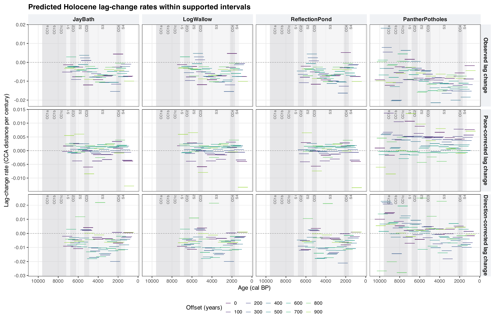

| Response | Specification | Observations | Descriptive R² |
| --- | --- | --- | --- |
| lag_rate_per_century | Holocene | 210 | 0.00512 |
| lag_rate_per_century | Anthropocene_basic | 607 | 0.04691 |
| lag_rate_per_century | Anthropocene_extended | 607 | 0.05036 |
| pace_effect_on_lag_per_century | Holocene | 184 | 0.007669 |
| pace_effect_on_lag_per_century | Anthropocene_basic | 465 | 0.03058 |
| pace_effect_on_lag_per_century | Anthropocene_extended | 465 | 0.03579 |
| direction_effect_on_lag_per_century | Holocene | 210 | 0.003899 |
| direction_effect_on_lag_per_century | Anthropocene_basic | 607 | 0.03587 |
| direction_effect_on_lag_per_century | Anthropocene_extended | 607 | 0.03433 |

### Descriptive R² for the predictor models

Primary explanatory models with actual transition durations and matching climate/fire exposures. Bacon model sensitivity is currently on hold. **Primary reconstruction; conditional inference**.

Script: [15_tracking_predictor_models.R](../R/stages/15_tracking_predictor_models.R). [Complete PDF](../plot/test_figures/primary_models/fig_tracking_predictor_R2.pdf) (1 page).

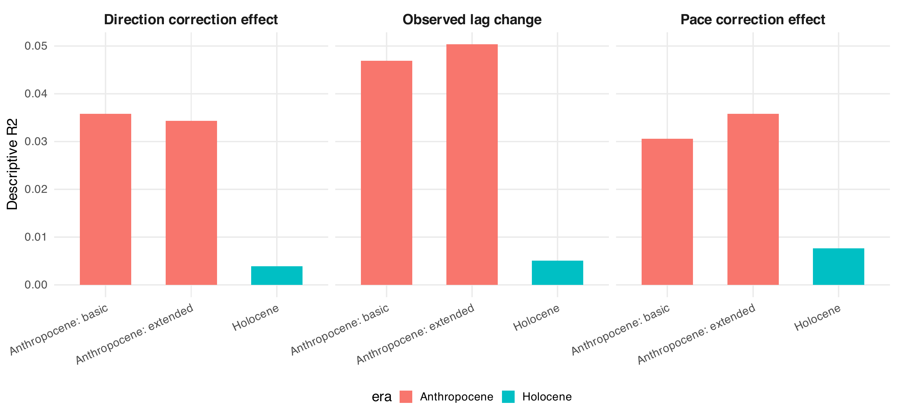

### Predictor-model normalized residual diagnostics

Primary explanatory models with actual transition durations and matching climate/fire exposures. Bacon model sensitivity is currently on hold. **Primary reconstruction; conditional inference**.

Script: [15_tracking_predictor_models.R](../R/stages/15_tracking_predictor_models.R). [Complete PDF](../plot/test_figures/primary_models/fig_tracking_predictor_residuals.pdf) (1 page).

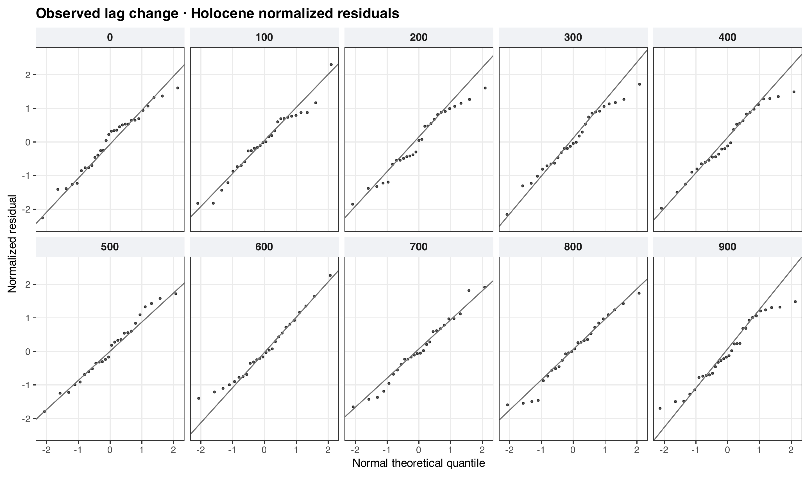

[Complete era-specific predictor results, lake sensitivity](assets/analysis/predictor_model_results.txt).

Bacon model sensitivity is **on hold for both community and species models** and omitted
from the active review. The code and saved checkpoints are retained for a later rerun;
normal workflow and standalone model-stage runs do not execute these sensitivities.
The reported coefficients and intervals condition on the primary median-age reconstruction;
they do not additionally propagate chronology uncertainty. Stored Bacon chronologies remain
unchanged and continue to supply the primary sample median ages.

## Species and seasonal climate contributions

Species vectors use changes in mean normalized sample weights and fixed species coordinates.
They sum exactly to delta WA before projections and rates. Species parallel contributions are
signed along delta LC and expressed per century. Seasonal climate-variable vectors are one-variable
LC perturbations; their sum equals delta LC, and their projections along delta WA retain displacement
units. Undefined directions stay NA. Perpendicular contributions remain retired.

Boxplots use one primary transition per species/variable and one modern pair, without flattening
chronology reconstructions into observations. The same conservation checks run within each draw.
These distributions describe differences among actual transitions, rather than uncertainty across
offsets or Bacon draws. Climate displacements retain their actual, variable-duration endpoints.

### Species contribution rates by era and park

Each primary lake transition and each modern plot pair contributes once per component. Boxes describe variation among actual transitions, not among offsets or Bacon draws. Species contributions are rates; climate contributions remain displacements. Undefined reference directions are omitted, with counts retained.

Script: [16_cca_transition_contributions.R](../R/stages/16_cca_transition_contributions.R). [Complete PDF](../plot/test_figures/fig_cca_transition_species_boxplots.pdf) (1 page).

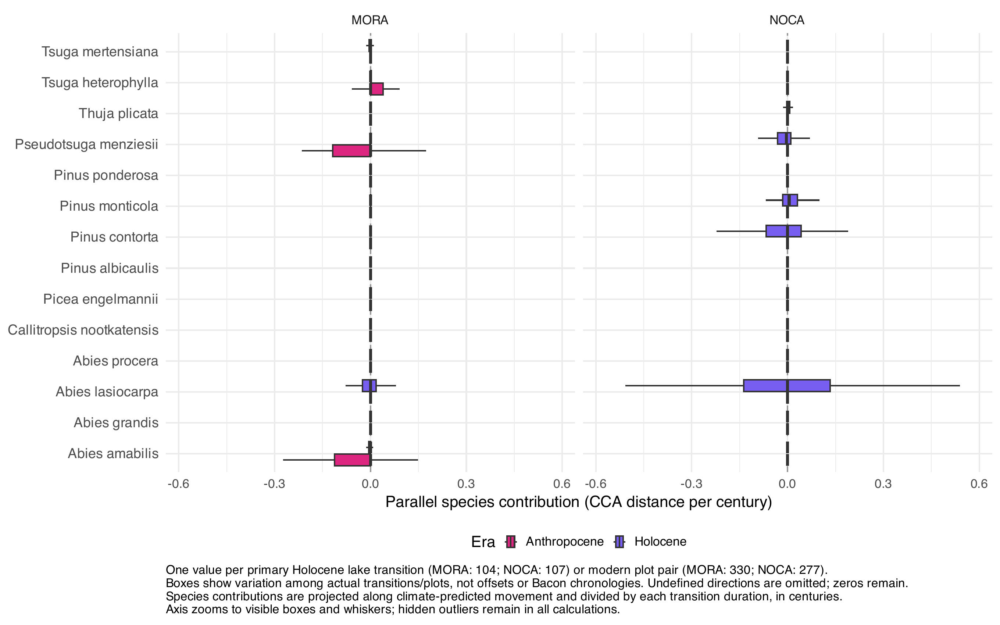

### Seasonal climate displacement contributions by era and park

Each primary lake transition and each modern plot pair contributes once per component. Boxes describe variation among actual transitions, not among offsets or Bacon draws. Species contributions are rates; climate contributions remain displacements. Undefined reference directions are omitted, with counts retained.

Script: [16_cca_transition_contributions.R](../R/stages/16_cca_transition_contributions.R). [Complete PDF](../plot/test_figures/fig_cca_transition_climate_boxplots.pdf) (1 page).

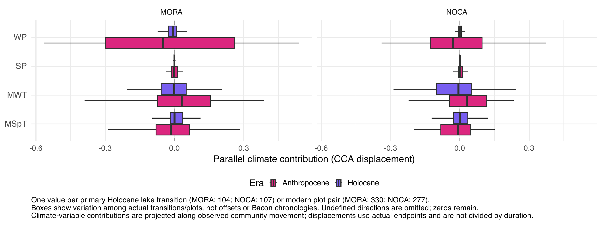

Stage 17 fits species models **separately within MORA and NOCA**. Holocene species rates use
`climate_rate + fire_activity`, with primary MA(1) covariance and Independent/CAR1 comparisons.
Anthropocene MORA species use intercept-only models (`contribution_rate ~ 1`).
Anthropocene NOCA species use `contribution_rate ~ burned` with unburned as the reference.
Both modern specifications use independent residuals. Each fit estimates its own
residual variance; there is no site coefficient or between-park variance ratio within a park.
The retained sensitivity code uses the same park separation when Bacon model sensitivity is resumed.

The coefficient PDF has separate Holocene and Anthropocene pages, with all 14 species as
readable rows and coefficients (including the intercept) as columns. Blue MORA and orange NOCA
estimates are shown together. The first column adds arithmetic mean parallel contributions
from the same finite primary observations used in the species boxplots: each transition or
plot pair counts once, zeros remain, and undefined directions are omitted. These descriptive
diamonds have no model confidence intervals or significance fading; they may include responses
excluded from models because a predictor is missing. Each column has its own x-axis scale. Faded estimates
have unadjusted p ≥ 0.05. An `NE` marker denotes a model not estimable in that park, not a fitted
zero coefficient. Species present in only one park are estimated there independently of their
absence in the other park. Absent species still have zero responses throughout their park and
cannot be fitted; constant responses, rank deficiency and numerical failures are reported.

The Holocene intercept is the expected contribution at zero climate-change rate and zero fire
activity in the fitted park. The Anthropocene MORA intercept is the mean across all eligible
plots; the NOCA intercept is the unburned mean, and its fire coefficient is burned minus
unburned. No MORA fire term is fitted. The Holocene intercept remains conditional on zero predictor values. Neither
an intercept nor a mean implies that all observations share its sign. Positive contributions align with climate-predicted movement;
negative contributions oppose it. Captions explain park-specific absences.

| Species | Era | Park | Covariance | Converged | Selected | Failure reason |
| --- | --- | --- | --- | --- | --- | --- |
| Abies amabilis | Holocene | MORA | Independent | TRUE | FALSE | — |
| Abies amabilis | Holocene | MORA | MA1 | TRUE | TRUE | — |
| Abies amabilis | Holocene | MORA | CAR1 | TRUE | FALSE | — |
| Abies amabilis | Holocene | NOCA | Independent | FALSE | FALSE | constant_response |
| Abies amabilis | Holocene | NOCA | MA1 | FALSE | FALSE | constant_response |
| Abies amabilis | Holocene | NOCA | CAR1 | FALSE | FALSE | constant_response |
| Abies amabilis | Anthropocene | MORA | Independent | TRUE | TRUE | — |
| Abies amabilis | Anthropocene | NOCA | Independent | TRUE | TRUE | — |
| Abies grandis | Holocene | MORA | Independent | FALSE | FALSE | constant_response |
| Abies grandis | Holocene | MORA | MA1 | FALSE | FALSE | constant_response |
| Abies grandis | Holocene | MORA | CAR1 | FALSE | FALSE | constant_response |
| Abies grandis | Holocene | NOCA | Independent | FALSE | FALSE | constant_response |
| Abies grandis | Holocene | NOCA | MA1 | FALSE | FALSE | constant_response |
| Abies grandis | Holocene | NOCA | CAR1 | FALSE | FALSE | constant_response |
| Abies grandis | Anthropocene | MORA | Independent | TRUE | TRUE | — |
| Abies grandis | Anthropocene | NOCA | Independent | TRUE | TRUE | — |
| Abies lasiocarpa | Holocene | MORA | Independent | TRUE | FALSE | — |
| Abies lasiocarpa | Holocene | MORA | MA1 | TRUE | TRUE | — |
| Abies lasiocarpa | Holocene | MORA | CAR1 | TRUE | FALSE | — |
| Abies lasiocarpa | Holocene | NOCA | Independent | TRUE | FALSE | — |
| Abies lasiocarpa | Holocene | NOCA | MA1 | TRUE | TRUE | — |
| Abies lasiocarpa | Holocene | NOCA | CAR1 | TRUE | FALSE | — |
| Abies lasiocarpa | Anthropocene | MORA | Independent | TRUE | TRUE | — |
| Abies lasiocarpa | Anthropocene | NOCA | Independent | TRUE | TRUE | — |
| Abies procera | Holocene | MORA | Independent | TRUE | FALSE | — |
| Abies procera | Holocene | MORA | MA1 | TRUE | TRUE | — |
| Abies procera | Holocene | MORA | CAR1 | TRUE | FALSE | — |
| Abies procera | Holocene | NOCA | Independent | FALSE | FALSE | constant_response |
| Abies procera | Holocene | NOCA | MA1 | FALSE | FALSE | constant_response |
| Abies procera | Holocene | NOCA | CAR1 | FALSE | FALSE | constant_response |
| Abies procera | Anthropocene | MORA | Independent | TRUE | TRUE | — |
| Abies procera | Anthropocene | NOCA | Independent | FALSE | FALSE | constant_response |
| Callitropsis nootkatensis | Holocene | MORA | Independent | TRUE | FALSE | — |
| Callitropsis nootkatensis | Holocene | MORA | MA1 | TRUE | TRUE | — |
| Callitropsis nootkatensis | Holocene | MORA | CAR1 | TRUE | FALSE | — |
| Callitropsis nootkatensis | Holocene | NOCA | Independent | TRUE | FALSE | — |
| Callitropsis nootkatensis | Holocene | NOCA | MA1 | TRUE | TRUE | — |
| Callitropsis nootkatensis | Holocene | NOCA | CAR1 | TRUE | FALSE | — |
| Callitropsis nootkatensis | Anthropocene | MORA | Independent | TRUE | TRUE | — |
| Callitropsis nootkatensis | Anthropocene | NOCA | Independent | TRUE | TRUE | — |
| Picea engelmannii | Holocene | MORA | Independent | TRUE | FALSE | — |
| Picea engelmannii | Holocene | MORA | MA1 | TRUE | TRUE | — |
| Picea engelmannii | Holocene | MORA | CAR1 | TRUE | FALSE | — |
| Picea engelmannii | Holocene | NOCA | Independent | TRUE | FALSE | — |
| Picea engelmannii | Holocene | NOCA | MA1 | TRUE | TRUE | — |
| Picea engelmannii | Holocene | NOCA | CAR1 | TRUE | FALSE | — |
| Picea engelmannii | Anthropocene | MORA | Independent | TRUE | TRUE | — |
| Picea engelmannii | Anthropocene | NOCA | Independent | TRUE | TRUE | — |
| Pinus albicaulis | Holocene | MORA | Independent | FALSE | FALSE | constant_response |
| Pinus albicaulis | Holocene | MORA | MA1 | FALSE | FALSE | constant_response |
| Pinus albicaulis | Holocene | MORA | CAR1 | FALSE | FALSE | constant_response |
| Pinus albicaulis | Holocene | NOCA | Independent | FALSE | FALSE | constant_response |
| Pinus albicaulis | Holocene | NOCA | MA1 | FALSE | FALSE | constant_response |
| Pinus albicaulis | Holocene | NOCA | CAR1 | FALSE | FALSE | constant_response |
| Pinus albicaulis | Anthropocene | MORA | Independent | TRUE | TRUE | — |
| Pinus albicaulis | Anthropocene | NOCA | Independent | TRUE | TRUE | — |
| Pinus contorta | Holocene | MORA | Independent | TRUE | FALSE | — |
| Pinus contorta | Holocene | MORA | MA1 | TRUE | TRUE | — |
| Pinus contorta | Holocene | MORA | CAR1 | TRUE | FALSE | — |
| Pinus contorta | Holocene | NOCA | Independent | TRUE | FALSE | — |
| Pinus contorta | Holocene | NOCA | MA1 | TRUE | TRUE | — |
| Pinus contorta | Holocene | NOCA | CAR1 | TRUE | FALSE | — |
| Pinus contorta | Anthropocene | MORA | Independent | TRUE | TRUE | — |
| Pinus contorta | Anthropocene | NOCA | Independent | TRUE | TRUE | — |
| Pinus monticola | Holocene | MORA | Independent | TRUE | FALSE | — |
| Pinus monticola | Holocene | MORA | MA1 | TRUE | TRUE | — |
| Pinus monticola | Holocene | MORA | CAR1 | TRUE | FALSE | — |
| Pinus monticola | Holocene | NOCA | Independent | TRUE | FALSE | — |
| Pinus monticola | Holocene | NOCA | MA1 | TRUE | TRUE | — |
| Pinus monticola | Holocene | NOCA | CAR1 | TRUE | FALSE | — |
| Pinus monticola | Anthropocene | MORA | Independent | TRUE | TRUE | — |
| Pinus monticola | Anthropocene | NOCA | Independent | TRUE | TRUE | — |
| Pinus ponderosa | Holocene | MORA | Independent | FALSE | FALSE | constant_response |
| Pinus ponderosa | Holocene | MORA | MA1 | FALSE | FALSE | constant_response |
| Pinus ponderosa | Holocene | MORA | CAR1 | FALSE | FALSE | constant_response |
| Pinus ponderosa | Holocene | NOCA | Independent | FALSE | FALSE | constant_response |
| Pinus ponderosa | Holocene | NOCA | MA1 | FALSE | FALSE | constant_response |
| Pinus ponderosa | Holocene | NOCA | CAR1 | FALSE | FALSE | constant_response |
| Pinus ponderosa | Anthropocene | MORA | Independent | TRUE | TRUE | — |
| Pinus ponderosa | Anthropocene | NOCA | Independent | TRUE | TRUE | — |
| Pseudotsuga menziesii | Holocene | MORA | Independent | TRUE | FALSE | — |
| Pseudotsuga menziesii | Holocene | MORA | MA1 | TRUE | TRUE | — |
| Pseudotsuga menziesii | Holocene | MORA | CAR1 | TRUE | FALSE | — |
| Pseudotsuga menziesii | Holocene | NOCA | Independent | TRUE | FALSE | — |
| Pseudotsuga menziesii | Holocene | NOCA | MA1 | TRUE | TRUE | — |
| Pseudotsuga menziesii | Holocene | NOCA | CAR1 | TRUE | FALSE | — |
| Pseudotsuga menziesii | Anthropocene | MORA | Independent | TRUE | TRUE | — |
| Pseudotsuga menziesii | Anthropocene | NOCA | Independent | TRUE | TRUE | — |
| Thuja plicata | Holocene | MORA | Independent | FALSE | FALSE | constant_response |
| Thuja plicata | Holocene | MORA | MA1 | FALSE | FALSE | constant_response |
| Thuja plicata | Holocene | MORA | CAR1 | FALSE | FALSE | constant_response |
| Thuja plicata | Holocene | NOCA | Independent | TRUE | FALSE | — |
| Thuja plicata | Holocene | NOCA | MA1 | TRUE | TRUE | — |
| Thuja plicata | Holocene | NOCA | CAR1 | TRUE | FALSE | — |
| Thuja plicata | Anthropocene | MORA | Independent | TRUE | TRUE | — |
| Thuja plicata | Anthropocene | NOCA | Independent | TRUE | TRUE | — |
| Tsuga heterophylla | Holocene | MORA | Independent | TRUE | FALSE | — |
| Tsuga heterophylla | Holocene | MORA | MA1 | TRUE | TRUE | — |
| Tsuga heterophylla | Holocene | MORA | CAR1 | TRUE | FALSE | — |
| Tsuga heterophylla | Holocene | NOCA | Independent | TRUE | FALSE | — |
| Tsuga heterophylla | Holocene | NOCA | MA1 | TRUE | TRUE | — |
| Tsuga heterophylla | Holocene | NOCA | CAR1 | TRUE | FALSE | — |
| Tsuga heterophylla | Anthropocene | MORA | Independent | TRUE | TRUE | — |
| Tsuga heterophylla | Anthropocene | NOCA | Independent | TRUE | TRUE | — |
| Tsuga mertensiana | Holocene | MORA | Independent | TRUE | FALSE | — |
| Tsuga mertensiana | Holocene | MORA | MA1 | TRUE | TRUE | — |
| Tsuga mertensiana | Holocene | MORA | CAR1 | TRUE | FALSE | — |
| Tsuga mertensiana | Holocene | NOCA | Independent | TRUE | FALSE | — |
| Tsuga mertensiana | Holocene | NOCA | MA1 | TRUE | TRUE | — |
| Tsuga mertensiana | Holocene | NOCA | CAR1 | TRUE | FALSE | — |
| Tsuga mertensiana | Anthropocene | MORA | Independent | TRUE | TRUE | — |
| Tsuga mertensiana | Anthropocene | NOCA | Independent | TRUE | TRUE | — |

### Within-park species contribution means and GLS coefficients, including intercepts, by era

Separate Holocene and Anthropocene pages retain all 14 species. Blue MORA and orange NOCA diamonds show arithmetic means of finite primary contributions from the boxplot data, each transition/plot weighted equally; these descriptive means have no model intervals. Circles and capped bars show within-park GLS coefficients and conditional 95% intervals; estimates with unadjusted p ≥ 0.05 are faded. NE denotes an unavailable model in that park, with explanations in captions. Holocene intercepts are predictions at zero climate/fire predictors. Anthropocene MORA is intercept-only (overall park mean); NOCA retains burned versus unburned, with unburned as its intercept. No MORA fire coefficient is fitted. Columns have separate x-axis scales.

Script: [17_species_contribution_models.R](../R/stages/17_species_contribution_models.R). [Complete PDF](../plot/test_figures/primary_models/fig_species_contribution_model_coefficients.pdf) (2 pages).

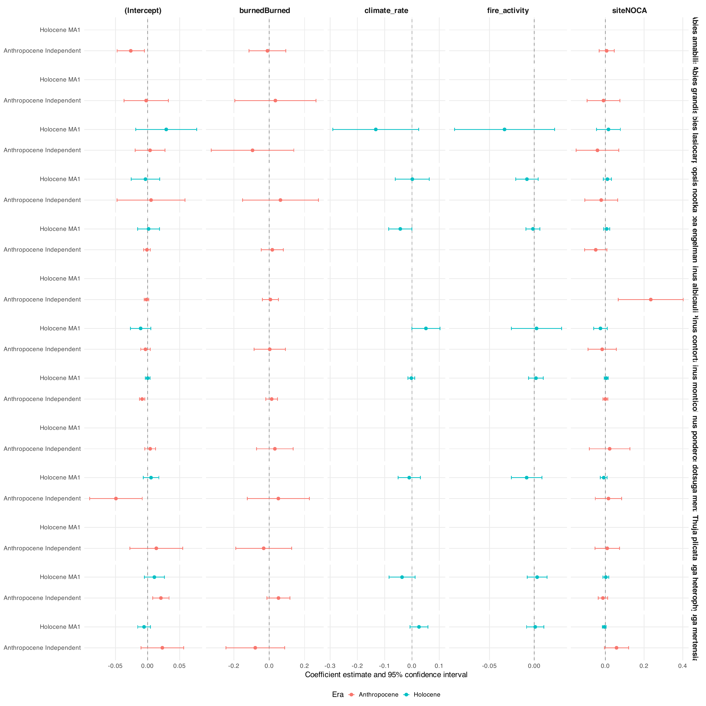

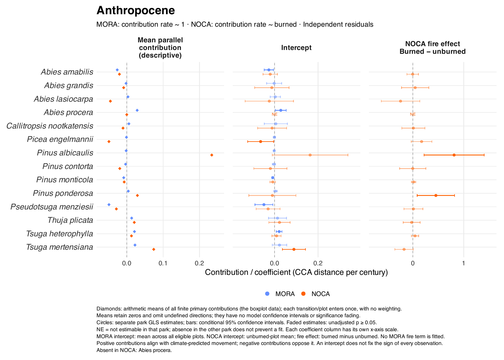

### Primary species-model normalized residual diagnostics

Four pages separate Holocene MORA, Holocene NOCA, Anthropocene MORA and Anthropocene NOCA. Residuals are from each species model within that park; Bacon model sensitivity is currently on hold.

Script: [17_species_contribution_models.R](../R/stages/17_species_contribution_models.R). [Complete PDF](../plot/test_figures/primary_models/fig_species_contribution_model_residuals.pdf) (4 pages).

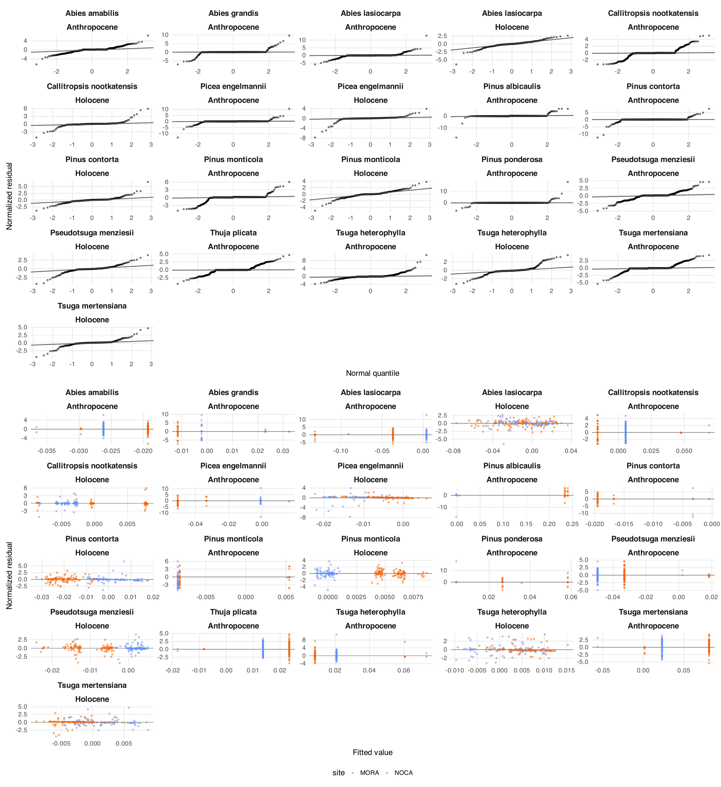

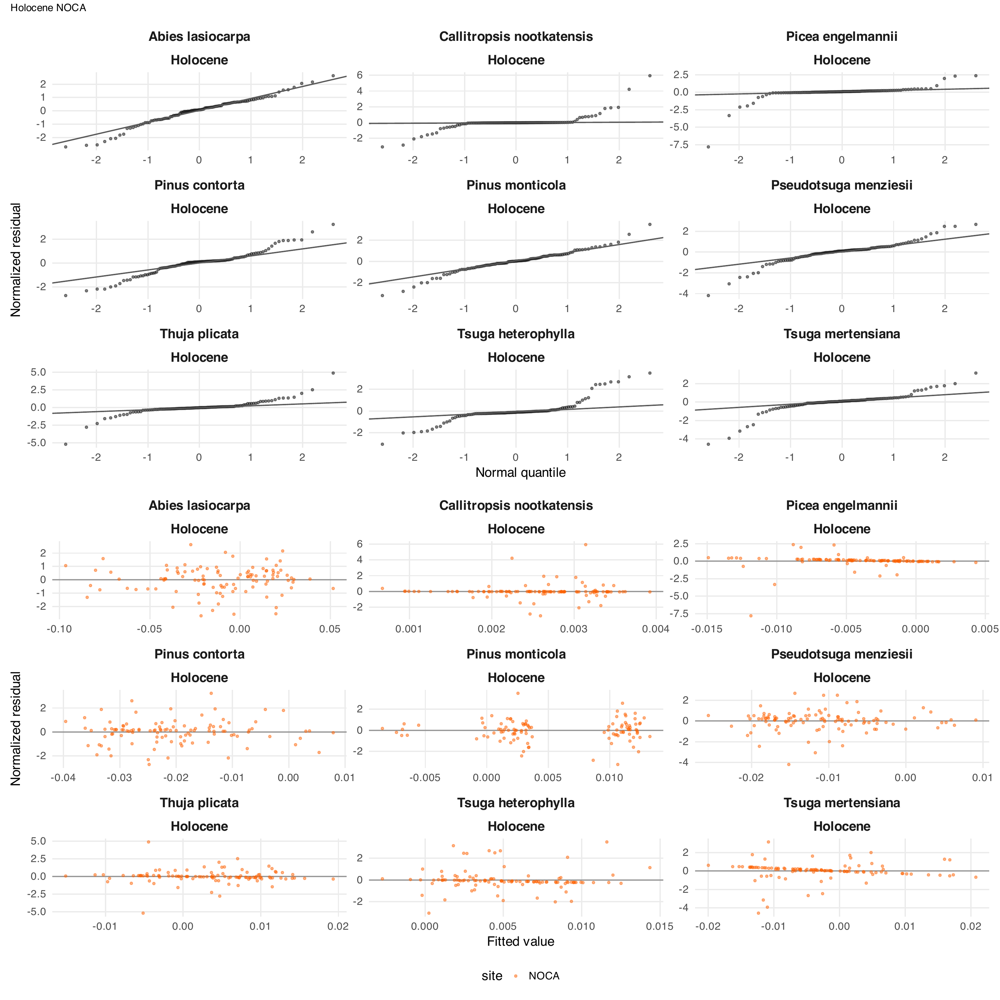

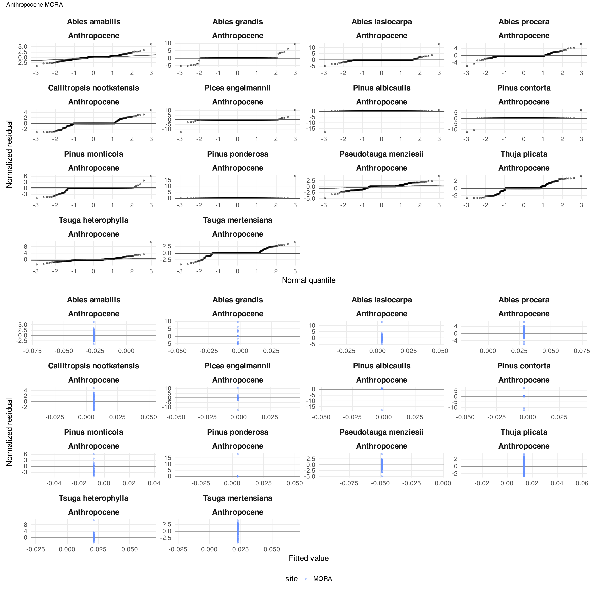

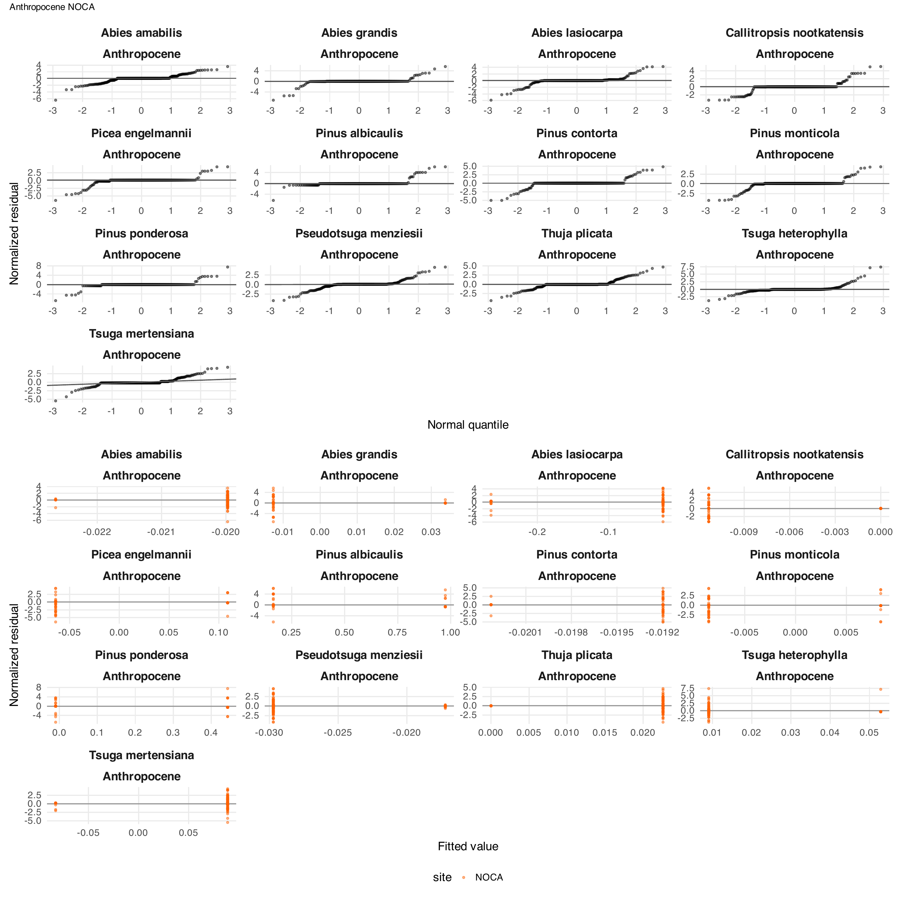

- [species occupancy](assets/analysis/tables/species_occupancy.csv)
- [predictor model coefficients](assets/analysis/tables/predictor_model_coefficients.csv)
- [predictor model performance](assets/analysis/tables/predictor_model_performance.csv)
- [predictor lake random intercept sensitivity](assets/analysis/tables/predictor_lake_random_intercept_sensitivity.csv)
- [predictor transition predictions](assets/analysis/tables/predictor_transition_predictions.csv)
- [predictor model exclusions](assets/analysis/tables/predictor_model_exclusions.csv)
- [predictor anthropocene elevations](assets/analysis/tables/predictor_anthropocene_elevations.csv)
- [predictor model selection](assets/analysis/tables/predictor_model_selection.csv)
- [species model coefficients](assets/analysis/tables/species_model_coefficients.csv)
- [species figure coefficient availability](assets/analysis/tables/species_figure_coefficient_availability.csv)
- [species model selection](assets/analysis/tables/species_model_selection.csv)
- [species model performance](assets/analysis/tables/species_model_performance.csv)
- [predictor figure main coefficients](assets/analysis/tables/predictor_figure_main_coefficients.csv)
- [predictor figure appendix coefficients](assets/analysis/tables/predictor_figure_appendix_coefficients.csv)
- [species figure mean contributions](assets/analysis/tables/species_figure_mean_contributions.csv)

## Limitations and remaining questions

The chronology controls, survey windows, GPS exclusions and paired CCA
eligibility are settled for this analysis. Their interpretation limits remain:
conditional dating uncertainty, differing fire-proxy support, unequal survey
size classes, site-confounded paleo occupancy, overlapping temporal samples
and possible climate-product discontinuities.

The remaining questions below come from the
[scientific decision register](SCIENTIFIC_DECISIONS.md#remaining-scientific-questions).
They distinguish planned or optional sensitivities from decisions already made.

| Question | Current choice | Consequence | Evidence needed to resolve it |
|---|---|---|---|
| Raw versus V2.1-anchored TraCE21k climate | The active Holocene analysis uses raw TraCE21k values; the V2.1 anchoring diagnostic is not authoritative. | Absolute Holocene climate levels and cross-product comparisons may retain product bias, although the active within-series change calculations are internally consistent. | A validated overlap-period comparison showing whether anchoring reduces bias without introducing a discontinuity or changing the intended anomaly interpretation. |
| Legacy-calibration versus full-record climate SDs | Changes are divided by SDs from the 607 matched legacy CCA calibration plots. | The reference is tied to the fitted model. A full-record SD would change displayed standardized magnitudes, cross-variable weighting, the unthresholded composite, and standardized climate rates, but not CC/S boundaries under the current variable-specific 50%-of-own-maximum rule. | A prespecified full-record sensitivity with explicit temporal/site weighting and a scientific choice between calibration-relative and dataset-relative effect sizes. |
| Anthropocene precipitation continuity | Historical climate remains 1979–1989; modern climate uses adult Y−5 through Y at both sites (2026-10-07 decision). The MORA precipitation contrast is flagged. | The apparent post-2010 MORA precipitation shift may partly reflect CHELSA inhomogeneity rather than climate. | Independent station/reanalysis validation and a documented decision on whether post-2010 MORA precipitation is usable. The agreed years are not a pending decision. |
| Own-origin versus common-origin taxon target geometry | Deferred: the target-alignment analysis is retired. Existing CCA scores and reference matrices are preserved; the parallel contribution decomposition does not implement that separate target-origin sensitivity. | The two cosines answer alignment relative to each trajectory's own starting community; part of their difference can arise because LC₁ and WA₁ differ. | A prespecified common-origin sensitivity and an ecological decision about whether the estimand should condition on each starting state or hold the target vector fixed across observed and predicted movement. |

This snapshot uses verified existing analysis outputs, including stored CCA summaries and permutation tests. It does not represent a new full analysis run. [Checks and rebuilding instructions](WORKFLOW.md#tests-and-decisions).

## Diagnostic PDFs

The selected pages above show the relevant evidence; these links open the full
figures. The older CHELSAcruts comparison is a historical reference, outside the
current-results analysis.

| Diagnostic PDF | Purpose | Script | Shown pages | Analysis or sensitivity |
| --- | --- | --- | --- | --- |
| [NOCA_cleaning.pdf](../plot/test_figures/NOCA_cleaning.pdf) | Show which NOCA plots remain after cleaning. | [000_NOCA_cleaning.R](../R/stages/000_NOCA_cleaning.R) | 1 | current |
| [MORA_dynamics.pdf](../plot/test_figures/MORA_dynamics.pdf) | Show species counts before model taxon selection. | [000_MORA_cleaning.R](../R/stages/000_MORA_cleaning.R) | 3 | current |
| [NOCA_dynamics.pdf](../plot/test_figures/NOCA_dynamics.pdf) | Compare corrected legacy and resurvey species counts. | [000_NOCA_cleaning.R](../R/stages/000_NOCA_cleaning.R) | 3 | current |
| [species_counts_consolidated.pdf](../plot/test_figures/species_counts_consolidated.pdf) | Inspect consolidated occurrence counts in each site-period group. | [000_occurrence_data_consolidate.R](../R/stages/000_occurrence_data_consolidate.R) | 1 | current |
| [stage_adult_seedling_past_present.pdf](../plot/test_figures/stage_adult_seedling_past_present.pdf) | Expose adult versus regeneration support for presence. | [000_occurrence_data_consolidate.R](../R/stages/000_occurrence_data_consolidate.R) | 1 | current |
| [species_through_time.pdf](../plot/test_figures/species_through_time.pdf) | Inspect taxon site confounding and temporal occupancy. | [test_species_through_time.R](../R/diagnostics/test_species_through_time.R) | 1 | current |
| [plots_to_cca.pdf](../plot/test_figures/plots_to_cca.pdf) | From starting plots and core samples to the CCA. | [plot_sample_selection.R](../R/diagnostics/plot_sample_selection.R) | 1 | current |
| [fig_bacon_agedepth_slump.pdf](../plot/test_figures/fig_bacon_agedepth_slump.pdf) | Inspect four fitted age-depth models and slump treatment. | [000_PALEO_a_agedepth.R](../R/stages/000_PALEO_a_agedepth.R) | 1 | current |
| [fig_bacon_pb210_sensitivity.pdf](../plot/test_figures/fig_bacon_pb210_sensitivity.pdf) | Compare published activity errors with assumed ±10-year age uncertainty. | [000_PALEO_a_agedepth.R](../R/stages/000_PALEO_a_agedepth.R) | 1 | chronology sensitivity |
| [test_survey_year_anomaly.pdf](../plot/test_figures/test_survey_year_anomaly.pdf) | Compare selected survey windows with the full 1979–2021 record. | [test_survey_year_anomaly.R](../R/diagnostics/test_survey_year_anomaly.R) | 1 | current |
| [climate_holocene_timeseries.pdf](../plot/test_figures/climate_holocene_timeseries.pdf) | Inspect redundancy among candidate climate variables. | [test_climate_change_variables.R](../R/diagnostics/test_climate_change_variables.R) | 2 | correlation diagnostic; full PDF includes 500-year sensitivity |
| [fig_cca_scaling_comparison.pdf](../plot/test_figures/fig_cca_scaling_comparison.pdf) | Compare scaling 1 and 2 of the same fitted CCA. | [test_cca_scaling_comparison.R](../R/diagnostics/test_cca_scaling_comparison.R) | 1 | current |
| [NOCA_fire_map_Wilson2024_PaleoACES.pdf](../plot/test_figures/NOCA_fire_map_Wilson2024_PaleoACES.pdf) | Audit NOCA modern fire assignment against Wilson reference plots. | [01_get_fire_info.R](../R/stages/01_get_fire_info.R) | 1 | current |
| [fig_fire_event_detection_workflow.pdf](../plot/test_figures/worked_examples/fig_fire_event_detection_workflow.pdf) | Compare fire-event detection in all four lake records. | [03_fire_event_detection_worked_example.R](../R/stages/03_fire_event_detection_worked_example.R) | 2 | current |
| [fig_walsh_charanalysis_reproduction.pdf](../plot/test_figures/fig_walsh_charanalysis_reproduction.pdf) | Compare official CharAnalysis results with published Walsh totals. | [02_walsh_fire_reproduction.R](../R/stages/02_walsh_fire_reproduction.R) | 3 | current |
| [fig_holocene_climate_period_method_worked_example.pdf](../plot/test_figures/worked_examples/fig_holocene_climate_period_method_worked_example.pdf) | Expose signed changes, phase support, and era construction. | [05_holocene_climate_fire_eras.R](../R/stages/05_holocene_climate_fire_eras.R) | 1 | current |
| [fig_holocene_fire_method_worked_example.pdf](../plot/test_figures/worked_examples/fig_holocene_fire_method_worked_example.pdf) | Work through centered event frequencies at 2,300 cal BP. | [06_fire_method_worked_example.R](../R/stages/06_fire_method_worked_example.R) | 1 | current |
| [fig_holocene_sampling_fire_100yr.pdf](../plot/test_figures/fig_holocene_sampling_fire_100yr.pdf) | Inspect macrofossil sampling and accepted fire detections on native 100-year climate cells before CCA. | [000_occurrence_data_consolidate.R](../R/stages/000_occurrence_data_consolidate.R) | 1 | current |
| [fig_method_worked_example.pdf](../plot/test_figures/worked_examples/fig_method_worked_example.pdf) | Work through WA/LC movement, lag, ratio, and angle. | [09_tracking_example_and_visualizations.R](../R/stages/09_tracking_example_and_visualizations.R) | 1 | current |
| [fig_tracking_transition_rates.pdf](../plot/test_figures/fig_tracking_transition_rates.pdf) | Compare tracking responses, climate and fire under established regional climate-period bands, with Anthropocene boxplots. | [09_tracking_example_and_visualizations.R](../R/stages/09_tracking_example_and_visualizations.R) | 1 | primary reconstruction; conditional inference |
| [fig_tracking_transition_ratios_angles.pdf](../plot/test_figures/fig_tracking_transition_ratios_angles.pdf) | Compare magnitude tracking ratio, angle, climate and fire under the same regional climate-period bands, one variable per row. | [09_tracking_example_and_visualizations.R](../R/stages/09_tracking_example_and_visualizations.R) | 1 | primary reconstruction; conditional inference |
| [test_chelsa_cruts_vs_present.pdf](../plot/test_figures/test_chelsa_cruts_vs_present.pdf) | Retain the older product-comparison reference outside current results. | [test_chelsa_cruts_vs_present.R](../R/diagnostics/test_chelsa_cruts_vs_present.R) | Full PDF only | historical reference |
| [fig_tracking_model_group_means.pdf](../plot/test_figures/primary_models/fig_tracking_model_group_means.pdf) | Selected-covariance fitted Holocene/Anthropocene group means and contrasts for the primary reconstruction. | [12_tracking_era_models.R](../R/stages/12_tracking_era_models.R) | 1 | primary reconstruction; conditional inference |
| [fig_tracking_model_coefficients.pdf](../plot/test_figures/primary_models/fig_tracking_model_coefficients.pdf) | Selected-covariance coefficients for the primary reconstruction. | [12_tracking_era_models.R](../R/stages/12_tracking_era_models.R) | 1 | primary reconstruction; conditional inference |
| [fig_tracking_model_contrasts.pdf](../plot/test_figures/primary_models/fig_tracking_model_contrasts.pdf) | Selected-covariance Anthropocene-minus-Holocene contrasts for the primary reconstruction within each park. | [12_tracking_era_models.R](../R/stages/12_tracking_era_models.R) | 1 | primary reconstruction; conditional inference |
| [fig_tracking_model_residuals.pdf](../plot/test_figures/primary_models/fig_tracking_model_residuals.pdf) | Residual checks for the selected Selected-covariance for the primary reconstruction. | [12_tracking_era_models.R](../R/stages/12_tracking_era_models.R) | 1 | primary reconstruction; conditional inference |
| [fig_tracking_model_aic.pdf](../plot/test_figures/primary_models/fig_tracking_model_aic.pdf) | Compare independent, neighboring MA(1), and continuous-time AR(1) residual covariance on identical primary observations. | [12_tracking_era_models.R](../R/stages/12_tracking_era_models.R) | 1 | primary reconstruction; conditional inference |
| [fig_tracking_lake_coefficients.pdf](../plot/test_figures/sensitivity/lake_checks/fig_tracking_lake_coefficients.pdf) | Selected-covariance individual-lake coefficients for the primary reconstruction. | [13_tracking_lake_sensitivity.R](../R/stages/13_tracking_lake_sensitivity.R) | 1 | primary reconstruction; conditional inference |
| [fig_tracking_lake_contrasts.pdf](../plot/test_figures/sensitivity/lake_checks/fig_tracking_lake_contrasts.pdf) | Selected-covariance Anthropocene-minus-Holocene lake contrasts for the primary reconstruction. | [13_tracking_lake_sensitivity.R](../R/stages/13_tracking_lake_sensitivity.R) | 1 | primary reconstruction; conditional inference |
| [fig_tracking_model_group_means.pdf](../plot/test_figures/primary_models/fig_tracking_model_group_means.pdf) | Observed turnover: Selected-covariance fitted Holocene/Anthropocene group means and contrasts for the primary reconstruction. | [12_tracking_era_models.R](../R/stages/12_tracking_era_models.R) | 2 | primary reconstruction; conditional inference |
| [fig_tracking_model_coefficients.pdf](../plot/test_figures/primary_models/fig_tracking_model_coefficients.pdf) | Observed turnover: Selected-covariance coefficients for the primary reconstruction. | [12_tracking_era_models.R](../R/stages/12_tracking_era_models.R) | 2 | primary reconstruction; conditional inference |
| [fig_tracking_model_contrasts.pdf](../plot/test_figures/primary_models/fig_tracking_model_contrasts.pdf) | Observed turnover: Selected-covariance Anthropocene-minus-Holocene contrasts for the primary reconstruction within each park. | [12_tracking_era_models.R](../R/stages/12_tracking_era_models.R) | 2 | primary reconstruction; conditional inference |
| [fig_tracking_model_residuals.pdf](../plot/test_figures/primary_models/fig_tracking_model_residuals.pdf) | Observed turnover: residual checks for the selected Selected-covariance for the primary reconstruction. | [12_tracking_era_models.R](../R/stages/12_tracking_era_models.R) | 2 | primary reconstruction; conditional inference |
| [fig_tracking_model_aic.pdf](../plot/test_figures/primary_models/fig_tracking_model_aic.pdf) | Compare independent, neighboring MA(1), and continuous-time AR(1) residual covariance on identical primary observations. | [12_tracking_era_models.R](../R/stages/12_tracking_era_models.R) | 2 | primary reconstruction; conditional inference |
| [fig_tracking_lake_coefficients.pdf](../plot/test_figures/sensitivity/lake_checks/fig_tracking_lake_coefficients.pdf) | Observed turnover: Selected-covariance individual-lake coefficients for the primary reconstruction. | [13_tracking_lake_sensitivity.R](../R/stages/13_tracking_lake_sensitivity.R) | 2 | primary reconstruction; conditional inference |
| [fig_tracking_lake_contrasts.pdf](../plot/test_figures/sensitivity/lake_checks/fig_tracking_lake_contrasts.pdf) | Observed turnover: Selected-covariance Anthropocene-minus-Holocene lake contrasts for the primary reconstruction. | [13_tracking_lake_sensitivity.R](../R/stages/13_tracking_lake_sensitivity.R) | 2 | primary reconstruction; conditional inference |
| [fig_tracking_model_group_means.pdf](../plot/test_figures/primary_models/fig_tracking_model_group_means.pdf) | Untransformed physical climate-change rate: Selected-covariance fitted Holocene/Anthropocene group means and contrasts for the primary reconstruction. | [12_tracking_era_models.R](../R/stages/12_tracking_era_models.R) | 3 | primary reconstruction; conditional inference |
| [fig_tracking_model_coefficients.pdf](../plot/test_figures/primary_models/fig_tracking_model_coefficients.pdf) | Untransformed physical climate-change rate: Selected-covariance coefficients for the primary reconstruction. | [12_tracking_era_models.R](../R/stages/12_tracking_era_models.R) | 3 | primary reconstruction; conditional inference |
| [fig_tracking_model_contrasts.pdf](../plot/test_figures/primary_models/fig_tracking_model_contrasts.pdf) | Untransformed physical climate-change rate: Selected-covariance Anthropocene-minus-Holocene contrasts for the primary reconstruction within each park. | [12_tracking_era_models.R](../R/stages/12_tracking_era_models.R) | 3 | primary reconstruction; conditional inference |
| [fig_tracking_model_residuals.pdf](../plot/test_figures/primary_models/fig_tracking_model_residuals.pdf) | Untransformed physical climate-change rate: residual checks for the selected Selected-covariance for the primary reconstruction. | [12_tracking_era_models.R](../R/stages/12_tracking_era_models.R) | 3 | primary reconstruction; conditional inference |
| [fig_tracking_model_aic.pdf](../plot/test_figures/primary_models/fig_tracking_model_aic.pdf) | Compare independent, neighboring MA(1), and continuous-time AR(1) residual covariance on identical primary observations. | [12_tracking_era_models.R](../R/stages/12_tracking_era_models.R) | 3 | primary reconstruction; conditional inference |
| [fig_tracking_lake_coefficients.pdf](../plot/test_figures/sensitivity/lake_checks/fig_tracking_lake_coefficients.pdf) | Untransformed physical climate-change rate: Selected-covariance individual-lake coefficients for the primary reconstruction. | [13_tracking_lake_sensitivity.R](../R/stages/13_tracking_lake_sensitivity.R) | 3 | primary reconstruction; conditional inference |
| [fig_tracking_lake_contrasts.pdf](../plot/test_figures/sensitivity/lake_checks/fig_tracking_lake_contrasts.pdf) | Untransformed physical climate-change rate: Selected-covariance Anthropocene-minus-Holocene lake contrasts for the primary reconstruction. | [13_tracking_lake_sensitivity.R](../R/stages/13_tracking_lake_sensitivity.R) | 3 | primary reconstruction; conditional inference |
| [fig_tracking_model_group_means.pdf](../plot/test_figures/primary_models/fig_tracking_model_group_means.pdf) | Pace correction effect: group means for the primary reconstruction. | [12_tracking_era_models.R](../R/stages/12_tracking_era_models.R) | 4 | primary reconstruction; conditional inference |
| [fig_tracking_model_coefficients.pdf](../plot/test_figures/primary_models/fig_tracking_model_coefficients.pdf) | Pace correction effect: coefficients for the primary reconstruction. | [12_tracking_era_models.R](../R/stages/12_tracking_era_models.R) | 4 | primary reconstruction; conditional inference |
| [fig_tracking_model_contrasts.pdf](../plot/test_figures/primary_models/fig_tracking_model_contrasts.pdf) | Pace correction effect: contrasts for the primary reconstruction. | [12_tracking_era_models.R](../R/stages/12_tracking_era_models.R) | 4 | primary reconstruction; conditional inference |
| [fig_tracking_model_residuals.pdf](../plot/test_figures/primary_models/fig_tracking_model_residuals.pdf) | Pace correction effect: residuals for the primary reconstruction. | [12_tracking_era_models.R](../R/stages/12_tracking_era_models.R) | 4 | primary reconstruction; conditional inference |
| [fig_tracking_model_aic.pdf](../plot/test_figures/primary_models/fig_tracking_model_aic.pdf) | Compare independent, neighboring MA(1), and continuous-time AR(1) residual covariance on identical primary observations. | [12_tracking_era_models.R](../R/stages/12_tracking_era_models.R) | 4 | primary reconstruction; conditional inference |
| [fig_tracking_lake_coefficients.pdf](../plot/test_figures/sensitivity/lake_checks/fig_tracking_lake_coefficients.pdf) | Pace correction effect: primary lake sensitivity coefficients. | [13_tracking_lake_sensitivity.R](../R/stages/13_tracking_lake_sensitivity.R) | 4 | primary reconstruction; conditional inference |
| [fig_tracking_lake_contrasts.pdf](../plot/test_figures/sensitivity/lake_checks/fig_tracking_lake_contrasts.pdf) | Pace correction effect: primary lake sensitivity contrasts. | [13_tracking_lake_sensitivity.R](../R/stages/13_tracking_lake_sensitivity.R) | 4 | primary reconstruction; conditional inference |
| [fig_tracking_model_group_means.pdf](../plot/test_figures/primary_models/fig_tracking_model_group_means.pdf) | Direction correction effect: group means for the primary reconstruction. | [12_tracking_era_models.R](../R/stages/12_tracking_era_models.R) | 5 | primary reconstruction; conditional inference |
| [fig_tracking_model_coefficients.pdf](../plot/test_figures/primary_models/fig_tracking_model_coefficients.pdf) | Direction correction effect: coefficients for the primary reconstruction. | [12_tracking_era_models.R](../R/stages/12_tracking_era_models.R) | 5 | primary reconstruction; conditional inference |
| [fig_tracking_model_contrasts.pdf](../plot/test_figures/primary_models/fig_tracking_model_contrasts.pdf) | Direction correction effect: contrasts for the primary reconstruction. | [12_tracking_era_models.R](../R/stages/12_tracking_era_models.R) | 5 | primary reconstruction; conditional inference |
| [fig_tracking_model_residuals.pdf](../plot/test_figures/primary_models/fig_tracking_model_residuals.pdf) | Direction correction effect: residuals for the primary reconstruction. | [12_tracking_era_models.R](../R/stages/12_tracking_era_models.R) | 5 | primary reconstruction; conditional inference |
| [fig_tracking_model_aic.pdf](../plot/test_figures/primary_models/fig_tracking_model_aic.pdf) | Compare independent, neighboring MA(1), and continuous-time AR(1) residual covariance on identical primary observations. | [12_tracking_era_models.R](../R/stages/12_tracking_era_models.R) | 5 | primary reconstruction; conditional inference |
| [fig_tracking_lake_coefficients.pdf](../plot/test_figures/sensitivity/lake_checks/fig_tracking_lake_coefficients.pdf) | Direction correction effect: primary lake sensitivity coefficients. | [13_tracking_lake_sensitivity.R](../R/stages/13_tracking_lake_sensitivity.R) | 5 | primary reconstruction; conditional inference |
| [fig_tracking_lake_contrasts.pdf](../plot/test_figures/sensitivity/lake_checks/fig_tracking_lake_contrasts.pdf) | Direction correction effect: primary lake sensitivity contrasts. | [13_tracking_lake_sensitivity.R](../R/stages/13_tracking_lake_sensitivity.R) | 5 | primary reconstruction; conditional inference |
| [fig_tracking_correction_effect_contrasts.pdf](../plot/test_figures/primary_models/fig_tracking_correction_effect_contrasts.pdf) | Primary correction-effect era contrasts | [14_tracking_manuscript_figure.R](../R/stages/14_tracking_manuscript_figure.R) | 1 | primary reconstruction; conditional inference |
| [fig_tracking_predictor_extended_coefficients.pdf](../plot/test_figures/primary_models/fig_tracking_predictor_extended_coefficients.pdf) | Appendix: extended Anthropocene predictor coefficients | [15_tracking_predictor_models.R](../R/stages/15_tracking_predictor_models.R) | 1 | primary reconstruction; conditional inference |
| [fig_tracking_predictor_holocene_predictions.pdf](../plot/test_figures/primary_models/fig_tracking_predictor_holocene_predictions.pdf) | Holocene predicted lag-change trajectories | [15_tracking_predictor_models.R](../R/stages/15_tracking_predictor_models.R) | 1 | primary reconstruction; conditional inference |
| [fig_tracking_predictor_R2.pdf](../plot/test_figures/primary_models/fig_tracking_predictor_R2.pdf) | Descriptive R² for the predictor models | [15_tracking_predictor_models.R](../R/stages/15_tracking_predictor_models.R) | 1 | primary reconstruction; conditional inference |
| [fig_tracking_predictor_residuals.pdf](../plot/test_figures/primary_models/fig_tracking_predictor_residuals.pdf) | Predictor-model normalized residual diagnostics | [15_tracking_predictor_models.R](../R/stages/15_tracking_predictor_models.R) | 1 | primary reconstruction; conditional inference |
| [fig_cca_transition_species_boxplots.pdf](../plot/test_figures/fig_cca_transition_species_boxplots.pdf) | Species contribution rates by era and park. | [16_cca_transition_contributions.R](../R/stages/16_cca_transition_contributions.R) | 1 | current |
| [fig_cca_transition_climate_boxplots.pdf](../plot/test_figures/fig_cca_transition_climate_boxplots.pdf) | Seasonal climate displacement contributions by era and park. | [16_cca_transition_contributions.R](../R/stages/16_cca_transition_contributions.R) | 1 | current |
| [fig_species_contribution_model_coefficients.pdf](../plot/test_figures/primary_models/fig_species_contribution_model_coefficients.pdf) | Within-park species contribution means and GLS coefficients, including intercepts, by era. | [17_species_contribution_models.R](../R/stages/17_species_contribution_models.R) | 1, 2 | current |
| [fig_species_contribution_model_residuals.pdf](../plot/test_figures/primary_models/fig_species_contribution_model_residuals.pdf) | Primary species-model normalized residual diagnostics. | [17_species_contribution_models.R](../R/stages/17_species_contribution_models.R) | 1, 2, 3, 4 | current |
| [fig_tracking_joint_correction_residuals.pdf](../plot/test_figures/primary_models/fig_tracking_joint_correction_residuals.pdf) | Paired pace/direction model normalized-residual diagnostics | [12_tracking_era_models.R](../R/stages/12_tracking_era_models.R) | 1 | primary reconstruction; conditional inference |

## TraCE21k–V2.1 comparison and planned sensitivity

[Climate-product comparison PDF (two pages)](review/chelsa_trace_v21/TraCE21k_vs_V21_1980_1990.pdf).


This supplementary snapshot was prepared on 2026-10-07 from existing native caches at the same four pond locations. It compares the final TraCE21k slice's **1900–1990 climatology** with **V2.1 monthly averages for 1980–1990**. MORA averages its three ponds equally; NOCA uses Panther Potholes. The averaging periods differ, so the comparison describes climate levels and seasonality rather than matched annual changes or an isolated estimate of model bias.

**Planned sensitivity — not yet performed:** Apply temperature offsets and precipitation correction factors to TraCE21k, then compare climate-change metrics, climate-predicted vegetation trajectories, Δlag and main conclusions with the current raw-TraCE21k results. Document the correction reference and factors explicitly. The current analysis remains unchanged; this comparison does not apply a correction or constitute the sensitivity analysis.
