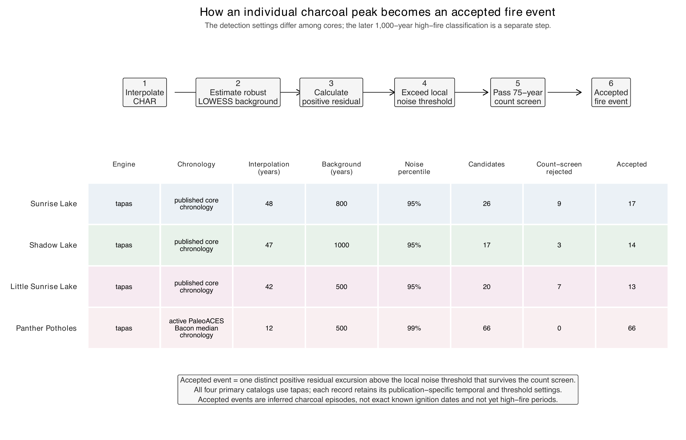
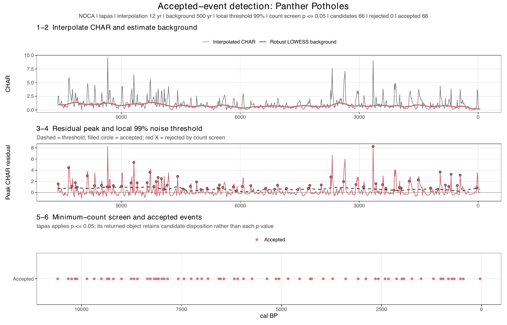
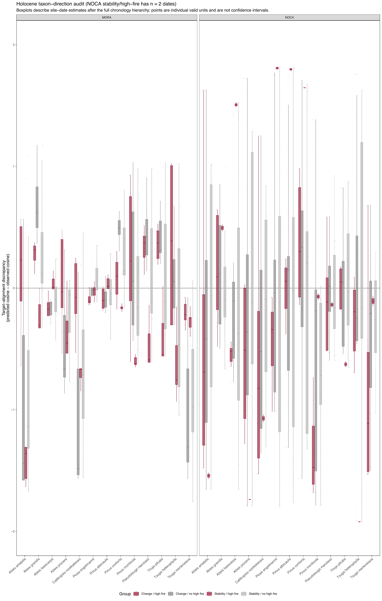
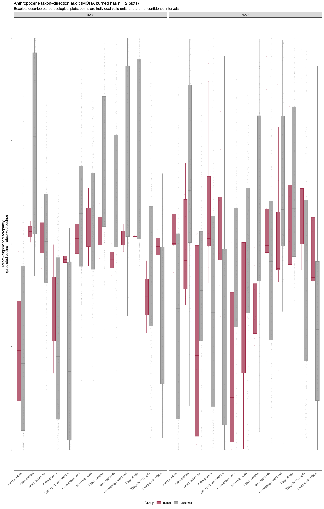
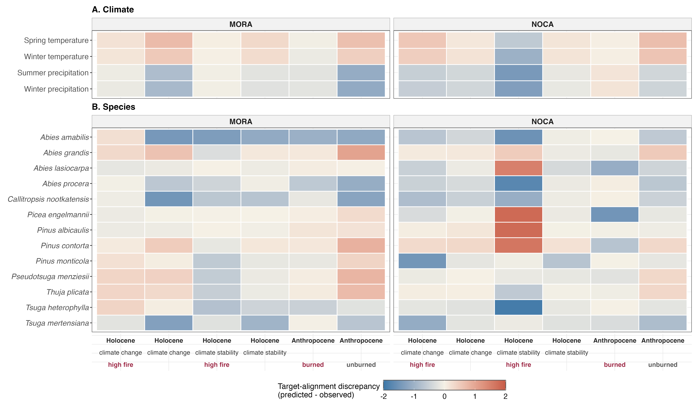

**Rebuilt analysis · 2026-10-07.** Current results and diagnostics were refreshed; chronology figures use the existing stored models.

PaleoACES asks how observed forest composition moves relative to the composition
predicted by climate, comparing modern forest resurveys with four Holocene
records. This review follows the [workflow](WORKFLOW.md), showing preparation,
methods, diagnostics and manuscript figures. [Scientific decisions](SCIENTIFIC_DECISIONS.md)
records the adopted choices; [figure captions](FIGURE_CAPTIONS.md) provides the
publication text.

## Study design and inputs

Mount Rainier (MORA) and North Cascades (NOCA) share one CCA calibrated on legacy
forest plots. Resurveys and dated plant-macrofossil samples are projected into
that ordination. MORA's Holocene vegetation comes from Jay Bath, Log Wallow and
Reflection Pond; NOCA's comes from Panther Potholes. MORA fire evidence comes
from Sunrise, Shadow and Little Sunrise lakes, while NOCA charcoal comes from
Panther Potholes. Vegetation and fire therefore have different spatial support.

The [input inventory](REPOSITORY_INVENTORY.md#raw-duplicates-and-authority),
[MORA data notes](../data/MORA/README_data_raw.md), [NOCA paleo notes](../data/NOCA/NOCA_paleo/SOURCES.md)
and [chronology sources](../Cores/SOURCES_MORA.md) identify the source materials.

The arrows show dependencies. The table below gives the exact execution order,
including figure production; figure numbers retain their manuscript meaning.
The [combined script](review/00_main_analysis_review.R) contains these stages
verbatim for reading. Run the workflow for an analysis rebuild.

| Order | Analysis step | Scripts |
| --- | --- | --- |
| 1–3 | Modern vegetation and fire | [000_MORA_cleaning.R](../R/stages/000_MORA_cleaning.R); [000_NOCA_cleaning.R](../R/stages/000_NOCA_cleaning.R); [01_get_fire_info.R](../R/stages/01_get_fire_info.R) |
| 4–5 | Modern climate | [000_MORA_climate.R](../R/stages/000_MORA_climate.R); [000_NOCA_climate.R](../R/stages/000_NOCA_climate.R) |
| 6 | Chronology (optional refit) | [000_PALEO_a_agedepth.R](../R/stages/000_PALEO_a_agedepth.R) |
| 7–9 | Paleo vegetation and fire | [000_PALEO_b_vegetation.R](../R/stages/000_PALEO_b_vegetation.R); [000_FIRE_cleaning.R](../R/stages/000_FIRE_cleaning.R); [000_PALEO_c_fire.R](../R/stages/000_PALEO_c_fire.R) |
| 10–11 | Paleo climate | [000_PALEO_d_climate_download.R](../R/stages/000_PALEO_d_climate_download.R); [000_PALEO_e_climate.R](../R/stages/000_PALEO_e_climate.R) |
| 12 | Taxonomy consolidation | [000_occurrence_data_consolidate.R](../R/stages/000_occurrence_data_consolidate.R) |
| 13 | CCA eligibility and calibration | [05_cca_model.R](../R/stages/05_cca_model.R) |
| 14–15 | Tracking and 500-year sensitivity | [09_tracking_metrics_500yr_sensitivity.R](../R/stages/09_tracking_metrics_500yr_sensitivity.R); [09_tracking_metrics.R](../R/stages/09_tracking_metrics.R) |
| 16–17 | Fire catalog and climate eras | [12_walsh_fire_reproduction.R](../R/stages/12_walsh_fire_reproduction.R); [13_holocene_climate_fire_eras.R](../R/stages/13_holocene_climate_fire_eras.R) |
| 18 | Community trajectories: Figure 3 | [05a_cca_figure.R](../R/stages/05a_cca_figure.R) |
| 19–20 | Tracking and fire-detection examples | [09a_method_example.R](../R/stages/09a_method_example.R); [12a_fire_event_detection_worked_example.R](../R/stages/12a_fire_event_detection_worked_example.R) |
| 21–22 | Climate/fire display: Figure 2 and example | [13a_climate_change_figure.R](../R/stages/13a_climate_change_figure.R); [13b_fire_method_worked_example.R](../R/stages/13b_fire_method_worked_example.R) |
| 23–24 | Tracking comparison: Figure 4 | [09b_tracking_visualization_data.R](../R/stages/09b_tracking_visualization_data.R); [09c_tracking_comparison.R](../R/stages/09c_tracking_comparison.R) |
| 25 | Direction discrepancies: Figure 5 | [14_cca_direction_analysis.R](../R/stages/14_cca_direction_analysis.R) |

| Prepared input | Rows | Plot/sample IDs | Taxa |
| --- | --- | --- | --- |
| MORA | 2502 | 331 | 23 |
| NOCA | 1775 | 305 | 31 |
| paleo | 9590 | 963 | 12 |
| consolidated | 13658 | 1599 | 21 |

[Full cleaning summary table](assets/analysis/tables/cleaning_summary.csv).

## Modern vegetation preparation

Presence means an adult **or** regeneration record. MORA uses the original legacy
workbook and cleaned resurvey tree and seedling files. NOCA applies the received
corrected-tree workbook before building occurrences; unsupported identification
labels are discarded. Both cleaners retain matched survey plots.

NOCA excludes `BAK487` for its old clearcut, `BEAV6061` for uncertain relocation,
and `CARI449`/`CARI450` for GPS problems. The latter share coordinates despite
conflicting elevations, and Rachel's notes supply no verified correction.
These exclusions apply to both dates. The cleaned NOCA universe has 305 pairs;
CCA eligibility is assessed later. The [cleaning guide](methods/000_NOCA_cleaning_guide.md)
and [GPS source note](review/NOCA_GPS_EXCLUSION.md) explain the decisions.

| Patch audit status | Affected plot IDs |
| --- | --- |
| excluded | 3 |
| included | 51 |

| Study-excluded plot | Reason |
| --- | --- |
| BAK487 | old clearcut; removed from Wilson final analysis |
| BEAV6061 | historic plot location uncertain; resurvey is an avalanche chute |
| CARI449 | GPS problem; shared coordinates conflict with elevations; no verified correction |
| CARI450 | GPS problem; shared coordinates conflict with elevations; no verified correction |

[Complete correction audit](assets/analysis/tables/correction_audit.csv), [study exclusions](assets/analysis/tables/study_exclusions.csv), and [excluded GPS-coordinate collision](assets/analysis/tables/coordinate_collision.csv).

### Account for the corrected paired-plot cleaning universe

The retained cleaning universe is broader than the final modeled pairs. Empty-period records and study exclusions remain explicit.

Script: [000_NOCA_cleaning.R](../R/stages/000_NOCA_cleaning.R). [Complete PDF](../plot/test_figures/NOCA_cleaning.pdf) (3 pages).

### Show species counts before model taxon selection

Counts reflect adult-or-regeneration presence in cleaned survey plots; they do not measure abundance.

Script: [000_MORA_cleaning.R](../R/stages/000_MORA_cleaning.R). [Complete PDF](../plot/test_figures/MORA_dynamics.pdf) (3 pages).

### Compare corrected legacy and resurvey species counts

Species differences describe cleaned surveys before cross-site harmonization and the CCA threshold.

Script: [000_NOCA_cleaning.R](../R/stages/000_NOCA_cleaning.R). [Complete PDF](../plot/test_figures/NOCA_dynamics.pdf) (3 pages).

## Modern fire assignments

Mapped disturbance records identify fire exposure for the paired modern plots.
NOCA has 32 burned and 273 unburned plots, with matching assignments on all 303
plots shared with Wilson's reference. MORA's mapped record covers 1987–2017,
so no mapped fire does not establish that a plot remained unburned throughout
the full survey interval.

### Audit NOCA modern fire assignment against Wilson reference plots

The 303 shared plots agree. The cleaned 305-plot universe excludes CARI449/CARI450 for GPS problems; the Wilson reference is not substituted for it.

Script: [01_get_fire_info.R](../R/stages/01_get_fire_info.R). [Complete PDF](../plot/test_figures/NOCA_fire_map_Wilson2024_PaleoACES.pdf) (1 pages).

## Modern climate preparation

CHELSA V2.1 monthly values supply spring temperature (MSpT), winter temperature
(MWT), summer precipitation (SP) and winter precipitation (WP). Temperature is
the midpoint of monthly minima and maxima, then averaged over the season;
precipitation is summed. These are seasonal climate proxies, not direct measures
of growing degree days, soil moisture or snowpack.

Spring is March–May, summer June–August and winter December–February. Modern
December belongs to the following winter. All three months are required;
temperatures are in °C and precipitation in mm per season.

MORA compares **1979–1989 with 2010–2019** over **30.5 midpoint years**; NOCA
compares **1979–1989 with 2010–2015** over **28.5 years**. Missing January 1979
leaves ten complete legacy winters. These are annualized contrasts between
survey windows, rather than instantaneous trends. The windows are settled;
the possible post-2010 MORA precipitation discontinuity remains a limitation.
Vegetation rates use each plot's survey interval separately. The
[survey-year notes](../data/SOURCES_SURVEY_YEARS.md) explain those references and
identify the missing original MORA date-source records.

| Site | Period | Plots | Spring years | Winter years | Summer years | Winter precipitation years |
| --- | --- | --- | --- | --- | --- | --- |
| MORA | past | 331 | 11 | 10 | 11 | 10 |
| MORA | present | 331 | 10 | 10 | 10 | 10 |
| NOCA | past | 305 | 11 | 10 | 11 | 10 |
| NOCA | present | 305 | 6 | 6 | 6 | 6 |

[Full climate windows table](assets/analysis/tables/climate_windows.csv).

### Compare selected survey windows with the full 1979–2021 record

Detrending does not resolve CHELSA product continuity. Apparent precipitation anomalies remain a scientific limitation.

Script: [test_survey_year_anomaly.R](../R/diagnostics/test_survey_year_anomaly.R). [Complete PDF](../plot/test_figures/test_survey_year_anomaly.pdf) (1 pages).

## Chronology and uncertainty

The four Bacon models provide sample ages, allowing vegetation to be matched
to climate through time. The [control-point register](../Cores/CONTROL_POINTS.md)
explains radiocarbon dates, tephra ages, surface controls and instantaneous layers.
Tracking uses 100 whole-chronology draws per core, preserving temporal dependence
within each core.

**The chronology choices are retained for this analysis.** Some tephra errors
are assumed bracket half-widths, rather than verified statistical standard
deviations. Reflection Pond's basal-lahar control also retains an assumed age
error and an unverified core-to-deposit correlation. The draws describe
uncertainty conditional on these controls and the Bacon model; they do not
represent every source of dating uncertainty. The [MORA reconsideration](../Cores/SOURCES_MORA.md#basal-lahar-reconsideration-2026-10-06)
records the sources and reason for retaining the existing model.

Panther Potholes' primary chronology deliberately retains inherited Pb210
activity errors for reproduction. The existing **assumed ±10-year age-error
sensitivity** examines that limitation without replacing the primary chronology.
The deeper models are similar, not identical: the
[stored comparison](review/PB210_STORED_SENSITIVITY_COMPARISON.csv) finds maximum
differences below 35 cm of 15 years in median age and 24/28 years in the lower/upper
95% bounds. The [NOCA source notes](../data/NOCA/NOCA_paleo/SOURCES.md) preserve the
earlier discussion. This report uses stored chronologies; no model is refitted.

### Inspect four fitted age-depth models and slump treatment

The four age-depth curves show sediment accumulation, removed instantaneous layers and modeled age ranges. Those ranges are conditional on the adopted controls and Bacon settings.

Script: [000_PALEO_a_agedepth.R](../R/stages/000_PALEO_a_agedepth.R). [Complete PDF](../plot/test_figures/fig_bacon_agedepth_slump.pdf) (1 pages).

### Compare published activity errors with assumed ±10-year age uncertainty

The sensitivity concerns the upper 35–40 cm of Panther Potholes; uncertainty in published fire chronologies is not equivalent across sites. **Chronology sensitivity**.

Script: [000_PALEO_a_agedepth.R](../R/stages/000_PALEO_a_agedepth.R). [Complete PDF](../plot/test_figures/fig_bacon_pb210_sensitivity.pdf) (1 pages).

## Paleo vegetation and fire preparation

Macrofossil records are harmonized into presence/absence observations while
retaining their lake, sample depth and modeled age. Macrofossil percentages and
survey stem counts are not combined as abundance. A sample without detected
tree taxa does not demonstrate an absence of forest.

Charcoal and charred-needle information is prepared separately from vegetation.
The MORA published charcoal chronologies and the Panther Potholes core do not
have equivalent timing precision or spatial support. Later fire classification
uses the accepted-event catalog described below.

## Paleo climate preparation

CHELSA-TraCE21k supplies climate at the four pond locations. Each vegetation
sample is matched to the available climate slice nearest its own age, within
the 50-year tolerance. The seasonal variables and units match the modern
analysis; December remains within its paleo climatology slice.

Raw TraCE21k is the current input. A V2.1-based correction is planned as a
sensitivity and has not been applied. The comparison at the end of this review
shows the available recent overlap and its different averaging windows.

### Inspect redundancy among candidate climate variables

Only page 2 (correlations) is inline. Page 1 and associated pace tables retain the former 500-year sensitivity and are not primary rate evidence. **Correlation diagnostic; full PDF includes 500-year sensitivity**.

Script: [test_climate_change_variables.R](../R/diagnostics/test_climate_change_variables.R). [Complete PDF](../plot/test_figures/climate_holocene_timeseries.pdf) (2 pages).

Only the correlation page is shown here. The full climate diagnostic also
contains older **500-year sensitivity** calculations; those are separate from
primary climate-rate results.

## Taxonomy and species selection

[Consolidation](methods/README_occurrence_consolidation.md) aligns Populus,
Picea and Abies identifications across surveys and macrofossils. Acer circinatum
and Taxus brevifolia are removed for stratum compatibility; Pinus ponderosa is
excluded by the documented analysis choice.

CCA retains a taxon when it occurs in **at least 20 plots or samples in any one
site × period group**. The rule does not require 20 in every group. Pinus
albicaulis reaches exactly 20 and remains included. Selection rests on taxon
relevance and ordination interpretation; increased explained inertia alone is
not its justification. Resurvey and paleo counts influence selection even
though those observations do not calibrate the CCA.

| Taxon | MORA legacy | MORA resurvey | MORA paleo | NOCA legacy | NOCA resurvey | NOCA paleo | CCA retained |
| --- | --- | --- | --- | --- | --- | --- | --- |
| Abies amabilis | 290 | 289 | 117 | 113 | 128 | 0 | TRUE |
| Abies lasiocarpa | 34 | 32 | 92 | 63 | 76 | 468 | TRUE |
| Abies procera | 68 | 50 | 43 | 0 | 0 | 0 | TRUE |
| Callitropsis nootkatensis | 106 | 101 | 78 | 37 | 44 | 38 | TRUE |
| Picea engelmannii | 12 | 9 | 5 | 26 | 22 | 12 | TRUE |
| Pinus contorta | 2 | 1 | 31 | 32 | 28 | 285 | TRUE |
| Pinus monticola | 42 | 15 | 90 | 28 | 25 | 489 | TRUE |
| Pseudotsuga menziesii | 181 | 147 | 40 | 157 | 147 | 594 | TRUE |
| Tsuga heterophylla | 281 | 283 | 54 | 88 | 121 | 179 | TRUE |
| Tsuga mertensiana | 88 | 77 | 108 | 89 | 76 | 39 | TRUE |
| Abies grandis | 8 | 8 | 0 | 11 | 20 | 0 | TRUE |
| Alnus rubra | 15 | 16 | 0 | 11 | 18 | 0 | FALSE |
| Picea sitchensis | 2 | 1 | 0 | 0 | 0 | 0 | FALSE |
| Populus trichocarpa | 3 | 3 | 0 | 8 | 3 | 0 | FALSE |
| Thuja plicata | 111 | 113 | 0 | 95 | 101 | 159 | TRUE |
| Acer macrophyllum | 0 | 4 | 0 | 17 | 18 | 0 | FALSE |
| Malus fusca | 0 | 1 | 0 | 0 | 0 | 0 | FALSE |
| Pinus albicaulis | 0 | 2 | 0 | 20 | 7 | 0 | TRUE |
| Juniperus communis | 0 | 0 | 0 | 0 | 0 | 8 | FALSE |
| Betula papyrifera | 0 | 0 | 0 | 4 | 6 | 0 | FALSE |
| Larix lyallii | 0 | 0 | 0 | 7 | 9 | 0 | FALSE |

[Full CCA taxa table](assets/analysis/tables/cca_taxa.csv).

NOCA size classes differ between dates: legacy regeneration spans 0–3 m and
adults exceed 3 m; resurvey seedlings span 10–140 cm and trees exceed 1.4 m.
These strata are not identical measurements across surveys.

### Inspect consolidated occurrence counts in each site-period group

Retention requires at least 20 plots or samples in one group. The threshold is not required in every group.

Script: [000_occurrence_data_consolidate.R](../R/stages/000_occurrence_data_consolidate.R). [Complete PDF](../plot/test_figures/species_counts_consolidated.pdf) (1 pages).

### Expose adult versus regeneration support for presence

Adult and regeneration sources contribute to presence; stem counts and macrofossil percentages are not combined as abundance.

Script: [000_occurrence_data_consolidate.R](../R/stages/000_occurrence_data_consolidate.R). [Complete PDF](../plot/test_figures/stage_adult_seedling_past_present.pdf) (1 pages).

### Inspect taxon site confounding and temporal occupancy

This explicitly retains the 500-year occupancy sensitivity. Sparse sampling is shown; the primary tracking analysis uses 1,000 years. **500-year sensitivity**.

Script: [test_species_through_time.R](../R/diagnostics/test_species_through_time.R). [Complete PDF](../plot/test_figures/species_through_time.pdf) (1 pages).

The occupancy display is explicitly a **500-year sensitivity**. Primary
Holocene tracking uses 1,000-year intervals.

## CCA sample eligibility and exclusions

[05_cca_model.R](../R/stages/05_cca_model.R) resolves eligibility **before fitting
or projecting**. An observation with no retained taxa has no observed WA
position. It is excluded from both observed and climate-predicted comparisons.
Modern endpoints use the same eligible pairs at both dates; Holocene WA and LC
positions also use identical samples. All eligible legacy plots remain available
for calibration.

| Era | Site | Use | Prepared plots/samples | Excluded | Included |
| --- | --- | --- | --- | --- | --- |
| anthropocene | MORA | Legacy calibration | 331 | 0 | 331 |
| anthropocene | MORA | Modern paired comparison | 331 | 1 | 330 |
| anthropocene | NOCA | Legacy calibration | 305 | 18 | 287 |
| anthropocene | NOCA | Modern paired comparison | 305 | 30 | 275 |
| holocene | MORA | Paleo projection | 117 | 0 | 117 |
| holocene | NOCA | Paleo projection | 846 | 56 | 790 |

[Full CCA eligibility counts table](assets/analysis/tables/cca_eligibility_counts.csv).

Exclusion reasons are separated below. Each modern pair is counted once,
against its first failing endpoint, with legacy checked first. Calibration and
paired-comparison counts overlap and must not be added together. Holocene
counts are samples before age draws or temporal binning.

| Era | Site | Use | Excluded at | Reason | Count |
| --- | --- | --- | --- | --- | --- |
| anthropocene | MORA | Modern paired comparison | present | Only taxa excluded by CCA species selection | 1 |
| anthropocene | NOCA | Legacy calibration | past | Only taxa excluded during consolidation | 1 |
| anthropocene | NOCA | Legacy calibration | past | No tree taxa recorded at legacy | 6 |
| anthropocene | NOCA | Legacy calibration | past | Only taxa excluded by CCA species selection | 11 |
| anthropocene | NOCA | Modern paired comparison | past | Only taxa excluded during consolidation | 1 |
| anthropocene | NOCA | Modern paired comparison | past | No tree taxa recorded at legacy | 6 |
| anthropocene | NOCA | Modern paired comparison | past | Only taxa excluded by CCA species selection | 11 |
| anthropocene | NOCA | Modern paired comparison | present | Only taxa excluded during consolidation | 1 |
| anthropocene | NOCA | Modern paired comparison | present | Loss of all recorded tree-taxon presence at resurvey | 9 |
| anthropocene | NOCA | Modern paired comparison | present | Only taxa excluded by CCA species selection | 2 |
| holocene | NOCA | Paleo projection | paleo | No tree taxa detected in paleo sample | 56 |

[Full CCA exclusion summary table](assets/analysis/tables/cca_exclusion_summary.csv).

“Loss of all recorded tree-taxon presence at resurvey” describes absence in the
sampled taxa and strata, not proven biological extinction. “No tree taxa detected
in paleo sample” describes macrofossil non-detection. Cases holding only taxa
removed during consolidation or CCA selection are listed separately. Missing
climate and unmatched endpoints are also classified if encountered.

The [sample table](assets/analysis/tables/cca_sample_eligibility.csv) and
[paired-plot table](assets/analysis/tables/cca_pair_eligibility.csv) retain the
individual reasons. The cleaned data retain these observations even when they
cannot enter CCA tracking.

## CCA calibration and geometry

One pooled legacy CCA relates composition to the four climate variables.
Observed **weighted-average (WA)** scores describe composition; predicted
**linear-combination (LC)** scores describe the position expected from climate.
Modern resurveys and paleo samples enter the existing ordination without
recalibrating it.

| Fitted model quantity | Value |
| --- | --- |
| Legacy calibration plots | 618 |
| Retained taxa | 13 |
| Minimum occupancy in one site × period | 20 |
| CCA score scaling | Site scaling (1) |
| Hill scaling | Off |
| Climate variables | MSpT;MWT;SP;WP |
| Total inertia | 3.041 |
| Climate-constrained inertia | 0.5038 |
| Constrained inertia (%) | 16.57 |
| Modern plots and paleo samples before eligibility | 1599 |
| Eligible modern pairs and paleo samples | 1512 |

[Full CCA summary table](assets/analysis/tables/cca_summary.csv).

| Axis | Eigenvalue | % total inertia | % constrained inertia |
| --- | --- | --- | --- |
| CCA1 | 0.2846 | 9.36 | 56.5 |
| CCA2 | 0.1843 | 6.059 | 36.58 |
| CCA3 | 0.02907 | 0.9561 | 5.771 |
| CCA4 | 0.005783 | 0.1902 | 1.148 |

[Full CCA axes table](assets/analysis/tables/cca_axes.csv).

| Site | Period | Prepared climate samples | Calibrated | Positioned projection |
| --- | --- | --- | --- | --- |
| MORA | paleo | 117 | — | 117 |
| MORA | past | 331 | 331 | — |
| MORA | present | 331 | — | 330 |
| NOCA | paleo | 846 | — | 790 |
| NOCA | past | 305 | 287 | — |
| NOCA | present | 305 | — | 275 |

[Full CCA counts table](assets/analysis/tables/cca_counts.csv).

CCA1–CCA2 and site scaling (1), with Hill scaling off, define all distances and
angles. Display arrow multipliers do not enter calculations. Binary presence
still carries CCA's row and taxon weighting. The displayed axes represent only
part of total community inertia, and correlated climate variables prevent
adding their marginal contributions as independent shares. Projections are
descriptive scores rather than independently validated forecasts.

### Compare scaling 1 and 2 of the same fitted CCA

Site scaling (1), Hill off and CCA1–CCA2 define the primary geometry. Unequal rescaling of axes changes distances and angles; display arrow multipliers are excluded from the calculations.

Script: [test_cca_scaling_comparison.R](../R/diagnostics/test_cca_scaling_comparison.R). [Complete PDF](../plot/test_figures/fig_cca_scaling_comparison.pdf) (1 pages).

## Tracking calculations and resolution sensitivity

Observed movement is the change in WA position; climate-predicted movement is
the change in LC position. Endpoint lag is the distance between LC and WA.
**Δlag is final lag minus initial lag**: positive values mean the mismatch opens.
The tracking ratio compares observed and predicted movement rates; the angle
compares their directions and is undefined when either movement is stationary.

Primary Holocene calculations pool MORA's lakes before calculating nonlinear
metrics for consecutive **1,000-year intervals**. Each core contributes 100
chronology draws, and ten 100-year offsets assess sensitivity to interval
placement. Draws are summarized within offset before offsets are combined.
These realizations are not additional ecological replicates. One-sample bins
remain flagged, with an existing minimum-two-sample sensitivity.

The workflow runs the **500-year sensitivity** first, then the primary analysis.
The table compares their resolution and descriptive estimates.

| Site | Metric | Resolution | Dates | Median | Median samples/bin |
| --- | --- | --- | --- | --- | --- |
| MORA | Movement angle (°) | 1000 years (primary) | 54 | 37.27 | 11.5 |
| MORA | Δlag per century | 1000 years (primary) | 54 | -0.005371 | 11.5 |
| MORA | Tracking rate ratio | 1000 years (primary) | 54 | 5.375 | 11.5 |
| NOCA | Movement angle (°) | 1000 years (primary) | 83 | 80.43 | 57.5 |
| NOCA | Δlag per century | 1000 years (primary) | 83 | -0.01393 | 57.5 |
| NOCA | Tracking rate ratio | 1000 years (primary) | 83 | 3.662 | 57.5 |
| MORA | Movement angle (°) | 500 years (sensitivity) | 64 | 76.43 | 6 |
| MORA | Δlag per century | 500 years (sensitivity) | 64 | -0.004496 | 6 |
| MORA | Tracking rate ratio | 500 years (sensitivity) | 64 | 2.993 | 6 |
| NOCA | Movement angle (°) | 500 years (sensitivity) | 98 | 91.1 | 30 |
| NOCA | Δlag per century | 500 years (sensitivity) | 98 | 0.0005854 | 30 |
| NOCA | Tracking rate ratio | 500 years (sensitivity) | 98 | 2.88 | 30 |

[Full resolution audit table](assets/analysis/tables/resolution_audit.csv).

## Accepted fire events and climate eras

The accepted-event catalog uses the shared tapas detector with core-specific
interpolation, background smoothing and local thresholds. All cores use
unlogged charcoal accumulation, robust LOWESS background, a local Gaussian-mixture
threshold and a 75-year count screen with p ≤ 0.05. Accepted totals are 17
Sunrise, 14 Shadow, 13 Little Sunrise and 66 Panther Potholes. The existing
12.5-year NOCA interpolation sensitivity yields 72 events.

| Lake | Engine | Interpolation years | Background years | Local threshold |
| --- | --- | --- | --- | --- |
| Sunrise Lake | tapas | 48 | 800 | 0.95 |
| Shadow Lake | tapas | 47 | 1000 | 0.95 |
| Little Sunrise Lake | tapas | 42 | 500 | 0.95 |
| PantherPotholes | tapas | 12 | 500 | 0.99 |

[Full fire settings table](assets/analysis/tables/fire_settings.csv).

| Lake | Candidates | Count rejected | Accepted |
| --- | --- | --- | --- |
| Sunrise Lake | 26 | 9 | 17 |
| Shadow Lake | 17 | 3 | 14 |
| Little Sunrise Lake | 20 | 7 | 13 |
| PantherPotholes | 66 | 0 | 66 |

[Full event audit table](assets/analysis/tables/event_audit.csv).

The official CharAnalysis comparison is separate from the primary catalog.
Its discrepancy with Walsh's publication is retained without threshold tuning.

| Lake | Official R episodes | Published total | Difference |
| --- | --- | --- | --- |
| Little Sunrise Lake | 14 | 16 | -2 |
| Shadow Lake | 16 | 18 | -2 |
| Sunrise Lake | 15 | 24 | -9 |

[Full walsh audit table](assets/analysis/tables/walsh_audit.csv).

### Compare official CharAnalysis results with published Walsh totals

The official CharAnalysis implementation and Walsh publication give different event totals. This comparison is separate from the primary tapas event catalog, whose thresholds were not tuned to force agreement.

Script: [12_walsh_fire_reproduction.R](../R/stages/12_walsh_fire_reproduction.R). [Complete PDF](../plot/test_figures/fig_walsh_charanalysis_reproduction.pdf) (3 pages).

Climate eras are defined independently of vegetation, fire and literature.
Signed 1,000-year changes are divided by legacy-calibration standard deviations;
MORA lakes are averaged first, then MORA and NOCA receive equal regional weight.
A variable qualifies at 50% of its own maximum absolute regional median, with
at least eight of ten offsets supporting its direction. Any qualifying variable
marks climate change; adjacent cells merge into eras. The unsigned four-variable
composite provides context, rather than defining a boundary. Complete offset
support spans 9.6–1.3 ka.

| Era | Class | Older cal BP | Younger cal BP | Duration years |
| --- | --- | --- | --- | --- |
| CC1 | climate change | 9600 | 7200 | 2400 |
| S1 | relative stability | 7200 | 6800 | 400 |
| CC2 | climate change | 6800 | 6200 | 600 |
| S2 | relative stability | 6200 | 5400 | 800 |
| CC3 | climate change | 5400 | 4900 | 500 |
| S3 | relative stability | 4900 | 2200 | 2700 |
| CC4 | climate change | 2200 | 1700 | 500 |
| S4 | relative stability | 1700 | 1300 | 400 |

[Full era catalog table](assets/analysis/tables/era_catalog.csv).

High-fire periods are defined independently from centered 1,000-year event
frequencies. Each core is normalized by its own maximum; MORA averages covered
cores equally and requires at least two. A site's frequency must exceed its
median plus 1.4826 × MAD. Above-threshold periods are retained without bridging
coverage gaps. Five MORA and six NOCA high-fire periods result. These categories
use fixed median event chronologies, without propagating event-timing uncertainty.

## Community trajectories

Figure 3 connects observed and predicted centroids for each site through the
CC1–S4 eras. These are separate WA and LC trajectories within the same fitted
ordination. Modern arrows use exactly the same eligible pairs at both endpoints,
while the broader legacy calibration remains the fitting reference.

| Site | Survey | Same paired plots | Observed CCA1 | Observed CCA2 | Predicted CCA1 | Predicted CCA2 |
| --- | --- | --- | --- | --- | --- | --- |
| MORA | legacy | 330 | -0.06778 | -0.2735 | -0.05547 | -0.275 |
| MORA | resurvey | 330 | -0.0832 | -0.3088 | -0.3354 | 0.01053 |
| NOCA | legacy | 275 | 0.005739 | 0.4424 | 0.02131 | 0.4578 |
| NOCA | resurvey | 275 | -0.06695 | 0.3476 | -0.113 | 0.5041 |

[Full modern centroids table](assets/analysis/tables/modern_centroids.csv).

| Site | Era | Positioned dates | Observed CCA1 | Observed CCA2 | Predicted CCA1 | Predicted CCA2 |
| --- | --- | --- | --- | --- | --- | --- |
| MORA | CC1 | 3 | 0.2206 | 0.4235 | -0.2621 | -0.8369 |
| MORA | S1 | 4 | 0.3422 | 0.4924 | -0.1427 | -0.8386 |
| MORA | CC2 | 6 | 0.4038 | 0.4876 | -0.08619 | -0.8407 |
| MORA | S2 | 8 | 0.5946 | 0.3899 | -0.06419 | -0.8423 |
| MORA | CC3 | 5 | 0.6446 | 0.3516 | -0.09901 | -0.8187 |
| MORA | S3 | 27 | 0.6911 | 0.01324 | -0.1705 | -0.8738 |
| MORA | CC4 | 5 | 0.6571 | -0.31 | -0.1814 | -0.9048 |
| MORA | S4 | 4 | 0.6677 | -0.2171 | -0.2191 | -0.8595 |
| NOCA | CC1 | 24 | -0.003958 | 1.462 | -0.2252 | 0.3865 |
| NOCA | S1 | 4 | -0.03754 | 1.086 | -0.3113 | 0.2867 |
| NOCA | CC2 | 6 | -0.02273 | 1.123 | -0.2582 | 0.2851 |
| NOCA | S2 | 8 | 0.05961 | 0.9586 | -0.2342 | 0.2702 |
| NOCA | CC3 | 5 | -0.0006349 | 0.7702 | -0.2632 | 0.2673 |
| NOCA | S3 | 27 | -0.1031 | 0.7234 | -0.263 | 0.2369 |
| NOCA | CC4 | 5 | -0.1975 | 0.4842 | -0.257 | 0.265 |
| NOCA | S4 | 4 | -0.2816 | 0.2975 | -0.2715 | 0.2909 |

[Full era centroids table](assets/analysis/tables/era_centroids.csv).

### Figure 3. Observed and climate-predicted community trajectories

[Full PDF](../plot/fig_cca_trajectories.pdf) · [Figure script](../R/stages/05a_cca_figure.R) · [Publication captions](FIGURE_CAPTIONS.md).

## Worked examples and climate/fire display

The metric example below shows how displacement, lag, ratio and angle follow
from WA and LC endpoints. The fire-detection examples distinguish individual
events from the subsequent classification of high-fire periods.

### Work through WA/LC movement, lag, ratio, and angle

Lag change is endpoint mismatch at t2 minus t1; a stationary observed movement has no defined direction.

Script: [09a_method_example.R](../R/stages/09a_method_example.R). [Complete PDF](../plot/test_figures/fig_method_worked_example.pdf) (1 pages).

### Follow interpolation, background, local noise threshold, and count screening

Pages 1, 2, and 5 show common settings, Sunrise, and Panther Potholes. Core-specific temporal settings remain explicit; accepted events precede high-fire classification.

Script: [12a_fire_event_detection_worked_example.R](../R/stages/12a_fire_event_detection_worked_example.R). [Complete PDF](../plot/test_figures/fig_fire_event_detection_workflow.pdf) (6 pages).

Figure 2 aligns independently defined climate eras and high-fire periods.
Its rate comparison retains signed temperatures in °C/century and precipitation
in mm/century. Modern rates describe the agreed survey-window contrasts.

| Constraint | Units | Holocene regional signed maximum | Peak cal BP | MORA modern median | NOCA modern median |
| --- | --- | --- | --- | --- | --- |
| Spring temperature | deg C / century | 0.04175 | 7500 | 2.41 | 1.416 |
| Winter temperature | deg C / century | 0.05504 | 9500 | 1.833 | 1.411 |
| Summer precipitation | mm / century | -1.087 | 8900 | -152.4 | 104.6 |
| Winter precipitation | mm / century | 2.338 | 8100 | -732 | -422.6 |

[Full raw climate rates table](assets/analysis/tables/raw_climate_rates.csv).

### Figure 2. Climate eras, climate rates and high-fire periods

[Full PDF](../plot/fig_standardized_climate_change_eras_fire.pdf) · [Figure script](../R/stages/13a_climate_change_figure.R) · [Publication captions](FIGURE_CAPTIONS.md).

### Expose signed changes, phase support, and era construction

Any qualifying variable creates a climate-change cell. Only adjacent cells merge; the unsigned composite is context.

Script: [13_holocene_climate_fire_eras.R](../R/stages/13_holocene_climate_fire_eras.R). [Complete PDF](../plot/test_figures/fig_holocene_climate_period_method_worked_example.pdf) (1 pages).

### Work through centered event frequencies at 2,300 cal BP

Within-core normalization and site-specific robust thresholds yield MORA high fire and NOCA no high fire for the worked date.

Script: [13b_fire_method_worked_example.R](../R/stages/13b_fire_method_worked_example.R). [Complete PDF](../plot/test_figures/fig_holocene_fire_method_worked_example.pdf) (1 pages).

## Tracking comparisons

Prepared tracking summaries are assigned to climate eras and fire contexts.
Coverage is explicit: the primary analysis supports 54 MORA and 83 NOCA
site-dates across all ten offsets. Group summaries describe the supported data;
chronology draws, offsets and overlapping dates are not independent replication.

| Site | Era | Supported dates | Coverage |
| --- | --- | --- | --- |
| MORA | CC1 | 0 | insufficient complete-offset support |
| MORA | S1 | 0 | insufficient complete-offset support |
| MORA | CC2 | 5 | complete ten-offset support |
| MORA | S2 | 8 | complete ten-offset support |
| MORA | CC3 | 5 | complete ten-offset support |
| MORA | S3 | 27 | complete ten-offset support |
| MORA | CC4 | 5 | complete ten-offset support |
| MORA | S4 | 4 | complete ten-offset support |
| NOCA | CC1 | 24 | complete ten-offset support |
| NOCA | S1 | 4 | complete ten-offset support |
| NOCA | CC2 | 6 | complete ten-offset support |
| NOCA | S2 | 8 | complete ten-offset support |
| NOCA | CC3 | 5 | complete ten-offset support |
| NOCA | S3 | 27 | complete ten-offset support |
| NOCA | CC4 | 5 | complete ten-offset support |
| NOCA | S4 | 4 | complete ten-offset support |

[Full era coverage table](assets/analysis/tables/era_coverage.csv).

| Site | Era | Fire | Metric | Total | Valid | Median | Q25 | Q75 |
| --- | --- | --- | --- | --- | --- | --- | --- | --- |
| MORA | Holocene | No fire | Movement angle (°) | 38 | 38 | 37.5 | 34.9 | 66.27 |
| MORA | Holocene | No fire | Δlag per century | 38 | 38 | -0.006767 | -0.01088 | 0.0002948 |
| MORA | Holocene | No fire | Tracking rate ratio | 38 | 38 | 6.26 | 2.069 | 7.146 |
| MORA | Holocene | Fire | Movement angle (°) | 16 | 16 | 34.9 | 27.93 | 42.3 |
| MORA | Holocene | Fire | Δlag per century | 16 | 16 | -0.002413 | -0.01617 | 0.003181 |
| MORA | Holocene | Fire | Tracking rate ratio | 16 | 16 | 4.166 | 3.079 | 5.369 |
| MORA | Anthropocene | No fire | Movement angle (°) | 328 | 250 | 100.7 | 30.56 | 156.7 |
| MORA | Anthropocene | No fire | Δlag per century | 328 | 328 | 0.5389 | -0.2711 | 1.221 |
| MORA | Anthropocene | No fire | Tracking rate ratio | 328 | 328 | 0.6559 | 0.1985 | 1.123 |
| NOCA | Holocene | No fire | Movement angle (°) | 69 | 69 | 88.9 | 49.83 | 134.3 |
| NOCA | Holocene | No fire | Δlag per century | 69 | 69 | -0.009041 | -0.02581 | 0.01265 |
| NOCA | Holocene | No fire | Tracking rate ratio | 69 | 69 | 3.276 | 2.475 | 5.436 |
| NOCA | Holocene | Fire | Movement angle (°) | 14 | 14 | 68.86 | 30.79 | 80.43 |
| NOCA | Holocene | Fire | Δlag per century | 14 | 14 | -0.03407 | -0.03571 | -0.01623 |
| NOCA | Holocene | Fire | Tracking rate ratio | 14 | 14 | 4.948 | 2.846 | 6.377 |
| NOCA | Anthropocene | No fire | Movement angle (°) | 252 | 188 | 94.87 | 42.93 | 146.4 |
| NOCA | Anthropocene | No fire | Δlag per century | 252 | 252 | 0.002744 | -0.8702 | 0.8718 |
| NOCA | Anthropocene | No fire | Tracking rate ratio | 252 | 252 | 2.285 | 0 | 4.048 |
| NOCA | Anthropocene | Fire | Movement angle (°) | 23 | 12 | 28.46 | 11.14 | 87.3 |
| NOCA | Anthropocene | Fire | Δlag per century | 23 | 23 | -0.234 | -0.5432 | 0.6238 |
| NOCA | Anthropocene | Fire | Tracking rate ratio | 23 | 23 | 1.245 | 0 | 4.852 |

[Full tracking summary table](assets/analysis/tables/tracking_summary.csv).

Figure 4 omits the two burned MORA pairs from its descriptive comparison and
retains 603 modern pairs across the displayed groups. All 137 supported Holocene
site-dates remain. Its scatter has 587 direction-valid observations; stationary
modern compositions remain in the non-angle summaries. Quartiles and offset/draw
spread describe variation, not inferential confidence intervals.

### Figure 4. Vegetation tracking across eras and fire contexts

[Full PDF](../plot/fig_tracking_comparison.pdf) · [Figure script](../R/stages/09c_tracking_comparison.R) · [Publication captions](FIGURE_CAPTIONS.md).

## Direction discrepancies and support

For each taxon, predicted alignment compares LC movement with the vector from
its initial LC position toward the species score. Observed alignment uses the
corresponding vector from its initial WA position. Climate targets use the
common environmental biplot directions. The **target-alignment discrepancy**
is predicted minus observed cosine: positive values mean stronger predicted
alignment, including movement that is less opposed to a target.

Equal target alignment does not imply equal movement vectors. Each taxon
comparison uses its trajectory's own origin, so starting-position differences
can contribute to the discrepancy. Cosines are missing for movements below the
existing 1e-8 tolerance. The stage retains all 605 modern pairs, including the
two burned MORA plots, and 15,270 primary Holocene realizations.

| Period | Site | Climate state | Burned/high fire | Units | Min valid targets | Max valid targets |
| --- | --- | --- | --- | --- | --- | --- |
| Anthropocene | MORA | — | FALSE | 328 | 248 | 250 |
| Anthropocene | MORA | — | TRUE | 2 | 2 | 2 |
| Anthropocene | NOCA | — | FALSE | 252 | 177 | 188 |
| Anthropocene | NOCA | — | TRUE | 23 | 11 | 12 |
| Holocene | MORA | climate change | FALSE | 7 | 7 | 7 |
| Holocene | MORA | climate change | TRUE | 8 | 8 | 8 |
| Holocene | MORA | relative stability | FALSE | 31 | 31 | 31 |
| Holocene | MORA | relative stability | TRUE | 8 | 8 | 8 |
| Holocene | NOCA | climate change | FALSE | 28 | 28 | 28 |
| Holocene | NOCA | climate change | TRUE | 12 | 12 | 12 |
| Holocene | NOCA | relative stability | FALSE | 41 | 41 | 41 |
| Holocene | NOCA | relative stability | TRUE | 2 | 2 | 2 |

[Full direction summaries](assets/analysis/tables/direction_summary.csv) and [group support](assets/analysis/tables/direction_support.csv).

MORA burned has only two plots and NOCA relative-stability/high-fire has only
two dates. These groups remain visible, but do not support precise or causal
claims. Directional alignment does not directly measure taxon gain, dominance
or climate causation.

### Inspect distributions and support beneath the Figure 5 heatmap

The paired target discrepancy uses each trajectory's own origin. Quartiles are descriptive; small groups are retained rather than interpreted as precise estimates.

Script: [14_cca_direction_analysis.R](../R/stages/14_cca_direction_analysis.R). [Complete PDF](../plot/test_figures/fig_cca_direction_differences_audit.pdf) (3 pages).

### Figure 5. Predicted-minus-observed target-alignment discrepancies

[Full PDF](../plot/fig_cca_direction_differences.pdf) · [Figure script](../R/stages/14_cca_direction_analysis.R) · [Publication captions](FIGURE_CAPTIONS.md).

## Limitations and remaining questions

The chronology controls, survey windows, GPS exclusions and paired CCA
eligibility are settled for this analysis. Their interpretation limits remain:
conditional dating uncertainty, differing fire-proxy support, unequal survey
size classes, site-confounded paleo occupancy, overlapping temporal samples
and possible climate-product discontinuities.

The remaining questions below come from the
[scientific decision register](SCIENTIFIC_DECISIONS.md#remaining-scientific-questions).
They distinguish planned or optional sensitivities from decisions already made.

| Question | Current choice | Consequence | Evidence needed to resolve it |
|---|---|---|---|
| Raw versus V2.1-anchored TraCE21k climate | The active Holocene analysis uses raw TraCE21k values; the V2.1 anchoring diagnostic is not authoritative. | Absolute Holocene climate levels and cross-product comparisons may retain product bias, although the active within-series change calculations are internally consistent. | A validated overlap-period comparison showing whether anchoring reduces bias without introducing a discontinuity or changing the intended anomaly interpretation. |
| Legacy-calibration versus full-record climate SDs | Changes are divided by SDs from the 618 pooled legacy CCA calibration plots. | The reference is tied to the fitted model. A full-record SD would change displayed standardized magnitudes, cross-variable weighting, the unthresholded composite, and standardized climate rates, but not CC/S boundaries under the current variable-specific 50%-of-own-maximum rule. | A prespecified full-record sensitivity with explicit temporal/site weighting and a scientific choice between calibration-relative and dataset-relative effect sizes. |
| Anthropocene precipitation continuity | The agreed MORA and NOCA windows remain 1979–1989 to 2010–2019 and 1979–1989 to 2010–2015, respectively; unequal resurvey-window lengths are accepted. The MORA precipitation contrast is flagged. | The apparent post-2010 MORA precipitation shift may partly reflect CHELSA inhomogeneity rather than climate. | Independent station/reanalysis validation and a documented decision on whether post-2010 MORA precipitation is usable. The agreed years are not a pending decision. |
| Own-origin versus common-origin taxon target geometry | The primary target-alignment analysis uses LC₁→species for predicted movement and WA₁→species for observed movement. | The two cosines answer alignment relative to each trajectory's own starting community; part of their difference can arise because LC₁ and WA₁ differ. | A prespecified common-origin sensitivity and an ecological decision about whether the estimand should condition on each starting state or hold the target vector fixed across observed and predicted movement. |

The analysis checks passed, including paired exclusions, chronology, climate matching, tracking arithmetic and figure outputs. Stored chronologies were unchanged. [Checks and rebuilding instructions](WORKFLOW.md#tests-and-decisions).

## Diagnostic PDFs

The selected pages above show the relevant evidence; these links open the full
figures. The older CHELSAcruts comparison is a historical reference, outside the
current-results analysis.

| Diagnostic PDF | Purpose | Script | Shown pages | Analysis or sensitivity |
| --- | --- | --- | --- | --- |
| [NOCA_cleaning.pdf](../plot/test_figures/NOCA_cleaning.pdf) | Account for the corrected paired-plot cleaning universe. | [000_NOCA_cleaning.R](../R/stages/000_NOCA_cleaning.R) | 1 | current |
| [MORA_dynamics.pdf](../plot/test_figures/MORA_dynamics.pdf) | Show species counts before model taxon selection. | [000_MORA_cleaning.R](../R/stages/000_MORA_cleaning.R) | 3 | current |
| [NOCA_dynamics.pdf](../plot/test_figures/NOCA_dynamics.pdf) | Compare corrected legacy and resurvey species counts. | [000_NOCA_cleaning.R](../R/stages/000_NOCA_cleaning.R) | 3 | current |
| [species_counts_consolidated.pdf](../plot/test_figures/species_counts_consolidated.pdf) | Inspect consolidated occurrence counts in each site-period group. | [000_occurrence_data_consolidate.R](../R/stages/000_occurrence_data_consolidate.R) | 1 | current |
| [stage_adult_seedling_past_present.pdf](../plot/test_figures/stage_adult_seedling_past_present.pdf) | Expose adult versus regeneration support for presence. | [000_occurrence_data_consolidate.R](../R/stages/000_occurrence_data_consolidate.R) | 1 | current |
| [species_through_time.pdf](../plot/test_figures/species_through_time.pdf) | Inspect taxon site confounding and temporal occupancy. | [test_species_through_time.R](../R/diagnostics/test_species_through_time.R) | 1 | 500-year sensitivity |
| [fig_bacon_agedepth_slump.pdf](../plot/test_figures/fig_bacon_agedepth_slump.pdf) | Inspect four fitted age-depth models and slump treatment. | [000_PALEO_a_agedepth.R](../R/stages/000_PALEO_a_agedepth.R) | 1 | current |
| [fig_bacon_pb210_sensitivity.pdf](../plot/test_figures/fig_bacon_pb210_sensitivity.pdf) | Compare published activity errors with assumed ±10-year age uncertainty. | [000_PALEO_a_agedepth.R](../R/stages/000_PALEO_a_agedepth.R) | 1 | chronology sensitivity |
| [test_survey_year_anomaly.pdf](../plot/test_figures/test_survey_year_anomaly.pdf) | Compare selected survey windows with the full 1979–2021 record. | [test_survey_year_anomaly.R](../R/diagnostics/test_survey_year_anomaly.R) | 1 | current |
| [climate_holocene_timeseries.pdf](../plot/test_figures/climate_holocene_timeseries.pdf) | Inspect redundancy among candidate climate variables. | [test_climate_change_variables.R](../R/diagnostics/test_climate_change_variables.R) | 2 | correlation diagnostic; full PDF includes 500-year sensitivity |
| [fig_cca_scaling_comparison.pdf](../plot/test_figures/fig_cca_scaling_comparison.pdf) | Compare scaling 1 and 2 of the same fitted CCA. | [test_cca_scaling_comparison.R](../R/diagnostics/test_cca_scaling_comparison.R) | 1 | current |
| [NOCA_fire_map_Wilson2024_PaleoACES.pdf](../plot/test_figures/NOCA_fire_map_Wilson2024_PaleoACES.pdf) | Audit NOCA modern fire assignment against Wilson reference plots. | [01_get_fire_info.R](../R/stages/01_get_fire_info.R) | 1 | current |
| [fig_fire_event_detection_workflow.pdf](../plot/test_figures/fig_fire_event_detection_workflow.pdf) | Follow interpolation, background, local noise threshold, and count screening. | [12a_fire_event_detection_worked_example.R](../R/stages/12a_fire_event_detection_worked_example.R) | 1, 2, 5 | current |
| [fig_walsh_charanalysis_reproduction.pdf](../plot/test_figures/fig_walsh_charanalysis_reproduction.pdf) | Compare official CharAnalysis results with published Walsh totals. | [12_walsh_fire_reproduction.R](../R/stages/12_walsh_fire_reproduction.R) | 3 | current |
| [fig_holocene_climate_period_method_worked_example.pdf](../plot/test_figures/fig_holocene_climate_period_method_worked_example.pdf) | Expose signed changes, phase support, and era construction. | [13_holocene_climate_fire_eras.R](../R/stages/13_holocene_climate_fire_eras.R) | 1 | current |
| [fig_holocene_fire_method_worked_example.pdf](../plot/test_figures/fig_holocene_fire_method_worked_example.pdf) | Work through centered event frequencies at 2,300 cal BP. | [13b_fire_method_worked_example.R](../R/stages/13b_fire_method_worked_example.R) | 1 | current |
| [fig_method_worked_example.pdf](../plot/test_figures/fig_method_worked_example.pdf) | Work through WA/LC movement, lag, ratio, and angle. | [09a_method_example.R](../R/stages/09a_method_example.R) | 1 | current |
| [fig_cca_direction_differences_audit.pdf](../plot/test_figures/fig_cca_direction_differences_audit.pdf) | Inspect distributions and support beneath the Figure 5 heatmap. | [14_cca_direction_analysis.R](../R/stages/14_cca_direction_analysis.R) | 1, 2 | current |
| [test_chelsa_cruts_vs_present.pdf](../plot/test_figures/test_chelsa_cruts_vs_present.pdf) | Retain the older product-comparison reference outside current results. | [test_chelsa_cruts_vs_present.R](../R/diagnostics/test_chelsa_cruts_vs_present.R) | Full PDF only | historical reference |

## TraCE21k–V2.1 comparison and planned sensitivity

[Climate-product comparison PDF (two pages)](review/chelsa_trace_v21/TraCE21k_vs_V21_1980_1990.pdf).

This supplementary snapshot was prepared on 2026-10-07 from existing native caches at the same four pond locations. It compares the final TraCE21k slice's **1900–1990 climatology** with **V2.1 monthly averages for 1980–1990**. MORA averages its three ponds equally; NOCA uses Panther Potholes. The averaging periods differ, so the comparison describes climate levels and seasonality rather than matched annual changes or an isolated estimate of model bias.

**Planned sensitivity — not yet performed:** Apply temperature offsets and precipitation correction factors to TraCE21k, then compare climate-change metrics, climate-predicted vegetation trajectories, Δlag and main conclusions with the current raw-TraCE21k results. Document the correction reference and factors explicitly. The current analysis remains unchanged; this comparison does not apply a correction or constitute the sensitivity analysis.
