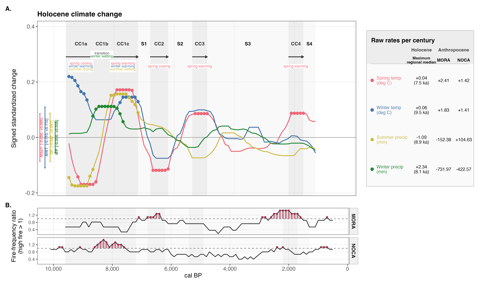
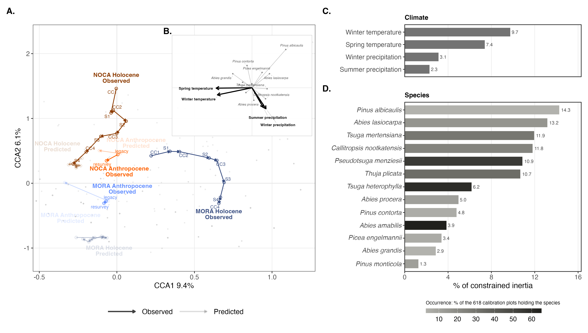
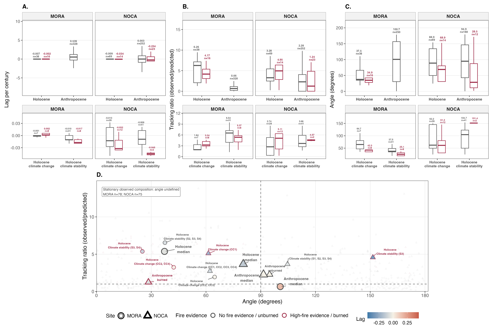

# Figure methods and captions

The conceptual framework is Figure 1. The empirical figures below follow the
order used in the manuscript. Method summaries are working text and are kept
separate from the publication-ready captions.

## Figure 2 — Holocene climate change and fire

**Method summary.** Adjacent 1,000-year changes in spring temperature, winter
temperature, summer precipitation, and winter precipitation were evaluated at
ten 100-year phases and standardized by the corresponding standard deviations
among the 618 legacy CCA calibration plots. The three MORA lake trajectories
were averaged before MORA and NOCA received equal regional weight. A variable
qualified when its absolute median regional change reached 50% of its maximum
and at least eight phases supported its direction; any qualifying variable
defined climate change. High-fire periods were classified independently from
accepted charcoal-event frequencies normalized within core and aggregated by
site, using a threshold of the site median plus `1.4826 × MAD`. Anthropocene
climate contrasts compare 1979–1989 with 2010–2019 at MORA and with 2010–2015
at NOCA, using midpoint intervals of 30.5 and 28.5 years, respectively.

[Open the publication PDF](../plot/fig_standardized_climate_change_eras_fire.pdf)

**Publication-ready caption.** Figure 2. Holocene climate-change eras and
high-fire evidence at Mount Rainier (MORA) and North Cascades (NOCA). **A.**
Signed 1,000-year changes in the four CCA climate variables, standardized by
their pooled legacy-calibration standard deviations and summarized with equal
weight for MORA and NOCA. Points mark variables meeting both the
variable-specific magnitude threshold and the eight-of-ten phase-direction
criterion. Background bands identify climate-change (CC) and climate-stability
(S) eras; arrows show the direction of time, and CC1a–CC1c annotations describe
the retained climate directions within CC1. Brackets at the older margin show
the variable-specific standardized stability ranges. The inset compares the
maximum-absolute Holocene regional median after ten-offset aggregation with
median Anthropocene plot-level rates in physical units per century. The
Anthropocene entries are annualized short-window contrasts: MORA compares
1979–1989 with 2010–2019 over 30.5 midpoint years, and NOCA compares 1979–1989
with 2010–2015 over 28.5 midpoint years. The MORA precipitation contrast should
be interpreted with the documented possible post-2010 CHELSA inhomogeneity.
**B.** Site-specific charcoal
event-frequency ratios relative to the robust high-fire threshold. The dashed
line denotes a ratio of 1; red segments and points identify dates classified as
high fire. Ages are calibrated years before present (cal BP; present = 1950).

## Figure 3 — Observed and climate-predicted CCA trajectories

**Method summary.** A common canonical correspondence analysis (CCA) was fit to
13 retained taxa and four seasonal climate constraints in 618 legacy plots.
Observed communities were represented by weighted-average (WA) scores and
climate-predicted communities by linear-combination (LC) scores in the unchanged
CCA1–CCA2, scaling-1 (`scaling = "sites"`), Hill-off geometry. Holocene positions
are MORA and NOCA centroids within each frozen CC1–S4 era; Anthropocene positions
are site means of the same 330 MORA and 275 NOCA valid paired plots at both
legacy and resurvey dates, for both WA and LC. All-zero retained-taxon rows are
excluded from both sides of these comparisons. Climate bars quantify each
constraint's unique marginal loss of constrained inertia, whereas species bars
partition constrained inertia among taxa.

[Open the publication PDF](../plot/fig_cca_trajectories.pdf)

**Publication-ready caption.** Figure 3. Observed and climate-predicted forest
community trajectories in the common CCA space. **A.** Observed WA and
climate-predicted LC trajectories for MORA and NOCA. Holocene paths connect
site-level centroids chronologically from CC1 through S4; Anthropocene arrows
connect legacy and resurvey means from identical valid pairs at both dates
(330 MORA, 275 NOCA). Predicted paths and annotations are
shown with reduced opacity. The grey points are legacy calibration plots; the
panel is cropped to the trajectories; calibration plots outside
the displayed extent remain in the model. **B.** CCA biplot showing the
four climate vectors and species scores; all taxa are plotted, while names are
shown only for species vectors at least 25% as long as the longest species
vector. **C.** Unique marginal effect of each climate constraint, expressed as a
percentage of total constrained inertia. These values are not additive because
the constraints share explanatory variation. **D.** Taxon-specific partition
of constrained inertia; shading indicates occurrence in the 618 calibration
plots.

## Figure 4 — Community tracking comparison

**Method summary.** At each endpoint, climate–community offset was the distance
between predicted LC and observed WA scores. Lag per century was the change in
this offset divided by elapsed time. Observed and predicted turnover were WA and
LC displacement rates, respectively; their ratio was
observed/predicted turnover, and their angle measured directional agreement.
Holocene nonlinear metrics were calculated for every site × age draw × offset ×
interval realization before draws were summarized within offsets and all ten
offsets were summarized on the reporting grid. Anthropocene metrics were
calculated for paired legacy–resurvey plots.

[Open the publication PDF](../plot/fig_tracking_comparison.pdf)

**Publication-ready caption.** Figure 4. Comparison of climate–community
tracking during the Holocene and Anthropocene at MORA and NOCA. **A–C.** Lag per
century, tracking ratio (observed/predicted), and angle between observed and
predicted turnover vectors. Upper panels compare Holocene site-dates with
Anthropocene plot pairs; lower panels divide Holocene site-dates between climate
change and climate stability and by high-fire evidence. Boxes have fixed
physical widths and show descriptive distributions; annotations report medians
and valid sample sizes. Neutral and red outlines distinguish no-fire/unburned
and high-fire/burned groups. The two burned MORA plot pairs are excluded from
this comparison and retained in its scope audit. **D.** Tracking ratio versus
turnover angle for all 587 direction-valid observations. Circles and triangles
identify MORA and NOCA, red outlines identify fire evidence, and fill represents
signed lag. Labelled points are macro-era, climate/fire, and NOCA burn-status
medians. Reference lines mark a tracking ratio of 1 and an angle of 90°. The 153
Anthropocene plots with stationary observed composition have undefined angles
and are reported separately in the panel.

## Figure 5 — Target-alignment discrepancies

**Method summary.** For every plot pair and Holocene age-draw × offset × interval
realization, predicted and observed movements were compared separately with 13
taxon directions and four unscaled climate biplot arrows. For each taxon, the
predicted cosine uses the vector from the initial LC position to the fixed taxon
score, whereas the observed cosine uses the vector from the initial WA position
to that score. The
target-alignment discrepancy was calculated within each unit as
`cos(predicted movement, target) - cos(observed movement, target)` before any
aggregation. Near-zero or non-finite movement or target vectors were assigned
`NA`. Holocene draws were summarized within offsets, then across all ten offsets
at each site-date, before climate-state and high-fire grouping; Anthropocene
units were grouped by site and burned status.

[Open the publication PDF](../plot/fig_cca_direction_differences.pdf)

**Publication-ready caption.** Figure 5. Differences between predicted and
observed community-change alignment with climate and taxon directions.
**A.** Median target-alignment discrepancies for the four CCA climate vectors.
**B.** Median target-alignment discrepancies for the 13 retained taxa. Columns
show Holocene climate change and climate stability with or without high-fire
evidence, followed by burned and unburned Anthropocene plots; MORA and NOCA are
shown in separate facets. Red group text identifies high-fire or burned groups.
Cell color is the median predicted-minus-observed cosine difference among valid
measurement units. For taxa, predicted and observed cosines use their own
initial LC and WA origins, respectively, toward the same fixed species score;
climate cosines use the corresponding common biplot arrow. Zero indicates equal
target-specific cosines, not agreement between the complete movement vectors.
Positive values indicate stronger predicted target alignment, including cases
where predicted movement is merely less strongly opposed to the target;
negative values indicate stronger observed target alignment. Magnitude
describes the strength of this target-specific discrepancy; it does not measure
taxon dominance, statistical significance, or causation.
