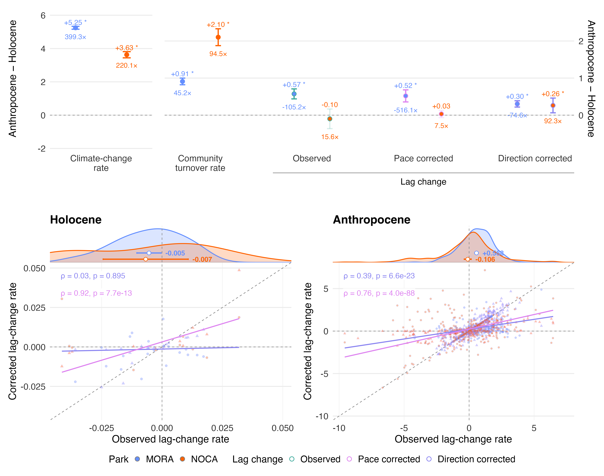

# Figure methods and captions

The conceptual framework is Figure 1. The empirical figures below follow the
order used in the manuscript. Method summaries are working text and are kept
separate from the publication-ready captions.

## Figure 2 — Holocene climate change and fire

**Method summary.** Adjacent 1,000-year changes in spring temperature, winter
temperature, summer precipitation, and winter precipitation were evaluated at
ten 100-year phases and standardized by the corresponding standard deviations
among the 607 matched legacy CCA calibration plots. The three MORA lake trajectories
were averaged before MORA and NOCA received equal regional weight. A variable
qualified when its absolute median regional change reached 50% of its maximum
and at least eight phases supported its direction; any qualifying variable
defined climate change. High-fire periods were classified independently from
accepted charcoal-event frequencies normalized within core and aggregated by
site, using a threshold of the site median plus `1.4826 × MAD`. Anthropocene
climate contrasts compare 1979–1989 with six season-years Y−5 through Y for
each plot, where Y is the selected adult resurvey year. Midpoint intervals run
from 1984 to Y−2.5: 27.5–32.5 years at MORA and 27.5–28.5 years at NOCA.

[Open the publication PDF](../plot/fig_standardized_climate_change_eras_fire.pdf)

**Publication-ready caption.** Figure 2. Holocene climate-change eras and
high-fire evidence at Mount Rainier (MORA) and North Cascades (NOCA). **A.**
Signed 1,000-year changes in the four CCA climate variables, standardized by
their pooled legacy-calibration standard deviations and summarized with equal
weight for MORA and NOCA. Points mark variables meeting both the
variable-specific magnitude threshold and the eight-of-ten phase-direction
criterion. Background bands identify climate-change (CC) and climate-stability
(S) eras; arrows show the direction of time, and CC1a–CC1c annotations describe
the retained climate directions within CC1. Brackets at the older margin show
the variable-specific standardized stability ranges. The inset compares the
maximum-absolute Holocene regional median after ten-offset aggregation with
median Anthropocene plot-level rates in physical units per century. The
Anthropocene entries are annualized short-window contrasts: MORA compares
1979–1989 with each plot’s adult-year window Y−5 through Y over
27.5–32.5 midpoint years; NOCA uses the same rule over 27.5–28.5 midpoint years. The MORA precipitation contrast should
be interpreted with the documented possible post-2010 CHELSA inhomogeneity.
**B.** Site-specific charcoal
event-frequency ratios relative to the robust high-fire threshold. The dashed
line denotes a ratio of 1; red segments and points identify dates classified as
high fire. Ages are calibrated years before present (cal BP; present = 1950).

## Figure 3 — Observed and climate-predicted CCA trajectories

**Method summary.** A common canonical correspondence analysis (CCA) was fit to
14 retained taxa and four seasonal climate constraints in 607 matched legacy plots.
Observed communities were represented by weighted-average (WA) scores and
climate-predicted communities by linear-combination (LC) scores in the unchanged
CCA1–CCA2, scaling-1 (`scaling = "sites"`), Hill-off geometry. Holocene positions
are MORA and NOCA centroids within each frozen CC1–S4 era; Anthropocene positions
are site means of the same 330 MORA and 277 NOCA valid paired plots at both
legacy and resurvey dates, for both WA and LC. MORA uses the latest adult
visit and its matching seedlings; modern climate uses Y−5 through Y for
each selected adult survey year Y. All-zero retained-taxon rows are
excluded from both sides of these comparisons. Climate bars quantify each
constraint's unique marginal loss of constrained inertia, whereas species bars
partition constrained inertia among taxa.

[Open the publication PDF](../plot/fig_cca_trajectories.pdf)

**Publication-ready caption.** Figure 3. Observed and climate-predicted forest
community trajectories in the common CCA space. **A.** Observed WA and
climate-predicted LC trajectories for MORA and NOCA. Holocene paths connect
site-level centroids chronologically from CC1 through S4; Anthropocene arrows
connect legacy and resurvey means from identical valid pairs at both dates
(330 MORA, 277 NOCA). Predicted paths and annotations are
shown with reduced opacity. The grey points are legacy calibration plots; the
panel is cropped to the trajectories; calibration plots outside
the displayed extent remain in the model. **B.** CCA biplot showing the
four climate vectors and species scores; all taxa are plotted, while names are
shown only for species vectors at least 25% as long as the longest species
vector. **C.** Unique marginal effect of each climate constraint, expressed as a
percentage of total constrained inertia. These values are not additive because
the constraints share explanatory variation. **D.** Taxon-specific partition
of constrained inertia; shading indicates occurrence in the 607 calibration
plots.

## Figure 4 — Era contrasts and corrected lag-change rates

**Method summary.** Offset-0 MA1 GLS results are reused without refitting for
physical climate-change rate, observed community turnover and observed,
pace-corrected and direction-corrected lag changes. Models use `era * site`,
REML and separate era/site residual variances. Corrected rates are calculated
within each chronology draw from stored counterfactual geometry before finite-draw
transition medians. The original 23/21-column model tables are preserved.
Contrast and group-mean intervals use Satterthwaite degrees of freedom; contrast
SEs retain covariance between fitted means. Correlations are descriptive and
nominal, without adjustment for lake/temporal dependence or mathematical coupling.

[Open the publication PDF](../plot/fig_tracking_era_distributions.pdf)

**Publication-ready caption.** Figure 4. Holocene–Anthropocene comparisons at
Mount Rainier (MORA, blue) and North Cascades (NOCA, orange). The upper row
shows Anthropocene-minus-Holocene MA(1) GLS contrasts and 95% confidence intervals
for physical climate-change rate, community turnover and observed (teal),
pace-corrected (pink) and direction-corrected (purple) lag changes. Climate uses
a separate scale; zero baselines are aligned. * denotes unadjusted contrast
p < 0.05; nonsignificant interval bars are faint. Numbers beneath intervals
are ratios of fitted Anthropocene to Holocene means, without ratio intervals.
Signed lag ratios may reflect sign reversals and become unstable near zero;
they are descriptive annotations, not multiplicative-effect inference.
Climate change is the Euclidean norm of four seasonal changes scaled by pooled
legacy-calibration SDs per climate century. Turnover is observed CCA displacement
per vegetation century. Observed lag change is the change in observed-to-predicted
CCA distance per climate century; corrected rates substitute the maintained
counterfactual final lag while preserving the actual initial lag.
The lower row plots observed against corrected lag-change rates separately for
each era, pooling parks. Small transparent points retain park fills and correction
outlines; colored straight lines are descriptive linear fits, dashed diagonals
are 1:1, and colored text gives Spearman rho and nominal two-sided p values.
Top densities show observed lag rates once per observation, with their original
MA1 fitted means and 95% intervals. Holocene values are chronology-draw medians
for actual offset-0 transitions: 20 MORA and 10 NOCA. Observed/direction modern
values comprise 330 MORA and 277 NOCA pairs; pace retains 254 and 211, respectively,
after excluding undefined stationary directions. The geometric corrections are
descriptive, not causal, and model intervals do not propagate chronology
uncertainty. Per-century units do not equalize temporal averaging across eras.
