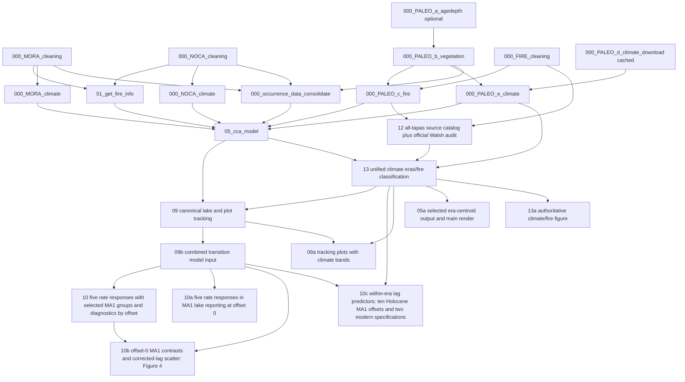

# PaleoACES workflow

This is the operational authority for executable order, dependencies, outputs,
and validation. Scientific interpretation is recorded in
[SCIENTIFIC_DECISIONS.md](SCIENTIFIC_DECISIONS.md).

The analysis entrypoint is [R/workflow.R](../R/workflow.R). Ordered analysis scripts are in `R/stages/`; shared settings and functions are in `R/helpers/`.

## Commands

```bash
# Standard ordered rebuild; network is used only for invalid climate caches
Rscript R/workflow.R

# Fully cached rebuild; never requests climate data
Rscript R/workflow.R --offline

# Analysis and review rebuild from validated native climate caches
Rscript R/workflow.R --offline --report

# Slow seeded chronology refit, then downstream rebuild
Rscript R/workflow.R --age-models

# Complete analysis without writing PDF/PNG files or running gates
Rscript R/workflow.R --offline --skip-figures --skip-tests

# Focused replacement stages
Rscript R/stages/000_FIRE_cleaning.R
Rscript R/stages/000_PALEO_c_fire.R
Rscript R/stages/05a_cca_figure.R
Rscript R/stages/09_tracking_metrics.R
Rscript R/stages/09b_tracking_model_data.R
Rscript R/stages/10_tracking_era_models.R
Rscript R/stages/10a_tracking_lake_sensitivity.R
Rscript R/stages/12_walsh_fire_reproduction.R
Rscript R/stages/12a_fire_event_detection_worked_example.R
Rscript R/stages/13_holocene_climate_fire_eras.R
Rscript R/stages/13a_climate_change_figure.R
Rscript R/stages/13b_fire_method_worked_example.R

# Focused offline gates
Rscript R/tests/test_cca_tracking_metrics.R
Rscript R/tests/test_tracking_offset_models.R
Rscript R/tests/test_review_edge_cases.R
Rscript R/tests/test_walsh_fire_reproduction.R
Rscript R/tests/test_holocene_climate_fire_eras.R
Rscript R/tests/test_cca_trajectory_figure.R
Rscript R/tests/test_figure_output_contract.R
Rscript R/tests/test_workflow_contract.R
Rscript R/render_docs.R
Rscript R/tests/test_documentation.R
git diff --check
```

`--skip-figures` suppresses persistent PDF/PNG writes only. All classifications,
model-derived tables, audits, and non-visual regression checks still run. It
does not delete or refresh existing figure files. Scripts run directly render
by default.

The publication-output contract reserves root `plot/` for three stems:
`fig_standardized_climate_change_eras_fire`, `fig_cca_trajectories` and
`fig_tracking_era_distributions`. Each has a
single-page PDF and PNG. Every other maintained figure is PDF-only under
`plot/test_figures/`; temporary rasters used while composing a PDF are not
retained.

Primary event detection requires the installed `tapas` 0.1.5 implementation.
The separate Walsh software audit requires CharAnalysis R 2.0.3; install it once
with `install.packages("CharAnalysis")`. Manifests validate versions, settings,
sources, and products. No climate download or Bacon regeneration is needed for
stages 9–14.

## Dependency diagram



## Ordered stages

| Order | Script | Status and purpose | Inputs | Outputs and validation |
|---:|---|---|---|---|
| 1a | `R/stages/000_MORA_cleaning.R` | Required modern vegetation cleaning | Original 1978 workbook, resurvey tree/seedling files, plot/species libraries | `MORA_occ.csv`, stage/plot tables and adult-visit audits; latest adult year with matching seedlings; `MORA_plot_years.csv` |
| 1b | `R/stages/000_NOCA_cleaning.R` | Required 2026 tree patch and study exclusions | Agee/JHRL data, corrected workbook, Wilson plots, Rachel notes | `NOCA_occ.csv`, stage/plot tables and audits, including excluded `CARI449`/`CARI450` GPS-collision evidence; 305 plots, 1,775 rows, 31 taxa |
| 2 | `R/stages/01_get_fire_info.R` | Required Anthropocene fire assignment | Clean plot tables, MORA disturbances, Wilson fire package/reference | MORA/NOCA fire tables and map; NOCA 305/32/273 and zero disagreement among 303 common plots |
| 3a | `R/stages/000_MORA_climate.R` | Required modern CHELSA V2.1 extraction | MORA IDs/coordinates, shared adult-year table and monthly service/cache | `MORA_climate.csv`; coordinate/variable/year/value fingerprints |
| 3b | `R/stages/000_NOCA_climate.R` | Required NOCA equivalent | NOCA IDs/coordinates, shared adult-year table and monthly service/cache | `NOCA_climate.csv`; same cache validation |
| 4 | `R/stages/000_PALEO_a_agedepth.R` | Manual/conditional seeded Bacon refit | Core controls and `R/helpers/bacon_settings.R` | Four primary models, ±10-year sensitivity, figures, manifest; about 15–30 min |
| 5 | `R/stages/000_PALEO_b_vegetation.R` | Required plant-macrofossil preparation | MORA workbook, NOCA Neotoma 52207, Bacon outputs | `paleo_occ.csv`, macrofossil long table, sample depths |
| 6a | `R/stages/000_FIRE_cleaning.R` | Required harmonized MORA `tapas` catalogs | Three MORA charcoal workbooks | `fire_walsh.csv` plus MORA tapas series/events/settings; 17 Sunrise, 14 Shadow, and 13 Little Sunrise accepted events |
| 6b | `R/stages/000_PALEO_c_fire.R` | Required harmonized NOCA `tapas` catalog and combined sample fire | Paleo vegetation, MORA catalog, NOCA Neotoma charcoal/Bacon ages | NOCA series/events/settings, `fire_noca_peaks.csv`, `paleo_fire.csv`; 12/500/99 primary with 66 peaks and 12.5-year interpolation sensitivity |
| 7a | `R/stages/000_PALEO_d_climate_download.R` | Validated native-cache aggregation; download only in online mode | Four pond coordinates and CHELSA services | `chelsa_paleo_ponds.csv`, chunks and bias anchor; atomic complete-cache validation |
| 7b | `R/stages/000_PALEO_e_climate.R` | Required seasonal derivation and age match | Cached pond climate and paleo samples | `paleo_env.csv`; complete nearest-slice match within tolerance |
| 8 | `R/stages/000_occurrence_data_consolidate.R` | Required taxonomy and occurrence consolidation | Three occurrence tables and stage data | `occ_consolidated.csv`; 13,690 rows, 22 taxa, 1,599 plots/samples |
| 9 | `R/stages/05_cca_model.R` | Required pooled calibration/projection | Consolidated occurrence, modern/paleo climate and fire | CCA reference bundle and fixed climate scaling; 20 threshold, scaling 1, 14 species, 607 matched calibration plots |
| 10c | `R/stages/12_walsh_fire_reproduction.R` | Assemble authoritative all-`tapas` source catalog and retain a separate official Walsh audit | Harmonized MORA/NOCA tapas outputs, three Walsh workbooks, CharAnalysis 2.0.3 | Authoritative four-core source series/events/settings and tapas manifest; separate official MORA series/events/FRIs/publication audit; active fire outputs hash-protected |
| 10d | `R/stages/13_holocene_climate_fire_eras.R` | Authoritative literature-blind climate-era and independent high-fire classification | Native pond climate, pooled legacy CCA scaling, stage-12 source series/events | Four-variable signed 1,000-year changes, thresholds, frozen CC/S grid/catalog, subphases, composite, normalized fire frequency/high-fire runs, and audit tables |
| 10e | `R/stages/09_tracking_metrics.R` | Canonical lake/plot tracking | Published CCA reference, cached whole draws, own-lake climate, accepted charcoal events and coverage, cleaned plot coordinates | Compact 23/21-column model tables, long uncertainty, lake/modern calculation audits, seven-response reporting and support; base schema dictionary |
| 10f | `R/stages/09b_tracking_model_data.R` | Combined transition model input | Canonical 23/21-column tables, detailed calculations, lake and cleaned plot coordinates | One 28-column long input with actual lake/offset transitions and modern pairs stored once per response; completed schema dictionary |
| 10g | `R/stages/10_tracking_era_models.R` | Maintained provisional offset GLS exploration | Combined transition input only | Observed/corrected lag rates, turnover and raw climate rate, each with ten offsets × AR1/MA1/Independent; coefficient, within-park contrast, MA1 group-mean and paired AIC comparison CSVs, one full results TXT, MA1-only group-mean/coefficient/contrast/residual PDFs and three-candidate within-offset ΔAIC boxplots when rendering; all five requested responses run by default |
| 10g-a | `R/stages/10a_tracking_lake_sensitivity.R` | Maintained offset-0 lake sensitivity | Combined transition input only | Lag rate, turnover and raw climate rate, each with four lakes × AR1/MA1; each lake versus its park's modern pairs; 16 coefficient rows, eight contrasts, one results TXT and two PDFs; MA1-only figures show eight coefficients and four contrasts; near-boundary fits retained and flagged |
| 10g-b | `R/stages/10b_tracking_manuscript_figure.R` | Manuscript Figure 4 and separate corrected contrasts; offset 0 only | Combined transition input and stage-10 MA1 group means/contrasts | Three observed contrast categories above two era scatter panels; observed marginal densities and model mean intervals; primary PDF/PNG plus corrected-contrast PDF; no refitting |
| 10g-c | `R/stages/10c_tracking_predictor_models.R` | Separate within-era predictor models | Combined transition input, native modern elevation sources and frozen CC/S catalog | Three lag responses: ten Holocene MA1 GLS offsets, offset-0 random lake intercept sensitivities, modern site-plus-burned and elevation/climate-extended independent GLS; coefficients, supported rate predictions, descriptive R², residual/spatial checks, six diagnostic PDFs and full TXT |
| 10h | `R/stages/05a_cca_figure.R` | Selected CCA trajectory data and main render | Model, positioned Holocene samples, stage-13 frozen CC/S grid | `cca_trajectory_era_centroids.csv` and, when rendering, main-paper `fig_cca_trajectories.pdf/.png` |
| 10i | `R/stages/09a_tracking_example_and_visualizations.R` | Tracking example and visualizations | Canonical lake realizations, lake-by-offset responses/predictors, reporting grid, aligned predictor medians reconstructed from source transitions, modern paired-plot model input and stage-13 frozen climate-era catalog/subphases | Three diagnostic PDFs: worked geometry and two tracking/climate/fire grids with four lake columns, established regional CC/S bands and CC1 subdivisions, complete-offset medians and an Anthropocene MORA/NOCA boxplot column |
| 10j | `R/stages/12a_fire_event_detection_worked_example.R` | Accepted-event detection for all four cores | All-`tapas` source series with local thresholds, candidate/count-screen flags, and accepted events | `fire_event_detection_lake_audit.csv` and, when rendering, a PDF with all four residual/threshold plots on one page, alongside settings and the software comparison |
| 10k | `R/stages/13a_climate_change_figure.R` | Climate/subphase/fire display data and render | Stage-13 directional cells, eras, subphases, fire frequency and thresholds; annualized Anthropocene plot-level contrasts for historical 1979–1989 and plot-specific modern Y−5 through Y (MORA 27.5–32.5 midpoint years; NOCA 27.5–28.5) | Fire-ratio and raw-rate comparison tables, including the maximum-absolute Holocene regional median after ten-offset aggregation, plus the main-paper PDF/PNG when rendering |
| 10l | `R/stages/13b_fire_method_worked_example.R` | Fire-classification arithmetic audit and illustration | Stage-12 accepted events and stage-13 core/site fire-frequency tables | `holocene_fire_method_worked_example.csv` and a PDF-only audit under `plot/test_figures/` |

The active stages are seconds to a few minutes when cached. Modern/paleo climate
downloads can take hours on a fresh cache. Bacon is the only intentionally slow
offline regeneration. The official Walsh stage takes seconds once its pinned R
package is installed.

The CCA stage prints and writes eligibility totals and exclusion reasons before
fitting or projection. `cca_sample_eligibility.csv` and `cca_pair_eligibility.csv`
retain individual decisions; `cca_eligibility_counts.csv` and
`cca_exclusion_summary.csv` are reproduced in the analysis review. All-zero
retained-taxon rows are excluded from both WA and LC comparisons. Modern
comparison endpoints and the legacy calibration share one valid matched set.
Both dates must pass eligibility before the legacy observation enters fitting.

## Shared helpers and settings

| File | Role |
|---|---|
| `R/helpers/config.R` | Species threshold 20, active climate variables, units, fire interval, cache fingerprints |
| `R/helpers/functions.R` | Occurrence/turnover helpers; only `occurrence == 1` is presence |
| `R/helpers/climate_variables.R` | Central seasonal climate derivation |
| `R/helpers/tracking_model_reporting.R` | Five requested rate responses, including pace/direction corrected lag, and units, MA1 reporting, result filtering, shared colors and plot theme |
| `R/helpers/tracking_model_data.R` | Combined 28-column assembly, era-specific missingness, coordinate identities and response-specific offset selection |
| `R/helpers/tracking_predictor_models.R` | Within-era GLS/LME fitting, supported prediction mapping, modern elevation joins, explicit descriptive R² and spatial residual checks |
| `R/helpers/tracking_metrics.R` | Focused vector geometry, guarded internal angle calculation, physical-climate rates and validity flags |
| `R/helpers/fire_detection_functions.R` | Shared all-core tapas preparation/detection, record settings, series, count-screen, and accepted-event extraction |
| `R/helpers/paleo_runs.R` | Whole-chronology draws and parameterized bin/offset assignment |
| `R/helpers/holocene_climate_fire_era_functions.R` | Complete 1,000-year climate changes, 50%-maximum classification, any-variable era union, composite magnitude, and independent fire-frequency classification |
| `R/helpers/walsh_fire_functions.R` | Separate official CharAnalysis audit and Walsh input construction; not the downstream primary detector |
| `R/helpers/figure_style.R` | Shared main-figure typography, site shapes, fire/burned red, and signed-gradient colors |
| `R/vendor/get_chelsa.R`, `R/helpers/get_chelsa_monthly.R` | Supported CHELSA clients |
| `R/helpers/bacon_settings.R`, `R/helpers/paleo_ages.R` | Bacon configuration and ages |
| `R/helpers/chronology_provenance.R` | Verified recorded path/caption substitutions for historical chronology hashes and age-draw cache dependencies; unrecorded source changes invalidate that equivalence |
| `data/holocene_period_candidates.csv` | Provisional calibrated/context evidence; never classification input |

Retired analysis scripts are preserved in Git history and are not active stages.

Required chronology source snapshots and the exact substitution record are
kept in `Cores/provenance/`. Removing old reorganization logs does not remove
the verification needed to use the existing posteriors.

## Tests and decisions

| Test | Type and execution point | Failure condition and decision supported |
|---|---|---|
| `test_check_vegetation.R` | Automatic offline gate after cleaners | Invalid occurrence, duplicate keys, unpaired periods, or broken plot/species sets; establishes paired-plot integrity |
| `test_NOCA_tree_corrections.R` | Automatic offline gate after NOCA cleaning | Wrong workbook/target/audit totals, unsupported labels, duplicate inflation, wrong 305-plot universe, any active normalized-coordinate collision, inclusion of `CARI449`/`CARI450` at either date, changed 622/1,149-m source elevations, or disappearance of the GPS-excluded audit |
| `test_NOCA_fire_assignments.R` | Automatic offline gate after modern fire | ID/count drift or any common-plot Wilson discrepancy |
| `test_paleo_split_validation.R` | Automatic offline gate after paleo fire | Vegetation/fire refactor changes intended sample/species/fire content |
| `test_bacon_provenance.R` | Automatic provenance gate | Seed/settings/control/version/posterior/age or chronology-code fingerprint drift; exact path-only relocations are accepted through verified historical source snapshots. Other whole-script differences require the explicit figure-output-only revision recorded in the manifest. |
| `test_paleo_climate_age_match.R` | Automatic offline climate gate | Missing/orphan climate, NA constraints, clamping, or >50-year nearest-slice error |
| `test_tracking_offset_models.R` | Automatic offline gate after model fits | Combined input reconstruction, singleton modern pairs, actual time gaps, AR1/MA1/independent covariance, coefficient/support integrity, paired AIC/weight reconstruction and covariance-aware group means/contrasts for all five responses; raw climate selection checks repeated copies and response-specific missingness |
| `test_tracking_predictor_models.R` | Automatic offline gate after predictor fits | Independent GLS covariance algebra, response-specific identities and exclusions, unfilled temporal support, coefficient/prediction intervals, R² reconstruction, actual lake variance uncertainty, elevation joins and deterministic spatial diagnostics |
| `test_cca_tracking_metrics.R` | Automatic offline gate after tracking | Independent geometry and counterfactual errors, incorrect lake/interval joins, fire coverage or comparable-window normalization, missing draw support, incorrect distributions, interval configuration or CCA drift |
| `test_review_edge_cases.R` | Automatic independent review gate | Known geometric values and invariances, unequal elapsed times, missing turnover classes, invalid monthly values/keys/caches, and climate/fire coverage gaps |
| `test_walsh_fire_reproduction.R` | Automatic scientific/provenance gate | Any non-tapas primary event, wrong settings/counts, lost sensitivity/catalog, modified protected outputs, stale manifest, or—when rendering—missing audit figures |
| `test_holocene_climate_fire_eras.R` | Automatic unified-era gate | Wrong scaling, threshold arithmetic, phase support, era sequence, composite, fire aggregation/threshold, audit, protected hashes, or—when rendering—missing figures |
| `test_cca_trajectory_figure.R` | Automatic trajectory data/render gate | Changed scaling/Hill/axes, incorrect CC1–S4 centroids, missing A–D labels or any of the eight independently positioned two-line path names, incorrect named anchors, unfaded predicted annotations, non-arrow legend glyphs, boxed series labels, retired duplicate artifacts, or missing main outputs |
| `test_figure_output_contract.R` | Automatic publication-output gate | Root `plot/` differs from the three approved PDF/PNG stems, diagnostic PNGs exist, a main PDF is multipage, or retired trajectory artifacts return |
| `test_workflow_contract.R` | Automatic structural gate | Producer/consumer order drifts, analysis is placed behind `--skip-figures`, a required gate disappears, or a plotting stage ignores the shared render option |
| `test_cca_scaling_comparison.R` | Offline model diagnostic | Reassesses site/scaling-1 geometry after model/species changes |
| `test_climate_change_variables.R` | Offline decision diagnostic | Reassesses units/redundancy and the four active constraints |
| `test_species_through_time.R` | Offline sensitivity | Quantifies site confounding and threshold effects |
| `test_survey_year_anomaly.R` | Cached/network sensitivity | Reassesses modern survey windows when universe or dates change |
| `test_chelsa_coverage.R`, `test_chelsa_cruts_vs_present.R`, `test_trace21k_vs_v21.R` | Optional network diagnostics | Product coverage and cross-product bias decisions |
| `test_paleo_surface_years.R`, `test_paleo_anthro_climate_match.R` | Offline unresolved sensitivities | Surface coverage and product/geography bias; raw TraCE21k remains current without closing the question |
| `test_documentation.R` | Automatic final gate | Broken links/inline paths, stale HTML/source hashes, missing maintained documents, archived-plan references in active comments, or obsolete terminology |

## Documentation index

| Document | Purpose |
|---|---|
| [README](../README.md) | Project landing page and principal outputs |
| [Scientific decisions](SCIENTIFIC_DECISIONS.md) | Current rationale, results, caveats, and unresolved sensitivities |
| [Tracking definitions](SCIENTIFIC_DECISIONS.md#lake-tracking-metrics) | Canonical formulas, signs, units and support conventions |
| [Tracking validation](review/TRACKING_DATA_VALIDATION.md) | Current schemas, support, migration checks and modeling limits |
| [Holocene evidence summary](references/Holocene_period_choices_MORA_NOCA_summary.pdf) | Literature/context source review retained outside the classification stage |
| [Bacon controls](../Cores/CONTROL_POINTS.md) | Age controls and chronology interpretation |
| [MORA core sources](../Cores/SOURCES_MORA.md) | MORA chronology provenance |
| [NOCA paleo sources](../data/NOCA/NOCA_paleo/SOURCES.md) | Panther Potholes vegetation/fire provenance |
| [Survey-year sources](../data/SOURCES_SURVEY_YEARS.md) | Modern survey and climate-window provenance |
| [NOCA cleaning guide](methods/000_NOCA_cleaning_guide.md) | Tree patch, exclusions, and outputs |
| [Occurrence consolidation](methods/README_occurrence_consolidation.md) | Taxonomy and retention decisions |
| [MORA raw-data reference](../data/MORA/README_data_raw.md) | Reference-only upstream package description |
| [MORA output reference](../data/README_outputs_MORA_AT.md) | Reference-only upstream outputs |

Run `Rscript R/render_docs.R` after changing any maintained Markdown. Each HTML
companion embeds the Markdown source hash and uses HTML-adjusted local links.

## Review reporting

`--report` refreshes the plot/sample selection diagram, scaling, species occupancy, climate-variable and survey-window diagnostics in separate environments, exports summaries from the current fitted CCA, redraws chronology figures from validated stored posteriors without executing control generation or MCMC, runs all gates, and rebuilds the [review](ANALYSIS_REVIEW.md). Offline report runs reaggregate modern and paleo climate from validated native chunks. Missing or invalid chunks fail before download or removal. Ordinary `--offline` retains the existing aggregate-based behavior.

`--report` cannot be combined with `--skip-figures` or `--skip-tests`. Derived report previews and tables are rebuilt in a staging directory; the previous published report remains available if generation or validation fails. Main PNGs are copied from their current producers, selected diagnostic PDF pages are rasterized into documentation assets, and the original diagnostic output remains PDF-only. Report rebuilding requires Python 3, Poppler (`pdfinfo`, `pdftoppm`), R `digest`, `magick`, and the existing analysis/documentation packages.

`Rscript R/render_analysis_review.R --snapshot` builds a clearly labeled snapshot from verified existing outputs, without claiming a fresh analysis run. A fresh report is produced by the workflow command above. [Report template](report/analysis_review_template.md), [repository inventory](REPOSITORY_INVENTORY.md), [outputs](OUTPUTS.md), and [documentation index](INDEX.md) describe the review and its provenance.

## Report verification records

The [artifact ledger](assets/analysis/artifacts.csv) records report inputs,
producing scripts, selected PDF pages and output hashes. The
[input](assets/analysis/inputs.csv), [source](assets/analysis/sources.csv) and
[result](assets/analysis/results.csv) records and [build metadata](assets/analysis/build.json)
keep these checks available separately from the scientific narrative.

Reusable independent checks and portable-report validation remain under
`tools/`; failure tests that alter inputs run only in an isolated copy.

Modern climate aggregates are rebuilt from validated native chunks even in offline
mode. `output/modern_plot_years.csv` is produced after both cleaners; it supplies
adult Y, six-year modern windows Y−5 through Y, and per-plot vegetation/climate
elapsed times. A changed date input requires cleaning again before projections.
The MORA record and visit audits preserve the assignment and selection evidence.

## Canonical tracking rebuild

After `05_cca_model.R` publishes the calibration reference, run stage 12, then
stage 13, then `09_tracking_metrics.R`. The stage is cache-only for chronology
and does not refit the CCA. Default outputs and schema definitions are in
[OUTPUTS.md](OUTPUTS.md#canonical-tracking-schemas).

```bash
Rscript R/stages/09_tracking_metrics.R
# Later sensitivity experiment; primary products stay untouched
Rscript R/stages/09_tracking_metrics.R --bin-width-years=500
```

The separate 500-year wrapper, old tracking visualization/target-direction
pipelines and their Figures 4/5 are retired through Git history. The shared
metric implementation supports other widths without retaining those analyses.
`tracking_data.R` handles lake joins, comparable fire windows, compact contracts,
long uncertainty, draw support and response-specific complete-offset reporting;
`cca_reference.R` exports the existing fit and prepared endpoints.

Stage 09 validates the 273 Holocene transition keys, 607 plot-pair keys and 3,822
uncertainty rows before replacing primary exports. Changed keys or exclusions
stop execution with diagnostics. Plot-endpoint and seasonal-climate consumers
read `cca_tracking_anthropocene_plot_calculations.csv`. Stage 09b assembles the
combined model input from the compact source tables; stage 10 reads only that
combined CSV. Stages 10/10a run observed/corrected lag rates, turnover and raw
physical climate-change rate by default. The climate response is selected from the fixed
physical-rate field once per observation, independently of tracking validity;
its repeated nine-response copies are checked for consistency and reduced
without changing the combined CSV schema.
Each response uses the same maintained code and distinct output paths.
The offset exploration runs every offset separately
with AR1, MA1 and independent residuals while retaining all finite selected
responses. Each offset uses identical observations, fixed effects and era/site
variances across its three covariance candidates. The comparison CSV exports
AIC, within-offset ΔAIC and relative Akaike weights; the paired boxplots
summarize sensitivity across offsets. The author selected MA1 for reporting
on 2026-10-09; the AIC comparison remains available. Coefficient, contrast
and residual figures show only MA1, using a common plot theme. The group-mean
figure aligns both parks in three rows: Holocene means across offsets, one
Anthropocene mean per park with its offset-0 interval, and all offset-specific
differences. Mean and contrast intervals use Satterthwaite degrees
of freedom and the fitted covariance. Modern pairs
are reused across offset fits. Stage 10a follows with the agreed offset-0
individual-lake sensitivity; its figures show MA1 only with modern plots from each
lake's own park. Its files live under `output/exploratory/tracking_lake_sensitivity/`.
Reflection Pond and Panther Potholes MA1 fits approach the parameter boundary;
tables and figures retain and flag them. The earlier group-mean preview is replaced by the maintained ten-offset MA1
figure. MA(2) stays outside the workflow. Turnover’s AIC comparison favors
independent residuals at every offset, with MA1 within two AIC units; the
requested Gaussian/MA1 turnover exercise remains exploratory. MA1 is selected for reporting. Final distribution, lake effects
and chronology uncertainty treatment remain decisions for model development.

Stage 09b extends the combined input to nine response names, retaining 28
columns and the original canonical table contracts. Corrected lag-change rates
are calculated from stored endpoints within each chronology draw before medians.
Stages 10/10a run all five requested rate models and their diagnostics by default,
reporting MA1. The pace response alone excludes 142 stationary modern pairs.
Stage 10b shows three offset-0 contrast categories in Figure 4's first row:
standardized climate change per century, community turnover rate and observed
lag change. Climate and community/lag have distinct scales with aligned zeros.
The pace- and direction-corrected contrasts are written to a separate PDF and
embedded alongside Figure 4 in the Analysis Review. Both figures use larger
fonts and CCA distance-per-century labels where appropriate. Figure 4's second
row shows observed-versus-corrected lag scatter panels by era, and observed-rate
top densities with original GLS means/95% intervals. No overall title, caption
or count subtitles are rendered. The corrected comparisons retain MORA/NOCA
identity and the existing descriptive counterfactual geometry. No refitting
occurs in the figure stage. Calibration, chronology and Figure 2/3 are preserved.

```bash
# Primary combined input and all ten provisional offset/covariance fits
Rscript R/stages/09b_tracking_model_data.R
Rscript R/stages/10_tracking_era_models.R
# Offset-0 lake sensitivity (also called by the full workflow)
Rscript R/stages/10a_tracking_lake_sensitivity.R
# Manuscript contrasts and corrected-lag scatter; offset 0 only
Rscript R/stages/10b_tracking_manuscript_figure.R
# Later exploration of another response, still running each offset separately
Rscript R/stages/10_tracking_era_models.R --metric=observed_turnover_rate
# Same untransformed model exercise for physical climate-change rate
Rscript R/stages/10_tracking_era_models.R --metric=standardized_climate_change_rate
Rscript R/stages/10a_tracking_lake_sensitivity.R --metric=standardized_climate_change_rate
```

The previous reporting-grid comparison CSV and diagnostic model runner/results
are retired. Canonical source, uncertainty and calculation tables remain.
The model stage honors `--skip-figures`: coefficients and TXT still refresh,
while persistent coefficient/residual PDF writes are suppressed.

## Within-era predictor models

Stage [10c_tracking_predictor_models.R](../R/stages/10c_tracking_predictor_models.R)
runs after the combined transition producer. It fits observed, pace-corrected
and direction-corrected lag-change rates separately. Holocene models use
`site + climate_rate + fire_activity`, MA(1) within each lake, site residual
variances and REML, once at every configured offset. Each response has one
offset-0 random lake-intercept sensitivity on identical input rows.
Modern models use independent residuals and site residual variances with
`site + burned` and `site + elevation + climate_rate + burned`. Elevation joins
preserve the 607 paired identities; undefined pace correction excludes only
that response. The main figures and earlier era models are not rerun by this stage.

```sh
Rscript R/stages/10c_tracking_predictor_models.R
Rscript R/tests/test_tracking_predictor_models.R
```

Results reside in `output/exploratory/tracking_predictor_models/`, with one
coefficient CSV, performance CSV and full results TXT for all specifications.
The local fit bundle supports independent checks. Six PDFs show offset coefficients alongside R², combined offset-0/modern coefficients, supported temporal
predictions with CC/S backgrounds, descriptive R², normalized residuals and
modern residual maps. Spatial Moran checks retain the initially independent
modern specification and identify remaining spatial pattern for later review.

A 100-year prediction date repeats its supported transition's fitted rate on
`[age_lo, age_hi)`; no gaps are filled and offsets are never averaged for fits
or trajectories. R² means unweighted in-sample `1 - SSE/SST`, including negative
values. It is not a model significance test or independent predictive validation.
A manual nondefault `--bin-width-years=N` run requires the separately suffixed
combined input and writes suffixed results and PDFs; only 1,000 years runs by default.
