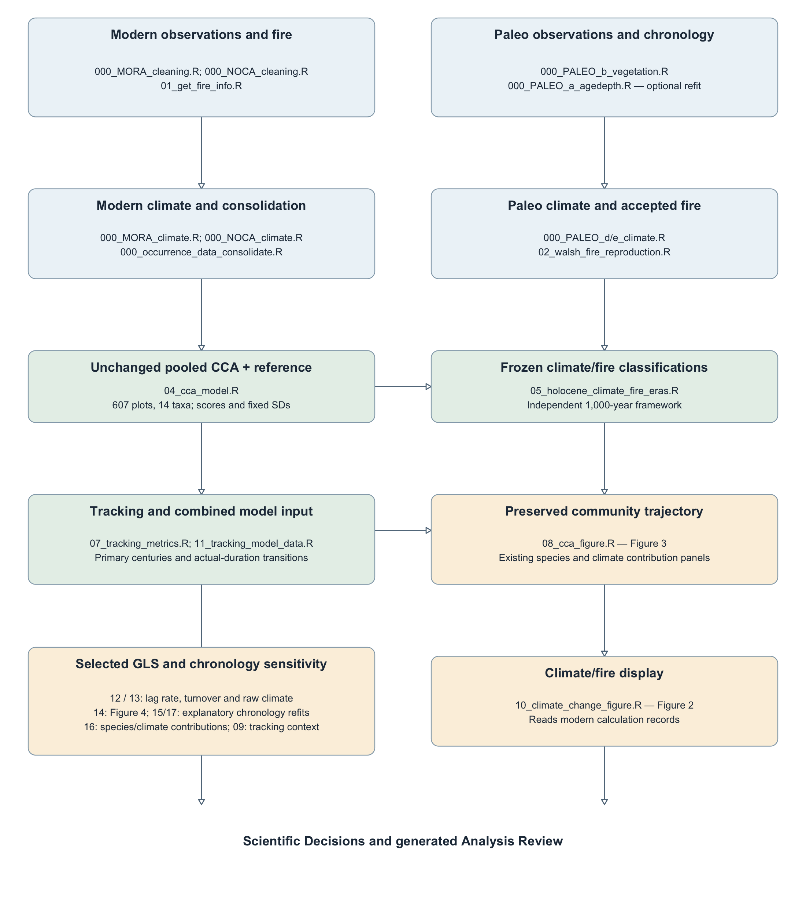

# Analysis workflow

The active ecological analysis uses primary original-sample posterior median ages on
native CHELSA 100-year cells. The separate descriptive climate/fire-period analysis
retains its established 1,000-year method. See [the documentation index](INDEX.md),
[scientific decisions](SCIENTIFIC_DECISIONS.md) and [output interfaces](OUTPUTS.md).

## Commands

```sh
Rscript R/workflow.R --offline
Rscript R/workflow.R --offline --report
Rscript R/workflow.R --offline --skip-figures
```

Offline execution requires the existing fixed CCA, stored Bacon posteriors and validated
native climate caches. Standard reconstruction never runs MCMC or recalibrates the CCA.
`--age-models` is a separate explicit chronology-refit option and is not used for this migration.
`--skip-figures` suppresses persistent graphics only; it does not omit calculations or models.
`--report` requires all checks and figures. No ecological interval-width or phase option remains.

## Dependency diagram



Original sample metadata and whole chronologies → fixed sample WA projections → native
century centroids → consecutive occupied-century transitions → corresponding endpoint
climate and full-duration fire exposure → primary tracking/contributions → ecological models.
The unchanged descriptive CC/S catalog supplies context and Figure 3 period boundaries;
it does not define the vegetation reconstruction.

## Ordered stages

Preparation remains numbered `000`. Numbered analysis stages follow execution dependencies:

1. Modern fire information.
2. Walsh fire reproduction and accepted-event catalogs.
3. Fire-event detection example.
4. Fixed CCA validation and projection records.
5. Unchanged descriptive Holocene climate/fire-period classification.
6. Descriptive fire-method example.
7. Canonical primary century reconstruction and tracking calculations.
8. CCA Figure 3, including equal-lake primary period centroids.
9. Tracking example and actual-transition visualizations.
10. Unchanged standardized climate/fire Figure 2.
11. Combined primary transition/plot × response model input.
12. Combined-era covariance comparison, selected fits, means and contrasts.
13. Primary individual-lake comparisons.
14. Manuscript Figure 4 and separate corrected-lag contrasts.
15. Primary community explanatory models and 1,000-chronology sensitivity.
16. Fixed-CCA species and seasonal climate contributions.
17. Species explanatory models and 1,000-chronology sensitivity.

The [generated reading script](review/00_main_analysis_review.R) contains current stage
bodies in this order. It is a review copy, not an executable substitute for the driver.

## Shared helpers and settings

`century_tracking.R` defines primary/draw reconstruction using original sample projections,
lake-specific native climate and coherently dated NOCA fire. `tracking_metrics.R` preserves
geometry and rate definitions. `reconstruction_models.R` supplies shared GLS fitting,
selection, conditional intervals, descriptive R² and resumable sensitivity. Contribution
vectors and conservation checks live in `cca_transition_contributions.R`.

Primary ages are unrounded medians over all stored posterior rows. Sensitivity uses
1,000 reproducibly sampled whole rows per core. No occupancy or joint-support cutoff applies.
MA1 uses the complete transition sequence before exclusions; CAR1 uses actual midpoints.
MA(1) remains primary for all models containing Holocene observations. Compare Independent
and CAR1 on identical rows and fixed effects, reporting their AIC results as diagnostics only.
Sensitivity retains the primary selected family and reestimates parameters; it does not select
another family or change the observations to rescue a failed fit.

## Tests and decisions

Automatic offline checks cover original identities, complete chronology ages, native boundaries,
WA-before-centroid averaging, actual-duration geometry, corresponding climate, fire coverage/counts,
species conservation, model rows/selection and sensitivity denominators. Modern cleaning,
fire assignments, chronology provenance, descriptive climate/fire methods, Figure 3, report
integrity and documentation remain independently checked.

Primary counts follow the reconstruction rather than historical expectations. Modern pairs
remain 607. Constant/rank-deficient species models and optimizer/covariance failures are recorded.
Descriptive R² equals 1 − SSE/SST; it is not a GLS residual-variance decomposition or significance test.

## Review reporting and verification

The report registry records producers, scientific tables and PDFs. The builder stages assets,
embeds PNG previews into the HTML, validates links and hashes, and publishes both formats together.
Protected calibration, modern calculation and descriptive figures can remain byte-identical;
their preservation is separately audited rather than inferred from modification times.

Primary results and conditional confidence intervals remain distinct from chronology-reconstruction
sensitivity quantiles and sign/support proportions. Every requested draw receives a fit-status
record, with valid denominators. Combined-era models, lake comparisons and random-intercept
sensitivities run only for the primary reconstruction. Standalone modern models run once.

See the [figure migration manifest](review/TRACKING_FIGURE_MIGRATION.csv) and
[tracking validation](review/TRACKING_DATA_VALIDATION.md).

## Result organization

Primary models are under `output/tracking_analysis/primary/`; chronology sensitivity is
under `output/tracking_analysis/sensitivity/bacon_chronologies/`; individual-lake and
random-intercept checks are under `output/tracking_analysis/sensitivity/lake_checks/`.
Model PDFs mirror those roles under `plot/test_figures/primary_models/` and
`plot/test_figures/sensitivity/`. Repeated metric figures are consolidated into multipage
PDFs by purpose, with the response named on each page.
