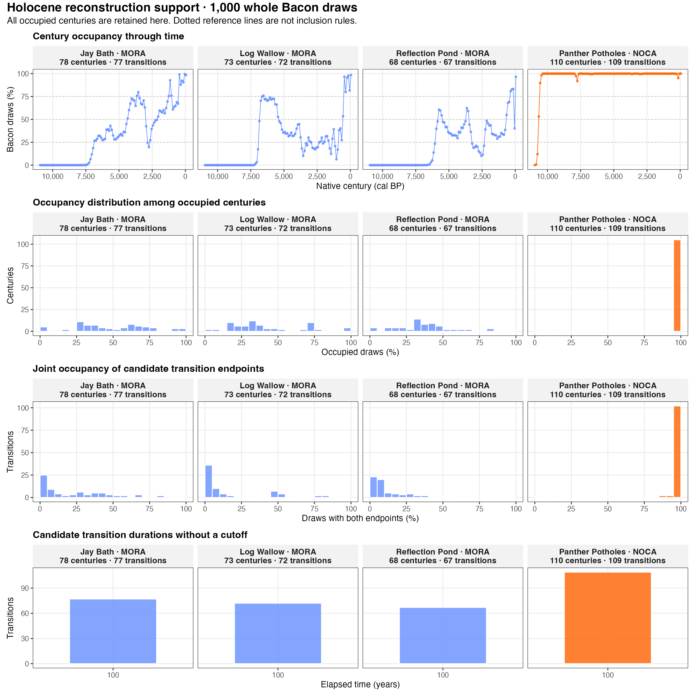
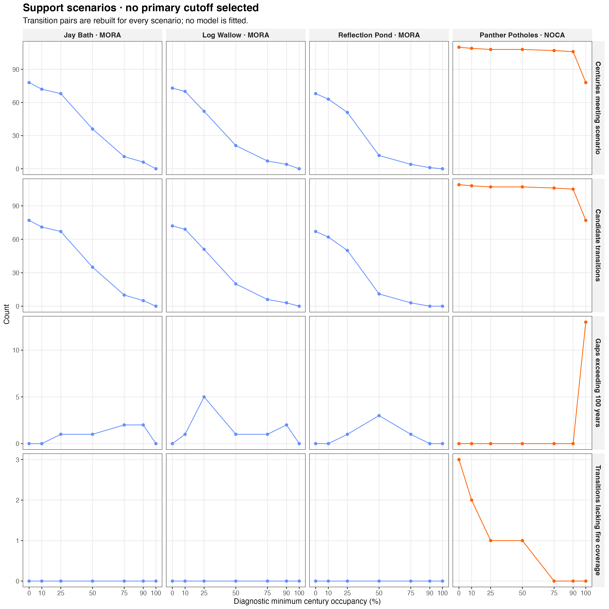

# Holocene century reconstruction: support audit

**Decision pending.** This is a diagnostic reconstruction, not a replacement model input. 
No occupancy or joint-support inclusion cutoff has been applied to a primary analysis.

Run: `Rscript R/stages/08_tracking_metrics.R --reconstruction-audit`.

## Reconstruction

Original macrofossil samples are identified by core depth (MORA) or Neotoma sample ID (NOCA). 
Taxonomic categories are harmonized within each original sample; samples sharing a median age remain separate. 
The fixed 607-plot, 14-taxon CCA projects sample WA positions before averaging. 
The audit uses 1,000 complete chronology rows per core from the existing stored Bacon posteriors, without MCMC or sampling with replacement. 
Bacon evaluates temporary core copies; the source posteriors and configurations are unchanged.

Samples are assigned to each lake's native CHELSA intervals `[lower, upper)`. 
Centroids average sample WA positions within each draw and century. Reconstructed coordinates are medians of the centroids across occupied draws. 
Occupancy is the number of draws containing at least one eligible sample, divided by 1,000. 
Empty centuries have zero occupancy and undefined coordinates. Coordinate quantiles are conditional on occupied draws, not model confidence intervals.

The calculation excerpt below is taken directly from the maintained helper:

```r
  centroids = assignments |> dplyr::filter(!is.na(century_cal_bp)) |>
    dplyr::group_by(site, lake, draw, century_cal_bp) |>
    dplyr::summarise(observed_CCA1 = mean(observed_CCA1), observed_CCA2 = mean(observed_CCA2),
      n_samples = dplyr::n(), .groups = 'drop')
  positions = centroids |> dplyr::group_by(site, lake, century_cal_bp) |>
    # Quantiles precede names that replace source coordinates in summarise().
    dplyr::summarise(CCA1_q025 = quantile(observed_CCA1, .025, names = FALSE),
      CCA1_q975 = quantile(observed_CCA1, .975, names = FALSE),
      CCA2_q025 = quantile(observed_CCA2, .025, names = FALSE),
      CCA2_q975 = quantile(observed_CCA2, .975, names = FALSE),
      observed_CCA1 = median(observed_CCA1), observed_CCA2 = median(observed_CCA2),
      n_occupied_draws = dplyr::n_distinct(draw), n_draws_nmin2 = sum(n_samples >= 2),
      n_samples_median = median(n_samples), .groups = 'drop')
```

## Original sample identities

| lake | n_original_samples | n_eligible_samples | n_historical_ids | n_restored_sample_identities |
| --- | --- | --- | --- | --- |
| JayBath | 48 | 48 | 48 | 0 |
| LogWallow | 40 | 40 | 40 | 0 |
| ReflectionPond | 31 | 31 | 29 | 2 |
| PantherPotholes | 870 | 812 | 846 | 24 |

## Occupancy distributions

| lake | empty_native_centuries | occupancy_q025_pct | occupancy_median_pct | occupancy_q975_pct |
| --- | --- | --- | --- | --- |
| JayBath | 33 | 0.100 | 45.75 | 98.453 |
| LogWallow | 38 | 5.780 | 34.30 | 96.920 |
| ReflectionPond | 43 | 0.670 | 35.30 | 82.997 |
| PantherPotholes | 1 | 79.635 | 100.00 | 100.000 |

Occupancy quantiles here describe occupied centuries only; empty native centuries are counted separately.

## Reconstruction without a cutoff

| lake | occupied_centuries | candidate_transitions | gaps_over_100yr | joint_support_median | zero_joint_support | missing_fire |
| --- | --- | --- | --- | --- | --- | --- |
| JayBath | 78 | 77 | 0 | 0.167 | 4 | 0 |
| LogWallow | 73 | 72 | 0 | 0.050 | 13 | 0 |
| ReflectionPond | 68 | 67 | 0 | 0.066 | 0 | 0 |
| PantherPotholes | 110 | 109 | 0 | 1.000 | 0 | 3 |

Candidate transitions connect successive occupied centuries in older-to-younger order. 
Joint support counts draws in which both exact endpoints contain samples. Zero joint support cannot supply a species contribution, even though independently reconstructed endpoint medians exist. 
Low support does not mean the samples were observed independently every century. 
No vegetation interpolation, extrapolation, equal-lake coverage requirement or ecological bin offset is used.

## Diagnostic support scenarios

| lake | scenario_threshold | n_scenario_centuries | n_candidate_transitions | n_gaps_over_100yr | duration_max | joint_support_median | n_joint_support_zero | n_fire_missing_transitions |
| --- | --- | --- | --- | --- | --- | --- | --- | --- |
| JayBath | 0.00 | 78 | 77 | 0 | 100 | 0.167 | 4 | 0 |
| JayBath | 0.10 | 72 | 71 | 0 | 100 | 0.248 | 0 | 0 |
| JayBath | 0.25 | 68 | 67 | 1 | 300 | 0.261 | 0 | 0 |
| JayBath | 0.50 | 36 | 35 | 1 | 1000 | 0.443 | 0 | 0 |
| JayBath | 0.75 | 11 | 10 | 2 | 2300 | 0.778 | 0 | 0 |
| JayBath | 0.90 | 6 | 5 | 2 | 700 | 0.915 | 0 | 0 |
| JayBath | 1.00 | 0 | 0 | 0 | NA | NA | 0 | 0 |
| LogWallow | 0.00 | 73 | 72 | 0 | 100 | 0.050 | 13 | 0 |
| LogWallow | 0.10 | 70 | 69 | 1 | 200 | 0.054 | 13 | 0 |
| LogWallow | 0.25 | 52 | 51 | 5 | 800 | 0.120 | 4 | 0 |
| LogWallow | 0.50 | 21 | 20 | 1 | 4900 | 0.501 | 0 | 0 |
| LogWallow | 0.75 | 7 | 6 | 1 | 6100 | 0.793 | 0 | 0 |
| LogWallow | 0.90 | 4 | 3 | 2 | 200 | 0.936 | 0 | 0 |
| LogWallow | 1.00 | 0 | 0 | 0 | NA | NA | 0 | 0 |
| ReflectionPond | 0.00 | 68 | 67 | 0 | 100 | 0.066 | 0 | 0 |
| ReflectionPond | 0.10 | 63 | 62 | 0 | 100 | 0.071 | 0 | 0 |
| ReflectionPond | 0.25 | 51 | 50 | 1 | 1100 | 0.106 | 0 | 0 |
| ReflectionPond | 0.50 | 12 | 11 | 3 | 2900 | 0.346 | 0 | 0 |
| ReflectionPond | 0.75 | 4 | 3 | 1 | 200 | 0.661 | 0 | 0 |
| ReflectionPond | 0.90 | 1 | 0 | 0 | NA | NA | 0 | 0 |
| ReflectionPond | 1.00 | 0 | 0 | 0 | NA | NA | 0 | 0 |
| PantherPotholes | 0.00 | 110 | 109 | 0 | 100 | 1.000 | 0 | 3 |
| PantherPotholes | 0.10 | 109 | 108 | 0 | 100 | 1.000 | 0 | 2 |
| PantherPotholes | 0.25 | 108 | 107 | 0 | 100 | 1.000 | 0 | 1 |
| PantherPotholes | 0.50 | 108 | 107 | 0 | 100 | 1.000 | 0 | 1 |
| PantherPotholes | 0.75 | 107 | 106 | 0 | 100 | 1.000 | 0 | 0 |
| PantherPotholes | 0.90 | 106 | 105 | 0 | 100 | 1.000 | 0 | 0 |
| PantherPotholes | 1.00 | 78 | 77 | 13 | 600 | 1.000 | 0 | 0 |

These scenarios do not select a cutoff. Each scenario reconstructs its own endpoint pairs; 
a transition joining two retained centuries can span unoccupied centuries or occupied centuries skipped by that scenario. 
Those two causes are counted separately. Empty scenarios contain zero counts and unavailable distribution statistics.

A stronger occupancy cutoff can also create long bridges by excluding occupied intermediate centuries. 
Inspect `duration_max` alongside the support distributions before choosing a rule; no maximum-gap exclusion is imposed here.

## Fire coverage

Fire activity counts accepted events over the entire `[age_lo, age_hi)` transition. 
A fully covered core contributes `event_count * 100 / duration_years` events per century. 
MORA requires at least two fully covered regional cores and averages them equally; NOCA requires Panther Potholes coverage. 
The unit is events per century per eligible core. Covered zero-event windows are zero; missing coverage is NA. 
The three MORA vegetation lakes share the regional charcoal history. Counts of distinct shared exposures are exported separately. 
This audit does not change the normalized 1,000-year fire predictor or CC/S descriptive classification.

## Figures





[Two-page PDF](../../plot/test_figures/fig_holocene_reconstruction_support.pdf)

## Files and validation

Tables and the independent audit draw cache: `output/reconstruction_audit/`.

- `original_samples.csv`: original identities, eligibility, WA, depths and historical-ID lookup.
- `century_draws.csv`: occupied draw/century centroids and sample counts.
- `century_positions.csv`: every native century, coordinates, occupancy and conditional quantiles.
- `occupancy_summary.csv`: per-lake occupancy distributions and empty-century counts.
- `joint_occupancy_by_transition.csv`: no-cutoff endpoint pairs and joint support.
- `all_transition_scenarios.csv` and `scenario_support.csv`: candidate pairs and scenario summaries.
- `fire_core_exposure.csv`, `fire_interval_exposure.csv`, `shared_fire_support.csv`: event counts, frequencies, coverage and distinct shared exposures.
- `posterior_rows.csv`, `depth_evaluation.csv`, `age_draws.rds`: exact whole-row chronology provenance.
- `sample_draw_exclusions.csv`: eligible sample draws outside the native climate grid.
- `preservation.csv`, `validation.csv`, `schema.csv`, `provenance.rds`: preservation and checks.

| check | passed |
| --- | --- |
| fixed_CCA_sample_WA_identity | TRUE |
| historical_retained_occurrences | TRUE |
| complete_original_sample_draws | TRUE |
| unique_centroid_keys | TRUE |
| bounded_occupancy_counts | TRUE |
| bounded_joint_counts | TRUE |
| positive_native_duration | TRUE |
| zero_fire_missingness_distinction | TRUE |

## Required decisions before primary production

Choose century occupancy and species joint occupancy separately after inspecting these distributions. 
Both policy values remain unset in `R/helpers/holocene_reconstruction_settings.R`; the primary century mode refuses to proceed. 
The subsequent migration includes species GLS models in stage 17: Holocene `site + climate_rate + fire_activity`; Anthropocene `site + burned` only. 
The current 1,000-year model inputs, fitted models, manuscript figures and full Analysis Review have not been replaced.

