<!-- Generated by R/build_report.R from report/README.Rmd. Edit the .Rmd, not this file. -->

# Forest tree communities

## Legacy surveys and resurveys

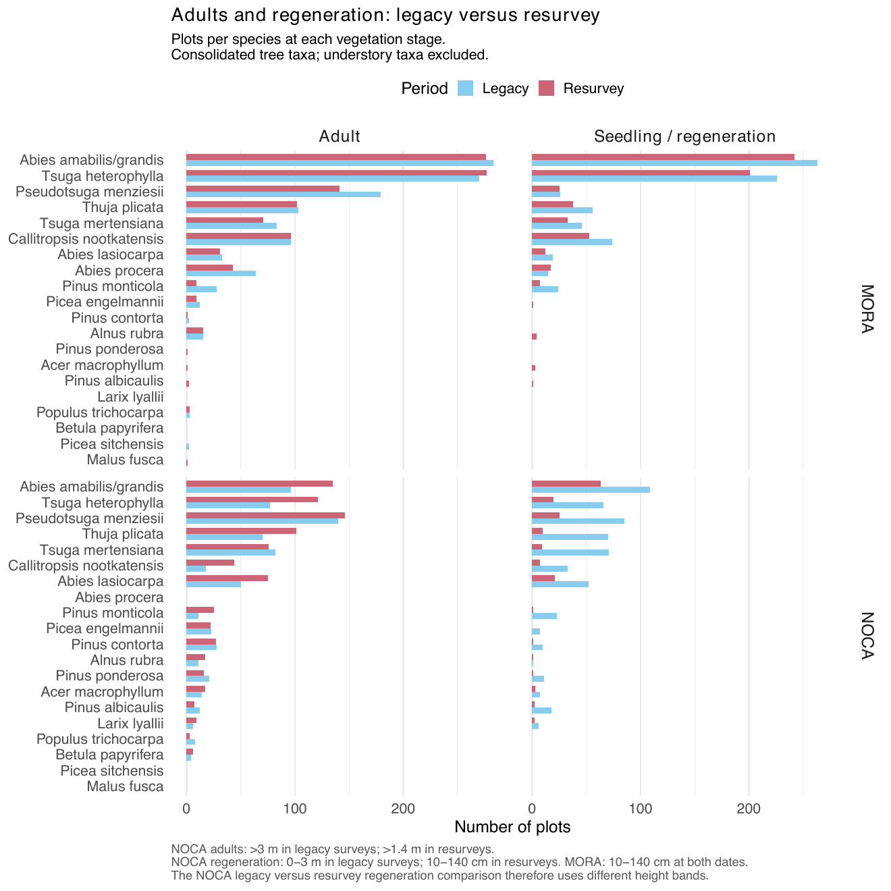

**Fig. S1. Occurrence of tree species as adult trees and as seedlings in
the legacy surveys and the resurveys.** Number of plots in which each
species was recorded as an adult tree or as a seedling at Mount Rainier
(MORA) and North Cascades (NOCA), after taxonomic harmonization and
exclusion of understory taxa, but before the selection of species for
the CCA. A species could be recorded in both stages in the same plot. At
MORA, seedlings were individuals of 10–140 cm height in both surveys. At
NOCA, however, the legacy surveys recorded individuals of 0–3 m height
as regeneration and taller individuals as adults, whereas the resurveys
recorded seedlings of 10–140 cm and adults taller than 1.4 m.
Differences between the two stages at NOCA should therefore be
interpreted with caution, because the size classes differed between the
surveys.

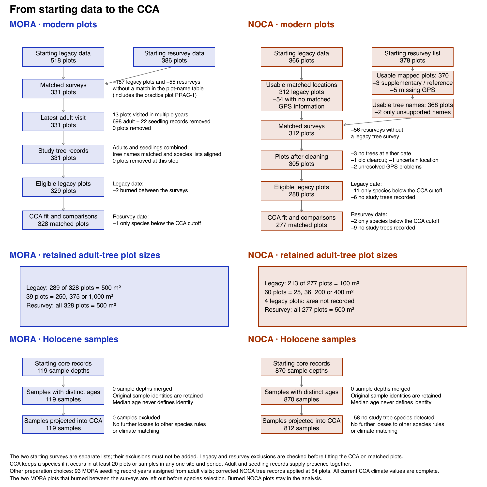

**Fig. S2. Selection of forest plots and macrofossil samples for the
canonical correspondence analysis (CCA).** Flowchart of the matching,
cleaning, and selection of the plot pairs (legacy survey and resurvey;
upper panels) and of the Holocene macrofossil samples (lower panels) at
Mount Rainier (MORA, blue) and North Cascades (NOCA, dark red). The plot
pairs that remained were used both to fit the CCA (with the legacy
surveys) and to quantify community change in the Anthropocene, whereas
the Holocene samples were projected into the fitted climate–community
space. Plots without any of the retained tree species at one of the two
surveys were excluded, because they have no observed position in this
space. Sample sizes and reasons for exclusion are given at each step.
The middle panels give the plot sizes of the retained plot pairs in each
park: the adult-tree plot area of the legacy survey and of the resurvey.

**Legacy plot size at NOCA.** Both parks were resurveyed with 500-m²
plots, whereas the legacy plots at NOCA ranged from 25 to 400 m². To
test whether the smaller legacy plots missed species, which would be
counted as community turnover at the resurvey, we compared species
richness, turnover rate, lag, and lag rate among the legacy plot sizes
at NOCA (Table S1).

**Table S1. Plot pairs at NOCA by legacy plot size.** Richness is the
mean number of the 13 tree species of the analysis that were present in
a plot. Turnover rate, lag, and lag rate are means with 95% confidence
intervals (t-intervals, no model): the turnover rate and the lag rate in
CCA distance per century, and the lag in CCA distance. The single 36-m²
plot has no interval.

| Legacy area (m²) | Plots | Richness, legacy | Richness, resurvey | Turnover rate | Lag | Lag rate |
|:---|---:|:---|:---|:---|:---|:---|
| 25 | 37 | 2.89 | 3.05 | 1.741 (1.082 to 2.400) | -0.134 (-0.370 to 0.103) | -0.470 (-1.302 to 0.362) |
| 36 | 1 | 2.00 | 3.00 | 1.728 | -0.498 | -1.812 |
| 100 | 213 | 2.81 | 2.86 | 2.077 (1.834 to 2.321) | -0.041 (-0.119 to 0.038) | -0.140 (-0.416 to 0.136) |
| 200 | 2 | 4.00 | 1.50 | 2.529 (-29.602 to 34.660) | 0.884 (-9.509 to 11.278) | 3.102 (-33.366 to 39.571) |
| 400 | 20 | 2.10 | 2.15 | 2.604 (1.169 to 4.040) | 0.017 (-0.491 to 0.526) | 0.064 (-1.722 to 1.849) |
| not recorded | 4 | 1.50 | 2.00 | 1.657 (-1.614 to 4.928) | 0.325 (-0.185 to 0.834) | 1.171 (-0.675 to 3.016) |
| all NOCA plot pairs | 277 | 2.75 | 2.82 | 2.066 (1.836 to 2.296) | -0.039 (-0.115 to 0.038) | -0.133 (-0.403 to 0.137) |

The smallest legacy plots did not hold fewer species than the larger
ones (2.89 species per 25-m² plot against 2.81 per 100-m² plot), and
their turnover rate was not higher (1.74 against 2.08 CCA distance per
century). The confidence intervals of the three most common plot sizes
overlapped for all quantities. The Anthropocene results at NOCA
therefore do not depend on the small legacy plots.

## Species selection

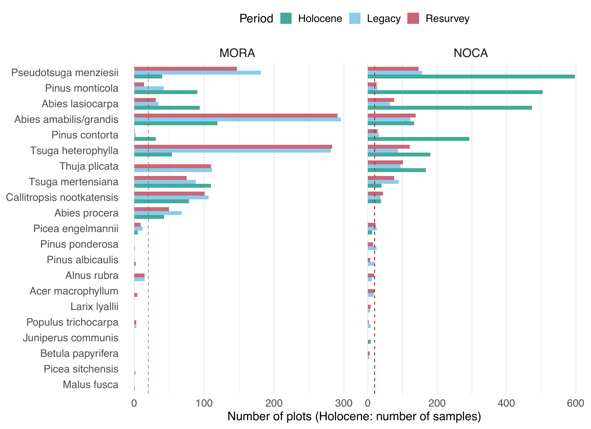

**Fig. S3. Occurrence of tree species in the two parks and the three
survey periods, before the selection of species for the CCA.** Number of
plots (legacy surveys and resurveys) or macrofossil samples (Holocene)
in which each tree species was recorded at MORA and NOCA, after
taxonomic harmonization and exclusion of understory and unidentified
taxa. A species was counted as present when it was recorded as an adult
tree or as a seedling. The dashed red line shows the threshold of 20
plots or samples. We retained the species that reached this threshold in
at least one park and period, which gave the 13 species of the CCA.

**The *Abies amabilis/grandis* aggregate.** The needles of *Abies
amabilis* and *A. grandis* cannot be told apart, so the macrofossil
records cannot separate the two species. In the Panther Potholes record,
Prichard et al. (2009) classified them to genus (*Abies*
undifferentiated, the *Abies* needles other than *A. lasiocarpa*), and
the *A. amabilis* of the MORA records can hold *A. grandis*. We
therefore treated the two species as one taxon, *Abies
amabilis/grandis*, in both eras and both parks, and aggregated the
survey plots in the same way. The aggregate occurs in 134 Panther
Potholes samples and 119 MORA samples, and in 296 and 291 MORA plots and
123 and 138 NOCA plots in the legacy surveys and the resurveys.

## Holocene macrofossil records

The Holocene communities come from plant macrofossils in dated
lake-sediment cores, three at MORA and one at NOCA (Fig. 2 of the main
text). We dated each sample with the age-depth model of its core
(Appendix S1).

### Appendix S1. Age-depth models of the Holocene records

#### S1.1 Why new age-depth models were needed

Age-depth models based on calibrated radiocarbon ages were needed for
the four cores of the forest records. At MORA, Dunwiddie (1986) reported
radiocarbon ages that were not calibrated to calendar years. At NOCA,
Prichard et al. (2009) did not publish the age-depth model of Panther
Potholes. A Bayesian chronology was later archived in the Neotoma
database (Gavin, 2021), with corrected depths of the dates and tephra
layers, but without its uncertainty intervals. To make the analysis
reproducible, we built a Bayesian age-depth model for each of the four
cores with the same method (R package rbacon; Blaauw & Christen, 2011).
For the three charcoal records of Sunrise Ridge at MORA (Appendix S3),
we used the published age-depth models of Walsh et al. (2017), which are
already calibrated.

#### S1.2 Chronological controls

To build the models from the same information as the original studies,
we used the published chronological controls of each core, i.e., the
depths with a known age: the core surface, radiocarbon dates, tephra
layers, and, at Panther Potholes, ²¹⁰Pb ages (Table S2). We entered the
radiocarbon ages as uncalibrated ages, which rbacon calibrated with the
IntCal20 curve (Reimer et al., 2020), and the other controls as calendar
ages. Two decisions differ from the original studies. Reflection Pond
has no radiocarbon date of its own, so we gave it the mean basal age of
Jay Bath and Log Wallow. For Panther Potholes, we used the depths of the
controls archived in the Neotoma database, which correct depth errors in
Prichard et al. (2009).

**Table S2. Chronological controls used in the four Bayesian age-depth
models.** For cc = 1, the entered age is an uncalibrated ¹⁴C age
calibrated with IntCal20. For cc = 0, the entered age is already in
calibrated years before present (cal yr BP; present = A.D. 1950).

| Site | Core | Chronological control | Depth (cm) | Age entered ± error | Bacon treatment | Age source | Uncertainty source |
|:---|:---|:---|:---|:---|:---|:---|:---|
| MORA | Jay Bath | Core surface | 0 | −31.5 ± 10 cal yr BP | cc = 0 | Coring date, 1981–1982 | Assumed ±10 yr to account for uncertainty in recovery of the sediment–water interface |
| MORA | Jay Bath | MSH-W tephra | 22 | 470 ± 10 cal yr BP | cc = 0 | Yamaguchi 1983; Walsh et al. 2017 | Assumed ±10 yr around the tree-ring-dated eruption age; no published statistical age error |
| MORA | Jay Bath | QL-1729 | 39.5 | 1320 ± 30 ¹⁴C yr BP | cc = 1, IntCal20 | Dunwiddie 1986 | Published laboratory error |
| MORA | Jay Bath | MR-C tephra | 62 | 2250 ± 100 cal yr BP | cc = 0 | Mullineaux 1974; Walsh et al. 2017 | Assumed ±100 yr; no published statistical age error |
| MORA | Jay Bath | QL-1730 | 70 | 2920 ± 60 ¹⁴C yr BP | cc = 1, IntCal20 | Dunwiddie 1986 | Published laboratory error |
| MORA | Jay Bath | MSH-Y tephra, upper boundary | 87 | 3650 ± 100 cal yr BP | cc = 0 | Mullineaux 1974; Walsh et al. 2017 | ±100 yr derived approximately from radiocarbon dates bracketing the eruption age (bracket half-width ≈103 yr; Mullineaux 1996) |
| MORA | Jay Bath | MSH-Y tephra, lower boundary | 105 | 3650 ± 100 cal yr BP | cc = 0 | Mullineaux 1974; Walsh et al. 2017 | Same uncertainty as upper boundary; both depths represent the same instantaneous tephra deposit |
| MORA | Jay Bath | Beta-6332 | 124.5 | 3740 ± 80 ¹⁴C yr BP | cc = 1, IntCal20 | Dunwiddie 1986 | Published laboratory error |
| MORA | Jay Bath | MR-F tephra | 142 | 5740 ± 100 cal yr BP | cc = 0 | Mullineaux 1974; Walsh et al. 2017 | Assumed ±100 yr; no published statistical age error |
| MORA | Jay Bath | QL-1704 | 152.25 | 6050 ± 110 ¹⁴C yr BP | cc = 1, IntCal20 | Dunwiddie 1986 | Published laboratory error |
| MORA | Log Wallow | Core surface | 0 | −31.5 ± 10 cal yr BP | cc = 0 | Coring date, 1981–1982 | Assumed ±10 yr to account for uncertainty in recovery of the sediment–water interface |
| MORA | Log Wallow | MSH-W tephra | 22 | 470 ± 10 cal yr BP | cc = 0 | Yamaguchi 1983; Walsh et al. 2017 | Assumed ±10 yr around the tree-ring-dated eruption age; no published statistical age error |
| MORA | Log Wallow | QL-1726 | 29 | 1650 ± 80 ¹⁴C yr BP | cc = 1, IntCal20 | Dunwiddie 1986 | Published laboratory error |
| MORA | Log Wallow | MSH-Y tephra, upper boundary | 40 | 3650 ± 100 cal yr BP | cc = 0 | Mullineaux 1974; Walsh et al. 2017 | ±100 yr derived approximately from radiocarbon dates bracketing the eruption age (bracket half-width ≈103 yr; Mullineaux 1996) |
| MORA | Log Wallow | MSH-Y tephra, lower boundary | 98 | 3650 ± 100 cal yr BP | cc = 0 | Mullineaux 1974; Walsh et al. 2017 | Same uncertainty as upper boundary; both depths represent the same instantaneous tephra deposit |
| MORA | Log Wallow | MR-F tephra | 116 | 5740 ± 100 cal yr BP | cc = 0 | Mullineaux 1974; Walsh et al. 2017 | Assumed ±100 yr; no published statistical age error |
| MORA | Log Wallow | QL-1727 | 117 | 4900 ± 80 ¹⁴C yr BP | cc = 1, IntCal20 | Dunwiddie 1986 | Published laboratory error |
| MORA | Log Wallow | QL-1728 | 140 | 5980 ± 60 ¹⁴C yr BP | cc = 1, IntCal20 | Dunwiddie 1986 | Published laboratory error |
| MORA | Reflection Pond | Core surface | 0 | −31.5 ± 10 cal yr BP | cc = 0 | Coring date, 1981–1982 | Assumed ±10 yr to account for uncertainty in recovery of the sediment–water interface |
| MORA | Reflection Pond | MSH-W tephra | 10 | 470 ± 10 cal yr BP | cc = 0 | Yamaguchi 1983; Walsh et al. 2017 | Assumed ±10 yr around the tree-ring-dated eruption age; no published statistical age error |
| MORA | Reflection Pond | MR-C tephra | 26 | 2250 ± 100 cal yr BP | cc = 0 | Mullineaux 1974; Walsh et al. 2017 | Assumed ±100 yr; no published statistical age error |
| MORA | Reflection Pond | MSH-Y tephra, upper boundary | 45 | 3650 ± 100 cal yr BP | cc = 0 | Mullineaux 1974; Walsh et al. 2017 | ±100 yr derived approximately from radiocarbon dates bracketing the eruption age (bracket half-width ≈103 yr; Mullineaux 1996) |
| MORA | Reflection Pond | MSH-Y tephra, lower boundary | 64 | 3650 ± 100 cal yr BP | cc = 0 | Mullineaux 1974; Walsh et al. 2017 | Same uncertainty as upper boundary; both depths represent the same instantaneous tephra deposit |
| MORA | Reflection Pond | MR-F tephra | 82 | 5740 ± 100 cal yr BP | cc = 0 | Mullineaux 1974; Walsh et al. 2017 | Assumed ±100 yr; no published statistical age error |
| MORA | Reflection Pond | Basal sediment, mean of QL-1704 and QL-1728 | 90 | 6015 ± 110 ¹⁴C yr BP | cc = 1, IntCal20 | Dunwiddie 1986; P. Dunwiddie, pers. comm. | Larger of the two laboratory errors (±110 yr), allowing for transfer of the Jay Bath and Log Wallow basal age to Reflection Pond |
| NOCA | Panther Potholes | Core surface | 0.5 | −49 ± 1 cal yr BP | cc = 0 | Gavin 2021 Neotoma chronology; coring year 1999 | ±1 yr retained from the archived chronology |
| NOCA | Panther Potholes | ²¹⁰Pb CRS age | 7 | −36.7; error entered = 3.47 | cc = 0 | Prichard et al. 2009; Gavin 2021 | Value of the archived chronology; 3.47 is numerically the published ²¹⁰Pb activity uncertainty in DPM g⁻¹, not a verified age error in years |
| NOCA | Panther Potholes | ²¹⁰Pb CRS age | 14 | −9; error entered = 1.15 | cc = 0 | Prichard et al. 2009; Gavin 2021 | Value of the archived chronology; 1.15 is numerically the published ²¹⁰Pb activity uncertainty in DPM g⁻¹, not a verified age error in years |
| NOCA | Panther Potholes | ²¹⁰Pb CRS age | 21 | 12; error entered = 0.72 | cc = 0 | Prichard et al. 2009; Gavin 2021 | Value of the archived chronology; 0.72 is numerically the published ²¹⁰Pb activity uncertainty in DPM g⁻¹, not a verified age error in years |
| NOCA | Panther Potholes | ²¹⁰Pb CRS age | 28 | 21; error entered = 0.74 | cc = 0 | Prichard et al. 2009; Gavin 2021 | Value of the archived chronology; 0.74 is numerically the published ²¹⁰Pb activity uncertainty in DPM g⁻¹, not a verified age error in years |
| NOCA | Panther Potholes | ²¹⁰Pb CRS age | 35 | 36; error entered = 0.77 | cc = 0 | Prichard et al. 2009; Gavin 2021 | Value of the archived chronology; 0.77 is numerically the published ²¹⁰Pb activity uncertainty in DPM g⁻¹, not a verified age error in years |
| NOCA | Panther Potholes | Beta-172005, conifer seed | 214 | 1950 ± 50 ¹⁴C yr BP | cc = 1, IntCal20 | Prichard et al. 2009 | Published laboratory error |
| NOCA | Panther Potholes | MSH-P tephra | 305.5 | 2620 ± 70 cal yr BP | cc = 0 | Gavin 2021 Neotoma chronology | Age and ±70-yr uncertainty retained from the archived chronology |
| NOCA | Panther Potholes | Beta-169623, seed | 363 | 3260 ± 40 ¹⁴C yr BP | cc = 1, IntCal20 | Prichard et al. 2009 | Published laboratory error |
| NOCA | Panther Potholes | Beta-169624, pollen cone | 389 | 3520 ± 40 ¹⁴C yr BP | cc = 1, IntCal20 | Prichard et al. 2009 | Published laboratory error |
| NOCA | Panther Potholes | MSH-Y tephra | 401 | 3660 ± 65 cal yr BP | cc = 0 | Gavin 2021 Neotoma chronology | Age and ±65-yr uncertainty retained from the archived chronology |
| NOCA | Panther Potholes | Beta-169207, pollen cone | 479 | 4500 ± 40 ¹⁴C yr BP | cc = 1, IntCal20 | Prichard et al. 2009 | Published laboratory error |
| NOCA | Panther Potholes | Mazama tephra | 629 | 7633 ± 25 cal yr BP | cc = 0 | Gavin 2021 Neotoma chronology; Egan et al. 2015 | Age and ±25-yr uncertainty retained from the archived chronology |
| NOCA | Panther Potholes | Beta-169208, seed | 678 | 7330 ± 40 ¹⁴C yr BP | cc = 1, IntCal20 | Prichard et al. 2009 | Published laboratory error |
| NOCA | Panther Potholes | Beta-169625, Pinus contorta needles | 864 | 9370 ± 40 ¹⁴C yr BP | cc = 1, IntCal20 | Prichard et al. 2009 | Published laboratory error |

#### S1.3 Age-depth models

To estimate the age of every depth between the controls, rbacon models
how fast sediment accumulated along the core and returns many age-depth
curves that agree with the controls (Fig. S4; settings in Table S3). The
three MORA cores had no Bayesian chronology before, and we used the same
settings for all three, mostly the rbacon defaults. For Panther
Potholes, we used the settings of the Bacon chronology archived in
Neotoma (Gavin, 2021), so that our model reproduces that chronology and
also gives its uncertainty intervals. We treated thick tephra layers as
instantaneous deposits (grey bands in Fig. S4). From each model, we took
the median of the modelled ages at the depth of each macrofossil sample
as the age of that sample, and used it to assign the sample to a century
(see Methods of the main text).

**Table S3. rbacon parameters used to construct the age-depth models.**

| rbacon argument | What it controls | MORA | Panther Potholes | Rationale |
|:---|:---|:---|:---|:---|
| cc, cc1 | Determines whether a date requires radiocarbon calibration and which calibration curve is used | cc=1, cc1=“IntCal20” for ¹⁴C dates; cc=0 for calendar-age controls | Same | We calibrated the ¹⁴C dates with IntCal20, the curve for Northern Hemisphere terrestrial samples, and entered the other controls as calendar ages. |
| thick | Thickness of the sediment sections for which accumulation rates are estimated | 5 cm | 5 cm | rbacon default; at Panther Potholes, also the value of the archived chronology. |
| acc.mean | Mean of the prior distribution for accumulation time, in yr cm⁻¹ | 50 | 10 | The MORA cores accumulated more slowly. At Panther Potholes, the value of the archived chronology, close to the accumulation of about 12.8 yr cm⁻¹ reported for this core. |
| acc.shape | Shape of the gamma prior around acc.mean; larger values impose a more concentrated accumulation prior | 1.5 | 1.5 | rbacon default (MORA); value of the archived chronology (Panther Potholes). |
| mem.mean | Prior mean dependence between accumulation rates in adjacent sediment sections | 0.5 | 0.7 | rbacon default (MORA); value of the archived chronology (Panther Potholes). |
| mem.strength | Strength of the prior around mem.mean; larger values impose the assumed memory more strongly | 10 | 10 | rbacon default (MORA); value of the archived chronology (Panther Potholes). |
| slump | Depth intervals treated as effectively instantaneous accumulation rather than gradual sedimentation | Jay Bath: 87–105 cm; Log Wallow: 40–98 cm; Reflection Pond: 45–64 cm | 303–308, 396–406, and 623–635 cm | Treats each thick tephra layer as one instantaneous deposit, so that the model does not read its thickness as a long period of accumulation. |
| normal, t.a, t.b | Distribution used to accommodate chronological-control scatter and potential outlying dates | FALSE, 3, 4 | FALSE, 15, 16 | rbacon default (MORA); value of the archived chronology (Panther Potholes). |
| ssize | Number of MCMC iterations retained for the posterior | 4,000 | 10,000 | rbacon default (MORA). Panther Potholes needed more iterations for the chain to mix and to reproduce the archived chronology. |
| prob | Posterior interval reported for the chronology | 0.95 | 0.95 | We summarize ages with 95% posterior intervals. |
| d.max | Maximum core depth included in the model | Jay Bath: 153 cm; no manual extension for Log Wallow or Reflection Pond | 870 cm | We extended Jay Bath to 153 cm to keep its deepest macrofossil sample. At Panther Potholes, the extent of the archived chronology. |

**Fig. S4. Bayesian age-depth models of the four cores of the forest
records: Jay Bath, Log Wallow, and Reflection Pond at MORA, and Panther
Potholes at NOCA.** Coloured distributions show the chronological
controls, the grey field the modelled age-depth curves, the red dotted
line their mean, and the grey dotted lines their 95% interval. Grey
bands mark the tephra layers treated as instantaneous deposits. Ages are
in calibrated years before present. The small upper panels are the
standard rbacon diagnostics.

#### S1.4 Check of the ²¹⁰Pb errors at Panther Potholes

In the archived chronology of Panther Potholes, the errors given for the
five ²¹⁰Pb ages are the uncertainties of the measured ²¹⁰Pb activity,
not age errors in years. To check whether this matters, we fitted a
second model with an error of ±10 years for these five ages. The two
chronologies differed only in the upper 35 to 40 cm of the core, which
is much younger than the youngest lake-period of the analysis (1400 cal
BP), so this choice does not affect the results (Fig. S5).

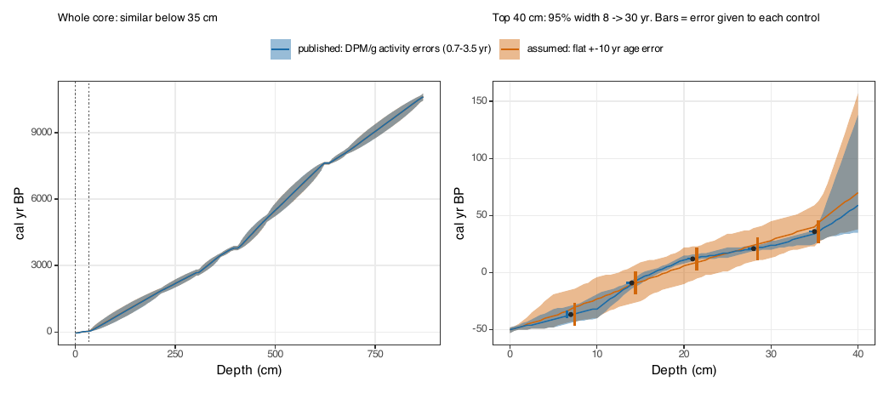

**Fig. S5. Check of the Panther Potholes age-depth chronology to
uncertainty assigned to the five ²¹⁰Pb controls in the upper 35 to 40 cm
of the core.** The left panel shows that the two posterior chronologies
are nearly identical below the ²¹⁰Pb-dated section, whereas the right
panel shows the expected increase in uncertainty within the upper 35–40
cm. The uncertainty assigned to the ²¹⁰Pb controls affects the precision
of the most recent chronology but does not materially alter the deeper
Holocene chronology used in our analyses.

# Climate products

## Appendix S2. Climate products and the bias correction of the Holocene climate

We fitted the climate–community space with CHELSA V2.1 at the forest
plots, whereas the climate-predicted positions of the Holocene
communities come from CHELSA-TraCE21k at the lakes. If the two products
differ in the level of temperature or precipitation, a Holocene climate
is placed elsewhere in the climate–community space than the same climate
would be with CHELSA V2.1, and this difference enters every mismatch and
every lag. We therefore corrected the Holocene climate to the level of
CHELSA V2.1.

To correct it, we followed the change-factor approach that is commonly
used for paleoclimate simulations (Lorenz et al., 2016): the difference
between two products is calculated over the years that they have in
common, and is then applied to all time steps of the product to be
corrected. CHELSA-TraCE21k and CHELSA V2.1 cannot be compared directly,
because the most recent time step of CHELSA-TraCE21k is the mean of the
years 1900 to 1990, whereas CHELSA V2.1 starts in 1979. We therefore
used CHELSAcruts (1901 to 2016), which has years in common with both
products, as a link between them (Table S4). Over the years that the
three products have in common, they differed in the level of temperature
and precipitation (Fig. S6).

**Table S4. The three CHELSA products.** All three products have the
same grid of 30 arcsec.

| Product | Version | Years read | What it is |
|----|----|----|----|
| CHELSA-TraCE21k | 1.0 | timeIDs 16 to 20 (1500 to 1990, century means) | Downscaled TraCE-21k transient simulation; timeID 20 is the mean of 1900 to 1990 |
| CHELSAcruts | 1.0 | 1901 to 2016, monthly | CRU TS anomalies downscaled with the CHELSA V1 climatology |
| CHELSA V2.1 | 2.1 | 1979 to 2021, monthly | CHELSA time series, current version; the climate of the climate–community space |

**Fig. S6. The three climate products of the bias correction, without
correction.** Monthly minimum temperature, maximum temperature, and
precipitation over the years that the three products have in common: the
most recent time step of CHELSA-TraCE21k (timeID 20, the mean of 1900 to
1990; purple), and CHELSAcruts (gold) and CHELSA V2.1 (black) over 1979
to 1990. For each point, the values of CHELSAcruts and CHELSA V2.1 were
averaged over these years. Each line is the median over the forest plots
of a park (331 at MORA and 305 at NOCA) or over the grid cells within 5
km of its lakes (136 at MORA and 136 at NOCA). CHELSA V2.1 has no
temperature for January 1979, so that its January temperatures are means
over 1980 to 1990.

The correction thus has two steps (Fig. S7). In step 1, we corrected
CHELSA-TraCE21k to CHELSAcruts over 1900 to 1990, and in step 2,
CHELSAcruts to CHELSA V2.1 over 1979 to 2016. For each park and calendar
month, each step is an offset that we added to minimum and maximum
temperature, and a ratio by which we multiplied precipitation. We
calculated both steps from the mean over the grid cells within 5 km of
the lakes of each park, and applied them to all time steps of
CHELSA-TraCE21k. Step 1 was needed because CHELSA-TraCE21k and
CHELSAcruts did not agree over the years that they have in common,
although both are downscaled with the same method (Table
S5).

This correction assumes that the difference between the products stayed
constant through the Holocene. As a sensitivity analysis, we therefore
repeated all analyses without correction (Appendix S4).

**Table S5. Comparison of CHELSA-TraCE21k and CHELSAcruts over the years
that they have in common, without correction.** The most recent time
step of CHELSA-TraCE21k (timeID 20, the mean of 1900 to 1990) and
CHELSAcruts (1901 to 1990), on the grid cells within 5 km of the lakes
(disc), at the grid cells of the lakes (MORA: mean of the three lakes),
and as the mean over the forest plots. Difference: CHELSAcruts
subtracted from CHELSA-TraCE21k. Ratio: CHELSA-TraCE21k divided by
CHELSAcruts.

| Park | Place | Variable | TraCE21k timeID 20 | CHELSAcruts 1901-1990 | Difference | Ratio |
|:---|:---|:---|---:|---:|---:|---:|
| MORA | MORA disc | Spring temperature (°C) | 2.87 | 2.07 | 0.80 | 1.39 |
| MORA | MORA disc | Summer precipitation (mm) | 135.57 | 161.50 | -25.94 | 0.84 |
| MORA | MORA lakes | Spring temperature (°C) | 3.40 | 2.78 | 0.62 | 1.22 |
| MORA | MORA lakes | Summer precipitation (mm) | 128.00 | 167.13 | -39.13 | 0.77 |
| MORA | MORA plots | Spring temperature (°C) | 4.45 | 4.18 | 0.27 | 1.07 |
| MORA | MORA plots | Summer precipitation (mm) | 140.26 | 140.02 | 0.24 | 1.00 |
| NOCA | NOCA disc | Spring temperature (°C) | 4.05 | 3.73 | 0.32 | 1.08 |
| NOCA | NOCA disc | Summer precipitation (mm) | 112.85 | 95.13 | 17.72 | 1.19 |
| NOCA | NOCA lakes | Spring temperature (°C) | 4.20 | 3.96 | 0.24 | 1.06 |
| NOCA | NOCA lakes | Summer precipitation (mm) | 101.00 | 108.26 | -7.26 | 0.93 |
| NOCA | NOCA plots | Spring temperature (°C) | 4.52 | 4.37 | 0.14 | 1.03 |
| NOCA | NOCA plots | Summer precipitation (mm) | 105.26 | 88.80 | 16.46 | 1.19 |

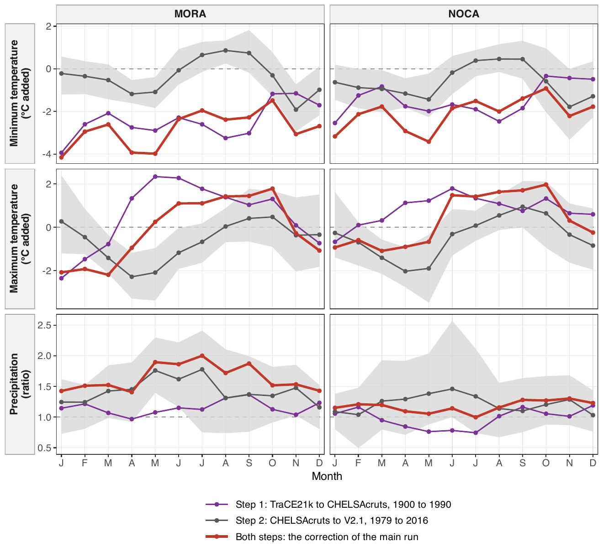

**Fig. S7. The two steps of the bias correction of the Holocene
climate.** For each park and calendar month, the offset added to
temperature (°C) or the ratio by which precipitation was multiplied,
calculated on the grid cells within 5 km of the lakes. Purple: step 1
(CHELSA-TraCE21k to CHELSAcruts, 1900 to 1990). Grey: step 2
(CHELSAcruts to CHELSA V2.1, 1979 to 2016), with the 10th to 90th
percentile of the yearly values in light grey. Red: both steps together,
i.e., the correction of the main analysis. On the dashed line, a step
changes nothing.

# Climate change and comparisons within eras

## Climate data

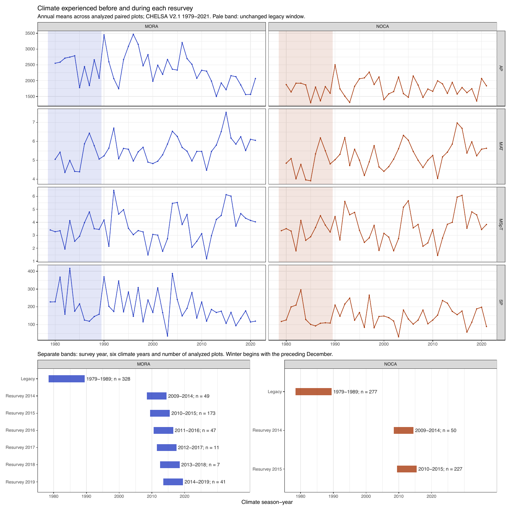

**Fig. S8. Climate of the Anthropocene and the climate windows of the
surveys.** Upper panels: annual climate from CHELSA V2.1 (1979–2021),
averaged over the plot pairs at Mount Rainier (MORA, blue) and North
Cascades (NOCA, dark red), for mean annual temperature (MAT), annual
precipitation (AP), mean spring temperature (MSpT), and summer
precipitation (SP). Spring temperature and summer precipitation are the
two variables of the climate–community space. The shaded area shows the
climate window of the legacy surveys (1979–1989), which is the same for
all plots. Lower panels: the six-year climate window of each resurvey
year (from five years before the resurvey to the year of the resurvey),
with the number of plot pairs (n) resurveyed in that year. The climate
of the resurvey was therefore calculated separately for each plot,
according to the year of its resurvey. CHELSA V2.1 is the product to
which the Holocene climate was corrected (Appendix S2), and is itself
not corrected.

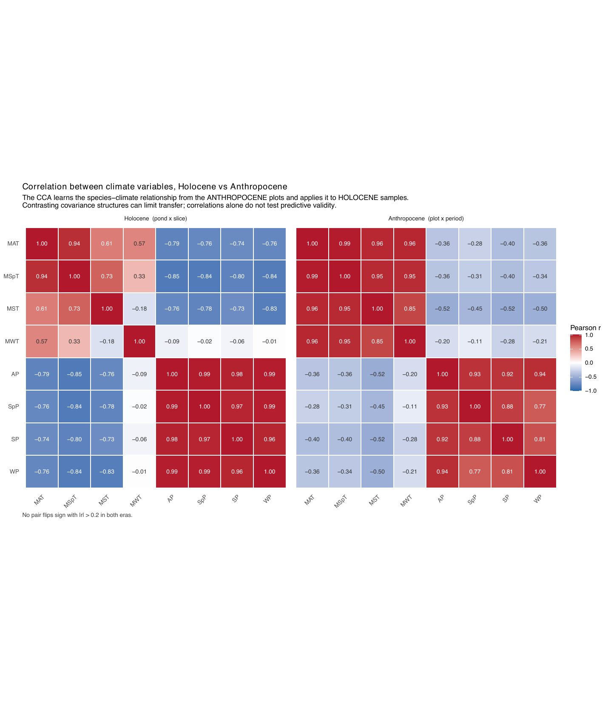

**Fig. S9. Correlations among climate variables in the Holocene and the
Anthropocene.** Pearson correlation coefficients (r) across lakes and
centuries for the Holocene (CHELSA-TraCE21k after the bias correction of
Appendix S2, left), and across forest plots and surveys for the
Anthropocene (CHELSA V2.1, right). Red shows positive and blue negative
correlations, and the numbers give r. The variables are mean annual
(MAT), spring (MSpT), summer (MST), and winter (MWT) temperature, and
annual (AP), spring (SpP), summer (SP), and winter (WP) precipitation.
Spring is March–May, summer June–August, and winter December–February.

## Climate periods

**Table S6. Climate periods of the Holocene.** Climate-change (C) and
stability (S) periods defined from spring temperature (MSpT) and summer
precipitation (SP), which are used in the analysis, and, with the same
rules, from the four seasonal variables, for comparison. Both are
defined from the Holocene climate after the bias correction (Appendix
S2). Drivers: the variables whose change defined a climate-change
period.

| Variables | Period | Type | Older (cal BP) | Younger (cal BP) | Duration (years) | Drivers |
|:---|:---|:---|---:|---:|---:|:---|
| Spring temperature and summer precipitation (used) | C1 | Holocene-C | 9650 | 8650 | 1000 | spring cooling, summer drying |
| Spring temperature and summer precipitation (used) | S1 | Holocene-S | 8650 | 8250 | 400 |  |
| Spring temperature and summer precipitation (used) | C2 | Holocene-C | 8250 | 7250 | 1000 | spring warming, summer wetting |
| Spring temperature and summer precipitation (used) | S2 | Holocene-S | 7250 | 6850 | 400 |  |
| Spring temperature and summer precipitation (used) | C3 | Holocene-C | 6850 | 6250 | 600 | spring cooling |
| Spring temperature and summer precipitation (used) | S3 | Holocene-S | 6250 | 5450 | 800 |  |
| Spring temperature and summer precipitation (used) | C4 | Holocene-C | 5450 | 4950 | 500 | spring warming |
| Spring temperature and summer precipitation (used) | S4 | Holocene-S | 4950 | 2250 | 2700 |  |
| Spring temperature and summer precipitation (used) | C5 | Holocene-C | 2250 | 1750 | 500 | spring warming |
| Spring temperature and summer precipitation (used) | S5 | Holocene-S | 1750 | 1350 | 400 |  |
| Four seasonal variables (comparison) | C1a | Holocene-C | 9650 | 8650 | 1000 | spring cooling, winter warming, summer drying |
| Four seasonal variables (comparison) | C1b | Holocene-C | 8650 | 8250 | 400 | winter wetting |
| Four seasonal variables (comparison) | C1c | Holocene-C | 8250 | 7250 | 1000 | spring warming, winter warming, summer wetting |
| Four seasonal variables (comparison) | S1 | Holocene-S | 7250 | 6850 | 400 |  |
| Four seasonal variables (comparison) | C2 | Holocene-C | 6850 | 6250 | 600 | spring cooling |
| Four seasonal variables (comparison) | S2 | Holocene-S | 6250 | 5450 | 800 |  |
| Four seasonal variables (comparison) | C3 | Holocene-C | 5450 | 4950 | 500 | spring warming |
| Four seasonal variables (comparison) | S3 | Holocene-S | 4950 | 2250 | 2700 |  |
| Four seasonal variables (comparison) | C4 | Holocene-C | 2250 | 1750 | 500 | spring warming |
| Four seasonal variables (comparison) | S4 | Holocene-S | 1750 | 1350 | 400 |  |

**Fig. S10. Holocene climate for the four seasonal variables.** (A)
Standardized levels, in standard deviations of the legacy plots from
their mean, of spring temperature, winter temperature, summer
precipitation, and winter precipitation: 1,000-year running means (bold)
and the centennial series (thin), averaged over the lakes of each park
with the two parks weighted equally. The Holocene climate is
CHELSA-TraCE21k after the bias correction (Appendix S2). Only spring
temperature and summer precipitation are used in the climate–community
space and define the climate periods. (B) Fire frequency as in Fig. 3C
of the main text.

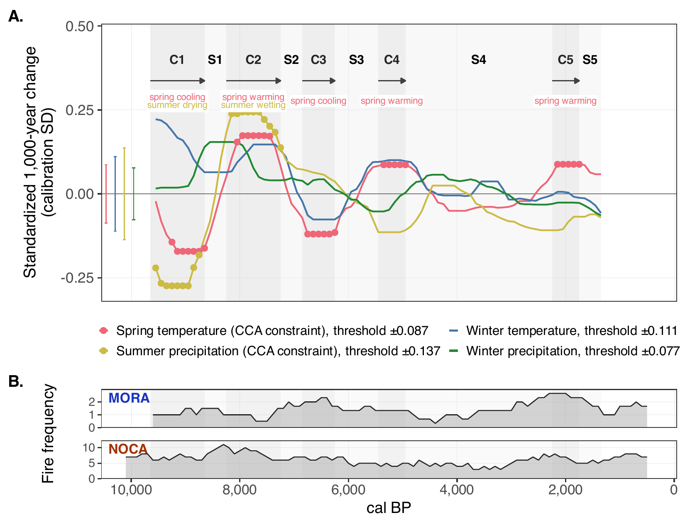

**Fig. S11. How the climate periods were defined.** (A) Change of each
of the four seasonal variables over 1,000 years (Holocene climate after
the bias correction of Appendix S2), with its sign, as the mean of the
two parks (weighted equally), taken as the median over the ten phases of
the 1,000-year bins, and standardized by the standard deviation across
the legacy plots. Filled points mark the time steps at which one of the
two variables of the climate–community space changed in one direction
(more than 50% of the maximum change of the variable, with at least 8 of
10 phases in the same direction). We defined the climate periods from
these points. Winter temperature and winter precipitation are shown for
comparison. Brackets on the left mark the stability range of each
variable, whose threshold is given in the legend. (B) Fire frequency as
in Fig. 3C of the main text.

# Fire dynamics

## Appendix S3. Fire histories of the Holocene

### S3.1 Charcoal records

To describe fire activity through the Holocene in each park, we used
published records of macroscopic charcoal in lake sediments: Sunrise
Lake, Shadow Lake, and Little Sunrise Lake at MORA (Walsh et al., 2017),
and Panther Potholes at NOCA (Prichard et al., 2009). At MORA, these
records come from Sunrise Ridge and not from the lakes of the forest
records (see S3.5). At NOCA, the fire record and the forest record come
from the same core and have the same chronology (Appendix S1).

### S3.2 Fire events

To identify fire events in the same way in the four records, we repeated
the peak detection of the two original studies in one workflow (R
package tapas), with the settings of each original study (Table S7). In
this workflow, a fire event is a peak in the charcoal accumulation rate
that exceeds the background noise of the record and passes a
minimum-count test (Fig. S12).

**Table S7. Parameters used to reconstruct individual Holocene fire
events.** All records were also screened with the same 75-year
minimum-count test (p ≤ 0.05). MORA settings follow Walsh et al. (2017)
and Panther Potholes settings Prichard et al. (2009), except its 12-year
interpolation interval, the median resolution of our updated chronology.

| Site | Fire record | Interpolation interval (years) | Background window (years) | Peak threshold | Accepted fire events |
|:---|:---|---:|---:|:---|---:|
| MORA | Sunrise Lake | 48 | 800 | 95% | 17 |
| MORA | Shadow Lake | 47 | 1000 | 95% | 14 |
| MORA | Little Sunrise Lake | 42 | 500 | 95% | 13 |
| NOCA | Panther Potholes | 12 | 500 | 99% | 70 |

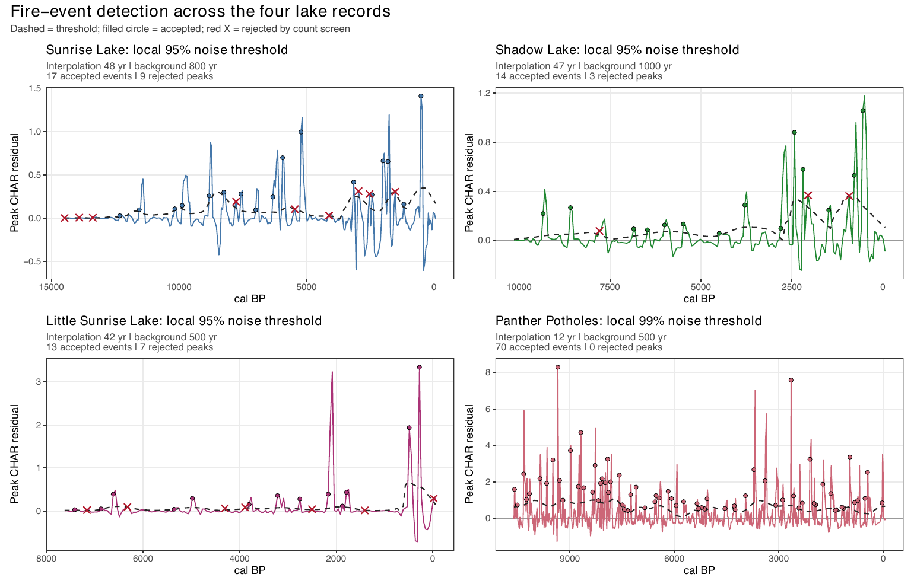

**Fig. S12. Identification of Holocene fire events in the four
records.** The residual peak component is the difference between
interpolated charcoal accumulation rates (CHAR) and the background
estimated with the record’s robust LOWESS window. Candidate events
exceed the local noise threshold (dashed line) and are then screened
with a 75-year minimum-count test (p ≤ 0.05): filled circles are
accepted events, and red crosses are rejected candidates.

### S3.3 Fire frequency

To show how fire activity changed through the Holocene (Fig. 3C of the
main text), we counted the fire events of each record in windows of
1,000 years, moved in steps of 100 years. The MORA series is the mean of
the three Sunrise Ridge records, and the NOCA series is the Panther
Potholes record. The records differ in resolution, so that fire
frequencies cannot be compared between the parks. Note that the models
do not use this fire frequency, but the number of fire events between t1
and t2 of each lake-period (see Methods of the main
text).

### S3.4 Comparison with the original studies

To check the workflow, we compared the numbers of fire events that we
identified with those of the original studies, and repeated the analysis
of the MORA records with a second software (CharAnalysis; Table S8). The
numbers differed from the published ones, also with CharAnalysis, which
suggests that part of the difference comes from the software. We kept
one workflow for the four records, with the settings of the original
studies, and did not tune the settings to match the published numbers.

**Table S8. Holocene fire-event counts reported in the original studies
and reconstructed with CharAnalysis R 2.0.3 (MORA only) and tapas (all
four records).**

| Site | Lake | Published | CharAnalysis R 2.0.3 | tapas | Difference from published |
|:---|:---|---:|---:|---:|:---|
| MORA | Sunrise | 24 | 15 | 17 | -7 (-29%) |
| MORA | Shadow | 18 | 16 | 14 | -4 (-22%) |
| MORA | Little Sunrise | 16 | 14 | 13 | -3 (-19%) |
| MORA total |  | 58 | 45 | 44 | -14 (-24%) |
| NOCA | Panther Potholes | 59 | — | 70 | +11 (+19%) |
| Both sites |  | 117 | — | 114 | -3 (-3%) |

### S3.5 Fire records and forest records at MORA

At MORA, the fire records and the forest records come from different
lakes. We did not use the charcoal of the forest records, i.e., the
charcoal fragments that Dunwiddie (1986) counted in the macrofossil
samples of Jay Bath, Log Wallow, and Reflection Pond, for two reasons.
First, to compare the two parks, fire had to be reconstructed in the
same way at MORA and at NOCA, i.e., as fire events identified from peaks
in charcoal accumulation rates. Second, this is not possible with the
forest records. The detection of fire events requires charcoal
accumulation rates (fragments per cm² per year), i.e., the charcoal
concentration of a sample (fragments per cm³) multiplied by the
sedimentation rate (cm per year). Dunwiddie (1986) reported the charcoal
as the number of fragments in each sample, and not as accumulation
rates. Moreover, each sample covers about 80 to 200 years, so that
single fire events could not be separated even with accumulation rates.
We therefore used the Sunrise Ridge records, and assessed what they can
describe.

Macroscopic charcoal records the fires around a lake, and the records of
nearby lakes therefore do not have to agree. This was the case at MORA.
The three Sunrise Ridge records were only weakly correlated with one
another (Spearman correlations of +0.45, +0.31, and +0.09), and the
three forest records were correlated with one another with +0.19, +0.32,
and -0.09. The forest records did not follow the Sunrise Ridge records
either (Fig. S13). No single record can therefore describe fire in the
park. For this reason, we used the mean of the three Sunrise Ridge
records, which is high when several watersheds burned in the same
period. We interpret this mean as an indication of periods of high fire
activity in the region, and not as the fire history at the lakes of the
forest records. Note that the comparison with the forest records is
coarse, for the same two reasons, so that the lack of agreement may
partly come from the records themselves.

**Fig. S13. Charcoal in the fire records of Sunrise Ridge (Walsh et al.,
2017) and in the forest records of MORA (Dunwiddie, 1986).** Upper three
rows: charcoal accumulation rate of each Sunrise Ridge record (grey),
with its background (dashed) and the fire events that we identified
(dark red ticks at the top of each row). Lower three rows: number of
charcoal fragments in each macrofossil sample of Dunwiddie (1986). This
number is a concentration, because all samples of a core had the same
volume, and the samples above the 75th percentile of each lake are
filled. Each fire event of the Sunrise Ridge records is drawn as a faint
line through all rows. Time runs from 7,000 cal BP to the present, which
is the time span of the forest records. The correlations in the text are
Spearman correlations of the charcoal of two records over bins of 500
years.

# Climate–community space

**Table S9. Choice of the climate variables of the climate–community
space.** CCA fitted to the 605 legacy plots with three sets of climate
variables. VIF, variance inflation factor. The last two columns give the
percentage of the centuries of the Holocene records (333 at MORA, three
lakes, and 111 at NOCA) whose climate, after the bias correction
(Appendix S2), was outside the climate of the legacy plots.

| Set | Variables | Largest abs. correlation | VIF | R² | Adjusted R² | MORA lake-centuries outside (%) | NOCA lake-centuries outside (%) |
|:---|:---|---:|:---|---:|---:|---:|---:|
| All four | MSpT, MWT, SP, WP | 0.956 | MSpT 29.6, MWT 26.4, SP 5.2, WP 6.7 | 0.166 | 0.161 | 63.964 | 28.829 |
| MWT + SP | MWT, SP | 0.071 | MWT 1.0, SP 1.0 | 0.141 | 0.138 | 0.000 | 0.000 |
| MSpT + SP | MSpT, SP | 0.286 | MSpT 1.1, SP 1.1 | 0.138 | 0.136 | 0.000 | 0.000 |

**Table S10. The two climate variables of the climate–community space.**
Variance inflation factor (VIF) and biplot score of each variable on the
two unrotated CCA axes.

| Variable | Label                |  VIF | CCA1 score | CCA2 score |
|:---------|:---------------------|-----:|-----------:|-----------:|
| MSpT     | Spring temperature   | 1.08 |       0.52 |      -0.07 |
| SP       | Summer precipitation | 1.08 |      -0.23 |      -0.35 |

**Table S11. Axes of the CCA.** The two climate variables explained
13.8% of the variation in composition (constrained inertia).

| Axis | Eigenvalue | % total inertia | % constrained inertia |
|:-----|-----------:|----------------:|----------------------:|
| CCA1 |      0.279 |           9.025 |                65.285 |
| CCA2 |      0.149 |           4.799 |                34.715 |

**Table S12. Permutation tests of the CCA.** 9,999 permutations,
unrestricted and restricted within parks. df, degrees of freedom of each
component.

| Test    | Component |  df | Pseudo-F | p (unrestricted) | p (within parks) |
|:--------|:----------|----:|---------:|:-----------------|:-----------------|
| Overall | Model     |   2 |   48.284 | \< 0.001         | \< 0.001         |
| Axis    | CCA1      |   1 |   63.044 | \< 0.001         | \< 0.001         |
| Axis    | CCA2      |   1 |   33.594 | \< 0.001         | \< 0.001         |

**Fig. S14. The climate–community space on the unrotated CCA axes, with
all species.** As Fig. 4A of the main text, on the unrotated axes
(labelled with the share of the variation in composition that each axis
explained) and with all 13 species.

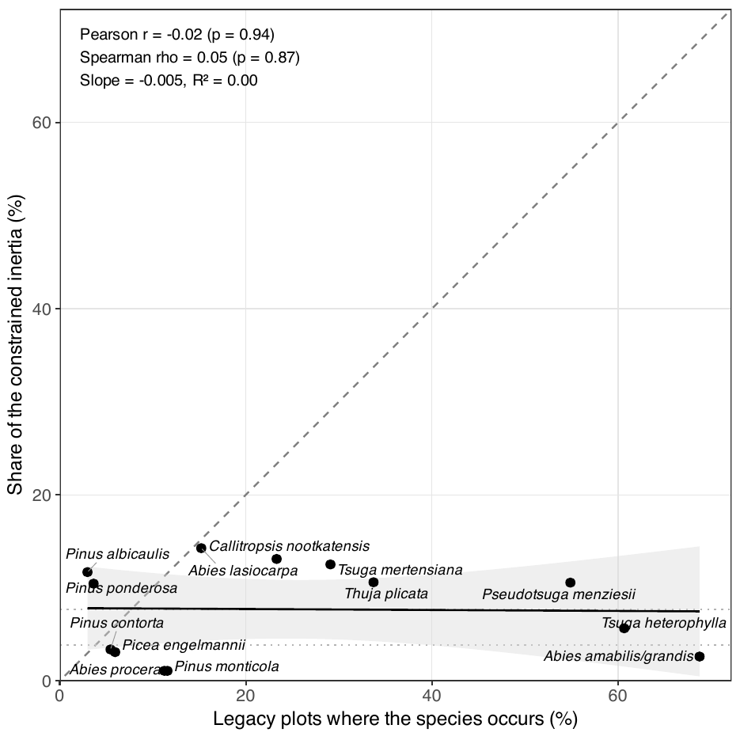

**Fig. S15. Share of the constrained inertia against commonness of the
species.** Each point is one of the 13 taxa of the CCA: its share of the
constrained inertia against the share of the legacy plots in which it
occurs. Dashed line: 1:1. Solid line and band: linear fit with its 95%
confidence band. Dotted lines: an equal share of the constrained inertia
(7.7%, 100% divided by the number of taxa) and half of it, the threshold
above which a species is drawn in Fig. 4A. Share and commonness are not
related (Pearson r = -0.02, p = 0.94, and Spearman rho = 0.05, p = 0.87,
with a slope of the fit of -0.005 percentage points of inertia per
percentage point of plots, R² = 0.00). Only *Pinus albicaulis* and
*Pinus ponderosa* carry a larger share of the inertia than of the plots.

## Holocene samples in the climate–community space

**Table S13. Sampled centuries of each lake.** A sampled century is a
century with at least one macrofossil sample.

| Park | Lake | Sampled centuries | Samples | Centuries with one sample | Oldest (cal BP) | Youngest (cal BP) |
|:---|:---|---:|---:|---:|---:|---:|
| MORA | Jay Bath | 42 | 48 | 37 | 6800 | 0 |
| MORA | Log Wallow | 34 | 40 | 29 | 6800 | 0 |
| MORA | Reflection Pond | 28 | 31 | 26 | 6200 | 0 |
| NOCA | Panther Potholes | 107 | 812 | 0 | 10600 | 0 |

The records of the three MORA lakes start between 6,200 and 6,800 cal
BP, and most of their sampled centuries hold a single sample. The
Panther Potholes record (NOCA) covers the whole Holocene, with several
samples per century.

# Climate–community lags (Q1)

## Lake-periods

**Table S14. Lake-periods.** One row for each lake within each climate
period, from its oldest (t1) to its youngest (t2) sampled century. The
climate is the Holocene climate after the bias correction (Appendix S2).
M, climate–community mismatch. Rates are per century: the climate change
rate in SD of the legacy plots, fire activity in fire events per
charcoal record, and the other rates in CCA distance. The pace
contribution and the direction contribution are undefined when the
observed or the climate-predicted position did not move.

| Park | Lake | Period | t1 (cal BP) | t2 (cal BP) | Years | Samples t1 | Samples t2 | Climate change rate | MSpT change (°C) | SP change (mm) | Fire activity | M t1 | M t2 | Lag rate | Turnover rate | Pace contribution | Direction contribution |
|:---|:---|:---|---:|---:|---:|---:|---:|---:|---:|---:|---:|---:|---:|---:|---:|---:|---:|
| MORA | Jay Bath | C3 | 6800 | 6300 | 500 | 1 | 1 | 0.129 | -1.183 | -25.777 | 0.200 | 1.259 | 1.283 | 0.005 | 0.055 | -0.007 | 0.010 |
| MORA | Jay Bath | S3 | 5900 | 5600 | 300 | 1 | 1 | 0.136 | 0.083 | 25.040 | 0.000 | 1.539 | 1.566 | 0.009 | 0.073 | -0.009 | 0.023 |
| MORA | Jay Bath | C4 | 5400 | 5100 | 300 | 1 | 1 | 0.021 | -0.150 | -1.000 | 0.222 | 1.490 | 1.491 | 0.000 | 0.000 | — | — |
| MORA | Jay Bath | S4 | 4800 | 2400 | 2400 | 1 | 1 | 0.011 | -0.267 | 14.312 | 0.125 | 0.762 | 0.347 | -0.017 | 0.025 | -0.017 | 0.002 |
| MORA | Jay Bath | C5 | 2200 | 1900 | 300 | 1 | 1 | 0.155 | 0.417 | -26.621 | 0.333 | 0.638 | 0.395 | -0.081 | 0.140 | 0.008 | -0.153 |
| MORA | Jay Bath | S5 | 1700 | 1400 | 300 | 1 | 1 | 0.084 | -0.167 | 14.908 | 0.111 | 0.428 | 0.532 | 0.035 | 0.000 | — | — |
| MORA | Log Wallow | C3 | 6800 | 6300 | 500 | 1 | 1 | 0.126 | -1.133 | -25.777 | 0.200 | 1.443 | 1.174 | -0.054 | 0.030 | 0.033 | -0.038 |
| MORA | Log Wallow | S3 | 6200 | 5500 | 700 | 1 | 1 | 0.048 | 0.550 | 15.318 | 0.095 | 1.262 | 0.983 | -0.040 | 0.058 | -0.028 | -0.031 |
| MORA | Log Wallow | C4 | 5300 | 5000 | 300 | 1 | 1 | 0.015 | -0.067 | -2.139 | 0.111 | 1.060 | 1.114 | 0.018 | 0.076 | 0.022 | -0.033 |
| MORA | Log Wallow | S4 | 4800 | 2400 | 2400 | 1 | 1 | 0.012 | -0.267 | 16.032 | 0.125 | 0.741 | 0.633 | -0.004 | 0.014 | -0.005 | 0.004 |
| MORA | Reflection Pond | S3 | 6200 | 5500 | 700 | 1 | 1 | 0.045 | 0.550 | 13.456 | 0.095 | 0.811 | 0.949 | 0.020 | 0.000 | — | — |
| MORA | Reflection Pond | S4 | 4900 | 2800 | 2100 | 1 | 1 | 0.024 | -0.900 | -20.338 | 0.095 | 1.069 | 0.275 | -0.038 | 0.032 | -0.017 | -0.053 |
| MORA | Reflection Pond | C5 | 2200 | 1800 | 400 | 1 | 1 | 0.130 | 0.483 | -29.506 | 0.417 | 0.234 | 0.337 | 0.026 | 0.084 | 0.028 | -0.002 |
| NOCA | Panther Potholes | C1 | 9600 | 8700 | 900 | 7 | 7 | 0.044 | -0.933 | -5.983 | 0.667 | 1.063 | 1.457 | 0.044 | 0.050 | 0.023 | 0.036 |
| NOCA | Panther Potholes | S1 | 8600 | 8300 | 300 | 8 | 7 | 0.076 | 0.517 | 4.614 | 0.333 | 1.015 | 1.175 | 0.053 | 0.140 | 0.030 | 0.078 |
| NOCA | Panther Potholes | C2 | 8200 | 7300 | 900 | 8 | 6 | 0.060 | 0.967 | 22.242 | 1.222 | 0.829 | 0.652 | -0.020 | 0.033 | -0.001 | -0.019 |
| NOCA | Panther Potholes | S2 | 7200 | 6900 | 300 | 5 | 6 | 0.039 | 0.283 | -0.409 | 0.333 | 0.476 | 0.604 | 0.042 | 0.046 | 0.023 | 0.039 |
| NOCA | Panther Potholes | C3 | 6800 | 6300 | 500 | 5 | 6 | 0.096 | -1.100 | -8.894 | 0.600 | 1.169 | 0.732 | -0.087 | 0.103 | -0.022 | -0.122 |
| NOCA | Panther Potholes | S3 | 6200 | 5500 | 700 | 5 | 6 | 0.033 | 0.533 | 4.093 | 0.571 | 0.588 | 0.378 | -0.030 | 0.073 | -0.019 | -0.044 |
| NOCA | Panther Potholes | C4 | 5400 | 5000 | 400 | 6 | 6 | 0.013 | 0.117 | -1.185 | 1.250 | 0.469 | 0.399 | -0.017 | 0.095 | -0.008 | -0.095 |
| NOCA | Panther Potholes | S4 | 4900 | 2300 | 2600 | 5 | 11 | 0.014 | -0.783 | -9.468 | 0.462 | 0.268 | 0.561 | 0.011 | 0.017 | 0.008 | 0.005 |
| NOCA | Panther Potholes | C5 | 2200 | 1800 | 400 | 10 | 10 | 0.091 | 0.633 | -15.620 | 0.750 | 0.445 | 0.415 | -0.008 | 0.077 | 0.022 | -0.041 |
| NOCA | Panther Potholes | S5 | 1700 | 1400 | 300 | 8 | 9 | 0.049 | -0.017 | 9.144 | 0.333 | 0.273 | 1.087 | 0.271 | 0.281 | 0.259 | 0.047 |

Of the 27 combinations of lake and climate period with at least one
sampled century, 23 had samples in two or more centuries and are
therefore lake-periods (13 at MORA and 10 at NOCA, of which 11 in
climate-change periods and 12 in stability periods). The lake-periods
span 300 to 2600 years. At MORA, t1 and t2 of every lake-period hold a
single sample, and 3 lake-periods have no pace or direction
contribution, because the observed or the climate-predicted position did
not move. The charcoal records cover all lake-periods.

## Comparison among period types

**Table S15. Comparison among period types: estimated means for each
period type and park.** Generalized least-squares models with period
type, park, and their interaction as fixed effects (see Methods of the
main text). The Holocene climate is CHELSA-TraCE21k after the bias
correction (Appendix S2). SE, standard error. df, residual degrees of
freedom of the model, used for the 95% confidence interval (CI). Climate
change is in SD of the legacy plots, and turnover, lag, pace
contribution, and direction contribution are in CCA distance. Quantities
named rate, and the two contributions, are per century, unless marked
not divided by time. The lake-periods span 300 to 900 years in the
Holocene climate-change periods and 300 to 2600 years in the Holocene
stability periods, and the Anthropocene plot pairs span 27.5 to 32.5
years.

| Quantity | Park | Period type | n | Estimated mean | SE | df | 95% CI |
|:---|:---|:---|---:|---:|---:|---:|:---|
| Climate change rate | MORA | Holocene-S | 7 | 0.052 | 0.017 | 622 | 0.018 to 0.085 |
| Climate change rate | MORA | Holocene-C | 6 | 0.096 | 0.025 | 622 | 0.047 to 0.145 |
| Climate change rate | MORA | Anthropocene | 328 | 3.102 | 0.053 | 622 | 2.999 to 3.205 |
| Climate change rate | NOCA | Holocene-S | 5 | 0.044 | 0.010 | 622 | 0.023 to 0.064 |
| Climate change rate | NOCA | Holocene-C | 5 | 0.063 | 0.015 | 622 | 0.034 to 0.093 |
| Climate change rate | NOCA | Anthropocene | 277 | 2.104 | 0.100 | 622 | 1.907 to 2.300 |
| Climate change (not divided by time) | MORA | Holocene-S | 7 | 0.329 | 0.037 | 622 | 0.256 to 0.401 |
| Climate change (not divided by time) | MORA | Holocene-C | 6 | 0.398 | 0.121 | 622 | 0.162 to 0.635 |
| Climate change (not divided by time) | MORA | Anthropocene | 328 | 0.913 | 0.018 | 622 | 0.878 to 0.948 |
| Climate change (not divided by time) | NOCA | Holocene-S | 5 | 0.216 | 0.040 | 622 | 0.137 to 0.294 |
| Climate change (not divided by time) | NOCA | Holocene-C | 5 | 0.378 | 0.076 | 622 | 0.230 to 0.526 |
| Climate change (not divided by time) | NOCA | Anthropocene | 277 | 0.597 | 0.029 | 622 | 0.541 to 0.653 |
| Turnover rate | MORA | Holocene-S | 7 | 0.029 | 0.012 | 622 | 0.006 to 0.052 |
| Turnover rate | MORA | Holocene-C | 6 | 0.080 | 0.022 | 622 | 0.037 to 0.123 |
| Turnover rate | MORA | Anthropocene | 328 | 0.936 | 0.046 | 622 | 0.847 to 1.026 |
| Turnover rate | NOCA | Holocene-S | 5 | 0.146 | 0.070 | 622 | 0.009 to 0.284 |
| Turnover rate | NOCA | Holocene-C | 5 | 0.061 | 0.019 | 622 | 0.024 to 0.099 |
| Turnover rate | NOCA | Anthropocene | 277 | 2.066 | 0.117 | 622 | 1.837 to 2.296 |
| Turnover (not divided by time) | MORA | Holocene-S | 7 | 0.315 | 0.103 | 622 | 0.113 to 0.517 |
| Turnover (not divided by time) | MORA | Holocene-C | 6 | 0.245 | 0.062 | 622 | 0.124 to 0.366 |
| Turnover (not divided by time) | MORA | Anthropocene | 328 | 0.356 | 0.017 | 622 | 0.322 to 0.390 |
| Turnover (not divided by time) | NOCA | Holocene-S | 5 | 0.495 | 0.116 | 622 | 0.267 to 0.723 |
| Turnover (not divided by time) | NOCA | Holocene-C | 5 | 0.373 | 0.042 | 622 | 0.291 to 0.454 |
| Turnover (not divided by time) | NOCA | Anthropocene | 277 | 0.659 | 0.037 | 622 | 0.585 to 0.732 |
| Lag rate | MORA | Holocene-S | 7 | -0.005 | 0.011 | 622 | -0.026 to 0.016 |
| Lag rate | MORA | Holocene-C | 6 | -0.015 | 0.017 | 622 | -0.049 to 0.019 |
| Lag rate | MORA | Anthropocene | 328 | 0.687 | 0.062 | 622 | 0.565 to 0.810 |
| Lag rate | NOCA | Holocene-S | 5 | 0.083 | 0.057 | 622 | -0.029 to 0.194 |
| Lag rate | NOCA | Holocene-C | 5 | -0.015 | 0.020 | 622 | -0.053 to 0.024 |
| Lag rate | NOCA | Anthropocene | 277 | -0.133 | 0.137 | 622 | -0.402 to 0.137 |
| Lag | MORA | Holocene-S | 7 | -0.189 | 0.128 | 622 | -0.440 to 0.062 |
| Lag | MORA | Holocene-C | 6 | -0.053 | 0.066 | 622 | -0.182 to 0.077 |
| Lag | MORA | Anthropocene | 328 | 0.201 | 0.018 | 622 | 0.165 to 0.237 |
| Lag | NOCA | Holocene-S | 5 | 0.293 | 0.170 | 622 | -0.041 to 0.626 |
| Lag | NOCA | Holocene-C | 5 | -0.039 | 0.127 | 622 | -0.288 to 0.210 |
| Lag | NOCA | Anthropocene | 277 | -0.039 | 0.039 | 622 | -0.115 to 0.038 |
| Pace contribution | MORA | Holocene-S | 5 | -0.016 | 0.004 | 474 | -0.024 to -0.007 |
| Pace contribution | MORA | Holocene-C | 5 | 0.018 | 0.008 | 474 | 0.002 to 0.033 |
| Pace contribution | MORA | Anthropocene | 252 | 0.125 | 0.047 | 474 | 0.032 to 0.218 |
| Pace contribution | NOCA | Holocene-S | 5 | 0.081 | 0.052 | 474 | -0.022 to 0.184 |
| Pace contribution | NOCA | Holocene-C | 5 | 0.007 | 0.008 | 474 | -0.009 to 0.024 |
| Pace contribution | NOCA | Anthropocene | 208 | -0.226 | 0.154 | 474 | -0.528 to 0.076 |
| Direction contribution | MORA | Holocene-S | 5 | -0.016 | 0.023 | 474 | -0.060 to 0.029 |
| Direction contribution | MORA | Holocene-C | 5 | -0.044 | 0.046 | 474 | -0.135 to 0.048 |
| Direction contribution | MORA | Anthropocene | 252 | 0.531 | 0.081 | 474 | 0.372 to 0.691 |
| Direction contribution | NOCA | Holocene-S | 5 | 0.048 | 0.026 | 474 | -0.003 to 0.098 |
| Direction contribution | NOCA | Holocene-C | 5 | -0.025 | 0.031 | 474 | -0.086 to 0.036 |
| Direction contribution | NOCA | Anthropocene | 208 | -0.347 | 0.147 | 474 | -0.637 to -0.058 |
| Pace contribution (not divided by time) | MORA | Holocene-S | 5 | -0.227 | 0.082 | 474 | -0.388 to -0.067 |
| Pace contribution (not divided by time) | MORA | Holocene-C | 5 | 0.065 | 0.038 | 474 | -0.009 to 0.139 |
| Pace contribution (not divided by time) | MORA | Anthropocene | 252 | 0.034 | 0.014 | 474 | 0.007 to 0.062 |
| Pace contribution (not divided by time) | NOCA | Holocene-S | 5 | 0.281 | 0.162 | 474 | -0.038 to 0.599 |
| Pace contribution (not divided by time) | NOCA | Holocene-C | 5 | 0.055 | 0.053 | 474 | -0.049 to 0.159 |
| Pace contribution (not divided by time) | NOCA | Anthropocene | 208 | -0.065 | 0.044 | 474 | -0.151 to 0.021 |
| Direction contribution (not divided by time) | MORA | Holocene-S | 5 | -0.266 | 0.303 | 474 | -0.862 to 0.330 |
| Direction contribution (not divided by time) | MORA | Holocene-C | 5 | -0.148 | 0.116 | 474 | -0.377 to 0.080 |
| Direction contribution (not divided by time) | MORA | Anthropocene | 252 | 0.155 | 0.024 | 474 | 0.108 to 0.201 |
| Direction contribution (not divided by time) | NOCA | Holocene-S | 5 | 0.126 | 0.102 | 474 | -0.075 to 0.327 |
| Direction contribution (not divided by time) | NOCA | Holocene-C | 5 | -0.135 | 0.157 | 474 | -0.443 to 0.173 |
| Direction contribution (not divided by time) | NOCA | Anthropocene | 208 | -0.099 | 0.042 | 474 | -0.181 to -0.016 |

**Table S16. Comparison among period types: differences between period
types within each park.** Models and units as in Table S15. Two-sided
t-tests on the residual degrees of freedom (df) of the model, with 95%
confidence intervals (CI, not adjusted). p (Holm) is adjusted with the
Holm method across the six differences of each quantity, three per park.
The lake-periods span 300 to 900 years in the Holocene climate-change
periods and 300 to 2600 years in the Holocene stability periods, and the
Anthropocene plot pairs span 27.5 to 32.5 years.

| Quantity | Park | Contrast | Estimate | SE | df | t | 95% CI | p | p (Holm) |
|:---|:---|:---|---:|---:|---:|---:|:---|---:|---:|
| Climate change (not divided by time) | MORA | Anthropocene - Holocene-C | 0.515 | 0.122 | 622 | 4.224 | 0.275 to 0.754 | 0.000 | 0.000 |
| Climate change (not divided by time) | MORA | Anthropocene - Holocene-S | 0.584 | 0.041 | 622 | 14.308 | 0.504 to 0.665 | 0.000 | 0.000 |
| Climate change (not divided by time) | MORA | Holocene-C - Holocene-S | 0.070 | 0.136 | 622 | 0.513 | -0.197 to 0.336 | 0.608 | 0.608 |
| Climate change (not divided by time) | NOCA | Anthropocene - Holocene-C | 0.219 | 0.081 | 622 | 2.707 | 0.060 to 0.377 | 0.007 | 0.021 |
| Climate change (not divided by time) | NOCA | Anthropocene - Holocene-S | 0.381 | 0.049 | 622 | 7.754 | 0.284 to 0.477 | 0.000 | 0.000 |
| Climate change (not divided by time) | NOCA | Holocene-C - Holocene-S | 0.162 | 0.097 | 622 | 1.665 | -0.029 to 0.353 | 0.096 | 0.193 |
| Climate change rate | MORA | Anthropocene - Holocene-C | 3.007 | 0.058 | 622 | 51.700 | 2.892 to 3.121 | 0.000 | 0.000 |
| Climate change rate | MORA | Anthropocene - Holocene-S | 3.051 | 0.055 | 622 | 55.255 | 2.942 to 3.159 | 0.000 | 0.000 |
| Climate change rate | MORA | Holocene-C - Holocene-S | 0.044 | 0.030 | 622 | 1.485 | -0.014 to 0.103 | 0.138 | 0.276 |
| Climate change rate | NOCA | Anthropocene - Holocene-C | 2.040 | 0.101 | 622 | 20.127 | 1.841 to 2.239 | 0.000 | 0.000 |
| Climate change rate | NOCA | Anthropocene - Holocene-S | 2.060 | 0.101 | 622 | 20.434 | 1.862 to 2.258 | 0.000 | 0.000 |
| Climate change rate | NOCA | Holocene-C - Holocene-S | 0.020 | 0.018 | 622 | 1.106 | -0.015 to 0.055 | 0.269 | 0.276 |
| Direction contribution | MORA | Anthropocene - Holocene-C | 0.575 | 0.093 | 474 | 6.158 | 0.392 to 0.759 | 0.000 | 0.000 |
| Direction contribution | MORA | Anthropocene - Holocene-S | 0.547 | 0.084 | 474 | 6.498 | 0.382 to 0.712 | 0.000 | 0.000 |
| Direction contribution | MORA | Holocene-C - Holocene-S | -0.028 | 0.032 | 474 | -0.880 | -0.091 to 0.035 | 0.380 | 0.380 |
| Direction contribution | NOCA | Anthropocene - Holocene-C | -0.322 | 0.151 | 474 | -2.138 | -0.618 to -0.026 | 0.033 | 0.066 |
| Direction contribution | NOCA | Anthropocene - Holocene-S | -0.395 | 0.150 | 474 | -2.639 | -0.689 to -0.101 | 0.009 | 0.026 |
| Direction contribution | NOCA | Holocene-C - Holocene-S | -0.073 | 0.014 | 474 | -5.099 | -0.101 to -0.045 | 0.000 | 0.000 |
| Direction contribution (not divided by time) | MORA | Anthropocene - Holocene-C | 0.303 | 0.119 | 474 | 2.554 | 0.070 to 0.536 | 0.011 | 0.066 |
| Direction contribution (not divided by time) | MORA | Anthropocene - Holocene-S | 0.420 | 0.304 | 474 | 1.382 | -0.177 to 1.018 | 0.168 | 0.503 |
| Direction contribution (not divided by time) | MORA | Holocene-C - Holocene-S | 0.117 | 0.253 | 474 | 0.464 | -0.379 to 0.614 | 0.643 | 1.000 |
| Direction contribution (not divided by time) | NOCA | Anthropocene - Holocene-C | 0.036 | 0.162 | 474 | 0.225 | -0.282 to 0.355 | 0.822 | 1.000 |
| Direction contribution (not divided by time) | NOCA | Anthropocene - Holocene-S | -0.225 | 0.111 | 474 | -2.033 | -0.442 to -0.008 | 0.043 | 0.170 |
| Direction contribution (not divided by time) | NOCA | Holocene-C - Holocene-S | -0.261 | 0.106 | 474 | -2.467 | -0.469 to -0.053 | 0.014 | 0.070 |
| Turnover (not divided by time) | MORA | Anthropocene - Holocene-C | 0.111 | 0.064 | 622 | 1.729 | -0.015 to 0.236 | 0.084 | 0.422 |
| Turnover (not divided by time) | MORA | Anthropocene - Holocene-S | 0.041 | 0.104 | 622 | 0.394 | -0.164 to 0.246 | 0.694 | 1.000 |
| Turnover (not divided by time) | MORA | Holocene-C - Holocene-S | -0.070 | 0.132 | 622 | -0.526 | -0.329 to 0.190 | 0.599 | 1.000 |
| Turnover (not divided by time) | NOCA | Anthropocene - Holocene-C | 0.286 | 0.056 | 622 | 5.118 | 0.176 to 0.396 | 0.000 | 0.000 |
| Turnover (not divided by time) | NOCA | Anthropocene - Holocene-S | 0.164 | 0.122 | 622 | 1.342 | -0.076 to 0.403 | 0.180 | 0.720 |
| Turnover (not divided by time) | NOCA | Holocene-C - Holocene-S | -0.123 | 0.135 | 622 | -0.910 | -0.387 to 0.142 | 0.363 | 1.000 |
| Lag | MORA | Anthropocene - Holocene-C | 0.254 | 0.068 | 622 | 3.719 | 0.120 to 0.388 | 0.000 | 0.001 |
| Lag | MORA | Anthropocene - Holocene-S | 0.390 | 0.129 | 622 | 3.024 | 0.137 to 0.643 | 0.003 | 0.013 |
| Lag | MORA | Holocene-C - Holocene-S | 0.136 | 0.139 | 622 | 0.979 | -0.137 to 0.409 | 0.328 | 0.656 |
| Lag | NOCA | Anthropocene - Holocene-C | 0.000 | 0.133 | 622 | 0.002 | -0.260 to 0.261 | 0.998 | 0.998 |
| Lag | NOCA | Anthropocene - Holocene-S | -0.332 | 0.174 | 622 | -1.903 | -0.674 to 0.011 | 0.058 | 0.230 |
| Lag | NOCA | Holocene-C - Holocene-S | -0.332 | 0.202 | 622 | -1.646 | -0.728 to 0.064 | 0.100 | 0.301 |
| Lag rate | MORA | Anthropocene - Holocene-C | 0.702 | 0.065 | 622 | 10.850 | 0.575 to 0.829 | 0.000 | 0.000 |
| Lag rate | MORA | Anthropocene - Holocene-S | 0.693 | 0.063 | 622 | 10.949 | 0.568 to 0.817 | 0.000 | 0.000 |
| Lag rate | MORA | Holocene-C - Holocene-S | -0.010 | 0.021 | 622 | -0.463 | -0.051 to 0.032 | 0.644 | 0.787 |
| Lag rate | NOCA | Anthropocene - Holocene-C | -0.118 | 0.139 | 622 | -0.854 | -0.391 to 0.154 | 0.394 | 0.787 |
| Lag rate | NOCA | Anthropocene - Holocene-S | -0.216 | 0.148 | 622 | -1.451 | -0.507 to 0.076 | 0.147 | 0.462 |
| Lag rate | NOCA | Holocene-C - Holocene-S | -0.097 | 0.062 | 622 | -1.577 | -0.218 to 0.024 | 0.115 | 0.462 |
| Pace contribution | MORA | Anthropocene - Holocene-C | 0.108 | 0.048 | 474 | 2.236 | 0.013 to 0.202 | 0.026 | 0.103 |
| Pace contribution | MORA | Anthropocene - Holocene-S | 0.141 | 0.048 | 474 | 2.953 | 0.047 to 0.234 | 0.003 | 0.017 |
| Pace contribution | MORA | Holocene-C - Holocene-S | 0.033 | 0.008 | 474 | 4.080 | 0.017 to 0.049 | 0.000 | 0.000 |
| Pace contribution | NOCA | Anthropocene - Holocene-C | -0.233 | 0.154 | 474 | -1.516 | -0.536 to 0.069 | 0.130 | 0.260 |
| Pace contribution | NOCA | Anthropocene - Holocene-S | -0.307 | 0.162 | 474 | -1.891 | -0.626 to 0.012 | 0.059 | 0.178 |
| Pace contribution | NOCA | Holocene-C - Holocene-S | -0.074 | 0.050 | 474 | -1.475 | -0.172 to 0.025 | 0.141 | 0.260 |
| Pace contribution (not divided by time) | MORA | Anthropocene - Holocene-C | -0.031 | 0.040 | 474 | -0.766 | -0.110 to 0.048 | 0.444 | 0.444 |
| Pace contribution (not divided by time) | MORA | Anthropocene - Holocene-S | 0.262 | 0.083 | 474 | 3.152 | 0.099 to 0.425 | 0.002 | 0.009 |
| Pace contribution (not divided by time) | MORA | Holocene-C - Holocene-S | 0.292 | 0.079 | 474 | 3.719 | 0.138 to 0.447 | 0.000 | 0.001 |
| Pace contribution (not divided by time) | NOCA | Anthropocene - Holocene-C | -0.120 | 0.069 | 474 | -1.744 | -0.255 to 0.015 | 0.082 | 0.245 |
| Pace contribution (not divided by time) | NOCA | Anthropocene - Holocene-S | -0.346 | 0.168 | 474 | -2.061 | -0.675 to -0.016 | 0.040 | 0.160 |
| Pace contribution (not divided by time) | NOCA | Holocene-C - Holocene-S | -0.226 | 0.147 | 474 | -1.540 | -0.514 to 0.062 | 0.124 | 0.248 |
| Turnover rate | MORA | Anthropocene - Holocene-C | 0.857 | 0.051 | 622 | 16.872 | 0.757 to 0.956 | 0.000 | 0.000 |
| Turnover rate | MORA | Anthropocene - Holocene-S | 0.908 | 0.047 | 622 | 19.201 | 0.815 to 1.001 | 0.000 | 0.000 |
| Turnover rate | MORA | Holocene-C - Holocene-S | 0.051 | 0.031 | 622 | 1.633 | -0.010 to 0.113 | 0.103 | 0.206 |
| Turnover rate | NOCA | Anthropocene - Holocene-C | 2.005 | 0.118 | 622 | 16.936 | 1.773 to 2.238 | 0.000 | 0.000 |
| Turnover rate | NOCA | Anthropocene - Holocene-S | 1.920 | 0.136 | 622 | 14.106 | 1.653 to 2.187 | 0.000 | 0.000 |
| Turnover rate | NOCA | Holocene-C - Holocene-S | -0.085 | 0.086 | 622 | -0.990 | -0.253 to 0.084 | 0.323 | 0.323 |

**Table S17. How many times higher the rates were in the Anthropocene
than in the Holocene.** The estimated mean of the Anthropocene divided
by the estimated mean of each Holocene period type (Table S15). The
lake-periods span 300 to 900 years in the Holocene climate-change
periods and 300 to 2600 years in the Holocene stability periods, and the
Anthropocene plot pairs span 27.5 to 32.5 years.

| Quantity            | Park | Anthropocene over |     Fold | Quoted as speed |
|:--------------------|:-----|:------------------|---------:|:----------------|
| Climate change rate | MORA | Holocene-C        |   32.415 | yes             |
| Climate change rate | MORA | Holocene-S        |   60.154 | no              |
| Climate change rate | NOCA | Holocene-C        |   33.163 | yes             |
| Climate change rate | NOCA | Holocene-S        |   48.133 | no              |
| Turnover rate       | MORA | Holocene-C        |   11.722 | yes             |
| Turnover rate       | MORA | Holocene-S        |   32.653 | no              |
| Turnover rate       | NOCA | Holocene-C        |   33.642 | yes             |
| Turnover rate       | NOCA | Holocene-S        |   14.117 | no              |
| Lag rate            | MORA | Holocene-C        |  -45.945 | no              |
| Lag rate            | MORA | Holocene-S        | -131.451 | no              |
| Lag rate            | NOCA | Holocene-C        |    9.139 | no              |
| Lag rate            | NOCA | Holocene-S        |   -1.609 | no              |

**Quantities not divided by time.** The main text compares the rates per
century (Fig. 5). The same models fitted on the quantities not divided
by time give the means and differences in Fig. S16 (Tables S15 and S16).

**Fig. S16. Climate change, community turnover, climate–community lag,
and the pace and direction contributions not divided by time.** As Fig.
5 of the main text, not divided by time, i.e., between t1 and t2 of a
lake-period or plot pair: (A) the standardized climate change between
the two ends, (B) the observed community turnover, (C) the
climate–community lag, (D) the pace contribution, and (E) the direction
contribution to the lag. For each park, the fitted mean and 95%
confidence interval of the Holocene stability periods (squares), the
Holocene climate-change periods (diamonds), and the Anthropocene plot
pairs (circles), with the fitted mean printed beside each point. All
panels are on linear axes, and D and E share one y scale. Connectors
show the three differences between period types within each park, and a
star marks a difference that differs from zero (two-sided t test,
Holm-adjusted p \< 0.05 across the six differences of each quantity,
three per park). The intervals are unadjusted. These quantities build up
over a whole lake-period in the Holocene and over the few decades
between the two surveys in the Anthropocene. The lake-periods of the
Holocene climate-change periods span 300 to 900 years, and those of the
stability periods 300 to 2600 years, between t1 and t2. The Anthropocene
plot pairs span 27.5 to 32.5 years between the midpoints of their two
climate windows (about 29 years). Units: the climate change in standard
deviations of the legacy plots, the others in CCA distance.

**Turnover and lag by the duration of the lake-periods.** To test
whether longer lake-periods had more turnover and larger lags only
because they are longer, we compared the lake-periods among three
classes of duration (Table S18).

**Table S18. Turnover and lag of the lake-periods by duration.** Means
over the Holocene lake-periods of each park and class of duration.
Turnover is the distance that the community moved in the
climate–community space between t1 and t2. The size of the lag is the
change in mismatch between t1 and t2 without its sign, and the lag is
the same change with its sign. All three are in CCA distance and not
divided by time.

| Park | Duration | Lake-periods | Stability / climate-change | Years | Mean turnover | Mean size of the lag | Mean lag |
|:---|:---|---:|:---|:---|---:|---:|---:|
| MORA | 1,000 years or more | 3 | 3 / 0 | 2100 to 2400 | 0.535 | 0.439 | -0.439 |
| MORA | 200 to 400 years | 6 | 2 / 4 | 300 to 400 | 0.200 | 0.089 | 0.008 |
| MORA | 500 to 900 years | 4 | 2 / 2 | 500 to 700 | 0.209 | 0.178 | -0.096 |
| NOCA | 1,000 years or more | 1 | 1 / 0 | 2600 to 2600 | 0.430 | 0.293 | 0.293 |
| NOCA | 200 to 400 years | 5 | 3 / 2 | 300 to 400 | 0.418 | 0.240 | 0.200 |
| NOCA | 500 to 900 years | 4 | 1 / 3 | 500 to 900 | 0.442 | 0.304 | -0.108 |

At MORA, the 3 longest lake-periods (2,100 to 2,400 years) had a higher
turnover than the shorter ones (mean of 0.535 against 0.200 for 200 to
400 years and 0.209 for 500 to 900 years). At NOCA, turnover did not
increase with duration (0.418, 0.442, and 0.430, the last from a single
lake-period). The size of the lag ranged from 0.089 to 0.439 at MORA and
from 0.240 to 0.304 at NOCA among the classes. Turnover is the net
movement of the community between t1 and t2, so movements back and forth
within a lake-period do not add to it, and it does not increase in
proportion to time. This is one reason why the rates of the long
lake-periods are low.

**Model checks.** To check the models of the comparison among period
types (see Methods of the main text), we report their fit (Table S19)
and their residuals (Fig. S17).

**Table S19. Comparison among period types: fit of the models.** Units,
number of lake-periods and plot pairs. AR(1), parameter of the
first-order autoregressive correlation between successive lake-periods
of a lake. The residual standard deviation (SD) of each period type and
park is relative to that of the Anthropocene at MORA, and is multiplied
by the square root of the variance from the number of samples at t1 and
t2. Residual df, units with the coefficients subtracted. The residual SE
is that of the Anthropocene at MORA for a variance of 1. The models were
fitted with restricted maximum likelihood (REML), so that the
log-likelihood and the AIC can only be compared among models with the
same fixed effects. R² is descriptive (the residual sum of squares
divided by the total sum of squares, subtracted from 1).

| Quantity | Units | Coefficients | Residual df | Residual SE | AR(1) | Residual SD by period type and park | Log-likelihood (REML) | AIC | Descriptive R² | Warnings |
|:---|---:|---:|---:|---:|---:|:---|---:|---:|---:|:---|
| Climate change rate | 628 | 6 | 622 | 0.672 | 0.026 | Anthropocene NOCA=1.754, Holocene-C MORA=0.064, Holocene-S MORA=0.047, Holocene-C NOCA=0.093, Holocene-S NOCA=0.064 | -955.567 | 1937.134 | 0.218 | none |
| Climate change (not divided by time) | 628 | 6 | 622 | 0.227 | -0.211 | Anthropocene NOCA=1.480, Holocene-C MORA=0.912, Holocene-S MORA=0.298, Holocene-C NOCA=1.360, Holocene-S NOCA=0.702 | -276.583 | 579.166 | 0.167 | none |
| Turnover rate | 628 | 6 | 622 | 0.586 | -0.558 | Anthropocene NOCA=2.345, Holocene-C MORA=0.059, Holocene-S MORA=0.033, Holocene-C NOCA=0.112, Holocene-S NOCA=0.397 | -952.621 | 1931.242 | 0.156 | none |
| Turnover (not divided by time) | 628 | 6 | 622 | 0.222 | -0.178 | Anthropocene NOCA=1.979, Holocene-C MORA=0.477, Holocene-S MORA=0.853, Holocene-C NOCA=0.770, Holocene-S NOCA=2.096 | -349.593 | 725.186 | 0.094 | none |
| Lag rate | 628 | 6 | 622 | 0.798 | -0.051 | Anthropocene NOCA=2.023, Holocene-C MORA=0.038, Holocene-S MORA=0.025, Holocene-C NOCA=0.104, Holocene-S NOCA=0.291 | -1101.602 | 2229.204 | 0.053 | none |
| Lag | 628 | 6 | 622 | 0.234 | 0.056 | Anthropocene NOCA=1.960, Holocene-C MORA=0.486, Holocene-S MORA=1.018, Holocene-C NOCA=2.268, Holocene-S NOCA=2.969 | -386.945 | 799.891 | 0.058 | none |
| Pace contribution | 480 | 6 | 474 | 0.532 | 0.203 | Anthropocene NOCA=2.945, Holocene-C MORA=0.024, Holocene-S MORA=0.013, Holocene-C NOCA=0.064, Holocene-S NOCA=0.392 | -715.246 | 1456.492 | 0.012 | none |
| Direction contribution | 480 | 6 | 474 | 0.909 | 0.686 | Anthropocene NOCA=1.652, Holocene-C MORA=0.073, Holocene-S MORA=0.035, Holocene-C NOCA=0.106, Holocene-S NOCA=0.085 | -849.535 | 1725.070 | 0.061 | none |
| Pace contribution (not divided by time) | 480 | 6 | 474 | 0.156 | 0.262 | Anthropocene NOCA=2.867, Holocene-C MORA=0.380, Holocene-S MORA=0.814, Holocene-C NOCA=1.371, Holocene-S NOCA=4.079 | -175.569 | 377.137 | 0.016 | none |
| Direction contribution (not divided by time) | 480 | 6 | 474 | 0.264 | 0.501 | Anthropocene NOCA=1.615, Holocene-C MORA=0.665, Holocene-S MORA=1.684, Holocene-C NOCA=2.113, Holocene-S NOCA=1.341 | -309.252 | 644.504 | 0.067 | none |

**Fig. S17. Residuals of the ten models of the comparison among period
types.** Top: normal quantile plots of the normalized residuals, one for
each quantity. Bottom: normalized residuals for each period type and
park (points, with boxes for the quartiles). The models have no
continuous explanatory variable, so the fitted values take one value for
each period type and park, and the residuals for each group show what a
plot against the fitted values would show. Turnover and turnover rate
are positive by construction, and their residuals are skewed to the
right. The residuals of the lag, the lag rate, and the pace and
direction contributions have heavy tails, which come from a few
Anthropocene plot pairs.

# Pace and direction contributions (Q2)

# Associations with fire (Q3)

**Table S20. Associations with fire: coefficients of the models.**
Holocene: models of the lake-periods with park, climate change rate (or
climate change, for the quantities not divided by time), and fire
activity as fixed effects, a first-order autoregressive correlation
within each lake, and weights for the number of samples at t1 and t2.
Anthropocene: models of the plot pairs with park and fire (burned or
unburned) as fixed effects (see Methods of the main text). Terms: Park
(NOCA), difference between NOCA and MORA; Burned, difference between
burned and unburned plot pairs. Estimates are in CCA distance (per
century for the rates) for one unit of the term. SE, standard error.
Two-sided t-tests on the residual degrees of freedom (df) of the model,
with 95% confidence intervals (CI). n, number of lake-periods or plot
pairs. R² is descriptive. The fit of the models is given in Table S21.

| Quantity | Era | Term | Estimate | SE | df | t | 95% CI | p | n | R² |
|:---|:---|:---|---:|---:|---:|---:|:---|---:|---:|---:|
| Lag rate | Holocene | (Intercept) | 0.010 | 0.018 | 19 | 0.536 | -0.028 to 0.047 | 0.598 | 23 | 0.228 |
| Lag rate | Holocene | Park (NOCA) | 0.091 | 0.046 | 19 | 1.991 | -0.005 to 0.187 | 0.061 | 23 | 0.228 |
| Lag rate | Holocene | climate_rate | -0.036 | 0.190 | 19 | -0.191 | -0.435 to 0.362 | 0.850 | 23 | 0.228 |
| Lag rate | Holocene | fire_activity | -0.103 | 0.071 | 19 | -1.451 | -0.252 to 0.046 | 0.163 | 23 | 0.228 |
| Lag rate | Anthropocene | (Intercept) | 0.687 | 0.062 | 602 | 11.024 | 0.565 to 0.810 | 0.000 | 605 | 0.052 |
| Lag rate | Anthropocene | Park (NOCA) | -0.798 | 0.157 | 602 | -5.089 | -1.105 to -0.490 | 0.000 | 605 | 0.052 |
| Lag rate | Anthropocene | Burned | -0.260 | 0.489 | 602 | -0.533 | -1.220 to 0.699 | 0.594 | 605 | 0.052 |
| Pace contribution | Holocene | (Intercept) | -0.006 | 0.009 | 16 | -0.672 | -0.025 to 0.013 | 0.511 | 20 | -0.032 |
| Pace contribution | Holocene | Park (NOCA) | 0.014 | 0.031 | 16 | 0.452 | -0.052 to 0.080 | 0.657 | 20 | -0.032 |
| Pace contribution | Holocene | climate_rate | 0.016 | 0.083 | 16 | 0.193 | -0.161 to 0.193 | 0.849 | 20 | -0.032 |
| Pace contribution | Holocene | fire_activity | 0.033 | 0.044 | 16 | 0.741 | -0.061 to 0.127 | 0.470 | 20 | -0.032 |
| Pace contribution | Anthropocene | (Intercept) | 0.125 | 0.047 | 457 | 2.638 | 0.032 to 0.218 | 0.009 | 460 | 0.034 |
| Pace contribution | Anthropocene | Park (NOCA) | -0.246 | 0.166 | 457 | -1.482 | -0.571 to 0.080 | 0.139 | 460 | 0.034 |
| Pace contribution | Anthropocene | Burned | -1.292 | 0.555 | 457 | -2.325 | -2.383 to -0.200 | 0.020 | 460 | 0.034 |
| Direction contribution | Holocene | (Intercept) | 0.018 | 0.032 | 16 | 0.570 | -0.049 to 0.086 | 0.576 | 20 | 0.245 |
| Direction contribution | Holocene | Park (NOCA) | 0.068 | 0.039 | 16 | 1.761 | -0.014 to 0.151 | 0.097 | 20 | 0.245 |
| Direction contribution | Holocene | climate_rate | -0.324 | 0.232 | 16 | -1.398 | -0.816 to 0.168 | 0.181 | 20 | 0.245 |
| Direction contribution | Holocene | fire_activity | -0.109 | 0.032 | 16 | -3.416 | -0.176 to -0.041 | 0.004 | 20 | 0.245 |
| Direction contribution | Anthropocene | (Intercept) | 0.531 | 0.081 | 457 | 6.559 | 0.372 to 0.691 | 0.000 | 460 | 0.062 |
| Direction contribution | Anthropocene | Park (NOCA) | -0.894 | 0.174 | 457 | -5.136 | -1.236 to -0.552 | 0.000 | 460 | 0.062 |
| Direction contribution | Anthropocene | Burned | 0.189 | 0.539 | 457 | 0.350 | -0.870 to 1.248 | 0.727 | 460 | 0.062 |
| Lag (not divided by time) | Holocene | (Intercept) | 0.074 | 0.152 | 19 | 0.486 | -0.244 to 0.391 | 0.633 | 23 | 0.240 |
| Lag (not divided by time) | Holocene | Park (NOCA) | 0.381 | 0.201 | 19 | 1.895 | -0.040 to 0.802 | 0.073 | 23 | 0.240 |
| Lag (not divided by time) | Holocene | climate_change | -0.404 | 0.372 | 19 | -1.086 | -1.183 to 0.375 | 0.291 | 23 | 0.240 |
| Lag (not divided by time) | Holocene | fire_activity | -0.343 | 0.311 | 19 | -1.102 | -0.994 to 0.308 | 0.284 | 23 | 0.240 |
| Lag (not divided by time) | Anthropocene | (Intercept) | 0.201 | 0.018 | 602 | 11.004 | 0.165 to 0.237 | 0.000 | 605 | 0.054 |
| Lag (not divided by time) | Anthropocene | Park (NOCA) | -0.234 | 0.045 | 602 | -5.215 | -0.322 to -0.146 | 0.000 | 605 | 0.054 |
| Lag (not divided by time) | Anthropocene | Burned | -0.073 | 0.139 | 602 | -0.529 | -0.346 to 0.199 | 0.597 | 605 | 0.054 |
| Pace contribution (not divided by time) | Holocene | (Intercept) | -0.064 | 0.117 | 16 | -0.551 | -0.312 to 0.183 | 0.589 | 20 | 0.192 |
| Pace contribution (not divided by time) | Holocene | Park (NOCA) | 0.360 | 0.166 | 16 | 2.170 | 0.008 to 0.713 | 0.045 | 20 | 0.192 |
| Pace contribution (not divided by time) | Holocene | climate_change | 0.106 | 0.269 | 16 | 0.393 | -0.464 to 0.675 | 0.700 | 20 | 0.192 |
| Pace contribution (not divided by time) | Holocene | fire_activity | -0.324 | 0.286 | 16 | -1.133 | -0.930 to 0.282 | 0.274 | 20 | 0.192 |
| Pace contribution (not divided by time) | Anthropocene | (Intercept) | 0.034 | 0.014 | 457 | 2.473 | 0.007 to 0.062 | 0.014 | 460 | 0.034 |
| Pace contribution (not divided by time) | Anthropocene | Park (NOCA) | -0.069 | 0.047 | 457 | -1.468 | -0.162 to 0.023 | 0.143 | 460 | 0.034 |
| Pace contribution (not divided by time) | Anthropocene | Burned | -0.367 | 0.158 | 457 | -2.326 | -0.678 to -0.057 | 0.020 | 460 | 0.034 |
| Direction contribution (not divided by time) | Holocene | (Intercept) | -0.031 | 0.228 | 16 | -0.137 | -0.515 to 0.452 | 0.892 | 20 | 0.121 |
| Direction contribution (not divided by time) | Holocene | Park (NOCA) | 0.312 | 0.229 | 16 | 1.360 | -0.174 to 0.798 | 0.193 | 20 | 0.121 |
| Direction contribution (not divided by time) | Holocene | climate_change | -0.216 | 0.422 | 16 | -0.511 | -1.111 to 0.680 | 0.616 | 20 | 0.121 |
| Direction contribution (not divided by time) | Holocene | fire_activity | -0.385 | 0.225 | 16 | -1.716 | -0.862 to 0.091 | 0.105 | 20 | 0.121 |
| Direction contribution (not divided by time) | Anthropocene | (Intercept) | 0.155 | 0.024 | 457 | 6.563 | 0.108 to 0.201 | 0.000 | 460 | 0.062 |
| Direction contribution (not divided by time) | Anthropocene | Park (NOCA) | -0.258 | 0.050 | 457 | -5.182 | -0.355 to -0.160 | 0.000 | 460 | 0.062 |
| Direction contribution (not divided by time) | Anthropocene | Burned | 0.054 | 0.153 | 457 | 0.349 | -0.248 to 0.355 | 0.727 | 460 | 0.062 |

**Associations not divided by time.** The main text gives the
associations per century (Fig. 6). The same models on the responses not
divided by time, with the climate change between the two ends in place
of its rate, give the slopes in Fig. S18.

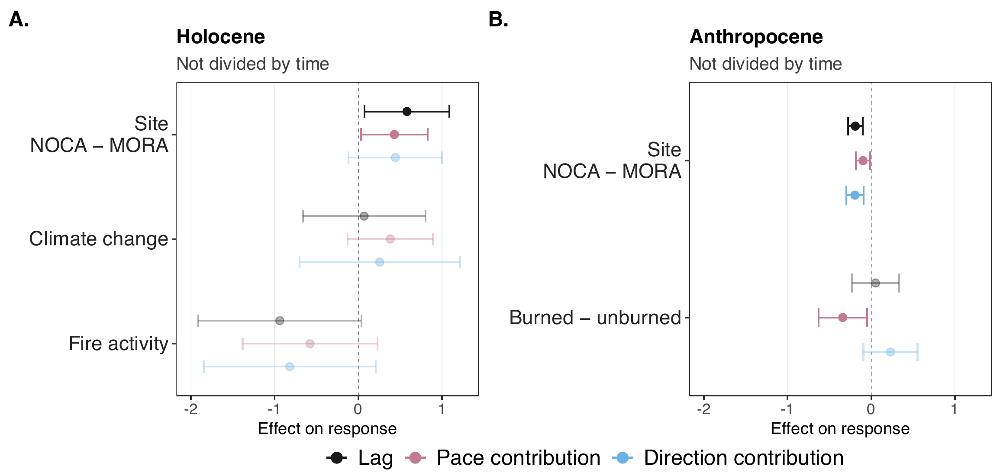

**Fig. S18. Climate and fire associations not divided by time.** As Fig.
6 of the main text, for the lag, the pace contribution, and the
direction contribution not divided by time: the change in mismatch
between the two ends, or the observed mismatch at t2, from which the
mismatch with the climate-predicted distance (pace) or the
climate-predicted direction (direction) was subtracted. Model slopes
with conditional 95% confidence intervals, the lag in black, the pace
contribution in pink, and the direction contribution in blue. Faded
estimates have intervals that include zero, and the two panels share one
x scale. (A) Holocene lake-periods, models with park, climate change,
and fire activity as explanatory variables, where climate change is the
standardized climate change between the two ends, with an AR(1)
correlation within each lake and weights for the number of samples at
each end. (B) Anthropocene plot pairs, models with park and burning
(burned or unburned) as explanatory variables, with park-specific
variances. The climate slope is per standardized unit of climate change,
and the fire slope per fire event per century and per charcoal record.
Both panels also show the park (the difference between NOCA and MORA).
Slopes are in CCA distance per unit of the term. The lake-periods of the
Holocene climate-change periods span 300 to 900 years, and those of the
stability periods 300 to 2600 years, between t1 and t2. The Anthropocene
plot pairs span 27.5 to 32.5 years between the midpoints of their two
climate windows (about 29 years).

**Model checks.** The fit of these models is given in Table
S21.

**Table S21. Associations with fire: fit of the models.** MORA and NOCA,
number of lake-periods or plot pairs of each park. AR(1), parameter of
the first-order autoregressive correlation within each lake. Residual
df, lake-periods or plot pairs with the coefficients subtracted. The
residual SE is that of MORA (for a variance of 1 in the Holocene
models). The models were fitted with restricted maximum likelihood
(REML), so that the log-likelihood and the AIC can only be compared
among models with the same fixed effects. R² is descriptive.

| Quantity | Era | Model | MORA | NOCA | Coefficients | Residual df | Residual SE | AR(1) | SD ratio NOCA/MORA | Log-likelihood (REML) | AIC | Descriptive R² | Warnings |
|:---|:---|:---|---:|---:|---:|---:|---:|---:|---:|---:|---:|---:|:---|
| Lag rate | Holocene | site + climate_rate + fire_activity | 13 | 10 | 4 | 19 | 0.026 | -0.089 | 6.780 | 27.332 | -40.664 | 0.228 | none |
| Lag rate | Anthropocene | site + burned | 328 | 277 | 3 | 602 | 1.129 | — | 2.026 | -1128.711 | 2267.422 | 0.052 | none |
| Pace contribution | Holocene | site + climate_rate + fire_activity | 10 | 10 | 4 | 16 | 0.012 | -0.495 | 16.592 | 26.595 | -39.190 | -0.032 | none |
| Pace contribution | Anthropocene | site + burned | 252 | 208 | 3 | 457 | 0.753 | — | 2.914 | -745.940 | 1501.879 | 0.034 | none |
| Direction contribution | Holocene | site + climate_rate + fire_activity | 10 | 10 | 4 | 16 | 0.042 | 0.494 | 2.149 | 25.267 | -36.533 | 0.245 | none |
| Direction contribution | Anthropocene | site + burned | 252 | 208 | 3 | 457 | 1.286 | — | 1.656 | -874.090 | 1758.179 | 0.062 | none |
| Lag | Holocene | site + climate_change + fire_activity | 13 | 10 | 4 | 19 | 0.196 | -0.045 | 3.082 | -6.260 | 26.520 | 0.240 | none |
| Lag | Anthropocene | site + burned | 328 | 277 | 3 | 602 | 0.331 | — | 1.962 | -381.940 | 773.880 | 0.054 | none |
| Pace contribution (not divided by time) | Holocene | site + climate_change + fire_activity | 10 | 10 | 4 | 16 | 0.139 | -0.446 | 4.147 | -1.638 | 17.276 | 0.192 | none |
| Pace contribution (not divided by time) | Anthropocene | site + burned | 252 | 208 | 3 | 457 | 0.220 | — | 2.837 | -178.059 | 366.118 | 0.034 | none |
| Direction contribution (not divided by time) | Holocene | site + climate_change + fire_activity | 10 | 10 | 4 | 16 | 0.292 | 0.279 | 1.666 | -6.511 | 27.022 | 0.121 | none |
| Direction contribution (not divided by time) | Anthropocene | site + burned | 252 | 208 | 3 | 457 | 0.374 | — | 1.619 | -305.018 | 620.036 | 0.062 | none |

# Species contributions (Q4)

**Table S22. Species contributions in the climate-predicted direction
per century.** Mean and 95% confidence interval (t-interval) in CCA
distance per century, for each species, park, and period type: how far
the species moved the community in the climate-predicted direction
(positive values) or against it (negative values). “absent”: the species
was not found in that park and period type. Lake-periods and plot pairs
in which the observed or the climate-predicted position did not move are
left out.

| Species | Park | Holocene-S | Holocene-C | Anthropocene |
|:---|:---|:---|:---|:---|
| Abies amabilis/grandis | MORA | -0.000 (-0.003 to 0.003) | +0.005 (-0.007 to 0.017) | -0.032 (-0.061 to -0.003) |
| Abies amabilis/grandis | NOCA | +0.001 (-0.002 to 0.004) | +0.001 (-0.002 to 0.004) | +0.023 (-0.008 to 0.054) |
| Abies lasiocarpa | MORA | +0.002 (-0.008 to 0.011) | -0.000 (-0.023 to 0.023) | -0.009 (-0.044 to 0.026) |
| Abies lasiocarpa | NOCA | +0.061 (-0.042 to 0.163) | -0.029 (-0.075 to 0.018) | -0.028 (-0.168 to 0.112) |
| Abies procera | MORA | -0.003 (-0.007 to 0.001) | +0.002 (-0.005 to 0.009) | +0.030 (-0.001 to 0.061) |
| Abies procera | NOCA | absent | absent | absent |
| Callitropsis nootkatensis | MORA | +0.003 (-0.001 to 0.006) | -0.030 (-0.114 to 0.054) | -0.003 (-0.072 to 0.065) |
| Callitropsis nootkatensis | NOCA | -0.007 (-0.024 to 0.011) | -0.008 (-0.030 to 0.014) | +0.061 (0.002 to 0.119) |
| Picea engelmannii | MORA | absent | absent | -0.005 (-0.021 to 0.010) |
| Picea engelmannii | NOCA | -0.003 (-0.012 to 0.006) | +0.001 (-0.002 to 0.003) | -0.026 (-0.097 to 0.044) |
| Pinus albicaulis | MORA | absent | absent | +0.006 (-0.002 to 0.013) |
| Pinus albicaulis | NOCA | absent | absent | +0.264 (0.094 to 0.434) |
| Pinus contorta | MORA | +0.008 (-0.002 to 0.018) | -0.003 (-0.013 to 0.008) | -0.003 (-0.014 to 0.009) |
| Pinus contorta | NOCA | -0.004 (-0.023 to 0.016) | +0.008 (-0.013 to 0.030) | +0.040 (-0.050 to 0.130) |
| Pinus monticola | MORA | -0.001 (-0.008 to 0.006) | -0.001 (-0.007 to 0.004) | -0.044 (-0.062 to -0.027) |
| Pinus monticola | NOCA | +0.008 (-0.043 to 0.059) | +0.001 (-0.013 to 0.014) | +0.005 (-0.032 to 0.042) |
| Pinus ponderosa | MORA | absent | absent | +0.009 (-0.009 to 0.027) |
| Pinus ponderosa | NOCA | absent | absent | +0.207 (-0.054 to 0.468) |
| Pseudotsuga menziesii | MORA | +0.001 (-0.003 to 0.005) | -0.010 (-0.035 to 0.016) | -0.052 (-0.101 to -0.002) |
| Pseudotsuga menziesii | NOCA | -0.008 (-0.025 to 0.009) | -0.005 (-0.027 to 0.017) | -0.023 (-0.101 to 0.055) |
| Thuja plicata | MORA | absent | absent | +0.005 (-0.022 to 0.031) |
| Thuja plicata | NOCA | -0.002 (-0.007 to 0.002) | -0.004 (-0.013 to 0.006) | +0.038 (-0.018 to 0.094) |
| Tsuga heterophylla | MORA | +0.004 (-0.013 to 0.022) | -0.000 (-0.024 to 0.024) | -0.051 (-0.072 to -0.030) |
| Tsuga heterophylla | NOCA | +0.007 (-0.014 to 0.028) | +0.001 (-0.002 to 0.004) | +0.108 (0.060 to 0.155) |
| Tsuga mertensiana | MORA | +0.001 (-0.002 to 0.004) | +0.014 (-0.014 to 0.042) | +0.011 (-0.017 to 0.039) |
| Tsuga mertensiana | NOCA | +0.002 (-0.002 to 0.005) | absent | +0.049 (-0.011 to 0.109) |

**Species contributions not divided by time.** Per century, the species
contributions of the Holocene are small partly because the lake-periods
are long, and those of the Anthropocene are large partly because the
time between the two surveys is short. To test whether this explains the
difference between the two eras, we also calculated the species
contributions without dividing by time (Fig. S19, Table S23).

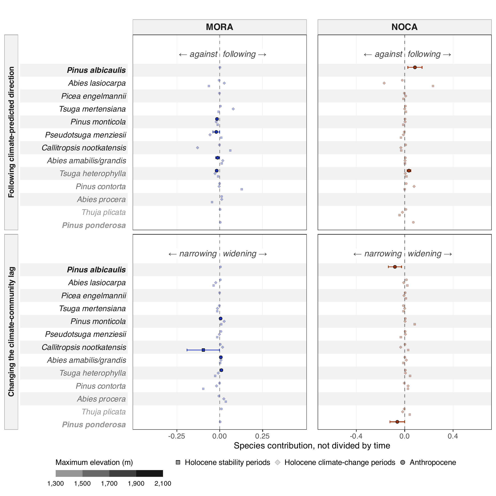

Not divided by time, the Holocene species contributions were at least as
large as those of the Anthropocene (mean size 0.034 against 0.008 at
MORA, and 0.039 against 0.023 at NOCA, in CCA distance). However, they
varied so much among the few lake-periods that none of the 37 Holocene
means had a confidence interval that excluded zero, not divided by time
or per century. In the Anthropocene, the same seven means excluded zero
either way.

**Fig. S19. Species contributions in the climate-predicted direction not
divided by time.** As Fig. 7 of the main text, with the contribution of
each species between t1 and t2 and not per century: how far each species
moved the community in the climate-predicted direction (positive values)
or against it (negative values). Means with 95% confidence intervals
(t-intervals). Symbols, order of the species, and shading as in Fig. 7.
The lake-periods of the Holocene climate-change periods span 300 to 900
years, and those of the stability periods 300 to 2600 years, between t1
and t2. The Anthropocene plot pairs span 27.5 to 32.5 years between the
midpoints of their two climate windows (about 29 years). Contributions
are in CCA distance.

**Table S23. Species contributions in the climate-predicted direction
not divided by time.** Mean and 95% confidence interval (t-interval) in
CCA distance, for each species, park, and period type. Columns as in
Table S22.

| Species | Park | Holocene-S | Holocene-C | Anthropocene |
|:---|:---|:---|:---|:---|
| Abies amabilis/grandis | MORA | +0.015 (-0.014 to 0.043) | +0.019 (-0.029 to 0.067) | -0.012 (-0.023 to -0.001) |
| Abies amabilis/grandis | NOCA | +0.003 (-0.007 to 0.012) | +0.004 (-0.009 to 0.017) | +0.007 (-0.003 to 0.017) |
| Abies lasiocarpa | MORA | -0.017 (-0.100 to 0.066) | -0.001 (-0.092 to 0.091) | -0.003 (-0.016 to 0.010) |
| Abies lasiocarpa | NOCA | +0.228 (-0.202 to 0.658) | -0.205 (-0.510 to 0.101) | -0.009 (-0.054 to 0.035) |
| Abies procera | MORA | -0.045 (-0.114 to 0.023) | +0.010 (-0.024 to 0.044) | +0.012 (-0.000 to 0.024) |
| Abies procera | NOCA | absent | absent | absent |
| Callitropsis nootkatensis | MORA | +0.059 (-0.030 to 0.148) | -0.120 (-0.458 to 0.217) | -0.001 (-0.027 to 0.024) |
| Callitropsis nootkatensis | NOCA | -0.028 (-0.080 to 0.024) | -0.031 (-0.119 to 0.056) | +0.019 (0.001 to 0.038) |
| Picea engelmannii | MORA | absent | absent | -0.002 (-0.008 to 0.004) |
| Picea engelmannii | NOCA | -0.010 (-0.036 to 0.017) | +0.008 (-0.015 to 0.031) | -0.008 (-0.031 to 0.014) |
| Pinus albicaulis | MORA | absent | absent | +0.002 (-0.001 to 0.005) |
| Pinus albicaulis | NOCA | absent | absent | +0.085 (0.030 to 0.139) |
| Pinus contorta | MORA | +0.114 (-0.054 to 0.282) | -0.008 (-0.050 to 0.035) | -0.001 (-0.006 to 0.003) |
| Pinus contorta | NOCA | -0.002 (-0.077 to 0.073) | +0.080 (-0.096 to 0.257) | +0.013 (-0.016 to 0.041) |
| Pinus monticola | MORA | -0.050 (-0.144 to 0.044) | -0.004 (-0.026 to 0.019) | -0.017 (-0.023 to -0.010) |
| Pinus monticola | NOCA | -0.012 (-0.214 to 0.190) | +0.006 (-0.067 to 0.078) | +0.002 (-0.010 to 0.013) |
| Pinus ponderosa | MORA | absent | absent | +0.004 (-0.003 to 0.010) |
| Pinus ponderosa | NOCA | absent | absent | +0.066 (-0.017 to 0.150) |
| Pseudotsuga menziesii | MORA | +0.022 (-0.042 to 0.085) | -0.029 (-0.106 to 0.047) | -0.020 (-0.039 to -0.000) |
| Pseudotsuga menziesii | NOCA | -0.028 (-0.095 to 0.039) | -0.006 (-0.139 to 0.127) | -0.008 (-0.032 to 0.017) |
| Thuja plicata | MORA | absent | absent | +0.002 (-0.008 to 0.012) |
| Thuja plicata | NOCA | -0.043 (-0.155 to 0.069) | -0.014 (-0.054 to 0.025) | +0.012 (-0.006 to 0.030) |
| Tsuga heterophylla | MORA | -0.014 (-0.128 to 0.100) | -0.000 (-0.120 to 0.120) | -0.019 (-0.027 to -0.011) |
| Tsuga heterophylla | NOCA | +0.011 (-0.064 to 0.087) | +0.005 (-0.008 to 0.017) | +0.034 (0.019 to 0.050) |
| Tsuga mertensiana | MORA | +0.026 (-0.046 to 0.098) | +0.062 (-0.054 to 0.177) | +0.004 (-0.007 to 0.015) |
| Tsuga mertensiana | NOCA | +0.013 (-0.013 to 0.039) | absent | +0.016 (-0.004 to 0.035) |

# Appendix S4. Sensitivity of the results to the correction of the Holocene climate

To test how much the results depend on the correction of the Holocene
climate (Appendix S2), we repeated all analyses without correction,
i.e., with CHELSA-TraCE21k as published. The correction changes only the
Holocene climate. Between the two analyses, only the Holocene climate
change, the climate periods, and the climate-predicted positions of the
Holocene communities can therefore differ, whereas the observed
positions, community turnover, and all quantities of the Anthropocene
stay the same.

**Climate periods and lake-periods.** The two analyses gave the same 10
climate periods and the same 23 lake-periods. To assess whether the sign
of the lag and of the two contributions depends on the correction of the
Holocene climate, we counted the lake-periods in which they kept their
sign without correction (Table S24). The lag kept its sign in 5 of 13
lake-periods at MORA and in 8 of 10 at NOCA.

**Table S24. Lake-periods in which the lag, the pace contribution, and
the direction contribution kept their sign without correction of the
Holocene climate.** The quantities are not divided by time. A pace or
direction contribution is undefined when the observed or the
climate-predicted position did not move.

| Quantity | Park | Lake-periods | Defined in both analyses | Kept their sign | Changed sign |
|:---|:---|---:|---:|---:|---:|
| Lag | MORA | 13 | 13 | 5 | 8 |
| Lag | NOCA | 10 | 10 | 8 | 2 |
| Pace contribution | MORA | 13 | 10 | 5 | 5 |
| Pace contribution | NOCA | 10 | 10 | 7 | 3 |
| Direction contribution | MORA | 13 | 10 | 6 | 4 |
| Direction contribution | NOCA | 10 | 10 | 7 | 3 |

**Differences between the Anthropocene and the Holocene.** Of the 17
differences between the Anthropocene and the Holocene that were
significant in the main analysis, 12 stayed significant with the same
sign without correction (Table S16 and Fig. S20, without community
turnover, which the correction does not change). Without correction, the
lag not divided by time at MORA (Anthropocene against both Holocene
period types), the pace contribution per century at MORA (Anthropocene
against Holocene stability periods), and the direction contribution per
century at NOCA (Anthropocene against Holocene stability periods) kept
their sign but were no longer significant. The pace contribution not
divided by time at MORA (Anthropocene against Holocene stability
periods) changed sign but was not significant. No other difference
between the Anthropocene and the Holocene was significant without
correction.

**Differences within the Holocene.** None of the three differences
between the climate-change and the stability periods that were
significant in the main analysis (the pace contribution per century and
not divided by time at MORA, and the direction contribution per century
at NOCA) stayed significant without correction (Table S16 and Fig. S20).
Without correction, the pace contribution per century at MORA and the
direction contribution per century at NOCA kept their sign but were no
longer significant. The pace contribution not divided by time at MORA
changed sign but was not significant. No other difference between the
climate-change and the stability periods was significant without
correction.

**Associations with climate change and fire.** The one Holocene
coefficient of climate change or fire activity whose 95% confidence
interval excluded zero in the main analysis (fire activity on the
direction contribution per century) no longer excluded zero with the
same sign without correction (Fig. S21). Without correction, fire
activity on the direction contribution per century (−0.11 in the main
analysis, +0.28 without correction) changed sign, with an interval that
excluded zero in the opposite direction. Without correction, fire
activity on the lag per century (−0.10 in the main analysis, +0.35
without correction) and fire activity on the direction contribution not
divided by time (−0.39 in the main analysis, +0.86 without correction)
had intervals that excluded zero with the opposite sign, unlike in the
main analysis. Without correction, the climate change rate on the lag
per century (−0.04 in the main analysis, +0.02 without correction), the
climate change rate on the direction contribution per century (−0.32 in
the main analysis, +0.68 without correction), climate change on the pace
contribution not divided by time (+0.11 in the main analysis, −0.23
without correction), climate change on the direction contribution not
divided by time (−0.22 in the main analysis, +0.20 without correction),
fire activity on the lag not divided by time (−0.34 in the main
analysis, +0.35 without correction), and fire activity on the pace
contribution not divided by time (−0.32 in the main analysis, +0.03
without correction) changed sign, with intervals that included zero in
both analyses. The coefficients of the Anthropocene are the same in both
analyses.

**Species contributions.** None of the 37 Holocene species means had a
95% confidence interval that excluded zero in the main analysis (Fig.
S22). No Holocene species mean had a 95% confidence interval that
excluded zero without correction. Of the Holocene species means, whose
intervals included zero in both analyses, none changed sign without
correction. The species means of the Anthropocene are the same in both
analyses.

**Results that hold.** Significant with the same sign in both analyses:
climate change per century and not divided by time at MORA and NOCA
(Anthropocene against both Holocene period types); the lag per century
at MORA (Anthropocene against both Holocene period types); the direction
contribution per century at MORA (Anthropocene against both Holocene
period types). Holocene coefficients of climate change and fire activity
whose interval excluded zero with the same sign in both analyses: none.

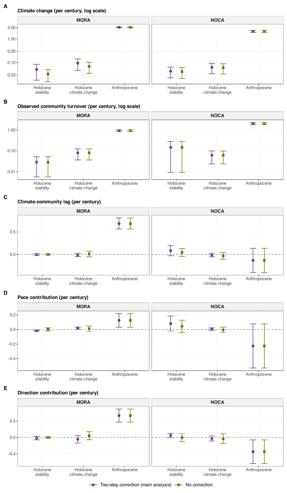

**Fig. S20. Rates of climate change, community turnover, the
climate–community lag, and the pace and direction contributions by
period type, with and without correction of the Holocene climate.**
Estimated means with 95% confidence intervals for the Holocene stability
periods, the Holocene climate-change periods and the Anthropocene plot
pairs of each park, from the models of Fig. 5 fitted with each version
of the Holocene climate: (A) the climate change rate (SD of the legacy
plots per century) and (B) the observed community turnover rate (CCA
distance per century), both on log axes, where an interval that reaches
zero or below is cut at the lower edge of the panel; (C) the lag rate,
(D) the pace contribution and (E) the direction contribution, in CCA
distance per century. Community turnover and every quantity of the
Anthropocene are the same in the two analyses. Purple circles: two-step
correction (main analysis). Olive squares: no
correction.

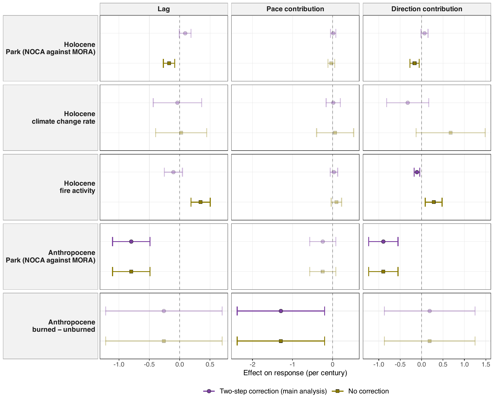

**Fig. S21. Associations with climate change and fire, with and without
correction of the Holocene climate.** Coefficients of Fig. 6 with their
95% confidence intervals, from the models fitted with each version of
the Holocene climate. Rows: the terms of the Holocene models of the
lake-periods (park, climate change rate, fire activity) and of the
Anthropocene models of the plot pairs (park, burned between the
surveys), which are the same in the two analyses. Columns: the lag, the
pace contribution and the direction contribution, per century.
Coefficients whose interval includes zero are faded. The dashed vertical
line marks zero. Purple circles: two-step correction (main analysis).
Olive squares: no correction.

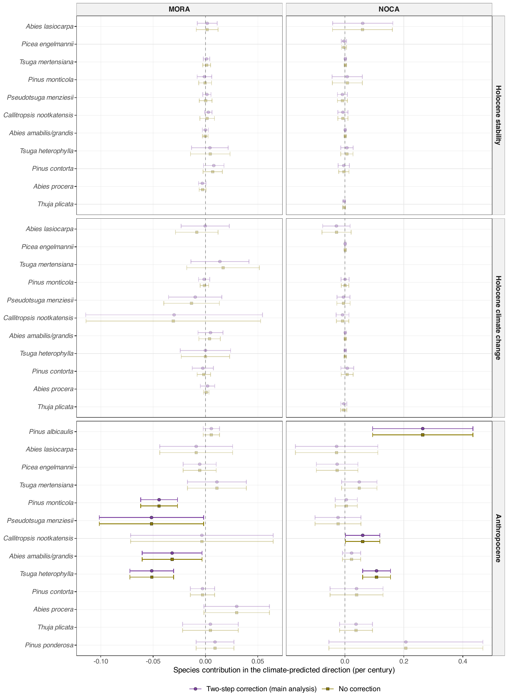

**Fig. S22. Species contributions in the climate-predicted direction,
with and without correction of the Holocene climate.** Mean contribution
per century of each species to the community change in the
climate-predicted direction, with its 95% confidence interval, as in
Fig. 7, for each park (columns) and period type (rows). Species are
ordered by elevation as in Fig. 7, and species absent from a park and
period type are left out. Means whose interval includes zero are faded.
The dashed vertical line marks zero. The means of the Anthropocene are
the same in the two analyses. Purple circles: two-step correction (main
analysis). Olive squares: no correction.

# Appendix S5. Sensitivity of the results to the Anthropocene climate product

Three climate products could describe the Anthropocene climate at the
forest plots, each with its advantages and disadvantages: CHELSA V2.1 (1
km), the PRISM long-term series (LT81m, 800 m; Daly et al., 2008), which
uses stations with long records to keep its time series consistent, and
nClimGrid (1/24°, about 5 km; Vose et al., 2014). PRISM and nClimGrid
are interpolated from weather station observations, but they do not
cover the Holocene. We used CHELSA V2.1 in the main analysis, because
the Holocene climate comes from the same product line (CHELSA-TraCE21k),
so that the climates of the two eras are more comparable. To be fully
transparent, we nevertheless repeated all analyses with each of the
other two products as the Anthropocene climate. Each product replaced
V2.1 at the same plots, survey windows and months. The Holocene climate
is corrected to the level of each product in the same two steps as in
the main analysis (Appendix S2): step 1, from CHELSA-TraCE21k to
CHELSAcruts, is the same for all products, and step 2 goes from
CHELSAcruts to the product, over the same grid cells within 5 km of the
lakes and the same years (1979 to 2016). For PRISM, we used its monthly
mean temperature, which PRISM calculates as the mean of the minimum and
maximum temperature, as in the main analysis. The climate–community
space is fitted on the climate of the legacy plots, so the climate
product can change every result: the CCA, the positions of all
communities, the climate periods, the lags and the two contributions,
the differences between period types, the associations with climate
change and fire, and the species contributions.

**Table S25. Climate of the Anthropocene plot pairs with the three
climate products.** Median over the plot pairs of each park
(interquartile range in brackets) of the climate at the legacy survey
(1979 to 1989), at the resurvey (the six years up to the resurvey of
each plot), and of the change at each plot pair (the legacy value
subtracted from the resurvey value). The change in percent is the median
of the change of each plot pair relative to its legacy value. The median
change is not the difference of the two medians.

| Park | Variable | Product | Legacy survey | Resurvey | Change at the plot pairs | Change (%) |
|:---|:---|:---|:---|:---|:---|:---|
| MORA | Spring temperature (°C) | CHELSA V2.1 | 3.32 (1.88 to 4.87) | 3.77 (2.45 to 5.36) | 0.37 (0.23 to 0.81) |  |
| MORA | Spring temperature (°C) | PRISM | 4.06 (2.79 to 5.29) | 4.15 (3.08 to 5.53) | 0.08 (−0.14 to 0.45) |  |
| MORA | Spring temperature (°C) | nClimGrid | 3.79 (2.98 to 4.82) | 3.52 (2.60 to 4.68) | −0.41 (−0.46 to 0.05) |  |
| MORA | Summer precipitation (mm) | CHELSA V2.1 | 204 (173 to 258) | 150 (132 to 187) | −52 (−63 to −37) | −23.3 |
| MORA | Summer precipitation (mm) | PRISM | 173 (138 to 212) | 154 (117 to 184) | −21 (−27 to −15) | −12.8 |
| MORA | Summer precipitation (mm) | nClimGrid | 181 (137 to 227) | 170 (130 to 211) | −8 (−11 to −5) | −5.5 |
| NOCA | Spring temperature (°C) | CHELSA V2.1 | 3.61 (0.77 to 5.84) | 3.94 (0.86 to 6.02) | 0.22 (−0.24 to 0.52) |  |
| NOCA | Spring temperature (°C) | PRISM | 4.73 (2.48 to 7.02) | 4.00 (1.98 to 6.50) | −0.54 (−0.89 to −0.35) |  |
| NOCA | Spring temperature (°C) | nClimGrid | 5.38 (3.37 to 7.49) | 5.07 (3.04 to 7.10) | −0.13 (−0.22 to −0.05) |  |
| NOCA | Summer precipitation (mm) | CHELSA V2.1 | 126 (109 to 166) | 163 (139 to 205) | 16 (5 to 58) | 13.5 |
| NOCA | Summer precipitation (mm) | PRISM | 139 (114 to 174) | 129 (113 to 157) | −10 (−17 to 3) | −5.9 |
| NOCA | Summer precipitation (mm) | nClimGrid | 133 (113 to 151) | 132 (120 to 151) | 5 (−4 to 11) | 3.3 |

**Table S26. Step 2 of the bias correction with the climate products.**
The correction from CHELSAcruts to each product, to whose level the
Holocene climate was corrected, over 1979 to 2016, on the grid cells
within 5 km of the lakes, shown for the two climate variables of the
climate–community space: the mean offset of the spring (March to May)
mean temperature and the ratio of the summer (June to August)
precipitation sums. Step 1, from CHELSA-TraCE21k to CHELSAcruts, is the
same for all products (Table S5, Fig. S7).

| Park | Product     | Spring temperature offset (°C) | Summer precipitation ratio |
|:-----|:------------|:-------------------------------|:---------------------------|
| MORA | CHELSA V2.1 | −1.43                          | 1.56                       |
| MORA | PRISM       | 0.04                           | 1.20                       |
| MORA | nClimGrid   | −0.15                          | 1.16                       |
| NOCA | CHELSA V2.1 | −1.48                          | 1.32                       |
| NOCA | PRISM       | −0.22                          | 1.37                       |
| NOCA | nClimGrid   | 1.23                           | 1.41                       |

**Climate of the plot pairs.** The median change of the spring mean
temperature at the plot pairs was 0.37 °C at MORA and 0.22 °C at NOCA
with CHELSA V2.1, 0.08 °C at MORA and −0.54 °C at NOCA with PRISM and
−0.41 °C at MORA and −0.13 °C at NOCA with nClimGrid. The median change
of the summer precipitation was −23.3% at MORA and 13.5% at NOCA with
CHELSA V2.1, −12.8% at MORA and −5.9% at NOCA with PRISM and −5.5% at
MORA and 3.3% at NOCA with nClimGrid (Table S25, Fig. S23).

**Climate periods and lake-periods.** All three products gave the same
10 climate periods (Fig. S24) and the same 23 lake-periods.

**Climate–community space.** The two climate variables explained 13.8%
of the inertia of the legacy communities with CHELSA V2.1, and 11.2%
with PRISM and 6.8% with nClimGrid (Fig. S25).

**Differences between the Anthropocene and the Holocene.** Of the 22
differences between the Anthropocene and the Holocene that were
significant in the main analysis, 16 stayed significant with the same
sign with PRISM and 12 with nClimGrid (Tables S16 and S27, Fig. S26).
With PRISM, climate change not divided by time at MORA (Anthropocene
against Holocene climate-change periods), the lag not divided by time at
MORA (Anthropocene against both Holocene period types), and the
direction contribution per century at MORA (Anthropocene against both
Holocene period types) kept their sign but were no longer significant.
Climate change not divided by time at NOCA (Anthropocene against
Holocene climate-change periods) changed sign but was not significant.
With nClimGrid, the lag not divided by time at MORA (Anthropocene
against both Holocene period types), the pace contribution per century
and not divided by time at MORA (Anthropocene against Holocene stability
periods), and the direction contribution per century at MORA
(Anthropocene against both Holocene period types) kept their sign but
were no longer significant. Climate change not divided by time at MORA
and NOCA (Anthropocene against both Holocene period types) changed sign
but were not significant. With PRISM, the pace contribution per century
at MORA (Anthropocene against Holocene climate-change periods), the
direction contribution per century at NOCA (Anthropocene against
Holocene climate-change periods), and the direction contribution not
divided by time at NOCA (Anthropocene against Holocene stability
periods) were significant, unlike in the main analysis. With nClimGrid,
the pace contribution per century at NOCA (Anthropocene against Holocene
stability periods) and the direction contribution per century at NOCA
(Anthropocene against Holocene climate-change periods) were significant,
unlike in the main analysis.

**Differences within the Holocene.** Of the three differences between
the climate-change and the stability periods that were significant in
the main analysis (the pace contribution per century and not divided by
time at MORA, and the direction contribution per century at NOCA), all
three stayed significant with the same sign with PRISM and one with
nClimGrid (Tables S16 and S27, Fig. S26). With nClimGrid, the pace
contribution not divided by time at MORA and the direction contribution
per century at NOCA kept their sign but were no longer significant. No
other difference between the climate-change and the stability periods
was significant with PRISM or with nClimGrid.

**Associations with climate change and fire.** Of the three coefficients
of climate change, fire activity, and burning whose 95% confidence
intervals excluded zero in the main analysis (fire activity on the
direction contribution per century, and burning between the surveys on
the pace contribution per century and not divided by time), two still
excluded zero with the same sign with PRISM and two with nClimGrid (Fig.
S27). With PRISM, fire activity on the direction contribution per
century (−0.11 in the main analysis, −0.08 with PRISM) kept its sign but
its interval no longer excluded zero. With nClimGrid, fire activity on
the direction contribution per century (−0.11 in the main analysis,
+0.001 with nClimGrid) changed sign, with an interval that included
zero. With PRISM, fire activity on the pace contribution per century
(+0.03 in the main analysis, +0.10 with PRISM), burning between the
surveys on the lag per century (−0.26 in the main analysis, −1.40 with
PRISM), and burning between the surveys on the lag not divided by time
(−0.07 in the main analysis, −0.40 with PRISM) had intervals that
excluded zero, unlike in the main analysis. With nClimGrid, burning
between the surveys on the lag per century (−0.26 in the main analysis,
−1.47 with nClimGrid) and burning between the surveys on the lag not
divided by time (−0.07 in the main analysis, −0.42 with nClimGrid) had
intervals that excluded zero, unlike in the main analysis. With PRISM,
the climate change rate on the pace contribution per century (+0.02 in
the main analysis, −0.07 with PRISM), climate change on the pace
contribution not divided by time (+0.11 in the main analysis, −0.09 with
PRISM), burning between the surveys on the direction contribution per
century (+0.19 in the main analysis, −0.62 with PRISM), and burning
between the surveys on the direction contribution not divided by time
(+0.05 in the main analysis, −0.18 with PRISM) changed sign, with
intervals that included zero in both analyses. With nClimGrid, the
climate change rate on the lag per century (−0.04 in the main analysis,
+0.07 with nClimGrid), the climate change rate on the direction
contribution per century (−0.32 in the main analysis, +0.03 with
nClimGrid), climate change on the pace contribution not divided by time
(+0.11 in the main analysis, −0.10 with nClimGrid), fire activity on the
lag per century (−0.10 in the main analysis, +0.06 with nClimGrid), fire
activity on the lag not divided by time (−0.34 in the main analysis,
+0.05 with nClimGrid), fire activity on the direction contribution not
divided by time (−0.39 in the main analysis, +0.16 with nClimGrid),
burning between the surveys on the direction contribution per century
(+0.19 in the main analysis, −0.68 with nClimGrid), and burning between
the surveys on the direction contribution not divided by time (+0.05 in
the main analysis, −0.19 with nClimGrid) changed sign, with intervals
that included zero in both analyses.

**Species contributions.** Of the seven species means whose 95%
confidence intervals excluded zero in the main analysis, three still
excluded zero with the same sign with PRISM and four with nClimGrid
(Fig. S28). With PRISM, *Pseudotsuga menziesii* at MORA in the
Anthropocene (−0.05 in the main analysis, −0.04 with PRISM) kept its
sign but its interval no longer excluded zero. *Callitropsis
nootkatensis* at NOCA in the Anthropocene (+0.06 in the main analysis,
−0.004 with PRISM) changed sign, with an interval that included zero.
*Pinus albicaulis* at NOCA in the Anthropocene (+0.26 in the main
analysis, −0.13 with PRISM) and *Tsuga heterophylla* at NOCA in the
Anthropocene (+0.11 in the main analysis, −0.09 with PRISM) changed
sign, with intervals that excluded zero in the opposite direction. With
nClimGrid, *Tsuga heterophylla* at NOCA in the Anthropocene (+0.11 in
the main analysis, +0.002 with nClimGrid) kept its sign but its interval
no longer excluded zero. *Abies amabilis/grandis* at MORA in the
Anthropocene (−0.03 in the main analysis, +0.002 with nClimGrid) and
*Pseudotsuga menziesii* at MORA in the Anthropocene (−0.05 in the main
analysis, +0.04 with nClimGrid) changed sign, with intervals that
included zero. With PRISM, *Abies procera* at MORA in the Anthropocene
(+0.03 in the main analysis, +0.02 with PRISM) had an interval that
excluded zero, unlike in the main analysis. With nClimGrid, *Picea
engelmannii* at NOCA in the Anthropocene (−0.03 in the main analysis,
−0.13 with nClimGrid) had an interval that excluded zero and *Tsuga
mertensiana* at NOCA in the Anthropocene (+0.05 in the main analysis,
−0.05 with nClimGrid) had an interval that excluded zero with the
opposite sign, unlike in the main analysis. Of the other species means,
whose intervals included zero in both analyses, 7 changed sign with
PRISM and 10 with nClimGrid.

**Results that hold.** Significant with the same sign with all three
products: climate change per century at MORA and NOCA (Anthropocene
against both Holocene period types); community turnover per century at
MORA and NOCA (Anthropocene against both Holocene period types);
community turnover not divided by time at NOCA (Anthropocene against
Holocene climate-change periods); the lag per century at MORA
(Anthropocene against both Holocene period types); the pace contribution
per century at MORA (Holocene climate-change against stability periods);
the direction contribution per century at NOCA (Anthropocene against
Holocene stability periods). Coefficients of climate change, fire
activity, and burning whose interval excluded zero with the same sign
with all three products: burning between the surveys on the pace
contribution per century and not divided by time. Species means whose
interval excluded zero with the same sign with all three products:
*Pinus monticola* at MORA in the Anthropocene; *Tsuga heterophylla* at
MORA in the Anthropocene.

**Table S27. Differences between period types whose significance differs
between the climate products.** The difference between the estimated
means of two period types within a park (Table S16 for the main
analysis) with its Holm-adjusted p in brackets, for each difference that
was significant (p \< 0.05) with one product and not with another, or
that changed sign. Climate change is in SD of the legacy plots, the
other quantities in CCA distance or in CCA distance per century.

| Quantity | Park | Difference | CHELSA V2.1 | PRISM | nClimGrid |
|:---|:---|:---|:---|:---|:---|
| Climate change (not divided by time) | MORA | Anthropocene - Holocene-C | 0.515 (\< 0.001) | 0.127 (0.914) | −0.087 (1.000) |
| Climate change (not divided by time) | MORA | Anthropocene - Holocene-S | 0.584 (\< 0.001) | 0.203 (\< 0.001) | −0.005 (1.000) |
| Climate change (not divided by time) | NOCA | Anthropocene - Holocene-C | 0.219 (0.021) | −0.058 (1.000) | −0.243 (0.090) |
| Climate change (not divided by time) | NOCA | Anthropocene - Holocene-S | 0.381 (\< 0.001) | 0.133 (0.038) | −0.028 (1.000) |
| Direction contribution | MORA | Anthropocene - Holocene-C | 0.575 (\< 0.001) | 0.183 (0.131) | 0.080 (1.000) |
| Direction contribution | MORA | Anthropocene - Holocene-S | 0.547 (\< 0.001) | 0.189 (0.116) | 0.080 (1.000) |
| Direction contribution | NOCA | Anthropocene - Holocene-C | −0.322 (0.066) | −1.237 (\< 0.001) | −0.634 (0.002) |
| Direction contribution | NOCA | Holocene-C - Holocene-S | −0.073 (\< 0.001) | −0.064 (0.005) | −0.049 (0.453) |
| Direction contribution (not divided by time) | NOCA | Anthropocene - Holocene-S | −0.225 (0.170) | −0.423 (\< 0.001) | −0.106 (1.000) |
| Lag | MORA | Anthropocene - Holocene-C | 0.254 (0.001) | 0.084 (0.936) | 0.020 (1.000) |
| Lag | MORA | Anthropocene - Holocene-S | 0.390 (0.013) | 0.279 (0.080) | 0.219 (0.764) |
| Pace contribution | MORA | Anthropocene - Holocene-C | 0.108 (0.103) | 0.202 (0.001) | 0.096 (0.253) |
| Pace contribution | MORA | Anthropocene - Holocene-S | 0.141 (0.017) | 0.241 (\< 0.001) | 0.135 (0.086) |
| Pace contribution | NOCA | Anthropocene - Holocene-S | −0.307 (0.178) | −0.364 (0.096) | −0.499 (0.046) |
| Pace contribution (not divided by time) | MORA | Anthropocene - Holocene-S | 0.262 (0.009) | 0.266 (\< 0.001) | 0.274 (0.106) |
| Pace contribution (not divided by time) | MORA | Holocene-C - Holocene-S | 0.292 (0.001) | 0.262 (0.002) | 0.326 (0.157) |

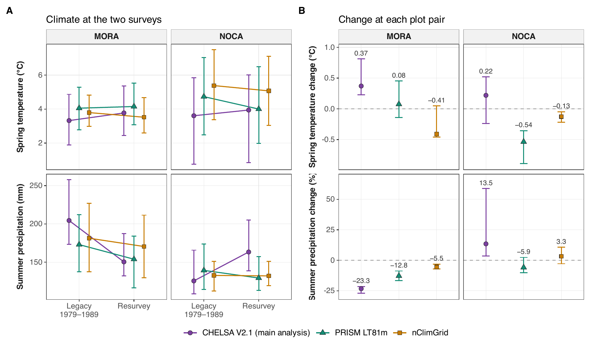

**Fig. S23. Climate of the Anthropocene plot pairs with the three
climate products.** (A) Median over the plot pairs of each park of the
spring mean temperature (°C) and the summer precipitation (mm) at the
legacy survey (1979 to 1989) and at the resurvey (the six years up to
the resurvey of each plot), with the interquartile range. (B) Median
over the plot pairs of the change at each plot pair (the legacy value
subtracted from the resurvey value; precipitation in percent of the
legacy value), with the interquartile range and the median printed
above. Purple circles: CHELSA V2.1 (main analysis). Green diamonds:
PRISM. Orange squares: nClimGrid.

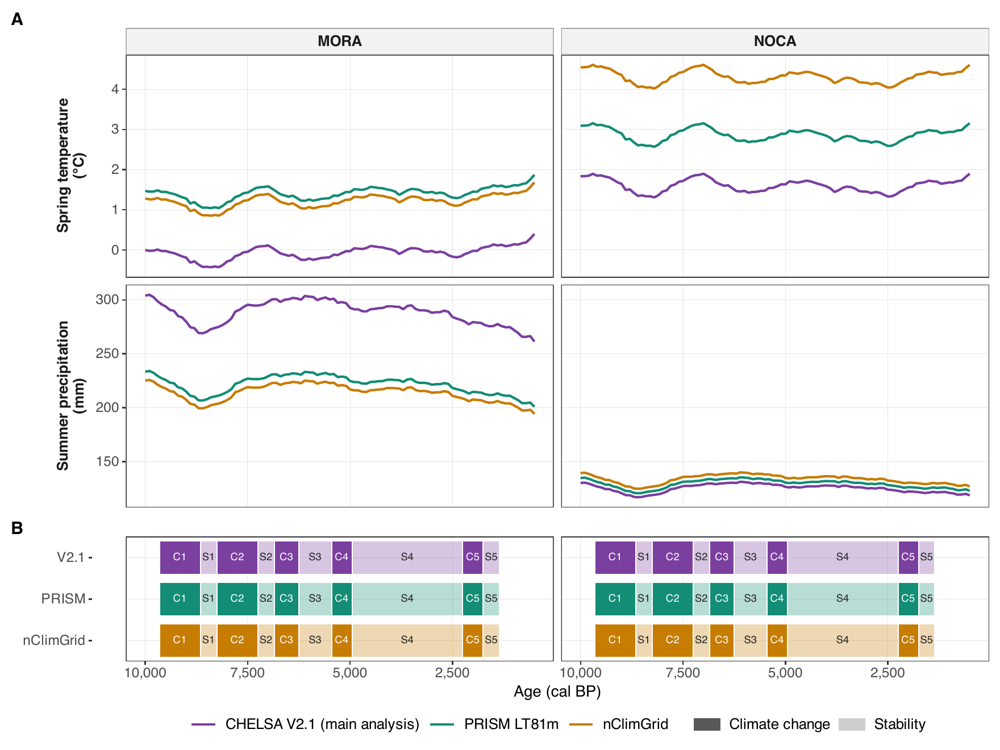

**Fig. S24. Holocene climate and climate periods with the three climate
products.** (A) Spring mean temperature (°C) and summer precipitation
(mm) of CHELSA-TraCE21k at the lakes of each park (MORA: mean of its
three lakes), corrected to the level of each product in two steps, as
the centred 1,000-year running mean of the centennial time steps, from
10,500 to 500 cal BP. (B) The climate periods drawn with each product
from the regional series of Fig. 3: climate-change periods (C) in full
colour and stability periods (S) in light colour. The periods are the
same for both parks and are repeated under each. Purple: CHELSA V2.1
(main analysis). Green: PRISM. Orange: nClimGrid.

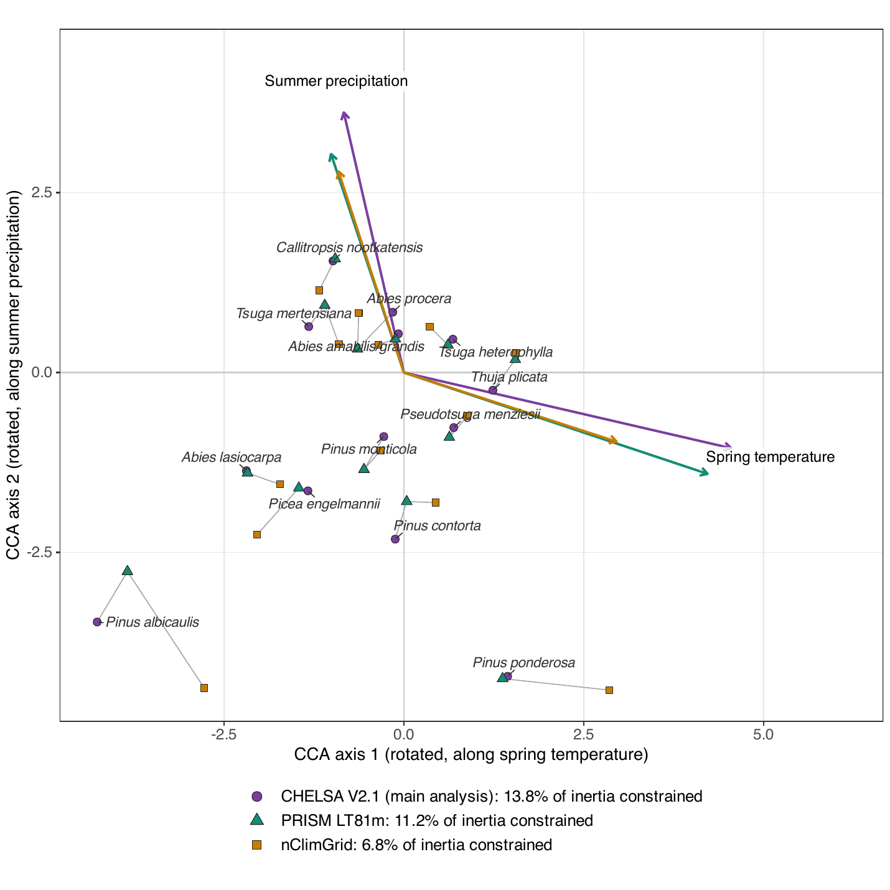

**Fig. S25. The climate–community space with the three climate
products.** Scores of the tree species (points, scaling 1) and biplot
arrows of spring temperature and summer precipitation in the CCA fitted
with each product, each in its own display rotation, so that axis 1 runs
along spring temperature and axis 2 along summer precipitation as in
Fig. 4. Grey lines join the scores of one species in the analyses with
the different products. Species names are placed at their scores with
CHELSA V2.1. The arrows are scaled together, so that their lengths
compare across the products. The legend gives the share of the total
inertia that the two climate variables explain with each product. Purple
circles: CHELSA V2.1 (main analysis). Green diamonds: PRISM. Orange
squares: nClimGrid.

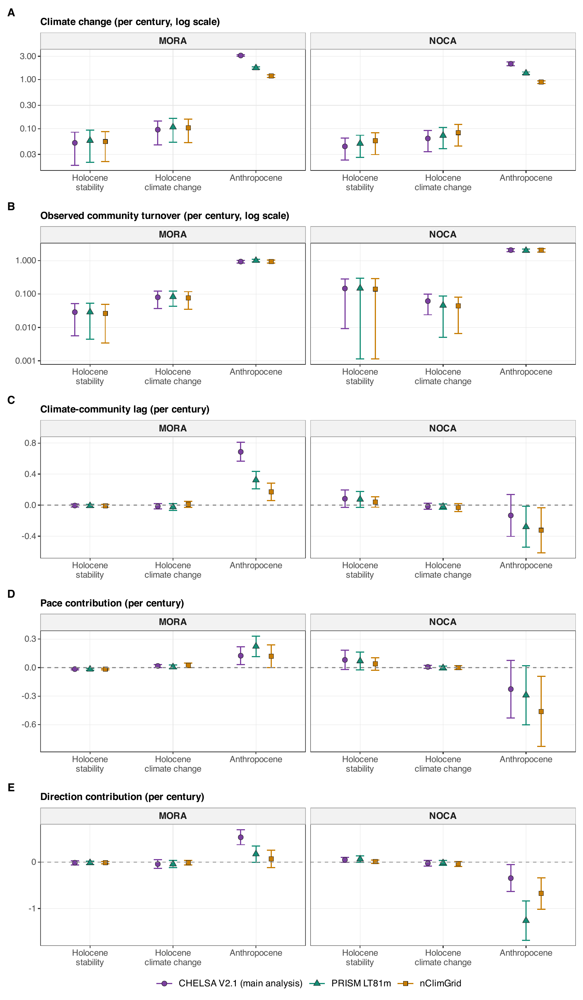

**Fig. S26. Rates of climate change, community turnover, the
climate–community lag, and the pace and direction contributions by
period type, with the three climate products.** Estimated means with 95%
confidence intervals for the Holocene stability periods, the Holocene
climate-change periods and the Anthropocene plot pairs of each park,
from the models of Fig. 5 fitted with each product: (A) the climate
change rate (SD of the legacy plots per century) and (B) the observed
community turnover rate (CCA distance per century), both on log axes,
where an interval that reaches zero or below is cut at the lower edge of
the panel; (C) the lag rate, (D) the pace contribution and (E) the
direction contribution, in CCA distance per century. Purple circles:
CHELSA V2.1 (main analysis). Green diamonds: PRISM. Orange squares:
nClimGrid.

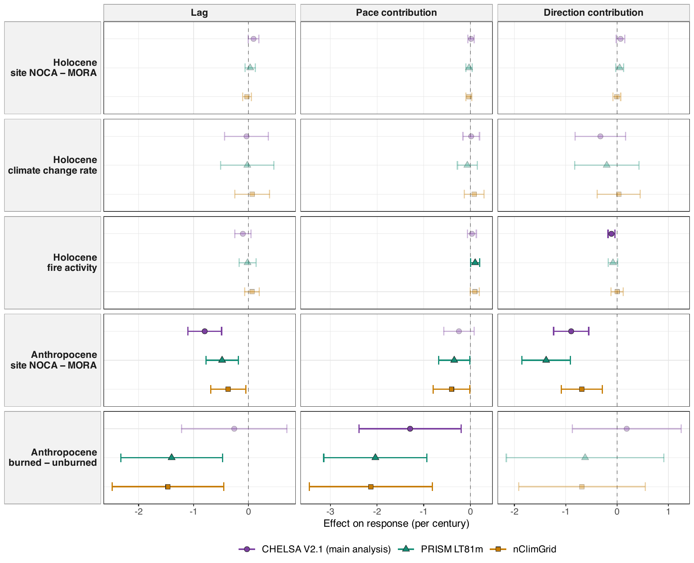

**Fig. S27. Associations with climate change and fire, with the three
climate products.** Coefficients of Fig. 6 with their 95% confidence
intervals, from the models fitted with each product. Rows: the terms of
the Holocene models of the lake-periods (park, climate change rate, fire
activity) and of the Anthropocene models of the plot pairs (park, burned
between the surveys). Columns: the lag, the pace contribution and the
direction contribution, per century. Coefficients whose interval
includes zero are faded. The dashed vertical line marks zero. Purple
circles: CHELSA V2.1 (main analysis). Green diamonds: PRISM. Orange
squares: nClimGrid.

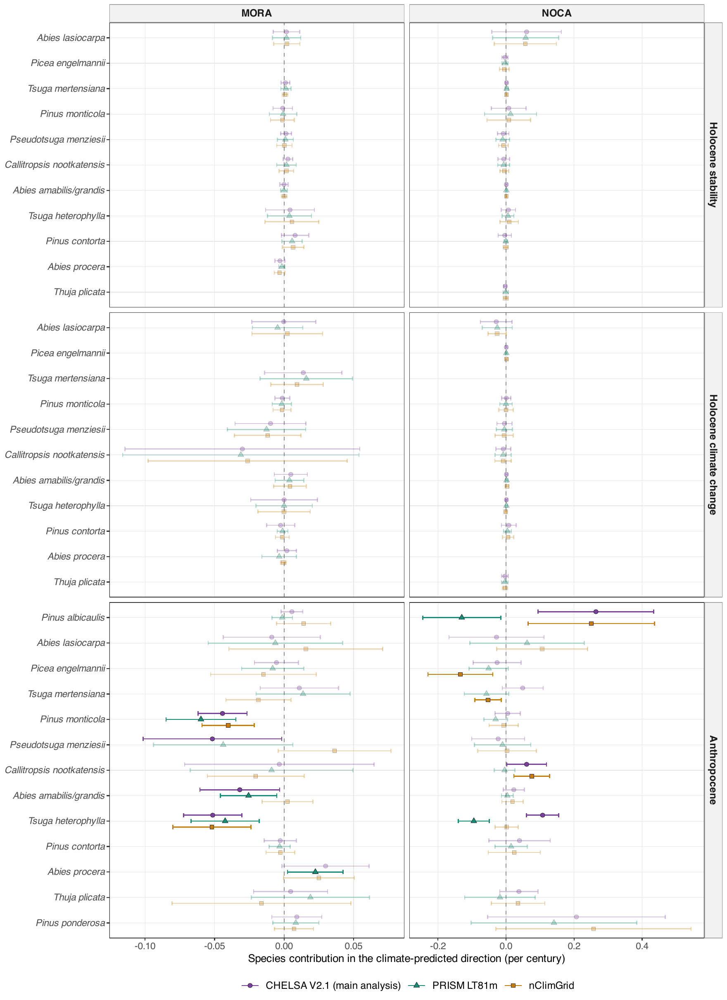

**Fig. S28. Species contributions in the climate-predicted direction
with the three climate products.** Mean contribution per century of each
species to the community change in the climate-predicted direction, with
its 95% confidence interval, as in Fig. 7, for each park (columns) and
period type (rows). Species are ordered by elevation as in Fig. 7, and
species absent from a park and period type are left out. Means whose
interval includes zero are faded. The dashed vertical line marks zero.
Purple circles: CHELSA V2.1 (main analysis). Green diamonds: PRISM.
Orange squares: nClimGrid.
