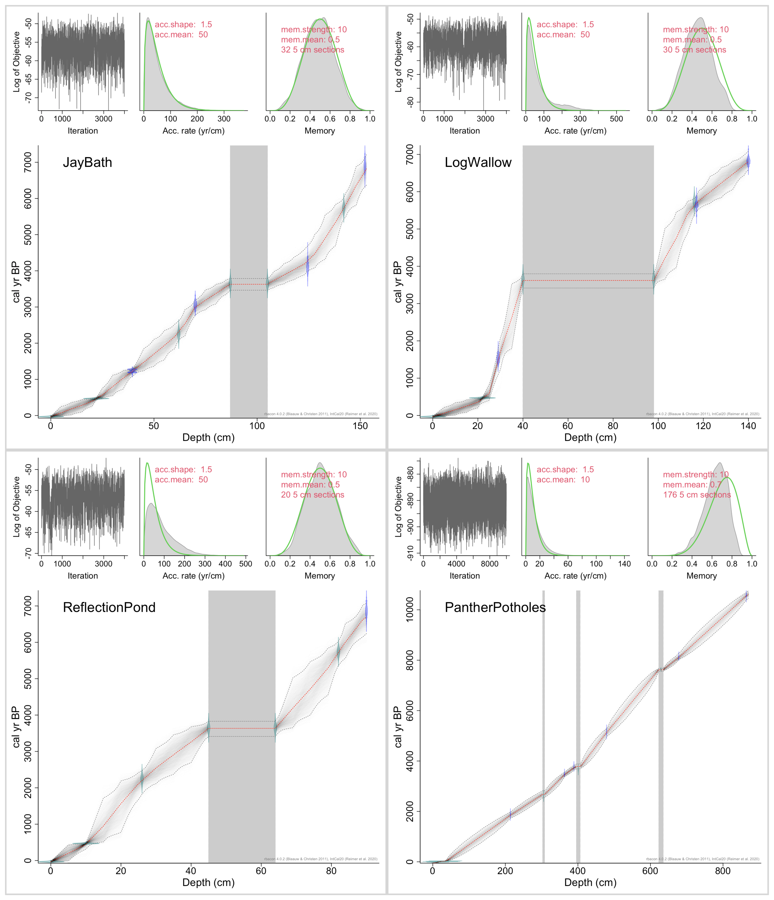
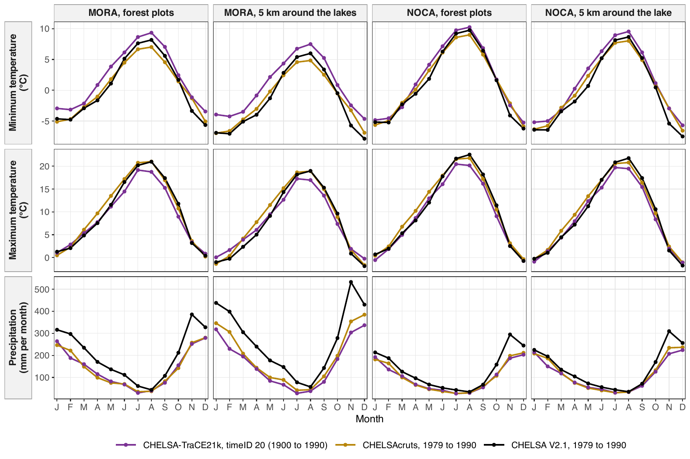
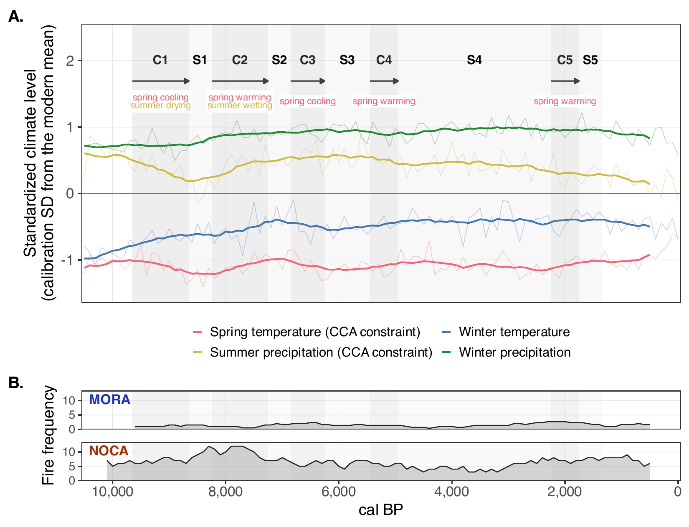
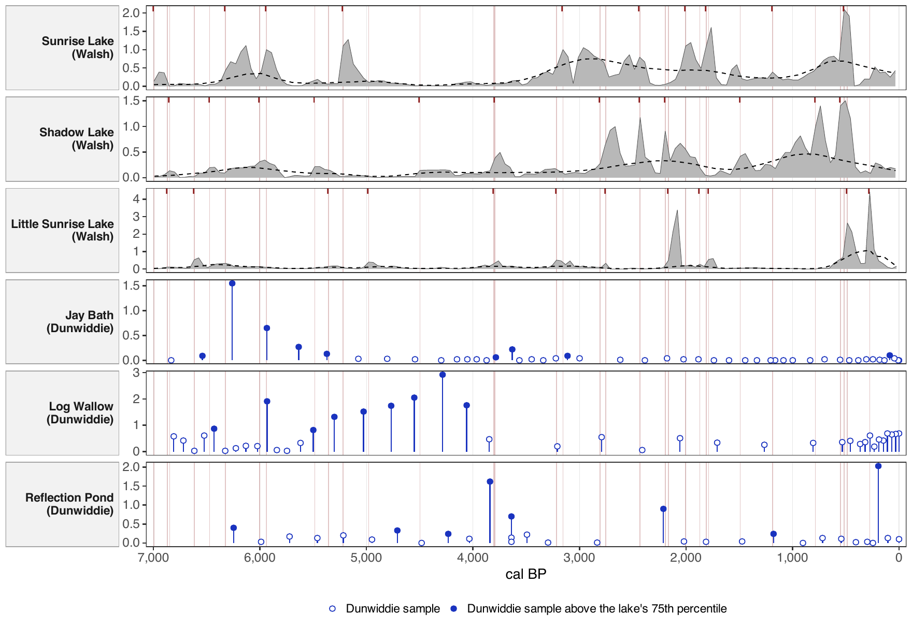
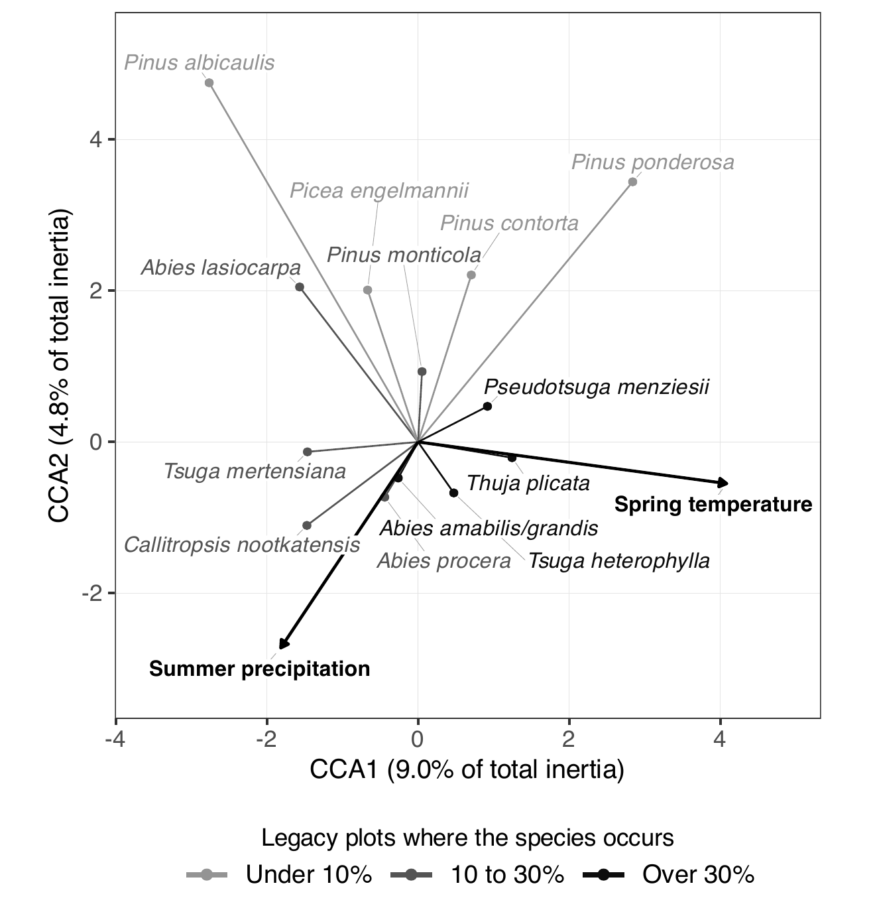
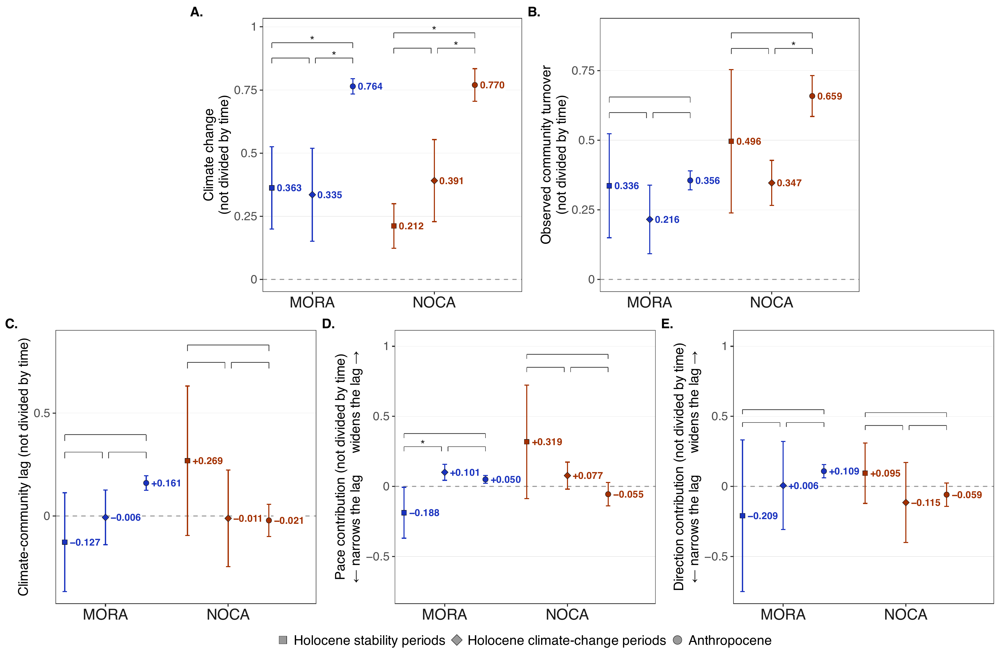
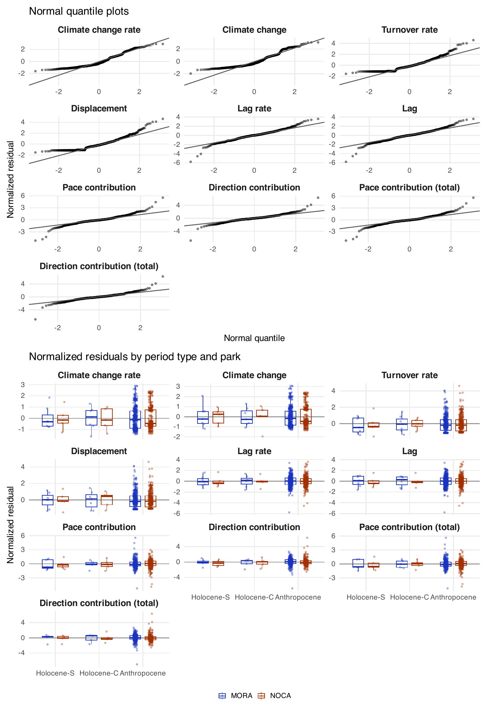
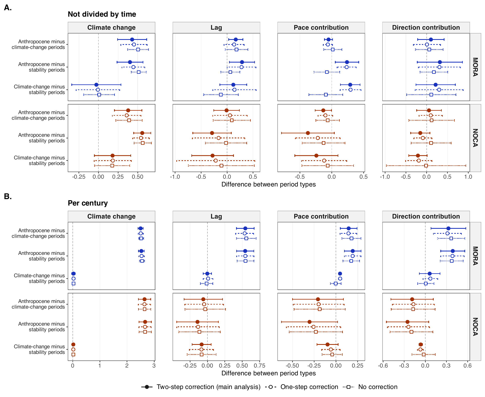

<!-- Generated by R/build_report.R from report/README.Rmd. Edit the .Rmd, not this file. -->

# Forest tree communities

## Legacy surveys and resurveys

**Fig. S1. Occurrence of tree species as adult trees and as seedlings in
the legacy surveys and the resurveys.** Number of plots in which each
species was recorded as an adult tree or as a seedling at Mount Rainier
(MORA) and North Cascades (NOCA), after taxonomic harmonization and
exclusion of understory taxa, but before the selection of species for
the CCA. A species could be recorded in both stages in the same plot. At
MORA, seedlings were individuals of 10–140 cm height in both surveys. At
NOCA, however, the legacy surveys recorded individuals of 0–3 m height
as regeneration and taller individuals as adults, whereas the resurveys
recorded seedlings of 10–140 cm and adults taller than 1.4 m.
Differences between the two stages at NOCA should therefore be
interpreted with caution, because the size classes differed between the
surveys.

**Fig. S2. Selection of forest plots and macrofossil samples for the
canonical correspondence analysis (CCA).** Flowchart of the matching,
cleaning, and selection of the plot pairs (legacy survey and resurvey;
upper panels) and of the Holocene macrofossil samples (lower panels) at
Mount Rainier (MORA, blue) and North Cascades (NOCA, orange). The plot
pairs that remained were used both to fit the CCA (with the legacy
surveys) and to quantify community change in the Anthropocene, whereas
the Holocene samples were projected into the fitted climate–community
space. Plots without any of the retained tree species at one of the two
surveys were excluded, because they have no observed position in this
space. Sample sizes and reasons for exclusion are given at each step.

**Legacy plot size at NOCA.** Both parks were resurveyed with 500-m²
plots, whereas the legacy plots at NOCA ranged from 25 to 400 m². To
test whether the smaller legacy plots missed species, which would be
counted as community turnover at the resurvey, we compared species
richness, turnover rate, lag, and lag rate among the legacy plot sizes
at NOCA (Table S1).

**Table S1. Plot pairs at NOCA by legacy plot size.** Richness is the
mean number of the 14 tree species of the analysis that were present in
a plot. Turnover rate, lag, and lag rate are means with 95% confidence
intervals (t-intervals, no model): the turnover rate and the lag rate in
CCA distance per century, and the lag in CCA distance. The single 36-m²
plot has no interval.

| Legacy area (m²) | Plots | Richness, legacy | Richness, resurvey | Turnover rate | Lag | Lag rate |
|:---|---:|:---|:---|:---|:---|:---|
| 25 | 37 | 2.89 | 3.05 | 1.741 (1.082 to 2.400) | -0.117 (-0.362 to 0.128) | -0.413 (-1.273 to 0.448) |
| 36 | 1 | 2.00 | 3.00 | 1.728 | -0.498 | -1.812 |
| 100 | 213 | 2.81 | 2.86 | 2.077 (1.834 to 2.321) | -0.026 (-0.106 to 0.053) | -0.089 (-0.369 to 0.190) |
| 200 | 2 | 4.00 | 1.50 | 2.529 (-29.602 to 34.660) | 0.964 (-9.393 to 11.321) | 3.382 (-32.959 to 39.722) |
| 400 | 20 | 2.10 | 2.15 | 2.604 (1.169 to 4.040) | 0.070 (-0.441 to 0.581) | 0.248 (-1.545 to 2.042) |
| not recorded | 4 | 1.50 | 2.00 | 1.657 (-1.614 to 4.928) | 0.314 (-0.177 to 0.804) | 1.132 (-0.651 to 2.916) |
| all NOCA plot pairs | 277 | 2.75 | 2.82 | 2.066 (1.836 to 2.296) | -0.021 (-0.099 to 0.057) | -0.072 (-0.346 to 0.203) |

The smallest legacy plots did not hold fewer species than the larger
ones (2.89 species per 25-m² plot against 2.81 per 100-m² plot), and
their turnover rate was not higher (1.74 against 2.08 CCA distance per
century). The confidence intervals of the three most common plot sizes
overlapped for all quantities. The Anthropocene results at NOCA
therefore do not depend on the small legacy plots.

## Species selection

**Fig. S3. Occurrence of tree species in the two parks and the three
survey periods, before the selection of species for the CCA.** Number of
plots (legacy surveys and resurveys) or macrofossil samples (Holocene)
in which each tree species was recorded at MORA and NOCA, after
taxonomic harmonization and exclusion of understory and unidentified
taxa. A species was counted as present when it was recorded as an adult
tree or as a seedling. The dashed red line shows the threshold of 20
plots or samples. We retained the species that reached this threshold in
at least one park and period, which gave the 13 species of the CCA.

**The *Abies amabilis/grandis* aggregate.** The needles of *Abies
amabilis* and *A. grandis* cannot be told apart, so the macrofossil
records cannot separate the two species. In the Panther Potholes record,
Prichard et al. (2009) classified them to genus (*Abies*
undifferentiated, the *Abies* needles other than *A. lasiocarpa*), and
the *A. amabilis* of the MORA records can hold *A. grandis*. We
therefore treated the two species as one taxon, *Abies
amabilis/grandis*, in both eras and both parks, and aggregated the
survey plots in the same way. The aggregate occurs in 134 Panther
Potholes samples and 119 MORA samples, and in 296 and 291 MORA plots and
123 and 138 NOCA plots in the legacy surveys and the resurveys.

## Holocene macrofossil records

The Holocene communities come from plant macrofossils in dated
lake-sediment cores, three at MORA and one at NOCA (Fig. 2 of the main
text). We dated each sample with the age–depth model of its core
(Appendix S1).

### Appendix S1. Age–depth models of the Holocene records

#### S1.1 Why new age–depth models were needed

To place the macrofossil samples in time, we needed a calendar age, with
its uncertainty, for each sample. The published chronologies did not
provide this. At MORA, the ages of Dunwiddie (1986) are radiocarbon ages
that were not calibrated to calendar years. At NOCA, the chronology of
Prichard et al. (2009) is calibrated, but the median ages of the single
macrofossil samples were not available to us. We therefore built a
Bayesian age–depth model for each of the four cores with the same method
(R package rbacon; Blaauw & Christen, 2011).

#### S1.2 Chronological controls

To build the models from the same information as the original studies,
we used the published chronological controls of each core, i.e., the
depths with a known age: the core surface, radiocarbon dates, tephra
layers, and, at Panther Potholes, ²¹⁰Pb ages (Table S2). We entered the
radiocarbon ages as uncalibrated ages, which rbacon calibrated with the
IntCal20 curve (Reimer et al., 2020), and the other controls as calendar
ages. Two decisions differ from the original studies. Reflection Pond
has no radiocarbon date of its own, so we gave it the mean basal age of
Jay Bath and Log Wallow. For Panther Potholes, we used the depths of the
controls archived in the Neotoma database, which correct depth errors in
Prichard et al. (2009).

**Table S2. Chronological controls used in the four Bayesian age–depth
models.** For cc = 1, the entered age is an uncalibrated ¹⁴C age
calibrated with IntCal20. For cc = 0, the entered age is already in
calibrated years before present (cal yr BP; present = A.D. 1950).

| Site | Core | Chronological control | Depth (cm) | Age entered ± error | Bacon treatment | Age source | Uncertainty source |
|:---|:---|:---|:---|:---|:---|:---|:---|
| MORA | Jay Bath | Core surface | 0 | −31.5 ± 10 cal yr BP | cc = 0 | Coring date, 1981–1982 | Assumed ±10 yr to account for uncertainty in recovery of the sediment–water interface |
| MORA | Jay Bath | MSH-W tephra | 22 | 470 ± 10 cal yr BP | cc = 0 | Yamaguchi 1983; Walsh et al. 2017 | Assumed ±10 yr around the tree-ring-dated eruption age; no published statistical age error |
| MORA | Jay Bath | QL-1729 | 39.5 | 1320 ± 30 ¹⁴C yr BP | cc = 1, IntCal20 | Dunwiddie 1986 | Published laboratory error |
| MORA | Jay Bath | MR-C tephra | 62 | 2250 ± 100 cal yr BP | cc = 0 | Mullineaux 1974; Walsh et al. 2017 | Assumed ±100 yr; no published statistical age error |
| MORA | Jay Bath | QL-1730 | 70 | 2920 ± 60 ¹⁴C yr BP | cc = 1, IntCal20 | Dunwiddie 1986 | Published laboratory error |
| MORA | Jay Bath | MSH-Y tephra, upper boundary | 87 | 3650 ± 100 cal yr BP | cc = 0 | Mullineaux 1974; Walsh et al. 2017 | ±100 yr derived approximately from radiocarbon dates bracketing the eruption age (bracket half-width ≈103 yr; Mullineaux 1996) |
| MORA | Jay Bath | MSH-Y tephra, lower boundary | 105 | 3650 ± 100 cal yr BP | cc = 0 | Mullineaux 1974; Walsh et al. 2017 | Same uncertainty as upper boundary; both depths represent the same instantaneous tephra deposit |
| MORA | Jay Bath | Beta-6332 | 124.5 | 3740 ± 80 ¹⁴C yr BP | cc = 1, IntCal20 | Dunwiddie 1986 | Published laboratory error |
| MORA | Jay Bath | MR-F tephra | 142 | 5740 ± 100 cal yr BP | cc = 0 | Mullineaux 1974; Walsh et al. 2017 | Assumed ±100 yr; no published statistical age error |
| MORA | Jay Bath | QL-1704 | 152.25 | 6050 ± 110 ¹⁴C yr BP | cc = 1, IntCal20 | Dunwiddie 1986 | Published laboratory error |
| MORA | Log Wallow | Core surface | 0 | −31.5 ± 10 cal yr BP | cc = 0 | Coring date, 1981–1982 | Assumed ±10 yr to account for uncertainty in recovery of the sediment–water interface |
| MORA | Log Wallow | MSH-W tephra | 22 | 470 ± 10 cal yr BP | cc = 0 | Yamaguchi 1983; Walsh et al. 2017 | Assumed ±10 yr around the tree-ring-dated eruption age; no published statistical age error |
| MORA | Log Wallow | QL-1726 | 29 | 1650 ± 80 ¹⁴C yr BP | cc = 1, IntCal20 | Dunwiddie 1986 | Published laboratory error |
| MORA | Log Wallow | MSH-Y tephra, upper boundary | 40 | 3650 ± 100 cal yr BP | cc = 0 | Mullineaux 1974; Walsh et al. 2017 | ±100 yr derived approximately from radiocarbon dates bracketing the eruption age (bracket half-width ≈103 yr; Mullineaux 1996) |
| MORA | Log Wallow | MSH-Y tephra, lower boundary | 98 | 3650 ± 100 cal yr BP | cc = 0 | Mullineaux 1974; Walsh et al. 2017 | Same uncertainty as upper boundary; both depths represent the same instantaneous tephra deposit |
| MORA | Log Wallow | MR-F tephra | 116 | 5740 ± 100 cal yr BP | cc = 0 | Mullineaux 1974; Walsh et al. 2017 | Assumed ±100 yr; no published statistical age error |
| MORA | Log Wallow | QL-1727 | 117 | 4900 ± 80 ¹⁴C yr BP | cc = 1, IntCal20 | Dunwiddie 1986 | Published laboratory error |
| MORA | Log Wallow | QL-1728 | 140 | 5980 ± 60 ¹⁴C yr BP | cc = 1, IntCal20 | Dunwiddie 1986 | Published laboratory error |
| MORA | Reflection Pond | Core surface | 0 | −31.5 ± 10 cal yr BP | cc = 0 | Coring date, 1981–1982 | Assumed ±10 yr to account for uncertainty in recovery of the sediment–water interface |
| MORA | Reflection Pond | MSH-W tephra | 10 | 470 ± 10 cal yr BP | cc = 0 | Yamaguchi 1983; Walsh et al. 2017 | Assumed ±10 yr around the tree-ring-dated eruption age; no published statistical age error |
| MORA | Reflection Pond | MR-C tephra | 26 | 2250 ± 100 cal yr BP | cc = 0 | Mullineaux 1974; Walsh et al. 2017 | Assumed ±100 yr; no published statistical age error |
| MORA | Reflection Pond | MSH-Y tephra, upper boundary | 45 | 3650 ± 100 cal yr BP | cc = 0 | Mullineaux 1974; Walsh et al. 2017 | ±100 yr derived approximately from radiocarbon dates bracketing the eruption age (bracket half-width ≈103 yr; Mullineaux 1996) |
| MORA | Reflection Pond | MSH-Y tephra, lower boundary | 64 | 3650 ± 100 cal yr BP | cc = 0 | Mullineaux 1974; Walsh et al. 2017 | Same uncertainty as upper boundary; both depths represent the same instantaneous tephra deposit |
| MORA | Reflection Pond | MR-F tephra | 82 | 5740 ± 100 cal yr BP | cc = 0 | Mullineaux 1974; Walsh et al. 2017 | Assumed ±100 yr; no published statistical age error |
| MORA | Reflection Pond | Basal sediment, mean of QL-1704 and QL-1728 | 90 | 6015 ± 110 ¹⁴C yr BP | cc = 1, IntCal20 | Dunwiddie 1986; P. Dunwiddie, pers. comm. | Larger of the two laboratory errors (±110 yr), allowing for transfer of the Jay Bath and Log Wallow basal age to Reflection Pond |
| NOCA | Panther Potholes | Core surface | 0.5 | −49 ± 1 cal yr BP | cc = 0 | Gavin 2021 Neotoma chronology; coring year 1999 | ±1 yr retained from the archived Gavin chronology |
| NOCA | Panther Potholes | ²¹⁰Pb CRS age | 7 | −36.7; error entered = 3.47 | cc = 0 | Prichard et al. 2009; Gavin 2021 | Inherited Gavin value; 3.47 is numerically the published ²¹⁰Pb activity uncertainty in DPM g⁻¹, not a verified age error in years |
| NOCA | Panther Potholes | ²¹⁰Pb CRS age | 14 | −9; error entered = 1.15 | cc = 0 | Prichard et al. 2009; Gavin 2021 | Inherited Gavin value; 1.15 is numerically the published ²¹⁰Pb activity uncertainty in DPM g⁻¹, not a verified age error in years |
| NOCA | Panther Potholes | ²¹⁰Pb CRS age | 21 | 12; error entered = 0.72 | cc = 0 | Prichard et al. 2009; Gavin 2021 | Inherited Gavin value; 0.72 is numerically the published ²¹⁰Pb activity uncertainty in DPM g⁻¹, not a verified age error in years |
| NOCA | Panther Potholes | ²¹⁰Pb CRS age | 28 | 21; error entered = 0.74 | cc = 0 | Prichard et al. 2009; Gavin 2021 | Inherited Gavin value; 0.74 is numerically the published ²¹⁰Pb activity uncertainty in DPM g⁻¹, not a verified age error in years |
| NOCA | Panther Potholes | ²¹⁰Pb CRS age | 35 | 36; error entered = 0.77 | cc = 0 | Prichard et al. 2009; Gavin 2021 | Inherited Gavin value; 0.77 is numerically the published ²¹⁰Pb activity uncertainty in DPM g⁻¹, not a verified age error in years |
| NOCA | Panther Potholes | Beta-172005, conifer seed | 214 | 1950 ± 50 ¹⁴C yr BP | cc = 1, IntCal20 | Prichard et al. 2009 | Published laboratory error |
| NOCA | Panther Potholes | MSH-P tephra | 305.5 | 2620 ± 70 cal yr BP | cc = 0 | Gavin 2021 Neotoma chronology | Age and ±70-yr uncertainty retained from the archived chronology |
| NOCA | Panther Potholes | Beta-169623, seed | 363 | 3260 ± 40 ¹⁴C yr BP | cc = 1, IntCal20 | Prichard et al. 2009 | Published laboratory error |
| NOCA | Panther Potholes | Beta-169624, pollen cone | 389 | 3520 ± 40 ¹⁴C yr BP | cc = 1, IntCal20 | Prichard et al. 2009 | Published laboratory error |
| NOCA | Panther Potholes | MSH-Y tephra | 401 | 3660 ± 65 cal yr BP | cc = 0 | Gavin 2021 Neotoma chronology | Age and ±65-yr uncertainty retained from the archived chronology |
| NOCA | Panther Potholes | Beta-169207, pollen cone | 479 | 4500 ± 40 ¹⁴C yr BP | cc = 1, IntCal20 | Prichard et al. 2009 | Published laboratory error |
| NOCA | Panther Potholes | Mazama tephra | 629 | 7633 ± 25 cal yr BP | cc = 0 | Gavin 2021 Neotoma chronology; Egan et al. 2015 | Age and ±25-yr uncertainty retained from the archived chronology |
| NOCA | Panther Potholes | Beta-169208, seed | 678 | 7330 ± 40 ¹⁴C yr BP | cc = 1, IntCal20 | Prichard et al. 2009 | Published laboratory error |
| NOCA | Panther Potholes | Beta-169625, Pinus contorta needles | 864 | 9370 ± 40 ¹⁴C yr BP | cc = 1, IntCal20 | Prichard et al. 2009 | Published laboratory error |

#### S1.3 Age–depth models

To estimate the age of every depth between the controls, rbacon models
how fast sediment accumulated along the core, and returns many age–depth
curves that are compatible with the controls (Fig. S4; settings in Table
S3). We used the same settings for the three MORA cores. For Panther
Potholes, we kept the settings of the chronology archived in Neotoma, so
that our model reproduced the published chronology. Thick tephra layers
were treated as deposited instantaneously (grey bands in Fig. S4). We
dated each macrofossil sample by the median of its ages.

**Table S3. rbacon parameters used to construct the age–depth models.**

| rbacon argument | What it controls | MORA | Panther Potholes | Rationale |
|:---|:---|:---|:---|:---|
| cc, cc1 | Determines whether a date requires radiocarbon calibration and which calibration curve is used | cc=1, cc1=“IntCal20” for ¹⁴C dates; cc=0 for calendar-age controls | Same | Northern Hemisphere terrestrial ¹⁴C dates were calibrated with IntCal20; already calendar-dated controls were not recalibrated |
| thick | Thickness of the sediment sections for which accumulation rates are estimated | 5 cm | 5 cm | Standard Bacon section thickness; for Panther Potholes this value reproduced the archived Gavin chronology |
| acc.mean | Mean of the prior distribution for accumulation time, in yr cm⁻¹ | 50 | 10 | MORA cores accumulate substantially more slowly; 10 yr cm⁻¹ reproduces the Gavin chronology and is close to the approximately 12.8 yr cm⁻¹ reported for Panther Potholes |
| acc.shape | Shape of the gamma prior around acc.mean; larger values impose a more concentrated accumulation prior | 1.5 | 1.5 | Broad rbacon default retained for MORA and Gavin setting retained for Panther Potholes |
| mem.mean | Prior mean dependence between accumulation rates in adjacent sediment sections | 0.5 | 0.7 | rbacon default retained for MORA; Gavin setting retained for Panther Potholes |
| mem.strength | Strength of the prior around mem.mean; larger values impose the assumed memory more strongly | 10 | 10 | Broad rbacon default retained for MORA and Gavin setting retained for Panther Potholes |
| slump | Depth intervals treated as effectively instantaneous accumulation rather than gradual sedimentation | Jay Bath: 87–105 cm; Log Wallow: 40–98 cm; Reflection Pond: 45–64 cm | 303–308, 396–406, and 623–635 cm | Prevents thick tephra deposits from being interpreted as long periods of sediment accumulation |
| normal, t.a, t.b | Distribution used to accommodate chronological-control scatter and potential outlying dates | FALSE, 3, 4 | FALSE, 15, 16 | rbacon default robust t-distribution retained for MORA; Gavin settings retained for Panther Potholes |
| ssize | Number of MCMC iterations retained for the posterior | 4,000 | 10,000 | Default sampling was retained for MORA; Panther Potholes required the larger value for adequate MCMC mixing and reproduction of the archived chronology |
| prob | Posterior interval reported for the chronology | 0.95 | 0.95 | Ages are summarized with 95% posterior intervals |
| d.max | Maximum core depth included in the model | Jay Bath: 153 cm; no manual extension for Log Wallow or Reflection Pond | 870 cm | Jay Bath was extended to 153 cm to retain its deepest macrofossil sample; Panther Potholes retained the Gavin model extent |

**Fig. S4. Bayesian age–depth models for the Jay Bath, Log Wallow, and
Reflection Pond cores at MORA and the Panther Potholes core at NOCA.**
For each core, the three upper panels show, from left to right, the
Markov chain Monte Carlo trace, the prior (green) and posterior (grey)
distributions of sediment accumulation time, and the prior and posterior
distributions of memory. In the main panels, depth increases along the
x-axis and age is expressed as calibrated years before present. Coloured
distributions at dated depths represent the chronological controls and
their uncertainty. The grey field represents the posterior distribution
of possible age–depth relationships; the central red line shows the
posterior age–depth estimate and the outer dotted lines the 95%
posterior interval. Vertical grey bands identify tephra intervals
treated as instantaneous deposition.

#### S1.4 Sensitivity of the Panther Potholes chronology

In the archived chronology of Panther Potholes, the errors of the five
²¹⁰Pb ages are the uncertainties of the measured ²¹⁰Pb activity, and not
age errors in years. To test whether this affects the chronology, we
fitted a second model with an assumed error of ±10 years for these five
ages. The two chronologies were nearly identical below the upper 35 to
40 cm of the core, so that this choice does not affect the Holocene ages
of the analysis (Fig. S5).

**Fig. S5. Sensitivity of the Panther Potholes age–depth chronology to
uncertainty assigned to the five ²¹⁰Pb controls in the upper 35 cm of
the core.** The left panel shows that the two posterior chronologies are
nearly identical below the ²¹⁰Pb-dated section, whereas the right panel
shows the expected increase in uncertainty within the upper 35–40 cm.
The uncertainty assigned to the ²¹⁰Pb controls affects the precision of
the most recent chronology but does not materially alter the deeper
Holocene chronology used in our analyses.

# Climate products

## Appendix S2. Climate products and the bias correction of the Holocene climate

We fitted the climate–community space with CHELSA V2.1 at the forest
plots, whereas the climate-predicted positions of the Holocene
communities come from CHELSA-TraCE21k at the lakes. If the two products
differ in the level of temperature or precipitation, a Holocene climate
is placed elsewhere in the climate–community space than the same climate
would be with CHELSA V2.1, and this difference enters every mismatch and
every lag. We therefore corrected the Holocene climate to the level of
CHELSA V2.1.

To correct it, we followed the change-factor approach that is commonly
used for paleoclimate simulations (Lorenz et al., 2016): the difference
between two products is calculated over the years that they have in
common, and is then applied to all time steps of the product to be
corrected. CHELSA-TraCE21k and CHELSA V2.1 cannot be compared directly,
because the most recent time step of CHELSA-TraCE21k is the mean of the
years 1900 to 1990, whereas CHELSA V2.1 starts in 1979. We therefore
used CHELSAcruts (1901 to 2016), which has years in common with both
products, as a link between them (Table S4). Over the years that the
three products have in common, they differed in the level of temperature
and precipitation (Fig. S6).

**Table S4. The four CHELSA products.** All four products have the same
grid of 30 arcsec.

| Product | Version | Years read | What it is |
|----|----|----|----|
| CHELSA-TraCE21k | 1.0 | timeIDs 16 to 20 (1500 to 1990, century means) | Downscaled TraCE-21k transient simulation; timeID 20 is the mean of 1900 to 1990 |
| CHELSAcruts | 1.0 | 1901 to 2016, monthly | CRU TS anomalies downscaled with the CHELSA V1 climatology |
| CHELSA V1.2 | 1.2.1 | 1979 to 2013, monthly | CHELSA time series, first version |
| CHELSA V2.1 | 2.1 | 1979 to 2021, monthly | CHELSA time series, current version; the climate of the climate–community space |

**Fig. S6. The three climate products of the bias correction, without
correction.** Monthly minimum temperature, maximum temperature, and
precipitation over the years that the three products have in common: the
most recent time step of CHELSA-TraCE21k (timeID 20, the mean of 1900 to
1990; purple), and CHELSAcruts (gold) and CHELSA V2.1 (black) over 1979
to 1990. For each point, the values of CHELSAcruts and CHELSA V2.1 were
averaged over these years. Each line is the median over the forest plots
of a park (331 at MORA and 305 at NOCA) or over the grid cells within 5
km of its lakes (136 at MORA and 136 at NOCA). CHELSA V2.1 has no
temperature for January 1979, so that its January temperatures are means
over 1980 to 1990.

The correction thus has two steps (Fig. S7). In step 1, we corrected
CHELSA-TraCE21k to CHELSAcruts over 1900 to 1990, and in step 2,
CHELSAcruts to CHELSA V2.1 over 1979 to 2016. For each park and calendar
month, each step is an offset that we added to minimum and maximum
temperature, and a ratio by which we multiplied precipitation. We
calculated both steps from the mean over the grid cells within 5 km of
the lakes of each park, and applied them to all time steps of
CHELSA-TraCE21k. Step 1 was needed because CHELSA-TraCE21k and
CHELSAcruts did not agree over the years that they have in common,
although both are downscaled with the same method (Table
S5).

Note that this correction assumes that the difference between the
products was constant through the Holocene. We therefore repeated the
analysis with step 2 alone and without correction, and report how the
results changed in the sensitivity analysis of Appendix S4.

**Table S5. Comparison of CHELSA-TraCE21k and CHELSAcruts over the years
that they have in common, without correction.** The most recent time
step of CHELSA-TraCE21k (timeID 20, the mean of 1900 to 1990) and
CHELSAcruts (1901 to 1990), on the grid cells within 5 km of the lakes
(disc), at the grid cells of the lakes (MORA: mean of the three lakes),
and as the mean over the forest plots. Difference: CHELSAcruts
subtracted from CHELSA-TraCE21k. Ratio: CHELSA-TraCE21k divided by
CHELSAcruts.

| Park | Place | Variable | TraCE21k timeID 20 | CHELSAcruts 1901-1990 | Difference | Ratio |
|:---|:---|:---|---:|---:|---:|---:|
| MORA | MORA disc | Spring temperature (°C) | 2.87 | 2.07 | 0.80 | 1.39 |
| MORA | MORA disc | Summer precipitation (mm) | 135.57 | 161.50 | -25.94 | 0.84 |
| MORA | MORA lakes | Spring temperature (°C) | 3.40 | 2.78 | 0.62 | 1.22 |
| MORA | MORA lakes | Summer precipitation (mm) | 128.00 | 167.13 | -39.13 | 0.77 |
| MORA | MORA plots | Spring temperature (°C) | 4.45 | 4.18 | 0.27 | 1.07 |
| MORA | MORA plots | Summer precipitation (mm) | 140.26 | 140.02 | 0.24 | 1.00 |
| NOCA | NOCA disc | Spring temperature (°C) | 4.05 | 3.73 | 0.32 | 1.08 |
| NOCA | NOCA disc | Summer precipitation (mm) | 112.85 | 95.13 | 17.72 | 1.19 |
| NOCA | NOCA lakes | Spring temperature (°C) | 4.20 | 3.96 | 0.24 | 1.06 |
| NOCA | NOCA lakes | Summer precipitation (mm) | 101.00 | 108.26 | -7.26 | 0.93 |
| NOCA | NOCA plots | Spring temperature (°C) | 4.52 | 4.37 | 0.14 | 1.03 |
| NOCA | NOCA plots | Summer precipitation (mm) | 105.26 | 88.80 | 16.46 | 1.19 |

**Fig. S7. The two steps of the bias correction of the Holocene
climate.** For each park and calendar month, the offset added to
temperature (°C) or the ratio by which precipitation was multiplied,
calculated on the grid cells within 5 km of the lakes. Purple: step 1
(CHELSA-TraCE21k to CHELSAcruts, 1900 to 1990). Grey: step 2
(CHELSAcruts to CHELSA V2.1, 1979 to 2016), with the 10th to 90th
percentile of the yearly values in light grey. Red: both steps together,
i.e., the correction of the main analysis. On the dashed line, a step
changes nothing.

# Climate change and comparisons within eras

## Climate data

**Fig. S8. Climate of the Anthropocene and the climate windows of the
surveys.** Upper panels: annual climate from CHELSA V2.1 (1979–2021),
averaged over the plot pairs at Mount Rainier (MORA, blue) and North
Cascades (NOCA, orange), for mean annual temperature (MAT), annual
precipitation (AP), and the four seasonal variables, i.e., mean spring
temperature (MSpT), mean winter temperature (MWT), summer precipitation
(SP), and winter precipitation (WP). Spring temperature and summer
precipitation are the two variables of the climate–community space. The
shaded area shows the climate window of the legacy surveys (1979–1989),
which is the same for all plots. Lower panels: the six-year climate
window of each resurvey year (from five years before the resurvey to the
year of the resurvey), with the number of plot pairs (n) resurveyed in
that year. Winter included December of the preceding year. The climate
of the resurvey was therefore calculated separately for each plot,
according to the year of its resurvey. CHELSA V2.1 is the product to
which the Holocene climate was corrected (Appendix S2), and is itself
not corrected.

**Fig. S9. Correlations among climate variables in the Holocene and the
Anthropocene.** Pearson correlation coefficients (r) across lakes and
centuries for the Holocene (CHELSA-TraCE21k after the bias correction of
Appendix S2, left), and across forest plots and surveys for the
Anthropocene (CHELSA V2.1, right). Red shows positive and blue negative
correlations, and the numbers give r. The variables are mean annual
(MAT), spring (MSpT), summer (MST), and winter (MWT) temperature, and
annual (AP), spring (SpP), summer (SP), and winter (WP) precipitation.
Spring is March–May, summer June–August, and winter December–February.

## Climate periods

**Table S6. Climate periods of the Holocene.** Climate-change (C) and
stability (S) periods defined from spring temperature (MSpT) and summer
precipitation (SP), which are used in the analysis, and, with the same
rules, from the four seasonal variables, for comparison. Both are
defined from the Holocene climate after the bias correction (Appendix
S2). Drivers: the variables whose change defined a climate-change
period.

| Variables | Period | Type | Older (cal BP) | Younger (cal BP) | Duration (years) | Drivers |
|:---|:---|:---|---:|---:|---:|:---|
| Spring temperature and summer precipitation (used) | C1 | Holocene-C | 9650 | 8650 | 1000 | spring cooling, summer drying |
| Spring temperature and summer precipitation (used) | S1 | Holocene-S | 8650 | 8250 | 400 |  |
| Spring temperature and summer precipitation (used) | C2 | Holocene-C | 8250 | 7250 | 1000 | spring warming, summer wetting |
| Spring temperature and summer precipitation (used) | S2 | Holocene-S | 7250 | 6850 | 400 |  |
| Spring temperature and summer precipitation (used) | C3 | Holocene-C | 6850 | 6250 | 600 | spring cooling |
| Spring temperature and summer precipitation (used) | S3 | Holocene-S | 6250 | 5450 | 800 |  |
| Spring temperature and summer precipitation (used) | C4 | Holocene-C | 5450 | 4950 | 500 | spring warming |
| Spring temperature and summer precipitation (used) | S4 | Holocene-S | 4950 | 2250 | 2700 |  |
| Spring temperature and summer precipitation (used) | C5 | Holocene-C | 2250 | 1750 | 500 | spring warming |
| Spring temperature and summer precipitation (used) | S5 | Holocene-S | 1750 | 1350 | 400 |  |
| Four seasonal variables (comparison) | C1a | Holocene-C | 9650 | 8650 | 1000 | spring cooling, winter warming, summer drying |
| Four seasonal variables (comparison) | C1b | Holocene-C | 8650 | 8250 | 400 | winter wetting |
| Four seasonal variables (comparison) | C1c | Holocene-C | 8250 | 7250 | 1000 | spring warming, winter warming, summer wetting |
| Four seasonal variables (comparison) | S1 | Holocene-S | 7250 | 6850 | 400 |  |
| Four seasonal variables (comparison) | C2 | Holocene-C | 6850 | 6250 | 600 | spring cooling |
| Four seasonal variables (comparison) | S2 | Holocene-S | 6250 | 5450 | 800 |  |
| Four seasonal variables (comparison) | C3 | Holocene-C | 5450 | 4950 | 500 | spring warming |
| Four seasonal variables (comparison) | S3 | Holocene-S | 4950 | 2250 | 2700 |  |
| Four seasonal variables (comparison) | C4 | Holocene-C | 2250 | 1750 | 500 | spring warming |
| Four seasonal variables (comparison) | S4 | Holocene-S | 1750 | 1350 | 400 |  |

**Fig. S10. Holocene climate for the four seasonal variables.** As Fig.
3A of the main text, for spring temperature, winter temperature, summer
precipitation, and winter precipitation, without the labels of the
rates. The Holocene climate is CHELSA-TraCE21k after the bias correction
(Appendix S2). Only spring temperature and summer precipitation are used
in the climate–community space and define the climate periods. (B) Fire
frequency as in Fig. 3C of the main text.

**Fig. S11. How the climate periods were defined.** (A) Change of each
of the four seasonal variables over 1,000 years (Holocene climate after
the bias correction of Appendix S2), with its sign, as the median over
the two parks (weighted equally) and standardized by the standard
deviation across the legacy plots. Filled points mark the time steps at
which one of the two variables of the climate–community space changed in
one direction (more than 50% of the maximum change of the variable, with
at least 8 of 10 phases in the same direction). We defined the climate
periods from these points. Winter temperature and winter precipitation
are shown for comparison. Brackets on the left give the stability range
of each variable. (B) Fire frequency as in Fig. 3C of the main text.

# Fire dynamics

## Appendix S3. Fire histories of the Holocene

### S3.1 Charcoal records

To describe fire activity through the Holocene in each park, we used
published records of macroscopic charcoal in lake sediments: Sunrise
Lake, Shadow Lake, and Little Sunrise Lake at MORA (Walsh et al., 2017),
and Panther Potholes at NOCA (Prichard et al., 2009). At MORA, these
records come from Sunrise Ridge and not from the lakes of the forest
records (see S3.5). At NOCA, the fire record and the forest record come
from the same core and have the same chronology (Appendix S1).

### S3.2 Fire events

To identify fire events in the same way in the four records, we repeated
the peak detection of the two original studies in one workflow (R
package tapas), with the settings of each original study (Table S7). In
this workflow, a fire event is a peak in the charcoal accumulation rate
that exceeds the background noise of the record and passes a
minimum-count test (Fig. S12).

**Table S7. Parameters used to reconstruct individual Holocene fire
events.** All records were also screened with the same 75-year
minimum-count test (p ≤ 0.05). MORA settings follow Walsh et al. (2017)
and Panther Potholes settings Prichard et al. (2009), except its 12-year
interpolation interval, the median resolution of our updated chronology.

| Site | Fire record | Interpolation interval (years) | Background window (years) | Peak threshold | Accepted fire events |
|:---|:---|---:|---:|:---|---:|
| MORA | Sunrise Lake | 48 | 800 | 95% | 17 |
| MORA | Shadow Lake | 47 | 1000 | 95% | 14 |
| MORA | Little Sunrise Lake | 42 | 500 | 95% | 13 |
| NOCA | Panther Potholes | 12 | 500 | 99% | 66 |

**Fig. S12. Identification of Holocene fire events in the four
records.** The residual peak component is the difference between
interpolated charcoal accumulation rates (CHAR) and the background
estimated with the record’s robust LOWESS window. Candidate events
exceed the local noise threshold (dashed line) and are then screened
with a 75-year minimum-count test (p ≤ 0.05): filled circles are
accepted events, and red crosses are rejected candidates.

### S3.3 Fire frequency

To show how fire activity changed through the Holocene (Fig. 3C of the
main text), we counted the fire events of each record in windows of
1,000 years, moved in steps of 100 years. The MORA series is the mean of
the three Sunrise Ridge records, and the NOCA series is the Panther
Potholes record. The records differ in resolution, so that fire
frequencies cannot be compared between the parks. Note that the models
do not use this fire frequency, but the number of fire events between t1
and t2 of each lake-period (see Methods of the main
text).

### S3.4 Comparison with the original studies

To check the workflow, we compared the numbers of fire events that we
identified with those of the original studies, and repeated the analysis
of the MORA records with a second software (CharAnalysis; Table S8). The
numbers differed from the published ones, also with CharAnalysis, which
suggests that part of the difference comes from the software. We kept
one workflow for the four records, with the settings of the original
studies, and did not tune the settings to match the published numbers.

**Table S8. Holocene fire-event counts reported in the original studies
and reconstructed with CharAnalysis R 2.0.3 (MORA only) and tapas (all
four records).**

| Site | Lake | Published | CharAnalysis R 2.0.3 | tapas | Difference from published |
|:---|:---|---:|---:|---:|:---|
| MORA | Sunrise | 24 | 15 | 17 | -7 (-29%) |
| MORA | Shadow | 18 | 16 | 14 | -4 (-22%) |
| MORA | Little Sunrise | 16 | 14 | 13 | -3 (-19%) |
| MORA total |  | 58 | 45 | 44 | -14 (-24%) |
| NOCA | Panther Potholes | 59 | — | 66 | +7 (+12%) |
| Both sites |  | 117 | — | 110 | -7 (-6%) |

### S3.5 Fire records and forest records at MORA

At MORA, the fire records and the forest records come from different
lakes. We did not use the charcoal of the forest records, i.e., the
charcoal fragments that Dunwiddie (1986) counted in the macrofossil
samples of Jay Bath, Log Wallow, and Reflection Pond, for two reasons.
First, to compare the two parks, fire had to be reconstructed in the
same way at MORA and at NOCA, i.e., as fire events identified from peaks
in charcoal accumulation rates. Second, this is not possible with the
forest records. The detection of fire events requires charcoal
accumulation rates (fragments per cm² per year), i.e., the charcoal
concentration of a sample (fragments per cm³) multiplied by the
sedimentation rate (cm per year). Dunwiddie (1986) reported the charcoal
as the number of fragments in each sample, and not as accumulation
rates. Moreover, each sample covers about 80 to 200 years, so that
single fire events could not be separated even with accumulation rates.
We therefore used the Sunrise Ridge records, and assessed what they can
describe.

Macroscopic charcoal records the fires around a lake, and the records of
nearby lakes therefore do not have to agree. This was the case at MORA.
The three Sunrise Ridge records were only weakly correlated with one
another (Spearman correlations of +0.45, +0.31, and +0.09), and the
three forest records were correlated with one another with +0.18, +0.48,
and -0.09. The forest records did not follow the Sunrise Ridge records
either (Fig. S13). No single record can therefore describe fire in the
park. For this reason, we used the mean of the three Sunrise Ridge
records, which is high when several watersheds burned in the same
period. We interpret this mean as an indication of periods of high fire
activity in the region, and not as the fire history at the lakes of the
forest records. Note that the comparison with the forest records is
coarse, for the same two reasons, so that the lack of agreement may
partly come from the records themselves.

**Fig. S13. Charcoal in the fire records of Sunrise Ridge (Walsh et al.,
2017) and in the forest records of MORA (Dunwiddie, 1986).** Upper three
rows: charcoal accumulation rate of each Sunrise Ridge record (grey),
with its background (dashed) and the fire events that we identified
(dark red ticks at the top of each row). Lower three rows: number of
charcoal fragments in each macrofossil sample of Dunwiddie (1986). This
number is a concentration, because all samples of a core had the same
volume, and the samples above the 75th percentile of each lake are
filled. Each fire event of the Sunrise Ridge records is drawn as a faint
line through all rows. Time runs from 7,000 cal BP to the present, which
is the time span of the forest records. The correlations in the text are
Spearman correlations of the charcoal of two records over bins of 500
years.

# Climate–community space

**Table S9. Choice of the climate variables of the climate–community
space.** CCA fitted to the 605 legacy plots with three sets of climate
variables. VIF, variance inflation factor. The last two columns give the
percentage of the centuries of the Holocene records (333 at MORA, three
lakes, and 111 at NOCA) whose climate, after the bias correction
(Appendix S2), was outside the climate of the legacy plots.

| Set | Variables | Largest abs. correlation | VIF | R² | Adjusted R² | MORA lake-centuries outside (%) | NOCA lake-centuries outside (%) |
|:---|:---|---:|:---|---:|---:|---:|---:|
| All four | MSpT, MWT, SP, WP | 0.956 | MSpT 29.6, MWT 26.4, SP 5.2, WP 6.7 | 0.166 | 0.161 | 63.964 | 28.829 |
| MWT + SP | MWT, SP | 0.071 | MWT 1.0, SP 1.0 | 0.141 | 0.138 | 0.000 | 0.000 |
| MSpT + SP | MSpT, SP | 0.286 | MSpT 1.1, SP 1.1 | 0.138 | 0.136 | 0.000 | 0.000 |

**Table S10. The two climate variables of the climate–community space.**
Variance inflation factor (VIF) and biplot score of each variable on the
two unrotated CCA axes.

| Variable | Label                |  VIF | CCA1 score | CCA2 score |
|:---------|:---------------------|-----:|-----------:|-----------:|
| MSpT     | Spring temperature   | 1.08 |       0.52 |      -0.07 |
| SP       | Summer precipitation | 1.08 |      -0.23 |      -0.35 |

**Table S11. Axes of the CCA.** The two climate variables explained
13.8% of the variation in composition (constrained inertia).

| Axis | Eigenvalue | % total inertia | % constrained inertia |
|:-----|-----------:|----------------:|----------------------:|
| CCA1 |      0.279 |           9.025 |                65.285 |
| CCA2 |      0.149 |           4.799 |                34.715 |

**Table S12. Permutation tests of the CCA.** 9,999 permutations,
unrestricted and restricted within parks. df, degrees of freedom of each
component.

| Test    | Component |  df | Pseudo-F | p (unrestricted) | p (within parks) |
|:--------|:----------|----:|---------:|-----------------:|-----------------:|
| Overall | Model     |   2 |   48.284 |                0 |                0 |
| Axis    | CCA1      |   1 |   63.044 |                0 |                0 |
| Axis    | CCA2      |   1 |   33.650 |                0 |                0 |

**Fig. S14. The climate–community space on the unrotated CCA axes, with
all species.** As Fig. 4A of the main text, on the unrotated axes
(labelled with the share of the variation in composition that each axis
explained) and with all 13 species.

**Fig. S15. Share of the constrained inertia against commonness of the
species.** Each point is one of the 13 taxa of the CCA: its share of the
constrained inertia against the share of the legacy plots in which it
occurs. Dashed line: 1:1. Solid line and band: linear fit with its 95%
confidence band. Dotted lines: an equal share of the constrained inertia
(7.7%, 100% divided by the number of taxa) and half of it, the threshold
above which a species is drawn in Fig. 4A. Share and commonness are not
related (Pearson r = -0.02, p = 0.94, and Spearman rho = 0.05, p = 0.87,
with a slope of the fit of -0.005 percentage points of inertia per
percentage point of plots, R² = 0.00). Only *Pinus albicaulis* and
*Pinus ponderosa* carry a larger share of the inertia than of the plots.

## Holocene samples in the climate–community space

**Table S13. Sampled centuries of each lake.** A sampled century is a
century with at least one macrofossil sample.

| Park | Lake | Sampled centuries | Samples | Centuries with one sample | Oldest (cal BP) | Youngest (cal BP) |
|:---|:---|---:|---:|---:|---:|---:|
| MORA | JayBath | 41 | 48 | 35 | 6800 | 0 |
| MORA | LogWallow | 34 | 40 | 29 | 6800 | 0 |
| MORA | ReflectionPond | 28 | 31 | 26 | 6200 | 0 |
| NOCA | PantherPotholes | 107 | 812 | 0 | 10600 | 0 |

The records of the three MORA lakes start at about 6,800 cal BP, and
most of their sampled centuries hold a single sample. The Panther
Potholes record (NOCA) covers the whole Holocene, with several samples
per century.

# Climate–community lags (Q1)

## Lake-periods

**Table S14. Lake-periods.** One row for each lake within each climate
period, from its oldest (t1) to its youngest (t2) sampled century. The
climate is the Holocene climate after the bias correction (Appendix S2).
M, climate–community mismatch. Rates are per century: the climate change
rate in SD of the legacy plots, fire activity in fire events per
charcoal record, and the other rates in CCA distance. The pace
contribution and the direction contribution are undefined when the
observed or the climate-predicted position did not move.

| Park | Lake | Period | t1 (cal BP) | t2 (cal BP) | Years | Samples t1 | Samples t2 | Climate change rate | MSpT change (°C) | SP change (mm) | Fire activity | M t1 | M t2 | Lag rate | Turnover rate | Pace contribution | Direction contribution |
|:---|:---|:---|---:|---:|---:|---:|---:|---:|---:|---:|---:|---:|---:|---:|---:|---:|---:|
| MORA | JayBath | C3 | 6800 | 6500 | 300 | 1 | 1 | 0.065 | -0.433 | 4.416 | 0.111 | 1.259 | 1.301 | 0.014 | 0.000 | — | — |
| MORA | JayBath | S3 | 6200 | 5600 | 600 | 1 | 1 | 0.132 | 0.583 | 46.529 | 0.111 | 1.368 | 1.566 | 0.033 | 0.064 | -0.001 | 0.037 |
| MORA | JayBath | C4 | 5400 | 5100 | 300 | 1 | 1 | 0.021 | -0.150 | -1.000 | 0.222 | 1.490 | 1.491 | 0.000 | 0.000 | — | — |
| MORA | JayBath | S4 | 4800 | 2400 | 2400 | 1 | 1 | 0.011 | -0.267 | 14.312 | 0.125 | 0.762 | 0.347 | -0.017 | 0.025 | -0.017 | 0.002 |
| MORA | JayBath | C5 | 2200 | 1900 | 300 | 1 | 1 | 0.155 | 0.417 | -26.621 | 0.333 | 0.638 | 0.395 | -0.081 | 0.140 | 0.008 | -0.153 |
| MORA | JayBath | S5 | 1700 | 1500 | 200 | 1 | 1 | 0.205 | 0.033 | 25.233 | 0.000 | 0.428 | 0.593 | 0.083 | 0.000 | — | — |
| MORA | LogWallow | C3 | 6800 | 6300 | 500 | 1 | 1 | 0.126 | -1.133 | -25.777 | 0.200 | 1.443 | 1.174 | -0.054 | 0.030 | 0.033 | -0.038 |
| MORA | LogWallow | S3 | 6200 | 5500 | 700 | 1 | 1 | 0.048 | 0.550 | 15.318 | 0.095 | 1.262 | 0.983 | -0.040 | 0.058 | -0.028 | -0.031 |
| MORA | LogWallow | C4 | 5300 | 5100 | 200 | 1 | 1 | 0.101 | -0.383 | 7.597 | 0.167 | 1.060 | 1.190 | 0.065 | 0.114 | 0.026 | 0.091 |
| MORA | LogWallow | S4 | 4800 | 2500 | 2300 | 1 | 1 | 0.012 | 0.200 | 16.773 | 0.101 | 0.741 | 0.673 | -0.003 | 0.015 | -0.004 | 0.005 |
| MORA | ReflectionPond | S3 | 6200 | 5500 | 700 | 1 | 1 | 0.045 | 0.550 | 13.456 | 0.095 | 0.811 | 0.949 | 0.020 | 0.000 | — | — |
| MORA | ReflectionPond | C4 | 5200 | 5000 | 200 | 1 | 1 | 0.070 | 0.333 | 0.992 | 0.000 | 0.822 | 0.983 | 0.081 | 0.154 | 0.050 | 0.118 |
| MORA | ReflectionPond | S4 | 4700 | 2800 | 1900 | 1 | 1 | 0.017 | -0.700 | -9.740 | 0.105 | 0.889 | 0.275 | -0.032 | 0.031 | -0.016 | -0.051 |
| MORA | ReflectionPond | C5 | 2200 | 1800 | 400 | 1 | 1 | 0.130 | 0.483 | -29.506 | 0.417 | 0.234 | 0.337 | 0.026 | 0.084 | 0.028 | -0.002 |
| NOCA | PantherPotholes | C1 | 9600 | 8700 | 900 | 8 | 7 | 0.044 | -0.933 | -5.983 | 0.667 | 1.070 | 1.457 | 0.043 | 0.044 | 0.019 | 0.039 |
| NOCA | PantherPotholes | S1 | 8600 | 8300 | 300 | 8 | 7 | 0.076 | 0.517 | 4.614 | 0.333 | 1.015 | 1.175 | 0.053 | 0.140 | 0.030 | 0.078 |
| NOCA | PantherPotholes | C2 | 8200 | 7300 | 900 | 8 | 5 | 0.060 | 0.967 | 22.242 | 0.889 | 0.829 | 0.731 | -0.011 | 0.025 | 0.006 | -0.013 |
| NOCA | PantherPotholes | S2 | 7200 | 6900 | 300 | 5 | 6 | 0.039 | 0.283 | -0.409 | 0.667 | 0.476 | 0.536 | 0.020 | 0.026 | 0.003 | 0.020 |
| NOCA | PantherPotholes | C3 | 6800 | 6300 | 500 | 6 | 5 | 0.096 | -1.100 | -8.894 | 0.600 | 1.089 | 0.699 | -0.078 | 0.095 | -0.016 | -0.106 |
| NOCA | PantherPotholes | S3 | 6200 | 5500 | 700 | 6 | 6 | 0.033 | 0.533 | 4.093 | 0.571 | 0.647 | 0.378 | -0.038 | 0.079 | -0.027 | -0.054 |
| NOCA | PantherPotholes | C4 | 5400 | 5000 | 400 | 5 | 6 | 0.013 | 0.117 | -1.185 | 0.750 | 0.457 | 0.399 | -0.015 | 0.097 | -0.005 | -0.095 |
| NOCA | PantherPotholes | S4 | 4900 | 2300 | 2600 | 5 | 11 | 0.014 | -0.783 | -9.468 | 0.500 | 0.268 | 0.561 | 0.011 | 0.017 | 0.008 | 0.005 |
| NOCA | PantherPotholes | C5 | 2200 | 1800 | 400 | 11 | 10 | 0.091 | 0.633 | -15.620 | 0.750 | 0.458 | 0.415 | -0.011 | 0.077 | 0.020 | -0.043 |
| NOCA | PantherPotholes | S5 | 1700 | 1400 | 300 | 8 | 8 | 0.049 | -0.017 | 9.144 | 0.333 | 0.273 | 1.116 | 0.281 | 0.290 | 0.269 | 0.047 |

Of the 27 combinations of lake and climate period with at least one
sampled century, 24 had samples in two or more centuries and are
therefore lake-periods (14 at MORA and 10 at NOCA, of which 12 in
climate-change periods and 12 in stability periods). The lake-periods
span 200 to 2600 years. At MORA, t1 and t2 of every lake-period hold a
single sample, and 4 lake-periods have no pace or direction
contribution, because the observed or the climate-predicted position did
not move. The charcoal records cover all lake-periods.

## Comparison among period types

**Table S15. Comparison among period types: estimated means for each
period type and park.** Generalized least-squares models with period
type, park, and their interaction as fixed effects (see Methods of the
main text). The Holocene climate is CHELSA-TraCE21k after the bias
correction (Appendix S2). SE, standard error. df, residual degrees of
freedom of the model, used for the 95% confidence interval (CI). Climate
change is in SD of the legacy plots, and turnover, lag, pace
contribution, and direction contribution are in CCA distance. The
quantities named “rate”, and the pace contribution and the direction
contribution without “(not divided by time)”, are per century. The
lake-periods span 200 to 900 years in the Holocene climate-change
periods and 200 to 2600 years in the Holocene stability periods, and the
Anthropocene plot pairs span 27.5 to 32.5 years.

| Quantity | Park | Period type | n | Estimated mean | SE | df | 95% CI |
|:---|:---|:---|---:|---:|---:|---:|:---|
| Climate change rate | MORA | Holocene-S | 7 | 0.067 | 0.028 | 623 | 0.013 to 0.122 |
| Climate change rate | MORA | Holocene-C | 7 | 0.095 | 0.017 | 623 | 0.061 to 0.130 |
| Climate change rate | MORA | Anthropocene | 328 | 2.596 | 0.046 | 623 | 2.505 to 2.687 |
| Climate change rate | NOCA | Holocene-S | 5 | 0.043 | 0.010 | 623 | 0.023 to 0.064 |
| Climate change rate | NOCA | Holocene-C | 5 | 0.064 | 0.015 | 623 | 0.035 to 0.093 |
| Climate change rate | NOCA | Anthropocene | 277 | 2.711 | 0.115 | 623 | 2.485 to 2.937 |
| Climate change (not divided by time) | MORA | Holocene-S | 7 | 0.363 | 0.083 | 623 | 0.200 to 0.525 |
| Climate change (not divided by time) | MORA | Holocene-C | 7 | 0.335 | 0.094 | 623 | 0.152 to 0.519 |
| Climate change (not divided by time) | MORA | Anthropocene | 328 | 0.764 | 0.016 | 623 | 0.734 to 0.795 |
| Climate change (not divided by time) | NOCA | Holocene-S | 5 | 0.212 | 0.045 | 623 | 0.124 to 0.300 |
| Climate change (not divided by time) | NOCA | Holocene-C | 5 | 0.391 | 0.083 | 623 | 0.229 to 0.554 |
| Climate change (not divided by time) | NOCA | Anthropocene | 277 | 0.770 | 0.033 | 623 | 0.705 to 0.834 |
| Turnover rate | MORA | Holocene-S | 7 | 0.029 | 0.012 | 623 | 0.007 to 0.052 |
| Turnover rate | MORA | Holocene-C | 7 | 0.090 | 0.030 | 623 | 0.030 to 0.149 |
| Turnover rate | MORA | Anthropocene | 328 | 0.936 | 0.046 | 623 | 0.847 to 1.026 |
| Turnover rate | NOCA | Holocene-S | 5 | 0.146 | 0.089 | 623 | -0.028 to 0.321 |
| Turnover rate | NOCA | Holocene-C | 5 | 0.057 | 0.025 | 623 | 0.008 to 0.106 |
| Turnover rate | NOCA | Anthropocene | 277 | 2.066 | 0.117 | 623 | 1.837 to 2.296 |
| Turnover (not divided by time) | MORA | Holocene-S | 7 | 0.336 | 0.095 | 623 | 0.150 to 0.523 |
| Turnover (not divided by time) | MORA | Holocene-C | 7 | 0.216 | 0.063 | 623 | 0.093 to 0.339 |
| Turnover (not divided by time) | MORA | Anthropocene | 328 | 0.356 | 0.017 | 623 | 0.322 to 0.390 |
| Turnover (not divided by time) | NOCA | Holocene-S | 5 | 0.496 | 0.131 | 623 | 0.239 to 0.753 |
| Turnover (not divided by time) | NOCA | Holocene-C | 5 | 0.347 | 0.041 | 623 | 0.266 to 0.428 |
| Turnover (not divided by time) | NOCA | Anthropocene | 277 | 0.659 | 0.037 | 623 | 0.585 to 0.732 |
| Lag rate | MORA | Holocene-S | 7 | 0.007 | 0.016 | 623 | -0.025 to 0.038 |
| Lag rate | MORA | Holocene-C | 7 | 0.005 | 0.022 | 623 | -0.038 to 0.048 |
| Lag rate | MORA | Anthropocene | 328 | 0.549 | 0.061 | 623 | 0.429 to 0.669 |
| Lag rate | NOCA | Holocene-S | 5 | 0.071 | 0.062 | 623 | -0.051 to 0.194 |
| Lag rate | NOCA | Holocene-C | 5 | -0.012 | 0.019 | 623 | -0.050 to 0.026 |
| Lag rate | NOCA | Anthropocene | 277 | -0.072 | 0.139 | 623 | -0.345 to 0.202 |
| Lag | MORA | Holocene-S | 7 | -0.127 | 0.122 | 623 | -0.367 to 0.113 |
| Lag | MORA | Holocene-C | 7 | -0.006 | 0.067 | 623 | -0.139 to 0.126 |
| Lag | MORA | Anthropocene | 328 | 0.161 | 0.018 | 623 | 0.125 to 0.196 |
| Lag | NOCA | Holocene-S | 5 | 0.269 | 0.185 | 623 | -0.094 to 0.631 |
| Lag | NOCA | Holocene-C | 5 | -0.011 | 0.119 | 623 | -0.246 to 0.223 |
| Lag | NOCA | Anthropocene | 277 | -0.021 | 0.040 | 623 | -0.099 to 0.057 |
| Pace contribution | MORA | Holocene-S | 5 | -0.013 | 0.007 | 474 | -0.027 to 0.001 |
| Pace contribution | MORA | Holocene-C | 5 | 0.034 | 0.009 | 474 | 0.015 to 0.052 |
| Pace contribution | MORA | Anthropocene | 252 | 0.180 | 0.048 | 474 | 0.085 to 0.274 |
| Pace contribution | NOCA | Holocene-S | 5 | 0.111 | 0.070 | 474 | -0.025 to 0.248 |
| Pace contribution | NOCA | Holocene-C | 5 | 0.014 | 0.009 | 474 | -0.004 to 0.032 |
| Pace contribution | NOCA | Anthropocene | 208 | -0.192 | 0.149 | 474 | -0.484 to 0.099 |
| Direction contribution | MORA | Holocene-S | 5 | -0.014 | 0.027 | 474 | -0.067 to 0.038 |
| Direction contribution | MORA | Holocene-C | 5 | 0.047 | 0.095 | 474 | -0.140 to 0.234 |
| Direction contribution | MORA | Anthropocene | 252 | 0.374 | 0.082 | 474 | 0.212 to 0.536 |
| Direction contribution | NOCA | Holocene-S | 5 | 0.046 | 0.030 | 474 | -0.012 to 0.105 |
| Direction contribution | NOCA | Holocene-C | 5 | -0.019 | 0.031 | 474 | -0.080 to 0.042 |
| Direction contribution | NOCA | Anthropocene | 208 | -0.207 | 0.150 | 474 | -0.501 to 0.087 |
| Pace contribution (not divided by time) | MORA | Holocene-S | 5 | -0.188 | 0.092 | 474 | -0.369 to -0.006 |
| Pace contribution (not divided by time) | MORA | Holocene-C | 5 | 0.101 | 0.029 | 474 | 0.044 to 0.158 |
| Pace contribution (not divided by time) | MORA | Anthropocene | 252 | 0.050 | 0.014 | 474 | 0.023 to 0.078 |
| Pace contribution (not divided by time) | NOCA | Holocene-S | 5 | 0.319 | 0.206 | 474 | -0.086 to 0.724 |
| Pace contribution (not divided by time) | NOCA | Holocene-C | 5 | 0.077 | 0.049 | 474 | -0.019 to 0.174 |
| Pace contribution (not divided by time) | NOCA | Anthropocene | 208 | -0.055 | 0.042 | 474 | -0.138 to 0.027 |
| Direction contribution (not divided by time) | MORA | Holocene-S | 5 | -0.209 | 0.275 | 474 | -0.750 to 0.332 |
| Direction contribution (not divided by time) | MORA | Holocene-C | 5 | 0.006 | 0.160 | 474 | -0.308 to 0.320 |
| Direction contribution (not divided by time) | MORA | Anthropocene | 252 | 0.109 | 0.024 | 474 | 0.062 to 0.156 |
| Direction contribution (not divided by time) | NOCA | Holocene-S | 5 | 0.095 | 0.110 | 474 | -0.121 to 0.310 |
| Direction contribution (not divided by time) | NOCA | Holocene-C | 5 | -0.115 | 0.145 | 474 | -0.401 to 0.171 |
| Direction contribution (not divided by time) | NOCA | Anthropocene | 208 | -0.059 | 0.043 | 474 | -0.142 to 0.025 |

**Table S16. Comparison among period types: differences between period
types within each park.** Models and units as in Table S15. Two-sided
t-tests on the residual degrees of freedom (df) of the model, with 95%
confidence intervals (CI, not adjusted). p (Holm) is adjusted with the
Holm method across the six differences of each quantity, three per park.
The lake-periods span 200 to 900 years in the Holocene climate-change
periods and 200 to 2600 years in the Holocene stability periods, and the
Anthropocene plot pairs span 27.5 to 32.5 years.

| Quantity | Park | Contrast | Estimate | SE | df | t | 95% CI | p | p (Holm) |
|:---|:---|:---|---:|---:|---:|---:|:---|---:|---:|
| Climate change (not divided by time) | MORA | Anthropocene - Holocene-C | 0.429 | 0.095 | 623 | 4.520 | 0.243 to 0.615 | 0.000 | 0.000 |
| Climate change (not divided by time) | MORA | Anthropocene - Holocene-S | 0.402 | 0.084 | 623 | 4.766 | 0.236 to 0.567 | 0.000 | 0.000 |
| Climate change (not divided by time) | MORA | Holocene-C - Holocene-S | -0.027 | 0.160 | 623 | -0.170 | -0.341 to 0.286 | 0.865 | 0.865 |
| Climate change (not divided by time) | NOCA | Anthropocene - Holocene-C | 0.378 | 0.089 | 623 | 4.252 | 0.204 to 0.553 | 0.000 | 0.000 |
| Climate change (not divided by time) | NOCA | Anthropocene - Holocene-S | 0.558 | 0.056 | 623 | 10.039 | 0.449 to 0.667 | 0.000 | 0.000 |
| Climate change (not divided by time) | NOCA | Holocene-C - Holocene-S | 0.179 | 0.118 | 623 | 1.518 | -0.053 to 0.411 | 0.130 | 0.259 |
| Climate change rate | MORA | Anthropocene - Holocene-C | 2.501 | 0.050 | 623 | 50.526 | 2.404 to 2.598 | 0.000 | 0.000 |
| Climate change rate | MORA | Anthropocene - Holocene-S | 2.529 | 0.054 | 623 | 46.782 | 2.423 to 2.635 | 0.000 | 0.000 |
| Climate change rate | MORA | Holocene-C - Holocene-S | 0.028 | 0.033 | 623 | 0.861 | -0.036 to 0.092 | 0.390 | 0.489 |
| Climate change rate | NOCA | Anthropocene - Holocene-C | 2.647 | 0.116 | 623 | 22.797 | 2.419 to 2.875 | 0.000 | 0.000 |
| Climate change rate | NOCA | Anthropocene - Holocene-S | 2.668 | 0.116 | 623 | 23.069 | 2.441 to 2.895 | 0.000 | 0.000 |
| Climate change rate | NOCA | Holocene-C - Holocene-S | 0.021 | 0.018 | 623 | 1.165 | -0.014 to 0.056 | 0.245 | 0.489 |
| Direction contribution | MORA | Anthropocene - Holocene-C | 0.327 | 0.126 | 474 | 2.598 | 0.080 to 0.575 | 0.010 | 0.039 |
| Direction contribution | MORA | Anthropocene - Holocene-S | 0.389 | 0.087 | 474 | 4.481 | 0.218 to 0.559 | 0.000 | 0.000 |
| Direction contribution | MORA | Holocene-C - Holocene-S | 0.061 | 0.075 | 474 | 0.823 | -0.085 to 0.208 | 0.411 | 0.441 |
| Direction contribution | NOCA | Anthropocene - Holocene-C | -0.188 | 0.153 | 474 | -1.227 | -0.488 to 0.113 | 0.221 | 0.441 |
| Direction contribution | NOCA | Anthropocene - Holocene-S | -0.253 | 0.153 | 474 | -1.659 | -0.553 to 0.047 | 0.098 | 0.293 |
| Direction contribution | NOCA | Holocene-C - Holocene-S | -0.066 | 0.012 | 474 | -5.256 | -0.090 to -0.041 | 0.000 | 0.000 |
| Direction contribution (not divided by time) | MORA | Anthropocene - Holocene-C | 0.102 | 0.162 | 474 | 0.634 | -0.215 to 0.420 | 0.526 | 1.000 |
| Direction contribution (not divided by time) | MORA | Anthropocene - Holocene-S | 0.318 | 0.276 | 474 | 1.151 | -0.225 to 0.861 | 0.250 | 1.000 |
| Direction contribution (not divided by time) | MORA | Holocene-C - Holocene-S | 0.216 | 0.241 | 474 | 0.896 | -0.257 to 0.688 | 0.371 | 1.000 |
| Direction contribution (not divided by time) | NOCA | Anthropocene - Holocene-C | 0.056 | 0.151 | 474 | 0.371 | -0.242 to 0.354 | 0.711 | 1.000 |
| Direction contribution (not divided by time) | NOCA | Anthropocene - Holocene-S | -0.153 | 0.118 | 474 | -1.304 | -0.385 to 0.078 | 0.193 | 0.965 |
| Direction contribution (not divided by time) | NOCA | Holocene-C - Holocene-S | -0.210 | 0.112 | 474 | -1.871 | -0.430 to 0.010 | 0.062 | 0.371 |
| Turnover (not divided by time) | MORA | Anthropocene - Holocene-C | 0.140 | 0.065 | 623 | 2.151 | 0.012 to 0.268 | 0.032 | 0.159 |
| Turnover (not divided by time) | MORA | Anthropocene - Holocene-S | 0.019 | 0.097 | 623 | 0.199 | -0.170 to 0.209 | 0.842 | 0.936 |
| Turnover (not divided by time) | MORA | Holocene-C - Holocene-S | -0.121 | 0.126 | 623 | -0.957 | -0.368 to 0.127 | 0.339 | 0.936 |
| Turnover (not divided by time) | NOCA | Anthropocene - Holocene-C | 0.312 | 0.056 | 623 | 5.604 | 0.203 to 0.421 | 0.000 | 0.000 |
| Turnover (not divided by time) | NOCA | Anthropocene - Holocene-S | 0.162 | 0.136 | 623 | 1.192 | -0.105 to 0.430 | 0.234 | 0.934 |
| Turnover (not divided by time) | NOCA | Holocene-C - Holocene-S | -0.150 | 0.148 | 623 | -1.012 | -0.440 to 0.141 | 0.312 | 0.936 |
| Lag | MORA | Anthropocene - Holocene-C | 0.167 | 0.070 | 623 | 2.393 | 0.030 to 0.304 | 0.017 | 0.102 |
| Lag | MORA | Anthropocene - Holocene-S | 0.287 | 0.123 | 623 | 2.326 | 0.045 to 0.530 | 0.020 | 0.102 |
| Lag | MORA | Holocene-C - Holocene-S | 0.120 | 0.132 | 623 | 0.914 | -0.138 to 0.378 | 0.361 | 0.723 |
| Lag | NOCA | Anthropocene - Holocene-C | -0.010 | 0.126 | 623 | -0.079 | -0.257 to 0.237 | 0.937 | 0.937 |
| Lag | NOCA | Anthropocene - Holocene-S | -0.290 | 0.189 | 623 | -1.534 | -0.661 to 0.081 | 0.126 | 0.502 |
| Lag | NOCA | Holocene-C - Holocene-S | -0.280 | 0.205 | 623 | -1.368 | -0.682 to 0.122 | 0.172 | 0.516 |
| Lag rate | MORA | Anthropocene - Holocene-C | 0.544 | 0.065 | 623 | 8.396 | 0.417 to 0.671 | 0.000 | 0.000 |
| Lag rate | MORA | Anthropocene - Holocene-S | 0.542 | 0.063 | 623 | 8.603 | 0.418 to 0.666 | 0.000 | 0.000 |
| Lag rate | MORA | Holocene-C - Holocene-S | -0.002 | 0.030 | 623 | -0.067 | -0.061 to 0.057 | 0.947 | 1.000 |
| Lag rate | NOCA | Anthropocene - Holocene-C | -0.060 | 0.141 | 623 | -0.423 | -0.336 to 0.217 | 0.672 | 1.000 |
| Lag rate | NOCA | Anthropocene - Holocene-S | -0.143 | 0.153 | 623 | -0.938 | -0.443 to 0.157 | 0.349 | 1.000 |
| Lag rate | NOCA | Holocene-C - Holocene-S | -0.084 | 0.070 | 623 | -1.198 | -0.221 to 0.053 | 0.231 | 0.925 |
| Pace contribution | MORA | Anthropocene - Holocene-C | 0.146 | 0.049 | 474 | 2.981 | 0.050 to 0.242 | 0.003 | 0.012 |
| Pace contribution | MORA | Anthropocene - Holocene-S | 0.193 | 0.049 | 474 | 3.970 | 0.097 to 0.288 | 0.000 | 0.000 |
| Pace contribution | MORA | Holocene-C - Holocene-S | 0.047 | 0.007 | 474 | 7.051 | 0.034 to 0.060 | 0.000 | 0.000 |
| Pace contribution | NOCA | Anthropocene - Holocene-C | -0.207 | 0.149 | 474 | -1.390 | -0.499 to 0.086 | 0.165 | 0.239 |
| Pace contribution | NOCA | Anthropocene - Holocene-S | -0.303 | 0.164 | 474 | -1.851 | -0.626 to 0.019 | 0.065 | 0.194 |
| Pace contribution | NOCA | Holocene-C - Holocene-S | -0.097 | 0.062 | 474 | -1.560 | -0.219 to 0.025 | 0.119 | 0.239 |
| Pace contribution (not divided by time) | MORA | Anthropocene - Holocene-C | -0.051 | 0.032 | 474 | -1.570 | -0.114 to 0.013 | 0.117 | 0.234 |
| Pace contribution (not divided by time) | MORA | Anthropocene - Holocene-S | 0.238 | 0.093 | 474 | 2.550 | 0.055 to 0.422 | 0.011 | 0.055 |
| Pace contribution (not divided by time) | MORA | Holocene-C - Holocene-S | 0.289 | 0.078 | 474 | 3.695 | 0.135 to 0.442 | 0.000 | 0.001 |
| Pace contribution (not divided by time) | NOCA | Anthropocene - Holocene-C | -0.133 | 0.065 | 474 | -2.050 | -0.260 to -0.005 | 0.041 | 0.164 |
| Pace contribution (not divided by time) | NOCA | Anthropocene - Holocene-S | -0.374 | 0.210 | 474 | -1.779 | -0.788 to 0.039 | 0.076 | 0.228 |
| Pace contribution (not divided by time) | NOCA | Holocene-C - Holocene-S | -0.241 | 0.172 | 474 | -1.403 | -0.579 to 0.097 | 0.161 | 0.234 |
| Turnover rate | MORA | Anthropocene - Holocene-C | 0.847 | 0.055 | 623 | 15.418 | 0.739 to 0.955 | 0.000 | 0.000 |
| Turnover rate | MORA | Anthropocene - Holocene-S | 0.907 | 0.047 | 623 | 19.204 | 0.814 to 1.000 | 0.000 | 0.000 |
| Turnover rate | MORA | Holocene-C - Holocene-S | 0.060 | 0.040 | 623 | 1.489 | -0.019 to 0.140 | 0.137 | 0.274 |
| Turnover rate | NOCA | Anthropocene - Holocene-C | 2.009 | 0.119 | 623 | 16.820 | 1.775 to 2.244 | 0.000 | 0.000 |
| Turnover rate | NOCA | Anthropocene - Holocene-S | 1.920 | 0.147 | 623 | 13.075 | 1.632 to 2.208 | 0.000 | 0.000 |
| Turnover rate | NOCA | Holocene-C - Holocene-S | -0.089 | 0.111 | 623 | -0.803 | -0.308 to 0.129 | 0.423 | 0.423 |

**Table S17. How many times higher the rates were in the Anthropocene
than in the Holocene.** The estimated mean of the Anthropocene divided
by the estimated mean of each Holocene period type (Table S15). The
lake-periods span 200 to 900 years in the Holocene climate-change
periods and 200 to 2600 years in the Holocene stability periods, and the
Anthropocene plot pairs span 27.5 to 32.5 years.

| Quantity            | Park | Anthropocene over |    Fold | Quoted as speed |
|:--------------------|:-----|:------------------|--------:|:----------------|
| Climate change rate | MORA | Holocene-C        |  27.230 | yes             |
| Climate change rate | MORA | Holocene-S        |  38.576 | no              |
| Climate change rate | NOCA | Holocene-C        |  42.134 | yes             |
| Climate change rate | NOCA | Holocene-S        |  62.369 | no              |
| Turnover rate       | MORA | Holocene-C        |  10.450 | yes             |
| Turnover rate       | MORA | Holocene-S        |  31.806 | no              |
| Turnover rate       | NOCA | Holocene-C        |  36.219 | yes             |
| Turnover rate       | NOCA | Holocene-S        |  14.120 | no              |
| Lag rate            | MORA | Holocene-C        | 113.099 | no              |
| Lag rate            | MORA | Holocene-S        |  80.088 | no              |
| Lag rate            | NOCA | Holocene-C        |   5.923 | no              |
| Lag rate            | NOCA | Holocene-S        |  -1.002 | no              |

**Quantities not divided by time.** The main text compares the rates per
century (Fig. 5). The same models fitted on the quantities not divided
by time give the means and differences in Fig. S16 (Tables S15 and S16).

**Fig. S16. Climate change, community turnover, climate–community lag,
and the pace and direction contributions not divided by time.** As Fig.
5 of the main text, for the totals over a whole lake-period or plot
pair: (A) the standardized climate change between the two ends, (B) the
observed community turnover, (C) the climate–community lag, (D) the pace
contribution, and (E) the direction contribution to the lag. For each
park, the fitted mean and 95% confidence interval of the Holocene
stability periods (squares), the Holocene climate-change periods
(diamonds), and the Anthropocene plot pairs (circles), with the fitted
mean printed beside each point. All panels are on linear axes, and D and
E share one y scale. Connectors show the three differences between
period types within each park, and a star marks a difference that
differs from zero (two-sided t test, Holm-adjusted p \< 0.05 across the
six differences of each quantity, three per park). The intervals are
unadjusted. The totals build up over a whole lake-period in the Holocene
and over the few decades between the two surveys in the Anthropocene.
The lake-periods of the Holocene climate-change periods span 200 to 900
years, and those of the stability periods 200 to 2600 years, between t1
and t2. The Anthropocene plot pairs span 27.5 to 32.5 years between the
midpoints of their two climate windows (about 29 years). Units: the
climate change in calibration standard deviations, the others in CCA
distance.

**Turnover and lag by the duration of the lake-periods.** To test
whether longer lake-periods had more turnover and larger lags only
because they are longer, we compared the lake-periods among three
classes of duration (Table S18).

**Table S18. Turnover and lag of the lake-periods by duration.** Means
over the Holocene lake-periods of each park and class of duration.
Turnover is the distance that the community moved in the
climate–community space between t1 and t2. The absolute lag is the size
of the change in mismatch between t1 and t2 without its sign, and the
lag is the same change with its sign. All three are in CCA distance and
not divided by time.

| Park | Duration | Lake-periods | Stability / climate-change | Years | Mean turnover | Mean absolute lag | Mean lag |
|:---|:---|---:|:---|:---|---:|---:|---:|
| MORA | 1,000 years or more | 3 | 3 / 0 | 1900 to 2400 | 0.513 | 0.366 | -0.366 |
| MORA | 200 to 400 years | 7 | 1 / 6 | 200 to 400 | 0.184 | 0.121 | 0.052 |
| MORA | 500 to 900 years | 4 | 3 / 1 | 500 to 700 | 0.236 | 0.221 | -0.053 |
| NOCA | 1,000 years or more | 1 | 1 / 0 | 2600 to 2600 | 0.430 | 0.293 | 0.293 |
| NOCA | 200 to 400 years | 5 | 3 / 2 | 300 to 400 | 0.412 | 0.233 | 0.192 |
| NOCA | 500 to 900 years | 4 | 1 / 3 | 500 to 900 | 0.413 | 0.286 | -0.093 |

At MORA, the 3 longest lake-periods (1,900 to 2,400 years) had a higher
turnover than the shorter ones (mean of 0.513 against 0.184 for 200 to
400 years and 0.236 for 500 to 900 years). At NOCA, turnover did not
increase with duration (0.412, 0.413, and 0.430, the last from a single
lake-period). The absolute lag ranged from 0.121 to 0.366 at MORA and
from 0.233 to 0.293 at NOCA among the classes. Turnover is the net
movement of the community between t1 and t2, so movements back and forth
within a lake-period do not add to it, and it does not increase in
proportion to time. This is one reason why the rates of the long
lake-periods are low.

**Model checks.** To check the models of the comparison among period
types (see Methods of the main text), we report their fit (Table S19)
and their residuals (Fig. S17).

**Table S19. Comparison among period types: fit of the models.** Units,
number of lake-periods and plot pairs. AR(1), parameter of the
first-order autoregressive correlation between successive lake-periods
of a lake. The residual standard deviation (SD) of each period type and
park is relative to that of the Anthropocene at MORA, and is multiplied
by the square root of the variance from the number of samples at t1 and
t2. Residual df, units with the coefficients subtracted. The residual SE
is that of the Anthropocene at MORA for a variance of 1. The models were
fitted with restricted maximum likelihood (REML), so that the
log-likelihood and the AIC can only be compared among models with the
same fixed effects. R² is descriptive (the residual sum of squares
divided by the total sum of squares, subtracted from 1).

| Quantity | Units | Coefficients | Residual df | Residual SE | AR(1) | Residual SD by period type and park | Log-likelihood (REML) | AIC | Descriptive R² | Warnings |
|:---|---:|---:|---:|---:|---:|:---|---:|---:|---:|:---|
| Climate change rate | 629 | 6 | 623 | 0.593 | 0.012 | Anthropocene NOCA=2.284, Holocene-C MORA=0.055, Holocene-S MORA=0.088, Holocene-C NOCA=0.104, Holocene-S NOCA=0.073 | -952.820 | 1931.640 | 0.111 | none |
| Climate change (not divided by time) | 629 | 6 | 623 | 0.200 | -0.451 | Anthropocene NOCA=1.935, Holocene-C MORA=0.802, Holocene-S MORA=0.710, Holocene-C NOCA=1.519, Holocene-S NOCA=0.807 | -275.367 | 576.733 | 0.040 | none |
| Turnover rate | 629 | 6 | 623 | 0.586 | -0.655 | Anthropocene NOCA=2.345, Holocene-C MORA=0.080, Holocene-S MORA=0.031, Holocene-C NOCA=0.135, Holocene-S NOCA=0.473 | -951.963 | 1929.925 | 0.157 | none |
| Turnover (not divided by time) | 629 | 6 | 623 | 0.222 | -0.160 | Anthropocene NOCA=1.979, Holocene-C MORA=0.522, Holocene-S MORA=0.791, Holocene-C NOCA=0.764, Holocene-S NOCA=2.381 | -349.805 | 725.609 | 0.095 | none |
| Lag rate | 629 | 6 | 623 | 0.780 | -0.151 | Anthropocene NOCA=2.101, Holocene-C MORA=0.052, Holocene-S MORA=0.038, Holocene-C NOCA=0.102, Holocene-S NOCA=0.322 | -1100.860 | 2227.719 | 0.031 | none |
| Lag | 629 | 6 | 623 | 0.229 | 0.084 | Anthropocene NOCA=2.039, Holocene-C MORA=0.550, Holocene-S MORA=0.997, Holocene-C NOCA=2.176, Holocene-S NOCA=3.305 | -383.119 | 792.237 | 0.034 | none |
| Pace contribution | 480 | 6 | 474 | 0.539 | 0.622 | Anthropocene NOCA=2.810, Holocene-S MORA=0.019, Holocene-C MORA=0.026, Holocene-C NOCA=0.055, Holocene-S NOCA=0.413 | -709.612 | 1445.224 | 0.014 | none |
| Direction contribution | 480 | 6 | 474 | 0.926 | 0.740 | Anthropocene NOCA=1.649, Holocene-S MORA=0.039, Holocene-C MORA=0.144, Holocene-C NOCA=0.100, Holocene-S NOCA=0.093 | -859.874 | 1745.748 | 0.027 | none |
| Pace contribution (not divided by time) | 480 | 6 | 474 | 0.157 | 0.516 | Anthropocene NOCA=2.743, Holocene-S MORA=0.860, Holocene-C MORA=0.280, Holocene-C NOCA=1.103, Holocene-S NOCA=4.534 | -167.610 | 361.219 | 0.017 | none |
| Direction contribution (not divided by time) | 480 | 6 | 474 | 0.269 | 0.416 | Anthropocene NOCA=1.614, Holocene-S MORA=1.537, Holocene-C MORA=0.914, Holocene-C NOCA=2.021, Holocene-S NOCA=1.496 | -318.866 | 663.732 | 0.030 | none |

**Fig. S17. Residuals of the ten models of the comparison among period
types.** Top: normal quantile plots of the normalized residuals, one for
each quantity. Bottom: normalized residuals for each period type and
park (points, with boxes for the quartiles). The models have no
continuous explanatory variable, so the fitted values take one value for
each period type and park, and the residuals for each group show what a
plot against the fitted values would show. Climate change, climate
change rate, turnover, and turnover rate are positive by construction,
and their residuals are skewed to the right. The residuals of the lag,
the lag rate, and the pace and direction contributions have heavy tails,
which come from a few Anthropocene plot pairs.

# Pace and direction contributions (Q2)

**Sign of the lag and of the pace and direction contributions with the
three versions of the Holocene climate.** The main analysis uses the
Holocene climate after the two-step correction: CHELSA-TraCE21k
corrected first to CHELSAcruts (step 1, over 1900 to 1990) and then to
CHELSA V2.1 (step 2, over 1979 to 2016; Appendix S2). The one-step
correction applies step 2 alone, i.e., it assumes that CHELSA-TraCE21k
and CHELSAcruts agree. Without correction, the Holocene climate is
CHELSA-TraCE21k as published. To assess whether the sign of the lag and
of the two contributions depends on the correction of the Holocene
climate, we counted the lake-periods in which they had the same sign as
in the main analysis, with the one-step correction and without
correction (Table S20; see Appendix S4).

**Table S20. Lake-periods in which the lag, the pace contribution, and
the direction contribution had the same sign as in the main analysis,
with the one-step correction and without correction of the Holocene
climate.** The quantities are not divided by time. A pace or direction
contribution is undefined when the observed or the climate-predicted
position did not move.

| Holocene climate | Quantity | Park | Lake-periods | Defined in both analyses | Same sign as in the main analysis | Opposite sign |
|:---|:---|:---|---:|---:|---:|---:|
| One-step correction | Lag | MORA | 14 | 14 | 13 | 1 |
| One-step correction | Lag | NOCA | 10 | 10 | 9 | 1 |
| One-step correction | Pace contribution | MORA | 14 | 10 | 10 | 0 |
| One-step correction | Pace contribution | NOCA | 10 | 10 | 9 | 1 |
| One-step correction | Direction contribution | MORA | 14 | 10 | 8 | 2 |
| One-step correction | Direction contribution | NOCA | 10 | 10 | 9 | 1 |
| No correction | Lag | MORA | 14 | 14 | 4 | 10 |
| No correction | Lag | NOCA | 10 | 10 | 8 | 2 |
| No correction | Pace contribution | MORA | 14 | 10 | 4 | 6 |
| No correction | Pace contribution | NOCA | 10 | 10 | 7 | 3 |
| No correction | Direction contribution | MORA | 14 | 10 | 5 | 5 |
| No correction | Direction contribution | NOCA | 10 | 10 | 7 | 3 |

# Associations with fire (Q3)

**Table S21. Associations with fire: coefficients of the models.**
Holocene: models of the lake-periods with park, climate change rate (or
climate change, for the quantities not divided by time), and fire
activity as fixed effects, a first-order autoregressive correlation
within each lake, and weights for the number of samples at t1 and t2.
Anthropocene: models of the plot pairs with park and fire (burned or
unburned) as fixed effects (see Methods of the main text). Terms:
siteNOCA, difference between NOCA and MORA; burnedBurned, difference
between burned and unburned plot pairs. Estimates are in CCA distance
(per century for the rates) for one unit of the term. SE, standard
error. Two-sided t-tests on the residual degrees of freedom (df) of the
model, with 95% confidence intervals (CI). n, number of lake-periods or
plot pairs. R² is descriptive. The fit of the models is given in Table
S22.

| Quantity | Era | Term | Estimate | SE | df | t | 95% CI | p | n | R² |
|:---|:---|:---|---:|---:|---:|---:|:---|---:|---:|---:|
| Lag rate | Holocene | (Intercept) | 0.026 | 0.022 | 20 | 1.169 | -0.020 to 0.073 | 0.256 | 24 | 0.320 |
| Lag rate | Holocene | siteNOCA | 0.150 | 0.050 | 20 | 2.990 | 0.045 to 0.255 | 0.007 | 24 | 0.320 |
| Lag rate | Holocene | climate_rate | 0.242 | 0.200 | 20 | 1.213 | -0.174 to 0.659 | 0.239 | 24 | 0.320 |
| Lag rate | Holocene | fire_activity | -0.263 | 0.090 | 20 | -2.929 | -0.450 to -0.076 | 0.008 | 24 | 0.320 |
| Lag rate | Anthropocene | (Intercept) | 0.549 | 0.061 | 602 | 9.006 | 0.429 to 0.669 | 0.000 | 605 | 0.030 |
| Lag rate | Anthropocene | siteNOCA | -0.623 | 0.158 | 602 | -3.936 | -0.934 to -0.312 | 0.000 | 605 | 0.030 |
| Lag rate | Anthropocene | burnedBurned | 0.029 | 0.496 | 602 | 0.058 | -0.946 to 1.003 | 0.954 | 605 | 0.030 |
| Pace contribution | Holocene | (Intercept) | -0.003 | 0.014 | 16 | -0.235 | -0.032 to 0.026 | 0.817 | 20 | 0.213 |
| Pace contribution | Holocene | siteNOCA | 0.078 | 0.041 | 16 | 1.887 | -0.010 to 0.165 | 0.077 | 20 | 0.213 |
| Pace contribution | Holocene | climate_rate | 0.340 | 0.174 | 16 | 1.948 | -0.030 to 0.709 | 0.069 | 20 | 0.213 |
| Pace contribution | Holocene | fire_activity | -0.098 | 0.071 | 16 | -1.383 | -0.247 to 0.052 | 0.186 | 20 | 0.213 |
| Pace contribution | Anthropocene | (Intercept) | 0.180 | 0.048 | 457 | 3.741 | 0.085 to 0.274 | 0.000 | 460 | 0.033 |
| Pace contribution | Anthropocene | siteNOCA | -0.277 | 0.161 | 457 | -1.722 | -0.593 to 0.039 | 0.086 | 460 | 0.033 |
| Pace contribution | Anthropocene | burnedBurned | -1.159 | 0.537 | 457 | -2.158 | -2.215 to -0.103 | 0.031 | 460 | 0.033 |
| Direction contribution | Holocene | (Intercept) | 0.034 | 0.038 | 16 | 0.883 | -0.048 to 0.115 | 0.390 | 20 | 0.248 |
| Direction contribution | Holocene | siteNOCA | 0.079 | 0.049 | 16 | 1.612 | -0.025 to 0.183 | 0.126 | 20 | 0.248 |
| Direction contribution | Holocene | climate_rate | -0.040 | 0.336 | 16 | -0.120 | -0.753 to 0.672 | 0.906 | 20 | 0.248 |
| Direction contribution | Holocene | fire_activity | -0.195 | 0.076 | 16 | -2.576 | -0.355 to -0.035 | 0.020 | 20 | 0.248 |
| Direction contribution | Anthropocene | (Intercept) | 0.374 | 0.082 | 457 | 4.538 | 0.212 to 0.536 | 0.000 | 460 | 0.027 |
| Direction contribution | Anthropocene | siteNOCA | -0.599 | 0.177 | 457 | -3.386 | -0.947 to -0.251 | 0.001 | 460 | 0.027 |
| Direction contribution | Anthropocene | burnedBurned | 0.221 | 0.547 | 457 | 0.405 | -0.854 to 1.297 | 0.686 | 460 | 0.027 |
| Lag (not divided by time) | Holocene | (Intercept) | 0.033 | 0.140 | 20 | 0.238 | -0.258 to 0.324 | 0.815 | 24 | 0.186 |
| Lag (not divided by time) | Holocene | siteNOCA | 0.562 | 0.249 | 20 | 2.257 | 0.043 to 1.081 | 0.035 | 24 | 0.186 |
| Lag (not divided by time) | Holocene | climate_change | 0.054 | 0.361 | 20 | 0.149 | -0.700 to 0.807 | 0.883 | 24 | 0.186 |
| Lag (not divided by time) | Holocene | fire_activity | -0.840 | 0.477 | 20 | -1.763 | -1.835 to 0.154 | 0.093 | 24 | 0.186 |
| Lag (not divided by time) | Anthropocene | (Intercept) | 0.161 | 0.018 | 602 | 8.992 | 0.125 to 0.196 | 0.000 | 605 | 0.031 |
| Lag (not divided by time) | Anthropocene | siteNOCA | -0.182 | 0.045 | 602 | -4.036 | -0.271 to -0.094 | 0.000 | 605 | 0.031 |
| Lag (not divided by time) | Anthropocene | burnedBurned | 0.009 | 0.141 | 602 | 0.064 | -0.268 to 0.286 | 0.949 | 605 | 0.031 |
| Pace contribution (not divided by time) | Holocene | (Intercept) | -0.121 | 0.094 | 16 | -1.292 | -0.321 to 0.078 | 0.215 | 20 | 0.177 |
| Pace contribution (not divided by time) | Holocene | siteNOCA | 0.432 | 0.192 | 16 | 2.251 | 0.025 to 0.839 | 0.039 | 20 | 0.177 |
| Pace contribution (not divided by time) | Holocene | climate_change | 0.376 | 0.249 | 16 | 1.513 | -0.151 to 0.904 | 0.150 | 20 | 0.177 |
| Pace contribution (not divided by time) | Holocene | fire_activity | -0.522 | 0.388 | 16 | -1.345 | -1.343 to 0.300 | 0.197 | 20 | 0.177 |
| Pace contribution (not divided by time) | Anthropocene | (Intercept) | 0.050 | 0.014 | 457 | 3.595 | 0.023 to 0.078 | 0.000 | 460 | 0.033 |
| Pace contribution (not divided by time) | Anthropocene | siteNOCA | -0.079 | 0.046 | 457 | -1.718 | -0.169 to 0.011 | 0.086 | 460 | 0.033 |
| Pace contribution (not divided by time) | Anthropocene | burnedBurned | -0.330 | 0.153 | 457 | -2.158 | -0.630 to -0.029 | 0.031 | 460 | 0.033 |
| Direction contribution (not divided by time) | Holocene | (Intercept) | -0.059 | 0.212 | 16 | -0.281 | -0.509 to 0.390 | 0.783 | 20 | 0.080 |
| Direction contribution (not divided by time) | Holocene | siteNOCA | 0.388 | 0.283 | 16 | 1.371 | -0.212 to 0.987 | 0.189 | 20 | 0.080 |
| Direction contribution (not divided by time) | Holocene | climate_change | 0.175 | 0.480 | 16 | 0.364 | -0.842 to 1.192 | 0.720 | 20 | 0.080 |
| Direction contribution (not divided by time) | Holocene | fire_activity | -0.706 | 0.499 | 16 | -1.416 | -1.763 to 0.351 | 0.176 | 20 | 0.080 |
| Direction contribution (not divided by time) | Anthropocene | (Intercept) | 0.109 | 0.024 | 457 | 4.544 | 0.062 to 0.156 | 0.000 | 460 | 0.028 |
| Direction contribution (not divided by time) | Anthropocene | siteNOCA | -0.173 | 0.051 | 457 | -3.417 | -0.272 to -0.073 | 0.001 | 460 | 0.028 |
| Direction contribution (not divided by time) | Anthropocene | burnedBurned | 0.063 | 0.156 | 457 | 0.404 | -0.243 to 0.369 | 0.686 | 460 | 0.028 |

**Associations not divided by time.** The main text gives the
associations per century (Fig. 6). The same models on the responses not
divided by time, with the climate change between the two ends in place
of its rate, give the slopes in Fig. S18.

**Fig. S18. Climate and fire associations not divided by time.** As Fig.
6 of the main text, for the lag, the pace contribution, and the
direction contribution not divided by time: the change in mismatch, or
the reduction in final mismatch under the pace or direction correction,
between the two ends. Model slopes with conditional 95% confidence
intervals, the lag in black, the pace contribution in pink, and the
direction contribution in blue. Faded estimates have intervals that
include zero, and the two panels share one x scale. (A) Holocene
lake-periods, model response ~ site + climate change + fire activity,
where climate change is the standardized climate change between the two
ends, with an AR(1) correlation within each lake and weights for the
number of samples at each end. (B) Anthropocene plot pairs, model
response ~ site + burned with park-specific variances. The climate slope
is per standardized unit of climate change, and the fire slope per
accepted event per century per covered core. Effects are in CCA distance
per unit of the term. The lake-periods of the Holocene climate-change
periods span 200 to 900 years, and those of the stability periods 200 to
2600 years, between t1 and t2. The Anthropocene plot pairs span 27.5 to
32.5 years between the midpoints of their two climate windows (about 29
years).

**Model checks.** The fit of these models is given in Table
S22.

**Table S22. Associations with fire: fit of the models.** MORA and NOCA,
number of lake-periods or plot pairs of each park. AR(1), parameter of
the first-order autoregressive correlation within each lake. Residual
df, lake-periods or plot pairs with the coefficients subtracted. The
residual SE is that of MORA (for a variance of 1 in the Holocene
models). The models were fitted with restricted maximum likelihood
(REML), so that the log-likelihood and the AIC can only be compared
among models with the same fixed effects. R² is descriptive.

| Quantity | Era | Model | MORA | NOCA | Coefficients | Residual df | Residual SE | AR(1) | SD ratio NOCA/MORA | Log-likelihood (REML) | AIC | Descriptive R² | Warnings |
|:---|:---|:---|---:|---:|---:|---:|---:|---:|---:|---:|---:|---:|:---|
| Lag rate | Holocene | site + climate_rate + fire_activity | 14 | 10 | 4 | 20 | 0.031 | -0.050 | 4.982 | 27.798 | -41.597 | 0.320 | none |
| Lag rate | Anthropocene | site + burned | 328 | 277 | 3 | 602 | 1.104 | — | 2.105 | -1125.563 | 2261.125 | 0.030 | none |
| Pace contribution | Holocene | site + climate_rate + fire_activity | 10 | 10 | 4 | 16 | 0.016 | -0.170 | 9.571 | 26.358 | -38.716 | 0.213 | none |
| Pace contribution | Anthropocene | site + burned | 252 | 208 | 3 | 457 | 0.762 | — | 2.786 | -742.164 | 1494.327 | 0.033 | none |
| Direction contribution | Holocene | site + climate_rate + fire_activity | 10 | 10 | 4 | 16 | 0.054 | 0.208 | 1.720 | 22.048 | -30.095 | 0.248 | none |
| Direction contribution | Anthropocene | site + burned | 252 | 208 | 3 | 457 | 1.309 | — | 1.652 | -881.837 | 1773.674 | 0.027 | none |
| Lag | Holocene | site + climate_change + fire_activity | 14 | 10 | 4 | 20 | 0.189 | -0.149 | 3.182 | -5.476 | 24.953 | 0.186 | none |
| Lag | Anthropocene | site + burned | 328 | 277 | 3 | 602 | 0.323 | — | 2.043 | -378.194 | 766.389 | 0.031 | none |
| Pace contribution (not divided by time) | Holocene | site + climate_change + fire_activity | 10 | 10 | 4 | 16 | 0.129 | -0.587 | 5.111 | -0.789 | 15.578 | 0.177 | none |
| Pace contribution (not divided by time) | Anthropocene | site + burned | 252 | 208 | 3 | 457 | 0.222 | — | 2.720 | -173.460 | 356.920 | 0.033 | none |
| Direction contribution (not divided by time) | Holocene | site + climate_change + fire_activity | 10 | 10 | 4 | 16 | 0.273 | -0.009 | 1.904 | -6.603 | 27.206 | 0.080 | none |
| Direction contribution (not divided by time) | Anthropocene | site + burned | 252 | 208 | 3 | 457 | 0.380 | — | 1.617 | -312.433 | 634.866 | 0.028 | none |

# Species contributions (Q4)

**Table S23. Species contributions per century.** Mean and 95%
confidence interval (t-interval) in CCA distance per century, for each
species, park, and period type. The columns give the measure and the
period type: contrib_climate, how far the species moved the community in
the climate-predicted direction (positive) or against it (negative);
contrib_lag, the part of the lag rate that is due to the species
(positive values amplify the lag, and negative values shrink it).
“absent”: the species was not found in that park and period type.
contrib_lag includes the lake-periods and plot pairs in which the
community did not move (all species at zero), and contrib_climate does
not.

| Species | Park | contrib_climate_Holocene-S | contrib_climate_Holocene-C | contrib_climate_Anthropocene | contrib_lag_Holocene-S | contrib_lag_Holocene-C | contrib_lag_Anthropocene |
|:---|:---|:---|:---|:---|:---|:---|:---|
| Abies amabilis/grandis | MORA | -0.000 (-0.003 to 0.003) | +0.004 (-0.008 to 0.017) | -0.032 (-0.060 to -0.004) | +0.001 (-0.002 to 0.003) | +0.004 (-0.004 to 0.011) | +0.023 (0.002 to 0.043) |
| Abies amabilis/grandis | NOCA | +0.001 (-0.002 to 0.004) | +0.001 (-0.003 to 0.005) | +0.018 (-0.017 to 0.052) | -0.001 (-0.006 to 0.003) | +0.003 (-0.005 to 0.010) | +0.005 (-0.017 to 0.027) |
| Abies lasiocarpa | MORA | -0.000 (-0.018 to 0.017) | +0.017 (-0.040 to 0.074) | -0.009 (-0.042 to 0.023) | -0.003 (-0.009 to 0.003) | -0.012 (-0.041 to 0.018) | +0.013 (-0.038 to 0.065) |
| Abies lasiocarpa | NOCA | +0.062 (-0.036 to 0.161) | -0.023 (-0.064 to 0.018) | -0.061 (-0.208 to 0.087) | +0.008 (-0.096 to 0.112) | +0.003 (-0.030 to 0.036) | +0.055 (-0.072 to 0.181) |
| Abies procera | MORA | -0.003 (-0.006 to 0.001) | +0.002 (-0.004 to 0.009) | +0.029 (-0.002 to 0.060) | +0.002 (-0.001 to 0.005) | +0.005 (-0.007 to 0.017) | -0.016 (-0.039 to 0.008) |
| Abies procera | NOCA | absent | absent | absent | absent | absent | absent |
| Callitropsis nootkatensis | MORA | +0.003 (-0.000 to 0.006) | -0.034 (-0.116 to 0.048) | -0.004 (-0.073 to 0.065) | -0.008 (-0.019 to 0.004) | +0.006 (-0.003 to 0.014) | +0.012 (-0.036 to 0.060) |
| Callitropsis nootkatensis | NOCA | -0.007 (-0.024 to 0.011) | -0.008 (-0.030 to 0.014) | +0.026 (-0.015 to 0.068) | +0.002 (-0.002 to 0.006) | -0.008 (-0.031 to 0.015) | +0.009 (-0.040 to 0.058) |
| Picea engelmannii | MORA | absent | absent | -0.004 (-0.018 to 0.009) | absent | absent | -0.003 (-0.023 to 0.017) |
| Picea engelmannii | NOCA | -0.003 (-0.012 to 0.006) | +0.001 (-0.002 to 0.003) | -0.010 (-0.087 to 0.068) | +0.003 (-0.006 to 0.012) | -0.001 (-0.002 to 0.001) | +0.013 (-0.049 to 0.076) |
| Pinus albicaulis | MORA | absent | absent | +0.004 (-0.001 to 0.009) | absent | absent | +0.015 (-0.006 to 0.037) |
| Pinus albicaulis | NOCA | absent | absent | +0.265 (0.082 to 0.448) | absent | absent | -0.283 (-0.476 to -0.091) |
| Pinus contorta | MORA | +0.008 (-0.002 to 0.019) | +0.001 (-0.009 to 0.011) | -0.003 (-0.013 to 0.008) | -0.006 (-0.014 to 0.002) | -0.006 (-0.016 to 0.004) | -0.004 (-0.014 to 0.006) |
| Pinus contorta | NOCA | -0.003 (-0.023 to 0.016) | +0.008 (-0.011 to 0.028) | +0.041 (-0.065 to 0.147) | +0.021 (-0.050 to 0.091) | +0.003 (-0.056 to 0.063) | -0.013 (-0.099 to 0.073) |
| Pinus monticola | MORA | +0.001 (-0.005 to 0.006) | -0.009 (-0.032 to 0.015) | -0.042 (-0.059 to -0.025) | -0.000 (-0.004 to 0.003) | +0.014 (-0.027 to 0.056) | +0.018 (0.004 to 0.032) |
| Pinus monticola | NOCA | +0.008 (-0.042 to 0.059) | +0.000 (-0.014 to 0.014) | +0.009 (-0.030 to 0.048) | +0.017 (-0.024 to 0.058) | -0.002 (-0.025 to 0.021) | +0.019 (-0.006 to 0.044) |
| Pinus ponderosa | MORA | absent | absent | +0.009 (-0.009 to 0.027) | absent | absent | +0.009 (-0.009 to 0.027) |
| Pinus ponderosa | NOCA | absent | absent | +0.224 (-0.038 to 0.486) | absent | absent | -0.214 (-0.428 to -0.001) |
| Pseudotsuga menziesii | MORA | -0.001 (-0.007 to 0.005) | -0.023 (-0.065 to 0.018) | -0.053 (-0.104 to -0.002) | -0.000 (-0.010 to 0.010) | +0.002 (-0.024 to 0.028) | +0.026 (-0.008 to 0.061) |
| Pseudotsuga menziesii | NOCA | -0.009 (-0.026 to 0.008) | -0.006 (-0.031 to 0.018) | -0.011 (-0.085 to 0.063) | -0.002 (-0.017 to 0.012) | +0.001 (-0.030 to 0.032) | +0.013 (-0.052 to 0.078) |
| Thuja plicata | MORA | absent | absent | +0.005 (-0.025 to 0.036) | absent | absent | +0.035 (-0.001 to 0.070) |
| Thuja plicata | NOCA | -0.002 (-0.006 to 0.002) | -0.005 (-0.016 to 0.007) | +0.033 (-0.013 to 0.078) | +0.005 (-0.004 to 0.014) | -0.004 (-0.015 to 0.007) | -0.012 (-0.055 to 0.031) |
| Tsuga heterophylla | MORA | +0.002 (-0.010 to 0.014) | -0.005 (-0.021 to 0.010) | -0.047 (-0.067 to -0.027) | -0.002 (-0.006 to 0.001) | -0.002 (-0.006 to 0.002) | +0.034 (0.010 to 0.059) |
| Tsuga heterophylla | NOCA | +0.008 (-0.016 to 0.032) | +0.001 (-0.002 to 0.005) | +0.110 (0.062 to 0.157) | +0.014 (-0.024 to 0.052) | +0.002 (-0.003 to 0.006) | +0.020 (-0.010 to 0.050) |
| Tsuga mertensiana | MORA | -0.001 (-0.006 to 0.005) | +0.022 (-0.016 to 0.060) | +0.011 (-0.019 to 0.042) | -0.001 (-0.002 to 0.001) | -0.001 (-0.012 to 0.010) | -0.007 (-0.033 to 0.018) |
| Tsuga mertensiana | NOCA | +0.001 (-0.000 to 0.002) | absent | +0.019 (-0.021 to 0.058) | -0.001 (-0.002 to 0.001) | absent | -0.038 (-0.093 to 0.016) |

**Table S24. The lag rate divided into the part due to the species and
the part due to climate.** Means over the lake-periods or plot pairs
with 95% confidence intervals (t-intervals), in CCA distance per
century. In each lake-period and plot pair, the contributions of all
species and the part due to climate add up to the lag rate. Positive
values amplify the lag, and negative values shrink it.

| Park | Period type | Units | Lag rate | Species (sum) | Climate part |
|:---|:---|---:|:---|:---|:---|
| MORA | Holocene-S | 7 | +0.006 (-0.033 to +0.046) | -0.017 (-0.034 to -0.001) | +0.023 (-0.005 to +0.052) |
| MORA | Holocene-C | 7 | +0.007 (-0.047 to +0.062) | +0.010 (-0.021 to +0.041) | -0.003 (-0.030 to +0.025) |
| MORA | Anthropocene | 328 | +0.549 (+0.429 to +0.669) | +0.156 (+0.054 to +0.258) | +0.393 (+0.324 to +0.463) |
| NOCA | Holocene-S | 5 | +0.065 (-0.090 to +0.220) | +0.065 (-0.095 to +0.225) | +0.001 (-0.009 to +0.010) |
| NOCA | Holocene-C | 5 | -0.014 (-0.068 to +0.039) | -0.004 (-0.054 to +0.046) | -0.010 (-0.036 to +0.015) |
| NOCA | Anthropocene | 277 | -0.072 (-0.346 to +0.203) | -0.428 (-0.711 to -0.146) | +0.357 (+0.245 to +0.468) |

**Species contributions not divided by time.** Per century, the species
contributions of the Holocene are small partly because the lake-periods
are long, and those of the Anthropocene are large partly because the
time between the two surveys is short. To test whether this explains the
difference between the two eras, we also calculated the species
contributions without dividing by time (Fig. S19, Table S25).

Not divided by time, the mean contributions of the Holocene were as
large as those of the Anthropocene. However, they varied so much among
the few lake-periods that the confidence interval excluded zero for 1 of
the 74 Holocene means (0 per century). In the Anthropocene, it excluded
zero for 11 means, against 11 per century, for the same species in the
same parks. Thus, within a lake-period, the species of the Holocene
moved the communities about as far as those of the Anthropocene, but too
variably among lake-periods to identify which species did so.

**Fig. S19. Species contributions not divided by time.** As Fig. 7 of
the main text, with the contribution of each species between t1 and t2
and not per century. Upper row: how far each species moved the community
in the climate-predicted direction (positive values) or against it
(negative values). Lower row: how far each species moved the community
away from its climate-predicted position, which is the part of the lag
that is due to that species. Means with 95% confidence intervals
(t-intervals). Symbols, order of the species, and shading as in Fig. 7.
The lake-periods of the Holocene climate-change periods span 200 to 900
years, and those of the stability periods 200 to 2600 years, between t1
and t2. The Anthropocene plot pairs span 27.5 to 32.5 years between the
midpoints of their two climate windows (about 29 years). Contributions
are in CCA distance.

**Table S25. Species contributions not divided by time.** Mean and 95%
confidence interval (t-interval) in CCA distance, for each species,
park, and period type. Columns as in Table S23.

| Species | Park | contrib_climate_Holocene-S | contrib_climate_Holocene-C | contrib_climate_Anthropocene | contrib_lag_Holocene-S | contrib_lag_Holocene-C | contrib_lag_Anthropocene |
|:---|:---|:---|:---|:---|:---|:---|:---|
| Abies amabilis/grandis | MORA | +0.012 (-0.021 to 0.045) | +0.018 (-0.031 to 0.066) | -0.012 (-0.023 to -0.001) | +0.002 (-0.030 to 0.034) | +0.007 (-0.011 to 0.025) | +0.007 (0.001 to 0.012) |
| Abies amabilis/grandis | NOCA | +0.002 (-0.008 to 0.013) | +0.003 (-0.015 to 0.021) | +0.005 (-0.005 to 0.016) | -0.011 (-0.033 to 0.011) | +0.014 (-0.022 to 0.050) | +0.001 (-0.005 to 0.007) |
| Abies lasiocarpa | MORA | -0.063 (-0.284 to 0.158) | +0.027 (-0.103 to 0.157) | -0.003 (-0.015 to 0.009) | -0.035 (-0.134 to 0.064) | -0.023 (-0.085 to 0.039) | +0.004 (-0.011 to 0.019) |
| Abies lasiocarpa | NOCA | +0.234 (-0.187 to 0.654) | -0.170 (-0.438 to 0.098) | -0.020 (-0.067 to 0.027) | +0.022 (-0.295 to 0.339) | -0.008 (-0.184 to 0.168) | +0.015 (-0.021 to 0.051) |
| Abies procera | MORA | -0.045 (-0.103 to 0.013) | +0.012 (-0.021 to 0.045) | +0.012 (-0.000 to 0.023) | +0.035 (-0.009 to 0.080) | +0.024 (-0.035 to 0.083) | -0.005 (-0.012 to 0.002) |
| Abies procera | NOCA | absent | absent | absent | absent | absent | absent |
| Callitropsis nootkatensis | MORA | +0.062 (-0.018 to 0.142) | -0.129 (-0.461 to 0.203) | -0.002 (-0.028 to 0.025) | -0.096 (-0.190 to -0.001) | +0.017 (-0.012 to 0.045) | +0.003 (-0.010 to 0.017) |
| Callitropsis nootkatensis | NOCA | -0.028 (-0.080 to 0.024) | -0.031 (-0.119 to 0.056) | +0.008 (-0.005 to 0.021) | +0.028 (-0.039 to 0.096) | -0.033 (-0.125 to 0.059) | +0.002 (-0.012 to 0.016) |
| Picea engelmannii | MORA | absent | absent | -0.002 (-0.007 to 0.003) | absent | absent | -0.001 (-0.007 to 0.005) |
| Picea engelmannii | NOCA | -0.010 (-0.036 to 0.017) | +0.008 (-0.015 to 0.031) | -0.003 (-0.028 to 0.022) | +0.010 (-0.017 to 0.036) | -0.006 (-0.021 to 0.010) | +0.004 (-0.014 to 0.022) |
| Pinus albicaulis | MORA | absent | absent | +0.001 (-0.001 to 0.003) | absent | absent | +0.005 (-0.002 to 0.011) |
| Pinus albicaulis | NOCA | absent | absent | +0.085 (0.026 to 0.143) | absent | absent | -0.081 (-0.136 to -0.026) |
| Pinus contorta | MORA | +0.128 (-0.038 to 0.294) | -0.003 (-0.034 to 0.028) | -0.001 (-0.005 to 0.003) | -0.096 (-0.217 to 0.026) | -0.019 (-0.048 to 0.011) | -0.001 (-0.004 to 0.002) |
| Pinus contorta | NOCA | -0.000 (-0.079 to 0.079) | +0.078 (-0.083 to 0.239) | +0.013 (-0.021 to 0.047) | +0.027 (-0.255 to 0.310) | +0.028 (-0.479 to 0.536) | -0.004 (-0.028 to 0.021) |
| Pinus monticola | MORA | -0.012 (-0.068 to 0.044) | -0.020 (-0.067 to 0.026) | -0.016 (-0.022 to -0.010) | +0.009 (-0.024 to 0.042) | +0.026 (-0.058 to 0.111) | +0.005 (0.001 to 0.009) |
| Pinus monticola | NOCA | -0.012 (-0.211 to 0.188) | +0.003 (-0.072 to 0.078) | +0.003 (-0.010 to 0.015) | +0.082 (-0.111 to 0.276) | +0.003 (-0.129 to 0.136) | +0.005 (-0.002 to 0.012) |
| Pinus ponderosa | MORA | absent | absent | +0.004 (-0.003 to 0.011) | absent | absent | +0.003 (-0.003 to 0.008) |
| Pinus ponderosa | NOCA | absent | absent | +0.072 (-0.012 to 0.155) | absent | absent | -0.061 (-0.122 to -0.000) |
| Pseudotsuga menziesii | MORA | +0.009 (-0.065 to 0.084) | -0.056 (-0.152 to 0.039) | -0.020 (-0.040 to -0.001) | -0.015 (-0.090 to 0.060) | -0.002 (-0.065 to 0.062) | +0.007 (-0.003 to 0.017) |
| Pseudotsuga menziesii | NOCA | -0.031 (-0.097 to 0.036) | -0.011 (-0.153 to 0.131) | -0.004 (-0.027 to 0.020) | -0.032 (-0.114 to 0.051) | +0.006 (-0.206 to 0.218) | +0.004 (-0.015 to 0.022) |
| Thuja plicata | MORA | absent | absent | +0.002 (-0.010 to 0.014) | absent | absent | +0.010 (-0.000 to 0.021) |
| Thuja plicata | NOCA | -0.043 (-0.155 to 0.070) | -0.019 (-0.064 to 0.026) | +0.010 (-0.004 to 0.025) | +0.042 (-0.044 to 0.128) | -0.017 (-0.062 to 0.028) | -0.004 (-0.016 to 0.008) |
| Tsuga heterophylla | MORA | -0.009 (-0.127 to 0.109) | -0.027 (-0.103 to 0.049) | -0.018 (-0.025 to -0.010) | -0.027 (-0.070 to 0.017) | -0.008 (-0.029 to 0.012) | +0.010 (0.003 to 0.017) |
| Tsuga heterophylla | NOCA | +0.015 (-0.069 to 0.098) | +0.005 (-0.009 to 0.019) | +0.035 (0.020 to 0.050) | +0.045 (-0.069 to 0.158) | +0.006 (-0.011 to 0.023) | +0.006 (-0.003 to 0.014) |
| Tsuga mertensiana | MORA | -0.007 (-0.113 to 0.100) | +0.079 (-0.037 to 0.195) | +0.004 (-0.007 to 0.016) | -0.015 (-0.050 to 0.020) | -0.013 (-0.064 to 0.038) | -0.002 (-0.010 to 0.005) |
| Tsuga mertensiana | NOCA | +0.010 (-0.016 to 0.037) | absent | +0.006 (-0.006 to 0.018) | -0.011 (-0.038 to 0.016) | absent | -0.011 (-0.026 to 0.004) |

# Appendix S4. Sensitivity of the results to the correction of the Holocene climate

The bias correction of the Holocene climate assumes that the difference
between the climate products was constant through the Holocene (Appendix
S2). To assess how much the results depend on this correction, we
repeated the analysis with two other versions of the Holocene climate:
with the one-step correction (step 2 alone, i.e., CHELSAcruts to CHELSA
V2.1), and without correction. Among the three analyses, only the
climate-predicted positions of the Holocene communities and the climate
periods can change, whereas the observed positions, community turnover,
and all quantities of the Anthropocene do not. We compared three results
among the analyses: the lag and the pace and direction contributions of
each lake-period (Fig. S20, Table S20), the differences between period
types (Table S16, Fig. S21), and the associations with climate change
and fire in the Holocene (Fig. S22).

**Fig. S20. Holocene lake-periods with and without correction of the
Holocene climate.** Each point is one lake-period that the three
analyses have in common, with its value without correction (x-axis)
against its value with the two-step correction of the main analysis
(red) and with the one-step correction (grey), each with its
least-squares line: (A) climate change and (B) its rate, (C) the lag and
(D) its rate, (E) the pace contribution and (F) its rate, (G) the
direction contribution and (H) its rate. Left: quantities between t1 and
t2. Right: their rates per century. Circles are MORA and squares NOCA.
On the dashed line, a correction changes nothing, and in the shaded
quadrants, the value changes sign. The numbers in each panel are the
Pearson correlations (r), across the lake-periods of each park, between
each corrected analysis and the analysis without correction.
Lake-periods in which the observed or the climate-predicted position did
not move have no pace or direction contribution. Community turnover is
the same in the three analyses and is not shown. Climate change is in SD
of the legacy plots, and the other quantities are in CCA distance (left)
or in CCA distance per century (right).

**Fig. S21. Differences between period types with the three versions of
the Holocene climate.** The differences between the estimated means of
two period types within each park (Table S16 for the main analysis),
each with its 95% confidence interval (not adjusted): filled points and
solid lines with the two-step correction of the main analysis, open
circles and dashed lines with the one-step correction, and open squares
and dotted lines without correction. Upper row of each panel: MORA
(blue). Lower row: NOCA (orange). (A) Climate change, lag, pace
contribution, and direction contribution between t1 and t2. (B) Their
rates per century. Community turnover is the same in the three analyses
and is not shown. Climate change is in SD of the legacy plots, and the
other quantities are in CCA distance (A) or in CCA distance per century
(B). The dashed vertical line marks zero.

**Lake-periods.** The three analyses had the same 10 climate periods and
the same 24 lake-periods. With the one-step correction, the lag had the
same sign as in the main analysis in 13 of 14 lake-periods at MORA and
in 9 of 10 at NOCA. Without correction, it had the same sign in 4 of 14
lake-periods at MORA and in 8 of 10 at NOCA (Fig. S20C). The pace and
direction contributions are given in Table S20.

**Differences between the Anthropocene and the Holocene.** Of the 19
differences that were significant in the main analysis (Table S16, Fig.
S21), 19 were also significant, with the same sign, with the one-step
correction, and 19 without correction. None of them changed sign.

**Differences within the Holocene.** Of the 3 differences between the
climate-change and the stability periods that were significant in the
main analysis (direction contribution at NOCA; pace contribution at
MORA; pace contribution (not divided by time) at MORA), 3 were also
significant, with the same sign, with the one-step correction, and 0
without correction.

**Associations with climate change and fire in the Holocene.** Of the 5
coefficients whose confidence interval excluded zero in the main
analysis, 5 had the same sign with the one-step correction (0 with a
confidence interval that excluded zero), and 0 without correction (0;
Fig. S22).

**Consequences for the conclusions.** The comparison between the
Anthropocene and the Holocene does not depend on the correction of the
Holocene climate: all differences that were significant in the main
analysis had the same sign in the three analyses. The results that rest
on the Holocene alone depend on it more, i.e., the lags of single
lake-periods, the differences between the climate-change and the
stability periods, and the associations with climate change and fire. We
therefore interpret these three results with caution.

**Fig. S22. Associations with climate change and fire in the Holocene,
with the three versions of the Holocene climate.** Coefficients of Fig.
6A of the main text and Fig. S18A, from the models of the Holocene
lake-periods with park, climate change, and fire activity as explanatory
variables, each with its 95% confidence interval: filled points and
solid lines with the two-step correction of the main analysis, open
circles and dashed lines with the one-step correction, and open squares
and dotted lines without correction. (A) The lag, the pace contribution,
and the direction contribution not divided by time, with the climate
change between t1 and t2. (B) The same quantities per century, with the
climate change rate. Black: lag. Pink: pace contribution. Blue:
direction contribution. The dashed vertical line marks
zero.
