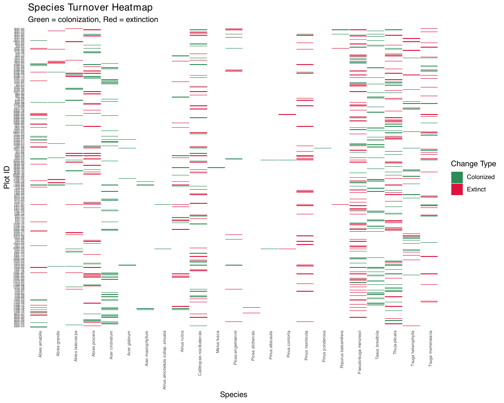
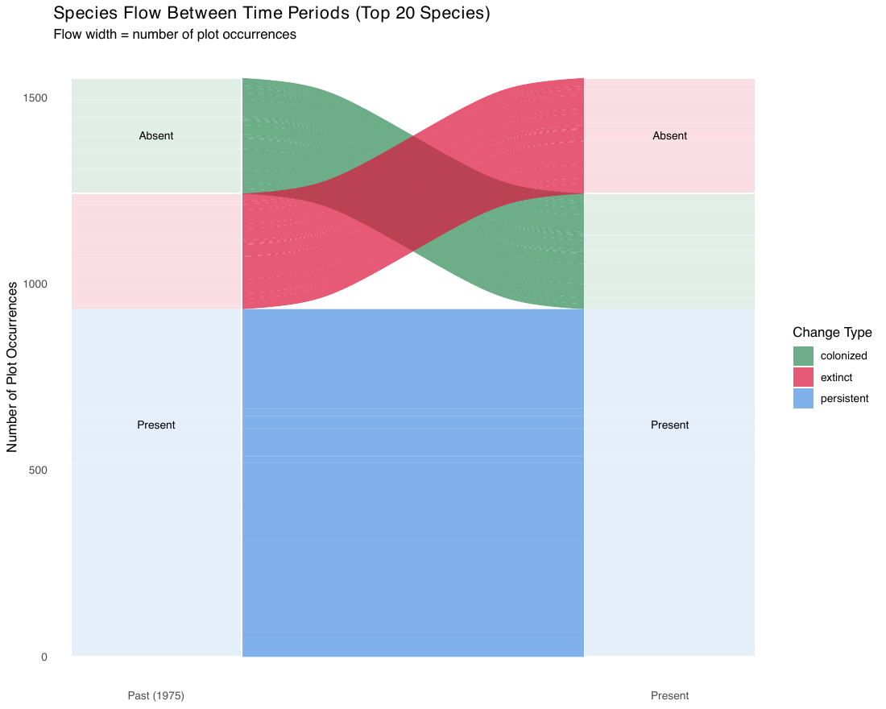
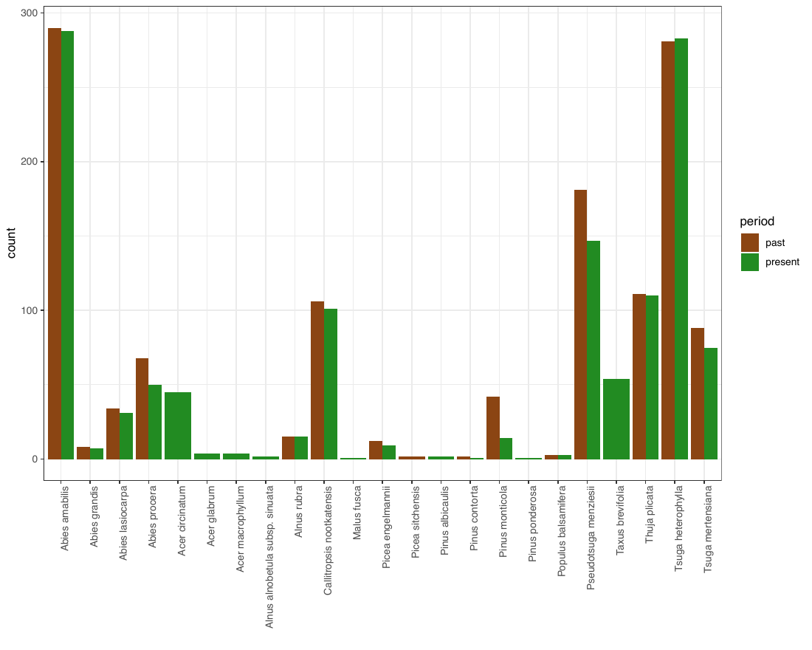
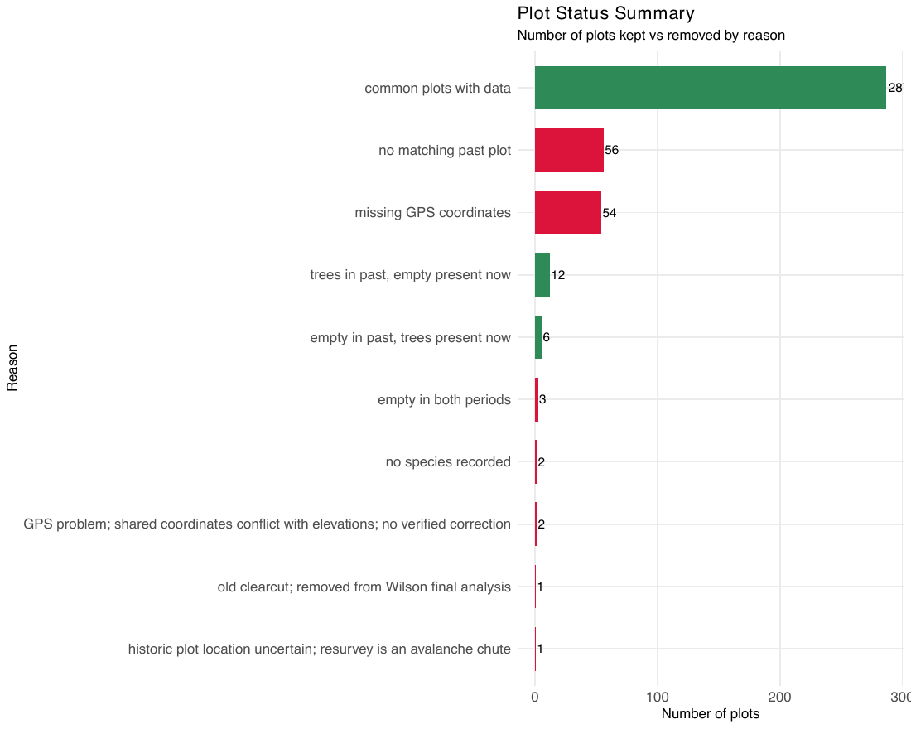
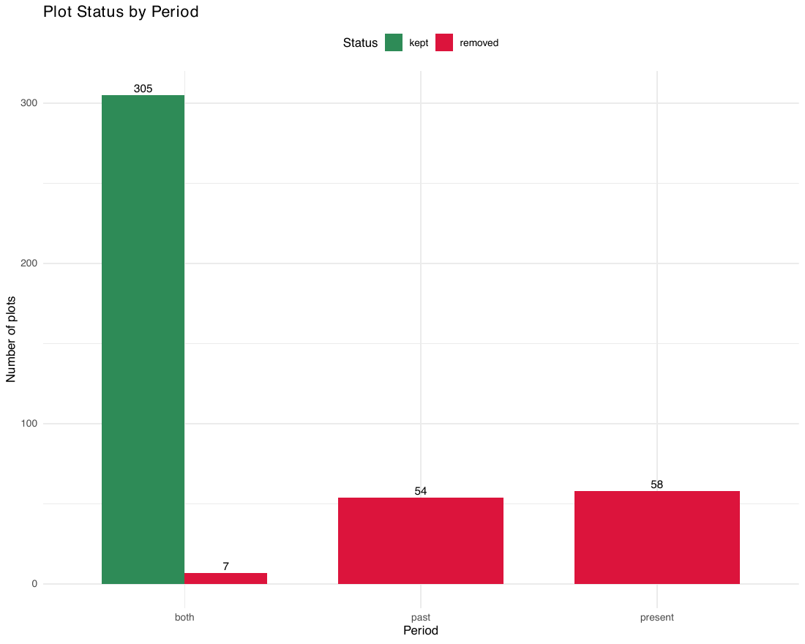
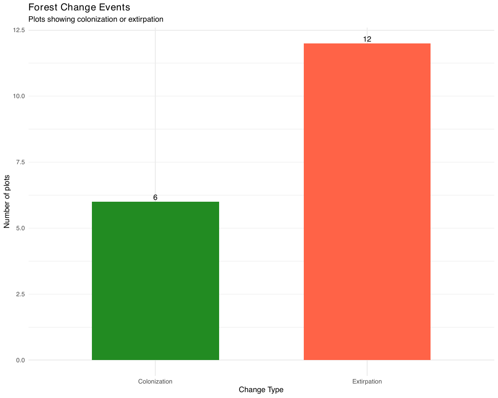
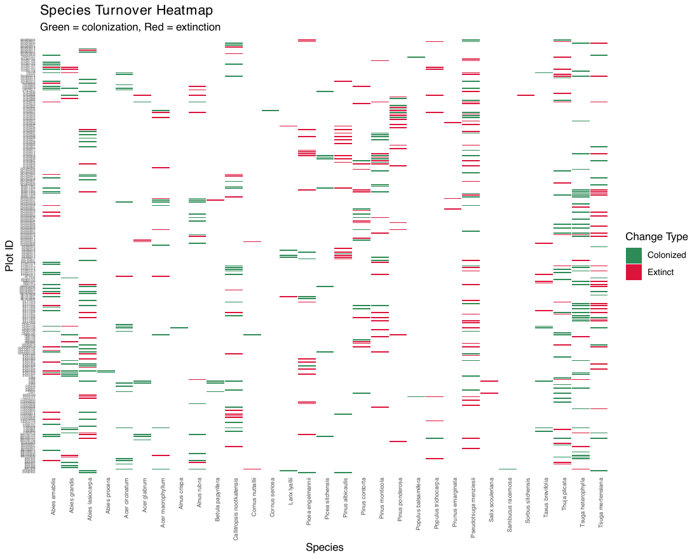
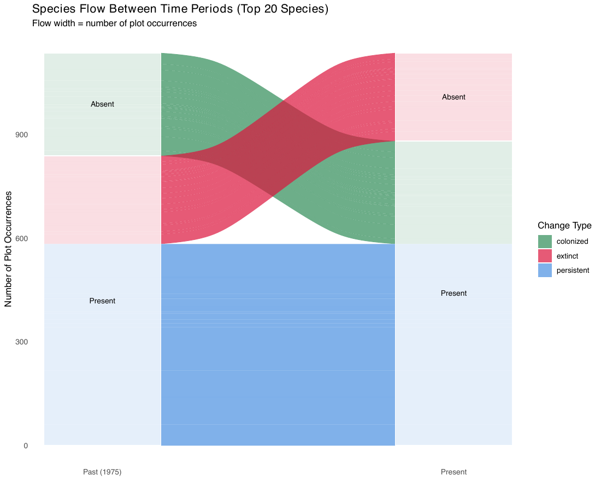
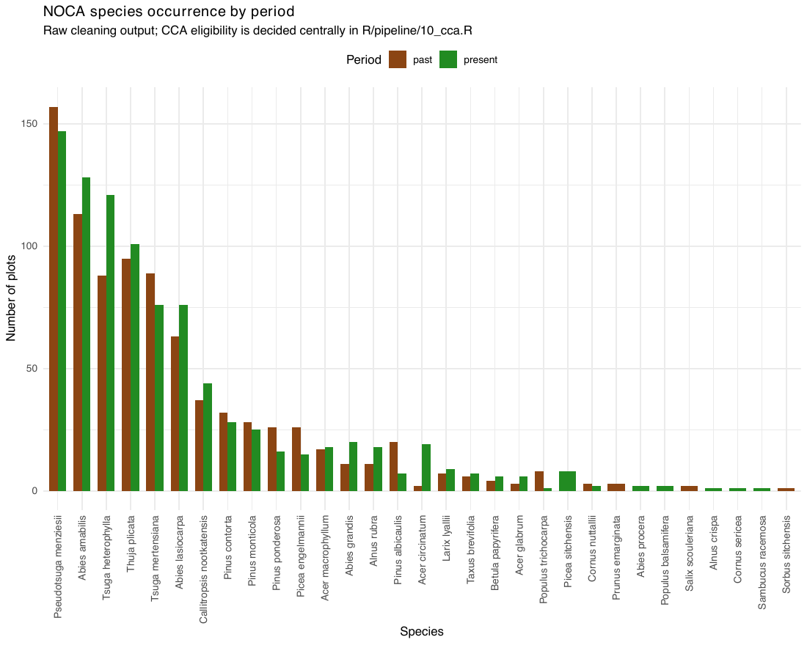

1. Modern vegetation: cleaning details
================

- [From starting plots to the CCA](#from-starting-plots-to-the-cca)
- [MORA](#mora)
- [NOCA](#noca)
- [Records per source](#records-per-source)

<!-- Generated by R/build_report.R. -->

Back to the [report](../../README.md#legacy-surveys-and-resurveys).
Scripts: `R/pipeline/01_clean_mora_vegetation.R`,
`R/pipeline/02_clean_noca_vegetation.R`.

Hand-written records for this step:

- [NOCA cleaning guide](01_vegetation_noca_cleaning_guide.md): how NOCA
  records are cleaned and paired.
- [NOCA GPS exclusion](01_vegetation_noca_gps_exclusion.md): why CARI449
  and CARI450 are excluded.
- [Survey years](01_vegetation_survey_years.md): the source of every
  survey date.
- [MORA raw data](01_vegetation_raw_data_MORA.md) and [MORA resurvey
  exports](01_vegetation_MORA_AT_outputs.md).

## From starting plots to the CCA

**Counts behind Fig. S3.**

| Site | Period | Step | Label | Remaining | Removed | Explanation |
|:---|:---|---:|:---|---:|---:|:---|
| MORA | Modern | 1.0 | Starting legacy plots | 518 | 0 | — |
| MORA | Modern | 2.0 | Starting resurvey plots | 386 | 0 | — |
| MORA | Modern | 2.5 | Legacy plots with a matched resurvey | 331 | 187 | — |
| MORA | Modern | 3.0 | Matched legacy and resurvey plots | 331 | 55 | 187 legacy plots and 55 resurvey plots have no entry in the paired-plot list; the latter include the practice plot PRAC-1. |
| MORA | Modern | 4.0 | Keep the latest adult visit | 331 | 0 | 13 plots have visits in multiple years; discard 698 earlier adult records and 22 earlier seedling records, without removing plots. |
| MORA | Modern | 5.0 | Combine adults, seedlings and study tree species | 331 | 0 | No matched plot disappears when the two vegetation stages are combined or the species lists are aligned. |
| NOCA | Modern | 1.0 | Starting legacy plots | 366 | 0 | — |
| NOCA | Modern | 2.0 | Starting registered resurvey plots | 378 | 0 | Wilson’s plot list defines the starting resurvey plots; corrected tree names are applied to this list. |
| NOCA | Modern | 2.5 | Legacy plots with usable matched locations | 312 | 54 | — |
| NOCA | Modern | 3.0 | Remove supplementary and reference plots | 375 | 3 | ROSS4001REF; SUPP2026; SUPP5127 |
| NOCA | Modern | 4.0 | Require usable GPS coordinates | 370 | 5 | — |
| NOCA | Modern | 5.0 | Require usable tree identifications | 368 | 2 | The two removed plots have only unsupported tree identifications. |
| NOCA | Modern | 6.0 | Match a legacy tree survey | 312 | 56 | 54 legacy plots also have no usable matched location. Counts for the two starting surveys must not be added. |
| NOCA | Modern | 7.0 | Remove plots empty at both dates | 309 | 3 | — |
| NOCA | Modern | 8.0 | Apply the agreed plot exclusions | 305 | 4 | One old clearcut, one uncertain resurvey location, and two unresolved GPS problems. |
| MORA | Modern | 9.0 | Eligible legacy plots | 329 | 2 | Each legacy plot must contain a retained tree species and complete climate data. Plots burned between the surveys are left out of the analysis (two at MORA). |
| MORA | Modern | 10.0 | CCA calibration and comparisons at both dates | 328 | 1 | Fit the CCA on these matched legacy plots; use the same plots for observed and predicted positions at both dates. |
| NOCA | Modern | 9.0 | Eligible legacy plots | 288 | 17 | Each legacy plot must contain a retained tree species and complete climate data. Plots burned between the surveys are left out of the analysis (two at MORA). |
| NOCA | Modern | 10.0 | CCA calibration and comparisons at both dates | 277 | 11 | Fit the CCA on these matched legacy plots; use the same plots for observed and predicted positions at both dates. |
| MORA | Holocene | 1.0 | Starting core sample depths | 119 | 0 | — |
| MORA | Holocene | 2.0 | Retain original sample identities | 119 | 0 | — |
| MORA | Holocene | 3.0 | No prepared vegetation record | 119 | 0 | — |
| MORA | Holocene | 4.0 | No study tree species detected | 119 | 0 | — |
| MORA | Holocene | 5.0 | Only species removed from the study | 119 | 0 | — |
| MORA | Holocene | 6.0 | Only species below the CCA cutoff | 119 | 0 | — |
| MORA | Holocene | 7.0 | Only species absent from the legacy CCA | 119 | 0 | — |
| MORA | Holocene | 8.0 | Missing climate values | 119 | 0 | — |
| NOCA | Holocene | 1.0 | Starting core sample depths | 870 | 0 | — |
| NOCA | Holocene | 2.0 | Retain original sample identities | 870 | 0 | — |
| NOCA | Holocene | 3.0 | No prepared vegetation record | 870 | 0 | — |
| NOCA | Holocene | 4.0 | No study tree species detected | 812 | 58 | — |
| NOCA | Holocene | 5.0 | Only species removed from the study | 812 | 0 | — |
| NOCA | Holocene | 6.0 | Only species below the CCA cutoff | 812 | 0 | — |
| NOCA | Holocene | 7.0 | Only species absent from the legacy CCA | 812 | 0 | — |
| NOCA | Holocene | 8.0 | Missing climate values | 812 | 0 | — |

Table file:
[sample_selection_counts.csv](../tables/sample_selection_counts.csv)

**Preparation choices that change records but not plot counts.**

| Site | Choice | Number | Unit | Plots removed | Explanation |
|:---|:---|---:|:---|---:|:---|
| MORA | Assign seedling dates from adult visits | 93 | seedling records | 0 | Correct years before selecting visits; supplied files are preserved. |
| MORA | Keep the latest adult visit | 13 | plots | 0 | Earlier records removed: 698 adult and 22 seedling records. Visits tied within the same year remain pooled. |
| NOCA | Apply corrected tree records | 54 | plots | 0 | Their exclusions, where applicable, are counted under GPS or missing legacy surveys; renaming and splitting source labels is not plot loss. |
| MORA | Complete climate at both dates | 0 | incomplete observations | 0 | Missing climate excludes both observed and predicted positions; the current modern data have complete climate. |
| NOCA | Complete climate at both dates | 0 | incomplete observations | 0 | Missing climate excludes both observed and predicted positions; the current modern data have complete climate. |

Table file:
[sample_selection_choices.csv](../tables/sample_selection_choices.csv)

**Legacy and resurvey plot areas of the retained plots.**

| site | legacy_area_m2 | resurvey_area_m2 | plots |
|:-----|---------------:|-----------------:|------:|
| MORA |            250 |              500 |     6 |
| MORA |            375 |              500 |     3 |
| MORA |            500 |              500 |   289 |
| MORA |           1000 |              500 |    30 |
| NOCA |             25 |              500 |    37 |
| NOCA |             36 |              500 |     1 |
| NOCA |            100 |              500 |   213 |
| NOCA |            200 |              500 |     2 |
| NOCA |            400 |              500 |    20 |
| NOCA |              — |              500 |     4 |

Table file:
[sample_selection_plot_sizes.csv](../tables/sample_selection_plot_sizes.csv)

**Plots and samples excluded from the CCA, by reason.**

| Era | Site | Use | Excluded at | Reason | Excluded |
|:---|:---|:---|:---|:---|---:|
| anthropocene | MORA | Legacy calibration | past | Burned between the surveys (left out of the analysis) | 2 |
| anthropocene | MORA | Legacy calibration | present | Only taxa excluded by CCA species selection | 1 |
| anthropocene | MORA | Modern paired comparison | past | Burned between the surveys (left out of the analysis) | 2 |
| anthropocene | MORA | Modern paired comparison | present | Only taxa excluded by CCA species selection | 1 |
| anthropocene | NOCA | Legacy calibration | past | No tree taxa recorded at legacy | 6 |
| anthropocene | NOCA | Legacy calibration | past | Only taxa excluded by CCA species selection | 11 |
| anthropocene | NOCA | Legacy calibration | present | Loss of all recorded tree-taxon presence at resurvey | 9 |
| anthropocene | NOCA | Legacy calibration | present | Only taxa excluded by CCA species selection | 2 |
| anthropocene | NOCA | Modern paired comparison | past | No tree taxa recorded at legacy | 6 |
| anthropocene | NOCA | Modern paired comparison | past | Only taxa excluded by CCA species selection | 11 |
| anthropocene | NOCA | Modern paired comparison | present | Loss of all recorded tree-taxon presence at resurvey | 9 |
| anthropocene | NOCA | Modern paired comparison | present | Only taxa excluded by CCA species selection | 2 |
| holocene | NOCA | Paleo projection | paleo | No tree taxa detected in paleo sample | 58 |

Table file:
[cca_exclusions.csv](../tables/cca_exclusions.csv)

## MORA

The MORA resurvey visited 13 plots in more than one year; the latest
adult visit is kept and seedling records are assigned to the adult visit
they belong to before that choice.

**MORA plots surveyed in more than one resurvey year.**

| Plot | Plot id | Adult survey years | Selected year | Adults kept | Adults discarded |
|:---|:---|:---|---:|---:|---:|
| CHIN-084 | CHIN-084 | 2014; 2015 | 2015 | 44 | 56 |
| GOAT-468 | GOAT-468 | 2014; 2016 | 2016 | 14 | 48 |
| LONG-356 | LONG-356 | 2015; 2016 | 2016 | 25 | 36 |
| LOWE-045 | LOWE-045 | 2015; 2016 | 2016 | 10 | 19 |
| RAMP-093 | RAMP-093 | 2015; 2016 | 2016 | 23 | 36 |
| RAMP-505 | RAMP-505 | 2018; 2019 | 2019 | 40 | 85 |
| RAMP-506 | RAMP-506 | 2018; 2019 | 2019 | 75 | 103 |
| SMO-364 | SMO-364 | 2016; 2019 | 2019 | 47 | 55 |
| SUNS-046 | SUNS-046 | 2015; 2016 | 2016 | 10 | 22 |
| TAHO-003 | TAHO-003 | 2014; 2016 | 2016 | 21 | 18 |
| WHIT-071 | WHIT-071 | 2014; 2016 | 2016 | 22 | 66 |
| WHIT-273 | WHIT-273 | 2014; 2016 | 2016 | 82 | 121 |
| WHIT-307 | WHIT-307 | 2015; 2016 | 2016 | 20 | 33 |

Table file:
[mora_repeat_visits.csv](../tables/mora_repeat_visits.csv)

**MORA plots whose resurvey year differs between sources.**

| Plot_ID | plot_id | baseline_analyzed | standardized_id_missing | stages | seedling_years | understory_years | original_visit_names | original_evidence | cleaned_evidence | reference_evidence | adult_years | selected_adult_year | treatment |
|:---|:---|:---|:---|:---|:---|:---|:---|:---|:---|:---|:---|---:|:---|
| ABOV-410 | ABOV-410 | TRUE | FALSE | seedling; understory | 2018 -\> 2019 | 2018 -\> 2019 | ABOV-410 | MORA_Seedlings_Resurvey_Org.csv line 754; MORA_VegData_Resurvey_Org.csv line 10528 | MORA_Seedlings_Resurvey_Cleaned.csv line 754; MORA_VegData_Resurvey_Cleaned.csv line 10528 | Master2019.xlsx: Seedlings!A743,C743; Master2019.xlsx: Veg Data!A10277,C10277 | 2019 | 2019 | assign adult visit year; retain latest visit; understory not used in PaleoACES tree presence |
| CARB-127 | CARB-127 | TRUE | FALSE | seedling | 2018 -\> 2019 | -\> | CARB-127 | MORA_Seedlings_Resurvey_Org.csv line 756 | MORA_Seedlings_Resurvey_Cleaned.csv line 756 | Master2019.xlsx: Seedlings!A745,C745 | 2019 | 2019 | assign adult visit year; retain latest visit |
| CARB-128 | CARB-128 | TRUE | FALSE | seedling; understory | 2018 -\> 2019 | 2018 -\> 2019 | CARB-128 | MORA_Seedlings_Resurvey_Org.csv line 761; MORA_VegData_Resurvey_Org.csv line 10638 | MORA_Seedlings_Resurvey_Cleaned.csv line 761; MORA_VegData_Resurvey_Cleaned.csv line 10638 | Master2019.xlsx: Seedlings!A750,C750; Master2019.xlsx: Veg Data!A10387,C10387 | 2019 | 2019 | assign adult visit year; retain latest visit; understory not used in PaleoACES tree presence |
| CARB-129 | CARB-129 | TRUE | FALSE | seedling; understory | 2018 -\> 2019 | 2018 -\> 2019 | CARB-129 | MORA_Seedlings_Resurvey_Org.csv line 755; MORA_VegData_Resurvey_Org.csv line 10553 | MORA_Seedlings_Resurvey_Cleaned.csv line 755; MORA_VegData_Resurvey_Cleaned.csv line 10553 | Master2019.xlsx: Seedlings!A744,C744; Master2019.xlsx: Veg Data!A10302,C10302 | 2019 | 2019 | assign adult visit year; retain latest visit; understory not used in PaleoACES tree presence |
| CHIN-247 | CHIN-247 | TRUE | FALSE | seedling; understory | 2019 -\> 2018 | 2019 -\> 2018 | CHIN-247-FIELD | MORA_Seedlings_Resurvey_Org.csv line 809; MORA_VegData_Resurvey_Org.csv line 11512 | MORA_Seedlings_Resurvey_Cleaned.csv line 809; MORA_VegData_Resurvey_Cleaned.csv line 11512 | MORA_PlotNames.csv line 37: 7/19/18 | 2018 | 2018 | assign adult visit year; retain latest visit; understory not used in PaleoACES tree presence |
| CLOV-369 | CLOV-369 | TRUE | FALSE | seedling; understory | 2018 -\> 2019 | 2018 -\> 2019 | CLOV-369-FIELD | MORA_Seedlings_Resurvey_Org.csv line 683; MORA_VegData_Resurvey_Org.csv line 8990 | MORA_Seedlings_Resurvey_Cleaned.csv line 683; MORA_VegData_Resurvey_Cleaned.csv line 8990 | Master2019.xlsx: Seedlings!A672,C672; Master2019.xlsx: Veg Data!A8740,C8740 | 2019 | 2019 | assign adult visit year; retain latest visit; understory not used in PaleoACES tree presence |
| CLOV-370 | CLOV-370 | TRUE | FALSE | seedling; understory | 2018 -\> 2019 | 2018 -\> 2019 | CLOV-370-FIELD | MORA_Seedlings_Resurvey_Org.csv line 681; MORA_VegData_Resurvey_Org.csv line 8975 | MORA_Seedlings_Resurvey_Cleaned.csv line 681; MORA_VegData_Resurvey_Cleaned.csv line 8975 | Master2019.xlsx: Seedlings!A670,C670; Master2019.xlsx: Veg Data!A8726,C8726 | 2019 | 2019 | assign adult visit year; retain latest visit; understory not used in PaleoACES tree presence |
| CRAT-195 | CRAT-195 | TRUE | FALSE | seedling; understory | 2018 -\> 2019 | 2018 -\> 2019 | CRAT-195-FIELD | MORA_Seedlings_Resurvey_Org.csv line 720; MORA_VegData_Resurvey_Org.csv line 9812 | MORA_Seedlings_Resurvey_Cleaned.csv line 720; MORA_VegData_Resurvey_Cleaned.csv line 9812 | Master2019.xlsx: Seedlings!A709,C709; Master2019.xlsx: Veg Data!A9561,C9561 | 2019 | 2019 | assign adult visit year; retain latest visit; understory not used in PaleoACES tree presence |
| CRAT-197 | CRAT-197 | TRUE | FALSE | seedling; understory | 2018 -\> 2019 | 2018 -\> 2019 | CRAT-197-FIELD | MORA_Seedlings_Resurvey_Org.csv line 706; MORA_VegData_Resurvey_Org.csv line 9575 | MORA_Seedlings_Resurvey_Cleaned.csv line 706; MORA_VegData_Resurvey_Cleaned.csv line 9575 | Master2019.xlsx: Seedlings!A695,C695; Master2019.xlsx: Veg Data!A9324,C9324 | 2019 | 2019 | assign adult visit year; retain latest visit; understory not used in PaleoACES tree presence |
| EAGL-462 | EAGL-462 | TRUE | FALSE | seedling; understory | 2019 -\> 2018 | 2019 -\> 2018 | EAGL-462-FIELD | MORA_Seedlings_Resurvey_Org.csv line 813; MORA_VegData_Resurvey_Org.csv line 11537 | MORA_Seedlings_Resurvey_Cleaned.csv line 813; MORA_VegData_Resurvey_Cleaned.csv line 11537 | MORA_PlotNames.csv line 85: 7/11/18 | 2018 | 2018 | assign adult visit year; retain latest visit; understory not used in PaleoACES tree presence |
| EAGl-120 | EAGl-120 | TRUE | FALSE | seedling; understory | 2019 -\> 2018 | 2019 -\> 2018 | EAGL-120-FIELD | MORA_Seedlings_Resurvey_Org.csv line 799; MORA_VegData_Resurvey_Org.csv line 11403 | MORA_Seedlings_Resurvey_Cleaned.csv line 799; MORA_VegData_Resurvey_Cleaned.csv line 11403 | Master2019.xlsx: Seedlings!A782,C782; Master2019.xlsx: Veg Data!A10969,C10969 | 2018 | 2018 | assign adult visit year; retain latest visit; understory not used in PaleoACES tree presence |
| FALL-130 | FALL-130 | TRUE | FALSE | seedling; understory | 2018 -\> 2019 | 2018 -\> 2019 | FALL-130 | MORA_Seedlings_Resurvey_Org.csv line 747; MORA_VegData_Resurvey_Org.csv line 10397 | MORA_Seedlings_Resurvey_Cleaned.csv line 747; MORA_VegData_Resurvey_Cleaned.csv line 10397 | Master2019.xlsx: Seedlings!A736,C736; Master2019.xlsx: Veg Data!A10146,C10146 | 2019 | 2019 | assign adult visit year; retain latest visit; understory not used in PaleoACES tree presence |
| FALL-131 | FALL-131 | TRUE | FALSE | seedling; understory | 2018 -\> 2019 | 2018 -\> 2019 | FALL-131 | MORA_Seedlings_Resurvey_Org.csv line 748; MORA_VegData_Resurvey_Org.csv line 10422 | MORA_Seedlings_Resurvey_Cleaned.csv line 748; MORA_VegData_Resurvey_Cleaned.csv line 10422 | Master2019.xlsx: Seedlings!A737,C737; Master2019.xlsx: Veg Data!A10171,C10171 | 2019 | 2019 | assign adult visit year; retain latest visit; understory not used in PaleoACES tree presence |
| GLAC-533 | — | FALSE | FALSE | understory | -\> | 2018 -\> 2019 | GLAC-1-NEW | MORA_VegData_Resurvey_Org.csv line 10155 | MORA_VegData_Resurvey_Cleaned.csv line 10155 | Master2019.xlsx: Veg Data!A9904,C9904 | — | — | outside paired plot library; not used in active analysis |
| GLAC-534 | — | FALSE | FALSE | seedling; understory | 2018 -\> 2019 | 2018 -\> 2019 | GLAC-2-NEW | MORA_Seedlings_Resurvey_Org.csv line 734; MORA_VegData_Resurvey_Org.csv line 10180 | MORA_Seedlings_Resurvey_Cleaned.csv line 734; MORA_VegData_Resurvey_Cleaned.csv line 10180 | Master2019.xlsx: Seedlings!A723,C723; Master2019.xlsx: Veg Data!A9929,C9929 | 2019 | 2019 | outside paired plot library; not used in active analysis |
| GLAC-535 | — | FALSE | FALSE | seedling; understory | 2018 -\> 2019 | 2018 -\> 2019 | GLAC-3-NEW | MORA_Seedlings_Resurvey_Org.csv line 735; MORA_VegData_Resurvey_Org.csv line 10209 | MORA_Seedlings_Resurvey_Cleaned.csv line 735; MORA_VegData_Resurvey_Cleaned.csv line 10209 | Master2019.xlsx: Seedlings!A724,C724; Master2019.xlsx: Veg Data!A9958,C9958 | 2019 | 2019 | outside paired plot library; not used in active analysis |
| IPSU-139 | IPSU-139 | TRUE | FALSE | seedling; understory | 2018 -\> 2019 | 2018 -\> 2019 | IPSU-139 | MORA_Seedlings_Resurvey_Org.csv line 768; MORA_VegData_Resurvey_Org.csv line 10756 | MORA_Seedlings_Resurvey_Cleaned.csv line 768; MORA_VegData_Resurvey_Cleaned.csv line 10756 | Master2019.xlsx: Seedlings!A757,C757; Master2019.xlsx: Veg Data!A10505,C10505 | 2019 | 2019 | assign adult visit year; retain latest visit; understory not used in PaleoACES tree presence |
| IPSU-140 | IPSU-140 | TRUE | FALSE | seedling; understory | 2018 -\> 2019 | 2018 -\> 2019 | IPSU-140 | MORA_Seedlings_Resurvey_Org.csv line 767; MORA_VegData_Resurvey_Org.csv line 10731 | MORA_Seedlings_Resurvey_Cleaned.csv line 767; MORA_VegData_Resurvey_Cleaned.csv line 10731 | Master2019.xlsx: Seedlings!A756,C756; Master2019.xlsx: Veg Data!A10480,C10480 | 2019 | 2019 | assign adult visit year; retain latest visit; understory not used in PaleoACES tree presence |
| IPSU-141 | IPSU-141 | TRUE | FALSE | seedling; understory | 2018 -\> 2019 | 2018 -\> 2019 | IPSU-141 | MORA_Seedlings_Resurvey_Org.csv line 765; MORA_VegData_Resurvey_Org.csv line 10690 | MORA_Seedlings_Resurvey_Cleaned.csv line 765; MORA_VegData_Resurvey_Cleaned.csv line 10690 | Master2019.xlsx: Seedlings!A754,C754; Master2019.xlsx: Veg Data!A10439,C10439 | 2019 | 2019 | assign adult visit year; retain latest visit; understory not used in PaleoACES tree presence |
| IPSU-145 | IPSU-145 | TRUE | FALSE | seedling; understory | 2018 -\> 2019 | 2018 -\> 2019 | IPSU-145 | MORA_Seedlings_Resurvey_Org.csv line 743; MORA_VegData_Resurvey_Org.csv line 10318 | MORA_Seedlings_Resurvey_Cleaned.csv line 743; MORA_VegData_Resurvey_Cleaned.csv line 10318 | Master2019.xlsx: Seedlings!A732,C732; Master2019.xlsx: Veg Data!A10067,C10067 | 2019 | 2019 | assign adult visit year; retain latest visit; understory not used in PaleoACES tree presence |
| IPSU-162 | IPSU-162 | TRUE | FALSE | seedling; understory | 2018 -\> 2019 | 2018 -\> 2019 | IPSU-162-FIELD | MORA_Seedlings_Resurvey_Org.csv line 701; MORA_VegData_Resurvey_Org.csv line 9400 | MORA_Seedlings_Resurvey_Cleaned.csv line 701; MORA_VegData_Resurvey_Cleaned.csv line 9400 | Master2019.xlsx: Seedlings!A690,C690; Master2019.xlsx: Veg Data!A9149,C9149 | 2019 | 2019 | assign adult visit year; retain latest visit; understory not used in PaleoACES tree presence |
| IPSU-470 | IPSU-470 | TRUE | FALSE | seedling; understory | 2018 -\> 2019 | 2018 -\> 2019 | IPSU-470-FIELD | MORA_Seedlings_Resurvey_Org.csv line 744; MORA_VegData_Resurvey_Org.csv line 10347 | MORA_Seedlings_Resurvey_Cleaned.csv line 744; MORA_VegData_Resurvey_Cleaned.csv line 10347 | Master2019.xlsx: Seedlings!A733,C733; Master2019.xlsx: Veg Data!A10096,C10096 | 2019 | 2019 | assign adult visit year; retain latest visit; understory not used in PaleoACES tree presence |
| IPSU-471 | IPSU-471 | TRUE | FALSE | seedling; understory | 2018 -\> 2019 | 2018 -\> 2019 | IPSU-471-FIELD | MORA_Seedlings_Resurvey_Org.csv line 694; MORA_VegData_Resurvey_Org.csv line 9263 | MORA_Seedlings_Resurvey_Cleaned.csv line 694; MORA_VegData_Resurvey_Cleaned.csv line 9263 | Master2019.xlsx: Seedlings!A683,C683; Master2019.xlsx: Veg Data!A9012,C9012 | 2019 | 2019 | assign adult visit year; retain latest visit; understory not used in PaleoACES tree presence |
| JUNE-477 | JUNE-477 | TRUE | FALSE | seedling; understory | 2018 -\> 2019 | 2018 -\> 2019 | JUNE-477 | MORA_Seedlings_Resurvey_Org.csv line 749; MORA_VegData_Resurvey_Org.csv line 10446 | MORA_Seedlings_Resurvey_Cleaned.csv line 749; MORA_VegData_Resurvey_Cleaned.csv line 10446 | Master2019.xlsx: Seedlings!A738,C738; Master2019.xlsx: Veg Data!A10195,C10195 | 2019 | 2019 | assign adult visit year; retain latest visit; understory not used in PaleoACES tree presence |
| JUNE-478 | JUNE-478 | TRUE | FALSE | seedling; understory | 2018 -\> 2019 | 2018 -\> 2019 | JUNE-478-FIELD | MORA_Seedlings_Resurvey_Org.csv line 752; MORA_VegData_Resurvey_Org.csv line 10485 | MORA_Seedlings_Resurvey_Cleaned.csv line 752; MORA_VegData_Resurvey_Cleaned.csv line 10485 | Master2019.xlsx: Seedlings!A741,C741; Master2019.xlsx: Veg Data!A10234,C10234 | 2019 | 2019 | assign adult visit year; retain latest visit; understory not used in PaleoACES tree presence |
| KLIC-277 | KLIC-277 | TRUE | FALSE | seedling; understory | 2018 -\> 2019 | 2018 -\> 2019 | KLIC-277 | MORA_Seedlings_Resurvey_Org.csv line 773; MORA_VegData_Resurvey_Org.csv line 10820 | MORA_Seedlings_Resurvey_Cleaned.csv line 773; MORA_VegData_Resurvey_Cleaned.csv line 10820 | Master2019.xlsx: Seedlings!A762,C762; Master2019.xlsx: Veg Data!A10569,C10569 | 2019 | 2019 | assign adult visit year; retain latest visit; understory not used in PaleoACES tree presence |
| LOWE-133 | LOWE-133 | TRUE | FALSE | seedling; understory | 2018 -\> 2019 | 2018 -\> 2019 | LOWE-133 | MORA_Seedlings_Resurvey_Org.csv line 746; MORA_VegData_Resurvey_Org.csv line 10374 | MORA_Seedlings_Resurvey_Cleaned.csv line 746; MORA_VegData_Resurvey_Cleaned.csv line 10374 | Master2019.xlsx: Seedlings!A735,C735; Master2019.xlsx: Veg Data!A10123,C10123 | 2019 | 2019 | assign adult visit year; retain latest visit; understory not used in PaleoACES tree presence |
| MARM-469 | MARM-469 | TRUE | FALSE | seedling; understory | 2018 -\> 2019 | 2018 -\> 2019 | MARM-469 | MORA_Seedlings_Resurvey_Org.csv line 737; MORA_VegData_Resurvey_Org.csv line 10248 | MORA_Seedlings_Resurvey_Cleaned.csv line 737; MORA_VegData_Resurvey_Cleaned.csv line 10248 | Master2019.xlsx: Seedlings!A726,C726; Master2019.xlsx: Veg Data!A9997,C9997 | 2019 | 2019 | assign adult visit year; retain latest visit; understory not used in PaleoACES tree presence |
| MB-2001 | — | FALSE | FALSE | seedling; understory | 2019 -\> 2018 | 2019 -\> 2018 | MB-1-FIELD | MORA_Seedlings_Resurvey_Org.csv line 818; MORA_VegData_Resurvey_Org.csv line 11590 | MORA_Seedlings_Resurvey_Cleaned.csv line 818; MORA_VegData_Resurvey_Cleaned.csv line 11590 | MORA_PlotNames.csv line 178: 7/24/18 | 2018 | 2018 | outside paired plot library; not used in active analysis |
| MB-2003 | — | FALSE | FALSE | seedling; understory | 2019 -\> 2018 | 2019 -\> 2018 | MB-3-FIELD | MORA_Seedlings_Resurvey_Org.csv line 820; MORA_VegData_Resurvey_Org.csv line 11624 | MORA_Seedlings_Resurvey_Cleaned.csv line 820; MORA_VegData_Resurvey_Cleaned.csv line 11624 | MORA_PlotNames.csv line 185: 7/25/18 | 2018 | 2018 | outside paired plot library; not used in active analysis |
| MB-2004 | — | FALSE | FALSE | seedling; understory | 2019 -\> 2018 | 2019 -\> 2018 | MB-4-FIELD | MORA_Seedlings_Resurvey_Org.csv line 822; MORA_VegData_Resurvey_Org.csv line 11647 | MORA_Seedlings_Resurvey_Cleaned.csv line 822; MORA_VegData_Resurvey_Cleaned.csv line 11647 | MORA_PlotNames.csv line 186: 7/26/18 | 2018 | 2018 | outside paired plot library; not used in active analysis |
| MB-2005 | — | FALSE | FALSE | seedling; understory | 2019 -\> 2018 | 2019 -\> 2018 | MB-5-FIELD | MORA_Seedlings_Resurvey_Org.csv line 824; MORA_VegData_Resurvey_Org.csv line 11663 | MORA_Seedlings_Resurvey_Cleaned.csv line 824; MORA_VegData_Resurvey_Cleaned.csv line 11663 | MORA_PlotNames.csv line 187: 7/26/18 | 2018 | 2018 | outside paired plot library; not used in active analysis |
| MB-2006 | — | FALSE | FALSE | seedling; understory | 2018 -\> 2019 | 2018 -\> 2019 | MB-6-FIELD | MORA_Seedlings_Resurvey_Org.csv line 674; MORA_VegData_Resurvey_Org.csv line 8802 | MORA_Seedlings_Resurvey_Cleaned.csv line 674; MORA_VegData_Resurvey_Cleaned.csv line 8802 | MORA_PlotNames.csv line 188: 7/1/2019 AND 7/2/19 | 2019 | 2019 | outside paired plot library; not used in active analysis |
| MB-2008 | — | FALSE | FALSE | seedling; understory | 2018 -\> 2019 | 2018 -\> 2019 | MB-8-FIELD | MORA_Seedlings_Resurvey_Org.csv line 675; MORA_VegData_Resurvey_Org.csv line 8842 | MORA_Seedlings_Resurvey_Cleaned.csv line 675; MORA_VegData_Resurvey_Cleaned.csv line 8842 | MORA_PlotNames.csv line 190: 7/10/19 | 2019 | 2019 | outside paired plot library; not used in active analysis |
| MB-2009 | — | FALSE | FALSE | seedling; understory | 2019 -\> 2018 | 2019 -\> 2018 | MB-9-FIELD | MORA_Seedlings_Resurvey_Org.csv line 827; MORA_VegData_Resurvey_Org.csv line 11710 | MORA_Seedlings_Resurvey_Cleaned.csv line 827; MORA_VegData_Resurvey_Cleaned.csv line 11710 | MORA_PlotNames.csv line 191: 12/6/18 | 2018 | 2018 | outside paired plot library; not used in active analysis |
| MB-2010 | — | FALSE | FALSE | seedling; understory | 2018 -\> 2019 | 2018 -\> 2019 | MB-10-FIELD | MORA_Seedlings_Resurvey_Org.csv line 676; MORA_VegData_Resurvey_Org.csv line 8904 | MORA_Seedlings_Resurvey_Cleaned.csv line 676; MORA_VegData_Resurvey_Cleaned.csv line 8904 | MORA_PlotNames.csv line 179: 8/21/19 | 2019 | 2019 | outside paired plot library; not used in active analysis |
| MB-2011 | — | FALSE | FALSE | understory | -\> | 2018 -\> 2019 | MB-11-FIELD | MORA_VegData_Resurvey_Org.csv line 8889 | MORA_VegData_Resurvey_Cleaned.csv line 8889 | MORA_PlotNames.csv line 180: 7/24/19 | 2019 | 2019 | outside paired plot library; not used in active analysis |
| MB-2012 | — | FALSE | FALSE | understory | -\> | 2018 -\> 2019 | MB-12-FIELD | MORA_VegData_Resurvey_Org.csv line 8875 | MORA_VegData_Resurvey_Cleaned.csv line 8875 | MORA_PlotNames.csv line 181: 7/9/19 | 2019 | 2019 | outside paired plot library; not used in active analysis |
| MB-2015 | — | FALSE | FALSE | seedling; understory | 2018 -\> 2019 | 2018 -\> 2019 | MB-15-FIELD | MORA_Seedlings_Resurvey_Org.csv line 669; MORA_VegData_Resurvey_Org.csv line 8711 | MORA_Seedlings_Resurvey_Cleaned.csv line 669; MORA_VegData_Resurvey_Cleaned.csv line 8711 | MORA_PlotNames.csv line 183: 7/25/19 | 2019 | 2019 | outside paired plot library; not used in active analysis |
| MOWC-184 | MOWC-184 | TRUE | FALSE | seedling; understory | 2018 -\> 2019 | 2018 -\> 2019 | MOWC-184/MOWI-184 | MORA_Seedlings_Resurvey_Org.csv line 717; MORA_VegData_Resurvey_Org.csv line 9755 | MORA_Seedlings_Resurvey_Cleaned.csv line 717; MORA_VegData_Resurvey_Cleaned.csv line 9755 | MORA_PlotNames.csv line 193: 8/20/19 | 2019 | 2019 | assign adult visit year; retain latest visit; understory not used in PaleoACES tree presence |
| MOWI-161 | MOWI-161 | TRUE | FALSE | seedling | 2018 -\> 2019 | -\> | MOWI-161-FIELD | MORA_Seedlings_Resurvey_Org.csv line 702 | MORA_Seedlings_Resurvey_Cleaned.csv line 702 | Master2019.xlsx: Seedlings!A691,C691 | 2019 | 2019 | assign adult visit year; retain latest visit |
| MOWI-183 | MOWI-183 | TRUE | FALSE | seedling; understory | 2018 -\> 2019 | 2018 -\> 2019 | MOWI-183 | MORA_Seedlings_Resurvey_Org.csv line 715; MORA_VegData_Resurvey_Org.csv line 9717 | MORA_Seedlings_Resurvey_Cleaned.csv line 715; MORA_VegData_Resurvey_Cleaned.csv line 9717 | Master2019.xlsx: Seedlings!A704,C704; Master2019.xlsx: Veg Data!A9466,C9466 | 2019 | 2019 | assign adult visit year; retain latest visit; understory not used in PaleoACES tree presence |
| MUDD-376 | MUDD-376 | TRUE | FALSE | seedling; understory | 2019 -\> 2018 | 2019 -\> 2018 | MUDD-376-FIELD | MORA_Seedlings_Resurvey_Org.csv line 807; MORA_VegData_Resurvey_Org.csv line 11463 | MORA_Seedlings_Resurvey_Cleaned.csv line 807; MORA_VegData_Resurvey_Cleaned.csv line 11463 | MORA_PlotNames.csv line 210: 7/18/18 | 2018 | 2018 | assign adult visit year; retain latest visit; understory not used in PaleoACES tree presence |
| NEO-448 | NEO-448 | TRUE | FALSE | seedling; understory | 2018 -\> 2019 | 2018 -\> 2019 | NEO-448 | MORA_Seedlings_Resurvey_Org.csv line 771; MORA_VegData_Resurvey_Org.csv line 10793 | MORA_Seedlings_Resurvey_Cleaned.csv line 771; MORA_VegData_Resurvey_Cleaned.csv line 10793 | Master2019.xlsx: Seedlings!A760,C760; Master2019.xlsx: Veg Data!A10542,C10542 | 2019 | 2019 | assign adult visit year; retain latest visit; understory not used in PaleoACES tree presence |
| NICK-319 | NICK-319 | TRUE | FALSE | understory | -\> | 2019 -\> 2018 | NICK-319-FIELD | MORA_VegData_Resurvey_Org.csv line 11482 | MORA_VegData_Resurvey_Cleaned.csv line 11482 | MORA_PlotNames.csv line 216: 7/18/18 | 2018 | 2018 | understory not used in PaleoACES tree presence |
| NORT-530 | — | FALSE | FALSE | seedling; understory | 2018 -\> 2019 | 2018 -\> 2019 | NORT-1-NEW | MORA_Seedlings_Resurvey_Org.csv line 704; MORA_VegData_Resurvey_Org.csv line 9532 | MORA_Seedlings_Resurvey_Cleaned.csv line 704; MORA_VegData_Resurvey_Cleaned.csv line 9532 | Master2019.xlsx: Seedlings!A693,C693; Master2019.xlsx: Veg Data!A9281,C9281 | 2019 | 2019 | outside paired plot library; not used in active analysis |
| NORT-531 | — | FALSE | FALSE | seedling; understory | 2018 -\> 2019 | 2018 -\> 2019 | NORT-2-NEW | MORA_Seedlings_Resurvey_Org.csv line 732; MORA_VegData_Resurvey_Org.csv line 10043 | MORA_Seedlings_Resurvey_Cleaned.csv line 732; MORA_VegData_Resurvey_Cleaned.csv line 10043 | Master2019.xlsx: Seedlings!A721,C721; Master2019.xlsx: Veg Data!A9792,C9792 | 2019 | 2019 | outside paired plot library; not used in active analysis |
| NORT-532 | — | FALSE | FALSE | seedling; understory | 2018 -\> 2019 | 2018 -\> 2019 | NORT-3-NEW | MORA_Seedlings_Resurvey_Org.csv line 733; MORA_VegData_Resurvey_Org.csv line 10094 | MORA_Seedlings_Resurvey_Cleaned.csv line 733; MORA_VegData_Resurvey_Cleaned.csv line 10094 | Master2019.xlsx: Seedlings!A722,C722; Master2019.xlsx: Veg Data!A9843,C9843 | 2019 | 2019 | outside paired plot library; not used in active analysis |
| OHAN-248 | OHAN-248 | TRUE | FALSE | seedling; understory | 2018 -\> 2019 | 2018 -\> 2019 | OHAN-248-FIELD | MORA_Seedlings_Resurvey_Org.csv line 815; MORA_VegData_Resurvey_Org.csv line 11559 | MORA_Seedlings_Resurvey_Cleaned.csv line 815; MORA_VegData_Resurvey_Cleaned.csv line 11559 | MORA_PlotNames.csv line 240: 7/18/19 | 2019 | 2019 | assign adult visit year; retain latest visit; understory not used in PaleoACES tree presence |
| OWYH-529 | — | FALSE | FALSE | understory | -\> | 2018 -\> 2019 | OWYH-1-NEW | MORA_VegData_Resurvey_Org.csv line 9495 | MORA_VegData_Resurvey_Cleaned.csv line 9495 | Master2019.xlsx: Veg Data!A9244,C9244 | 2019 | 2019 | outside paired plot library; not used in active analysis |
| PAGL-538 | — | FALSE | FALSE | understory | -\> | 2018 -\> 2019 | PAGL-1-FIELD | MORA_VegData_Resurvey_Org.csv line 9922 | MORA_VegData_Resurvey_Cleaned.csv line 9922 | Master2019.xlsx: Veg Data!A9671,C9671 | — | — | outside paired plot library; not used in active analysis |
| PAGL-539 | — | FALSE | FALSE | seedling; understory | 2018 -\> 2019 | 2018 -\> 2019 | PAGL-2-FIELD | MORA_Seedlings_Resurvey_Org.csv line 727; MORA_VegData_Resurvey_Org.csv line 9939 | MORA_Seedlings_Resurvey_Cleaned.csv line 727; MORA_VegData_Resurvey_Cleaned.csv line 9939 | Master2019.xlsx: Seedlings!A716,C716; Master2019.xlsx: Veg Data!A9688,C9688 | 2019 | 2019 | outside paired plot library; not used in active analysis |
| PALI-492 | PALI-492 | TRUE | FALSE | seedling; understory | 2018 -\> 2019 | 2018 -\> 2019 | PALI-492-FIELD | MORA_Seedlings_Resurvey_Org.csv line 684; MORA_VegData_Resurvey_Org.csv line 9034 | MORA_Seedlings_Resurvey_Cleaned.csv line 684; MORA_VegData_Resurvey_Cleaned.csv line 9034 | Master2019.xlsx: Seedlings!A673,C673; Master2019.xlsx: Veg Data!A8784,C8784 | 2019 | 2019 | assign adult visit year; retain latest visit; understory not used in PaleoACES tree presence |
| PALI-546 | — | FALSE | FALSE | seedling; understory | 2018 -\> 2019 | 2018 -\> 2019 | PALI-1-NEW | MORA_Seedlings_Resurvey_Org.csv line 685; MORA_VegData_Resurvey_Org.csv line 9073 | MORA_Seedlings_Resurvey_Cleaned.csv line 685; MORA_VegData_Resurvey_Cleaned.csv line 9073 | Master2019.xlsx: Seedlings!A674,C674; Master2019.xlsx: Veg Data!A8823,C8823 | 2019 | 2019 | outside paired plot library; not used in active analysis |
| PALI-547 | — | FALSE | FALSE | seedling; understory | 2018 -\> 2019 | 2018 -\> 2019 | PALI-2-NEW | MORA_Seedlings_Resurvey_Org.csv line 687; MORA_VegData_Resurvey_Org.csv line 9105 | MORA_Seedlings_Resurvey_Cleaned.csv line 687; MORA_VegData_Resurvey_Cleaned.csv line 9105 | Master2019.xlsx: Seedlings!A676,C676; Master2019.xlsx: Veg Data!A8854,C8854 | 2019 | 2019 | outside paired plot library; not used in active analysis |
| PARA-479 | PARA-479 | TRUE | FALSE | seedling; understory | 2019 -\> 2018 | 2019 -\> 2018 | PARA-479-FIELD | MORA_Seedlings_Resurvey_Org.csv line 801; MORA_VegData_Resurvey_Org.csv line 11424 | MORA_Seedlings_Resurvey_Cleaned.csv line 801; MORA_VegData_Resurvey_Cleaned.csv line 11424 | Master2019.xlsx: Seedlings!A784,C784; Master2019.xlsx: Veg Data!A10990,C10990 | 2018 | 2018 | assign adult visit year; retain latest visit; understory not used in PaleoACES tree presence |
| PAUL-194 | PAUL-194 | TRUE | FALSE | seedling; understory | 2018 -\> 2019 | 2018 -\> 2019 | PAUL-194 | MORA_Seedlings_Resurvey_Org.csv line 710; MORA_VegData_Resurvey_Org.csv line 9665 | MORA_Seedlings_Resurvey_Cleaned.csv line 710; MORA_VegData_Resurvey_Cleaned.csv line 9665 | Master2019.xlsx: Seedlings!A699,C699; Master2019.xlsx: Veg Data!A9414,C9414 | 2019 | 2019 | assign adult visit year; retain latest visit; understory not used in PaleoACES tree presence |
| PAUL-343 | PAUL-343 | TRUE | FALSE | seedling; understory | 2018 -\> 2019 | 2018 -\> 2019 | PAUL-343 | MORA_Seedlings_Resurvey_Org.csv line 713; MORA_VegData_Resurvey_Org.csv line 9683 | MORA_Seedlings_Resurvey_Cleaned.csv line 713; MORA_VegData_Resurvey_Cleaned.csv line 9683 | Master2019.xlsx: Seedlings!A702,C702; Master2019.xlsx: Veg Data!A9432,C9432 | 2019 | 2019 | assign adult visit year; retain latest visit; understory not used in PaleoACES tree presence |
| PIPE-536 | — | FALSE | FALSE | seedling; understory | 2018 -\> 2019 | 2018 -\> 2019 | PIPE-1 | MORA_Seedlings_Resurvey_Org.csv line 728; MORA_VegData_Resurvey_Org.csv line 9973 | MORA_Seedlings_Resurvey_Cleaned.csv line 728; MORA_VegData_Resurvey_Cleaned.csv line 9973 | Master2019.xlsx: Seedlings!A717,C717; Master2019.xlsx: Veg Data!A9722,C9722 | 2019 | 2019 | outside paired plot library; not used in active analysis |
| PIPE-537 | — | FALSE | FALSE | seedling; understory | 2018 -\> 2019 | 2018 -\> 2019 | PIPE-2 | MORA_Seedlings_Resurvey_Org.csv line 730; MORA_VegData_Resurvey_Org.csv line 10019 | MORA_Seedlings_Resurvey_Cleaned.csv line 730; MORA_VegData_Resurvey_Cleaned.csv line 10019 | Master2019.xlsx: Seedlings!A719,C719; Master2019.xlsx: Veg Data!A9768,C9768 | 2019 | 2019 | outside paired plot library; not used in active analysis |
| PRAC-1 | — | FALSE | TRUE | seedling; understory | 2018 -\> 2019 | 2018 -\> 2019 | PRAC-1 | MORA_Seedlings_Resurvey_Org.csv line 776; MORA_VegData_Resurvey_Org.csv line 10947 | MORA_Seedlings_Resurvey_Cleaned.csv line 776; MORA_VegData_Resurvey_Cleaned.csv line 10947 | Master2019.xlsx: Seedlings!A765,C765; Master2019.xlsx: Veg Data!A10696,C10696 | — | — | outside paired plot library; not used in active analysis |
| PRAC-526 | — | FALSE | FALSE | seedling; understory | 2018 -\> 2019 | 2018 -\> 2019 | PRAC-2 | MORA_Seedlings_Resurvey_Org.csv line 777; MORA_VegData_Resurvey_Org.csv line 10980 | MORA_Seedlings_Resurvey_Cleaned.csv line 777; MORA_VegData_Resurvey_Cleaned.csv line 10980 | Master2019.xlsx: Seedlings!A766,C766; Master2019.xlsx: Veg Data!A10729,C10729 | 2019 | 2019 | outside paired plot library; not used in active analysis |
| PRAC-527 | — | FALSE | FALSE | seedling; understory | 2018 -\> 2019 | 2018 -\> 2019 | PRAC-3 | MORA_Seedlings_Resurvey_Org.csv line 780; MORA_VegData_Resurvey_Org.csv line 11020 | MORA_Seedlings_Resurvey_Cleaned.csv line 780; MORA_VegData_Resurvey_Cleaned.csv line 11020 | Master2019.xlsx: Seedlings!A769,C769; Master2019.xlsx: Veg Data!A10769,C10769 | 2019 | 2019 | outside paired plot library; not used in active analysis |
| PRAC-528 | — | FALSE | FALSE | seedling; understory | 2018 -\> 2019 | 2018 -\> 2019 | PRAC-4 | MORA_Seedlings_Resurvey_Org.csv line 781; MORA_VegData_Resurvey_Org.csv line 11056 | MORA_Seedlings_Resurvey_Cleaned.csv line 781; MORA_VegData_Resurvey_Cleaned.csv line 11056 | Master2019.xlsx: Seedlings!A770,C770; Master2019.xlsx: Veg Data!A10805,C10805 | 2019 | 2019 | outside paired plot library; not used in active analysis |
| RAMP-505 | RAMP-505 | TRUE | FALSE | seedling; understory | 2018 -\> 2019; 2019 -\> 2018 | 2018 -\> 2019; 2019 -\> 2018 | RAMP-505-FIELD; RAMP-505-FIELD-2 | MORA_Seedlings_Resurvey_Org.csv line 783; MORA_Seedlings_Resurvey_Org.csv line 794; MORA_VegData_Resurvey_Org.csv line 11079; MORA_VegData_Resurvey_Org.csv line 11324 | MORA_Seedlings_Resurvey_Cleaned.csv line 783; MORA_Seedlings_Resurvey_Cleaned.csv line 794; MORA_VegData_Resurvey_Cleaned.csv line 11079; MORA_VegData_Resurvey_Cleaned.csv line 11324 | Master2019.xlsx: Seedlings!A772,C772; Master2019.xlsx: Seedlings!A777,C777; Master2019.xlsx: Veg Data!A10828,C10828; Master2019.xlsx: Veg Data!A10890,C10890 | 2018;2019 | 2019 | assign adult visit year; retain latest visit; understory not used in PaleoACES tree presence |
| RAMP-506 | RAMP-506 | TRUE | FALSE | seedling; understory | 2018 -\> 2019 | 2018 -\> 2019; 2019 -\> 2018 | RAMP-506-FIELD; RAMP-506-FIELD-2 | MORA_Seedlings_Resurvey_Org.csv line 787; MORA_VegData_Resurvey_Org.csv line 11102; MORA_VegData_Resurvey_Org.csv line 11308 | MORA_Seedlings_Resurvey_Cleaned.csv line 787; MORA_VegData_Resurvey_Cleaned.csv line 11102; MORA_VegData_Resurvey_Cleaned.csv line 11308 | Master2019.xlsx: Seedlings!A776,C776; Master2019.xlsx: Veg Data!A10851,C10851; Master2019.xlsx: Veg Data!A10874,C10874 | 2018;2019 | 2019 | assign adult visit year; retain latest visit; understory not used in PaleoACES tree presence |
| RANG-135 | RANG-135 | TRUE | FALSE | seedling; understory | 2018 -\> 2019 | 2018 -\> 2019 | RANG-135 | MORA_Seedlings_Resurvey_Org.csv line 753; MORA_VegData_Resurvey_Org.csv line 10502 | MORA_Seedlings_Resurvey_Cleaned.csv line 753; MORA_VegData_Resurvey_Cleaned.csv line 10502 | Master2019.xlsx: Seedlings!A742,C742; Master2019.xlsx: Veg Data!A10251,C10251 | 2019 | 2019 | assign adult visit year; retain latest visit; understory not used in PaleoACES tree presence |
| RP-1001 | — | FALSE | FALSE | seedling; understory | 2018 -\> 2019 | 2018 -\> 2019 | RP-1B-FIELD | MORA_Seedlings_Resurvey_Org.csv line 673; MORA_VegData_Resurvey_Org.csv line 8767 | MORA_Seedlings_Resurvey_Cleaned.csv line 673; MORA_VegData_Resurvey_Cleaned.csv line 8767 | MORA_PlotNames.csv line 296: 6/30/19 | 2019 | 2019 | outside paired plot library; not used in active analysis |
| RP-1004 | — | FALSE | FALSE | understory | -\> | 2019 -\> 2018 | RP-4-FIELD | MORA_VegData_Resurvey_Org.csv line 11125 | MORA_VegData_Resurvey_Cleaned.csv line 11125 | MORA_PlotNames.csv line 299: 6/25/18 | 2018 | 2018 | outside paired plot library; not used in active analysis |
| RP-1005 | — | FALSE | FALSE | seedling; understory | 2019 -\> 2018 | 2019 -\> 2018 | RP-5-FIELD | MORA_Seedlings_Resurvey_Org.csv line 788; MORA_VegData_Resurvey_Org.csv line 11142 | MORA_Seedlings_Resurvey_Cleaned.csv line 788; MORA_VegData_Resurvey_Cleaned.csv line 11142 | MORA_PlotNames.csv line 300: 6/25/18 | 2018 | 2018 | outside paired plot library; not used in active analysis |
| RP-1007 | — | FALSE | FALSE | understory | -\> | 2019 -\> 2018 | RP-7-FIELD | MORA_VegData_Resurvey_Org.csv line 11189 | MORA_VegData_Resurvey_Cleaned.csv line 11189 | MORA_PlotNames.csv line 302: 6/26/18 | 2018 | 2018 | outside paired plot library; not used in active analysis |
| RP-1008 | — | FALSE | FALSE | seedling; understory | 2019 -\> 2018 | 2019 -\> 2018 | RP-8-FIELD | MORA_Seedlings_Resurvey_Org.csv line 793; MORA_VegData_Resurvey_Org.csv line 11284 | MORA_Seedlings_Resurvey_Cleaned.csv line 793; MORA_VegData_Resurvey_Cleaned.csv line 11284 | MORA_PlotNames.csv line 303: 6/27/18 | 2018 | 2018 | outside paired plot library; not used in active analysis |
| RP-1009 | — | FALSE | FALSE | seedling; understory | 2018 -\> 2019 | 2018 -\> 2019 | RP-9-FIELD | MORA_Seedlings_Resurvey_Org.csv line 671; MORA_VegData_Resurvey_Org.csv line 8743 | MORA_Seedlings_Resurvey_Cleaned.csv line 671; MORA_VegData_Resurvey_Cleaned.csv line 8743 | MORA_PlotNames.csv line 304: 6/29/19 | 2019 | 2019 | outside paired plot library; not used in active analysis |
| RP-1011 | — | FALSE | FALSE | seedling; understory | 2018 -\> 2019 | 2018 -\> 2019 | RP-11-FIELD | MORA_Seedlings_Resurvey_Org.csv line 667; MORA_VegData_Resurvey_Org.csv line 8671 | MORA_Seedlings_Resurvey_Cleaned.csv line 667; MORA_VegData_Resurvey_Cleaned.csv line 8671 | MORA_PlotNames.csv line 292: 8/7/19 | 2019 | 2019 | outside paired plot library; not used in active analysis |
| RP-1012 | — | FALSE | FALSE | seedling; understory | 2019 -\> 2018 | 2019 -\> 2018 | RP-12-FIELD | MORA_Seedlings_Resurvey_Org.csv line 790; MORA_VegData_Resurvey_Org.csv line 11246 | MORA_Seedlings_Resurvey_Cleaned.csv line 790; MORA_VegData_Resurvey_Cleaned.csv line 11246 | MORA_PlotNames.csv line 293: 8/8/18 | 2018 | 2018 | outside paired plot library; not used in active analysis |
| RP-1014 | — | FALSE | FALSE | seedling; understory | 2019 -\> 2018 | 2019 -\> 2018 | RP-14-FIELD | MORA_Seedlings_Resurvey_Org.csv line 792; MORA_VegData_Resurvey_Org.csv line 11258 | MORA_Seedlings_Resurvey_Cleaned.csv line 792; MORA_VegData_Resurvey_Cleaned.csv line 11258 | MORA_PlotNames.csv line 294: 8/7/18 | 2018 | 2018 | outside paired plot library; not used in active analysis |
| RP-1015 | — | FALSE | FALSE | seedling; understory | 2019 -\> 2018 | 2019 -\> 2018 | RP-15-FIELD | MORA_Seedlings_Resurvey_Org.csv line 789; MORA_VegData_Resurvey_Org.csv line 11235 | MORA_Seedlings_Resurvey_Cleaned.csv line 789; MORA_VegData_Resurvey_Cleaned.csv line 11235 | MORA_PlotNames.csv line 295: 8/9/18 | 2018 | 2018 | outside paired plot library; not used in active analysis |
| SILV-523 | — | FALSE | FALSE | understory | -\> | 2018 -\> 2019 | SILV-1-NEW | MORA_VegData_Resurvey_Org.csv line 10907 | MORA_VegData_Resurvey_Cleaned.csv line 10907 | Master2019.xlsx: Veg Data!A10656,C10656 | 2019 | 2019 | outside paired plot library; not used in active analysis |
| SMO-182 | SMO-182 | TRUE | FALSE | seedling; understory | 2018 -\> 2019 | 2018 -\> 2019 | SMO-182 | MORA_Seedlings_Resurvey_Org.csv line 707; MORA_VegData_Resurvey_Org.csv line 9602 | MORA_Seedlings_Resurvey_Cleaned.csv line 707; MORA_VegData_Resurvey_Cleaned.csv line 9602 | Master2019.xlsx: Seedlings!A696,C696; Master2019.xlsx: Veg Data!A9351,C9351 | 2019 | 2019 | assign adult visit year; retain latest visit; understory not used in PaleoACES tree presence |
| SMO-364 | SMO-364 | TRUE | FALSE | seedling; understory | 2018 -\> 2019 | 2018 -\> 2019 | SMO-364 | MORA_Seedlings_Resurvey_Org.csv line 709; MORA_VegData_Resurvey_Org.csv line 9639 | MORA_Seedlings_Resurvey_Cleaned.csv line 709; MORA_VegData_Resurvey_Cleaned.csv line 9639 | Master2019.xlsx: Seedlings!A698,C698; Master2019.xlsx: Veg Data!A9388,C9388 | 2016;2019 | 2019 | assign adult visit year; retain latest visit; understory not used in PaleoACES tree presence |
| SMO-464 | SMO-464 | TRUE | FALSE | seedling; understory | 2018 -\> 2019 | 2018 -\> 2019 | SMO-464 | MORA_Seedlings_Resurvey_Org.csv line 718; MORA_VegData_Resurvey_Org.csv line 9782 | MORA_Seedlings_Resurvey_Cleaned.csv line 718; MORA_VegData_Resurvey_Cleaned.csv line 9782 | Master2019.xlsx: Seedlings!A707,C707; Master2019.xlsx: Veg Data!A9531,C9531 | 2019 | 2019 | assign adult visit year; retain latest visit; understory not used in PaleoACES tree presence |
| SPRA-159 | SPRA-159 | TRUE | FALSE | seedling; understory | 2018 -\> 2019 | 2018 -\> 2019 | SPRA-159-FIELD | MORA_Seedlings_Resurvey_Org.csv line 699; MORA_VegData_Resurvey_Org.csv line 9376 | MORA_Seedlings_Resurvey_Cleaned.csv line 699; MORA_VegData_Resurvey_Cleaned.csv line 9376 | Master2019.xlsx: Seedlings!A688,C688; Master2019.xlsx: Veg Data!A9125,C9125 | 2019 | 2019 | assign adult visit year; retain latest visit; understory not used in PaleoACES tree presence |
| SPRA-544 | — | FALSE | FALSE | seedling; understory | 2018 -\> 2019 | 2018 -\> 2019 | SPRA-1-NEW | MORA_Seedlings_Resurvey_Org.csv line 695; MORA_VegData_Resurvey_Org.csv line 9293 | MORA_Seedlings_Resurvey_Cleaned.csv line 695; MORA_VegData_Resurvey_Cleaned.csv line 9293 | Master2019.xlsx: Seedlings!A684,C684; Master2019.xlsx: Veg Data!A9042,C9042 | 2019 | 2019 | outside paired plot library; not used in active analysis |
| SPRA-545 | — | FALSE | FALSE | seedling; understory | 2018 -\> 2019 | 2018 -\> 2019 | SPRA-2-NEW | MORA_Seedlings_Resurvey_Org.csv line 698; MORA_VegData_Resurvey_Org.csv line 9344 | MORA_Seedlings_Resurvey_Cleaned.csv line 698; MORA_VegData_Resurvey_Cleaned.csv line 9344 | Master2019.xlsx: Seedlings!A687,C687; Master2019.xlsx: Veg Data!A9093,C9093 | 2019 | 2019 | outside paired plot library; not used in active analysis |
| SUNR-235 | — | FALSE | FALSE | seedling; understory | 2019 -\> 2018 | 2019 -\> 2018 | SUNR-235-FIELD | MORA_Seedlings_Resurvey_Org.csv line 796; MORA_VegData_Resurvey_Org.csv line 11355 | MORA_Seedlings_Resurvey_Cleaned.csv line 796; MORA_VegData_Resurvey_Cleaned.csv line 11355 | Master2019.xlsx: Seedlings!A779,C779; Master2019.xlsx: Veg Data!A10921,C10921 | 2018 | 2018 | outside paired plot library; not used in active analysis |
| SUNR-280 | SUNR-280 | TRUE | FALSE | seedling; understory | 2018 -\> 2019 | 2018 -\> 2019 | SUNR-280-FIELD | MORA_Seedlings_Resurvey_Org.csv line 678; MORA_VegData_Resurvey_Org.csv line 8920 | MORA_Seedlings_Resurvey_Cleaned.csv line 678; MORA_VegData_Resurvey_Cleaned.csv line 8920 | Master2019.xlsx: Seedlings!A667,C667; Master2019.xlsx: Veg Data!A8671,C8671 | 2019 | 2019 | assign adult visit year; retain latest visit; understory not used in PaleoACES tree presence |
| SUNR-306 | SUNR-306 | TRUE | FALSE | understory | -\> | 2018 -\> 2019 | SUNR-306 | MORA_VegData_Resurvey_Org.csv line 9159 | MORA_VegData_Resurvey_Cleaned.csv line 9159 | Master2019.xlsx: Veg Data!A8908,C8908 | 2019 | 2019 | understory not used in PaleoACES tree presence |
| SUNR-357 | SUNR-357 | TRUE | FALSE | seedling; understory | 2018 -\> 2019 | 2018 -\> 2019 | SUNR-357-FIELD | MORA_Seedlings_Resurvey_Org.csv line 680; MORA_VegData_Resurvey_Org.csv line 8945 | MORA_Seedlings_Resurvey_Cleaned.csv line 680; MORA_VegData_Resurvey_Cleaned.csv line 8945 | Master2019.xlsx: Seedlings!A669,C669; Master2019.xlsx: Veg Data!A8696,C8696 | 2019 | 2019 | assign adult visit year; retain latest visit; understory not used in PaleoACES tree presence |
| TOLM-542 | — | FALSE | FALSE | seedling; understory | 2018 -\> 2019 | 2018 -\> 2019 | TOLM-1-NEW | MORA_Seedlings_Resurvey_Org.csv line 688; MORA_VegData_Resurvey_Org.csv line 9205 | MORA_Seedlings_Resurvey_Cleaned.csv line 688; MORA_VegData_Resurvey_Cleaned.csv line 9205 | Master2019.xlsx: Seedlings!A677,C677; Master2019.xlsx: Veg Data!A8954,C8954 | 2019 | 2019 | outside paired plot library; not used in active analysis |
| TOLM-543 | — | FALSE | FALSE | seedling; understory | 2018 -\> 2019 | 2018 -\> 2019 | TOLM-2-NEW | MORA_Seedlings_Resurvey_Org.csv line 690; MORA_VegData_Resurvey_Org.csv line 9234 | MORA_Seedlings_Resurvey_Cleaned.csv line 690; MORA_VegData_Resurvey_Cleaned.csv line 9234 | Master2019.xlsx: Seedlings!A679,C679; Master2019.xlsx: Veg Data!A8983,C8983 | 2019 | 2019 | outside paired plot library; not used in active analysis |
| U OH-389 | UOH-389 | TRUE | FALSE | seedling; understory | 2019 -\> 2018 | 2019 -\> 2018 | UOH-389-FIELD | MORA_Seedlings_Resurvey_Org.csv line 804; MORA_VegData_Resurvey_Org.csv line 11451 | MORA_Seedlings_Resurvey_Cleaned.csv line 804; MORA_VegData_Resurvey_Cleaned.csv line 11451 | MORA_PlotNames.csv line 371: 7/17/18 | 2018 | 2018 | assign adult visit year; retain latest visit; understory not used in PaleoACES tree presence |
| UPPE-146 | UPPE-146 | TRUE | FALSE | seedling; understory | 2018 -\> 2019 | 2018 -\> 2019 | UPPE-146 | MORA_Seedlings_Resurvey_Org.csv line 741; MORA_VegData_Resurvey_Org.csv line 10279 | MORA_Seedlings_Resurvey_Cleaned.csv line 741; MORA_VegData_Resurvey_Cleaned.csv line 10279 | Master2019.xlsx: Seedlings!A730,C730; Master2019.xlsx: Veg Data!A10028,C10028 | 2019 | 2019 | assign adult visit year; retain latest visit; understory not used in PaleoACES tree presence |
| VANT-540 | — | FALSE | FALSE | seedling; understory | 2018 -\> 2019 | 2018 -\> 2019 | VANT-1 | MORA_Seedlings_Resurvey_Org.csv line 725; MORA_VegData_Resurvey_Org.csv line 9889 | MORA_Seedlings_Resurvey_Cleaned.csv line 725; MORA_VegData_Resurvey_Cleaned.csv line 9889 | Master2019.xlsx: Seedlings!A714,C714; Master2019.xlsx: Veg Data!A9638,C9638 | 2019 | 2019 | outside paired plot library; not used in active analysis |
| VANT-541 | — | FALSE | FALSE | seedling; understory | 2018 -\> 2019 | 2018 -\> 2019 | VANT-2 | MORA_Seedlings_Resurvey_Org.csv line 723; MORA_VegData_Resurvey_Org.csv line 9838 | MORA_Seedlings_Resurvey_Cleaned.csv line 723; MORA_VegData_Resurvey_Cleaned.csv line 9838 | Master2019.xlsx: Seedlings!A712,C712; Master2019.xlsx: Veg Data!A9587,C9587 | 2019 | 2019 | outside paired plot library; not used in active analysis |
| WOND-524 | — | FALSE | FALSE | seedling; understory | 2018 -\> 2019 | 2018 -\> 2019 | WOND-1-NEW | MORA_Seedlings_Resurvey_Org.csv line 774; MORA_VegData_Resurvey_Org.csv line 10871 | MORA_Seedlings_Resurvey_Cleaned.csv line 774; MORA_VegData_Resurvey_Cleaned.csv line 10871 | Master2019.xlsx: Seedlings!A763,C763; Master2019.xlsx: Veg Data!A10620,C10620 | 2019 | 2019 | outside paired plot library; not used in active analysis |

Table file:
[mora_year_source_discrepancies.csv](../tables/mora_year_source_discrepancies.csv)

**MORA species dynamics between surveys** (three pages: presences, gains
and losses, turnover).

## NOCA

**NOCA plots excluded from the study.**

| Plot | Reason | Source |
|:---|:---|:---|
| BAK487 | old clearcut; removed from Wilson final analysis | notes_from_Rachel/Burned plots.rtf |
| BEAV6061 | historic plot location uncertain; resurvey is an avalanche chute | notes_from_Rachel/Missing trees.rtf |
| CARI449 | GPS problem; shared coordinates conflict with elevations; no verified correction | data/NOCA/Correspondance_Kavya&Rachel_September2024.pdf (page 2); report/details/01_vegetation_noca_gps_exclusion.md |
| CARI450 | GPS problem; shared coordinates conflict with elevations; no verified correction | data/NOCA/Correspondance_Kavya&Rachel_September2024.pdf (page 2); report/details/01_vegetation_noca_gps_exclusion.md |

Table file:
[noca_study_exclusions.csv](../tables/noca_study_exclusions.csv)

**2026 NOCA tree corrections applied.**

| Action | Status | Plots | Rows added | Erroneous rows removed |
|:---|:---|---:|---:|---:|
| previously omitted; added | excluded | 2 | 14 | 0 |
| previously omitted; added | included | 44 | 1846 | 0 |
| renamed source BBCR6065 | included | 1 | 29 | 29 |
| renamed source HB5134 | excluded | 1 | 56 | 56 |
| renamed source STE2022 | included | 1 | 8 | 8 |
| renamed source STE2077 | included | 1 | 133 | 133 |
| split corrected PYRA1015 source group | included | 2 | 221 | 442 |
| split corrected ROSS3048 source group | included | 2 | 59 | 118 |

Table file:
[noca_tree_corrections.csv](../tables/noca_tree_corrections.csv)

**NOCA plots remaining after each cleaning step, and NOCA species
dynamics between surveys.**

## Records per source

**Presence records after cleaning.**

| Source       |  Rows | Plots or samples | Taxa |
|:-------------|------:|-----------------:|-----:|
| MORA         |  2490 |              331 |   23 |
| NOCA         |  1775 |              305 |   31 |
| paleo        |  9850 |              989 |   12 |
| consolidated | 13950 |             1625 |   22 |

Table file:
[cleaning_summary.csv](../tables/cleaning_summary.csv)
