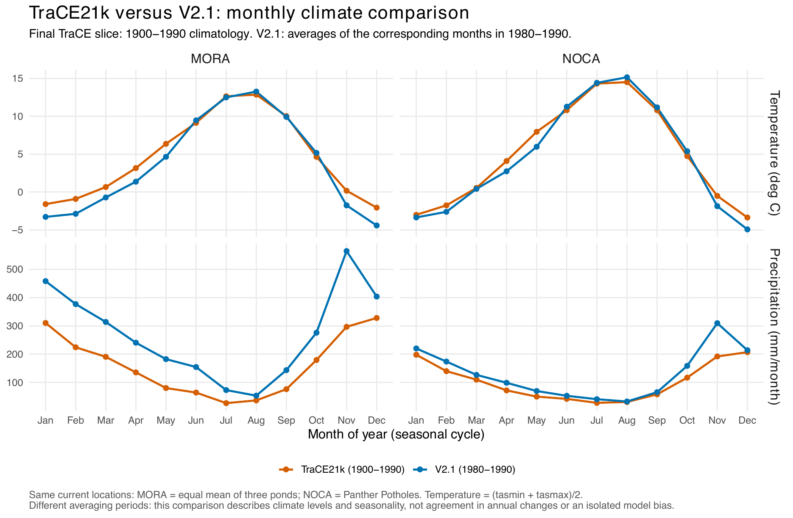

```{r setup, include = FALSE}
knitr::opts_chunk$set(echo = FALSE, message = FALSE, warning = FALSE)
suppressPackageStartupMessages({library(here); library(tidyverse)})
source(here("R/helpers/report_tools.R"))
```

<!-- Generated by R/build_report.R. -->

Back to the [report](../../README.md#2-climate). Scripts: `R/pipeline/04_modern_climate.R`,
`R/pipeline/07_paleo_climate.R`, `R/figures/supp_climate_windows.R`,
`R/figures/supp_climate_correlations.R`.

## Survey-specific climate windows

Legacy plots use 1979–1989; each resurvey plot uses its adult survey year Y and the five years
before (Y−5 to Y), with winter Y including December Y−1. The source of every survey date is in
`r repo_link('report/details/01_vegetation_survey_years.md', 'Survey years')`.

```{r}
read_output('report/survey_climate_windows.csv') |>
  transmute(Site = site, Period = period, `Survey year` = survey_year, `Climate from` = climate_start,
    `Climate to` = climate_end, Plots = analyzed_plots) |>
  show_table('survey_climate_windows', caption = '**Climate window of every survey group.**')
read_output('report/test_survey_year_anomaly.csv') |>
  transmute(Site = site, Period = period, `Survey year` = survey_year, Variable = variable,
    `Window mean` = window_mean, `z (whole record)` = z_record, `z (detrended)` = z_detrend) |>
  show_table('survey_window_anomalies', digits = 2,
    caption = '**How unusual each survey window is within 1979–2021** (z-scores; detrended removes the 1979–2021 trend).')
```

## Climate change through the Holocene and the Anthropocene

```{r}
show_figure('report/figures/supplementary/climate_holocene_timeseries.pdf', page = 1)
```

**Climate change per interval** at the four ponds through the Holocene, and at the survey plots in
the Anthropocene. Page 2 of this figure is Fig. S4.

```{r}
read_output('report/test_climate_change_variables.csv') |>
  transmute(Site = site, Era = era, Variable = variable, n, Median = median, `5%` = q05, `95%` = q95,
    Unit = unit, Interval = interval) |>
  show_table('climate_change_by_variable', digits = 2, caption = '**Climate change per interval, by variable and era.**')
```

```{r}
show_figure('report/figures/supplementary/fig_standardized_climate_levels_four_variables.pdf')
```

**Standardized climate levels** (rather than standardized change) with the climate eras and the
fire frequency of Figure 2.

## CHELSA-TraCE21k against CHELSA V2.1

The Holocene climate is CHELSA-TraCE21k, the modern climate CHELSA V2.1. Over their common period
(1980–1990) the two products differ, so Holocene and Anthropocene positions are compared as
changes within each product, never as levels across products (see
`r repo_link('report/details/10_decisions.md', 'Decisions')`).



Full comparison: `r repo_link('report/details/assets/TraCE21k_vs_V21_1980_1990.pdf', 'TraCE21k_vs_V21_1980_1990.pdf')`.
