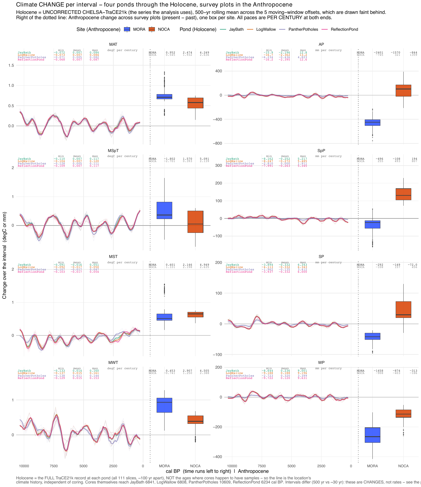
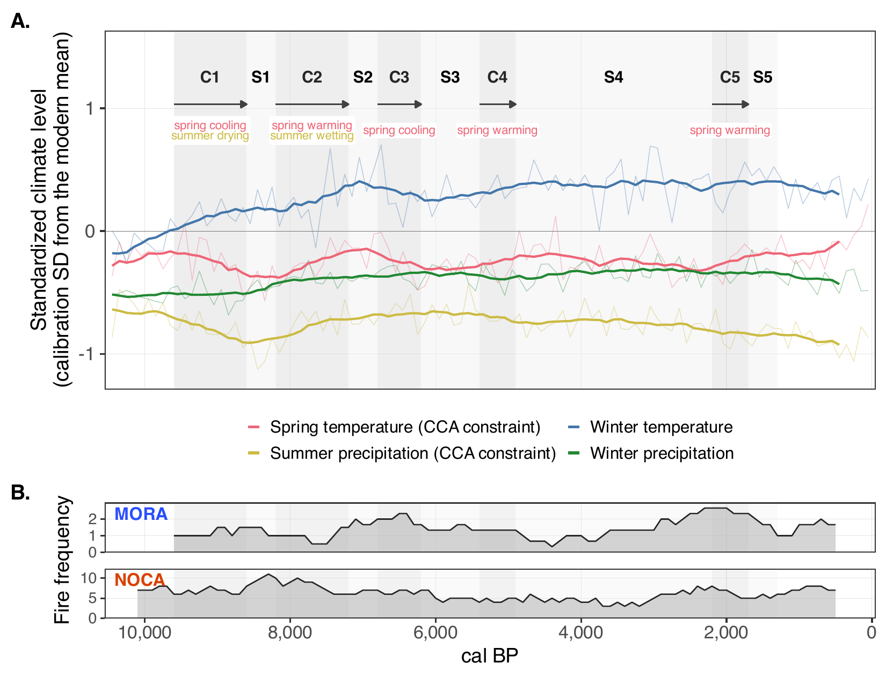
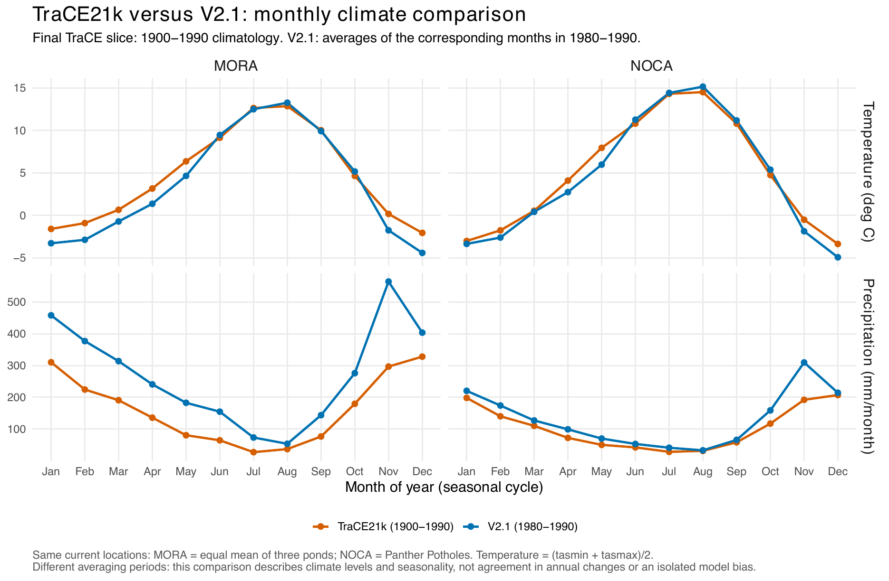

2. Climate details
================

- [Survey-specific climate windows](#survey-specific-climate-windows)
- [Climate change through the Holocene and the
  Anthropocene](#climate-change-through-the-holocene-and-the-anthropocene)
- [CHELSA-TraCE21k against CHELSA
  V2.1](#chelsa-trace21k-against-chelsa-v21)

<!-- Generated by R/build_report.R. -->

Back to the
[report](../../README.md#climate-change-and-comparisons-within-eras).
Scripts: `R/pipeline/04_modern_climate.R`,
`R/pipeline/07_paleo_climate.R`, `R/figures/supp_climate_windows.R`,
`R/figures/supp_climate_correlations.R`.

## Survey-specific climate windows

Legacy plots use 1979–1989; each resurvey plot uses its adult survey
year Y and the five years before (Y−5 to Y), with winter Y including
December Y−1. The source of every survey date is in [Survey
years](01_vegetation_survey_years.md).

**Climate window of every survey group.**

| Site | Period  | Survey year | Climate from | Climate to | Plots |
|:-----|:--------|------------:|-------------:|-----------:|------:|
| MORA | past    |           — |         1979 |       1989 |   328 |
| MORA | present |        2014 |         2009 |       2014 |    49 |
| MORA | present |        2015 |         2010 |       2015 |   173 |
| MORA | present |        2016 |         2011 |       2016 |    47 |
| MORA | present |        2017 |         2012 |       2017 |    11 |
| MORA | present |        2018 |         2013 |       2018 |     7 |
| MORA | present |        2019 |         2014 |       2019 |    41 |
| NOCA | past    |           — |         1979 |       1989 |   277 |
| NOCA | present |        2014 |         2009 |       2014 |    50 |
| NOCA | present |        2015 |         2010 |       2015 |   227 |

Table file:
[survey_climate_windows.csv](../tables/survey_climate_windows.csv)

**How unusual each survey window is within 1979–2021** (z-scores;
detrended removes the 1979–2021 trend).

| Site | Period  | Survey year | Variable | Window mean | z (whole record) | z (detrended) |
|:-----|:--------|------------:|:---------|------------:|-----------------:|--------------:|
| MORA | past    |           — | AP       |     2418.75 |             0.10 |         -1.29 |
| MORA | past    |           — | MAT      |        5.17 |            -0.55 |          0.05 |
| MORA | past    |           — | MSpT     |        3.39 |            -0.24 |          0.08 |
| MORA | past    |           — | SP       |      212.33 |             0.14 |         -1.74 |
| MORA | present |        2014 | AP       |     1979.27 |            -0.74 |         -0.59 |
| MORA | present |        2014 | MAT      |        6.10 |            -0.03 |         -1.01 |
| MORA | present |        2014 | MSpT     |        3.62 |            -0.48 |         -1.27 |
| MORA | present |        2014 | SP       |      163.85 |            -0.34 |         -0.06 |
| MORA | present |        2015 | AP       |     1957.79 |            -0.83 |         -0.77 |
| MORA | present |        2015 | MAT      |        5.81 |             0.48 |          0.13 |
| MORA | present |        2015 | MSpT     |        3.61 |             0.03 |         -0.35 |
| MORA | present |        2015 | SP       |      172.39 |            -0.28 |          0.24 |
| MORA | present |        2016 | AP       |     1965.87 |            -0.80 |         -0.83 |
| MORA | present |        2016 | MAT      |        5.35 |             0.60 |          0.38 |
| MORA | present |        2016 | MSpT     |        3.62 |             0.39 |          0.36 |
| MORA | present |        2016 | SP       |      170.60 |            -0.40 |         -0.14 |
| MORA | present |        2017 | AP       |     1771.02 |            -1.01 |         -0.92 |
| MORA | present |        2017 | MAT      |        6.82 |             1.06 |          1.28 |
| MORA | present |        2017 | MSpT     |        4.99 |             0.76 |          0.99 |
| MORA | present |        2017 | SP       |      146.47 |            -0.44 |         -0.10 |
| MORA | present |        2018 | AP       |     1944.88 |            -1.01 |         -0.95 |
| MORA | present |        2018 | MAT      |        6.39 |             1.25 |          1.61 |
| MORA | present |        2018 | MSpT     |        4.75 |             0.99 |          1.41 |
| MORA | present |        2018 | SP       |      158.33 |            -0.49 |         -0.22 |
| MORA | present |        2019 | AP       |     2006.11 |            -0.86 |         -0.67 |
| MORA | present |        2019 | MAT      |        6.36 |             1.07 |          1.28 |
| MORA | present |        2019 | MSpT     |        5.11 |             0.93 |          1.39 |
| MORA | present |        2019 | SP       |      161.74 |            -0.64 |         -0.54 |
| NOCA | past    |           — | AP       |     1709.41 |            -0.19 |         -1.19 |
| NOCA | past    |           — | MAT      |        4.84 |            -0.52 |          0.06 |
| NOCA | past    |           — | MSpT     |        3.34 |            -0.26 |          0.09 |
| NOCA | past    |           — | SP       |      145.00 |            -0.06 |         -0.53 |
| NOCA | present |        2014 | AP       |     1849.22 |             0.03 |          0.26 |
| NOCA | present |        2014 | MAT      |        5.52 |            -0.12 |         -1.17 |
| NOCA | present |        2014 | MSpT     |        3.43 |            -0.50 |         -1.29 |
| NOCA | present |        2014 | SP       |      171.88 |             0.18 |          0.61 |
| NOCA | present |        2015 | AP       |     1788.19 |             0.15 |          0.33 |
| NOCA | present |        2015 | MAT      |        5.37 |             0.34 |         -0.18 |
| NOCA | present |        2015 | MSpT     |        3.47 |             0.09 |         -0.28 |
| NOCA | present |        2015 | SP       |      193.40 |             0.54 |          1.56 |

Table file:
[survey_window_anomalies.csv](../tables/survey_window_anomalies.csv)

## Climate change through the Holocene and the Anthropocene

**Climate change per interval** at the four ponds through the Holocene,
and at the survey plots in the Anthropocene. Page 2 of this figure is
Fig. S7.

**Climate change per interval, by variable and era.**

| Site | Era          | Variable |   n |  Median |      5% |     95% | Unit | Interval             |
|:-----|:-------------|:---------|----:|--------:|--------:|--------:|:-----|:---------------------|
| MORA | anthropocene | MAT      | 331 |    0.71 |    0.31 |    1.13 | degC | 27.5–32.5 climate yr |
| MORA | holocene     | MAT      | 306 |    0.05 |   -0.23 |    0.28 | degC | 500 yr               |
| NOCA | anthropocene | MAT      | 305 |    0.58 |    0.23 |    0.73 | degC | 27.5–28.5 climate yr |
| NOCA | holocene     | MAT      | 102 |    0.04 |   -0.25 |    0.31 | degC | 500 yr               |
| MORA | anthropocene | MSpT     | 331 |    0.36 |   -0.32 |    1.54 | degC | 27.5–32.5 climate yr |
| MORA | holocene     | MSpT     | 306 |    0.04 |   -0.43 |    0.42 | degC | 500 yr               |
| NOCA | anthropocene | MSpT     | 305 |    0.05 |   -0.50 |    0.57 | degC | 27.5–28.5 climate yr |
| NOCA | holocene     | MSpT     | 102 |    0.07 |   -0.53 |    0.44 | degC | 500 yr               |
| MORA | anthropocene | MST      | 331 |    0.51 |    0.25 |    1.41 | degC | 27.5–32.5 climate yr |
| MORA | holocene     | MST      | 306 |   -0.08 |   -0.40 |    0.18 | degC | 500 yr               |
| NOCA | anthropocene | MST      | 305 |    0.65 |    0.43 |    0.74 | degC | 27.5–28.5 climate yr |
| NOCA | holocene     | MST      | 102 |   -0.06 |   -0.39 |    0.15 | degC | 500 yr               |
| MORA | anthropocene | MWT      | 331 |    0.93 |    0.38 |    1.17 | degC | 27.5–32.5 climate yr |
| MORA | holocene     | MWT      | 306 |    0.09 |   -0.35 |    0.49 | degC | 500 yr               |
| NOCA | anthropocene | MWT      | 305 |    0.39 |   -0.15 |    0.65 | degC | 27.5–28.5 climate yr |
| NOCA | holocene     | MWT      | 102 |    0.06 |   -0.40 |    0.45 | degC | 500 yr               |
| MORA | anthropocene | AP       | 331 | -450.03 | -611.35 | -331.35 | mm   | 27.5–32.5 climate yr |
| MORA | holocene     | AP       | 306 |  -11.10 |  -38.95 |   30.05 | mm   | 500 yr               |
| NOCA | anthropocene | AP       | 305 |  101.90 |  -96.93 |  352.33 | mm   | 27.5–28.5 climate yr |
| NOCA | holocene     | AP       | 102 |   -1.70 |  -17.77 |   14.18 | mm   | 500 yr               |
| MORA | anthropocene | SpP      | 331 |  -23.82 | -135.42 |   46.27 | mm   | 27.5–32.5 climate yr |
| MORA | holocene     | SpP      | 306 |   -0.40 |  -16.40 |   11.95 | mm   | 500 yr               |
| NOCA | anthropocene | SpP      | 305 |  130.88 |   81.94 |  215.50 | mm   | 27.5–28.5 climate yr |
| NOCA | holocene     | SpP      | 102 |    0.50 |   -6.60 |    4.78 | mm   | 500 yr               |
| MORA | anthropocene | SP       | 331 |  -41.91 |  -76.64 |  -26.27 | mm   | 27.5–32.5 climate yr |
| MORA | holocene     | SP       | 306 |   -1.50 |   -9.20 |   10.50 | mm   | 500 yr               |
| NOCA | anthropocene | SP       | 305 |   29.53 |    0.97 |  122.84 | mm   | 27.5–28.5 climate yr |
| NOCA | holocene     | SP       | 102 |   -0.70 |   -6.57 |    5.97 | mm   | 500 yr               |
| MORA | anthropocene | WP       | 331 | -265.20 | -350.73 | -122.68 | mm   | 27.5–32.5 climate yr |
| MORA | holocene     | WP       | 306 |    0.30 |  -25.35 |   27.55 | mm   | 500 yr               |
| NOCA | anthropocene | WP       | 305 | -113.50 | -188.62 |  -57.12 | mm   | 27.5–28.5 climate yr |
| NOCA | holocene     | WP       | 102 |    1.60 |  -10.79 |   13.33 | mm   | 500 yr               |

Table file:
[climate_change_by_variable.csv](../tables/climate_change_by_variable.csv)

**Standardized climate levels** (rather than standardized change) with
the climate eras and the fire frequency of Figure 3.

## CHELSA-TraCE21k against CHELSA V2.1

The Holocene climate is CHELSA-TraCE21k, the modern climate CHELSA V2.1.
Over their common period (1980–1990) the two products differ, so
Holocene and Anthropocene positions are compared as changes within each
product, never as levels across products (see
[Decisions](10_decisions.md)).

Full comparison:
[TraCE21k_vs_V21_1980_1990.pdf](assets/TraCE21k_vs_V21_1980_1990.pdf).
