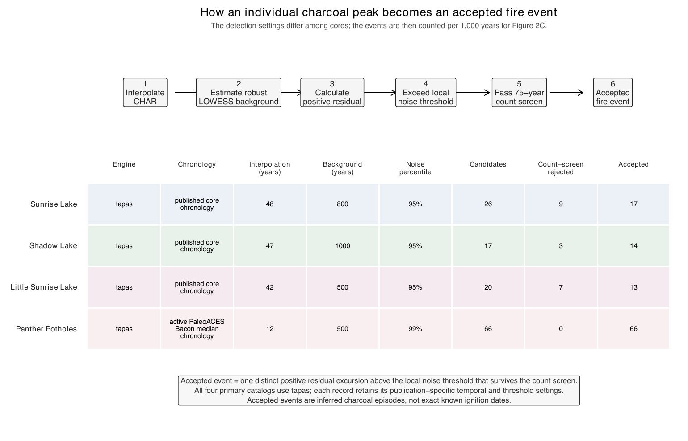
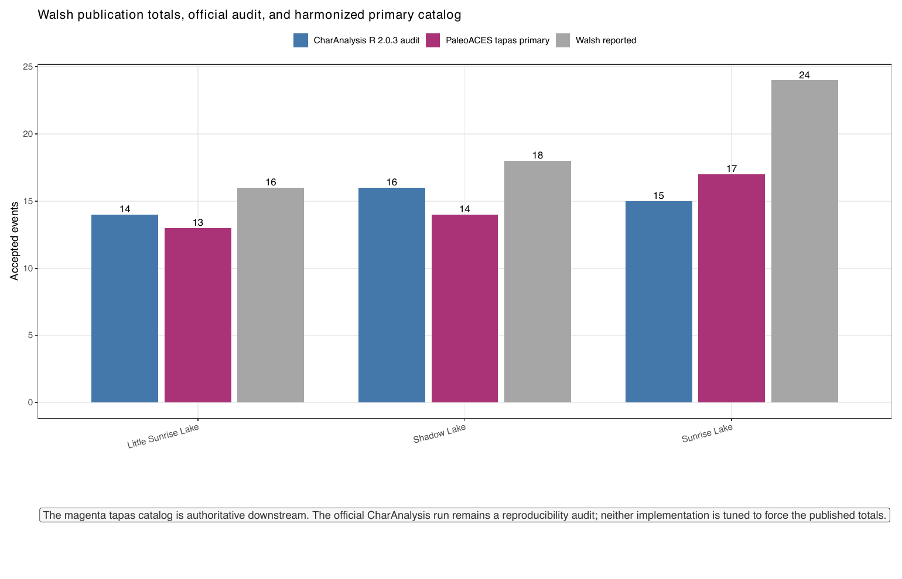
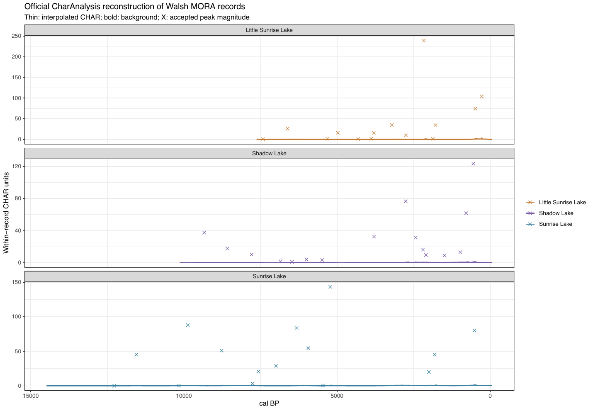
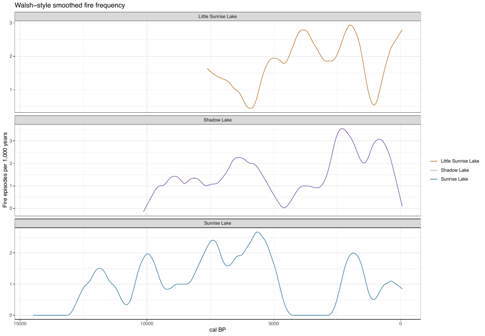
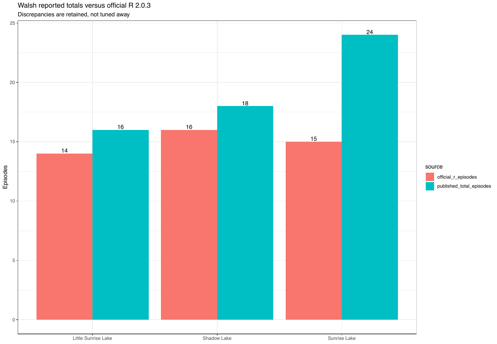
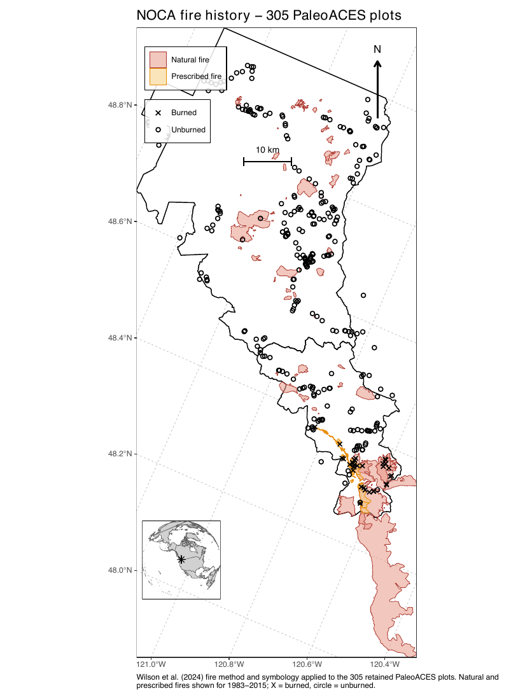

4. Fire details
================

- [Holocene fire events](#holocene-fire-events)
- [CharAnalysis reproduction of Walsh et
  al. (2017)](#charanalysis-reproduction-of-walsh-et-al-2017)
- [Modern fire assignment of the survey
  plots](#modern-fire-assignment-of-the-survey-plots)

<!-- Generated by R/build_report.R. -->

Back to the [report](../../README.md#fire-dynamics). Scripts:
`R/pipeline/09_fire_records.R` (Holocene), `R/pipeline/03_modern_fire.R`
(survey plots).

## Holocene fire events

**From a charcoal peak to an accepted event**, with every record’s
settings and counts.

**Detection settings of the four records.**

| Site | Lake | Engine | Chronology | Interpolation (yr) | Background (yr) | Threshold | Threshold type | Background | Count test p | Count window (yr) |
|:---|:---|:---|:---|---:|---:|---:|:---|:---|---:|---:|
| MORA | Sunrise Lake | tapas | published core chronology | 48 | 800 | 0.95 | local Gaussian-mixture noise | robust LOWESS | 0.05 | 75 |
| MORA | Shadow Lake | tapas | published core chronology | 47 | 1000 | 0.95 | local Gaussian-mixture noise | robust LOWESS | 0.05 | 75 |
| MORA | Little Sunrise Lake | tapas | published core chronology | 42 | 500 | 0.95 | local Gaussian-mixture noise | robust LOWESS | 0.05 | 75 |
| NOCA | PantherPotholes | tapas | active PaleoACES Bacon median chronology | 12 | 500 | 0.99 | local Gaussian-mixture noise | robust LOWESS | 0.05 | 75 |

Table file:
[fire_detection_settings.csv](../tables/fire_detection_settings.csv)

**Panther Potholes: events under alternative settings.**

| Setting | Background (yr) | Interpolation (yr) | Threshold | Accepted events |
|:---|---:|---:|---:|---:|
| primary_native12_smooth500_q99 | 500 | 12.0 | 0.990 | 66 |
| native12_smooth500_q95 | 500 | 12.0 | 0.950 | 77 |
| native12_smooth500_q999 | 500 | 12.0 | 0.999 | 57 |
| native12_smooth800_q99 | 800 | 12.0 | 0.990 | 74 |
| native12_smooth1000_q99 | 1000 | 12.0 | 0.990 | 73 |
| publication12.5_smooth500_q99 | 500 | 12.5 | 0.990 | 72 |
| coarse45_smooth500_q99 | 500 | 45.0 | 0.990 | 35 |

Table file:
[noca_threshold_sensitivity.csv](../tables/noca_threshold_sensitivity.csv)

## CharAnalysis reproduction of Walsh et al. (2017)

**CharAnalysis R 2.0.3 against the published totals and the tapas
catalog**, and the CharAnalysis series for each MORA record.

**CharAnalysis R against Walsh et al. (2017), Table 3.**

| Lake | CharAnalysis R 2.0.3 | Published | Difference | Interpretation |
|:---|---:|---:|---:|:---|
| Little Sunrise Lake | 14 | 16 | -2 | official R 2.0.3 result retained; discrepancy from Walsh reported total |
| Shadow Lake | 16 | 18 | -2 | official R 2.0.3 result retained; discrepancy from Walsh reported total |
| Sunrise Lake | 15 | 24 | -9 | official R 2.0.3 result retained; discrepancy from Walsh reported total |

Table file:
[charanalysis_reproduction.csv](../tables/charanalysis_reproduction.csv)

## Modern fire assignment of the survey plots

MORA plots are burned when a mapped 1987–2017 disturbance overlaps them;
NOCA plots follow the Wilson (2024) assignment rule.

**NOCA fire assignment against Wilson (2024).**

| Plot universe  | PaleoACES burned | Wilson burned | Discrepancy | Plots |
|:---------------|:-----------------|:--------------|:------------|------:|
| PaleoACES_only | FALSE            | —             | —           |     2 |
| Wilson_only    | —                | FALSE         | —           |    60 |
| Wilson_only    | —                | TRUE          | —           |     6 |
| shared         | FALSE            | FALSE         | FALSE       |   271 |
| shared         | TRUE             | TRUE          | FALSE       |    32 |

Table file:
[noca_fire_vs_wilson.csv](../tables/noca_fire_vs_wilson.csv)
