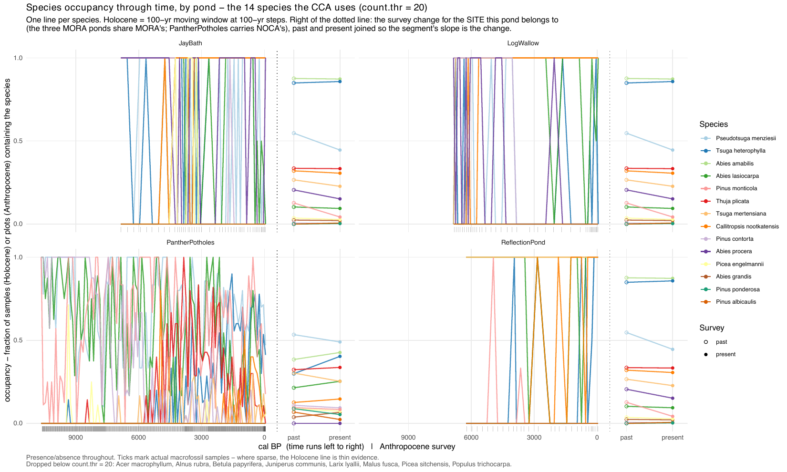

5. Species selection details
================

<!-- Generated by R/build_report.R. -->

Back to the [report](../README.md#3-species-selection). Script:
`R/pipeline/09_species_occurrences.R`. The merging rules and every
excluded taxon are in [Occurrence
consolidation](05_species_occurrence_consolidation.md).

**Plots or samples per taxon, site and period, and the CCA selection.**

| species | MORA_paleo | MORA_past | MORA_present | NOCA_paleo | NOCA_past | NOCA_present | retained |
|:---|---:|---:|---:|---:|---:|---:|:---|
| Abies amabilis | 119 | 290 | 288 | 0 | 113 | 128 | TRUE |
| Abies lasiocarpa | 94 | 34 | 31 | 473 | 63 | 76 | TRUE |
| Abies procera | 43 | 68 | 50 | 0 | 0 | 0 | TRUE |
| Callitropsis nootkatensis | 78 | 106 | 101 | 38 | 37 | 44 | TRUE |
| Picea engelmannii | 5 | 12 | 9 | 12 | 26 | 22 | TRUE |
| Pinus contorta | 31 | 2 | 1 | 293 | 32 | 28 | TRUE |
| Pinus monticola | 90 | 42 | 14 | 504 | 28 | 25 | TRUE |
| Pseudotsuga menziesii | 40 | 181 | 147 | 597 | 157 | 147 | TRUE |
| Tsuga heterophylla | 54 | 281 | 283 | 180 | 88 | 121 | TRUE |
| Tsuga mertensiana | 110 | 88 | 75 | 39 | 89 | 76 | TRUE |
| Abies grandis | 0 | 8 | 7 | 0 | 11 | 20 | TRUE |
| Alnus rubra | 0 | 15 | 15 | 0 | 11 | 18 | FALSE |
| Picea sitchensis | 0 | 2 | 0 | 0 | 0 | 0 | FALSE |
| Populus trichocarpa | 0 | 3 | 3 | 0 | 8 | 3 | FALSE |
| Thuja plicata | 0 | 111 | 110 | 168 | 95 | 101 | TRUE |
| Acer macrophyllum | 0 | 0 | 4 | 0 | 17 | 18 | FALSE |
| Malus fusca | 0 | 0 | 1 | 0 | 0 | 0 | FALSE |
| Pinus albicaulis | 0 | 0 | 2 | 0 | 20 | 7 | TRUE |
| Pinus ponderosa | 0 | 0 | 1 | 0 | 26 | 16 | TRUE |
| Juniperus communis | 0 | 0 | 0 | 8 | 0 | 0 | FALSE |
| Betula papyrifera | 0 | 0 | 0 | 0 | 4 | 6 | FALSE |
| Larix lyallii | 0 | 0 | 0 | 0 | 7 | 9 | FALSE |

Table file: [cca_taxa.csv](../tables/cca_taxa.csv)

**Retained taxa through the Holocene in each pond.**

**Holocene occupancy: which taxa separate the parks, and which vary
through time.**

| Species | MORA occupancy | NOCA occupancy | Separation | Max SD within a pond | Ponds with variation |
|:---|---:|---:|---:|---:|---:|
| Abies amabilis | 1.00 | 0.00 | 1.00 | 0.00 | 0 |
| Tsuga mertensiana | 0.92 | 0.04 | 0.88 | 0.39 | 2 |
| Callitropsis nootkatensis | 0.66 | 0.04 | 0.61 | 0.48 | 3 |
| Abies procera | 0.36 | 0.00 | 0.36 | 0.49 | 2 |
| Pseudotsuga menziesii | 0.34 | 0.69 | 0.35 | 0.49 | 4 |
| Tsuga heterophylla | 0.45 | 0.21 | 0.25 | 0.42 | 4 |
| Abies lasiocarpa | 0.79 | 0.54 | 0.25 | 0.42 | 4 |
| Thuja plicata | 0.00 | 0.19 | 0.19 | 0.25 | 1 |
| Pinus monticola | 0.76 | 0.58 | 0.18 | 0.30 | 2 |
| Pinus contorta | 0.26 | 0.34 | 0.08 | 0.50 | 3 |
| Picea engelmannii | 0.04 | 0.01 | 0.03 | 0.32 | 1 |
| Abies grandis | 0.00 | 0.00 | 0.00 | 0.00 | 0 |
| Pinus albicaulis | 0.00 | 0.00 | 0.00 | 0.00 | 0 |
| Pinus ponderosa | 0.00 | 0.00 | 0.00 | 0.00 | 0 |

Table file:
[holocene_species_occupancy.csv](../tables/holocene_species_occupancy.csv)
