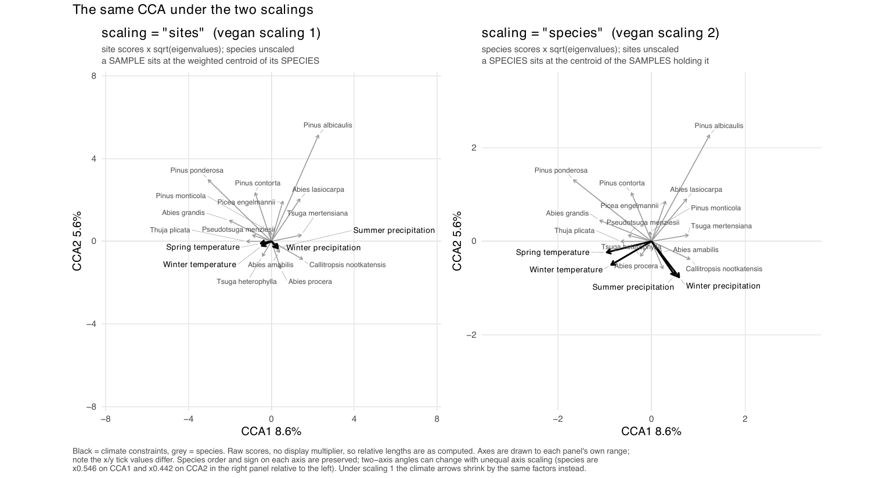

6. CCA details
================

- [Samples used](#samples-used)
- [Model](#model)
- [Scaling](#scaling)

<!-- Generated by R/build_report.R. -->

Back to the [report](../README.md#5-canonical-correspondence-analysis).
Script: `R/pipeline/10_cca.R` (fit and projections),
`R/helpers/cca_report.R` (tables below).

## Samples used

**Plots and samples used to fit and positioned in the CCA.**

| Site | Period  | Input samples | Used to fit | Positioned |
|:-----|:--------|--------------:|------------:|-----------:|
| MORA | paleo   |           119 |           — |        119 |
| MORA | past    |           331 |         330 |          — |
| MORA | present |           331 |           — |        330 |
| NOCA | paleo   |           870 |           — |        812 |
| NOCA | past    |           305 |         277 |          — |
| NOCA | present |           305 |           — |        277 |

Table file: [cca_counts.csv](../tables/cca_counts.csv)

## Model

    Call: cca(formula = species_past_final ~ MSpT + MWT + SP + WP, data =
    env_past_final)

                  Inertia Proportion Rank
    Total          3.4648     1.0000     
    Constrained    0.5310     0.1533    4
    Unconstrained  2.9338     0.8467   13

    Inertia is scaled Chi-square

    Eigenvalues for constrained axes:
       CCA1    CCA2    CCA3    CCA4 
    0.29766 0.19574 0.03152 0.00606 

    Eigenvalues for unconstrained axes:
       CA1    CA2    CA3    CA4    CA5    CA6    CA7    CA8    CA9   CA10   CA11 
    0.4902 0.3697 0.3563 0.3219 0.2565 0.2345 0.2029 0.1781 0.1375 0.1253 0.1153 
      CA12   CA13 
    0.0993 0.0462 

**Climate variables: marginal tests, inflation and biplot scores.**

| Variable | Label | Marginal inertia | Unique % of constrained | Pseudo-F | p (unrestricted) | p (within parks) | VIF | CCA1 | CCA2 |
|:---|:---|---:|---:|---:|---:|---:|---:|---:|---:|
| MSpT | Spring temperature | 0.038 | 7.094 | 7.729 | 0.000 | 0.965 | 29.504 | -0.523 | -0.105 |
| MWT | Winter temperature | 0.048 | 9.042 | 9.852 | 0.000 | 0.930 | 26.351 | -0.471 | -0.223 |
| SP | Summer precipitation | 0.012 | 2.269 | 2.473 | 0.003 | 0.001 | 5.200 | 0.272 | -0.325 |
| WP | Winter precipitation | 0.019 | 3.617 | 3.940 | 0.000 | 0.000 | 6.695 | 0.323 | -0.341 |

Table file:
[cca_climate_contributions.csv](../tables/cca_climate_contributions.csv)

**Species: share of the constrained inertia and scores.**

| Species | Legacy plots | % of legacy plots | % of constrained inertia | CCA1 | CCA2 |
|:---|---:|---:|---:|---:|---:|
| Abies lasiocarpa | 92 | 15.157 | 12.372 | 1.376 | 2.049 |
| Pinus albicaulis | 18 | 2.965 | 11.737 | 2.274 | 5.141 |
| Tsuga mertensiana | 177 | 29.160 | 11.732 | 1.443 | 0.298 |
| Callitropsis nootkatensis | 142 | 23.394 | 11.198 | 1.507 | -0.871 |
| Pinus ponderosa | 22 | 3.624 | 9.647 | -3.055 | 2.979 |
| Thuja plicata | 205 | 33.773 | 9.629 | -1.194 | -0.008 |
| Pseudotsuga menziesii | 332 | 54.695 | 8.460 | -0.911 | 0.295 |
| Tsuga heterophylla | 369 | 60.791 | 5.792 | -0.435 | -0.721 |
| Abies procera | 68 | 11.203 | 4.753 | 0.445 | -1.324 |
| Pinus contorta | 33 | 5.437 | 4.187 | -0.788 | 2.347 |
| Abies amabilis | 402 | 66.227 | 3.868 | 0.390 | -0.532 |
| Picea engelmannii | 36 | 5.931 | 2.885 | 0.546 | 1.938 |
| Abies grandis | 19 | 3.130 | 2.568 | -2.027 | 1.011 |
| Pinus monticola | 70 | 11.532 | 1.173 | -0.065 | 0.452 |

Table file:
[cca_species_contributions.csv](../tables/cca_species_contributions.csv)

## Scaling

**The same fit under scaling 1 (sites, used throughout) and scaling 2
(species).**
