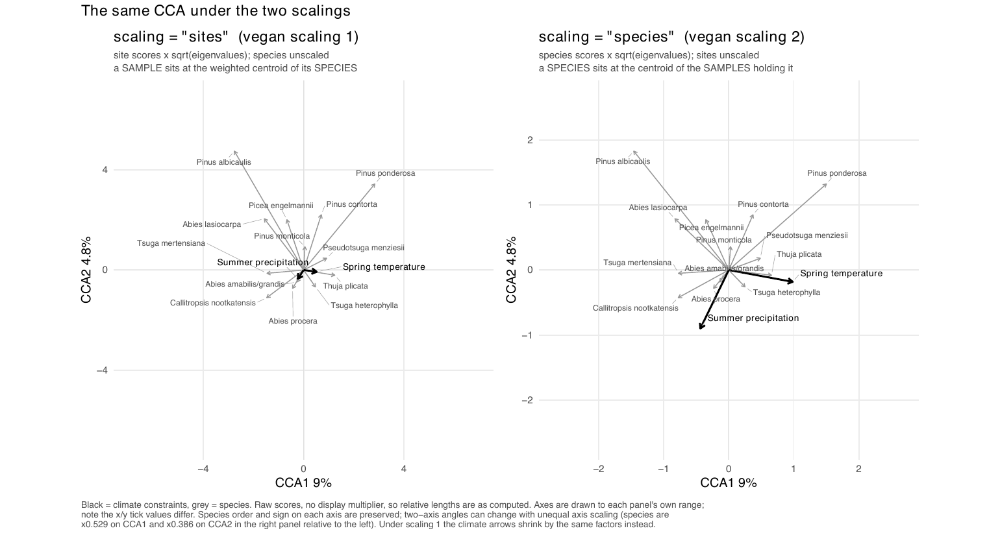

6. CCA details
================

- [Samples used](#samples-used)
- [Model](#model)
- [Scaling](#scaling)

<!-- Generated by R/build_report.R. -->

Back to the [report](../../README.md#climatecommunity-space). Script:
`R/pipeline/11_cca.R` (fit and projections), `R/helpers/cca_report.R`
(tables below).

## Samples used

**Plots and samples used to fit and positioned in the CCA.**

| Site | Period  | Input samples | Used to fit | Positioned |
|:-----|:--------|--------------:|------------:|-----------:|
| MORA | paleo   |           119 |           — |        119 |
| MORA | past    |           331 |         328 |          — |
| MORA | present |           331 |           — |        328 |
| NOCA | paleo   |           870 |           — |        812 |
| NOCA | past    |           305 |         277 |          — |
| NOCA | present |           305 |           — |        277 |

Table file:
[cca_counts.csv](../tables/cca_counts.csv)

## Model

    Call: cca(formula = species_past_final ~ MSpT + SP, data = env_past_final)

                  Inertia Proportion Rank
    Total          3.0970     1.0000
    Constrained    0.4281     0.1382    2
    Unconstrained  2.6688     0.8618   12

    Inertia is scaled Chi-square

    Eigenvalues for constrained axes:
       CCA1    CCA2
    0.27949 0.14862

    Eigenvalues for unconstrained axes:
       CA1    CA2    CA3    CA4    CA5    CA6    CA7    CA8    CA9   CA10   CA11
    0.4862 0.3790 0.3403 0.2784 0.2429 0.2119 0.1810 0.1457 0.1280 0.1204 0.1039
      CA12
    0.0511

**Climate variables: marginal tests, inflation and biplot scores.**

| Variable | Label | Marginal inertia | Unique % of constrained | Pseudo-F | p (unrestricted) | p (within parks) | VIF | CCA1 | CCA2 |
|:---|:---|---:|---:|---:|---:|---:|---:|---:|---:|
| MSpT | Spring temperature | 0.254 | 59.438 | 57.397 | 0 | 0 | 1.077 | 0.520 | -0.070 |
| SP | Summer precipitation | 0.153 | 35.724 | 34.498 | 0 | 0 | 1.077 | -0.231 | -0.347 |

Table file:
[cca_climate_contributions.csv](../tables/cca_climate_contributions.csv)

**Species: share of the constrained inertia and scores.**

| Species | Legacy plots | % of legacy plots | % of constrained inertia | CCA1 | CCA2 |
|:---|---:|---:|---:|---:|---:|
| Abies lasiocarpa | 92 | 15.207 | 14.259 | -1.567 | 2.050 |
| Callitropsis nootkatensis | 141 | 23.306 | 13.097 | -1.470 | -1.104 |
| Tsuga mertensiana | 176 | 29.091 | 12.510 | -1.463 | -0.131 |
| Pinus albicaulis | 18 | 2.975 | 11.684 | -2.764 | 4.750 |
| Thuja plicata | 204 | 33.719 | 10.594 | 1.244 | -0.208 |
| Pseudotsuga menziesii | 332 | 54.876 | 10.553 | 0.918 | 0.471 |
| Pinus ponderosa | 22 | 3.636 | 10.443 | 2.840 | 3.440 |
| Tsuga heterophylla | 367 | 60.661 | 5.646 | 0.473 | -0.674 |
| Pinus contorta | 33 | 5.455 | 3.372 | 0.705 | 2.209 |
| Picea engelmannii | 36 | 5.950 | 3.085 | -0.667 | 2.010 |
| Abies amabilis/grandis | 416 | 68.760 | 2.610 | -0.262 | -0.477 |
| Abies procera | 68 | 11.240 | 1.075 | -0.441 | -0.731 |
| Pinus monticola | 70 | 11.570 | 1.072 | 0.053 | 0.931 |

Table file:
[cca_species_contributions.csv](../tables/cca_species_contributions.csv)

## Scaling

<!-- -->

**The same fit under scaling 1 (sites, used throughout) and scaling 2
(species).**
