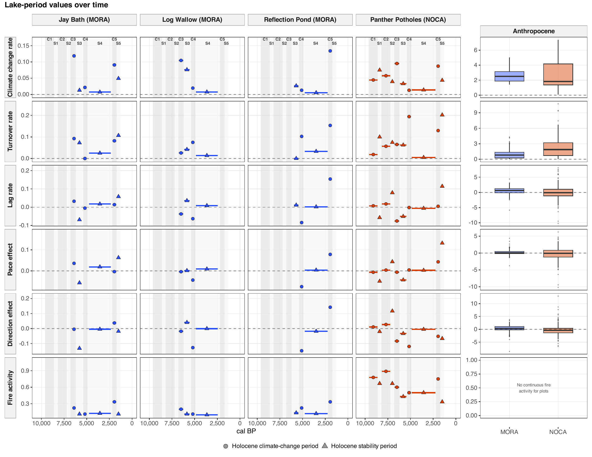
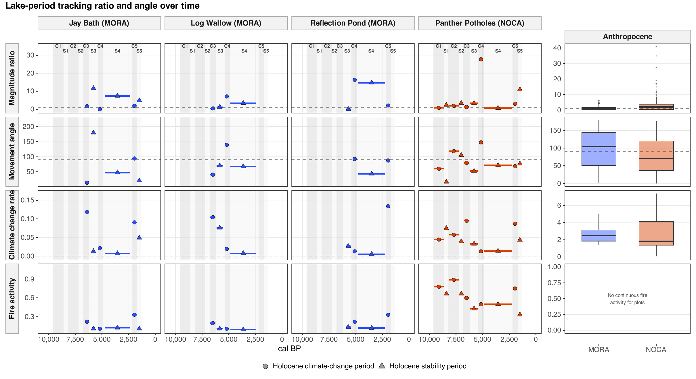

7. Tracking details
================

- [Lake-periods through time](#lake-periods-through-time)
- [Output columns](#output-columns)

<!-- Generated by R/build_report.R. -->

Back to the
[report](../../README.md#steps-1-to-4-lake-periods-and-their-responses).
Script: `R/pipeline/12_tracking.R`; geometry in
`R/helpers/tracking_metrics.R`. How each displacement is split into
species and climate contributions:
[Contributions](07_tracking_contributions.md).

## Lake-periods through time

The values that enter the models, one per lake-period, placed in time.
Before the remodelling these figures showed the steps between
consecutive sampled centuries, which are mostly sampling noise.

**Lake-period values over time.** One column per lake. Each lake-period
is a bar from its oldest to its youngest sampled century at its value,
with its symbol at the middle (circles climate-change periods, triangles
stability periods), under the C (darker) and S (lighter) period bands.
The last column holds the Anthropocene plot pairs of each park as
boxplots, on their own scale, because their values are much larger.
First figure: climate change rate (calibration SD per century),
turnover, lag rate, pace and direction effects (CCA distance per
century) and fire activity (events per century per core). Second figure:
the magnitude tracking ratio (unitless, 1 = observed and predicted moved
equally far), the movement angle (degrees, 90 = perpendicular to the
predicted direction), the climate change rate and fire activity. Ratios
and angles are left out where a position did not move.

## Output columns

**Columns of the tracking tables.**

| Table | Column | Type | Unit |
|:---|:---|:---|:---|
| cca_tracking_holocene_century_positions | site | character | — |
| cca_tracking_holocene_century_positions | lake | character | — |
| cca_tracking_holocene_century_positions | century_cal_bp | numeric | cal BP |
| cca_tracking_holocene_century_positions | o1 | numeric | CCA distance |
| cca_tracking_holocene_century_positions | o2 | numeric | CCA distance |
| cca_tracking_holocene_century_positions | n_samples | integer | count / index |
| cca_tracking_holocene_century_positions | slice | numeric | — |
| cca_tracking_holocene_century_positions | MAT | numeric | — |
| cca_tracking_holocene_century_positions | MSpT | numeric | — |
| cca_tracking_holocene_century_positions | MST | numeric | — |
| cca_tracking_holocene_century_positions | MWT | numeric | — |
| cca_tracking_holocene_century_positions | AP | numeric | — |
| cca_tracking_holocene_century_positions | SpP | numeric | — |
| cca_tracking_holocene_century_positions | SP | numeric | — |
| cca_tracking_holocene_century_positions | WP | numeric | — |
| cca_tracking_holocene_century_positions | MAT_max | numeric | — |
| cca_tracking_holocene_century_positions | MAT_mean | numeric | — |
| cca_tracking_holocene_century_positions | MAT_min | numeric | — |
| cca_tracking_holocene_century_positions | MSpT_max | numeric | — |
| cca_tracking_holocene_century_positions | MSpT_mean | numeric | — |
| cca_tracking_holocene_century_positions | MSpT_min | numeric | — |
| cca_tracking_holocene_century_positions | MST_max | numeric | — |
| cca_tracking_holocene_century_positions | MST_mean | numeric | — |
| cca_tracking_holocene_century_positions | MST_min | numeric | — |
| cca_tracking_holocene_century_positions | MWT_max | numeric | — |
| cca_tracking_holocene_century_positions | MWT_mean | numeric | — |
| cca_tracking_holocene_century_positions | MWT_min | numeric | — |
| cca_tracking_holocene_century_positions | p1 | numeric | CCA distance |
| cca_tracking_holocene_century_positions | p2 | numeric | CCA distance |
| cca_tracking_holocene_century_positions | n_occupied_draws | integer | count / index |
| cca_tracking_holocene_century_positions | n_expected_draws | integer | count / index |
| cca_tracking_holocene_century_positions | occupancy_proportion | numeric | unitless |
| cca_tracking_holocene_lake_transitions | site | character | — |
| cca_tracking_holocene_lake_transitions | lake | character | — |
| cca_tracking_holocene_lake_transitions | transition_id | character | — |
| cca_tracking_holocene_lake_transitions | transition_index | integer | count / index |
| cca_tracking_holocene_lake_transitions | age_hi | numeric | cal BP |
| cca_tracking_holocene_lake_transitions | age_lo | numeric | cal BP |
| cca_tracking_holocene_lake_transitions | interval_mid_cal_bp | numeric | cal BP |
| cca_tracking_holocene_lake_transitions | vegetation_dt_years | numeric | years |
| cca_tracking_holocene_lake_transitions | climate_dt_years | numeric | years |
| cca_tracking_holocene_lake_transitions | standardized_climate_change_rate | numeric | standardized climate distance per century |
| cca_tracking_holocene_lake_transitions | fire_activity | numeric | events per century per eligible core |
| cca_tracking_holocene_lake_transitions | fire_coverage_valid | logical | — |
| cca_tracking_holocene_lake_transitions | lag_rate_per_century | numeric | CCA distance per century |
| cca_tracking_holocene_lake_transitions | observed_turnover_rate | numeric | CCA distance per century |
| cca_tracking_holocene_lake_transitions | magnitude_tracking_ratio | numeric | unitless |
| cca_tracking_holocene_lake_transitions | rate_tracking_ratio | numeric | unitless |
| cca_tracking_holocene_lake_transitions | angle_degrees | numeric | degrees |
| cca_tracking_holocene_lake_transitions | pace_effect_on_lag_per_century | numeric | CCA distance per century |
| cca_tracking_holocene_lake_transitions | direction_effect_on_lag_per_century | numeric | CCA distance per century |
| cca_tracking_holocene_lake_transitions | pace_corrected_lag_rate_per_century | numeric | CCA distance per century |
| cca_tracking_holocene_lake_transitions | direction_corrected_lag_rate_per_century | numeric | CCA distance per century |
| cca_tracking_holocene_lake_transitions | n_samples_t1 | integer | count / index |
| cca_tracking_holocene_lake_transitions | n_samples_t2 | integer | count / index |
| cca_tracking_holocene_lake_calculations | site | character | — |
| cca_tracking_holocene_lake_calculations | lake | character | — |
| cca_tracking_holocene_lake_calculations | century_cal_bp | numeric | cal BP |
| cca_tracking_holocene_lake_calculations | o1 | numeric | CCA distance |
| cca_tracking_holocene_lake_calculations | o2 | numeric | CCA distance |
| cca_tracking_holocene_lake_calculations | n_samples | integer | count / index |
| cca_tracking_holocene_lake_calculations | slice | numeric | — |
| cca_tracking_holocene_lake_calculations | MAT | numeric | — |
| cca_tracking_holocene_lake_calculations | MSpT | numeric | — |
| cca_tracking_holocene_lake_calculations | MST | numeric | — |
| cca_tracking_holocene_lake_calculations | MWT | numeric | — |
| cca_tracking_holocene_lake_calculations | AP | numeric | — |
| cca_tracking_holocene_lake_calculations | SpP | numeric | — |
| cca_tracking_holocene_lake_calculations | SP | numeric | — |
| cca_tracking_holocene_lake_calculations | WP | numeric | — |
| cca_tracking_holocene_lake_calculations | MAT_max | numeric | — |
| cca_tracking_holocene_lake_calculations | MAT_mean | numeric | — |
| cca_tracking_holocene_lake_calculations | MAT_min | numeric | — |
| cca_tracking_holocene_lake_calculations | MSpT_max | numeric | — |
| cca_tracking_holocene_lake_calculations | MSpT_mean | numeric | — |
| cca_tracking_holocene_lake_calculations | MSpT_min | numeric | — |
| cca_tracking_holocene_lake_calculations | MST_max | numeric | — |
| cca_tracking_holocene_lake_calculations | MST_mean | numeric | — |
| cca_tracking_holocene_lake_calculations | MST_min | numeric | — |
| cca_tracking_holocene_lake_calculations | MWT_max | numeric | — |
| cca_tracking_holocene_lake_calculations | MWT_mean | numeric | — |
| cca_tracking_holocene_lake_calculations | MWT_min | numeric | — |
| cca_tracking_holocene_lake_calculations | p1 | numeric | CCA distance |
| cca_tracking_holocene_lake_calculations | p2 | numeric | CCA distance |
| cca_tracking_holocene_lake_calculations | transition_index | integer | count / index |
| cca_tracking_holocene_lake_calculations | age_hi | numeric | cal BP |
| cca_tracking_holocene_lake_calculations | age_lo | numeric | cal BP |
| cca_tracking_holocene_lake_calculations | o1_2 | numeric | CCA distance |
| cca_tracking_holocene_lake_calculations | o2_2 | numeric | CCA distance |
| cca_tracking_holocene_lake_calculations | p1_2 | numeric | CCA distance |
| cca_tracking_holocene_lake_calculations | p2_2 | numeric | CCA distance |
| cca_tracking_holocene_lake_calculations | n_samples_t1 | integer | count / index |
| cca_tracking_holocene_lake_calculations | n_samples_t2 | integer | count / index |
| cca_tracking_holocene_lake_calculations | MSpT_2 | numeric | — |
| cca_tracking_holocene_lake_calculations | SP_2 | numeric | — |
| cca_tracking_holocene_lake_calculations | interval_mid_cal_bp | numeric | cal BP |
| cca_tracking_holocene_lake_calculations | vegetation_dt_years | numeric | years |
| cca_tracking_holocene_lake_calculations | climate_dt_years | numeric | years |
| cca_tracking_holocene_lake_calculations | transition_id | character | — |
| cca_tracking_holocene_lake_calculations | draw | integer | count / index |
| cca_tracking_holocene_lake_calculations | finite_endpoints | logical | — |
| cca_tracking_holocene_lake_calculations | small_observed_movement | logical | — |
| cca_tracking_holocene_lake_calculations | small_predicted_movement | logical | — |
| cca_tracking_holocene_lake_calculations | angle_valid | logical | — |
| cca_tracking_holocene_lake_calculations | pace_counterfactual_valid | logical | — |
| cca_tracking_holocene_lake_calculations | direction_counterfactual_valid | logical | — |
| cca_tracking_holocene_lake_calculations | tracking_ratio_valid | logical | unitless |
| cca_tracking_holocene_lake_calculations | delta_observed_CCA1 | numeric | CCA distance |
| cca_tracking_holocene_lake_calculations | delta_observed_CCA2 | numeric | CCA distance |
| cca_tracking_holocene_lake_calculations | delta_predicted_CCA1 | numeric | CCA distance |
| cca_tracking_holocene_lake_calculations | delta_predicted_CCA2 | numeric | CCA distance |
| cca_tracking_holocene_lake_calculations | observed_vegetation_displacement | numeric | CCA distance |
| cca_tracking_holocene_lake_calculations | predicted_vegetation_displacement | numeric | CCA distance |
| cca_tracking_holocene_lake_calculations | observed_turnover_rate | numeric | CCA distance per century |
| cca_tracking_holocene_lake_calculations | predicted_vegetation_change_rate | numeric | CCA distance per century |
| cca_tracking_holocene_lake_calculations | magnitude_tracking_ratio | numeric | unitless |
| cca_tracking_holocene_lake_calculations | rate_tracking_ratio | numeric | unitless |
| cca_tracking_holocene_lake_calculations | angle_degrees | numeric | degrees |
| cca_tracking_holocene_lake_calculations | lag_t1 | numeric | CCA distance |
| cca_tracking_holocene_lake_calculations | lag_t2 | numeric | CCA distance |
| cca_tracking_holocene_lake_calculations | change_in_lag | numeric | — |
| cca_tracking_holocene_lake_calculations | lag_rate_per_century | numeric | CCA distance per century |
| cca_tracking_holocene_lake_calculations | pace_corrected_CCA2 | numeric | CCA distance |
| cca_tracking_holocene_lake_calculations | pace_corrected_CCA1 | numeric | CCA distance |
| cca_tracking_holocene_lake_calculations | direction_corrected_CCA2 | numeric | CCA distance |
| cca_tracking_holocene_lake_calculations | direction_corrected_CCA1 | numeric | CCA distance |
| cca_tracking_holocene_lake_calculations | lag_t2_pace_corrected | numeric | CCA distance |
| cca_tracking_holocene_lake_calculations | lag_t2_direction_corrected | numeric | CCA distance |
| cca_tracking_holocene_lake_calculations | pace_effect_on_lag | numeric | — |
| cca_tracking_holocene_lake_calculations | direction_effect_on_lag | numeric | — |
| cca_tracking_holocene_lake_calculations | pace_effect_on_lag_per_century | numeric | CCA distance per century |
| cca_tracking_holocene_lake_calculations | direction_effect_on_lag_per_century | numeric | CCA distance per century |
| cca_tracking_holocene_lake_calculations | MSpT_change | numeric | — |
| cca_tracking_holocene_lake_calculations | MSpT_rate_per_century | numeric | CCA distance per century |
| cca_tracking_holocene_lake_calculations | MSpT_z_change | numeric | — |
| cca_tracking_holocene_lake_calculations | MSpT_z_rate_per_century | numeric | CCA distance per century |
| cca_tracking_holocene_lake_calculations | SP_change | numeric | — |
| cca_tracking_holocene_lake_calculations | SP_rate_per_century | numeric | CCA distance per century |
| cca_tracking_holocene_lake_calculations | SP_z_change | numeric | — |
| cca_tracking_holocene_lake_calculations | SP_z_rate_per_century | numeric | CCA distance per century |
| cca_tracking_holocene_lake_calculations | standardized_climate_displacement | numeric | CCA distance |
| cca_tracking_holocene_lake_calculations | standardized_climate_change_rate | numeric | standardized climate distance per century |
| cca_tracking_holocene_lake_calculations | pace_corrected_lag_rate_per_century | numeric | CCA distance per century |
| cca_tracking_holocene_lake_calculations | direction_corrected_lag_rate_per_century | numeric | CCA distance per century |
| cca_tracking_holocene_lake_calculations | fire_covered_cores | integer | — |
| cca_tracking_holocene_lake_calculations | fire_required_cores | integer | — |
| cca_tracking_holocene_lake_calculations | fire_coverage_valid | logical | — |
| cca_tracking_holocene_lake_calculations | fire_activity | numeric | events per century per eligible core |
| cca_tracking_holocene_lake_calculations | fire_source_ids | character | — |
| cca_tracking_holocene_lake_support | site | character | — |
| cca_tracking_holocene_lake_support | lake | character | — |
| cca_tracking_holocene_lake_support | n_occupied_centuries | integer | count / index |
| cca_tracking_holocene_lake_support | n_transitions | integer | count / index |
| cca_tracking_holocene_lake_support | n_gaps_over_100 | integer | count / index |
| cca_tracking_holocene_lake_support | duration_min | numeric | unitless |
| cca_tracking_holocene_lake_support | duration_median | numeric | unitless |
| cca_tracking_holocene_lake_support | duration_max | numeric | unitless |
| cca_tracking_holocene_lake_support | n_fire_coverage_losses | integer | cal BP |
| cca_tracking_holocene_sample_assignments | site | character | — |
| cca_tracking_holocene_sample_assignments | lake | character | — |
| cca_tracking_holocene_sample_assignments | sample_id | character | — |
| cca_tracking_holocene_sample_assignments | draw | integer | count / index |
| cca_tracking_holocene_sample_assignments | age_cal_bp | numeric | cal BP |
| cca_tracking_holocene_sample_assignments | observed_CCA1 | numeric | CCA distance |
| cca_tracking_holocene_sample_assignments | observed_CCA2 | numeric | CCA distance |
| cca_tracking_holocene_sample_assignments | century_cal_bp | numeric | cal BP |
| cca_tracking_holocene_sample_assignments | exclusion | character | — |
| cca_tracking_anthropocene_plot_model_input | site | character | — |
| cca_tracking_anthropocene_plot_model_input | plot_id | character | — |
| cca_tracking_anthropocene_plot_model_input | vegetation_t1_year | numeric | — |
| cca_tracking_anthropocene_plot_model_input | vegetation_t2_year | numeric | — |
| cca_tracking_anthropocene_plot_model_input | climate_t1_midyear | numeric | — |
| cca_tracking_anthropocene_plot_model_input | climate_t2_midyear | numeric | — |
| cca_tracking_anthropocene_plot_model_input | vegetation_dt_years | numeric | years |
| cca_tracking_anthropocene_plot_model_input | climate_dt_years | numeric | years |
| cca_tracking_anthropocene_plot_model_input | standardized_climate_change_rate | numeric | standardized climate distance per century |
| cca_tracking_anthropocene_plot_model_input | burned | logical | — |
| cca_tracking_anthropocene_plot_model_input | lag_rate_per_century | numeric | CCA distance per century |
| cca_tracking_anthropocene_plot_model_input | observed_turnover_rate | numeric | CCA distance per century |
| cca_tracking_anthropocene_plot_model_input | magnitude_tracking_ratio | numeric | unitless |
| cca_tracking_anthropocene_plot_model_input | rate_tracking_ratio | numeric | unitless |
| cca_tracking_anthropocene_plot_model_input | angle_degrees | numeric | degrees |
| cca_tracking_anthropocene_plot_model_input | pace_effect_on_lag_per_century | numeric | CCA distance per century |
| cca_tracking_anthropocene_plot_model_input | direction_effect_on_lag_per_century | numeric | CCA distance per century |
| cca_tracking_anthropocene_plot_model_input | angle_valid | logical | — |
| cca_tracking_anthropocene_plot_model_input | pace_counterfactual_valid | logical | — |
| cca_tracking_anthropocene_plot_model_input | direction_counterfactual_valid | logical | — |
| cca_tracking_anthropocene_plot_model_input | tracking_ratio_valid | logical | unitless |
| cca_tracking_anthropocene_plot_calculations | plot_id | character | — |
| cca_tracking_anthropocene_plot_calculations | o1 | numeric | CCA distance |
| cca_tracking_anthropocene_plot_calculations | o2 | numeric | CCA distance |
| cca_tracking_anthropocene_plot_calculations | p1 | numeric | CCA distance |
| cca_tracking_anthropocene_plot_calculations | p2 | numeric | CCA distance |
| cca_tracking_anthropocene_plot_calculations | MSpT | numeric | — |
| cca_tracking_anthropocene_plot_calculations | SP | numeric | — |
| cca_tracking_anthropocene_plot_calculations | o1_2 | numeric | CCA distance |
| cca_tracking_anthropocene_plot_calculations | o2_2 | numeric | CCA distance |
| cca_tracking_anthropocene_plot_calculations | p1_2 | numeric | CCA distance |
| cca_tracking_anthropocene_plot_calculations | p2_2 | numeric | CCA distance |
| cca_tracking_anthropocene_plot_calculations | MSpT_2 | numeric | — |
| cca_tracking_anthropocene_plot_calculations | SP_2 | numeric | — |
| cca_tracking_anthropocene_plot_calculations | site | character | — |
| cca_tracking_anthropocene_plot_calculations | vegetation_t2_year | numeric | — |
| cca_tracking_anthropocene_plot_calculations | climate_start | numeric | — |
| cca_tracking_anthropocene_plot_calculations | climate_end | numeric | — |
| cca_tracking_anthropocene_plot_calculations | climate_n_years | numeric | years |
| cca_tracking_anthropocene_plot_calculations | vegetation_t1_year | numeric | — |
| cca_tracking_anthropocene_plot_calculations | vegetation_dt_years | numeric | years |
| cca_tracking_anthropocene_plot_calculations | climate_t1_midyear | numeric | — |
| cca_tracking_anthropocene_plot_calculations | climate_t2_midyear | numeric | — |
| cca_tracking_anthropocene_plot_calculations | climate_dt_years | numeric | years |
| cca_tracking_anthropocene_plot_calculations | finite_endpoints | logical | — |
| cca_tracking_anthropocene_plot_calculations | small_observed_movement | logical | — |
| cca_tracking_anthropocene_plot_calculations | small_predicted_movement | logical | — |
| cca_tracking_anthropocene_plot_calculations | angle_valid | logical | — |
| cca_tracking_anthropocene_plot_calculations | pace_counterfactual_valid | logical | — |
| cca_tracking_anthropocene_plot_calculations | direction_counterfactual_valid | logical | — |
| cca_tracking_anthropocene_plot_calculations | tracking_ratio_valid | logical | unitless |
| cca_tracking_anthropocene_plot_calculations | delta_observed_CCA1 | numeric | CCA distance |
| cca_tracking_anthropocene_plot_calculations | delta_observed_CCA2 | numeric | CCA distance |
| cca_tracking_anthropocene_plot_calculations | delta_predicted_CCA1 | numeric | CCA distance |
| cca_tracking_anthropocene_plot_calculations | delta_predicted_CCA2 | numeric | CCA distance |
| cca_tracking_anthropocene_plot_calculations | observed_vegetation_displacement | numeric | CCA distance |
| cca_tracking_anthropocene_plot_calculations | predicted_vegetation_displacement | numeric | CCA distance |
| cca_tracking_anthropocene_plot_calculations | observed_turnover_rate | numeric | CCA distance per century |
| cca_tracking_anthropocene_plot_calculations | predicted_vegetation_change_rate | numeric | CCA distance per century |
| cca_tracking_anthropocene_plot_calculations | magnitude_tracking_ratio | numeric | unitless |
| cca_tracking_anthropocene_plot_calculations | rate_tracking_ratio | numeric | unitless |
| cca_tracking_anthropocene_plot_calculations | angle_degrees | numeric | degrees |
| cca_tracking_anthropocene_plot_calculations | lag_t1 | numeric | CCA distance |
| cca_tracking_anthropocene_plot_calculations | lag_t2 | numeric | CCA distance |
| cca_tracking_anthropocene_plot_calculations | change_in_lag | numeric | — |
| cca_tracking_anthropocene_plot_calculations | lag_rate_per_century | numeric | CCA distance per century |
| cca_tracking_anthropocene_plot_calculations | pace_corrected_CCA2 | numeric | CCA distance |
| cca_tracking_anthropocene_plot_calculations | pace_corrected_CCA1 | numeric | CCA distance |
| cca_tracking_anthropocene_plot_calculations | direction_corrected_CCA2 | numeric | CCA distance |
| cca_tracking_anthropocene_plot_calculations | direction_corrected_CCA1 | numeric | CCA distance |
| cca_tracking_anthropocene_plot_calculations | lag_t2_pace_corrected | numeric | CCA distance |
| cca_tracking_anthropocene_plot_calculations | lag_t2_direction_corrected | numeric | CCA distance |
| cca_tracking_anthropocene_plot_calculations | pace_effect_on_lag | numeric | — |
| cca_tracking_anthropocene_plot_calculations | direction_effect_on_lag | numeric | — |
| cca_tracking_anthropocene_plot_calculations | pace_effect_on_lag_per_century | numeric | CCA distance per century |
| cca_tracking_anthropocene_plot_calculations | direction_effect_on_lag_per_century | numeric | CCA distance per century |
| cca_tracking_anthropocene_plot_calculations | MSpT_change | numeric | — |
| cca_tracking_anthropocene_plot_calculations | MSpT_rate_per_century | numeric | CCA distance per century |
| cca_tracking_anthropocene_plot_calculations | MSpT_z_change | numeric | — |
| cca_tracking_anthropocene_plot_calculations | MSpT_z_rate_per_century | numeric | CCA distance per century |
| cca_tracking_anthropocene_plot_calculations | SP_change | numeric | — |
| cca_tracking_anthropocene_plot_calculations | SP_rate_per_century | numeric | CCA distance per century |
| cca_tracking_anthropocene_plot_calculations | SP_z_change | numeric | — |
| cca_tracking_anthropocene_plot_calculations | SP_z_rate_per_century | numeric | CCA distance per century |
| cca_tracking_anthropocene_plot_calculations | standardized_climate_displacement | numeric | CCA distance |
| cca_tracking_anthropocene_plot_calculations | standardized_climate_change_rate | numeric | standardized climate distance per century |
| cca_tracking_anthropocene_plot_calculations | burned | logical | — |
| cca_tracking_anthropocene_plot_calculations | fire_assignment_source | character | — |

Table file:
[tracking_schema.csv](../tables/tracking_schema.csv)
