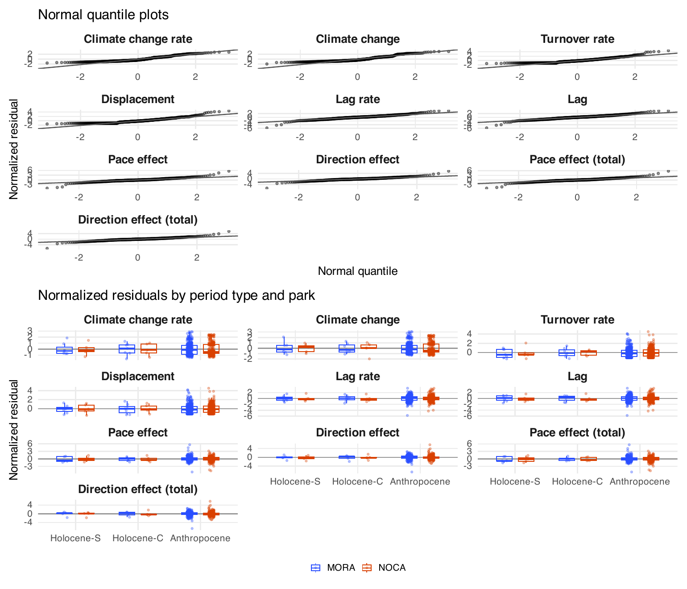
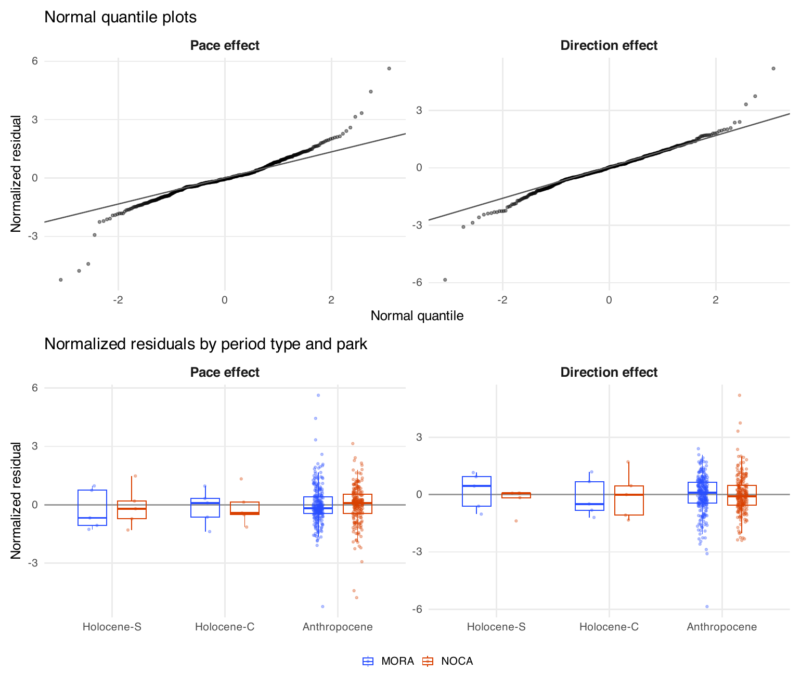

8. Model details
================

- [Era models (Step 5a)](#era-models-step-5a)
- [Joint pace and direction model](#joint-pace-and-direction-model)
- [Holocene explanatory models (Step
  5)](#holocene-explanatory-models-step-5)
- [Species means (Step 6)](#species-means-step-6)

<!-- Generated by R/build_report.R. -->

Back to the [report](../../README.md#holocene-against-anthropocene).
Scripts: `R/pipeline/14_era_models.R` (Step 5a),
`R/pipeline/15_predictor_models.R` (Step 5),
`R/pipeline/16_contributions.R` (Step 6). Shared GLS helpers in
`R/helpers/reconstruction_models.R` and
`R/helpers/tracking_model_reporting.R`. Every model is fitted on the
lake-periods and the plot pairs of
`output/13_tracking/cca_tracking_both_eras.csv`.

## Era models (Step 5a)

**Era models**: estimate ~ period_type \* site, AR(1) on the unit order
within series, residual SD per period type and park (relative to
Anthropocene MORA) times the square root of endpoint_var. R² is
descriptive.

| Response | n | AR(1) | Variance parameters | R² | Warnings |
|:---|---:|---:|:---|---:|:---|
| climate_rate | 629 | 0.012 | A.Anthropocene NOCA=2.284, A.Holocene-C MORA=0.055, A.Holocene-S MORA=0.088, A.Holocene-C NOCA=0.104, A.Holocene-S NOCA=0.073 | 0.111 |  |
| climate_change | 629 | -0.451 | A.Anthropocene NOCA=1.935, A.Holocene-C MORA=0.802, A.Holocene-S MORA=0.710, A.Holocene-C NOCA=1.519, A.Holocene-S NOCA=0.807 | 0.040 |  |
| turnover_rate | 629 | -0.657 | A.Anthropocene NOCA=2.308, A.Holocene-C MORA=0.080, A.Holocene-S MORA=0.030, A.Holocene-C NOCA=0.114, A.Holocene-S NOCA=0.488 | 0.176 |  |
| displacement | 629 | -0.372 | A.Anthropocene NOCA=1.944, A.Holocene-C MORA=0.546, A.Holocene-S MORA=0.822, A.Holocene-C NOCA=0.242, A.Holocene-S NOCA=2.253 | 0.110 |  |
| lag_rate | 629 | -0.185 | A.Anthropocene NOCA=2.124, A.Holocene-C MORA=0.053, A.Holocene-S MORA=0.038, A.Holocene-C NOCA=0.097, A.Holocene-S NOCA=0.326 | 0.031 |  |
| lag | 629 | 0.076 | A.Anthropocene NOCA=2.052, A.Holocene-C MORA=0.537, A.Holocene-S MORA=0.964, A.Holocene-C NOCA=2.152, A.Holocene-S NOCA=3.317 | 0.035 |  |
| pace_effect | 483 | 0.626 | A.Anthropocene NOCA=2.765, A.Holocene-S MORA=0.018, A.Holocene-C MORA=0.029, A.Holocene-C NOCA=0.076, A.Holocene-S NOCA=0.425 | 0.021 |  |
| direction_effect | 483 | 0.680 | A.Anthropocene NOCA=1.712, A.Holocene-S MORA=0.035, A.Holocene-C MORA=0.127, A.Holocene-C NOCA=0.096, A.Holocene-S NOCA=0.077 | 0.027 |  |
| pace_effect_total | 483 | 0.583 | A.Anthropocene NOCA=2.691, A.Holocene-S MORA=0.873, A.Holocene-C MORA=0.297, A.Holocene-C NOCA=1.395, A.Holocene-S NOCA=4.722 | 0.023 |  |
| direction_effect_total | 483 | 0.207 | A.Anthropocene NOCA=1.669, A.Holocene-S MORA=1.279, A.Holocene-C MORA=0.780, A.Holocene-C NOCA=1.980, A.Holocene-S NOCA=1.253 | 0.030 |  |

Table file:
[era_model_summary.csv](../tables/era_model_summary.csv)

**Era-model coefficients** (treatment contrasts, reference Holocene-S at
MORA).

| Response               | Term                             | Estimate |    SE |     p |
|:-----------------------|:---------------------------------|---------:|------:|------:|
| climate_rate           | (Intercept)                      |    0.067 | 0.028 | 0.016 |
| climate_rate           | period_typeHolocene-C            |    0.028 | 0.033 | 0.390 |
| climate_rate           | period_typeAnthropocene          |    2.529 | 0.054 | 0.000 |
| climate_rate           | siteNOCA                         |   -0.024 | 0.030 | 0.424 |
| climate_rate           | period_typeHolocene-C:siteNOCA   |   -0.007 | 0.037 | 0.847 |
| climate_rate           | period_typeAnthropocene:siteNOCA |    0.139 | 0.128 | 0.278 |
| climate_change         | (Intercept)                      |    0.363 | 0.083 | 0.000 |
| climate_change         | period_typeHolocene-C            |   -0.027 | 0.160 | 0.865 |
| climate_change         | period_typeAnthropocene          |    0.402 | 0.084 | 0.000 |
| climate_change         | siteNOCA                         |   -0.151 | 0.094 | 0.110 |
| climate_change         | period_typeHolocene-C:siteNOCA   |    0.207 | 0.199 | 0.299 |
| climate_change         | period_typeAnthropocene:siteNOCA |    0.156 | 0.101 | 0.123 |
| turnover_rate          | (Intercept)                      |    0.029 | 0.011 | 0.010 |
| turnover_rate          | period_typeHolocene-C            |    0.059 | 0.040 | 0.143 |
| turnover_rate          | period_typeAnthropocene          |    0.900 | 0.047 | 0.000 |
| turnover_rate          | siteNOCA                         |    0.118 | 0.092 | 0.202 |
| turnover_rate          | period_typeHolocene-C:siteNOCA   |   -0.144 | 0.117 | 0.221 |
| turnover_rate          | period_typeAnthropocene:siteNOCA |    1.081 | 0.154 | 0.000 |
| displacement           | (Intercept)                      |    0.334 | 0.103 | 0.001 |
| displacement           | period_typeHolocene-C            |   -0.111 | 0.152 | 0.464 |
| displacement           | period_typeAnthropocene          |    0.019 | 0.105 | 0.857 |
| displacement           | siteNOCA                         |    0.172 | 0.168 | 0.307 |
| displacement           | period_typeHolocene-C:siteNOCA   |   -0.029 | 0.208 | 0.888 |
| displacement           | period_typeAnthropocene:siteNOCA |    0.153 | 0.173 | 0.378 |
| lag_rate               | (Intercept)                      |    0.008 | 0.016 | 0.621 |
| lag_rate               | period_typeHolocene-C            |   -0.005 | 0.031 | 0.871 |
| lag_rate               | period_typeAnthropocene          |    0.546 | 0.063 | 0.000 |
| lag_rate               | siteNOCA                         |    0.058 | 0.065 | 0.372 |
| lag_rate               | period_typeHolocene-C:siteNOCA   |   -0.079 | 0.078 | 0.308 |
| lag_rate               | period_typeAnthropocene:siteNOCA |   -0.693 | 0.167 | 0.000 |
| lag                    | (Intercept)                      |   -0.119 | 0.118 | 0.316 |
| lag                    | period_typeHolocene-C            |    0.106 | 0.129 | 0.408 |
| lag                    | period_typeAnthropocene          |    0.282 | 0.120 | 0.019 |
| lag                    | siteNOCA                         |    0.377 | 0.220 | 0.087 |
| lag                    | period_typeHolocene-C:siteNOCA   |   -0.412 | 0.243 | 0.091 |
| lag                    | period_typeAnthropocene:siteNOCA |   -0.563 | 0.225 | 0.012 |
| pace_effect            | (Intercept)                      |   -0.013 | 0.007 | 0.064 |
| pace_effect            | period_typeHolocene-C            |    0.045 | 0.007 | 0.000 |
| pace_effect            | period_typeAnthropocene          |    0.185 | 0.048 | 0.000 |
| pace_effect            | siteNOCA                         |    0.125 | 0.071 | 0.078 |
| pace_effect            | period_typeHolocene-C:siteNOCA   |   -0.145 | 0.061 | 0.018 |
| pace_effect            | period_typeAnthropocene:siteNOCA |   -0.568 | 0.166 | 0.001 |
| direction_effect       | (Intercept)                      |   -0.013 | 0.024 | 0.581 |
| direction_effect       | period_typeHolocene-C            |    0.057 | 0.067 | 0.394 |
| direction_effect       | period_typeAnthropocene          |    0.364 | 0.088 | 0.000 |
| direction_effect       | siteNOCA                         |    0.051 | 0.034 | 0.132 |
| direction_effect       | period_typeHolocene-C:siteNOCA   |   -0.124 | 0.069 | 0.071 |
| direction_effect       | period_typeAnthropocene:siteNOCA |   -0.666 | 0.183 | 0.000 |
| pace_effect_total      | (Intercept)                      |   -0.179 | 0.094 | 0.058 |
| pace_effect_total      | period_typeHolocene-C            |    0.274 | 0.077 | 0.000 |
| pace_effect_total      | period_typeAnthropocene          |    0.227 | 0.095 | 0.017 |
| pace_effect_total      | siteNOCA                         |    0.520 | 0.241 | 0.031 |
| pace_effect_total      | period_typeHolocene-C:siteNOCA   |   -0.553 | 0.190 | 0.004 |
| pace_effect_total      | period_typeAnthropocene:siteNOCA |   -0.646 | 0.245 | 0.009 |
| direction_effect_total | (Intercept)                      |   -0.174 | 0.227 | 0.443 |
| direction_effect_total | period_typeHolocene-C            |    0.155 | 0.234 | 0.509 |
| direction_effect_total | period_typeAnthropocene          |    0.276 | 0.228 | 0.226 |
| direction_effect_total | siteNOCA                         |    0.254 | 0.243 | 0.296 |
| direction_effect_total | period_typeHolocene-C:siteNOCA   |   -0.387 | 0.269 | 0.150 |
| direction_effect_total | period_typeAnthropocene:siteNOCA |   -0.430 | 0.248 | 0.083 |

Table file:
[era_coefficients.csv](../tables/era_coefficients.csv)

Residual checks of the era models are Fig. S16 of the report, and those
of the joint pace and direction model Fig. S17.

## Joint pace and direction model

**Joint model** estimate ~ period_type \* site \* correction, paired
AR(1): fitted means.

| Park | Period type  | Correction |   n |   Mean | 95% CI          |
|:-----|:-------------|:-----------|----:|-------:|:----------------|
| MORA | Holocene-S   | Pace       |   5 | -0.012 | -0.028 to 0.003 |
| MORA | Holocene-S   | Direction  |   5 | -0.012 | -0.055 to 0.030 |
| MORA | Holocene-C   | Pace       |   5 |  0.031 | 0.012 to 0.051  |
| MORA | Holocene-C   | Direction  |   5 |  0.049 | -0.120 to 0.218 |
| MORA | Anthropocene | Pace       | 252 |  0.173 | 0.080 to 0.265  |
| MORA | Anthropocene | Direction  | 252 |  0.351 | 0.184 to 0.517  |
| NOCA | Holocene-S   | Pace       |   5 |  0.115 | -0.025 to 0.255 |
| NOCA | Holocene-S   | Direction  |   5 |  0.038 | -0.009 to 0.086 |
| NOCA | Holocene-C   | Pace       |   5 |  0.014 | -0.013 to 0.041 |
| NOCA | Holocene-C   | Direction  |   5 | -0.030 | -0.083 to 0.023 |
| NOCA | Anthropocene | Pace       | 211 | -0.270 | -0.551 to 0.010 |
| NOCA | Anthropocene | Direction  | 211 | -0.264 | -0.575 to 0.047 |

Table file:
[joint_correction_means.csv](../tables/joint_correction_means.csv)

**Direction minus pace** within each period type and park.

| Park | Period type  | Contrast         | Estimate | 95% CI          | p (Holm) |
|:-----|:-------------|:-----------------|---------:|:----------------|---------:|
| MORA | Holocene-S   | Direction - Pace |    0.000 | -0.033 to 0.033 |    1.000 |
| MORA | Holocene-C   | Direction - Pace |    0.018 | -0.137 to 0.173 |    1.000 |
| MORA | Anthropocene | Direction - Pace |    0.178 | 0.002 to 0.354  |    0.285 |
| NOCA | Holocene-S   | Direction - Pace |   -0.077 | -0.199 to 0.046 |    0.875 |
| NOCA | Holocene-C   | Direction - Pace |   -0.044 | -0.089 to 0.001 |    0.285 |
| NOCA | Anthropocene | Direction - Pace |    0.007 | -0.317 to 0.330 |    1.000 |

Table file:
[joint_correction_contrasts.csv](../tables/joint_correction_contrasts.csv)

**Correlation parameters**: AR(1) on the unit order, and the correlation
between the pace and direction of one unit per era and park.

| Parameter         | Estimate |
|:------------------|---------:|
| AR1               |    0.657 |
| Anthropocene MORA |    0.171 |
| Anthropocene NOCA |    0.406 |
| Holocene MORA     |    0.732 |
| Holocene NOCA     |    0.527 |

Table file:
[joint_correction_correlation.csv](../tables/joint_correction_correlation.csv)

## Holocene explanatory models (Step 5)

**Explanatory models**: rows, descriptive R² and covariance parameters.

| Response | Era | Model | n | MORA | NOCA | R² | AR(1) | SD ratio NOCA/MORA |
|:---|:---|:---|---:|---:|---:|---:|---:|---:|
| lag_rate | Holocene | site + climate_rate + fire_activity | 24 | 14 | 10 | 0.335 | -0.091 | 5.159 |
| lag_rate | Anthropocene | site + burned | 605 | 328 | 277 | 0.031 | — | 2.128 |
| pace_effect | Holocene | site + climate_rate + fire_activity | 20 | 10 | 10 | 0.230 | -0.022 | 9.564 |
| pace_effect | Anthropocene | site + burned | 463 | 252 | 211 | 0.042 | — | 2.737 |
| direction_effect | Holocene | site + climate_rate + fire_activity | 20 | 10 | 10 | 0.264 | 0.079 | 1.780 |
| direction_effect | Anthropocene | site + burned | 463 | 252 | 211 | 0.033 | — | 1.708 |
| lag | Holocene | site + climate_change + fire_activity | 24 | 14 | 10 | 0.206 | -0.182 | 3.238 |
| lag | Anthropocene | site + burned | 605 | 328 | 277 | 0.032 | — | 2.055 |
| pace_effect_total | Holocene | site + climate_change + fire_activity | 20 | 10 | 10 | 0.174 | -0.592 | 5.513 |
| pace_effect_total | Anthropocene | site + burned | 463 | 252 | 211 | 0.042 | — | 2.664 |
| direction_effect_total | Holocene | site + climate_change + fire_activity | 20 | 10 | 10 | 0.098 | -0.150 | 1.894 |
| direction_effect_total | Anthropocene | site + burned | 463 | 252 | 211 | 0.034 | — | 1.666 |

Table file:
[explanatory_model_performance.csv](../tables/explanatory_model_performance.csv)

**Rows left out of the explanatory models.**

| Response               | Period type  | Park | Reason             | Rows |
|:-----------------------|:-------------|:-----|:-------------------|-----:|
| direction_effect       | Anthropocene | MORA | undefined_response |   76 |
| direction_effect       | Anthropocene | NOCA | undefined_response |   66 |
| direction_effect       | Holocene-C   | MORA | undefined_response |    2 |
| direction_effect       | Holocene-S   | MORA | undefined_response |    2 |
| direction_effect_total | Anthropocene | MORA | undefined_response |   76 |
| direction_effect_total | Anthropocene | NOCA | undefined_response |   66 |
| direction_effect_total | Holocene-C   | MORA | undefined_response |    2 |
| direction_effect_total | Holocene-S   | MORA | undefined_response |    2 |
| pace_effect            | Anthropocene | MORA | undefined_response |   76 |
| pace_effect            | Anthropocene | NOCA | undefined_response |   66 |
| pace_effect            | Holocene-C   | MORA | undefined_response |    2 |
| pace_effect            | Holocene-S   | MORA | undefined_response |    2 |
| pace_effect_total      | Anthropocene | MORA | undefined_response |   76 |
| pace_effect_total      | Anthropocene | NOCA | undefined_response |   66 |
| pace_effect_total      | Holocene-C   | MORA | undefined_response |    2 |
| pace_effect_total      | Holocene-S   | MORA | undefined_response |    2 |

Table file:
[explanatory_model_exclusions.csv](../tables/explanatory_model_exclusions.csv)

## Species means (Step 6)

**Species contrasts between period types** (Welch differences of means).
p (Holm) is adjusted within each measure and park across all species and
contrasts.

| Measure | Species | Park | Contrast | Estimate | 95% CI | p | p (Holm) |
|:---|:---|:---|:---|---:|:---|---:|---:|
| contrib_climate | Abies amabilis | MORA | Anthropocene - Holocene-C | -0.046 | -0.079 to -0.013 | 0.006 | 0.212 |
| contrib_climate | Abies amabilis | MORA | Anthropocene - Holocene-S | -0.041 | -0.072 to -0.010 | 0.010 | 0.343 |
| contrib_climate | Abies amabilis | MORA | Holocene-C - Holocene-S | 0.005 | -0.009 to 0.020 | 0.384 | 1.000 |
| contrib_climate | Abies amabilis | NOCA | Anthropocene - Holocene-C | 0.021 | -0.016 to 0.059 | 0.265 | 1.000 |
| contrib_climate | Abies amabilis | NOCA | Anthropocene - Holocene-S | 0.021 | -0.016 to 0.059 | 0.265 | 1.000 |
| contrib_climate | Abies amabilis | NOCA | Holocene-C - Holocene-S | 0.000 | not defined | — | — |
| contrib_climate | Abies grandis | MORA | Anthropocene - Holocene-C | -0.018 | -0.057 to 0.021 | 0.373 | 1.000 |
| contrib_climate | Abies grandis | MORA | Anthropocene - Holocene-S | -0.018 | -0.057 to 0.021 | 0.373 | 1.000 |
| contrib_climate | Abies grandis | MORA | Holocene-C - Holocene-S | 0.000 | not defined | — | — |
| contrib_climate | Abies grandis | NOCA | Anthropocene - Holocene-C | -0.056 | -0.142 to 0.031 | 0.205 | 1.000 |
| contrib_climate | Abies grandis | NOCA | Anthropocene - Holocene-S | -0.056 | -0.142 to 0.031 | 0.205 | 1.000 |
| contrib_climate | Abies grandis | NOCA | Holocene-C - Holocene-S | 0.000 | not defined | — | — |
| contrib_climate | Abies lasiocarpa | MORA | Anthropocene - Holocene-C | -0.026 | -0.083 to 0.032 | 0.348 | 1.000 |
| contrib_climate | Abies lasiocarpa | MORA | Anthropocene - Holocene-S | -0.009 | -0.043 to 0.025 | 0.610 | 1.000 |
| contrib_climate | Abies lasiocarpa | MORA | Holocene-C - Holocene-S | 0.017 | -0.039 to 0.072 | 0.472 | 1.000 |
| contrib_climate | Abies lasiocarpa | NOCA | Anthropocene - Holocene-C | -0.044 | -0.191 to 0.102 | 0.551 | 1.000 |
| contrib_climate | Abies lasiocarpa | NOCA | Anthropocene - Holocene-S | -0.127 | -0.291 to 0.037 | 0.127 | 1.000 |
| contrib_climate | Abies lasiocarpa | NOCA | Holocene-C - Holocene-S | -0.083 | -0.187 to 0.022 | 0.098 | 1.000 |
| contrib_climate | Abies procera | MORA | Anthropocene - Holocene-C | 0.027 | -0.004 to 0.057 | 0.087 | 1.000 |
| contrib_climate | Abies procera | MORA | Anthropocene - Holocene-S | 0.032 | 0.002 to 0.062 | 0.039 | 1.000 |
| contrib_climate | Abies procera | MORA | Holocene-C - Holocene-S | 0.005 | -0.001 to 0.012 | 0.100 | 1.000 |
| contrib_climate | Abies procera | NOCA | Anthropocene - Holocene-C | 0.000 | not defined | — | — |
| contrib_climate | Abies procera | NOCA | Anthropocene - Holocene-S | 0.000 | not defined | — | — |
| contrib_climate | Abies procera | NOCA | Holocene-C - Holocene-S | 0.000 | not defined | — | — |
| contrib_climate | Callitropsis nootkatensis | MORA | Anthropocene - Holocene-C | 0.030 | -0.063 to 0.122 | 0.514 | 1.000 |
| contrib_climate | Callitropsis nootkatensis | MORA | Anthropocene - Holocene-S | -0.007 | -0.074 to 0.061 | 0.847 | 1.000 |
| contrib_climate | Callitropsis nootkatensis | MORA | Holocene-C - Holocene-S | -0.036 | -0.116 to 0.043 | 0.275 | 1.000 |
| contrib_climate | Callitropsis nootkatensis | NOCA | Anthropocene - Holocene-C | 0.031 | -0.012 to 0.074 | 0.156 | 1.000 |
| contrib_climate | Callitropsis nootkatensis | NOCA | Anthropocene - Holocene-S | 0.030 | -0.012 to 0.071 | 0.162 | 1.000 |
| contrib_climate | Callitropsis nootkatensis | NOCA | Holocene-C - Holocene-S | -0.001 | -0.024 to 0.022 | 0.904 | 1.000 |
| contrib_climate | Picea engelmannii | MORA | Anthropocene - Holocene-C | -0.004 | -0.017 to 0.009 | 0.540 | 1.000 |
| contrib_climate | Picea engelmannii | MORA | Anthropocene - Holocene-S | -0.004 | -0.017 to 0.009 | 0.540 | 1.000 |
| contrib_climate | Picea engelmannii | MORA | Holocene-C - Holocene-S | 0.000 | not defined | — | — |
| contrib_climate | Picea engelmannii | NOCA | Anthropocene - Holocene-C | -0.014 | -0.089 to 0.062 | 0.719 | 1.000 |
| contrib_climate | Picea engelmannii | NOCA | Anthropocene - Holocene-S | -0.010 | -0.085 to 0.066 | 0.804 | 1.000 |
| contrib_climate | Picea engelmannii | NOCA | Holocene-C - Holocene-S | 0.004 | -0.004 to 0.013 | 0.259 | 1.000 |
| contrib_climate | Pinus albicaulis | MORA | Anthropocene - Holocene-C | 0.003 | -0.001 to 0.008 | 0.159 | 1.000 |
| contrib_climate | Pinus albicaulis | MORA | Anthropocene - Holocene-S | 0.003 | -0.001 to 0.008 | 0.159 | 1.000 |
| contrib_climate | Pinus albicaulis | MORA | Holocene-C - Holocene-S | 0.000 | not defined | — | — |
| contrib_climate | Pinus albicaulis | NOCA | Anthropocene - Holocene-C | 0.257 | 0.079 to 0.434 | 0.005 | 0.160 |
| contrib_climate | Pinus albicaulis | NOCA | Anthropocene - Holocene-S | 0.257 | 0.079 to 0.434 | 0.005 | 0.160 |
| contrib_climate | Pinus albicaulis | NOCA | Holocene-C - Holocene-S | 0.000 | not defined | — | — |
| contrib_climate | Pinus contorta | MORA | Anthropocene - Holocene-C | -0.003 | -0.016 to 0.009 | 0.602 | 1.000 |
| contrib_climate | Pinus contorta | MORA | Anthropocene - Holocene-S | -0.011 | -0.024 to 0.003 | 0.109 | 1.000 |
| contrib_climate | Pinus contorta | MORA | Holocene-C - Holocene-S | -0.007 | -0.019 to 0.004 | 0.189 | 1.000 |
| contrib_climate | Pinus contorta | NOCA | Anthropocene - Holocene-C | 0.031 | -0.073 to 0.135 | 0.563 | 1.000 |
| contrib_climate | Pinus contorta | NOCA | Anthropocene - Holocene-S | 0.042 | -0.062 to 0.146 | 0.429 | 1.000 |
| contrib_climate | Pinus contorta | NOCA | Holocene-C - Holocene-S | 0.011 | -0.012 to 0.034 | 0.295 | 1.000 |
| contrib_climate | Pinus monticola | MORA | Anthropocene - Holocene-C | -0.032 | -0.057 to -0.007 | 0.014 | 0.462 |
| contrib_climate | Pinus monticola | MORA | Anthropocene - Holocene-S | -0.042 | -0.058 to -0.025 | 0.000 | 0.000 |
| contrib_climate | Pinus monticola | MORA | Holocene-C - Holocene-S | -0.010 | -0.032 to 0.013 | 0.323 | 1.000 |
| contrib_climate | Pinus monticola | NOCA | Anthropocene - Holocene-C | 0.008 | -0.031 to 0.047 | 0.692 | 1.000 |
| contrib_climate | Pinus monticola | NOCA | Anthropocene - Holocene-S | 0.003 | -0.052 to 0.059 | 0.900 | 1.000 |
| contrib_climate | Pinus monticola | NOCA | Holocene-C - Holocene-S | -0.004 | -0.054 to 0.045 | 0.823 | 1.000 |
| contrib_climate | Pinus ponderosa | MORA | Anthropocene - Holocene-C | 0.009 | -0.009 to 0.026 | 0.318 | 1.000 |
| contrib_climate | Pinus ponderosa | MORA | Anthropocene - Holocene-S | 0.009 | -0.009 to 0.026 | 0.318 | 1.000 |
| contrib_climate | Pinus ponderosa | MORA | Holocene-C - Holocene-S | 0.000 | not defined | — | — |
| contrib_climate | Pinus ponderosa | NOCA | Anthropocene - Holocene-C | 0.216 | -0.036 to 0.468 | 0.093 | 1.000 |
| contrib_climate | Pinus ponderosa | NOCA | Anthropocene - Holocene-S | 0.216 | -0.036 to 0.468 | 0.093 | 1.000 |
| contrib_climate | Pinus ponderosa | NOCA | Holocene-C - Holocene-S | 0.000 | not defined | — | — |
| contrib_climate | Pseudotsuga menziesii | MORA | Anthropocene - Holocene-C | -0.029 | -0.087 to 0.029 | 0.325 | 1.000 |
| contrib_climate | Pseudotsuga menziesii | MORA | Anthropocene - Holocene-S | -0.050 | -0.100 to -0.001 | 0.047 | 1.000 |
| contrib_climate | Pseudotsuga menziesii | MORA | Holocene-C - Holocene-S | -0.022 | -0.061 to 0.018 | 0.210 | 1.000 |
| contrib_climate | Pseudotsuga menziesii | NOCA | Anthropocene - Holocene-C | -0.002 | -0.075 to 0.071 | 0.956 | 1.000 |
| contrib_climate | Pseudotsuga menziesii | NOCA | Anthropocene - Holocene-S | -0.001 | -0.073 to 0.071 | 0.978 | 1.000 |
| contrib_climate | Pseudotsuga menziesii | NOCA | Holocene-C - Holocene-S | 0.001 | -0.025 to 0.028 | 0.927 | 1.000 |
| contrib_climate | Thuja plicata | MORA | Anthropocene - Holocene-C | 0.005 | -0.024 to 0.034 | 0.735 | 1.000 |
| contrib_climate | Thuja plicata | MORA | Anthropocene - Holocene-S | 0.005 | -0.024 to 0.034 | 0.735 | 1.000 |
| contrib_climate | Thuja plicata | MORA | Holocene-C - Holocene-S | 0.000 | not defined | — | — |
| contrib_climate | Thuja plicata | NOCA | Anthropocene - Holocene-C | 0.039 | -0.007 to 0.085 | 0.093 | 1.000 |
| contrib_climate | Thuja plicata | NOCA | Anthropocene - Holocene-S | 0.036 | -0.010 to 0.081 | 0.123 | 1.000 |
| contrib_climate | Thuja plicata | NOCA | Holocene-C - Holocene-S | -0.004 | -0.016 to 0.008 | 0.440 | 1.000 |
| contrib_climate | Tsuga heterophylla | MORA | Anthropocene - Holocene-C | -0.039 | -0.062 to -0.016 | 0.001 | 0.037 |
| contrib_climate | Tsuga heterophylla | MORA | Anthropocene - Holocene-S | -0.047 | -0.069 to -0.025 | 0.000 | 0.001 |
| contrib_climate | Tsuga heterophylla | MORA | Holocene-C - Holocene-S | -0.007 | -0.024 to 0.009 | 0.321 | 1.000 |
| contrib_climate | Tsuga heterophylla | NOCA | Anthropocene - Holocene-C | 0.107 | 0.061 to 0.154 | 0.000 | 0.000 |
| contrib_climate | Tsuga heterophylla | NOCA | Anthropocene - Holocene-S | 0.100 | 0.050 to 0.150 | 0.000 | 0.004 |
| contrib_climate | Tsuga heterophylla | NOCA | Holocene-C - Holocene-S | -0.007 | -0.031 to 0.017 | 0.474 | 1.000 |
| contrib_climate | Tsuga mertensiana | MORA | Anthropocene - Holocene-C | -0.010 | -0.052 to 0.031 | 0.608 | 1.000 |
| contrib_climate | Tsuga mertensiana | MORA | Anthropocene - Holocene-S | 0.012 | -0.018 to 0.042 | 0.439 | 1.000 |
| contrib_climate | Tsuga mertensiana | MORA | Holocene-C - Holocene-S | 0.022 | -0.014 to 0.059 | 0.169 | 1.000 |
| contrib_climate | Tsuga mertensiana | NOCA | Anthropocene - Holocene-C | 0.011 | -0.026 to 0.049 | 0.563 | 1.000 |
| contrib_climate | Tsuga mertensiana | NOCA | Anthropocene - Holocene-S | 0.010 | -0.027 to 0.048 | 0.585 | 1.000 |
| contrib_climate | Tsuga mertensiana | NOCA | Holocene-C - Holocene-S | -0.001 | -0.002 to 0.000 | 0.192 | 1.000 |
| contrib_lag | Abies amabilis | MORA | Anthropocene - Holocene-C | 0.025 | 0.002 to 0.048 | 0.030 | 0.919 |
| contrib_lag | Abies amabilis | MORA | Anthropocene - Holocene-S | 0.029 | 0.007 to 0.050 | 0.010 | 0.335 |
| contrib_lag | Abies amabilis | MORA | Holocene-C - Holocene-S | 0.004 | -0.005 to 0.012 | 0.345 | 1.000 |
| contrib_lag | Abies amabilis | NOCA | Anthropocene - Holocene-C | 0.005 | -0.014 to 0.025 | 0.587 | 1.000 |
| contrib_lag | Abies amabilis | NOCA | Anthropocene - Holocene-S | 0.005 | -0.014 to 0.025 | 0.587 | 1.000 |
| contrib_lag | Abies amabilis | NOCA | Holocene-C - Holocene-S | 0.000 | not defined | — | — |
| contrib_lag | Abies grandis | MORA | Anthropocene - Holocene-C | -0.027 | -0.051 to -0.004 | 0.020 | 0.654 |
| contrib_lag | Abies grandis | MORA | Anthropocene - Holocene-S | -0.027 | -0.051 to -0.004 | 0.020 | 0.654 |
| contrib_lag | Abies grandis | MORA | Holocene-C - Holocene-S | 0.000 | not defined | — | — |
| contrib_lag | Abies grandis | NOCA | Anthropocene - Holocene-C | -0.063 | -0.135 to 0.010 | 0.089 | 1.000 |
| contrib_lag | Abies grandis | NOCA | Anthropocene - Holocene-S | -0.063 | -0.135 to 0.010 | 0.089 | 1.000 |
| contrib_lag | Abies grandis | NOCA | Holocene-C - Holocene-S | 0.000 | not defined | — | — |
| contrib_lag | Abies lasiocarpa | MORA | Anthropocene - Holocene-C | 0.027 | -0.030 to 0.083 | 0.353 | 1.000 |
| contrib_lag | Abies lasiocarpa | MORA | Anthropocene - Holocene-S | 0.018 | -0.034 to 0.069 | 0.494 | 1.000 |
| contrib_lag | Abies lasiocarpa | MORA | Holocene-C - Holocene-S | -0.009 | -0.038 to 0.020 | 0.493 | 1.000 |
| contrib_lag | Abies lasiocarpa | NOCA | Anthropocene - Holocene-C | 0.054 | -0.073 to 0.182 | 0.399 | 1.000 |
| contrib_lag | Abies lasiocarpa | NOCA | Anthropocene - Holocene-S | 0.055 | -0.097 to 0.206 | 0.472 | 1.000 |
| contrib_lag | Abies lasiocarpa | NOCA | Holocene-C - Holocene-S | 0.000 | -0.110 to 0.111 | 0.997 | 1.000 |
| contrib_lag | Abies procera | MORA | Anthropocene - Holocene-C | -0.024 | -0.049 to 0.001 | 0.065 | 1.000 |
| contrib_lag | Abies procera | MORA | Anthropocene - Holocene-S | -0.021 | -0.045 to 0.002 | 0.075 | 1.000 |
| contrib_lag | Abies procera | MORA | Holocene-C - Holocene-S | 0.002 | -0.009 to 0.014 | 0.639 | 1.000 |
| contrib_lag | Abies procera | NOCA | Anthropocene - Holocene-C | 0.000 | not defined | — | — |
| contrib_lag | Abies procera | NOCA | Anthropocene - Holocene-S | 0.000 | not defined | — | — |
| contrib_lag | Abies procera | NOCA | Holocene-C - Holocene-S | 0.000 | not defined | — | — |
| contrib_lag | Callitropsis nootkatensis | MORA | Anthropocene - Holocene-C | 0.008 | -0.040 to 0.055 | 0.754 | 1.000 |
| contrib_lag | Callitropsis nootkatensis | MORA | Anthropocene - Holocene-S | 0.019 | -0.029 to 0.067 | 0.441 | 1.000 |
| contrib_lag | Callitropsis nootkatensis | MORA | Holocene-C - Holocene-S | 0.011 | -0.000 to 0.023 | 0.057 | 1.000 |
| contrib_lag | Callitropsis nootkatensis | NOCA | Anthropocene - Holocene-C | 0.019 | -0.031 to 0.068 | 0.464 | 1.000 |
| contrib_lag | Callitropsis nootkatensis | NOCA | Anthropocene - Holocene-S | 0.008 | -0.039 to 0.056 | 0.726 | 1.000 |
| contrib_lag | Callitropsis nootkatensis | NOCA | Holocene-C - Holocene-S | -0.010 | -0.032 to 0.012 | 0.278 | 1.000 |
| contrib_lag | Picea engelmannii | MORA | Anthropocene - Holocene-C | -0.001 | -0.020 to 0.018 | 0.878 | 1.000 |
| contrib_lag | Picea engelmannii | MORA | Anthropocene - Holocene-S | -0.001 | -0.020 to 0.018 | 0.878 | 1.000 |
| contrib_lag | Picea engelmannii | MORA | Holocene-C - Holocene-S | 0.000 | not defined | — | — |
| contrib_lag | Picea engelmannii | NOCA | Anthropocene - Holocene-C | 0.007 | -0.054 to 0.068 | 0.822 | 1.000 |
| contrib_lag | Picea engelmannii | NOCA | Anthropocene - Holocene-S | 0.003 | -0.059 to 0.065 | 0.925 | 1.000 |
| contrib_lag | Picea engelmannii | NOCA | Holocene-C - Holocene-S | -0.004 | -0.013 to 0.005 | 0.287 | 1.000 |
| contrib_lag | Pinus albicaulis | MORA | Anthropocene - Holocene-C | 0.015 | -0.006 to 0.037 | 0.158 | 1.000 |
| contrib_lag | Pinus albicaulis | MORA | Anthropocene - Holocene-S | 0.015 | -0.006 to 0.037 | 0.158 | 1.000 |
| contrib_lag | Pinus albicaulis | MORA | Holocene-C - Holocene-S | 0.000 | not defined | — | — |
| contrib_lag | Pinus albicaulis | NOCA | Anthropocene - Holocene-C | -0.283 | -0.475 to -0.091 | 0.004 | 0.140 |
| contrib_lag | Pinus albicaulis | NOCA | Anthropocene - Holocene-S | -0.283 | -0.475 to -0.091 | 0.004 | 0.140 |
| contrib_lag | Pinus albicaulis | NOCA | Holocene-C - Holocene-S | 0.000 | not defined | — | — |
| contrib_lag | Pinus contorta | MORA | Anthropocene - Holocene-C | 0.002 | -0.011 to 0.015 | 0.724 | 1.000 |
| contrib_lag | Pinus contorta | MORA | Anthropocene - Holocene-S | 0.003 | -0.009 to 0.014 | 0.661 | 1.000 |
| contrib_lag | Pinus contorta | MORA | Holocene-C - Holocene-S | 0.000 | -0.011 to 0.012 | 0.948 | 1.000 |
| contrib_lag | Pinus contorta | NOCA | Anthropocene - Holocene-C | -0.024 | -0.120 to 0.071 | 0.614 | 1.000 |
| contrib_lag | Pinus contorta | NOCA | Anthropocene - Holocene-S | -0.037 | -0.136 to 0.062 | 0.454 | 1.000 |
| contrib_lag | Pinus contorta | NOCA | Holocene-C - Holocene-S | -0.013 | -0.089 to 0.063 | 0.706 | 1.000 |
| contrib_lag | Pinus monticola | MORA | Anthropocene - Holocene-C | 0.003 | -0.039 to 0.044 | 0.879 | 1.000 |
| contrib_lag | Pinus monticola | MORA | Anthropocene - Holocene-S | 0.017 | 0.003 to 0.031 | 0.015 | 0.493 |
| contrib_lag | Pinus monticola | MORA | Holocene-C - Holocene-S | 0.015 | -0.026 to 0.055 | 0.419 | 1.000 |
| contrib_lag | Pinus monticola | NOCA | Anthropocene - Holocene-C | 0.023 | -0.007 to 0.052 | 0.134 | 1.000 |
| contrib_lag | Pinus monticola | NOCA | Anthropocene - Holocene-S | -0.002 | -0.048 to 0.044 | 0.926 | 1.000 |
| contrib_lag | Pinus monticola | NOCA | Holocene-C - Holocene-S | -0.025 | -0.069 to 0.020 | 0.228 | 1.000 |
| contrib_lag | Pinus ponderosa | MORA | Anthropocene - Holocene-C | 0.009 | -0.009 to 0.026 | 0.318 | 1.000 |
| contrib_lag | Pinus ponderosa | MORA | Anthropocene - Holocene-S | 0.009 | -0.009 to 0.026 | 0.318 | 1.000 |
| contrib_lag | Pinus ponderosa | MORA | Holocene-C - Holocene-S | 0.000 | not defined | — | — |
| contrib_lag | Pinus ponderosa | NOCA | Anthropocene - Holocene-C | -0.192 | -0.403 to 0.019 | 0.074 | 1.000 |
| contrib_lag | Pinus ponderosa | NOCA | Anthropocene - Holocene-S | -0.192 | -0.403 to 0.019 | 0.074 | 1.000 |
| contrib_lag | Pinus ponderosa | NOCA | Holocene-C - Holocene-S | 0.000 | not defined | — | — |
| contrib_lag | Pseudotsuga menziesii | MORA | Anthropocene - Holocene-C | 0.031 | -0.007 to 0.068 | 0.103 | 1.000 |
| contrib_lag | Pseudotsuga menziesii | MORA | Anthropocene - Holocene-S | 0.033 | 0.002 to 0.065 | 0.040 | 1.000 |
| contrib_lag | Pseudotsuga menziesii | MORA | Holocene-C - Holocene-S | 0.002 | -0.024 to 0.028 | 0.855 | 1.000 |
| contrib_lag | Pseudotsuga menziesii | NOCA | Anthropocene - Holocene-C | 0.017 | -0.048 to 0.083 | 0.598 | 1.000 |
| contrib_lag | Pseudotsuga menziesii | NOCA | Anthropocene - Holocene-S | 0.018 | -0.044 to 0.080 | 0.569 | 1.000 |
| contrib_lag | Pseudotsuga menziesii | NOCA | Holocene-C - Holocene-S | 0.001 | -0.029 to 0.030 | 0.964 | 1.000 |
| contrib_lag | Thuja plicata | MORA | Anthropocene - Holocene-C | 0.035 | -0.000 to 0.070 | 0.052 | 1.000 |
| contrib_lag | Thuja plicata | MORA | Anthropocene - Holocene-S | 0.035 | -0.000 to 0.070 | 0.052 | 1.000 |
| contrib_lag | Thuja plicata | MORA | Holocene-C - Holocene-S | 0.000 | not defined | — | — |
| contrib_lag | Thuja plicata | NOCA | Anthropocene - Holocene-C | -0.011 | -0.054 to 0.032 | 0.613 | 1.000 |
| contrib_lag | Thuja plicata | NOCA | Anthropocene - Holocene-S | -0.020 | -0.063 to 0.023 | 0.356 | 1.000 |
| contrib_lag | Thuja plicata | NOCA | Holocene-C - Holocene-S | -0.009 | -0.021 to 0.003 | 0.125 | 1.000 |
| contrib_lag | Tsuga heterophylla | MORA | Anthropocene - Holocene-C | 0.033 | 0.010 to 0.057 | 0.006 | 0.213 |
| contrib_lag | Tsuga heterophylla | MORA | Anthropocene - Holocene-S | 0.034 | 0.010 to 0.058 | 0.005 | 0.188 |
| contrib_lag | Tsuga heterophylla | MORA | Holocene-C - Holocene-S | 0.000 | -0.004 to 0.005 | 0.827 | 1.000 |
| contrib_lag | Tsuga heterophylla | NOCA | Anthropocene - Holocene-C | 0.017 | -0.012 to 0.045 | 0.255 | 1.000 |
| contrib_lag | Tsuga heterophylla | NOCA | Anthropocene - Holocene-S | 0.003 | -0.040 to 0.047 | 0.871 | 1.000 |
| contrib_lag | Tsuga heterophylla | NOCA | Holocene-C - Holocene-S | -0.013 | -0.053 to 0.027 | 0.410 | 1.000 |
| contrib_lag | Tsuga mertensiana | MORA | Anthropocene - Holocene-C | -0.006 | -0.033 to 0.020 | 0.639 | 1.000 |
| contrib_lag | Tsuga mertensiana | MORA | Anthropocene - Holocene-S | -0.006 | -0.031 to 0.019 | 0.636 | 1.000 |
| contrib_lag | Tsuga mertensiana | MORA | Holocene-C - Holocene-S | 0.000 | -0.011 to 0.012 | 0.946 | 1.000 |
| contrib_lag | Tsuga mertensiana | NOCA | Anthropocene - Holocene-C | -0.042 | -0.094 to 0.010 | 0.116 | 1.000 |
| contrib_lag | Tsuga mertensiana | NOCA | Anthropocene - Holocene-S | -0.041 | -0.094 to 0.011 | 0.122 | 1.000 |
| contrib_lag | Tsuga mertensiana | NOCA | Holocene-C - Holocene-S | 0.001 | -0.001 to 0.002 | 0.178 | 1.000 |

Table file:
[species_contrasts.csv](../tables/species_contrasts.csv)

**NOCA species contributions on burned and unburned plots** (means with
t-intervals).

| Measure         | Species                   | Burned |   n |   Mean | 95% CI           |
|:----------------|:--------------------------|:-------|----:|-------:|:-----------------|
| contrib_climate | Abies amabilis            | FALSE  | 194 |  0.029 | -0.010 to 0.067  |
| contrib_climate | Abies amabilis            | TRUE   |  17 | -0.064 | -0.223 to 0.094  |
| contrib_climate | Abies grandis             | FALSE  | 194 | -0.075 | -0.165 to 0.014  |
| contrib_climate | Abies grandis             | TRUE   |  17 |  0.167 | -0.186 to 0.520  |
| contrib_climate | Abies lasiocarpa          | FALSE  | 194 | -0.046 | -0.199 to 0.107  |
| contrib_climate | Abies lasiocarpa          | TRUE   |  17 | -0.239 | -0.634 to 0.155  |
| contrib_climate | Abies procera             | FALSE  | 194 |  0.000 | not defined      |
| contrib_climate | Abies procera             | TRUE   |  17 |  0.000 | not defined      |
| contrib_climate | Callitropsis nootkatensis | FALSE  | 194 |  0.025 | -0.018 to 0.069  |
| contrib_climate | Callitropsis nootkatensis | TRUE   |  17 |  0.000 | not defined      |
| contrib_climate | Picea engelmannii         | FALSE  | 194 | -0.025 | -0.102 to 0.051  |
| contrib_climate | Picea engelmannii         | TRUE   |  17 |  0.131 | -0.239 to 0.501  |
| contrib_climate | Pinus albicaulis          | FALSE  | 194 |  0.198 | 0.022 to 0.375   |
| contrib_climate | Pinus albicaulis          | TRUE   |  17 |  0.921 | -0.014 to 1.857  |
| contrib_climate | Pinus contorta            | FALSE  | 194 |  0.046 | -0.062 to 0.154  |
| contrib_climate | Pinus contorta            | TRUE   |  17 | -0.035 | -0.414 to 0.344  |
| contrib_climate | Pinus monticola           | FALSE  | 194 |  0.007 | -0.029 to 0.043  |
| contrib_climate | Pinus monticola           | TRUE   |  17 |  0.028 | -0.227 to 0.282  |
| contrib_climate | Pinus ponderosa           | FALSE  | 194 |  0.135 | -0.056 to 0.326  |
| contrib_climate | Pinus ponderosa           | TRUE   |  17 |  1.141 | -1.287 to 3.569  |
| contrib_climate | Pseudotsuga menziesii     | FALSE  | 194 |  0.017 | -0.048 to 0.083  |
| contrib_climate | Pseudotsuga menziesii     | TRUE   |  17 | -0.317 | -0.804 to 0.170  |
| contrib_climate | Thuja plicata             | FALSE  | 194 |  0.036 | -0.013 to 0.086  |
| contrib_climate | Thuja plicata             | TRUE   |  17 |  0.000 | not defined      |
| contrib_climate | Tsuga heterophylla        | FALSE  | 194 |  0.114 | 0.064 to 0.164   |
| contrib_climate | Tsuga heterophylla        | TRUE   |  17 |  0.044 | -0.049 to 0.136  |
| contrib_climate | Tsuga mertensiana         | FALSE  | 194 |  0.006 | -0.034 to 0.046  |
| contrib_climate | Tsuga mertensiana         | TRUE   |  17 |  0.069 | -0.020 to 0.157  |
| contrib_lag     | Abies amabilis            | FALSE  | 253 |  0.008 | -0.013 to 0.029  |
| contrib_lag     | Abies amabilis            | TRUE   |  24 | -0.021 | -0.058 to 0.016  |
| contrib_lag     | Abies grandis             | FALSE  | 253 | -0.056 | -0.132 to 0.019  |
| contrib_lag     | Abies grandis             | TRUE   |  24 | -0.130 | -0.399 to 0.139  |
| contrib_lag     | Abies lasiocarpa          | FALSE  | 253 |  0.045 | -0.088 to 0.177  |
| contrib_lag     | Abies lasiocarpa          | TRUE   |  24 |  0.184 | -0.222 to 0.591  |
| contrib_lag     | Abies procera             | FALSE  | 253 |  0.000 | not defined      |
| contrib_lag     | Abies procera             | TRUE   |  24 |  0.000 | not defined      |
| contrib_lag     | Callitropsis nootkatensis | FALSE  | 253 |  0.012 | -0.040 to 0.063  |
| contrib_lag     | Callitropsis nootkatensis | TRUE   |  24 |  0.000 | not defined      |
| contrib_lag     | Picea engelmannii         | FALSE  | 253 |  0.016 | -0.046 to 0.077  |
| contrib_lag     | Picea engelmannii         | TRUE   |  24 | -0.094 | -0.404 to 0.216  |
| contrib_lag     | Pinus albicaulis          | FALSE  | 253 | -0.216 | -0.404 to -0.029 |
| contrib_lag     | Pinus albicaulis          | TRUE   |  24 | -0.987 | -2.008 to 0.035  |
| contrib_lag     | Pinus contorta            | FALSE  | 253 | -0.028 | -0.117 to 0.062  |
| contrib_lag     | Pinus contorta            | TRUE   |  24 |  0.041 | -0.216 to 0.297  |
| contrib_lag     | Pinus monticola           | FALSE  | 253 |  0.023 | 0.001 to 0.044   |
| contrib_lag     | Pinus monticola           | TRUE   |  24 | -0.016 | -0.198 to 0.166  |
| contrib_lag     | Pinus ponderosa           | FALSE  | 253 | -0.121 | -0.286 to 0.044  |
| contrib_lag     | Pinus ponderosa           | TRUE   |  24 | -0.940 | -2.733 to 0.854  |
| contrib_lag     | Pseudotsuga menziesii     | FALSE  | 253 | -0.007 | -0.063 to 0.049  |
| contrib_lag     | Pseudotsuga menziesii     | TRUE   |  24 |  0.280 | -0.122 to 0.681  |
| contrib_lag     | Thuja plicata             | FALSE  | 253 | -0.017 | -0.063 to 0.029  |
| contrib_lag     | Thuja plicata             | TRUE   |  24 |  0.000 | not defined      |
| contrib_lag     | Tsuga heterophylla        | FALSE  | 253 |  0.021 | -0.011 to 0.052  |
| contrib_lag     | Tsuga heterophylla        | TRUE   |  24 | -0.011 | -0.034 to 0.012  |
| contrib_lag     | Tsuga mertensiana         | FALSE  | 253 | -0.044 | -0.101 to 0.013  |
| contrib_lag     | Tsuga mertensiana         | TRUE   |  24 | -0.018 | -0.060 to 0.024  |

Table file:
[noca_burned_species_means.csv](../tables/noca_burned_species_means.csv)

**Species contributions per lake-period** (CCA distance per century).

| Park | Lake | Period | Species | contrib_climate | contrib_lag |
|:---|:---|:---|:---|---:|---:|
| MORA | JayBath | C3 | Abies amabilis | — | 0.000 |
| MORA | JayBath | C3 | Abies grandis | — | 0.000 |
| MORA | JayBath | C3 | Abies lasiocarpa | — | 0.000 |
| MORA | JayBath | C3 | Abies procera | — | 0.000 |
| MORA | JayBath | C3 | Callitropsis nootkatensis | — | 0.000 |
| MORA | JayBath | C3 | Picea engelmannii | — | 0.000 |
| MORA | JayBath | C3 | Pinus albicaulis | — | 0.000 |
| MORA | JayBath | C3 | Pinus contorta | — | 0.000 |
| MORA | JayBath | C3 | Pinus monticola | — | 0.000 |
| MORA | JayBath | C3 | Pinus ponderosa | — | 0.000 |
| MORA | JayBath | C3 | Pseudotsuga menziesii | — | 0.000 |
| MORA | JayBath | C3 | Thuja plicata | — | 0.000 |
| MORA | JayBath | C3 | Tsuga heterophylla | — | 0.000 |
| MORA | JayBath | C3 | Tsuga mertensiana | — | 0.000 |
| MORA | JayBath | S3 | Abies amabilis | -0.005 | 0.006 |
| MORA | JayBath | S3 | Abies grandis | 0.000 | 0.000 |
| MORA | JayBath | S3 | Abies lasiocarpa | 0.021 | -0.010 |
| MORA | JayBath | S3 | Abies procera | -0.006 | 0.008 |
| MORA | JayBath | S3 | Callitropsis nootkatensis | 0.000 | 0.000 |
| MORA | JayBath | S3 | Picea engelmannii | 0.000 | 0.000 |
| MORA | JayBath | S3 | Pinus albicaulis | 0.000 | 0.000 |
| MORA | JayBath | S3 | Pinus contorta | 0.020 | -0.021 |
| MORA | JayBath | S3 | Pinus monticola | 0.009 | -0.008 |
| MORA | JayBath | S3 | Pinus ponderosa | 0.000 | 0.000 |
| MORA | JayBath | S3 | Pseudotsuga menziesii | -0.008 | 0.020 |
| MORA | JayBath | S3 | Thuja plicata | 0.000 | 0.000 |
| MORA | JayBath | S3 | Tsuga heterophylla | 0.017 | -0.008 |
| MORA | JayBath | S3 | Tsuga mertensiana | 0.000 | 0.000 |
| MORA | JayBath | C4 | Abies amabilis | — | 0.000 |
| MORA | JayBath | C4 | Abies grandis | — | 0.000 |
| MORA | JayBath | C4 | Abies lasiocarpa | — | 0.000 |
| MORA | JayBath | C4 | Abies procera | — | 0.000 |
| MORA | JayBath | C4 | Callitropsis nootkatensis | — | 0.000 |
| MORA | JayBath | C4 | Picea engelmannii | — | 0.000 |
| MORA | JayBath | C4 | Pinus albicaulis | — | 0.000 |
| MORA | JayBath | C4 | Pinus contorta | — | 0.000 |
| MORA | JayBath | C4 | Pinus monticola | — | 0.000 |
| MORA | JayBath | C4 | Pinus ponderosa | — | 0.000 |
| MORA | JayBath | C4 | Pseudotsuga menziesii | — | 0.000 |
| MORA | JayBath | C4 | Thuja plicata | — | 0.000 |
| MORA | JayBath | C4 | Tsuga heterophylla | — | 0.000 |
| MORA | JayBath | C4 | Tsuga mertensiana | — | 0.000 |
| MORA | JayBath | S4 | Abies amabilis | 0.002 | -0.002 |
| MORA | JayBath | S4 | Abies grandis | 0.000 | 0.000 |
| MORA | JayBath | S4 | Abies lasiocarpa | 0.001 | -0.001 |
| MORA | JayBath | S4 | Abies procera | -0.004 | 0.004 |
| MORA | JayBath | S4 | Callitropsis nootkatensis | 0.007 | -0.006 |
| MORA | JayBath | S4 | Picea engelmannii | 0.000 | 0.000 |
| MORA | JayBath | S4 | Pinus albicaulis | 0.000 | 0.000 |
| MORA | JayBath | S4 | Pinus contorta | 0.009 | -0.009 |
| MORA | JayBath | S4 | Pinus monticola | -0.002 | 0.002 |
| MORA | JayBath | S4 | Pinus ponderosa | 0.000 | 0.000 |
| MORA | JayBath | S4 | Pseudotsuga menziesii | 0.004 | -0.004 |
| MORA | JayBath | S4 | Thuja plicata | 0.000 | 0.000 |
| MORA | JayBath | S4 | Tsuga heterophylla | 0.000 | 0.000 |
| MORA | JayBath | S4 | Tsuga mertensiana | 0.004 | -0.004 |
| MORA | JayBath | C5 | Abies amabilis | 0.000 | 0.000 |
| MORA | JayBath | C5 | Abies grandis | 0.000 | 0.000 |
| MORA | JayBath | C5 | Abies lasiocarpa | 0.018 | 0.019 |
| MORA | JayBath | C5 | Abies procera | 0.000 | 0.000 |
| MORA | JayBath | C5 | Callitropsis nootkatensis | 0.000 | 0.000 |
| MORA | JayBath | C5 | Picea engelmannii | 0.000 | 0.000 |
| MORA | JayBath | C5 | Pinus albicaulis | 0.000 | 0.000 |
| MORA | JayBath | C5 | Pinus contorta | 0.000 | 0.000 |
| MORA | JayBath | C5 | Pinus monticola | 0.000 | 0.000 |
| MORA | JayBath | C5 | Pinus ponderosa | 0.000 | 0.000 |
| MORA | JayBath | C5 | Pseudotsuga menziesii | -0.045 | -0.041 |
| MORA | JayBath | C5 | Thuja plicata | 0.000 | 0.000 |
| MORA | JayBath | C5 | Tsuga heterophylla | 0.000 | 0.000 |
| MORA | JayBath | C5 | Tsuga mertensiana | 0.000 | 0.000 |
| MORA | JayBath | S5 | Abies amabilis | — | 0.000 |
| MORA | JayBath | S5 | Abies grandis | — | 0.000 |
| MORA | JayBath | S5 | Abies lasiocarpa | — | 0.000 |
| MORA | JayBath | S5 | Abies procera | — | 0.000 |
| MORA | JayBath | S5 | Callitropsis nootkatensis | — | 0.000 |
| MORA | JayBath | S5 | Picea engelmannii | — | 0.000 |
| MORA | JayBath | S5 | Pinus albicaulis | — | 0.000 |
| MORA | JayBath | S5 | Pinus contorta | — | 0.000 |
| MORA | JayBath | S5 | Pinus monticola | — | 0.000 |
| MORA | JayBath | S5 | Pinus ponderosa | — | 0.000 |
| MORA | JayBath | S5 | Pseudotsuga menziesii | — | 0.000 |
| MORA | JayBath | S5 | Thuja plicata | — | 0.000 |
| MORA | JayBath | S5 | Tsuga heterophylla | — | 0.000 |
| MORA | JayBath | S5 | Tsuga mertensiana | — | 0.000 |
| MORA | LogWallow | C3 | Abies amabilis | 0.001 | 0.004 |
| MORA | LogWallow | C3 | Abies grandis | 0.000 | 0.000 |
| MORA | LogWallow | C3 | Abies lasiocarpa | -0.017 | -0.007 |
| MORA | LogWallow | C3 | Abies procera | 0.012 | 0.033 |
| MORA | LogWallow | C3 | Callitropsis nootkatensis | 0.000 | 0.000 |
| MORA | LogWallow | C3 | Picea engelmannii | 0.000 | 0.000 |
| MORA | LogWallow | C3 | Pinus albicaulis | 0.000 | 0.000 |
| MORA | LogWallow | C3 | Pinus contorta | -0.009 | -0.015 |
| MORA | LogWallow | C3 | Pinus monticola | -0.005 | -0.005 |
| MORA | LogWallow | C3 | Pinus ponderosa | 0.000 | 0.000 |
| MORA | LogWallow | C3 | Pseudotsuga menziesii | 0.000 | 0.000 |
| MORA | LogWallow | C3 | Thuja plicata | 0.000 | 0.000 |
| MORA | LogWallow | C3 | Tsuga heterophylla | -0.027 | -0.012 |
| MORA | LogWallow | C3 | Tsuga mertensiana | 0.027 | -0.026 |
| MORA | LogWallow | S3 | Abies amabilis | 0.000 | 0.000 |
| MORA | LogWallow | S3 | Abies grandis | 0.000 | 0.000 |
| MORA | LogWallow | S3 | Abies lasiocarpa | 0.000 | 0.000 |
| MORA | LogWallow | S3 | Abies procera | 0.000 | 0.000 |
| MORA | LogWallow | S3 | Callitropsis nootkatensis | 0.002 | -0.033 |
| MORA | LogWallow | S3 | Picea engelmannii | 0.000 | 0.000 |
| MORA | LogWallow | S3 | Pinus albicaulis | 0.000 | 0.000 |
| MORA | LogWallow | S3 | Pinus contorta | 0.000 | 0.000 |
| MORA | LogWallow | S3 | Pinus monticola | 0.000 | 0.000 |
| MORA | LogWallow | S3 | Pinus ponderosa | 0.000 | 0.000 |
| MORA | LogWallow | S3 | Pseudotsuga menziesii | -0.002 | -0.017 |
| MORA | LogWallow | S3 | Thuja plicata | 0.000 | 0.000 |
| MORA | LogWallow | S3 | Tsuga heterophylla | 0.000 | 0.000 |
| MORA | LogWallow | S3 | Tsuga mertensiana | 0.000 | 0.000 |
| MORA | LogWallow | C4 | Abies amabilis | -0.005 | 0.007 |
| MORA | LogWallow | C4 | Abies grandis | 0.000 | 0.000 |
| MORA | LogWallow | C4 | Abies lasiocarpa | -0.013 | -0.015 |
| MORA | LogWallow | C4 | Abies procera | 0.000 | 0.000 |
| MORA | LogWallow | C4 | Callitropsis nootkatensis | -0.019 | 0.018 |
| MORA | LogWallow | C4 | Picea engelmannii | 0.000 | 0.000 |
| MORA | LogWallow | C4 | Pinus albicaulis | 0.000 | 0.000 |
| MORA | LogWallow | C4 | Pinus contorta | 0.013 | -0.027 |
| MORA | LogWallow | C4 | Pinus monticola | 0.003 | -0.010 |
| MORA | LogWallow | C4 | Pinus ponderosa | 0.000 | 0.000 |
| MORA | LogWallow | C4 | Pseudotsuga menziesii | -0.069 | 0.054 |
| MORA | LogWallow | C4 | Thuja plicata | 0.000 | 0.000 |
| MORA | LogWallow | C4 | Tsuga heterophylla | 0.000 | 0.000 |
| MORA | LogWallow | C4 | Tsuga mertensiana | -0.017 | 0.008 |
| MORA | LogWallow | S4 | Abies amabilis | 0.001 | -0.001 |
| MORA | LogWallow | S4 | Abies grandis | 0.000 | 0.000 |
| MORA | LogWallow | S4 | Abies lasiocarpa | -0.006 | 0.004 |
| MORA | LogWallow | S4 | Abies procera | -0.004 | 0.005 |
| MORA | LogWallow | S4 | Callitropsis nootkatensis | 0.002 | -0.003 |
| MORA | LogWallow | S4 | Picea engelmannii | 0.000 | 0.000 |
| MORA | LogWallow | S4 | Pinus albicaulis | 0.000 | 0.000 |
| MORA | LogWallow | S4 | Pinus contorta | 0.013 | -0.014 |
| MORA | LogWallow | S4 | Pinus monticola | -0.002 | 0.002 |
| MORA | LogWallow | S4 | Pinus ponderosa | 0.000 | 0.000 |
| MORA | LogWallow | S4 | Pseudotsuga menziesii | 0.000 | 0.000 |
| MORA | LogWallow | S4 | Thuja plicata | 0.000 | 0.000 |
| MORA | LogWallow | S4 | Tsuga heterophylla | 0.000 | 0.000 |
| MORA | LogWallow | S4 | Tsuga mertensiana | 0.000 | -0.001 |
| MORA | ReflectionPond | S3 | Abies amabilis | — | 0.000 |
| MORA | ReflectionPond | S3 | Abies grandis | — | 0.000 |
| MORA | ReflectionPond | S3 | Abies lasiocarpa | — | 0.000 |
| MORA | ReflectionPond | S3 | Abies procera | — | 0.000 |
| MORA | ReflectionPond | S3 | Callitropsis nootkatensis | — | 0.000 |
| MORA | ReflectionPond | S3 | Picea engelmannii | — | 0.000 |
| MORA | ReflectionPond | S3 | Pinus albicaulis | — | 0.000 |
| MORA | ReflectionPond | S3 | Pinus contorta | — | 0.000 |
| MORA | ReflectionPond | S3 | Pinus monticola | — | 0.000 |
| MORA | ReflectionPond | S3 | Pinus ponderosa | — | 0.000 |
| MORA | ReflectionPond | S3 | Pseudotsuga menziesii | — | 0.000 |
| MORA | ReflectionPond | S3 | Thuja plicata | — | 0.000 |
| MORA | ReflectionPond | S3 | Tsuga heterophylla | — | 0.000 |
| MORA | ReflectionPond | S3 | Tsuga mertensiana | — | 0.000 |
| MORA | ReflectionPond | C4 | Abies amabilis | 0.004 | 0.023 |
| MORA | ReflectionPond | C4 | Abies grandis | 0.000 | 0.000 |
| MORA | ReflectionPond | C4 | Abies lasiocarpa | 0.094 | -0.078 |
| MORA | ReflectionPond | C4 | Abies procera | 0.000 | 0.000 |
| MORA | ReflectionPond | C4 | Callitropsis nootkatensis | 0.000 | 0.000 |
| MORA | ReflectionPond | C4 | Picea engelmannii | 0.000 | 0.000 |
| MORA | ReflectionPond | C4 | Pinus albicaulis | 0.000 | 0.000 |
| MORA | ReflectionPond | C4 | Pinus contorta | 0.000 | 0.000 |
| MORA | ReflectionPond | C4 | Pinus monticola | -0.042 | 0.114 |
| MORA | ReflectionPond | C4 | Pinus ponderosa | 0.000 | 0.000 |
| MORA | ReflectionPond | C4 | Pseudotsuga menziesii | 0.000 | 0.000 |
| MORA | ReflectionPond | C4 | Thuja plicata | 0.000 | 0.000 |
| MORA | ReflectionPond | C4 | Tsuga heterophylla | 0.000 | 0.000 |
| MORA | ReflectionPond | C4 | Tsuga mertensiana | 0.053 | 0.010 |
| MORA | ReflectionPond | S4 | Abies amabilis | 0.001 | 0.003 |
| MORA | ReflectionPond | S4 | Abies grandis | 0.000 | 0.000 |
| MORA | ReflectionPond | S4 | Abies lasiocarpa | -0.018 | -0.013 |
| MORA | ReflectionPond | S4 | Abies procera | 0.000 | 0.000 |
| MORA | ReflectionPond | S4 | Callitropsis nootkatensis | 0.004 | -0.011 |
| MORA | ReflectionPond | S4 | Picea engelmannii | 0.000 | 0.000 |
| MORA | ReflectionPond | S4 | Pinus albicaulis | 0.000 | 0.000 |
| MORA | ReflectionPond | S4 | Pinus contorta | 0.000 | 0.000 |
| MORA | ReflectionPond | S4 | Pinus monticola | 0.000 | 0.000 |
| MORA | ReflectionPond | S4 | Pinus ponderosa | 0.000 | 0.000 |
| MORA | ReflectionPond | S4 | Pseudotsuga menziesii | 0.000 | 0.000 |
| MORA | ReflectionPond | S4 | Thuja plicata | 0.000 | 0.000 |
| MORA | ReflectionPond | S4 | Tsuga heterophylla | -0.008 | -0.006 |
| MORA | ReflectionPond | S4 | Tsuga mertensiana | -0.007 | 0.001 |
| MORA | ReflectionPond | C5 | Abies amabilis | 0.026 | -0.004 |
| MORA | ReflectionPond | C5 | Abies grandis | 0.000 | 0.000 |
| MORA | ReflectionPond | C5 | Abies lasiocarpa | 0.000 | 0.000 |
| MORA | ReflectionPond | C5 | Abies procera | 0.000 | 0.000 |
| MORA | ReflectionPond | C5 | Callitropsis nootkatensis | -0.147 | 0.007 |
| MORA | ReflectionPond | C5 | Picea engelmannii | 0.000 | 0.000 |
| MORA | ReflectionPond | C5 | Pinus albicaulis | 0.000 | 0.000 |
| MORA | ReflectionPond | C5 | Pinus contorta | 0.000 | 0.000 |
| MORA | ReflectionPond | C5 | Pinus monticola | 0.000 | 0.000 |
| MORA | ReflectionPond | C5 | Pinus ponderosa | 0.000 | 0.000 |
| MORA | ReflectionPond | C5 | Pseudotsuga menziesii | 0.000 | 0.000 |
| MORA | ReflectionPond | C5 | Thuja plicata | 0.000 | 0.000 |
| MORA | ReflectionPond | C5 | Tsuga heterophylla | 0.000 | 0.000 |
| MORA | ReflectionPond | C5 | Tsuga mertensiana | 0.045 | 0.007 |
| NOCA | PantherPotholes | C1 | Abies amabilis | 0.000 | 0.000 |
| NOCA | PantherPotholes | C1 | Abies grandis | 0.000 | 0.000 |
| NOCA | PantherPotholes | C1 | Abies lasiocarpa | -0.053 | -0.021 |
| NOCA | PantherPotholes | C1 | Abies procera | 0.000 | 0.000 |
| NOCA | PantherPotholes | C1 | Callitropsis nootkatensis | 0.000 | 0.000 |
| NOCA | PantherPotholes | C1 | Picea engelmannii | 0.000 | 0.000 |
| NOCA | PantherPotholes | C1 | Pinus albicaulis | 0.000 | 0.000 |
| NOCA | PantherPotholes | C1 | Pinus contorta | 0.016 | 0.070 |
| NOCA | PantherPotholes | C1 | Pinus monticola | 0.008 | 0.015 |
| NOCA | PantherPotholes | C1 | Pinus ponderosa | 0.000 | 0.000 |
| NOCA | PantherPotholes | C1 | Pseudotsuga menziesii | 0.016 | -0.024 |
| NOCA | PantherPotholes | C1 | Thuja plicata | 0.000 | 0.000 |
| NOCA | PantherPotholes | C1 | Tsuga heterophylla | 0.000 | 0.000 |
| NOCA | PantherPotholes | C1 | Tsuga mertensiana | 0.000 | 0.000 |
| NOCA | PantherPotholes | S1 | Abies amabilis | 0.000 | 0.000 |
| NOCA | PantherPotholes | S1 | Abies grandis | 0.000 | 0.000 |
| NOCA | PantherPotholes | S1 | Abies lasiocarpa | 0.185 | -0.116 |
| NOCA | PantherPotholes | S1 | Abies procera | 0.000 | 0.000 |
| NOCA | PantherPotholes | S1 | Callitropsis nootkatensis | 0.000 | 0.000 |
| NOCA | PantherPotholes | S1 | Picea engelmannii | -0.016 | 0.016 |
| NOCA | PantherPotholes | S1 | Pinus albicaulis | 0.000 | 0.000 |
| NOCA | PantherPotholes | S1 | Pinus contorta | -0.027 | 0.096 |
| NOCA | PantherPotholes | S1 | Pinus monticola | -0.011 | 0.021 |
| NOCA | PantherPotholes | S1 | Pinus ponderosa | 0.000 | 0.000 |
| NOCA | PantherPotholes | S1 | Pseudotsuga menziesii | 0.000 | 0.000 |
| NOCA | PantherPotholes | S1 | Thuja plicata | 0.000 | 0.000 |
| NOCA | PantherPotholes | S1 | Tsuga heterophylla | 0.000 | 0.000 |
| NOCA | PantherPotholes | S1 | Tsuga mertensiana | 0.000 | 0.000 |
| NOCA | PantherPotholes | C2 | Abies amabilis | 0.000 | 0.000 |
| NOCA | PantherPotholes | C2 | Abies grandis | 0.000 | 0.000 |
| NOCA | PantherPotholes | C2 | Abies lasiocarpa | -0.011 | 0.005 |
| NOCA | PantherPotholes | C2 | Abies procera | 0.000 | 0.000 |
| NOCA | PantherPotholes | C2 | Callitropsis nootkatensis | 0.000 | 0.000 |
| NOCA | PantherPotholes | C2 | Picea engelmannii | 0.006 | -0.004 |
| NOCA | PantherPotholes | C2 | Pinus albicaulis | 0.000 | 0.000 |
| NOCA | PantherPotholes | C2 | Pinus contorta | 0.033 | -0.056 |
| NOCA | PantherPotholes | C2 | Pinus monticola | -0.001 | 0.001 |
| NOCA | PantherPotholes | C2 | Pinus ponderosa | 0.000 | 0.000 |
| NOCA | PantherPotholes | C2 | Pseudotsuga menziesii | 0.004 | 0.018 |
| NOCA | PantherPotholes | C2 | Thuja plicata | 0.000 | 0.000 |
| NOCA | PantherPotholes | C2 | Tsuga heterophylla | 0.000 | 0.000 |
| NOCA | PantherPotholes | C2 | Tsuga mertensiana | 0.000 | 0.000 |
| NOCA | PantherPotholes | S2 | Abies amabilis | 0.000 | 0.000 |
| NOCA | PantherPotholes | S2 | Abies grandis | 0.000 | 0.000 |
| NOCA | PantherPotholes | S2 | Abies lasiocarpa | -0.029 | 0.024 |
| NOCA | PantherPotholes | S2 | Abies procera | 0.000 | 0.000 |
| NOCA | PantherPotholes | S2 | Callitropsis nootkatensis | 0.000 | 0.000 |
| NOCA | PantherPotholes | S2 | Picea engelmannii | 0.000 | 0.000 |
| NOCA | PantherPotholes | S2 | Pinus albicaulis | 0.000 | 0.000 |
| NOCA | PantherPotholes | S2 | Pinus contorta | 0.000 | 0.035 |
| NOCA | PantherPotholes | S2 | Pinus monticola | 0.006 | -0.026 |
| NOCA | PantherPotholes | S2 | Pinus ponderosa | 0.000 | 0.000 |
| NOCA | PantherPotholes | S2 | Pseudotsuga menziesii | -0.001 | -0.001 |
| NOCA | PantherPotholes | S2 | Thuja plicata | 0.000 | 0.000 |
| NOCA | PantherPotholes | S2 | Tsuga heterophylla | 0.000 | 0.000 |
| NOCA | PantherPotholes | S2 | Tsuga mertensiana | 0.000 | 0.000 |
| NOCA | PantherPotholes | C3 | Abies amabilis | 0.000 | 0.000 |
| NOCA | PantherPotholes | C3 | Abies grandis | 0.000 | 0.000 |
| NOCA | PantherPotholes | C3 | Abies lasiocarpa | -0.031 | -0.022 |
| NOCA | PantherPotholes | C3 | Abies procera | 0.000 | 0.000 |
| NOCA | PantherPotholes | C3 | Callitropsis nootkatensis | 0.000 | 0.000 |
| NOCA | PantherPotholes | C3 | Picea engelmannii | 0.000 | 0.000 |
| NOCA | PantherPotholes | C3 | Pinus albicaulis | 0.000 | 0.000 |
| NOCA | PantherPotholes | C3 | Pinus contorta | -0.007 | -0.025 |
| NOCA | PantherPotholes | C3 | Pinus monticola | -0.015 | -0.028 |
| NOCA | PantherPotholes | C3 | Pinus ponderosa | 0.000 | 0.000 |
| NOCA | PantherPotholes | C3 | Pseudotsuga menziesii | -0.030 | 0.030 |
| NOCA | PantherPotholes | C3 | Thuja plicata | 0.000 | 0.000 |
| NOCA | PantherPotholes | C3 | Tsuga heterophylla | 0.000 | 0.000 |
| NOCA | PantherPotholes | C3 | Tsuga mertensiana | 0.000 | 0.000 |
| NOCA | PantherPotholes | S3 | Abies amabilis | 0.000 | 0.000 |
| NOCA | PantherPotholes | S3 | Abies grandis | 0.000 | 0.000 |
| NOCA | PantherPotholes | S3 | Abies lasiocarpa | 0.100 | -0.032 |
| NOCA | PantherPotholes | S3 | Abies procera | 0.000 | 0.000 |
| NOCA | PantherPotholes | S3 | Callitropsis nootkatensis | 0.000 | 0.000 |
| NOCA | PantherPotholes | S3 | Picea engelmannii | 0.000 | 0.000 |
| NOCA | PantherPotholes | S3 | Pinus albicaulis | 0.000 | 0.000 |
| NOCA | PantherPotholes | S3 | Pinus contorta | 0.015 | -0.054 |
| NOCA | PantherPotholes | S3 | Pinus monticola | -0.038 | 0.064 |
| NOCA | PantherPotholes | S3 | Pinus ponderosa | 0.000 | 0.000 |
| NOCA | PantherPotholes | S3 | Pseudotsuga menziesii | -0.009 | -0.015 |
| NOCA | PantherPotholes | S3 | Thuja plicata | 0.000 | 0.000 |
| NOCA | PantherPotholes | S3 | Tsuga heterophylla | 0.000 | 0.000 |
| NOCA | PantherPotholes | S3 | Tsuga mertensiana | 0.000 | 0.000 |
| NOCA | PantherPotholes | C4 | Abies amabilis | 0.000 | 0.000 |
| NOCA | PantherPotholes | C4 | Abies grandis | 0.000 | 0.000 |
| NOCA | PantherPotholes | C4 | Abies lasiocarpa | -0.024 | 0.016 |
| NOCA | PantherPotholes | C4 | Abies procera | 0.000 | 0.000 |
| NOCA | PantherPotholes | C4 | Callitropsis nootkatensis | -0.039 | -0.040 |
| NOCA | PantherPotholes | C4 | Picea engelmannii | 0.000 | 0.000 |
| NOCA | PantherPotholes | C4 | Pinus albicaulis | 0.000 | 0.000 |
| NOCA | PantherPotholes | C4 | Pinus contorta | 0.008 | 0.029 |
| NOCA | PantherPotholes | C4 | Pinus monticola | 0.000 | -0.014 |
| NOCA | PantherPotholes | C4 | Pinus ponderosa | 0.000 | 0.000 |
| NOCA | PantherPotholes | C4 | Pseudotsuga menziesii | -0.029 | -0.024 |
| NOCA | PantherPotholes | C4 | Thuja plicata | -0.008 | -0.002 |
| NOCA | PantherPotholes | C4 | Tsuga heterophylla | 0.000 | 0.000 |
| NOCA | PantherPotholes | C4 | Tsuga mertensiana | 0.000 | 0.000 |
| NOCA | PantherPotholes | S4 | Abies amabilis | 0.000 | 0.000 |
| NOCA | PantherPotholes | S4 | Abies grandis | 0.000 | 0.000 |
| NOCA | PantherPotholes | S4 | Abies lasiocarpa | -0.003 | 0.001 |
| NOCA | PantherPotholes | S4 | Abies procera | 0.000 | 0.000 |
| NOCA | PantherPotholes | S4 | Callitropsis nootkatensis | -0.002 | 0.005 |
| NOCA | PantherPotholes | S4 | Picea engelmannii | 0.000 | 0.000 |
| NOCA | PantherPotholes | S4 | Pinus albicaulis | 0.000 | 0.000 |
| NOCA | PantherPotholes | S4 | Pinus contorta | 0.000 | 0.000 |
| NOCA | PantherPotholes | S4 | Pinus monticola | -0.002 | -0.001 |
| NOCA | PantherPotholes | S4 | Pinus ponderosa | 0.000 | 0.000 |
| NOCA | PantherPotholes | S4 | Pseudotsuga menziesii | 0.001 | -0.002 |
| NOCA | PantherPotholes | S4 | Thuja plicata | -0.008 | 0.006 |
| NOCA | PantherPotholes | S4 | Tsuga heterophylla | -0.002 | 0.001 |
| NOCA | PantherPotholes | S4 | Tsuga mertensiana | 0.002 | -0.002 |
| NOCA | PantherPotholes | C5 | Abies amabilis | 0.000 | 0.000 |
| NOCA | PantherPotholes | C5 | Abies grandis | 0.000 | 0.000 |
| NOCA | PantherPotholes | C5 | Abies lasiocarpa | 0.034 | 0.034 |
| NOCA | PantherPotholes | C5 | Abies procera | 0.000 | 0.000 |
| NOCA | PantherPotholes | C5 | Callitropsis nootkatensis | 0.000 | 0.000 |
| NOCA | PantherPotholes | C5 | Picea engelmannii | 0.000 | 0.000 |
| NOCA | PantherPotholes | C5 | Pinus albicaulis | 0.000 | 0.000 |
| NOCA | PantherPotholes | C5 | Pinus contorta | -0.006 | -0.005 |
| NOCA | PantherPotholes | C5 | Pinus monticola | 0.012 | 0.011 |
| NOCA | PantherPotholes | C5 | Pinus ponderosa | 0.000 | 0.000 |
| NOCA | PantherPotholes | C5 | Pseudotsuga menziesii | 0.001 | 0.001 |
| NOCA | PantherPotholes | C5 | Thuja plicata | -0.022 | -0.021 |
| NOCA | PantherPotholes | C5 | Tsuga heterophylla | 0.006 | 0.006 |
| NOCA | PantherPotholes | C5 | Tsuga mertensiana | 0.000 | 0.000 |
| NOCA | PantherPotholes | S5 | Abies amabilis | 0.000 | 0.000 |
| NOCA | PantherPotholes | S5 | Abies grandis | 0.000 | 0.000 |
| NOCA | PantherPotholes | S5 | Abies lasiocarpa | 0.075 | 0.133 |
| NOCA | PantherPotholes | S5 | Abies procera | 0.000 | 0.000 |
| NOCA | PantherPotholes | S5 | Callitropsis nootkatensis | -0.031 | 0.006 |
| NOCA | PantherPotholes | S5 | Picea engelmannii | 0.000 | 0.000 |
| NOCA | PantherPotholes | S5 | Pinus albicaulis | 0.000 | 0.000 |
| NOCA | PantherPotholes | S5 | Pinus contorta | 0.000 | 0.000 |
| NOCA | PantherPotholes | S5 | Pinus monticola | 0.071 | 0.050 |
| NOCA | PantherPotholes | S5 | Pinus ponderosa | 0.000 | 0.000 |
| NOCA | PantherPotholes | S5 | Pseudotsuga menziesii | -0.034 | 0.015 |
| NOCA | PantherPotholes | S5 | Thuja plicata | -0.003 | 0.016 |
| NOCA | PantherPotholes | S5 | Tsuga heterophylla | 0.044 | 0.072 |
| NOCA | PantherPotholes | S5 | Tsuga mertensiana | 0.001 | -0.002 |

Table file:
[species_lake_periods.csv](../tables/species_lake_periods.csv)
