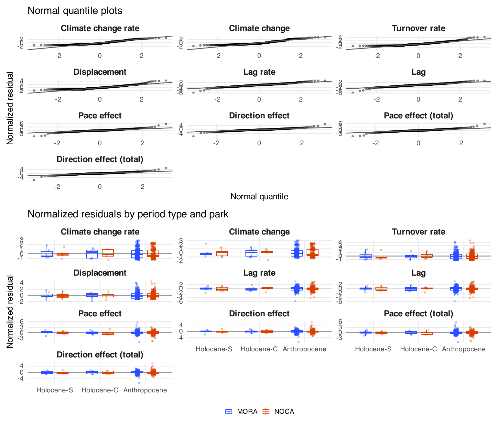
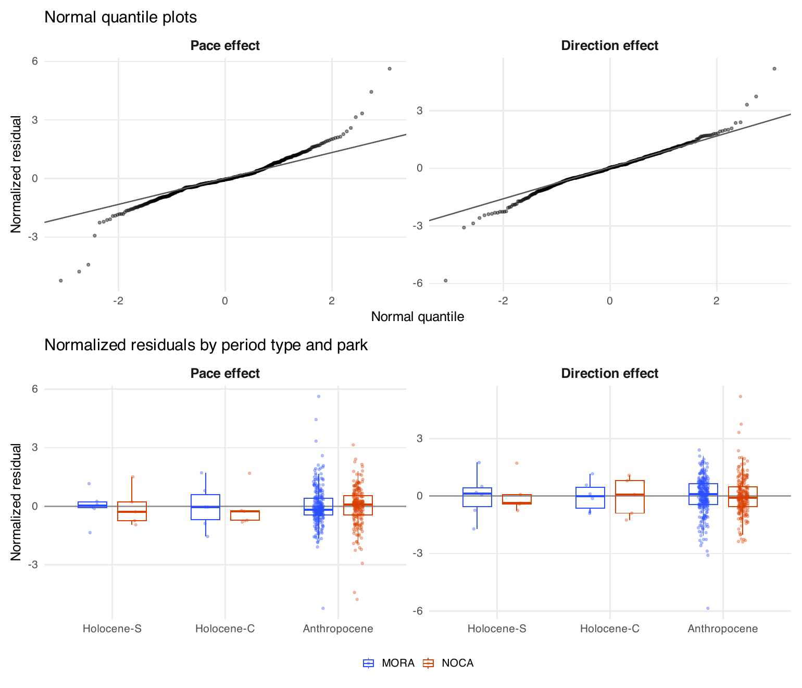

8. Model details
================

- [Era models (Step 5a)](#era-models-step-5a)
- [Joint pace and direction model](#joint-pace-and-direction-model)
- [Holocene explanatory models (Step
  5)](#holocene-explanatory-models-step-5)
- [Species means (Step 6)](#species-means-step-6)

<!-- Generated by R/build_report.R. -->

Back to the
[report](../../README.md#step-5a-holocene-against-anthropocene).
Scripts: `R/pipeline/13_era_models.R` (Step 5a),
`R/pipeline/14_predictor_models.R` (Step 5),
`R/pipeline/15_contributions.R` (Step 6). Shared GLS helpers in
`R/helpers/reconstruction_models.R` and
`R/helpers/tracking_model_reporting.R`. Every model is fitted on the
lake-periods and the plot pairs of
`output/12_tracking/cca_tracking_both_eras.csv`.

## Era models (Step 5a)

**Era models**: estimate ~ period_type \* site, AR(1) on the unit order
within series, residual SD per period type and park (relative to
Anthropocene MORA) times the square root of endpoint_var. R² is
descriptive.

| Response | n | AR(1) | Variance parameters | R² | Warnings |
|:---|---:|---:|:---|---:|:---|
| climate_rate | 629 | 0.025 | A.Anthropocene NOCA=2.284, A.Holocene-C MORA=0.062, A.Holocene-S MORA=0.032, A.Holocene-C NOCA=0.100, A.Holocene-S NOCA=0.072 | 0.113 |  |
| climate_change | 629 | -0.152 | A.Anthropocene NOCA=1.935, A.Holocene-C MORA=0.696, A.Holocene-S MORA=0.483, A.Holocene-C NOCA=1.462, A.Holocene-S NOCA=0.872 | 0.056 |  |
| turnover_rate | 629 | -0.359 | A.Anthropocene NOCA=2.308, A.Holocene-C MORA=0.065, A.Holocene-S MORA=0.046, A.Holocene-C NOCA=0.218, A.Holocene-S NOCA=0.257 | 0.176 |  |
| displacement | 629 | 0.064 | A.Anthropocene NOCA=1.944, A.Holocene-C MORA=0.383, A.Holocene-S MORA=0.857, A.Holocene-C NOCA=1.869, A.Holocene-S NOCA=1.715 | 0.110 |  |
| lag_rate | 629 | -0.133 | A.Anthropocene NOCA=2.124, A.Holocene-C MORA=0.071, A.Holocene-S MORA=0.035, A.Holocene-C NOCA=0.086, A.Holocene-S NOCA=0.194 | 0.031 |  |
| lag | 629 | -0.047 | A.Anthropocene NOCA=2.052, A.Holocene-C MORA=0.612, A.Holocene-S MORA=0.590, A.Holocene-C NOCA=1.577, A.Holocene-S NOCA=2.448 | 0.033 |  |
| pace_effect | 485 | 0.433 | A.Anthropocene NOCA=2.765, A.Holocene-C MORA=0.086, A.Holocene-S MORA=0.061, A.Holocene-C NOCA=0.077, A.Holocene-S NOCA=0.256 | 0.021 |  |
| direction_effect | 485 | -0.042 | A.Anthropocene NOCA=1.712, A.Holocene-C MORA=0.080, A.Holocene-S MORA=0.043, A.Holocene-C NOCA=0.114, A.Holocene-S NOCA=0.131 | 0.027 |  |
| pace_effect_total | 485 | 0.365 | A.Anthropocene NOCA=2.691, A.Holocene-C MORA=0.734, A.Holocene-S MORA=1.133, A.Holocene-C NOCA=1.103, A.Holocene-S NOCA=3.001 | 0.022 |  |
| direction_effect_total | 485 | 0.044 | A.Anthropocene NOCA=1.669, A.Holocene-C MORA=0.745, A.Holocene-S MORA=0.666, A.Holocene-C NOCA=1.971, A.Holocene-S NOCA=1.436 | 0.030 |  |

Table file:
[era_model_summary.csv](../tables/era_model_summary.csv)

**Era-model coefficients** (treatment contrasts, reference Holocene-S at
MORA).

| Response               | Term                             | Estimate |    SE |     p |
|:-----------------------|:---------------------------------|---------:|------:|------:|
| climate_rate           | (Intercept)                      |    0.027 | 0.010 | 0.009 |
| climate_rate           | period_typeHolocene-C            |    0.045 | 0.022 | 0.038 |
| climate_rate           | period_typeAnthropocene          |    2.570 | 0.047 | 0.000 |
| climate_rate           | siteNOCA                         |    0.015 | 0.014 | 0.299 |
| climate_rate           | period_typeHolocene-C:siteNOCA   |   -0.024 | 0.028 | 0.377 |
| climate_rate           | period_typeAnthropocene:siteNOCA |    0.100 | 0.125 | 0.425 |
| climate_change         | (Intercept)                      |    0.173 | 0.052 | 0.001 |
| climate_change         | period_typeHolocene-C            |    0.069 | 0.101 | 0.493 |
| climate_change         | period_typeAnthropocene          |    0.592 | 0.054 | 0.000 |
| climate_change         | siteNOCA                         |    0.037 | 0.067 | 0.578 |
| climate_change         | period_typeHolocene-C:siteNOCA   |    0.091 | 0.137 | 0.506 |
| climate_change         | period_typeAnthropocene:siteNOCA |   -0.032 | 0.076 | 0.675 |
| turnover_rate          | (Intercept)                      |    0.040 | 0.015 | 0.009 |
| turnover_rate          | period_typeHolocene-C            |    0.037 | 0.032 | 0.256 |
| turnover_rate          | period_typeAnthropocene          |    0.889 | 0.048 | 0.000 |
| turnover_rate          | siteNOCA                         |    0.068 | 0.042 | 0.102 |
| turnover_rate          | period_typeHolocene-C:siteNOCA   |   -0.065 | 0.072 | 0.361 |
| turnover_rate          | period_typeAnthropocene:siteNOCA |    1.130 | 0.130 | 0.000 |
| displacement           | (Intercept)                      |    0.364 | 0.102 | 0.000 |
| displacement           | period_typeHolocene-C            |   -0.141 | 0.107 | 0.188 |
| displacement           | period_typeAnthropocene          |   -0.010 | 0.103 | 0.919 |
| displacement           | siteNOCA                         |   -0.014 | 0.136 | 0.917 |
| displacement           | period_typeHolocene-C:siteNOCA   |    0.243 | 0.166 | 0.144 |
| displacement           | period_typeAnthropocene:siteNOCA |    0.339 | 0.142 | 0.017 |
| lag_rate               | (Intercept)                      |    0.008 | 0.015 | 0.599 |
| lag_rate               | period_typeHolocene-C            |   -0.008 | 0.036 | 0.827 |
| lag_rate               | period_typeAnthropocene          |    0.546 | 0.063 | 0.000 |
| lag_rate               | siteNOCA                         |    0.013 | 0.039 | 0.733 |
| lag_rate               | period_typeHolocene-C:siteNOCA   |   -0.022 | 0.056 | 0.699 |
| lag_rate               | period_typeAnthropocene:siteNOCA |   -0.648 | 0.158 | 0.000 |
| lag                    | (Intercept)                      |    0.128 | 0.072 | 0.077 |
| lag                    | period_typeHolocene-C            |   -0.154 | 0.108 | 0.154 |
| lag                    | period_typeAnthropocene          |    0.035 | 0.075 | 0.643 |
| lag                    | siteNOCA                         |   -0.125 | 0.152 | 0.412 |
| lag                    | period_typeHolocene-C:siteNOCA   |    0.131 | 0.198 | 0.509 |
| lag                    | period_typeAnthropocene:siteNOCA |   -0.061 | 0.158 | 0.700 |
| pace_effect            | (Intercept)                      |    0.010 | 0.020 | 0.602 |
| pace_effect            | period_typeHolocene-C            |   -0.010 | 0.023 | 0.670 |
| pace_effect            | period_typeAnthropocene          |    0.162 | 0.051 | 0.002 |
| pace_effect            | siteNOCA                         |    0.015 | 0.042 | 0.723 |
| pace_effect            | period_typeHolocene-C:siteNOCA   |   -0.001 | 0.038 | 0.983 |
| pace_effect            | period_typeAnthropocene:siteNOCA |   -0.458 | 0.156 | 0.003 |
| direction_effect       | (Intercept)                      |   -0.022 | 0.023 | 0.350 |
| direction_effect       | period_typeHolocene-C            |    0.003 | 0.051 | 0.946 |
| direction_effect       | period_typeAnthropocene          |    0.373 | 0.088 | 0.000 |
| direction_effect       | siteNOCA                         |    0.011 | 0.038 | 0.767 |
| direction_effect       | period_typeHolocene-C:siteNOCA   |   -0.032 | 0.065 | 0.625 |
| direction_effect       | period_typeAnthropocene:siteNOCA |   -0.626 | 0.184 | 0.001 |
| pace_effect_total      | (Intercept)                      |    0.141 | 0.106 | 0.186 |
| pace_effect_total      | period_typeHolocene-C            |   -0.155 | 0.095 | 0.104 |
| pace_effect_total      | period_typeAnthropocene          |   -0.093 | 0.107 | 0.389 |
| pace_effect_total      | siteNOCA                         |   -0.088 | 0.161 | 0.584 |
| pace_effect_total      | period_typeHolocene-C:siteNOCA   |    0.151 | 0.139 | 0.277 |
| pace_effect_total      | period_typeAnthropocene:siteNOCA |   -0.038 | 0.166 | 0.821 |
| direction_effect_total | (Intercept)                      |   -0.126 | 0.106 | 0.237 |
| direction_effect_total | period_typeHolocene-C            |    0.044 | 0.155 | 0.778 |
| direction_effect_total | period_typeAnthropocene          |    0.228 | 0.109 | 0.037 |
| direction_effect_total | siteNOCA                         |    0.052 | 0.142 | 0.715 |
| direction_effect_total | period_typeHolocene-C:siteNOCA   |   -0.111 | 0.220 | 0.615 |
| direction_effect_total | period_typeAnthropocene:siteNOCA |   -0.229 | 0.151 | 0.131 |

Table file:
[era_coefficients.csv](../tables/era_coefficients.csv)

**Residual checks** of the ten era models (page 1) and of the joint pace
and direction model (page 2). Top: normal quantile plots of the
normalized residuals, one per response. Bottom: normalized residuals by
period type and park (points, with boxes for the quartiles). The models
have no continuous predictor, so the fitted values take one value per
period type and park, and residuals by group show what a plot against
fitted values would. The climate change rate, the climate change, the
turnover rate and the displacement are positive by construction and
their residuals are right-skewed. The lag, lag rate, pace and direction
residuals have heavy tails from a few Anthropocene plots.

## Joint pace and direction model

**Joint model** estimate ~ period_type \* site \* correction, paired
AR(1): fitted means.

| Park | Period type  | Correction |   n |   Mean | 95% CI          |
|:-----|:-------------|:-----------|----:|-------:|:----------------|
| MORA | Holocene-S   | Pace       |   6 |  0.007 | -0.032 to 0.046 |
| MORA | Holocene-S   | Direction  |   6 | -0.021 | -0.079 to 0.036 |
| MORA | Holocene-C   | Pace       |   6 | -0.002 | -0.040 to 0.036 |
| MORA | Holocene-C   | Direction  |   6 | -0.020 | -0.095 to 0.055 |
| MORA | Anthropocene | Pace       | 252 |  0.173 | 0.080 to 0.265  |
| MORA | Anthropocene | Direction  | 252 |  0.351 | 0.184 to 0.517  |
| NOCA | Holocene-S   | Pace       |   5 |  0.025 | -0.044 to 0.093 |
| NOCA | Holocene-S   | Direction  |   5 | -0.010 | -0.067 to 0.048 |
| NOCA | Holocene-C   | Pace       |   5 |  0.011 | -0.009 to 0.031 |
| NOCA | Holocene-C   | Direction  |   5 | -0.041 | -0.092 to 0.010 |
| NOCA | Anthropocene | Pace       | 211 | -0.270 | -0.551 to 0.010 |
| NOCA | Anthropocene | Direction  | 211 | -0.264 | -0.575 to 0.047 |

Table file:
[joint_correction_means.csv](../tables/joint_correction_means.csv)

**Direction minus pace** within each period type and park.

| Park | Period type  | Contrast         | Estimate | 95% CI          | p (Holm) |
|:-----|:-------------|:-----------------|---------:|:----------------|---------:|
| MORA | Holocene-S   | Direction - Pace |   -0.028 | -0.061 to 0.005 |    0.402 |
| MORA | Holocene-C   | Direction - Pace |   -0.018 | -0.066 to 0.030 |    1.000 |
| MORA | Anthropocene | Direction - Pace |    0.178 | 0.002 to 0.354  |    0.285 |
| NOCA | Holocene-S   | Direction - Pace |   -0.035 | -0.131 to 0.062 |    1.000 |
| NOCA | Holocene-C   | Direction - Pace |   -0.052 | -0.110 to 0.006 |    0.402 |
| NOCA | Anthropocene | Direction - Pace |    0.007 | -0.317 to 0.330 |    1.000 |

Table file:
[joint_correction_contrasts.csv](../tables/joint_correction_contrasts.csv)

**Correlation parameters**: AR(1) on the unit order, and the correlation
between the pace and direction of one unit per era and park.

| Parameter         | Estimate |
|:------------------|---------:|
| AR1               |    0.045 |
| Anthropocene MORA |    0.171 |
| Anthropocene NOCA |    0.406 |
| Holocene MORA     |    0.834 |
| Holocene NOCA     |   -0.168 |

Table file:
[joint_correction_correlation.csv](../tables/joint_correction_correlation.csv)

## Holocene explanatory models (Step 5)

**Explanatory models**: rows, descriptive R² and covariance parameters.

| Response | Era | Model | n | MORA | NOCA | R² | AR(1) | SD ratio NOCA/MORA |
|:---|:---|:---|---:|---:|---:|---:|---:|---:|
| lag_rate | Holocene | site + climate_rate + fire_activity | 24 | 14 | 10 | 0.089 | -0.022 | 3.490 |
| lag_rate | Anthropocene | site + burned | 605 | 328 | 277 | 0.031 | — | 2.128 |
| pace_effect | Holocene | site + climate_rate + fire_activity | 22 | 12 | 10 | 0.173 | 0.236 | 3.700 |
| pace_effect | Anthropocene | site + burned | 463 | 252 | 211 | 0.042 | — | 2.737 |
| direction_effect | Holocene | site + climate_rate + fire_activity | 22 | 12 | 10 | 0.221 | -0.504 | 2.099 |
| direction_effect | Anthropocene | site + burned | 463 | 252 | 211 | 0.033 | — | 1.708 |
| lag | Holocene | site + climate_change + fire_activity | 24 | 14 | 10 | 0.032 | -0.069 | 3.237 |
| lag | Anthropocene | site + burned | 605 | 328 | 277 | 0.032 | — | 2.055 |
| pace_effect_total | Holocene | site + climate_change + fire_activity | 22 | 12 | 10 | -0.001 | 0.225 | 2.623 |
| pace_effect_total | Anthropocene | site + burned | 463 | 252 | 211 | 0.042 | — | 2.664 |
| direction_effect_total | Holocene | site + climate_change + fire_activity | 22 | 12 | 10 | 0.269 | -0.458 | 3.233 |
| direction_effect_total | Anthropocene | site + burned | 463 | 252 | 211 | 0.034 | — | 1.666 |

Table file:
[explanatory_model_performance.csv](../tables/explanatory_model_performance.csv)

**Rows left out of the explanatory models.**

| Response               | Period type  | Park | Reason             | Rows |
|:-----------------------|:-------------|:-----|:-------------------|-----:|
| direction_effect       | Anthropocene | MORA | undefined_response |   76 |
| direction_effect       | Anthropocene | NOCA | undefined_response |   66 |
| direction_effect       | Holocene-C   | MORA | undefined_response |    1 |
| direction_effect       | Holocene-S   | MORA | undefined_response |    1 |
| direction_effect_total | Anthropocene | MORA | undefined_response |   76 |
| direction_effect_total | Anthropocene | NOCA | undefined_response |   66 |
| direction_effect_total | Holocene-C   | MORA | undefined_response |    1 |
| direction_effect_total | Holocene-S   | MORA | undefined_response |    1 |
| pace_effect            | Anthropocene | MORA | undefined_response |   76 |
| pace_effect            | Anthropocene | NOCA | undefined_response |   66 |
| pace_effect            | Holocene-C   | MORA | undefined_response |    1 |
| pace_effect            | Holocene-S   | MORA | undefined_response |    1 |
| pace_effect_total      | Anthropocene | MORA | undefined_response |   76 |
| pace_effect_total      | Anthropocene | NOCA | undefined_response |   66 |
| pace_effect_total      | Holocene-C   | MORA | undefined_response |    1 |
| pace_effect_total      | Holocene-S   | MORA | undefined_response |    1 |

Table file:
[explanatory_model_exclusions.csv](../tables/explanatory_model_exclusions.csv)

## Species means (Step 6)

**Species contrasts between period types** (Welch differences of means).
p (Holm) is adjusted within each measure and park across all species and
contrasts.

| Measure | Species | Park | Contrast | Estimate | 95% CI | p | p (Holm) |
|:---|:---|:---|:---|---:|:---|---:|---:|
| contrib_climate | Abies amabilis | MORA | Anthropocene - Holocene-C | -0.042 | -0.073 to -0.010 | 0.009 | 0.303 |
| contrib_climate | Abies amabilis | MORA | Anthropocene - Holocene-S | -0.043 | -0.074 to -0.012 | 0.007 | 0.230 |
| contrib_climate | Abies amabilis | MORA | Holocene-C - Holocene-S | -0.001 | -0.007 to 0.004 | 0.568 | 1.000 |
| contrib_climate | Abies amabilis | NOCA | Anthropocene - Holocene-C | 0.021 | -0.016 to 0.059 | 0.265 | 1.000 |
| contrib_climate | Abies amabilis | NOCA | Anthropocene - Holocene-S | 0.021 | -0.016 to 0.059 | 0.265 | 1.000 |
| contrib_climate | Abies amabilis | NOCA | Holocene-C - Holocene-S | 0.000 | not defined | — | — |
| contrib_climate | Abies grandis | MORA | Anthropocene - Holocene-C | -0.018 | -0.057 to 0.021 | 0.373 | 1.000 |
| contrib_climate | Abies grandis | MORA | Anthropocene - Holocene-S | -0.018 | -0.057 to 0.021 | 0.373 | 1.000 |
| contrib_climate | Abies grandis | MORA | Holocene-C - Holocene-S | 0.000 | not defined | — | — |
| contrib_climate | Abies grandis | NOCA | Anthropocene - Holocene-C | -0.056 | -0.142 to 0.031 | 0.205 | 1.000 |
| contrib_climate | Abies grandis | NOCA | Anthropocene - Holocene-S | -0.056 | -0.142 to 0.031 | 0.205 | 1.000 |
| contrib_climate | Abies grandis | NOCA | Holocene-C - Holocene-S | 0.000 | not defined | — | — |
| contrib_climate | Abies lasiocarpa | MORA | Anthropocene - Holocene-C | 0.005 | -0.038 to 0.047 | 0.828 | 1.000 |
| contrib_climate | Abies lasiocarpa | MORA | Anthropocene - Holocene-S | -0.009 | -0.042 to 0.024 | 0.605 | 1.000 |
| contrib_climate | Abies lasiocarpa | MORA | Holocene-C - Holocene-S | -0.013 | -0.047 to 0.021 | 0.376 | 1.000 |
| contrib_climate | Abies lasiocarpa | NOCA | Anthropocene - Holocene-C | -0.062 | -0.213 to 0.090 | 0.423 | 1.000 |
| contrib_climate | Abies lasiocarpa | NOCA | Anthropocene - Holocene-S | -0.106 | -0.257 to 0.046 | 0.170 | 1.000 |
| contrib_climate | Abies lasiocarpa | NOCA | Holocene-C - Holocene-S | -0.044 | -0.123 to 0.035 | 0.234 | 1.000 |
| contrib_climate | Abies procera | MORA | Anthropocene - Holocene-C | 0.030 | -0.000 to 0.060 | 0.051 | 1.000 |
| contrib_climate | Abies procera | MORA | Anthropocene - Holocene-S | 0.026 | -0.005 to 0.056 | 0.095 | 1.000 |
| contrib_climate | Abies procera | MORA | Holocene-C - Holocene-S | -0.004 | -0.010 to 0.002 | 0.132 | 1.000 |
| contrib_climate | Abies procera | NOCA | Anthropocene - Holocene-C | 0.000 | not defined | — | — |
| contrib_climate | Abies procera | NOCA | Anthropocene - Holocene-S | 0.000 | not defined | — | — |
| contrib_climate | Abies procera | NOCA | Holocene-C - Holocene-S | 0.000 | not defined | — | — |
| contrib_climate | Callitropsis nootkatensis | MORA | Anthropocene - Holocene-C | 0.009 | -0.064 to 0.081 | 0.815 | 1.000 |
| contrib_climate | Callitropsis nootkatensis | MORA | Anthropocene - Holocene-S | -0.007 | -0.074 to 0.061 | 0.849 | 1.000 |
| contrib_climate | Callitropsis nootkatensis | MORA | Holocene-C - Holocene-S | -0.015 | -0.050 to 0.019 | 0.312 | 1.000 |
| contrib_climate | Callitropsis nootkatensis | NOCA | Anthropocene - Holocene-C | 0.039 | -0.014 to 0.091 | 0.141 | 1.000 |
| contrib_climate | Callitropsis nootkatensis | NOCA | Anthropocene - Holocene-S | 0.028 | -0.013 to 0.069 | 0.179 | 1.000 |
| contrib_climate | Callitropsis nootkatensis | NOCA | Holocene-C - Holocene-S | -0.011 | -0.053 to 0.032 | 0.544 | 1.000 |
| contrib_climate | Picea engelmannii | MORA | Anthropocene - Holocene-C | -0.004 | -0.017 to 0.009 | 0.540 | 1.000 |
| contrib_climate | Picea engelmannii | MORA | Anthropocene - Holocene-S | -0.004 | -0.017 to 0.009 | 0.540 | 1.000 |
| contrib_climate | Picea engelmannii | MORA | Holocene-C - Holocene-S | 0.000 | not defined | — | — |
| contrib_climate | Picea engelmannii | NOCA | Anthropocene - Holocene-C | -0.013 | -0.088 to 0.063 | 0.740 | 1.000 |
| contrib_climate | Picea engelmannii | NOCA | Anthropocene - Holocene-S | -0.006 | -0.083 to 0.070 | 0.867 | 1.000 |
| contrib_climate | Picea engelmannii | NOCA | Holocene-C - Holocene-S | 0.006 | -0.011 to 0.023 | 0.374 | 1.000 |
| contrib_climate | Pinus albicaulis | MORA | Anthropocene - Holocene-C | 0.003 | -0.001 to 0.008 | 0.159 | 1.000 |
| contrib_climate | Pinus albicaulis | MORA | Anthropocene - Holocene-S | 0.003 | -0.001 to 0.008 | 0.159 | 1.000 |
| contrib_climate | Pinus albicaulis | MORA | Holocene-C - Holocene-S | 0.000 | not defined | — | — |
| contrib_climate | Pinus albicaulis | NOCA | Anthropocene - Holocene-C | 0.257 | 0.079 to 0.434 | 0.005 | 0.160 |
| contrib_climate | Pinus albicaulis | NOCA | Anthropocene - Holocene-S | 0.257 | 0.079 to 0.434 | 0.005 | 0.160 |
| contrib_climate | Pinus albicaulis | NOCA | Holocene-C - Holocene-S | 0.000 | not defined | — | — |
| contrib_climate | Pinus contorta | MORA | Anthropocene - Holocene-C | -0.005 | -0.018 to 0.009 | 0.497 | 1.000 |
| contrib_climate | Pinus contorta | MORA | Anthropocene - Holocene-S | -0.013 | -0.048 to 0.022 | 0.399 | 1.000 |
| contrib_climate | Pinus contorta | MORA | Holocene-C - Holocene-S | -0.009 | -0.043 to 0.026 | 0.570 | 1.000 |
| contrib_climate | Pinus contorta | NOCA | Anthropocene - Holocene-C | 0.038 | -0.067 to 0.143 | 0.477 | 1.000 |
| contrib_climate | Pinus contorta | NOCA | Anthropocene - Holocene-S | 0.034 | -0.069 to 0.137 | 0.519 | 1.000 |
| contrib_climate | Pinus contorta | NOCA | Holocene-C - Holocene-S | -0.004 | -0.033 to 0.024 | 0.730 | 1.000 |
| contrib_climate | Pinus monticola | MORA | Anthropocene - Holocene-C | -0.053 | -0.084 to -0.022 | 0.003 | 0.106 |
| contrib_climate | Pinus monticola | MORA | Anthropocene - Holocene-S | -0.039 | -0.056 to -0.023 | 0.000 | 0.000 |
| contrib_climate | Pinus monticola | MORA | Holocene-C - Holocene-S | 0.014 | -0.016 to 0.043 | 0.291 | 1.000 |
| contrib_climate | Pinus monticola | NOCA | Anthropocene - Holocene-C | 0.010 | -0.028 to 0.048 | 0.613 | 1.000 |
| contrib_climate | Pinus monticola | NOCA | Anthropocene - Holocene-S | 0.003 | -0.048 to 0.054 | 0.907 | 1.000 |
| contrib_climate | Pinus monticola | NOCA | Holocene-C - Holocene-S | -0.007 | -0.050 to 0.036 | 0.686 | 1.000 |
| contrib_climate | Pinus ponderosa | MORA | Anthropocene - Holocene-C | 0.009 | -0.009 to 0.026 | 0.318 | 1.000 |
| contrib_climate | Pinus ponderosa | MORA | Anthropocene - Holocene-S | 0.009 | -0.009 to 0.026 | 0.318 | 1.000 |
| contrib_climate | Pinus ponderosa | MORA | Holocene-C - Holocene-S | 0.000 | not defined | — | — |
| contrib_climate | Pinus ponderosa | NOCA | Anthropocene - Holocene-C | 0.216 | -0.036 to 0.468 | 0.093 | 1.000 |
| contrib_climate | Pinus ponderosa | NOCA | Anthropocene - Holocene-S | 0.216 | -0.036 to 0.468 | 0.093 | 1.000 |
| contrib_climate | Pinus ponderosa | NOCA | Holocene-C - Holocene-S | 0.000 | not defined | — | — |
| contrib_climate | Pseudotsuga menziesii | MORA | Anthropocene - Holocene-C | -0.048 | -0.098 to 0.002 | 0.057 | 1.000 |
| contrib_climate | Pseudotsuga menziesii | MORA | Anthropocene - Holocene-S | -0.052 | -0.102 to -0.003 | 0.038 | 1.000 |
| contrib_climate | Pseudotsuga menziesii | MORA | Holocene-C - Holocene-S | -0.004 | -0.011 to 0.002 | 0.153 | 1.000 |
| contrib_climate | Pseudotsuga menziesii | NOCA | Anthropocene - Holocene-C | -0.004 | -0.077 to 0.070 | 0.925 | 1.000 |
| contrib_climate | Pseudotsuga menziesii | NOCA | Anthropocene - Holocene-S | 0.007 | -0.071 to 0.086 | 0.853 | 1.000 |
| contrib_climate | Pseudotsuga menziesii | NOCA | Holocene-C - Holocene-S | 0.011 | -0.035 to 0.057 | 0.592 | 1.000 |
| contrib_climate | Thuja plicata | MORA | Anthropocene - Holocene-C | 0.005 | -0.024 to 0.034 | 0.735 | 1.000 |
| contrib_climate | Thuja plicata | MORA | Anthropocene - Holocene-S | 0.005 | -0.024 to 0.034 | 0.735 | 1.000 |
| contrib_climate | Thuja plicata | MORA | Holocene-C - Holocene-S | 0.000 | not defined | — | — |
| contrib_climate | Thuja plicata | NOCA | Anthropocene - Holocene-C | 0.037 | -0.008 to 0.083 | 0.109 | 1.000 |
| contrib_climate | Thuja plicata | NOCA | Anthropocene - Holocene-S | 0.032 | -0.014 to 0.077 | 0.170 | 1.000 |
| contrib_climate | Thuja plicata | NOCA | Holocene-C - Holocene-S | -0.006 | -0.017 to 0.005 | 0.264 | 1.000 |
| contrib_climate | Tsuga heterophylla | MORA | Anthropocene - Holocene-C | -0.056 | -0.081 to -0.030 | 0.000 | 0.003 |
| contrib_climate | Tsuga heterophylla | MORA | Anthropocene - Holocene-S | -0.038 | -0.062 to -0.014 | 0.002 | 0.079 |
| contrib_climate | Tsuga heterophylla | MORA | Holocene-C - Holocene-S | 0.017 | -0.005 to 0.039 | 0.110 | 1.000 |
| contrib_climate | Tsuga heterophylla | NOCA | Anthropocene - Holocene-C | 0.107 | 0.060 to 0.153 | 0.000 | 0.000 |
| contrib_climate | Tsuga heterophylla | NOCA | Anthropocene - Holocene-S | 0.108 | 0.061 to 0.155 | 0.000 | 0.000 |
| contrib_climate | Tsuga heterophylla | NOCA | Holocene-C - Holocene-S | 0.001 | -0.004 to 0.007 | 0.623 | 1.000 |
| contrib_climate | Tsuga mertensiana | MORA | Anthropocene - Holocene-C | -0.001 | -0.047 to 0.044 | 0.958 | 1.000 |
| contrib_climate | Tsuga mertensiana | MORA | Anthropocene - Holocene-S | 0.008 | -0.022 to 0.038 | 0.600 | 1.000 |
| contrib_climate | Tsuga mertensiana | MORA | Holocene-C - Holocene-S | 0.009 | -0.031 to 0.049 | 0.584 | 1.000 |
| contrib_climate | Tsuga mertensiana | NOCA | Anthropocene - Holocene-C | 0.013 | -0.025 to 0.050 | 0.504 | 1.000 |
| contrib_climate | Tsuga mertensiana | NOCA | Anthropocene - Holocene-S | 0.009 | -0.029 to 0.047 | 0.642 | 1.000 |
| contrib_climate | Tsuga mertensiana | NOCA | Holocene-C - Holocene-S | -0.004 | -0.010 to 0.003 | 0.198 | 1.000 |
| contrib_lag | Abies amabilis | MORA | Anthropocene - Holocene-C | 0.039 | 0.012 to 0.065 | 0.005 | 0.175 |
| contrib_lag | Abies amabilis | MORA | Anthropocene - Holocene-S | 0.028 | 0.006 to 0.049 | 0.012 | 0.415 |
| contrib_lag | Abies amabilis | MORA | Holocene-C - Holocene-S | -0.011 | -0.029 to 0.007 | 0.183 | 1.000 |
| contrib_lag | Abies amabilis | NOCA | Anthropocene - Holocene-C | 0.005 | -0.014 to 0.025 | 0.587 | 1.000 |
| contrib_lag | Abies amabilis | NOCA | Anthropocene - Holocene-S | 0.005 | -0.014 to 0.025 | 0.587 | 1.000 |
| contrib_lag | Abies amabilis | NOCA | Holocene-C - Holocene-S | 0.000 | not defined | — | — |
| contrib_lag | Abies grandis | MORA | Anthropocene - Holocene-C | -0.027 | -0.051 to -0.004 | 0.020 | 0.654 |
| contrib_lag | Abies grandis | MORA | Anthropocene - Holocene-S | -0.027 | -0.051 to -0.004 | 0.020 | 0.654 |
| contrib_lag | Abies grandis | MORA | Holocene-C - Holocene-S | 0.000 | not defined | — | — |
| contrib_lag | Abies grandis | NOCA | Anthropocene - Holocene-C | -0.063 | -0.135 to 0.010 | 0.089 | 1.000 |
| contrib_lag | Abies grandis | NOCA | Anthropocene - Holocene-S | -0.063 | -0.135 to 0.010 | 0.089 | 1.000 |
| contrib_lag | Abies grandis | NOCA | Holocene-C - Holocene-S | 0.000 | not defined | — | — |
| contrib_lag | Abies lasiocarpa | MORA | Anthropocene - Holocene-C | 0.024 | -0.031 to 0.079 | 0.385 | 1.000 |
| contrib_lag | Abies lasiocarpa | MORA | Anthropocene - Holocene-S | 0.017 | -0.035 to 0.068 | 0.521 | 1.000 |
| contrib_lag | Abies lasiocarpa | MORA | Holocene-C - Holocene-S | -0.007 | -0.031 to 0.016 | 0.485 | 1.000 |
| contrib_lag | Abies lasiocarpa | NOCA | Anthropocene - Holocene-C | 0.025 | -0.103 to 0.153 | 0.703 | 1.000 |
| contrib_lag | Abies lasiocarpa | NOCA | Anthropocene - Holocene-S | 0.062 | -0.083 to 0.208 | 0.395 | 1.000 |
| contrib_lag | Abies lasiocarpa | NOCA | Holocene-C - Holocene-S | 0.038 | -0.060 to 0.135 | 0.367 | 1.000 |
| contrib_lag | Abies procera | MORA | Anthropocene - Holocene-C | -0.015 | -0.039 to 0.009 | 0.230 | 1.000 |
| contrib_lag | Abies procera | MORA | Anthropocene - Holocene-S | -0.019 | -0.042 to 0.005 | 0.114 | 1.000 |
| contrib_lag | Abies procera | MORA | Holocene-C - Holocene-S | -0.004 | -0.011 to 0.003 | 0.207 | 1.000 |
| contrib_lag | Abies procera | NOCA | Anthropocene - Holocene-C | 0.000 | not defined | — | — |
| contrib_lag | Abies procera | NOCA | Anthropocene - Holocene-S | 0.000 | not defined | — | — |
| contrib_lag | Abies procera | NOCA | Holocene-C - Holocene-S | 0.000 | not defined | — | — |
| contrib_lag | Callitropsis nootkatensis | MORA | Anthropocene - Holocene-C | -0.029 | -0.134 to 0.077 | 0.561 | 1.000 |
| contrib_lag | Callitropsis nootkatensis | MORA | Anthropocene - Holocene-S | 0.008 | -0.039 to 0.056 | 0.725 | 1.000 |
| contrib_lag | Callitropsis nootkatensis | MORA | Holocene-C - Holocene-S | 0.037 | -0.064 to 0.138 | 0.403 | 1.000 |
| contrib_lag | Callitropsis nootkatensis | NOCA | Anthropocene - Holocene-C | 0.013 | -0.034 to 0.061 | 0.582 | 1.000 |
| contrib_lag | Callitropsis nootkatensis | NOCA | Anthropocene - Holocene-S | 0.012 | -0.035 to 0.060 | 0.610 | 1.000 |
| contrib_lag | Callitropsis nootkatensis | NOCA | Holocene-C - Holocene-S | -0.001 | -0.009 to 0.007 | 0.764 | 1.000 |
| contrib_lag | Picea engelmannii | MORA | Anthropocene - Holocene-C | -0.001 | -0.020 to 0.018 | 0.878 | 1.000 |
| contrib_lag | Picea engelmannii | MORA | Anthropocene - Holocene-S | -0.001 | -0.020 to 0.018 | 0.878 | 1.000 |
| contrib_lag | Picea engelmannii | MORA | Holocene-C - Holocene-S | 0.000 | not defined | — | — |
| contrib_lag | Picea engelmannii | NOCA | Anthropocene - Holocene-C | 0.006 | -0.055 to 0.068 | 0.842 | 1.000 |
| contrib_lag | Picea engelmannii | NOCA | Anthropocene - Holocene-S | -0.002 | -0.065 to 0.062 | 0.957 | 1.000 |
| contrib_lag | Picea engelmannii | NOCA | Holocene-C - Holocene-S | -0.008 | -0.030 to 0.014 | 0.374 | 1.000 |
| contrib_lag | Pinus albicaulis | MORA | Anthropocene - Holocene-C | 0.015 | -0.006 to 0.037 | 0.158 | 1.000 |
| contrib_lag | Pinus albicaulis | MORA | Anthropocene - Holocene-S | 0.015 | -0.006 to 0.037 | 0.158 | 1.000 |
| contrib_lag | Pinus albicaulis | MORA | Holocene-C - Holocene-S | 0.000 | not defined | — | — |
| contrib_lag | Pinus albicaulis | NOCA | Anthropocene - Holocene-C | -0.283 | -0.475 to -0.091 | 0.004 | 0.140 |
| contrib_lag | Pinus albicaulis | NOCA | Anthropocene - Holocene-S | -0.283 | -0.475 to -0.091 | 0.004 | 0.140 |
| contrib_lag | Pinus albicaulis | NOCA | Holocene-C - Holocene-S | 0.000 | not defined | — | — |
| contrib_lag | Pinus contorta | MORA | Anthropocene - Holocene-C | -0.005 | -0.018 to 0.007 | 0.379 | 1.000 |
| contrib_lag | Pinus contorta | MORA | Anthropocene - Holocene-S | -0.010 | -0.031 to 0.011 | 0.313 | 1.000 |
| contrib_lag | Pinus contorta | MORA | Holocene-C - Holocene-S | -0.005 | -0.025 to 0.016 | 0.623 | 1.000 |
| contrib_lag | Pinus contorta | NOCA | Anthropocene - Holocene-C | 0.008 | -0.088 to 0.104 | 0.866 | 1.000 |
| contrib_lag | Pinus contorta | NOCA | Anthropocene - Holocene-S | -0.014 | -0.112 to 0.083 | 0.768 | 1.000 |
| contrib_lag | Pinus contorta | NOCA | Holocene-C - Holocene-S | -0.023 | -0.097 to 0.052 | 0.502 | 1.000 |
| contrib_lag | Pinus monticola | MORA | Anthropocene - Holocene-C | 0.013 | -0.002 to 0.028 | 0.086 | 1.000 |
| contrib_lag | Pinus monticola | MORA | Anthropocene - Holocene-S | 0.018 | 0.005 to 0.032 | 0.009 | 0.310 |
| contrib_lag | Pinus monticola | MORA | Holocene-C - Holocene-S | 0.005 | -0.002 to 0.013 | 0.137 | 1.000 |
| contrib_lag | Pinus monticola | NOCA | Anthropocene - Holocene-C | 0.021 | -0.006 to 0.048 | 0.122 | 1.000 |
| contrib_lag | Pinus monticola | NOCA | Anthropocene - Holocene-S | 0.000 | -0.051 to 0.050 | 0.985 | 1.000 |
| contrib_lag | Pinus monticola | NOCA | Holocene-C - Holocene-S | -0.021 | -0.072 to 0.029 | 0.317 | 1.000 |
| contrib_lag | Pinus ponderosa | MORA | Anthropocene - Holocene-C | 0.009 | -0.009 to 0.026 | 0.318 | 1.000 |
| contrib_lag | Pinus ponderosa | MORA | Anthropocene - Holocene-S | 0.009 | -0.009 to 0.026 | 0.318 | 1.000 |
| contrib_lag | Pinus ponderosa | MORA | Holocene-C - Holocene-S | 0.000 | not defined | — | — |
| contrib_lag | Pinus ponderosa | NOCA | Anthropocene - Holocene-C | -0.192 | -0.403 to 0.019 | 0.074 | 1.000 |
| contrib_lag | Pinus ponderosa | NOCA | Anthropocene - Holocene-S | -0.192 | -0.403 to 0.019 | 0.074 | 1.000 |
| contrib_lag | Pinus ponderosa | NOCA | Holocene-C - Holocene-S | 0.000 | not defined | — | — |
| contrib_lag | Pseudotsuga menziesii | MORA | Anthropocene - Holocene-C | 0.034 | 0.003 to 0.065 | 0.030 | 0.931 |
| contrib_lag | Pseudotsuga menziesii | MORA | Anthropocene - Holocene-S | 0.032 | 0.001 to 0.063 | 0.042 | 1.000 |
| contrib_lag | Pseudotsuga menziesii | MORA | Holocene-C - Holocene-S | -0.002 | -0.007 to 0.003 | 0.361 | 1.000 |
| contrib_lag | Pseudotsuga menziesii | NOCA | Anthropocene - Holocene-C | 0.017 | -0.045 to 0.079 | 0.586 | 1.000 |
| contrib_lag | Pseudotsuga menziesii | NOCA | Anthropocene - Holocene-S | 0.023 | -0.039 to 0.085 | 0.473 | 1.000 |
| contrib_lag | Pseudotsuga menziesii | NOCA | Holocene-C - Holocene-S | 0.006 | -0.006 to 0.017 | 0.298 | 1.000 |
| contrib_lag | Thuja plicata | MORA | Anthropocene - Holocene-C | 0.035 | -0.000 to 0.070 | 0.052 | 1.000 |
| contrib_lag | Thuja plicata | MORA | Anthropocene - Holocene-S | 0.035 | -0.000 to 0.070 | 0.052 | 1.000 |
| contrib_lag | Thuja plicata | MORA | Holocene-C - Holocene-S | 0.000 | not defined | — | — |
| contrib_lag | Thuja plicata | NOCA | Anthropocene - Holocene-C | -0.014 | -0.057 to 0.028 | 0.500 | 1.000 |
| contrib_lag | Thuja plicata | NOCA | Anthropocene - Holocene-S | -0.014 | -0.057 to 0.028 | 0.504 | 1.000 |
| contrib_lag | Thuja plicata | NOCA | Holocene-C - Holocene-S | 0.000 | -0.003 to 0.003 | 0.926 | 1.000 |
| contrib_lag | Tsuga heterophylla | MORA | Anthropocene - Holocene-C | 0.023 | -0.003 to 0.050 | 0.088 | 1.000 |
| contrib_lag | Tsuga heterophylla | MORA | Anthropocene - Holocene-S | 0.036 | 0.011 to 0.061 | 0.005 | 0.175 |
| contrib_lag | Tsuga heterophylla | MORA | Holocene-C - Holocene-S | 0.013 | -0.003 to 0.030 | 0.110 | 1.000 |
| contrib_lag | Tsuga heterophylla | NOCA | Anthropocene - Holocene-C | 0.017 | -0.011 to 0.046 | 0.239 | 1.000 |
| contrib_lag | Tsuga heterophylla | NOCA | Anthropocene - Holocene-S | 0.017 | -0.012 to 0.045 | 0.259 | 1.000 |
| contrib_lag | Tsuga heterophylla | NOCA | Holocene-C - Holocene-S | -0.001 | -0.006 to 0.004 | 0.762 | 1.000 |
| contrib_lag | Tsuga mertensiana | MORA | Anthropocene - Holocene-C | 0.012 | -0.023 to 0.047 | 0.494 | 1.000 |
| contrib_lag | Tsuga mertensiana | MORA | Anthropocene - Holocene-S | -0.010 | -0.035 to 0.015 | 0.437 | 1.000 |
| contrib_lag | Tsuga mertensiana | MORA | Holocene-C - Holocene-S | -0.022 | -0.050 to 0.007 | 0.109 | 1.000 |
| contrib_lag | Tsuga mertensiana | NOCA | Anthropocene - Holocene-C | -0.041 | -0.094 to 0.011 | 0.120 | 1.000 |
| contrib_lag | Tsuga mertensiana | NOCA | Anthropocene - Holocene-S | -0.041 | -0.093 to 0.011 | 0.124 | 1.000 |
| contrib_lag | Tsuga mertensiana | NOCA | Holocene-C - Holocene-S | 0.000 | -0.002 to 0.003 | 0.681 | 1.000 |

Table file:
[species_contrasts.csv](../tables/species_contrasts.csv)

**NOCA species contributions on burned and unburned plots** (means with
t-intervals).

| Measure         | Species                   | Burned |   n |   Mean | 95% CI           |
|:----------------|:--------------------------|:-------|----:|-------:|:-----------------|
| contrib_climate | Abies amabilis            | FALSE  | 194 |  0.029 | -0.010 to 0.067  |
| contrib_climate | Abies amabilis            | TRUE   |  17 | -0.064 | -0.223 to 0.094  |
| contrib_climate | Abies grandis             | FALSE  | 194 | -0.075 | -0.165 to 0.014  |
| contrib_climate | Abies grandis             | TRUE   |  17 |  0.167 | -0.186 to 0.520  |
| contrib_climate | Abies lasiocarpa          | FALSE  | 194 | -0.046 | -0.199 to 0.107  |
| contrib_climate | Abies lasiocarpa          | TRUE   |  17 | -0.239 | -0.634 to 0.155  |
| contrib_climate | Abies procera             | FALSE  | 194 |  0.000 | not defined      |
| contrib_climate | Abies procera             | TRUE   |  17 |  0.000 | not defined      |
| contrib_climate | Callitropsis nootkatensis | FALSE  | 194 |  0.025 | -0.018 to 0.069  |
| contrib_climate | Callitropsis nootkatensis | TRUE   |  17 |  0.000 | not defined      |
| contrib_climate | Picea engelmannii         | FALSE  | 194 | -0.025 | -0.102 to 0.051  |
| contrib_climate | Picea engelmannii         | TRUE   |  17 |  0.131 | -0.239 to 0.501  |
| contrib_climate | Pinus albicaulis          | FALSE  | 194 |  0.198 | 0.022 to 0.375   |
| contrib_climate | Pinus albicaulis          | TRUE   |  17 |  0.921 | -0.014 to 1.857  |
| contrib_climate | Pinus contorta            | FALSE  | 194 |  0.046 | -0.062 to 0.154  |
| contrib_climate | Pinus contorta            | TRUE   |  17 | -0.035 | -0.414 to 0.344  |
| contrib_climate | Pinus monticola           | FALSE  | 194 |  0.007 | -0.029 to 0.043  |
| contrib_climate | Pinus monticola           | TRUE   |  17 |  0.028 | -0.227 to 0.282  |
| contrib_climate | Pinus ponderosa           | FALSE  | 194 |  0.135 | -0.056 to 0.326  |
| contrib_climate | Pinus ponderosa           | TRUE   |  17 |  1.141 | -1.287 to 3.569  |
| contrib_climate | Pseudotsuga menziesii     | FALSE  | 194 |  0.017 | -0.048 to 0.083  |
| contrib_climate | Pseudotsuga menziesii     | TRUE   |  17 | -0.317 | -0.804 to 0.170  |
| contrib_climate | Thuja plicata             | FALSE  | 194 |  0.036 | -0.013 to 0.086  |
| contrib_climate | Thuja plicata             | TRUE   |  17 |  0.000 | not defined      |
| contrib_climate | Tsuga heterophylla        | FALSE  | 194 |  0.114 | 0.064 to 0.164   |
| contrib_climate | Tsuga heterophylla        | TRUE   |  17 |  0.044 | -0.049 to 0.136  |
| contrib_climate | Tsuga mertensiana         | FALSE  | 194 |  0.006 | -0.034 to 0.046  |
| contrib_climate | Tsuga mertensiana         | TRUE   |  17 |  0.069 | -0.020 to 0.157  |
| contrib_lag     | Abies amabilis            | FALSE  | 253 |  0.008 | -0.013 to 0.029  |
| contrib_lag     | Abies amabilis            | TRUE   |  24 | -0.021 | -0.058 to 0.016  |
| contrib_lag     | Abies grandis             | FALSE  | 253 | -0.056 | -0.132 to 0.019  |
| contrib_lag     | Abies grandis             | TRUE   |  24 | -0.130 | -0.399 to 0.139  |
| contrib_lag     | Abies lasiocarpa          | FALSE  | 253 |  0.045 | -0.088 to 0.177  |
| contrib_lag     | Abies lasiocarpa          | TRUE   |  24 |  0.184 | -0.222 to 0.591  |
| contrib_lag     | Abies procera             | FALSE  | 253 |  0.000 | not defined      |
| contrib_lag     | Abies procera             | TRUE   |  24 |  0.000 | not defined      |
| contrib_lag     | Callitropsis nootkatensis | FALSE  | 253 |  0.012 | -0.040 to 0.063  |
| contrib_lag     | Callitropsis nootkatensis | TRUE   |  24 |  0.000 | not defined      |
| contrib_lag     | Picea engelmannii         | FALSE  | 253 |  0.016 | -0.046 to 0.077  |
| contrib_lag     | Picea engelmannii         | TRUE   |  24 | -0.094 | -0.404 to 0.216  |
| contrib_lag     | Pinus albicaulis          | FALSE  | 253 | -0.216 | -0.404 to -0.029 |
| contrib_lag     | Pinus albicaulis          | TRUE   |  24 | -0.987 | -2.008 to 0.035  |
| contrib_lag     | Pinus contorta            | FALSE  | 253 | -0.028 | -0.117 to 0.062  |
| contrib_lag     | Pinus contorta            | TRUE   |  24 |  0.041 | -0.216 to 0.297  |
| contrib_lag     | Pinus monticola           | FALSE  | 253 |  0.023 | 0.001 to 0.044   |
| contrib_lag     | Pinus monticola           | TRUE   |  24 | -0.016 | -0.198 to 0.166  |
| contrib_lag     | Pinus ponderosa           | FALSE  | 253 | -0.121 | -0.286 to 0.044  |
| contrib_lag     | Pinus ponderosa           | TRUE   |  24 | -0.940 | -2.733 to 0.854  |
| contrib_lag     | Pseudotsuga menziesii     | FALSE  | 253 | -0.007 | -0.063 to 0.049  |
| contrib_lag     | Pseudotsuga menziesii     | TRUE   |  24 |  0.280 | -0.122 to 0.681  |
| contrib_lag     | Thuja plicata             | FALSE  | 253 | -0.017 | -0.063 to 0.029  |
| contrib_lag     | Thuja plicata             | TRUE   |  24 |  0.000 | not defined      |
| contrib_lag     | Tsuga heterophylla        | FALSE  | 253 |  0.021 | -0.011 to 0.052  |
| contrib_lag     | Tsuga heterophylla        | TRUE   |  24 | -0.011 | -0.034 to 0.012  |
| contrib_lag     | Tsuga mertensiana         | FALSE  | 253 | -0.044 | -0.101 to 0.013  |
| contrib_lag     | Tsuga mertensiana         | TRUE   |  24 | -0.018 | -0.060 to 0.024  |

Table file:
[noca_burned_species_means.csv](../tables/noca_burned_species_means.csv)

**Species contributions per lake-period** (CCA distance per century).

| Park | Lake | Period | Species | contrib_climate | contrib_lag |
|:---|:---|:---|:---|---:|---:|
| MORA | JayBath | C3 | Abies amabilis | -0.005 | -0.005 |
| MORA | JayBath | C3 | Abies grandis | 0.000 | 0.000 |
| MORA | JayBath | C3 | Abies lasiocarpa | 0.026 | 0.025 |
| MORA | JayBath | C3 | Abies procera | -0.007 | -0.007 |
| MORA | JayBath | C3 | Callitropsis nootkatensis | 0.000 | 0.000 |
| MORA | JayBath | C3 | Picea engelmannii | 0.000 | 0.000 |
| MORA | JayBath | C3 | Pinus albicaulis | 0.000 | 0.000 |
| MORA | JayBath | C3 | Pinus contorta | 0.021 | 0.022 |
| MORA | JayBath | C3 | Pinus monticola | 0.010 | 0.010 |
| MORA | JayBath | C3 | Pinus ponderosa | 0.000 | 0.000 |
| MORA | JayBath | C3 | Pseudotsuga menziesii | 0.000 | 0.000 |
| MORA | JayBath | C3 | Thuja plicata | 0.000 | 0.000 |
| MORA | JayBath | C3 | Tsuga heterophylla | 0.043 | 0.042 |
| MORA | JayBath | C3 | Tsuga mertensiana | 0.000 | 0.000 |
| MORA | JayBath | S3 | Abies amabilis | 0.003 | 0.004 |
| MORA | JayBath | S3 | Abies grandis | 0.000 | 0.000 |
| MORA | JayBath | S3 | Abies lasiocarpa | -0.020 | -0.015 |
| MORA | JayBath | S3 | Abies procera | 0.004 | 0.006 |
| MORA | JayBath | S3 | Callitropsis nootkatensis | 0.000 | 0.000 |
| MORA | JayBath | S3 | Picea engelmannii | 0.000 | 0.000 |
| MORA | JayBath | S3 | Pinus albicaulis | 0.000 | 0.000 |
| MORA | JayBath | S3 | Pinus contorta | -0.014 | -0.017 |
| MORA | JayBath | S3 | Pinus monticola | -0.007 | -0.007 |
| MORA | JayBath | S3 | Pinus ponderosa | 0.000 | 0.000 |
| MORA | JayBath | S3 | Pseudotsuga menziesii | 0.000 | -0.004 |
| MORA | JayBath | S3 | Thuja plicata | 0.000 | 0.000 |
| MORA | JayBath | S3 | Tsuga heterophylla | -0.039 | -0.030 |
| MORA | JayBath | S3 | Tsuga mertensiana | 0.000 | 0.000 |
| MORA | JayBath | C4 | Abies amabilis | — | 0.000 |
| MORA | JayBath | C4 | Abies grandis | — | 0.000 |
| MORA | JayBath | C4 | Abies lasiocarpa | — | 0.000 |
| MORA | JayBath | C4 | Abies procera | — | 0.000 |
| MORA | JayBath | C4 | Callitropsis nootkatensis | — | 0.000 |
| MORA | JayBath | C4 | Picea engelmannii | — | 0.000 |
| MORA | JayBath | C4 | Pinus albicaulis | — | 0.000 |
| MORA | JayBath | C4 | Pinus contorta | — | 0.000 |
| MORA | JayBath | C4 | Pinus monticola | — | 0.000 |
| MORA | JayBath | C4 | Pinus ponderosa | — | 0.000 |
| MORA | JayBath | C4 | Pseudotsuga menziesii | — | 0.000 |
| MORA | JayBath | C4 | Thuja plicata | — | 0.000 |
| MORA | JayBath | C4 | Tsuga heterophylla | — | 0.000 |
| MORA | JayBath | C4 | Tsuga mertensiana | — | 0.000 |
| MORA | JayBath | S4 | Abies amabilis | 0.002 | 0.002 |
| MORA | JayBath | S4 | Abies grandis | 0.000 | 0.000 |
| MORA | JayBath | S4 | Abies lasiocarpa | -0.003 | 0.001 |
| MORA | JayBath | S4 | Abies procera | -0.003 | -0.003 |
| MORA | JayBath | S4 | Callitropsis nootkatensis | 0.006 | 0.006 |
| MORA | JayBath | S4 | Picea engelmannii | 0.000 | 0.000 |
| MORA | JayBath | S4 | Pinus albicaulis | 0.000 | 0.000 |
| MORA | JayBath | S4 | Pinus contorta | 0.007 | 0.008 |
| MORA | JayBath | S4 | Pinus monticola | -0.002 | -0.002 |
| MORA | JayBath | S4 | Pinus ponderosa | 0.000 | 0.000 |
| MORA | JayBath | S4 | Pseudotsuga menziesii | 0.005 | 0.004 |
| MORA | JayBath | S4 | Thuja plicata | 0.000 | 0.000 |
| MORA | JayBath | S4 | Tsuga heterophylla | -0.001 | 0.000 |
| MORA | JayBath | S4 | Tsuga mertensiana | 0.005 | 0.004 |
| MORA | JayBath | C5 | Abies amabilis | 0.002 | -0.003 |
| MORA | JayBath | C5 | Abies grandis | 0.000 | 0.000 |
| MORA | JayBath | C5 | Abies lasiocarpa | -0.018 | -0.012 |
| MORA | JayBath | C5 | Abies procera | 0.003 | -0.003 |
| MORA | JayBath | C5 | Callitropsis nootkatensis | 0.008 | -0.007 |
| MORA | JayBath | C5 | Picea engelmannii | 0.000 | 0.000 |
| MORA | JayBath | C5 | Pinus albicaulis | 0.000 | 0.000 |
| MORA | JayBath | C5 | Pinus contorta | 0.000 | 0.000 |
| MORA | JayBath | C5 | Pinus monticola | -0.002 | 0.003 |
| MORA | JayBath | C5 | Pinus ponderosa | 0.000 | 0.000 |
| MORA | JayBath | C5 | Pseudotsuga menziesii | -0.004 | 0.004 |
| MORA | JayBath | C5 | Thuja plicata | 0.000 | 0.000 |
| MORA | JayBath | C5 | Tsuga heterophylla | -0.001 | -0.001 |
| MORA | JayBath | C5 | Tsuga mertensiana | 0.006 | -0.004 |
| MORA | JayBath | S5 | Abies amabilis | 0.004 | 0.003 |
| MORA | JayBath | S5 | Abies grandis | 0.000 | 0.000 |
| MORA | JayBath | S5 | Abies lasiocarpa | 0.000 | 0.005 |
| MORA | JayBath | S5 | Abies procera | 0.005 | 0.004 |
| MORA | JayBath | S5 | Callitropsis nootkatensis | 0.011 | 0.010 |
| MORA | JayBath | S5 | Picea engelmannii | 0.000 | 0.000 |
| MORA | JayBath | S5 | Pinus albicaulis | 0.000 | 0.000 |
| MORA | JayBath | S5 | Pinus contorta | 0.077 | 0.051 |
| MORA | JayBath | S5 | Pinus monticola | -0.004 | -0.002 |
| MORA | JayBath | S5 | Pinus ponderosa | 0.000 | 0.000 |
| MORA | JayBath | S5 | Pseudotsuga menziesii | 0.000 | 0.000 |
| MORA | JayBath | S5 | Thuja plicata | 0.000 | 0.000 |
| MORA | JayBath | S5 | Tsuga heterophylla | 0.000 | -0.002 |
| MORA | JayBath | S5 | Tsuga mertensiana | 0.007 | 0.008 |
| MORA | LogWallow | C3 | Abies amabilis | 0.000 | 0.000 |
| MORA | LogWallow | C3 | Abies grandis | 0.000 | 0.000 |
| MORA | LogWallow | C3 | Abies lasiocarpa | 0.000 | 0.000 |
| MORA | LogWallow | C3 | Abies procera | -0.003 | -0.020 |
| MORA | LogWallow | C3 | Callitropsis nootkatensis | 0.000 | 0.000 |
| MORA | LogWallow | C3 | Picea engelmannii | 0.000 | 0.000 |
| MORA | LogWallow | C3 | Pinus albicaulis | 0.000 | 0.000 |
| MORA | LogWallow | C3 | Pinus contorta | 0.000 | 0.000 |
| MORA | LogWallow | C3 | Pinus monticola | 0.000 | 0.000 |
| MORA | LogWallow | C3 | Pinus ponderosa | 0.000 | 0.000 |
| MORA | LogWallow | C3 | Pseudotsuga menziesii | 0.000 | 0.000 |
| MORA | LogWallow | C3 | Thuja plicata | 0.000 | 0.000 |
| MORA | LogWallow | C3 | Tsuga heterophylla | 0.023 | 0.019 |
| MORA | LogWallow | C3 | Tsuga mertensiana | 0.000 | 0.000 |
| MORA | LogWallow | S3 | Abies amabilis | 0.000 | 0.000 |
| MORA | LogWallow | S3 | Abies grandis | 0.000 | 0.000 |
| MORA | LogWallow | S3 | Abies lasiocarpa | 0.000 | 0.000 |
| MORA | LogWallow | S3 | Abies procera | 0.012 | -0.005 |
| MORA | LogWallow | S3 | Callitropsis nootkatensis | 0.000 | 0.000 |
| MORA | LogWallow | S3 | Picea engelmannii | 0.000 | 0.000 |
| MORA | LogWallow | S3 | Pinus albicaulis | 0.000 | 0.000 |
| MORA | LogWallow | S3 | Pinus contorta | 0.000 | 0.000 |
| MORA | LogWallow | S3 | Pinus monticola | 0.000 | 0.000 |
| MORA | LogWallow | S3 | Pinus ponderosa | 0.000 | 0.000 |
| MORA | LogWallow | S3 | Pseudotsuga menziesii | 0.002 | 0.008 |
| MORA | LogWallow | S3 | Thuja plicata | 0.000 | 0.000 |
| MORA | LogWallow | S3 | Tsuga heterophylla | 0.000 | 0.000 |
| MORA | LogWallow | S3 | Tsuga mertensiana | 0.000 | 0.000 |
| MORA | LogWallow | C4 | Abies amabilis | 0.001 | 0.001 |
| MORA | LogWallow | C4 | Abies grandis | 0.000 | 0.000 |
| MORA | LogWallow | C4 | Abies lasiocarpa | -0.020 | -0.020 |
| MORA | LogWallow | C4 | Abies procera | 0.000 | 0.000 |
| MORA | LogWallow | C4 | Callitropsis nootkatensis | -0.002 | -0.001 |
| MORA | LogWallow | C4 | Picea engelmannii | 0.000 | 0.000 |
| MORA | LogWallow | C4 | Pinus albicaulis | 0.000 | 0.000 |
| MORA | LogWallow | C4 | Pinus contorta | -0.008 | -0.009 |
| MORA | LogWallow | C4 | Pinus monticola | -0.005 | -0.005 |
| MORA | LogWallow | C4 | Pinus ponderosa | 0.000 | 0.000 |
| MORA | LogWallow | C4 | Pseudotsuga menziesii | -0.015 | -0.012 |
| MORA | LogWallow | C4 | Thuja plicata | 0.000 | 0.000 |
| MORA | LogWallow | C4 | Tsuga heterophylla | 0.000 | 0.000 |
| MORA | LogWallow | C4 | Tsuga mertensiana | -0.007 | -0.007 |
| MORA | LogWallow | S4 | Abies amabilis | 0.000 | 0.001 |
| MORA | LogWallow | S4 | Abies grandis | 0.000 | 0.000 |
| MORA | LogWallow | S4 | Abies lasiocarpa | 0.006 | 0.004 |
| MORA | LogWallow | S4 | Abies procera | 0.001 | -0.002 |
| MORA | LogWallow | S4 | Callitropsis nootkatensis | 0.001 | 0.003 |
| MORA | LogWallow | S4 | Picea engelmannii | 0.000 | 0.000 |
| MORA | LogWallow | S4 | Pinus albicaulis | 0.000 | 0.000 |
| MORA | LogWallow | S4 | Pinus contorta | -0.006 | 0.002 |
| MORA | LogWallow | S4 | Pinus monticola | 0.001 | 0.000 |
| MORA | LogWallow | S4 | Pinus ponderosa | 0.000 | 0.000 |
| MORA | LogWallow | S4 | Pseudotsuga menziesii | 0.000 | 0.000 |
| MORA | LogWallow | S4 | Thuja plicata | 0.000 | 0.000 |
| MORA | LogWallow | S4 | Tsuga heterophylla | 0.000 | 0.000 |
| MORA | LogWallow | S4 | Tsuga mertensiana | 0.002 | 0.003 |
| MORA | ReflectionPond | S3 | Abies amabilis | — | 0.000 |
| MORA | ReflectionPond | S3 | Abies grandis | — | 0.000 |
| MORA | ReflectionPond | S3 | Abies lasiocarpa | — | 0.000 |
| MORA | ReflectionPond | S3 | Abies procera | — | 0.000 |
| MORA | ReflectionPond | S3 | Callitropsis nootkatensis | — | 0.000 |
| MORA | ReflectionPond | S3 | Picea engelmannii | — | 0.000 |
| MORA | ReflectionPond | S3 | Pinus albicaulis | — | 0.000 |
| MORA | ReflectionPond | S3 | Pinus contorta | — | 0.000 |
| MORA | ReflectionPond | S3 | Pinus monticola | — | 0.000 |
| MORA | ReflectionPond | S3 | Pinus ponderosa | — | 0.000 |
| MORA | ReflectionPond | S3 | Pseudotsuga menziesii | — | 0.000 |
| MORA | ReflectionPond | S3 | Thuja plicata | — | 0.000 |
| MORA | ReflectionPond | S3 | Tsuga heterophylla | — | 0.000 |
| MORA | ReflectionPond | S3 | Tsuga mertensiana | — | 0.000 |
| MORA | ReflectionPond | C4 | Abies amabilis | 0.010 | -0.005 |
| MORA | ReflectionPond | C4 | Abies grandis | 0.000 | 0.000 |
| MORA | ReflectionPond | C4 | Abies lasiocarpa | -0.070 | -0.058 |
| MORA | ReflectionPond | C4 | Abies procera | 0.000 | 0.000 |
| MORA | ReflectionPond | C4 | Callitropsis nootkatensis | 0.000 | 0.000 |
| MORA | ReflectionPond | C4 | Picea engelmannii | 0.000 | 0.000 |
| MORA | ReflectionPond | C4 | Pinus albicaulis | 0.000 | 0.000 |
| MORA | ReflectionPond | C4 | Pinus contorta | 0.000 | 0.000 |
| MORA | ReflectionPond | C4 | Pinus monticola | 0.069 | 0.019 |
| MORA | ReflectionPond | C4 | Pinus ponderosa | 0.000 | 0.000 |
| MORA | ReflectionPond | C4 | Pseudotsuga menziesii | 0.000 | 0.000 |
| MORA | ReflectionPond | C4 | Thuja plicata | 0.000 | 0.000 |
| MORA | ReflectionPond | C4 | Tsuga heterophylla | 0.000 | 0.000 |
| MORA | ReflectionPond | C4 | Tsuga mertensiana | -0.013 | -0.037 |
| MORA | ReflectionPond | S4 | Abies amabilis | 0.004 | 0.003 |
| MORA | ReflectionPond | S4 | Abies grandis | 0.000 | 0.000 |
| MORA | ReflectionPond | S4 | Abies lasiocarpa | 0.015 | -0.008 |
| MORA | ReflectionPond | S4 | Abies procera | 0.000 | 0.000 |
| MORA | ReflectionPond | S4 | Callitropsis nootkatensis | 0.000 | 0.000 |
| MORA | ReflectionPond | S4 | Picea engelmannii | 0.000 | 0.000 |
| MORA | ReflectionPond | S4 | Pinus albicaulis | 0.000 | 0.000 |
| MORA | ReflectionPond | S4 | Pinus contorta | 0.000 | 0.000 |
| MORA | ReflectionPond | S4 | Pinus monticola | 0.000 | 0.000 |
| MORA | ReflectionPond | S4 | Pinus ponderosa | 0.000 | 0.000 |
| MORA | ReflectionPond | S4 | Pseudotsuga menziesii | 0.000 | 0.000 |
| MORA | ReflectionPond | S4 | Thuja plicata | 0.000 | 0.000 |
| MORA | ReflectionPond | S4 | Tsuga heterophylla | 0.000 | 0.000 |
| MORA | ReflectionPond | S4 | Tsuga mertensiana | 0.005 | 0.008 |
| MORA | ReflectionPond | C5 | Abies amabilis | -0.004 | -0.052 |
| MORA | ReflectionPond | C5 | Abies grandis | 0.000 | 0.000 |
| MORA | ReflectionPond | C5 | Abies lasiocarpa | 0.000 | 0.000 |
| MORA | ReflectionPond | C5 | Abies procera | 0.000 | 0.000 |
| MORA | ReflectionPond | C5 | Callitropsis nootkatensis | -0.079 | 0.286 |
| MORA | ReflectionPond | C5 | Picea engelmannii | 0.000 | 0.000 |
| MORA | ReflectionPond | C5 | Pinus albicaulis | 0.000 | 0.000 |
| MORA | ReflectionPond | C5 | Pinus contorta | 0.000 | 0.000 |
| MORA | ReflectionPond | C5 | Pinus monticola | 0.000 | 0.000 |
| MORA | ReflectionPond | C5 | Pinus ponderosa | 0.000 | 0.000 |
| MORA | ReflectionPond | C5 | Pseudotsuga menziesii | 0.000 | 0.000 |
| MORA | ReflectionPond | C5 | Thuja plicata | 0.000 | 0.000 |
| MORA | ReflectionPond | C5 | Tsuga heterophylla | 0.000 | 0.000 |
| MORA | ReflectionPond | C5 | Tsuga mertensiana | 0.089 | -0.081 |
| NOCA | PantherPotholes | C1 | Abies amabilis | 0.000 | 0.000 |
| NOCA | PantherPotholes | C1 | Abies grandis | 0.000 | 0.000 |
| NOCA | PantherPotholes | C1 | Abies lasiocarpa | -0.013 | -0.011 |
| NOCA | PantherPotholes | C1 | Abies procera | 0.000 | 0.000 |
| NOCA | PantherPotholes | C1 | Callitropsis nootkatensis | 0.000 | 0.000 |
| NOCA | PantherPotholes | C1 | Picea engelmannii | 0.000 | 0.000 |
| NOCA | PantherPotholes | C1 | Pinus albicaulis | 0.000 | 0.000 |
| NOCA | PantherPotholes | C1 | Pinus contorta | 0.006 | 0.027 |
| NOCA | PantherPotholes | C1 | Pinus monticola | 0.005 | 0.011 |
| NOCA | PantherPotholes | C1 | Pinus ponderosa | 0.000 | 0.000 |
| NOCA | PantherPotholes | C1 | Pseudotsuga menziesii | 0.011 | -0.010 |
| NOCA | PantherPotholes | C1 | Thuja plicata | 0.000 | 0.000 |
| NOCA | PantherPotholes | C1 | Tsuga heterophylla | 0.000 | 0.000 |
| NOCA | PantherPotholes | C1 | Tsuga mertensiana | 0.000 | 0.000 |
| NOCA | PantherPotholes | S1 | Abies amabilis | 0.000 | 0.000 |
| NOCA | PantherPotholes | S1 | Abies grandis | 0.000 | 0.000 |
| NOCA | PantherPotholes | S1 | Abies lasiocarpa | 0.115 | -0.111 |
| NOCA | PantherPotholes | S1 | Abies procera | 0.000 | 0.000 |
| NOCA | PantherPotholes | S1 | Callitropsis nootkatensis | 0.000 | 0.000 |
| NOCA | PantherPotholes | S1 | Picea engelmannii | -0.031 | 0.040 |
| NOCA | PantherPotholes | S1 | Pinus albicaulis | 0.000 | 0.000 |
| NOCA | PantherPotholes | S1 | Pinus contorta | 0.014 | -0.048 |
| NOCA | PantherPotholes | S1 | Pinus monticola | -0.014 | 0.028 |
| NOCA | PantherPotholes | S1 | Pinus ponderosa | 0.000 | 0.000 |
| NOCA | PantherPotholes | S1 | Pseudotsuga menziesii | 0.011 | 0.006 |
| NOCA | PantherPotholes | S1 | Thuja plicata | 0.000 | 0.000 |
| NOCA | PantherPotholes | S1 | Tsuga heterophylla | 0.000 | 0.000 |
| NOCA | PantherPotholes | S1 | Tsuga mertensiana | 0.000 | 0.000 |
| NOCA | PantherPotholes | C2 | Abies amabilis | 0.000 | 0.000 |
| NOCA | PantherPotholes | C2 | Abies grandis | 0.000 | 0.000 |
| NOCA | PantherPotholes | C2 | Abies lasiocarpa | -0.058 | 0.046 |
| NOCA | PantherPotholes | C2 | Abies procera | 0.000 | 0.000 |
| NOCA | PantherPotholes | C2 | Callitropsis nootkatensis | 0.000 | 0.000 |
| NOCA | PantherPotholes | C2 | Picea engelmannii | 0.000 | 0.000 |
| NOCA | PantherPotholes | C2 | Pinus albicaulis | 0.000 | 0.000 |
| NOCA | PantherPotholes | C2 | Pinus contorta | 0.037 | -0.058 |
| NOCA | PantherPotholes | C2 | Pinus monticola | -0.006 | 0.007 |
| NOCA | PantherPotholes | C2 | Pinus ponderosa | 0.000 | 0.000 |
| NOCA | PantherPotholes | C2 | Pseudotsuga menziesii | 0.000 | 0.000 |
| NOCA | PantherPotholes | C2 | Thuja plicata | 0.000 | 0.000 |
| NOCA | PantherPotholes | C2 | Tsuga heterophylla | 0.000 | 0.000 |
| NOCA | PantherPotholes | C2 | Tsuga mertensiana | 0.000 | 0.000 |
| NOCA | PantherPotholes | S2 | Abies amabilis | 0.000 | 0.000 |
| NOCA | PantherPotholes | S2 | Abies grandis | 0.000 | 0.000 |
| NOCA | PantherPotholes | S2 | Abies lasiocarpa | -0.024 | 0.028 |
| NOCA | PantherPotholes | S2 | Abies procera | 0.000 | 0.000 |
| NOCA | PantherPotholes | S2 | Callitropsis nootkatensis | 0.000 | 0.000 |
| NOCA | PantherPotholes | S2 | Picea engelmannii | 0.000 | 0.000 |
| NOCA | PantherPotholes | S2 | Pinus albicaulis | 0.000 | 0.000 |
| NOCA | PantherPotholes | S2 | Pinus contorta | -0.003 | 0.073 |
| NOCA | PantherPotholes | S2 | Pinus monticola | 0.013 | -0.039 |
| NOCA | PantherPotholes | S2 | Pinus ponderosa | 0.000 | 0.000 |
| NOCA | PantherPotholes | S2 | Pseudotsuga menziesii | -0.005 | 0.000 |
| NOCA | PantherPotholes | S2 | Thuja plicata | 0.000 | 0.000 |
| NOCA | PantherPotholes | S2 | Tsuga heterophylla | 0.000 | 0.000 |
| NOCA | PantherPotholes | S2 | Tsuga mertensiana | 0.000 | 0.000 |
| NOCA | PantherPotholes | C3 | Abies amabilis | 0.000 | 0.000 |
| NOCA | PantherPotholes | C3 | Abies grandis | 0.000 | 0.000 |
| NOCA | PantherPotholes | C3 | Abies lasiocarpa | 0.066 | 0.066 |
| NOCA | PantherPotholes | C3 | Abies procera | 0.000 | 0.000 |
| NOCA | PantherPotholes | C3 | Callitropsis nootkatensis | 0.000 | 0.000 |
| NOCA | PantherPotholes | C3 | Picea engelmannii | 0.000 | 0.000 |
| NOCA | PantherPotholes | C3 | Pinus albicaulis | 0.000 | 0.000 |
| NOCA | PantherPotholes | C3 | Pinus contorta | -0.027 | -0.097 |
| NOCA | PantherPotholes | C3 | Pinus monticola | -0.007 | -0.015 |
| NOCA | PantherPotholes | C3 | Pinus ponderosa | 0.000 | 0.000 |
| NOCA | PantherPotholes | C3 | Pseudotsuga menziesii | -0.021 | 0.008 |
| NOCA | PantherPotholes | C3 | Thuja plicata | 0.000 | 0.000 |
| NOCA | PantherPotholes | C3 | Tsuga heterophylla | 0.000 | 0.000 |
| NOCA | PantherPotholes | C3 | Tsuga mertensiana | 0.000 | 0.000 |
| NOCA | PantherPotholes | S3 | Abies amabilis | 0.000 | 0.000 |
| NOCA | PantherPotholes | S3 | Abies grandis | 0.000 | 0.000 |
| NOCA | PantherPotholes | S3 | Abies lasiocarpa | 0.054 | -0.050 |
| NOCA | PantherPotholes | S3 | Abies procera | 0.000 | 0.000 |
| NOCA | PantherPotholes | S3 | Callitropsis nootkatensis | 0.000 | 0.000 |
| NOCA | PantherPotholes | S3 | Picea engelmannii | 0.000 | 0.000 |
| NOCA | PantherPotholes | S3 | Pinus albicaulis | 0.000 | 0.000 |
| NOCA | PantherPotholes | S3 | Pinus contorta | 0.016 | -0.062 |
| NOCA | PantherPotholes | S3 | Pinus monticola | -0.030 | 0.062 |
| NOCA | PantherPotholes | S3 | Pinus ponderosa | 0.000 | 0.000 |
| NOCA | PantherPotholes | S3 | Pseudotsuga menziesii | -0.014 | -0.009 |
| NOCA | PantherPotholes | S3 | Thuja plicata | 0.011 | -0.003 |
| NOCA | PantherPotholes | S3 | Tsuga heterophylla | 0.000 | 0.000 |
| NOCA | PantherPotholes | S3 | Tsuga mertensiana | 0.000 | 0.000 |
| NOCA | PantherPotholes | C4 | Abies amabilis | 0.000 | 0.000 |
| NOCA | PantherPotholes | C4 | Abies grandis | 0.000 | 0.000 |
| NOCA | PantherPotholes | C4 | Abies lasiocarpa | -0.041 | 0.043 |
| NOCA | PantherPotholes | C4 | Abies procera | 0.000 | 0.000 |
| NOCA | PantherPotholes | C4 | Callitropsis nootkatensis | -0.078 | -0.014 |
| NOCA | PantherPotholes | C4 | Picea engelmannii | 0.000 | 0.000 |
| NOCA | PantherPotholes | C4 | Pinus albicaulis | 0.000 | 0.000 |
| NOCA | PantherPotholes | C4 | Pinus contorta | -0.009 | -0.021 |
| NOCA | PantherPotholes | C4 | Pinus monticola | 0.001 | -0.011 |
| NOCA | PantherPotholes | C4 | Pinus ponderosa | 0.000 | 0.000 |
| NOCA | PantherPotholes | C4 | Pseudotsuga menziesii | -0.038 | 0.000 |
| NOCA | PantherPotholes | C4 | Thuja plicata | 0.000 | 0.000 |
| NOCA | PantherPotholes | C4 | Tsuga heterophylla | 0.000 | 0.000 |
| NOCA | PantherPotholes | C4 | Tsuga mertensiana | 0.000 | 0.000 |
| NOCA | PantherPotholes | S4 | Abies amabilis | 0.000 | 0.000 |
| NOCA | PantherPotholes | S4 | Abies grandis | 0.000 | 0.000 |
| NOCA | PantherPotholes | S4 | Abies lasiocarpa | 0.006 | 0.003 |
| NOCA | PantherPotholes | S4 | Abies procera | 0.000 | 0.000 |
| NOCA | PantherPotholes | S4 | Callitropsis nootkatensis | 0.000 | 0.000 |
| NOCA | PantherPotholes | S4 | Picea engelmannii | 0.000 | 0.000 |
| NOCA | PantherPotholes | S4 | Pinus albicaulis | 0.000 | 0.000 |
| NOCA | PantherPotholes | S4 | Pinus contorta | 0.001 | 0.002 |
| NOCA | PantherPotholes | S4 | Pinus monticola | -0.001 | -0.002 |
| NOCA | PantherPotholes | S4 | Pinus ponderosa | 0.000 | 0.000 |
| NOCA | PantherPotholes | S4 | Pseudotsuga menziesii | 0.003 | -0.005 |
| NOCA | PantherPotholes | S4 | Thuja plicata | -0.004 | 0.001 |
| NOCA | PantherPotholes | S4 | Tsuga heterophylla | -0.003 | -0.002 |
| NOCA | PantherPotholes | S4 | Tsuga mertensiana | 0.000 | 0.000 |
| NOCA | PantherPotholes | C5 | Abies amabilis | 0.000 | 0.000 |
| NOCA | PantherPotholes | C5 | Abies grandis | 0.000 | 0.000 |
| NOCA | PantherPotholes | C5 | Abies lasiocarpa | 0.046 | 0.017 |
| NOCA | PantherPotholes | C5 | Abies procera | 0.000 | 0.000 |
| NOCA | PantherPotholes | C5 | Callitropsis nootkatensis | 0.000 | 0.000 |
| NOCA | PantherPotholes | C5 | Picea engelmannii | 0.000 | 0.000 |
| NOCA | PantherPotholes | C5 | Pinus albicaulis | 0.000 | 0.000 |
| NOCA | PantherPotholes | C5 | Pinus contorta | 0.000 | 0.000 |
| NOCA | PantherPotholes | C5 | Pinus monticola | 0.001 | 0.000 |
| NOCA | PantherPotholes | C5 | Pinus ponderosa | 0.000 | 0.000 |
| NOCA | PantherPotholes | C5 | Pseudotsuga menziesii | 0.018 | 0.005 |
| NOCA | PantherPotholes | C5 | Thuja plicata | -0.020 | -0.006 |
| NOCA | PantherPotholes | C5 | Tsuga heterophylla | 0.010 | 0.004 |
| NOCA | PantherPotholes | C5 | Tsuga mertensiana | -0.009 | -0.002 |
| NOCA | PantherPotholes | S5 | Abies amabilis | 0.000 | 0.000 |
| NOCA | PantherPotholes | S5 | Abies grandis | 0.000 | 0.000 |
| NOCA | PantherPotholes | S5 | Abies lasiocarpa | 0.071 | 0.101 |
| NOCA | PantherPotholes | S5 | Abies procera | 0.000 | 0.000 |
| NOCA | PantherPotholes | S5 | Callitropsis nootkatensis | -0.025 | -0.009 |
| NOCA | PantherPotholes | S5 | Picea engelmannii | 0.000 | 0.000 |
| NOCA | PantherPotholes | S5 | Pinus albicaulis | 0.000 | 0.000 |
| NOCA | PantherPotholes | S5 | Pinus contorta | 0.000 | 0.000 |
| NOCA | PantherPotholes | S5 | Pinus monticola | 0.061 | 0.051 |
| NOCA | PantherPotholes | S5 | Pinus ponderosa | 0.000 | 0.000 |
| NOCA | PantherPotholes | S5 | Pseudotsuga menziesii | -0.080 | -0.017 |
| NOCA | PantherPotholes | S5 | Thuja plicata | 0.001 | -0.003 |
| NOCA | PantherPotholes | S5 | Tsuga heterophylla | 0.006 | 0.008 |
| NOCA | PantherPotholes | S5 | Tsuga mertensiana | 0.011 | -0.005 |

Table file:
[species_lake_periods.csv](../tables/species_lake_periods.csv)
