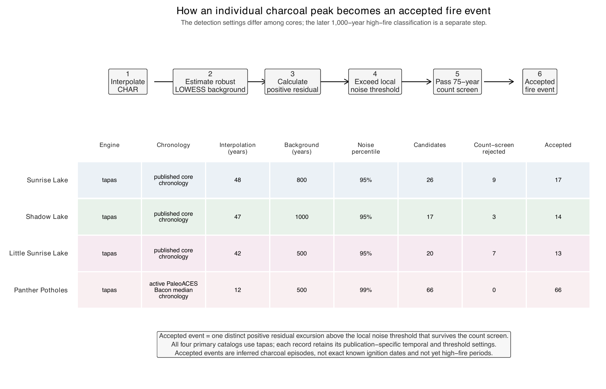
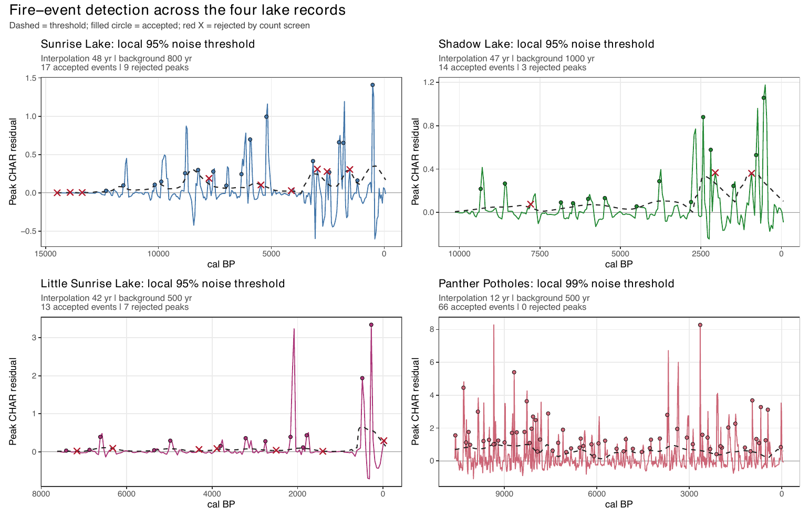
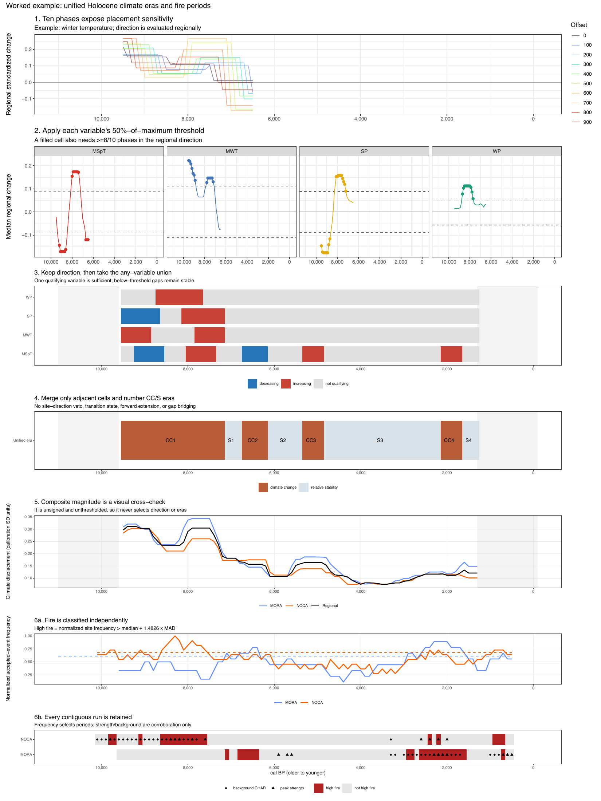
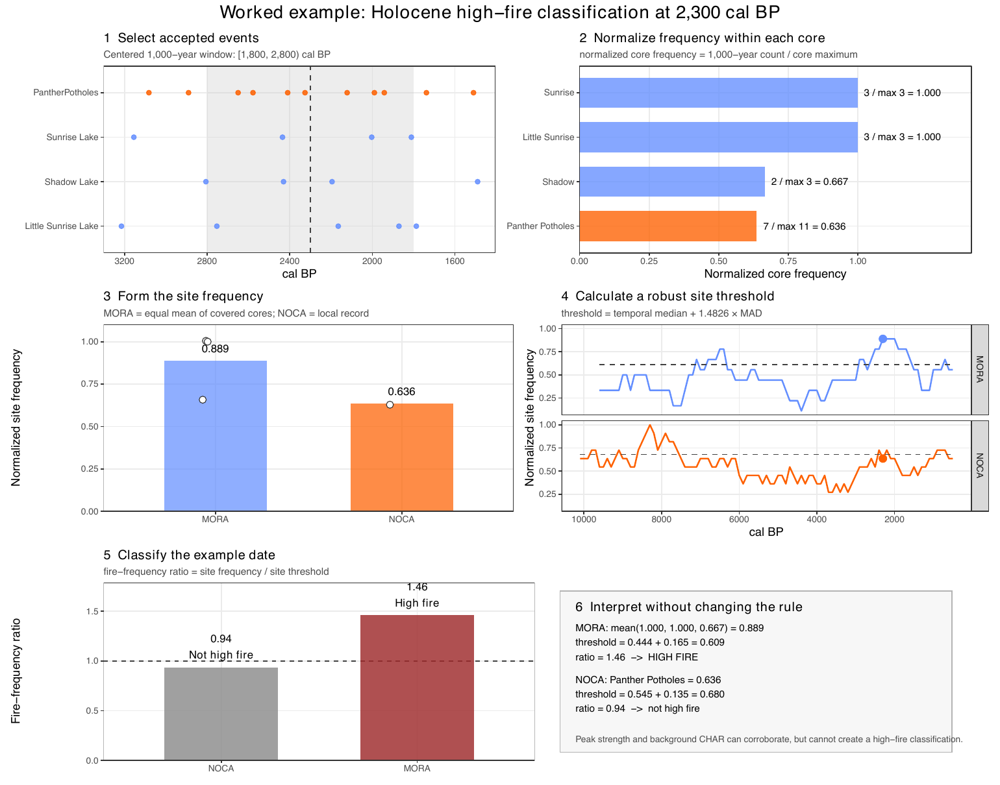
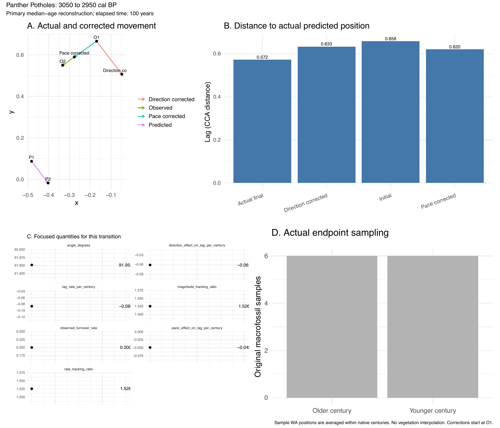

9. Worked examples
================

- [Accepted charcoal-event
  detection](#accepted-charcoal-event-detection)
- [Climate eras: from signed changes to numbered
  eras](#climate-eras-from-signed-changes-to-numbered-eras)
- [High-fire periods](#high-fire-periods)
- [Tracking geometry](#tracking-geometry)

<!-- Generated by R/build_report.R. -->

Step-by-step illustrations drawn from the finished pipeline outputs by
`R/worked_examples.R`. Nothing here feeds the analysis.

## Accepted charcoal-event detection

A charcoal record is interpolated, its background removed, peaks above
the local noise threshold become candidates, and candidates surviving
the 75-year count screen become accepted events (Appendix S2.2, Fig.
S7).

## Climate eras: from signed changes to numbered eras

Signed 1,000-year changes are computed in ten phase offsets, each
variable is thresholded at 50% of its maximum with at least eight of ten
phases agreeing in direction, qualifying cells of any variable are
joined, and adjacent cells are merged into numbered climate-change and
stability eras.

## High-fire periods

Centered 1,000-year event frequencies, normalized per record, averaged
per site and thresholded with Eq. 1 (Appendix S2.3).

## Tracking geometry

One Panther Potholes transition: observed and climate-predicted
movement, the lag before and after, the tracking ratio and the angle.
